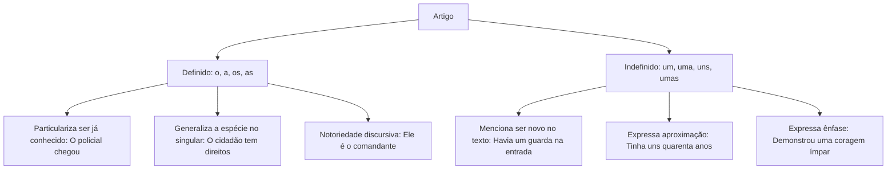
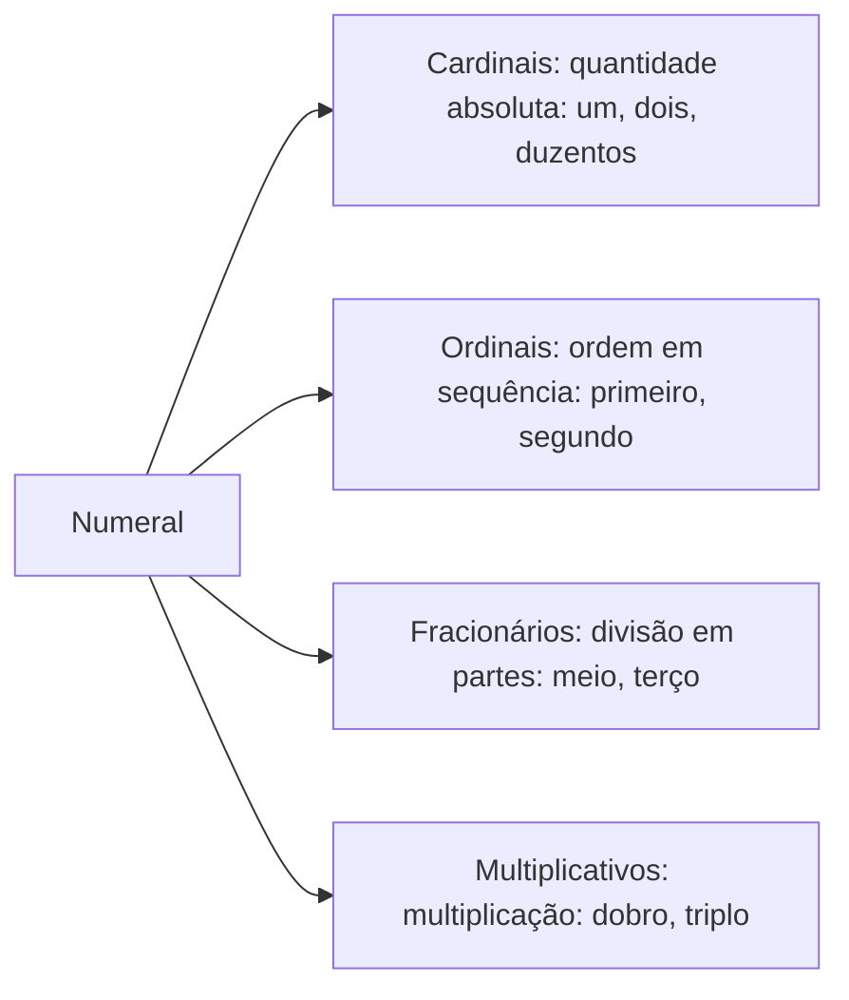
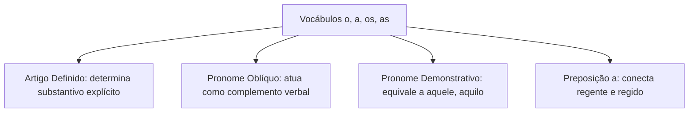
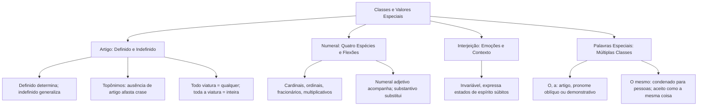

O estudo das classes de palavras nominais complementa-se com a análise do artigo, do numeral e da interjeição. O artigo determina ou indetermina o substantivo, exercendo função sintática de adjunto adnominal. O numeral quantifica ou ordena os seres no discurso, podendo atuar com valor adjetivo ou substantivo. A interjeição sintetiza emoções e apelos subjetivos em enunciados autônomos. Em concursos públicos, as bancas exploram a distinção funcional entre artigos e pronomes, a contagem de determinantes e as chamadas palavras especiais.

> [!objetivos]
> - Distinguir artigos definidos e indefinidos, identificando seus efeitos de generalização e determinação.
> - Compreender a aplicação de artigos diante de topônimos e nas estruturas com o pronome todo.
> - Classificar os numerais em cardinais, ordinais, fracionários e multiplicativos, diferenciando numeral de artigo.
> - Analisar o valor contextual das interjeições e classificar palavras especiais de múltipla função.

## O artigo: funções, valores semânticos e topônimos

O artigo é a classe gramatical variável que se antepõe ao substantivo para individualizá-lo ou generalizá-lo. Morfologicamente, varia em gênero e número (*o, a, os, as; um, uma, uns, umas*). Sintaticamente, desempenha sempre a função de **adjunto adnominal** do substantivo que acompanha.

### Artigo definido e artigo indefinido

- **Artigo definido** (*o, a, os, as*): introduz seres já identificados no universo textual ou familiares aos interlocutores (*A viatura retornou ao quartel*). Também pode generalizar uma espécie inteira quando usado no singular (*O policial deve manter a compostura* = todo policial).
- **Artigo indefinido** (*um, uma, uns, umas*): introduz seres novos, não especificados ou tomados de modo vago (*Um cidadão solicitou apoio da guarnição*). Além da indeterminação, pode denotar aproximação numérica (*O resgate durou umas três horas*) ou intensidade afetiva (*Ele teve uma calma admirável*).

### A presença do artigo e a determinação de topônimos

A presença ou ausência de artigo antes de nomes próprios de lugar (topônimos) reflete o uso consagrado da língua:

| Topônimo | Comportamento padrão | Com especificação ou modificador | Efeito na crase |
| --- | --- | --- | --- |
| Portugal | Não aceita artigo: *Viajou a Portugal.* | Exige artigo: *Viajou ao Portugal contemporâneo.* | Há crase apenas se houver especificação feminina |
| Roma | Não aceita artigo: *Chegou a Roma.* | Exige artigo: *Chegou à Roma antiga.* | Ocorre crase com a forma especificada |
| Paris | Não aceita artigo: *Iremos a Paris.* | Exige artigo: *Iremos à Paris das luzes.* | Ocorre crase diante do modificador restritivo |
| Bahia | Exige artigo: *Mora na Bahia.* | Mantém artigo: *Mora na bela Bahia.* | Ocorre crase normalmente: *Foi à Bahia.* |
| Recife | Não aceita artigo: *Voltou a Recife.* | Exige artigo: *Voltou ao Recife histórico.* | O artigo reaparece diante do adjetivo |

A ausência do artigo confere sentido geral ou indeterminado ao vocábulo. Por essa razão, dizer *Não confio em político* (sentido geral) difere de *Não confio no político* (indivíduo específico). Diante de substantivos que dispensam artigo, como *casa* (no sentido de lar próprio) e *terra* (em oposição a bordo), o artigo só aparece se houver termo determinante: *Cheguei a casa* (sem artigo) versus *Cheguei à casa de meus pais* (casa especificada). Em frases como *O biólogo pesquisou doenças tropicais*, a ausência do artigo generaliza o substantivo.

> [!exemplo] Contagem morfossintática e não fusão com o sujeito
> Em construções como *apesar de a gravidez exigir acompanhamento*, a preposição *de* não se funde com o artigo *a*, pois este encabeça o sujeito do verbo seguinte. O artigo conta como elemento autônomo. Do mesmo modo, em textos legais que tratam de assistência à gestante vítima de estupro ou hipóteses autorizadas de aborto terapêutico, o artigo especifica a situação jurídica examinada.

### O emprego do artigo com o pronome todo

A presença do artigo definido após o pronome indefinido *todo* altera expressivamente o sentido da oração:
- **Todo + substantivo sem artigo**: possui valor de *qualquer*, *cada* ou generalização distributiva (*Toda cidade possui suas leis* = qualquer cidade, todas as cidades).
- **Todo + o + substantivo com artigo**: expressa a ideia de totalidade, completude ou integridade (*Toda a cidade mobilizou os bombeiros* = a cidade inteira).

> [!pegadinha] Troca de sentido com o pronome todo
> Um item típico de prova: *"No segmento 'toda viatura foi inspecionada', a inserção do artigo 'a' após 'toda' manteria inalterado o sentido original do período."* A assertiva é falsa. A forma *toda viatura* refere-se a qualquer viatura da frota. A redação *toda a viatura* indica que a viatura foi inspecionada por completo, da lataria ao motor.

## O numeral: espécies, funções e distinções críticas

O numeral é a classe de palavras variável que indica quantidade numérica exata, posição em uma sequência, múltiplos ou frações de um todo.

### Classificação dos numerais

1. **Cardinais**: expressam quantidades absolutas (*um*, *dois*, *cinco*, *cem*, *duzentos*).
2. **Ordinais**: expressam ordem, sucessão ou posição em uma série (*primeiro*, *décimo*, *vigésimo*).
3. **Fracionários**: indicam frações ou divisões de uma quantidade (*meio*, *metade*, *terço*).
4. **Multiplicativos**: expressam o aumento proporcional de uma quantidade (*dobro*, *triplo*).

A flexão de gênero ocorre apenas nos cardinais *um/uma*, *dois/duas* e nas centenas a partir de *duzentos* (*duzentas*, *trezentas*, *quatrocentas*). Os demais cardinais são invariáveis em gênero (*três*, *quatro*, *dez*). Palavras como *ambos* e *ambas* possuem valor de numeral dual (= os dois, as duas).

Os numerais coletivos são substantivos que designam um conjunto com quantidade exata de seres: *dúzia* (doze), *dezena* (dez), *centena* (cem), *milhar* (mil), *década* (dez anos), *século* (cem anos) e *biênio* (dois anos).

### Numeral adjetivo versus numeral substantivo

O numeral pode atuar de duas formas distintas no período:
- **Numeral adjetivo**: acompanha o substantivo funcionando como adjunto adnominal (*Duas meninas foram socorridas pela equipe*).
- **Numeral substantivo**: substitui o substantivo, exercendo função sintática de núcleo nominal (*Havia dez candidatos; apenas **dois** foram aprovados*).

> [!bizu] Distinção entre numeral um e artigo indefinido um
> Para diferenciar na prova o numeral *um* do artigo indefinido *um*:
> - Se a palavra puder ser contrastada com outro valor numérico exato (*dois*, *três*) ou admitir a palavra *apenas/somente* antes, trata-se de **numeral cardinal**: *Comprei apenas um livro na feira*.
> - Se a palavra introduzir um ser vago, indeterminado ou qualquer, trata-se de **artigo indefinido**: *Ele encontrou um amigo no almoço*.

## A interjeição e seus valores contextuais

A interjeição é a classe morfológica invariável que traduz estados emocionais, reações psicológicas súbitas e apelos direcionados ao interlocutor. Ela equivale sintaticamente a uma oração exclamativa condensada.

As interjeições não exercem função sintática tradicional na estrutura da oração. Seu valor depende inteiramente da entonação da fala e do contexto expressivo do texto:

| Interjeição | Contexto comunicativo | Sentido expresso |
| --- | --- | --- |
| *Puxa!* | "Puxa, a equipe conseguiu derrotar o incêndio!" | Admiração, surpresa positiva |
| *Puxa!* | "Puxa, o suspeito fugiu pelo matagal!" | Decepção, contrariedade |
| *Psiu!* | "Psiu, guardem silêncio no alojamento!" | Apelo, ordem de silêncio |
| *Ufa!* | "Ufa, a gestante foi socorrida a tempo!" | Alívio após situação de risco |
| *Cuidado!* | "Cuidado com o vazamento de gás!" | Alerta, prevenção |
| *Tomara!* | "Tomara que o teste físico ocorra logo!" | Desejo, anseio positivo |

As **locuções interjetivas** são conjuntos de palavras que desempenham papel de interjeição: *Meu Deus!*, *Ora bolas!*, *Valha-me Deus!*, *Quem me dera!*.

> [!atencao] Análise semântica da interjeição em questões de concurso
> A banca avalia a adequação do sentido contextual atribuído à interjeição. Afirmar que *Puxa!* exprime dor física quando o texto retrata espanto torna a alternativa incorreta. Identifique a emoção predominante do enunciador.

## Palavras especiais e valores multifuncionais

Certos vocábulos da língua portuguesa transitam por diversas classes gramaticais a depender do contexto morfossintático. O domínio dessas palavras é decisivo em provas.

### As formas o, a, os, as

Esses monossílabos podem desempenhar quatro papéis gramaticais distintos:

1. **Artigo definido**: acompanha substantivo explícito como determinante (*O militar conduziu a ocorrência*).
2. **Pronome oblíquo átono**: substitui um nome funcionando como objeto verbal. Veja o exemplo clássico: *O peixinho o acompanhava a trote* (o primeiro termo *o* é artigo; o segundo *o* é pronome oblíquo que substitui o ser capturado).
3. **Pronome demonstrativo**: equivale a *aquele*, *aquela*, *aquilo* ou *isso*. Surge habitualmente antes do pronome relativo *que* ou da preposição *de* (*Comprei a viatura nova e **a** que estava em manutenção* = aquela que; *Uma era anterior à dos dinossauros* = anterior àquela época dos dinossauros).
4. **Preposição essencial** (restrito à forma *a*): liga termos regentes a termos regidos (*Dirigiu-se **a** pé até o quartel*; *Fez compras **a** prazo*).

### O comportamento dos vocábulos só, até e ainda

- **Só**:
  - Advérbio de modo/exclusão (ligado a verbo): *O soldado só treina pela manhã.*
  - Palavra denotativa de exclusão: *Só o tenente foi chamado à reunião.*
  - Adjetivo (equivale a *sozinho*, variável em número): *O sentinela ficou só no posto* / *Eles ficaram sós*.
- **Até**:
  - Preposição indicadora de limite: *A guarnição marchou até o rio.*
  - Palavra denotativa de inclusão: *A corporação carece de recursos até para o atendimento mais básico*, onde *mais* intensifica *básico*.
  - Advérbio de inclusão: *O suspeito até confessou a infração.*
- **Ainda**:
  - Circunstância de tempo (continuidade): *O policial ainda aguarda a viatura.*
  - Valor enfático ou de reforço: *Ele é ainda mais experiente que o colega.*
  - Ideia de adição: *Trabalha na escala e ainda estuda para o concurso.*
  - Oposição ou concessão: *Chegou atrasado e ainda reclamou da escala.*

### O emprego do termo o mesmo

O uso de *o mesmo* para substituir pessoas ou objetos já mencionados na oração é condenado pela norma culta e por manuais de redação oficial. Frases como *O perito chegou ao local; o mesmo iniciou a perícia* são consideradas inadequadas. Deve-se empregar o pronome pessoal reto (*ele*), o demonstrativo (*este*) ou a omissão por elipse.

O termo *o mesmo* é gramaticalmente legítimo apenas quando assume o valor de **a mesma coisa** ou **o mesmo fato**, retomando um processo anterior: *Várias pessoas foram assaltadas na via pública; o mesmo fato foi notificado à autoridade policial para os devidos esclarecimentos*.

## Aspectos de acentuação gráfica nos numerais e monossílabos

As regras de **acentuação gráfica** aplicam-se com frequência aos numerais e às formas gramaticais especiais estudadas neste capítulo.

1. **Monossílabos tônicos**: formas tônicas como *três*, *um* e *só* seguem as regras gerais de acentuação gráfica. A palavra *três* recebe acento circunflexo por ser monossílabo tônico terminado em *-es*. O vocábulo *só* é acentuado graficamente por terminar em *-o*.
2. **Cardinais e ordinais proparoxítonos**: numerais como *décimo*, *centésimo* e *milésimo* são proparoxítonos. Pela regra de acentuação gráfica, todos os vocábulos proparoxítonos recebem acento gráfico obrigatório.
3. **Formas oxítonas terminadas em ditongos e nasais**: numerais como *dezesseis* e *vinte e três* obedecem à regra de acentuação gráfica das palavras oxítonas terminadas em ditongo aberto ou *-es*.

O conhecimento rigoroso da acentuação gráfica assegura a correção ortográfica na produção textual e na resolução de itens do edital.

## Mapa do capítulo

| Classe ou vocábulo | Função gramatical típica | Exemplo de prova |
| --- | --- | --- |
| Artigo definido | Particulariza ou notabiliza o substantivo | *O comandante ordenou a marcha.* |
| Artigo indefinido | Generaliza, aproxima ou intensifica o nome | *Faltam umas duas semanas para o teste.* |
| Numeral cardinal | Expressa quantidade matemática exata | *Três bombeiros entraram no prédio.* |
| Numeral ordinal | Indica posição e ordem sucessiva | *Ele obteve a primeira colocação.* |
| Interjeição | Expressa emoção dependente da entonação | *Ufa! O resgate foi concluído.* |
| Pronome demonstrativo o, a | Equivale a aquele, aquela, aquilo | *Comprou a que estava mais barata.* |
| Palavra o mesmo | Válido apenas no sentido de a mesma coisa | *Todos comemoraram; o mesmo fez a equipe.* |

### Para fixar
- O artigo é classe variável que se liga ao substantivo exercendo a função de adjunto adnominal.
- O artigo definido particulariza o ser ou generaliza a espécie no singular; o indefinido introduz seres novos ou expressa aproximação numérica.
- Topônimos sem artigo passam a exigi-lo quando acompanhados de adjetivo ou delimitador (*a Roma antiga*).
- A expressão *toda viatura* significa qualquer viatura; *toda a viatura* indica a viatura inteira.
- Os numerais dividem-se em cardinais, ordinais, fracionários e multiplicativos.
- Apenas os cardinais *um/uma*, *dois/duas* e as centenas a partir de *duzentos* sofrem flexão de gênero.
- A palavra *um* é numeral cardinal se indicar quantificação exata contrastiva; é artigo indefinido se denotar ser genérico.
- As interjeições são invariáveis e expressam estados emocionais que dependem do contexto para sua correta classificação.
- As formas *o, a, os, as* atuam como artigos definidos, pronomes oblíquos átonos ou pronomes demonstrativos (equivalentes a *aquele*).
- A expressão *o mesmo* não deve substituir pronomes pessoais para retomar pessoas; seu uso culto restringe-se ao sentido de "a mesma coisa".
