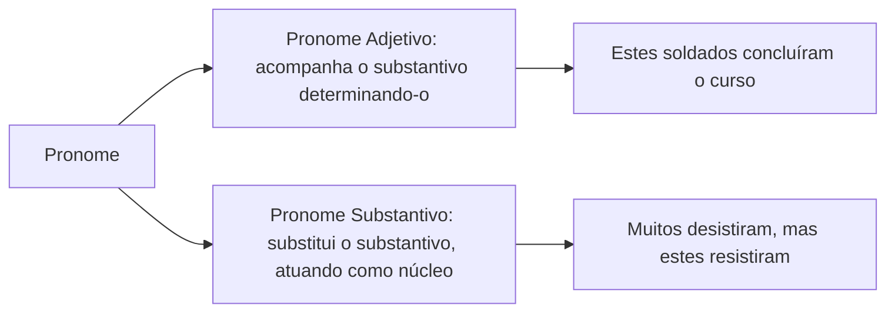
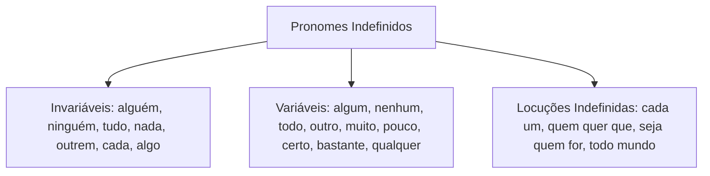
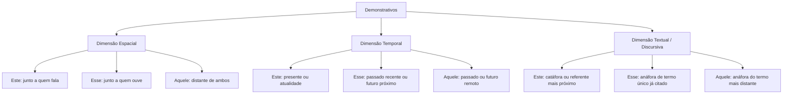
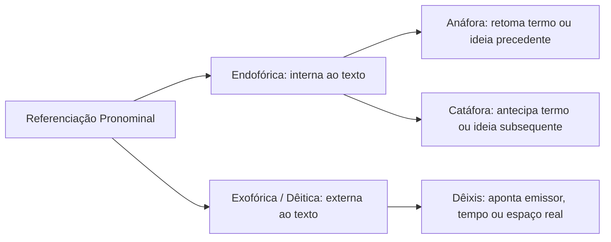
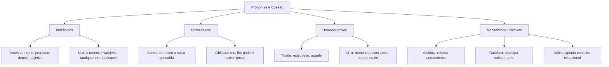

Os pronomes representam uma das classes mais versáteis e cobradas nas provas de concursos públicos. Eles possuem natureza relacional, substituindo ou determinando substantivos e situando elementos no tempo, no espaço e no texto. Neste capítulo, estudaremos as noções iniciais dos pronomes, os pronomes indefinidos, possessivos e demonstrativos, além de seus papéis cruciais nos mecanismos de coesão textual como anáfora, catáfora e dêixis.

> [!objetivos]
> - Diferenciar pronomes adjetivos de pronomes substantivos na estrutura sintática da oração.
> - Classificar os pronomes indefinidos, identificando as alterações de sentido e classe provocadas pela posição do vocábulo.
> - Empregar adequadamente os pronomes possessivos e reconhecer os pronomes oblíquos átonos com valor de posse.
> - Dominar a tríade dos pronomes demonstrativos nas esferas espacial, temporal e textual.
> - Aplicar os mecanismos de coesão textual de referenciação endofórica (anáfora e catáfora) e dêitica (exofórica).

## Noções fundamentais de pronomes e classificação funcional

O pronome é a palavra que se relaciona diretamente com o substantivo. Ele pode acompanhar o nome para delimitá-lo ou substituí-lo para evitar repetições no texto.

De acordo com o papel desempenhado no sintagma, os pronomes dividem-se em duas grandes categorias funcionais:

- **Pronome adjetivo**: acompanha o substantivo na condição de adjunto adnominal (*Aquela viatura foi vistoriada ontem*).
- **Pronome substantivo**: ocupa o lugar do substantivo, atuando como núcleo de função sintática nominal (*Poucos compareceram ao treinamento; **todos** sabiam do horário*).

### Pronomes interrogativos

Os pronomes interrogativos servem para formular indagações diretas ou indiretas sobre a identidade ou quantidade dos seres. As formas fundamentais são *que*, *quem*, *qual* (e o plural *quais*) e *quanto* (com as flexões *quanta*, *quantos*, *quantas*):
- Em interrogativa direta: *Quem assinou a portaria?* / *Quantas viaturas foram mobilizadas?*
- Em interrogativa indireta: *O comandante indagou quem redigiu o relatório.*

Na expressão coloquial *O que é que aconteceu?*, apenas o primeiro vocábulo *que* é pronome interrogativo substantivo. As formas intermediárias *o* e *é que* funcionam como partículas expletivas de realce.

## Pronomes indefinidos e variações contextuais

Os pronomes indefinidos referem-se à 3ª pessoa do discurso, conferindo ao substantivo uma ideia vaga, imprecisa ou uma quantificação indeterminada.

As formas *mais* e *menos* funcionam como pronomes indefinidos invariáveis quando acompanham substantivos (*Havia mais candidatos e menos vagas no certame*). O plural de *qualquer* é formado internamente por flexão do primeiro elemento: **quaisquer**.

### A posição do pronome e a alteração de classe gramatical

Determinados vocábulos mudam de classe gramatical e de significado conforme surjam antes ou depois do substantivo:

| Vocábulo | Antes do substantivo | Depois do substantivo | Diferença de sentido |
| --- | --- | --- | --- |
| *certo* | Pronome indefinido: *certo candidato* | Adjetivo: *o candidato certo* | Passa de indeterminado (um qualquer) para adequado ou correto |
| *bastante* | Pronome indefinido: *bastantes aliados* | Adjetivo: *aliados bastantes* | Passa de quantidade elevada (muitos) para suficientes |
| *algum* | Pronome indefinido afirmativo: *algum socorro* | Pronome com sentido negativo: *socorro algum* | Passa de sentido afirmativo (existente) para negativo (nenhum) |
| *vários* | Pronome indefinido: *vários policiais* | Adjetivo: *relatórios vários* | Passa de quantificador indeterminado para diversos ou variados |

> [!pegadinha] A palavra bastante: pronome, adjetivo ou advérbio
> Preste atenção máxima à palavra *bastante*, armadilha recorrente em concursos:
> 1. Antes do substantivo com sentido de *muitos*: é **pronome indefinido** e varia em número (*Temos bastantes viaturas no pátio*).
> 2. Depois do substantivo com sentido de *suficientes*: é **adjetivo** e varia em número (*Havia provas bastantes para o indiciamento*).
> 3. Modificando verbo ou adjetivo com sentido de *muito*: é **advérbio** e permanece estritamente invariável (*Os soldados treinaram bastante*; *A tropa estava bastante confiante*).

### Muito diante de substantivo

Outro erro frequente consiste em classificar *muito* como advérbio diante de nomes abstratos. Na oração *O delegado agiu com muito cuidado diante da calamidade*, a palavra *muito* determina o substantivo *cuidado*. Logo, trata-se de pronome indefinido adjetivo, e não de advérbio. O advérbio jamais se subordina a substantivos.

## Pronomes possessivos e valores expressivos

Os pronomes possessivos indicam relação de posse ou pertinência em referência às três pessoas gramaticais:

| Pessoa do discurso | Pronomes possessivos no padrão culto |
| --- | --- |
| 1ª pessoa (quem fala) | meu, minha, meus, minhas, nosso, nossa, nossos, nossas |
| 2ª pessoa (com quem se fala) | teu, tua, teus, tuas, vosso, vossa, vossos, vossas |
| 3ª pessoa (de quem se fala) | seu, sua, seus, suas |

O pronome possessivo concorda sempre em gênero e número com a **coisa possuída**, e não com o possuidor (*O oficial respeita a corporação por sua disciplina* → *sua* concorda com *disciplina*). No sintagma nominal, exerce habitualmente a função sintática de adjunto adnominal.

### Pronomes oblíquos átonos com valor possessivo

Em textos clássicos e provas formais, os pronomes pessoais oblíquos átonos (*me*, *te*, *se*, *lhe*, *nos*, *vos*) podem assumir valor de pronome possessivo. Isso ocorre quando estão associados a substantivos que indicam partes do corpo, vestimentas ou pertences íntimos:

- *O médico examinou-lhe a testa ferida.* (= examinou a sua testa).
- *O barbeiro cortou-me os cabelos.* (= cortou os meus cabelos).
- *A notícia incendiou-lhe a fantasia de glória.* (= incendiou a sua fantasia).
- *O cão mordeu-lhe a perna.* (= mordeu a perna dele).

Sintaticamente, o pronome oblíquo com valor possessivo desempenha a função de **adjunto adnominal** da palavra determinada, e não de objeto indireto.

> [!atencao] Ambiguidade no emprego do pronome de 3ª pessoa
> O emprego de *seu* e *sua* pode gerar duplicidade de sentido no período: *O capitão disse ao tenente que utilizaria seu veículo*. O veículo pertence ao capitão ou ao tenente? Para afastar a ambiguidade na redação oficial, substitui-se o possessivo por expressões preposicionadas precisas: *o veículo dele* ou *o veículo deste*.

## Pronomes demonstrativos: espaço, tempo e discurso

Os pronomes demonstrativos situam seres e enunciados em três dimensões referenciais: no espaço físico, no tempo cronológico e no interior do próprio texto.

### Quadro comparativo da tríade demonstrativa

| Posição / Dimensão | este, esta, isto | esse, essa, isso | aquele, aquela, aquilo |
| --- | --- | --- | --- |
| Espaço | Próximo do emissor: *este relatório em minhas mãos* | Próximo do receptor: *essa farda que você veste* | Distante de ambos: *aquele prédio no horizonte* |
| Tempo | Presente ou período em curso: *este ano de 2026* | Passado recente ou futuro próximo: *esse domingo que passou* | Passado remoto ou distante: *naquela época colonial* |
| Discurso (catáfora) | Antecipa o que vai ser dito: *Meu lema é este: servir.* | Não se usa para anunciar ideias futuras | Não se usa para catáfora comum |
| Discurso (anáfora) | Retoma o termo citado por último (mais próximo) | Retoma um único elemento ou ideia já dita: *Disso não abro mão.* | Retoma o primeiro termo citado (mais distante) |

Quando dois elementos antecedentes precisam ser resgatados sem ambiguidade, a gramática normativa prescreve:
- **Este / esta**: retoma o elemento mencionado por último (o mais próximo no texto).
- **Aquele / aquela**: retoma o elemento mencionado em primeiro lugar (o mais distante no texto).

> [!bizu] Memorização da tríade demonstrativa
> Guarde a regra prática: **Este** aponta para o presente (o ano corrente), para quem fala ou anuncia o termo futuro (catáfora). **Esse** aponta para o passado recente ou retoma termo já citado (anáfora). **Aquele** viaja para longe no tempo e no espaço, como em *naquele voo para Barcelona*.

> [!exemplo] Aplicação de este e aquele na distinção de termos
> Analise o período:
> *O Corpo de Bombeiros e a Polícia Judiciária desempenham papéis vitais; esta investiga as infrações penais com atenção seletiva, aquele combate sinistros em situações de calamidade.*
> O pronome *esta* retoma o referente mais próximo (*a Polícia Judiciária*), enquanto o pronome *aquele* resgata o referente citado em primeiro lugar (*o Corpo de Bombeiros*). Traremos adiante a definição exata de cada mecanismo de referenciação.

### Outros pronomes demonstrativos

Além das formas tradicionais, outros vocábulos desempenham papel demonstrativo:
1. **O, a, os, as**: atuam como demonstrativos quando equivalem a *aquele*, *aquela* ou *aquilo*. Surgem frequentemente antes da preposição *de* ou do pronome relativo *que*:
   - *Comprei as fardas novas e **as** de algodão.* (= aquelas de algodão; também em *camisas de algodão e as de linho*).
   - *Sei **o** que você planejou para a operação.* (= aquilo que).
   - *Era preciso agir na crise, e a corporação decidiu fazê-**lo**.* (o pronome *lo* atua como demonstrativo neutro, equivalendo a *fazer isso*).
2. **Mesmo e próprio**: expressam reforço de identidade pessoal quando pospostos a substantivos ou pronomes (*O comandante mesmo assinou a ordem*; *Eu mesma cozinho minha refeição*; *Os soldados próprios organizaram o alojamento*).
3. **Tal e semelhante**: funcionam como demonstrativos quando equivalem a *esse*, *essa* ou *isso* (*Não diga tais besteiras*; *Não cometa semelhantes equívocos*; *Tal decisão causou estranheza*).

## Mecanismos de coesão textual: anáfora, catáfora e dêixis

A coesão textual garante a articulação harmoniosa entre as partes de um texto. Os pronomes constituem os instrumentos de referenciação e sequenciação mais produtivos da língua.

As relações de referência pronominal subdividem-se em duas naturezas:
- **Referência endofórica**: o elemento de referência situa-se dentro da própria superfície textual. Subdivide-se em anáfora e catáfora.
- **Referência exofórica (ou dêitica)**: o referente encontra-se fora do texto, na situação concreta de enunciação (contexto comunicativo imediato).

### Anáfora versus catáfora

1. **Anáfora**: mecanismo coesivo em que o pronome resgata e sintetiza um termo, oração ou fato mencionado previamente na tessitura discursiva. Garante a continuidade temática sem repetição vocabular desnecessária (*A equipe concluiu o resgate complexo. **Essa** missão exigiu perícia extrema*).
2. **Catáfora**: processo em que o pronome antecipa um conceito, lista ou declaração que será exposta adiante no período (*Só desejo **isto**: a aprovação de todos na escala*).

### Dêixis textual e enunciação

A **dêixis** ocorre quando o sentido do pronome demonstrativo depende das coordenadas reais da comunicação: quem fala, onde fala e quando fala. Expressões como *neste escritório*, *neste país* e *nesta data* exigem pronomes de 1ª pessoa (*este, esta*) porque localizam o objeto no espaço ou no tempo compartilhado pelo emissor no ato de enunciação.

## Aspectos de acentuação gráfica nos pronomes

As regras de **acentuação gráfica** da língua portuguesa incidem sobre diversas formas pronominais:

- **Monossílabos tônicos**: pronomes como *nós*, *vós* e *só* recebem acento gráfico por terminarem em *-os* e *-es*. Formas átonas como *me*, *te*, *se*, *nos* e *vos* não levam acento gráfico.
- **Oxítonos terminados em -em e -ens**: pronomes indefinidos como *alguém* e *ninguém* recebem acento gráfico agudo na última sílaba, obedecendo à regra das palavras oxítonas.
- **Paroxítonas terminadas em -er**: o pronome *quaisquer* não leva acento gráfico na forma plural, seguindo as diretrizes ortográficas vigentes.
- **Pronomes demonstrativos**: vocábulos como *este*, *esta*, *esse* e *essa* são paroxítonos terminados em *-e* e *-a*, não devendo receber acento gráfico.

O domínio dessas diretrizes consolida a precisão necessária para pontuar alto em questões de acentuação gráfica e morfossintaxe.

## Mapa do capítulo

| Tipo de pronome | Comportamento essencial | Aplicação prática em prova |
| --- | --- | --- |
| Pronome adjetivo | Acompanha e determina o substantivo | *Estas diretrizes foram aprovadas.* |
| Pronome substantivo | Ocupa a posição de núcleo nominal | *Muitos faltaram; poucos chegaram.* |
| Pronome indefinido | Expressa quantificação vaga ou imprecisa | *Certas regras exigem atenção.* |
| Pronome possessivo | Concorda com a coisa possuída | *O tribunal julgou sua causa.* |
| Pronome demonstrativo | Situa no espaço, no tempo e no texto | *Esta missão foi a mais arriscada.* |
| Mecanismo anafórico | Resgata termo anterior no texto | *A prova foi adiada; isso gerou debates.* |
| Mecanismo catafórico | Antecipa conteúdo novo no período | *Grave bem isto: a pontualidade é tudo.* |

### Para fixar
- O pronome adjetivo acompanha o substantivo determinando-o; o pronome substantivo substitui o nome na oração.
- Pronomes indefinidos indicam quantidade indeterminada; formas como *alguém*, *ninguém*, *tudo* e *nada* são invariáveis.
- A posição do termo altera sua classe: *bastantes aliados* é pronome indefinido; *aliados bastantes* é adjetivo.
- Diante de substantivos, a palavra *muito* classifica-se como pronome indefinido adjetivo, e nunca como advérbio.
- Os pronomes possessivos concordam com o gênero e o número da coisa possuída, e não do possuidor.
- Pronomes oblíquos átonos (*me*, *lhe*, *nos*) exercem papel possessivo ao indicarem partes do corpo ou vestimentas.
- O demonstrativo *este* indica o tempo presente, o espaço de quem fala e antecipa termos na catáfora.
- O demonstrativo *esse* resgata termos passados na anáfora textual e situa o referente junto ao ouvinte.
- Em períodos com dois antecedentes, *este* retoma o termo mais próximo e *aquele* resgata o mais distante.
- Os vocábulos *o, a, os, as* funcionam como demonstrativos quando equivalem a *aquele* antes de *que* ou *de*.
