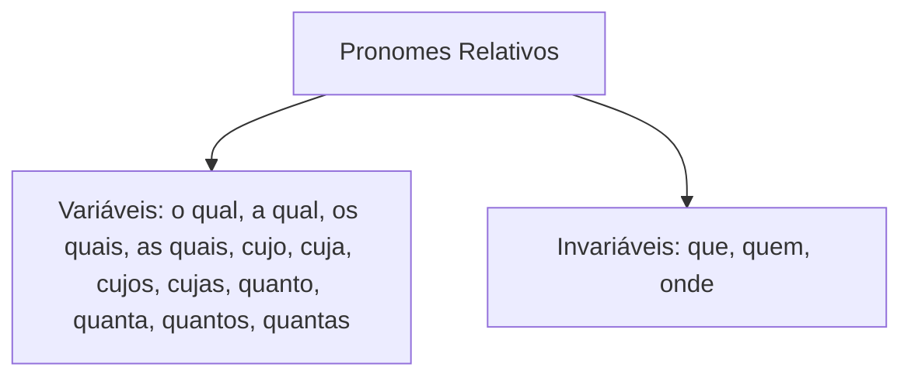
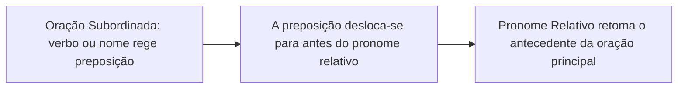
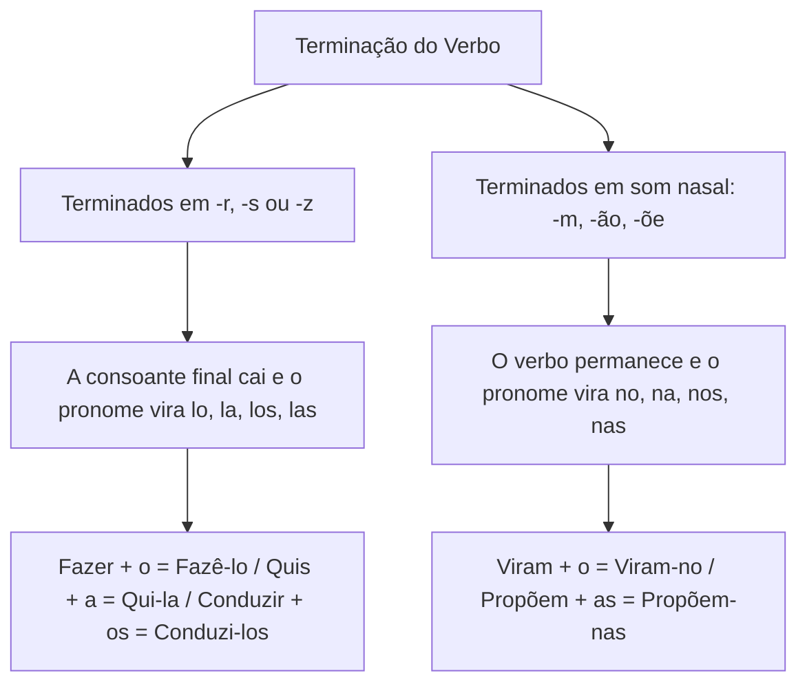
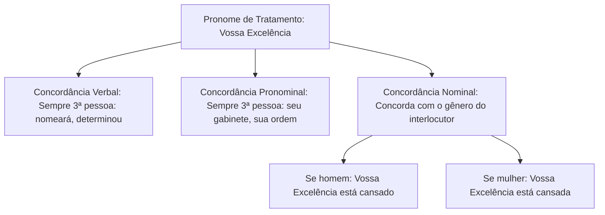

Os pronomes relativos, pessoais e de tratamento constituem a base da arquitetura sintática do período composto e da redação formal. Os relativos desempenham duplo papel: resgatam um antecedente e conectam orações subordinadas adjetivas. Os pronomes pessoais organizam as pessoas do discurso e preenchem as funções de sujeito e complemento verbal. Os pronomes de tratamento seguem diretrizes de formalidade e concordância regidas pelo Manual de Redação da Presidência da República. Nas provas, a cobrança exige o domínio da regência com relativos, a flexão dos pronomes enclíticos e a sintaxe dos oblíquos átonos.

> [!objetivos]
> - Identificar os pronomes relativos variáveis e invariáveis, aplicando corretamente a regência preposicionada exigida pela oração adjetiva.
> - Empregar os relativos cujo, onde, quem e o qual de acordo com as prescrições normativas e sem incorreções de crase ou artigo.
> - Diferenciar pronomes pessoais retos de oblíquos átonos e tônicos, dominando a distribuição das funções de objeto direto e indireto.
> - Aplicar as regras de fusão e alteração fonética dos pronomes oblíquos unidos ao verbo por hífen.
> - Reconhecer as fórmulas e regras de concordância verbal, nominal e pronominal dos pronomes de tratamento.

## Pronomes relativos: conceito, regência e emprego

O pronome relativo é a palavra que substitui um substantivo antecedente e, ao mesmo tempo, introduz uma oração subordinada adjetiva. Ao desempenhar essa função anafórica, ele impede repetições vocabulares desnecessárias e assegura a coesão textual.

Observe a articulação de dois períodos em um só:
- *O oficial coordenou a operação.* + *A operação resgatou as vítimas.*
- *O oficial coordenou a operação **que** resgatou as vítimas.*

O pronome *que* retoma o antecedente *a operação* e exerce a função de sujeito do verbo *resgatou*.



### Quadro sinótico dos pronomes relativos

| Pronome relativo | Natureza morfológica | Antecedente e particularidades de uso |
| --- | --- | --- |
| **que** | Invariável | Refere-se a pessoas ou coisas; admite apenas preposições monossilábicas (*de que*, *em que*, *a que*) |
| **quem** | Invariável | Refere-se exclusivamente a pessoas ou entes personificados; exige preposição (*a pessoa de quem falei*) |
| **o qual, a qual (e plurais)** | Variável | Substitui *que* para desfazer ambiguidade ou acompanhar preposições polissilábicas e locuções (*sobre o qual*) |
| **cujo, cuja, cujos, cujas** | Variável | Expressa posse entre dois substantivos; concorda com o consequente; proíbe artigo subsequente |
| **onde** | Invariável | Refere-se estritamente a lugar físico; equivale a *em que* ou *no qual* (*o quartel onde trabalho*) |
| **aonde** | Invariável | Usado com verbos que exigem a preposição *a*, indicando movimento para algum lugar (*a cidade aonde iremos*) |
| **donde** | Invariável | Equivale a *de onde*, indicando procedência ou origem (*o posto donde partiu o socorro*) |
| **como** | Invariável | Refere-se a antecedentes que expressam modo, jeito ou maneira (*o modo como agiram*) |
| **quando** | Invariável | Refere-se a antecedentes que indicam tempo cronológico (*o dia quando ocorreu o sinistro*) |
| **quanto, quanta (e plurais)** | Variável | Empregado após os pronomes indefinidos *tudo*, *tanto*, *todo* (*Fez tudo quanto podia*) |

### Regência preposicionada diante do pronome relativo

A presença da preposição antes do pronome relativo não é opcional. Ela é imposta pela regência do verbo ou do nome presente na oração subordinada adjetiva:



Analise os exemplos:
- *O documento **a que** me referi foi arquivado.* (Quem se refere, refere-se **a** algo → preposição *a* obrigatória).
- *A ocorrência **de que** participamos foi complexa.* (Quem participa, participa **de** algo → preposição *de*).
- *O prédio **em que** estávamos sofreu abalo.* (Quem está, está **em** algum lugar → preposição *em*).
- *A autoridade **por quem** intercedi agradeceu o apoio.* (Quem intercede, intercede **por** alguém).

> [!pegadinha] Supressão indevida da preposição antes de que e cujo
> Nas provas, é comum a omissão da preposição regencial: *"O regulamento que precisamos foi atualizado."* Essa frase é errônea na norma culta, pois o verbo *precisar* exige a preposição *de*. A forma correta é: *O regulamento **de que** precisamos foi atualizado*. Do mesmo modo, com o relativo *cujo*: *O autor **de cujos** textos gosto* (e não *cujos textos gosto*).

> [!exemplo] Desfazendo ambiguidades com o qual e flexões
> O pronome relativo *que* é universal, mas pode gerar duplo sentido quando houver dois antecedentes possíveis. Veja a frase: *A representante da loja de enfeites caríssimos, a qual foi muito elogiada pela diretoria, apresentou os relatórios*. O emprego de *a qual* esclarece que a elogiada foi a representante, e não a loja. Do mesmo modo, em *O primo do aluno que roubava livros foi advertido*, o pronome *que* deixa dúvida sobre quem praticou o ato; o uso de *o qual* soluciona a ambiguidade.

### O emprego do relativo cujo

O pronome relativo *cujo* possui regras estritas que geram alto índice de erros em concursos públicos:

1. Deve estar posicionado **obrigatoriamente entre dois substantivos**: o primeiro é o possuidor e o segundo é a coisa possuída (*o oficial cujo relatório foi elogiado* → o relatório do oficial).
2. **Concorda em gênero e número com o substantivo consequente** (a coisa possuída), e não com o antecedente (*o oficial cujas ações foram elogiadas*).
3. **Proíbe taxativamente o emprego de artigo** antes ou depois de sua estrutura. Construções como *cujo o*, *cuja a*, *cujos os* ou *cujas as* configuram erro grave.
4. Admite preposição anteposta se o termo posterior exigir regência preposicionada (*O comandante a cujas ordens obedecemos*).
5. Não pode ser substituído diretamente por *que*, *o qual* ou *onde* sem alteração profunda da estrutura sintática. Não se aceita *cuja metade* isolado no texto sem estabelecer vínculo direto entre possuidor e possuído.

Na literatura clássica de Machado de Assis, em *Quincas Borba*, um médico supôs achar um grãozinho de sandice nas ideias do filósofo amigo de Rubião. Ao unir os termos, dizemos: *o filósofo a cujas pernas a doença impunha limites*. O relativo *cujo* vincula os dois substantivos sem qualquer artigo intermediário. Da mesma forma, não se aceita a expressão *cuja metade* isolada no texto após um desastre, devendo-se redigir *a metade das quais*.

> [!bizu] O teste dos três passos para validar o pronome cujo
> 1. O pronome está entre dois substantivos?
> 2. O termo consequente pode ser respondido por "de quem?" (*o relatório do oficial*)?
> 3. Não há artigo logo após o pronome (*cujo*, e jamais *cujo o*)?
> Se a resposta for sim para os três itens, o emprego de *cujo* está plenamente correto.

### O pronome onde e suas variantes

O relativo *onde* indica exclusivamente **lugar físico, espacial ou delimitado geograficamente** (*o hospital onde a vítima foi atendida*; *a academia militar onde treinamos*). Não se admite *onde* para retomar noções temporais, conceituais ou psicológicas:
- *Na época onde o coronel comandava...* (Incorreto; use *na época em que* ou *na qual*).
- *Uma situação onde todos discordam...* (Incorreto; use *uma situação em que*).

Diferencie com precisão:
- **Onde**: indica permanência ou estado em um lugar (*O quartel onde estou sediado*).
- **Aonde**: fusão da preposição *a* com o advérbio/relativo *onde*, empregada com verbos de movimento transitivos indiretos (*A cidade aonde nos dirigimos*).
- **Donde**: contração de *de + onde*, indicando ponto de partida ou procedência (*O local donde partiu a guarnição*).

## Pronomes pessoais: retos, oblíquos e funções sintáticas

Os pronomes pessoais dividem-se em retos, oblíquos átonos e oblíquos tônicos, refletindo a hierarquia sintática e fonética da língua:

| Pessoa gramatical | Pronome reto | Oblíquo átono | Oblíquo tônico |
| --- | --- | --- | --- |
| 1ª singular | eu | me | mim, comigo |
| 2ª singular | tu | te | ti, contigo |
| 3ª singular | ele, ela | se, o, a, lhe | si, consigo, ele, ela |
| 1ª plural | nós | nos | nós, conosco |
| 2ª plural | vós | vos | vós, convosco |
| 3ª plural | eles, elas | se, os, as, lhes | si, consigo, eles, elas |

### Funções sintáticas: retos versus oblíquos

1. **Pronomes retos**: desempenham tipicamente a função de **sujeito** da oração (*Ele redigiu a portaria*; *Nós patrulhamos a avenida*).
2. **Pronomes oblíquos átonos**: exercem a função de **complemento verbal**. A distribuição dos pronomes de 3ª pessoa segue uma regra inflexível:
   - **o, a, os, as**: desempenham unicamente a função de **objeto direto** (verbos transitivos diretos, sem preposição): *O comandante convocou o cabo e **o** instruiu*; *Avistamos a viatura e **a** seguimos*.
   - **lhe, lhes**: desempenham unicamente a função de **objeto indireto** (verbos transitivos indiretos que regem a preposição *a*): *Entreguei-**lhe** os relatórios* (= entreguei a ele); *Obedecemos-**lhe** prontamente* (= a ele).
   - **me, te, se, nos, vos**: podem atuar como objeto direto ou indireto, dependendo da transitividade do verbo (*Você me chamou* → objeto direto; *Você me agradou* = agradou a mim, objeto indireto).

O pronome oblíquo *lhe* também pode assumir valor possessivo junto ao substantivo: *O tempo vai roubando-lhe a energia e a força de ferro*, em que *lhe* equivale a *sua energia*, atuando como adjunto adnominal. Da mesma forma, em *Informei-o de que a academia onde realizamos o treino possui solidez*, o pronome *o* funciona como objeto direto.

> [!atencao] Pronome reto como complemento verbal
> A gramática normativa condena o emprego de pronomes retos na posição de objeto direto (*Vi ele no quartel*; *Chame nós para o serviço*). O padrão culto exige: *Vi-o no quartel*; *Chame-nos para o serviço*. O uso do pronome reto como objeto só é tolerado doutrinariamente quando vier acompanhado de palavras limitadoras ou numerais: *Encontrei todos eles*; *Convocamos eles dois*.

### Regras especiais de pronomes tônicos e preposições

- **Entre mim e ti**: com preposições puras indicando reciprocidade ou relação, usam-se obrigatoriamente pronomes oblíquos tônicos (*Não há divergências entre mim e ti*; *Entre mim e ele reina a harmonia*). Dizer *entre eu e você* é incorreto na norma culta.
- **Para mim versus para eu**:
  - Usa-se **para mim** quando o pronome não pratica ação verbal, atuando como complemento (*Entregue o relatório para mim*).
  - Usa-se **para eu** quando o pronome é o sujeito de um verbo no infinitivo (*Trouxe o relatório para **eu** assinar*; *Falta uma hora para **eu** assumir o posto*).
- **Preposições acidentais**: diante de preposições acidentais como *conforme*, *segundo*, *consoante*, *exceto*, *salvo*, *fora* e *menos*, emprega-se o pronome reto: *Todos saíram do alojamento, exceto eu*; *Ninguém discordou, salvo ele*.
- **O uso de com nós e com vós**: quando os pronomes *nós* e *vós* vierem seguidos de determinantes como *outros*, *mesmos*, *próprios* ou numerais, a aglutinação *conosco/convosco* é desfeita: *O tenente falou com nós mesmos*; *A ordem foi dada a com nós dois*.

## Formas dos pronomes oblíquos unidos ao verbo

Quando os pronomes oblíquos átonos *o, a, os, as* são ligados ao verbo por ênclise ou mesóclise, sofrem alterações morfológicas decorrentes da terminação verbal:



### Regras de assimilação consonantal e nasal

1. **Terminações em -r, -s ou -z**: a consoante final é eliminada, e o pronome assume as formas **lo, la, los, las**:
   - *fazer + o* → *fazê-lo*
   - *pôr + o* → *pô-lo*
   - *conduzir + a* → *conduzi-la*
   - *quis + a* → *qui-la*
   - *fiz + o* → *fi-lo*
   - *parabenizamos + os* → *parabenizamo-los* (o *-s* da desinência verbal de 1ª pessoa do plural é suprimido).
2. **Terminações em ditongo ou som nasal (-m, -ão, -õe)**: o verbo mantém sua integridade gráfica, e o pronome assume as formas **no, na, nos, nas**:
   - *viram + o* → *viram-no*
   - *chamam + a* → *chamam-na*
   - *propõem + os* → *propõem-nos*
   - *dão + as* → *dão-nas*
3. **Primeira pessoa do plural com o pronome reflexivo nos**: o verbo perde a consoante *-s* final antes do pronome:
   - *alistamos + nos* → *alistamo-nos*
   - *dedicamos + nos* → *dedicamo-nos*
   - *retiramos + nos* → *retiramo-nos*

### Combinações de pronomes oblíquos (formas combinadas)

Na tradição gramatical e em textos formais, os pronomes oblíquos átonos podem se contrair quando ocorre o encontro de um objeto direto (*o, a, os, as*) com um objeto indireto (*me, te, lhe, nos, vos, lhes*):

| Combinação | Formas resultantes | Exemplo clássico de aplicação |
| --- | --- | --- |
| me + o / a | mo, ma, mos, mas | *Ele deu a medalha a mim.* → *Ele deu-ma.* |
| te + o / a | to, ta, tos, tas | *Eu confiei a missão a ti.* → *Eu confiei-ta.* |
| lhe + o / a | lho, lha, lhos, lhas | *O oficial entregou a escala a ela.* → *O oficial entregou-lha.* |
| nos + o / a | no-lo, no-la, no-los, no-las | *Eles apresentaram o plano a nós.* → *Eles apresentaram-no-lo.* |
| vos + o / a | vo-lo, vo-la, vo-los, vo-las | *Traremos a resposta a vós.* → *Traremos-vo-la.* |

Embora essas combinações sejam raras na conversação contemporânea, examinadores utilizam essas construções para verificar o conhecimento das estruturas clássicas da língua.

> [!esquema] Síntese das combinações pronominais em enunciados clássicos
> As bancas costumam extrair fragmentos formais para cobrar a fusão de pronomes oblíquos. Observe como os termos se articulam no padrão culto:
> - O oficial **ofereceu** a medalha ao aspirante: *O oficial ofereceu-lha*.
> - Os recrutas **perguntaram** a escala ao sargento: os recrutas *perguntaram-lha*.
> - Quando **falamos** da ocorrência aos bombeiros, logo eles **souberam** dos detalhes e transmitiram-nos a advertência: *transmitiram-no-la*.
> - Ninguém se **desespera** diante de um **castigo** severo se a disciplina e a justiça prevalecerem em todos os moldes operacionais.

## Pronomes de tratamento e redação oficial

Os pronomes de tratamento são formas substantivas de reverência empregadas para se dirigir a determinadas autoridades ou personalidades. O Manual de Redação da Presidência da República (3ª edição) padronizou o emprego dessas formas nas comunicações oficiais dos poderes da República.



### Quadro das formas de tratamento e autoridades correspondentes

| Pronome de tratamento | Abreviatura singular | Abreviatura plural | Destinatários previstos no padrão culto |
| --- | --- | --- | --- |
| **Vossa Excelência** | V. Ex.ª | V. Ex.ªs | Chefes dos Poderes Executivo, Legislativo e Judiciário, Ministros, Governadores, Oficiais-Generais, Magistrados |
| **Vossa Senhoria** | V. S.ª | V. S.ªs | Demais autoridades e servidores públicos civis e militares, cidadãos em geral |
| **Vossa Magnificência** | V. Mag.ª | V. Mag.ªs | Reitores de universidades |
| **Vossa Eminência** | V. Em.ª | V. Em.ªs | Cardeais da Igreja Católica |
| **Vossa Excelência Reverendíssima** | V. Ex.ª Rev.ma | V. Ex.ªs Rev.mas | Arcebispos e Bispos |
| **Vossa Reverendíssima** | V. Rev.ma | V. Rev.mas | Sacerdotes, padres e religiosos em geral |
| **Vossa Santidade** | V. S. | — | Papa |
| **Vossa Alteza** | V. A. | VV. AA. | Príncipes e duques |
| **Vossa Majestade** | V. M. | VV. MM. | Reis e imperadores |

### Três regras invioláveis de concordância

1. **Concordância verbal na 3ª pessoa**: embora o pronome de tratamento se refira à 2ª pessoa do discurso (com quem se fala), o verbo que o acompanha conjuga-se obrigatoriamente na **3ª pessoa do singular ou do plural**:
   - *Vossa Excelência **nomeará** o novo corregedor.* (e não *nomeareis*).
   - *Vossas Excelências **compreendem** a gravidade da situação.*
2. **Concordância pronominal na 3ª pessoa**: os pronomes possessivos ou oblíquos associados devem ser estritamente de **3ª pessoa** (*seu, sua, seus, suas, lhe, o, a*). É expressamente proibido usar formas de 2ª pessoa (*vosso, vossa, vos*):
   - *Vossa Senhoria deverá encaminhar **seu** relatório.* (e não *vosso relatório*).
3. **Concordância nominal com o gênero biológico do interlocutor**: adjetivos e particípios não concordam com a palavra feminina *Excelência* ou *Senhoria*, mas sim com o sexo do destinatário da mensagem (silepse de gênero):
   - Dirigindo-se a um magistrado homem: *Vossa Excelência foi muito **generoso**.*
   - Dirigindo-se a uma magistrada mulher: *Vossa Excelência foi muito **generosa**.*

### Diferença entre Vossa Excelência e Sua Excelência

- **Vossa Excelência**: emprega-se quando nos dirigimos **diretamente à autoridade** com quem estamos conversando ou para quem estamos escrevendo (segunda pessoa discursiva).
- **Sua Excelência**: emprega-se quando estamos falando **a respeito da autoridade** para uma terceira pessoa (terceira pessoa discursiva): *Ontem, estive com Sua Excelência, o Governador do Estado*. Em regra, a forma *Sua Excelência* não aceita crase (*Encaminhei o ofício a Sua Excelência*).

## Aspectos de acentuação gráfica nas formas verbais enclíticas

As formas verbais unidas a pronomes oblíquos por hífen seguem regras específicas de **acentuação gráfica**. A presença do pronome não altera a regra geral, mas o corte da consoante final modifica a terminação da palavra:

1. **Oxítonas terminadas em -a, -e, -o tônicos seguidas de -lo, -la**:
   - *resgatar + o* → *resgatá-lo* (oxítona terminada em *-a* tônico).
   - *fazer + o* → *fazê-lo* (oxítona terminada em *-e* tônico).
   - *propor + a* → *propô-la* (oxítona terminada em *-o* tônico).
2. **Monossílabos tônicos terminados em -a, -e, -o seguidos de -lo, -la**:
   - *dar + o* → *dá-lo* (monossílabo tônico em *-a*).
   - *ver + a* → *vê-la* (monossílabo tônico em *-e*).
   - *pôr + o* → *pô-lo* (monossílabo tônico em *-o*).
3. **Formas terminadas em -i tônico não acentuadas**:
   - *conduzir + o* → *conduzi-lo* (não leva acento gráfico, pois oxítonas em *-i* não são acentuadas).
   - *partir + a* → *parti-la* (sem acento gráfico).

O conhecimento das normas de acentuação gráfica impede equívocos recorrentes em questões de múltipla escolha e garante conformidade com o Acordo Ortográfico vigente.

## Mapa do capítulo

```mermaid Síntese do sistema de pronomes relativos, pessoais e de tratamento
flowchart TD
  MAPA[Pronomes Relativos, Pessoais e Tratamento] --> R1[Relativos]
  MAPA --> R2[Pessoais Retos e Oblíquos]
  MAPA --> R3[Oblíquos Enclíticos]
  MAPA --> R4[Tratamento e Redação Oficial]
  R1 --> R1A[Que: universal e anafórico]
  R1 --> R1B[Cujo: posse entre dois nomes, sem artigo]
  R1 --> R1C[Onde: exclusivamente lugar físico]
  R2 --> R2A[Retos: sujeito da oração]
  R2 --> R2B[O, a: objeto direto]
  R2 --> R2C[Lhe: objeto indireto]
  R3 --> R3A[r, s, z + o = lo, la]
  R3 --> R3B[m, ão, õe + o = no, na]
  R4 --> R4A[Verbos e possessivos na 3ª pessoa: seu/sua]
  R4 --> R4B[Adjetivo concorda com o sexo da autoridade]
```

| Elemento gramatical | Diretriz decisiva para a prova | Exemplo correto no padrão culto |
| --- | --- | --- |
| Relativo cujo | Liga dois substantivos, sem artigo antes ou depois | *A viatura cujas peças foram trocadas.* |
| Relativo onde | Exclusivo para lugar espacial; tempo usa *em que* | *O posto onde os bombeiros atuam.* |
| Objeto direto o, a | Substitui substantivo sem preposição regencial | *Convoquei o capitão e o instruí.* |
| Objeto indireto lhe | Substitui termo regido pela preposição *a* | *Entreguei o relatório ao coronel.* → *Entreguei-lhe.* |
| Ênclise em -r, -s, -z | Perde a consoante e recebe *l-* (*lo, la*) | *Fazer o resgate* → *Fazê-lo.* |
| Ênclise nasal | Mantém o verbo e recebe *n-* (*no, na*) | *Entregaram a farda* → *Entregaram-na.* |
| Tratamento V. Ex.ª | Verbo e pronome na 3ª pessoa; adjetivo por sexo | *Vossa Excelência será recebido pelo Governador.* |

### Para fixar
- Os pronomes relativos introduzem orações subordinadas adjetivas e resgatam um termo antecedente.
- A preposição que precede o pronome relativo é exigida pela regência do verbo ou nome da oração subordinada.
- O relativo *cujo* expressa posse entre dois substantivos, concorda com a coisa possuída e não aceita artigo.
- O pronome *onde* refere-se unicamente a lugar físico; para tempo ou circunstâncias abstratas, emprega-se *em que*.
- Os pronomes pessoais retos funcionam como sujeito; *o, a, os, as* atuam como objeto direto; *lhe, lhes* como objeto indireto.
- Após preposições acidentais como *exceto* e *salvo*, empregam-se pronomes pessoais retos (*todos saíram, exceto eu*).
- Verbos terminados em -r, -s, -z perdem a consoante e recebem os pronomes *lo, la, los, las* com devida acentuação gráfica.
- Verbos com terminação nasal recebem os pronomes *no, na, nos, nas*, mantendo a grafia original do verbo.
- Os pronomes de tratamento exigem concordância verbal e pronominal de 3ª pessoa (*seu/sua*, jamais *vosso*).
- O adjetivo referente a pronome de tratamento concorda com o sexo real da autoridade, configurando silepse de gênero.
