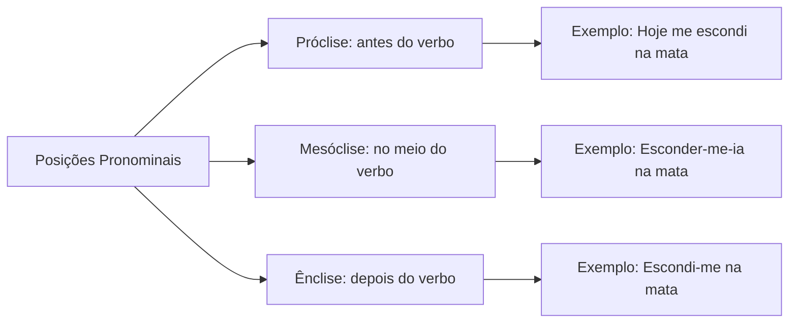
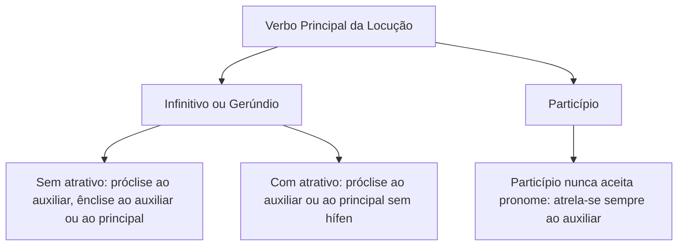
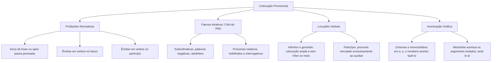

A colocação pronominal estuda a posição dos pronomes oblíquos átonos em relação ao verbo na oração. Nos concursos públicos, as bancas cobram o domínio do padrão culto escrito. O candidato precisa reconhecer as proibições absolutas, os fatores atrativos de próclise e o comportamento das locuções verbais. Neste capítulo, abordaremos essas regras com foco em pegadinhas e acentuação gráfica.

> [!objetivos]
> - Compreender a dinâmica sintática dos pronomes oblíquos átonos na oração.
> - Dominar as proibições absolutas da norma culta quanto ao início de frase, futuro e particípio.
> - Identificar com rapidez os fatores atrativos que determinam a próclise obrigatória.
> - Aplicar a colocação pronominal correta em locuções verbais e tempos compostos.
> - Integrar as regras de acentuação gráfica nas formas verbais com pronomes enclíticos e mesoclíticos.

## Fundamentos da colocação pronominal

A colocação pronominal analisa onde pode ou não ficar o pronome oblíquo átono (*me*, *te*, *se*, *lhe*, *o*, *a*, *nos*, *vos*, *lhes*, *os*, *as*) em relação ao verbo. Os pronomes átonos caracterizam-se pela fraqueza fonética e pela ausência de acento próprio. Por essa razão, apoiam-se na tonicidade do verbo ao qual se associam, comportando-se como autênticos clíticos sintáticos.

Na norma culta, o pronome pode assumir três posições: antes do verbo (próclise), no meio do verbo (mesóclise) ou depois do verbo (ênclise). O princípio orientador baseia-se na identificação de proibições e fatores atrativos. Quando não houver palavra atrativa nem proibição expressa, a colocação é facultativa. O candidato pode escolher entre a próclise e a ênclise sem incorrer em erro gramatical.

## Proibições gerais da norma padrão

Para acertar as questões de prova, é preciso memorizar as três proibições capitais da língua culta. O que não for expressamente proibido nem atraído é aceito.

### Proibição de início de período e após pontuação

Nunca se inicia período ou oração com pronome oblíquo átono. A linguagem oral usa *Me dá um cigarro*, mas a norma padrão exige ênclise: *Dê-me um cigarro*. Essa mesma regra vale após pausa marcada por vírgula ou ponto e vírgula. Do ponto de vista sintático, a oração recomeça após a pontuação: *Ele não virá; disse-me que estará ocupado* (jamais *me disse*).

### Proibição de ênclise com verbo no futuro

É proibido usar ênclise com formas verbais no futuro do presente ou no futuro do pretérito (*darei-te* e *daria-te* são errados). Com palavra atrativa, usa-se próclise (*Não te darei apoio*). Sem palavra atrativa, adota-se a mesóclise (*Dar-te-ei apoio*; *Dispor-me-ia a ajudar*).

### Proibição de ênclise ao verbo no particípio

Nunca se anexa pronome átono a verbo no particípio (*tinha emprestado-lhe* ou *haviam resguardado-se* configuram erro grave). Em tempos compostos, o pronome liga-se ao verbo auxiliar: *Tinha-lhe emprestado* ou *Tinha lhe emprestado*.

> [!pegadinha] Pronome oblíquo no início de período e após pontuação
> Bancas adoram iniciar períodos com orações reduzidas de gerúndio. Após a vírgula que fecha a oração subordinada, o pronome não pode abrir a oração principal: *Chegando ao quartel, apresentou-se ao oficial* (e não *se apresentou*). Sem proibição no início e sem atrativo, a posição é livre: *Os sacerdotes se recusavam* ou *recusavam-se a escrever*.

## Próclise obrigatória: os fatores atrativos

A próclise ocorre quando o pronome oblíquo antecede o verbo. Ela torna-se obrigatória sempre que houver palavra atrativa antes do verbo. Como regra prática, qualquer palavra invariável antes do verbo atrai o pronome.

Para facilitar a memorização, utiliza-se a síntese do mnemônico **CNA da PRII**:

| Fator atrativo | Regra normativa | Exemplo na norma padrão |
| --- | --- | --- |
| Conjunções subordinativas | Conjunções como *que*, *se*, *quando*, *embora*, *como* exigem próclise | *Quando se precisa de reforço.*   *Embora me dedique, há dificuldade.* |
| Palavras negativas | Termos como *não*, *nunca*, *jamais*, *nem*, *ninguém*, *nada* atraem o pronome | *É verdade que não se poderia agir assim.*   *Jamais me esqueci do fato.* |
| Advérbios sem vírgula | Advérbios sem pausa por vírgula impõem próclise imediata | *Ontem me informaram sobre a escala.*   *As condutas em muito se assemelham.* |
| Pronomes relativos | Relativos como *que*, *quem*, *onde*, *cujo* puxam o pronome átono | *Aqueles que se referem ao fato temem perigo.*   *A tropa cujas ações se destacaram.* |
| Pronomes indefinidos | Formas como *alguém*, *todos*, *tudo*, *nada*, *poucos*, *alguns* atraem | *Alguém me chamou no posto.*   *Tudo se resolve com serenidade.* |
| Pronomes interrogativos | Pronomes como *quem*, *qual*, *que*, *quanto* em perguntas forçam próclise | *Quem te falou sobre o concurso?*   *Qual medida se adota agora?* |

> [!bizu] O mnemônico CNA da PRII para fatores atrativos de próclise
> Memorize as seis classes atrativas que impõem a próclise obrigatória:
> - **C**: Conjunções subordinativas (*embora me dissesse*, *caso se confirme*).
> - **N**: Palavras de sentido negativo (*não me deixe*, *nunca me enganou*).
> - **A**: Advérbios sem pausa (*já se passaram meses*, *sempre te apoiei*).
> - **P**: Pronomes relativos (*os policiais que se dedicaram ao resgate*).
> - **R / I**: Pronomes indefinidos (*todos se calaram diante do oficial*).
> - **I**: Pronomes interrogativos (*quem se atreve a questionar a ordem?*).

### Atração remota e intercalação de termos

Em orações subordinadas, o atrator mantém sua força mesmo havendo sujeito intercalado entre o conectivo e o verbo: *Enquanto protestos violentos se espalham pelas ruas, sigo atento*. O pronome permanece antes de *espalham*. Todavia, havendo vírgula após o termo intercalado, a atração é desfeita, liberando a ênclise: *Aqui, trabalha-se com dedicação*; *Jamais, segundo os peritos, se fizeram ou fizeram-se despesas*.

## Regras especiais e colocação facultativa

A norma padrão consagra situações com diretrizes próprias de colocação pronominal:

- **Frases optativas**: em frases que exprimem desejo ou súplica, a próclise é mandatória (*Deus lhe pague*; *Bons ventos o levem*).
- **Estrutura em + gerúndio**: a próclise é obrigatória (*Em se plantando, tudo dá*; *Em se tratando de segurança em Recife, o rigor prevalece*).
- **Verbo no infinitivo com atrativo**: a colocação é facultativa. O candidato pode escolher próclise ou ênclise (*Prefiro não te convidar* ou *não convidar-te*; *deve se preocupar* ou *preocupar-se*).
- **Coordenação aditiva**: com a conjunção *e*, a posição é livre (*Cheguei, me sentei e preparei-me*). Com correlativos (*não só... como também*, *nem... nem*), prefere-se a próclise (*Nem se desculpou pelo atraso*).
- **Eufonia e harmonia fonética**: prefere-se a próclise com verbos monossilábicos ou proparoxítonos (*Eu a vi ontem*; *Nós lhes obedecíamos*).

> [!exemplo] Variações estilísticas e sujeito explícito
> Quando o sujeito vem explícito e não há fator atrativo, a posição do pronome é inteiramente livre: *Os soldados se recusaram* ou *recusaram-se a recuar*. Com o pronome reto *nós*, o verbo perde o *-s* final na ênclise: *Nós nos tornamos referência* ou *Nós tornamo-nos referência*.

## Colocação pronominal nas locuções verbais

A locução verbal reúne um verbo auxiliar e um verbo principal (no infinitivo, gerúndio ou particípio). As regras dependem da forma do verbo principal e da presença de atratores:

### Locução com infinitivo ou gerúndio

Sem palavra atrativa, o pronome pode ficar antes do auxiliar, enclítico ao auxiliar ou enclítico ao principal: *Eu lhe estou emprestando a viatura*, *Eu estou-lhe emprestando*, *Eu estou emprestando-lhe* ou *Vou-me arrastando*.

Com palavra atrativa, o pronome vai para antes do auxiliar ou antes do verbo principal sem hífen. É proibido usar hífen no meio da locução com atrativo: *Não lhe devo calar a verdade* (correto), *Não devo lhe calar* (correto), *Não devo calar-lhe* (correto), mas *Não devo-lhe calar* (errado).

### Locução com particípio

Com verbo principal no particípio, o pronome nunca fica posposto a ele. Deve apoiar-se no auxiliar:

| Cenário gramatical | Forma culta aceita | Forma condenada em prova |
| --- | --- | --- |
| Sem palavra atrativa | *O coronel tinha-me avisado do risco.*   *Os recrutas haviam-se revoltado.* | *O coronel tinha avisado-me.*   *Os recrutas haviam revoltado-se.* |
| Com palavra atrativa | *Ninguém me havia avisado da blitz.*   *Não nos tínhamos preparado.* | *Ninguém havia avisado-me.*   *Não tínhamos preparado-nos.* |

> [!atencao] Colocação pronominal com verbo no particípio
> Jamais utilize pronome enclítico a particípio. Construções como *haviam enganado-me* ou *tinha dito-lhe* violam a norma culta. O pronome átono deve apoiar-se no verbo auxiliar: *haviam-me enganado* ou *tinha-me dito*.

## Acentuação gráfica nas formas verbais pronominais

Os editais costumam exigir o domínio da acentuação gráfica nas formas verbais unidas a pronomes oblíquos átonos. A junção de pronomes enclíticos ou mesoclíticos exige aplicar as normas de acentuação gráfica na forma verbal isolada:

1. **Oxítonas em -a, -e, -o tônicos com -lo, -la**: perdem a terminação *-r*, *-s*, *-z* e recebem acento gráfico: *fazer + o* → *fazê-lo*; *superar + a* → *superá-la*; *compor + os* → *compô-los*.
2. **Monossílabos tônicos em -a, -e, -o**: recebem acento gráfico regular ou diferencial: *dar + as* → *dá-las*; *ver + o* → *vê-lo*; *pôr + o* → *pô-lo*.
3. **Formas em -i ou -u tônicos**: não levam acento gráfico: *conduzir + o* → *conduzi-lo*; *partir + a* → *parti-la*.
4. **Mesóclise no futuro**: cada elemento é acentuado por sua regra própria: *amar + ei + o* → *amá-lo-ei* (oxítona em *-a* tônico); *fazer + á + se* → *far-se-á* (monossílabo tônico em *-a*).

> [!esquema] Diretrizes de acentuação gráfica nas formas enclíticas e mesoclíticas
> Para nunca errar a acentuação gráfica de formas verbais pronominais:
> 1. Separe mentalmente o verbo do pronome unido por hífen (*fazê-*, *dá-*, *conduzi-*).
> 2. Classifique a forma verbal isolada quanto à posição da sílaba tônica.
> 3. Aplique as regras gerais de acentuação gráfica das oxítonas e dos monossílabos tônicos.
> 4. Se a terminação exigir acento gráfico, preserve-o na escrita culta (*revê-la*, *pô-lo*).

## Mapa do capítulo

| Tópico gramatical | Diretriz normativa para o concurso | Exemplo correto no padrão culto |
| --- | --- | --- |
| Início de oração | Proibido iniciar oração com pronome oblíquo átono | *Entregaram-me os laudos da perícia.* |
| Verbo no futuro | Sem atrativo, adota-se a mesóclise; ênclise é proibida | *Apresentar-te-ei o plano de combate.* |
| Verbo no particípio | O pronome une-se ao auxiliar; ênclise ao particípio é vedada | *O oficial tinha-me alertado do perigo.* |
| Fatores atrativos | Conjunções subordinativas e palavras negativas exigem próclise | *Não se desespere diante do teste.* |
| Infinitivo com atrativo | A posição pronominal torna-se facultativa | *Prefiro não te dizer / não dizer-te.* |
| Locução com atrativo | O pronome fica antes do auxiliar ou antes do principal | *Não lhe posso dizer / Não posso lhe dizer.* |
| Acentuação em ênclise | Oxítonas terminadas em *-a*, *-e*, *-o* seguidas de *-lo* levam acento | *Conter as chamas* → *Contê-las.* |

### Para fixar

- É terminantemente proibido iniciar período ou oração após pausa pontuada com pronome oblíquo átono.
- O pronome oblíquo átono não aceita ênclise a verbos no futuro do presente ou no futuro do pretérito.
- A ênclise a verbos no particípio é proibida na língua culta; o pronome liga-se ao auxiliar.
- O mnemônico CNA da PRII reúne os principais fatores que determinam a próclise obrigatória.
- Conjunções subordinativas e pronomes relativos exercem atração remota mesmo com sujeito intercalado.
- Pausa com vírgula logo após o advérbio anula a força atrativa e autoriza o uso da ênclise.
- Em orações optativas e na estrutura *em* + gerúndio, o emprego da próclise é obrigatório.
- Diante de verbos no infinitivo, a colocação pronominal é facultativa mesmo com palavra atrativa.
- Em locuções verbais com palavra atrativa, o pronome no meio não recebe hífen e apoia-se no verbo principal.
- Formas verbais oxítonas e monossílabos em *-a*, *-e*, *-o* tônicos seguidos de *-lo* ou *-la* recebem acento gráfico.
