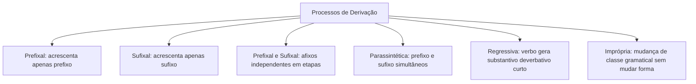
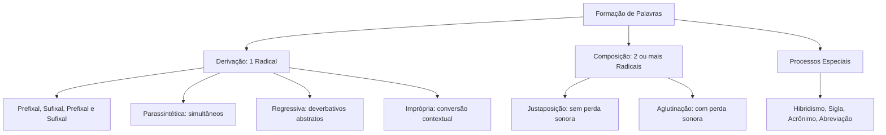

O estudo dos processos de formação de palavras é indispensável para concursos públicos e vestibulares. As bancas examinadoras cobram a decomposição mórfica dos vocábulos e a identificação do mecanismo preciso de criação lexical. O candidato deve dominar os conceitos de derivação, composição e processos especiais. Neste capítulo, abordaremos toda a estrutura mórfica do idioma de forma direcionada para sua aprovação.

> [!objetivos]
> - Reconhecer os elementos mórficos básicos que compõem as palavras no idioma.
> - Classificar os processos de derivação mórfica, diferenciando parassíntese e etapas sucessivas.
> - Distinguir com precisão a composição por justaposição da composição por aglutinação.
> - Identificar os processos especiais de formação como hibridismo, sigla, acrônimo e neologismo.
> - Aplicar um roteiro prático em 5 passos para resolver questões sobre formação de palavras.

## O que a banca quer saber sobre formação de palavras

As provas de concurso público costumam cobrar a habilidade do candidato de identificar o processo exato pelo qual um vocábulo foi criado na língua portuguesa. As bancas não exigem apenas memorização de nomenclaturas isoladas. Elas avaliam se você sabe decompor uma palavra em suas unidades mórficas menores para reconhecer sua raiz etimológica e a natureza dos afixos agregados.

Para acertar essas questões, o estudante precisa compreender que novas palavras surgem por derivação (um único radical) ou composição (dois ou mais radicais). Além disso, a banca explora processos especiais contemporâneos, como siglas, acrônimos, hibridismos e abreviações. O domínio pleno desses critérios morfossintáticos garante rapidez, segurança e alta precisão na resolução de todas as assertivas no exame.

## Primeiro, a estrutura da palavra e os elementos mórficos

Os morfemas são as menores unidades com sentido. Para analisar qualquer termo, decompõe-se o vocábulo em seus elementos. O radical traz o sentido básico. Os afixos (prefixos e sufixos) alteram a significação ou a classe da base. A vogal temática une o radical às desinências e marca a conjugação verbal, constituindo o tema.

| Elemento mórfico | Papel estrutural | Exemplo prático |
| --- | --- | --- |
| Radical | Raiz com sentido básico | *feliz* em *infelizmente* |
| Prefixo | Afixo anteposto ao radical | *des-* em *desleal* |
| Sufixo | Afixo posposto ao radical | *-dade* em *lealdade* |
| Vogal temática | Liga radical e indica conjugação | *-a-* em *cantar* |
| Desinência | Flexão de gênero/número ou tempo/pessoa | *-a-* e *-s-* em *meninas* |
| Consoante de ligação | Facilita a pronúncia e eufonia | *-l-* em *chaleira* |

> [!pegadinha] Pegadinhas comuns: desinência apenas flexiona; afixos criam palavras novas
> Desinências apenas flexionam termos existentes em gênero, número, tempo ou pessoa (*livro* / *livros*). Apenas prefixos e sufixos criam palavras novas. Termos com o mesmo radical formam uma família de palavras (*pedra*, *pedreiro*, *apedrejar*).

## Processo 1: Derivação mórfica

A derivação ocorre quando uma palavra nova surge a partir de uma base com um único radical. Divide-se em modalidades distintas na língua portuguesa:

### Derivação prefixal, sufixal e parassintética

Na derivação prefixal, acrescenta-se um prefixo ao radical (*fazer* → *refazer*). Na derivação sufixal, agrega-se um sufixo após a raiz (*chuva* → *chuvoso*).

Quando ambos entram de forma independente em etapas sucessivas, temos derivação prefixal e sufixal (*infelizmente* sobrevive sem um afixo: *felizmente* ou *infeliz*). Já na parassíntese, prefixo e sufixo associam-se simultaneamente: sem um dos dois afixos, o vocábulo inexiste (*anoitecer*, *entardecer*, *emudecer*).

> [!bizu] O teste prático para identificar a parassíntese
> Retire mentalmente um afixo de cada vez:
> - Se alguma das sobras existir isolada no dicionário, a formação é **prefixal e sufixal**.
> - Se nenhuma sobra existir isoladamente na língua, a formação é **parassintética**.

### Derivação regressiva deverbativa e imprópria

A derivação regressiva ocorre quando um substantivo abstrato indicativo de ação nasce da redução de um verbo primitivo: *pescar* gera *a pesca*; *combater* gera *o combate*; *resgatar* gera *o resgate*.

A derivação imprópria ocorre quando a palavra muda de classe gramatical sem modificação gráfica: *o jantar* (verbo substantivado); *um não* (advérbio substantivado); *falar alto* (adjetivo adverbializado).

> [!atencao] Distinção entre regressiva e sufixal (deverbal versus nominal)
> O substantivo deverbativo sempre expressa ação decorrente de um verbo. Se o substantivo for primitivo concreto, o verbo dele derivado resulta de **derivação sufixal**: de *martelo* surge *martelar*; de *âncora* surge *ancorar*.

> [!exemplo] Mudança de classe gramatical por derivação imprópria
> Quando um adjetivo recebe artigo antecedente, torna-se substantivo: *Os covardes fugiram do combate*. Aqui, *covardes* sofreu derivação imprópria ao atuar como núcleo do sujeito.

## Processo 2: Composição

A composição ocorre quando uma palavra nova resulta da união de dois ou mais radicais autônomos. Esse mecanismo divide-se em duas modalidades fundamentadas no comportamento fonético dos termos associados na norma culta.

Na justaposição, os radicais unem-se preservando integralmente seus fonemas e pronúncias de origem. Não há qualquer perda sonora, mesmo quando a grafia utiliza ou dispense o hífen: *guarda-chuva*, *passatempo*, *girassol*, *pontapé*.

Na aglutinação, os radicais fundem-se com perda fonética e alteração estrutural em pelo menos uma das bases constitutivas: *planalto* (*plano alto*), *aguardente* (*água ardente*), *fidalgo* (*filho de algo*), *boquiaberto* (*boca aberta*).

| Processo | Princípio fonético | Exemplos na norma culta |
| --- | --- | --- |
| Justaposição | Radicais unem-se sem perda sonora | *guarda-chuva*, *passatempo*, *girassol* |
| Aglutinação | Fusão com perda fonética em radical | *planalto*, *aguardente*, *fidalgo* |

> [!esquema] Diferenciação expressa entre justaposição e aglutinação
> O critério definidor da composição não é o hífen, mas a integridade sonora:
> - Radicais pronunciados de forma completa = **justaposição** (*girassol* = *gira* + *sol*).
> - Supressão ou alteração de fonemas na base = **aglutinação** (*boquiaberto* = *boca* + *aberto*).

## Processos especiais de formação vocabular

Além dos eixos tradicionais da derivação e da composição, a língua portuguesa emprega processos especiais para expandir seu repertório vocabular. Esses recursos expressivos surgem de influências culturais, avanços tecnológicos e conveniências comunicativas no cotidiano.

Entre os principais mecanismos especiais cobrados em certames, destacam-se o hibridismo, que combina raízes de idiomas distintos, e a onomatopeia, voltada à recriação aproximada de sons da natureza. Paralelamente, o dinamismo social consolidou o emprego de abreviações e siglas.

As siglas constituem reduções formadas pelas letras iniciais de uma denominação oficial. Quando lidas letra por letra (*PM*, *CPF*, *INSS*), são siglas estritas. Quando pronunciadas como vocábulo autônomo (*Detran*, *Anac*, *Petrobras*), configuram acrônimos.

| Processo especial | Como funciona | Exemplos clássicos |
| --- | --- | --- |
| Hibridismo | Reúne elementos de línguas diferentes | *automóvel* (grego + latim), *sociologia* (latim + grego) |
| Onomatopeia | Imita ruídos e sons da realidade | *zum-zum*, *miau*, *tic-tac*, *atchim* |
| Abreviação | Reduz a forma sem mudar o sentido | *foto* (*fotografia*), *pneu* (*pneumático*) |
| Sigla e Acrônimo | Letras iniciais soletradas ou lidas | *PM*, *CPF* (siglas); *Detran*, *Anac* (acrônimos) |
| Palavra-valise | Fusão de partes de duas palavras | *portunhol* (*português* + *espanhol*), *showmício* |
| Neologismo | Criação de novos vocábulos | *deletar*, *tuitar*, *escanear* |

## Como identificar em 5 passos o processo de formação

Para resolver qualquer questão sobre formação de palavras em provas de concurso, o candidato deve empregar uma abordagem analítica estruturada. A observação ordenada elimina alternativas incorretas com rapidez e precisão.

O primeiro passo isola os radicais da palavra para constatar se há dois elementos lexicais ou um. Com mais de uma raiz, conclui-se pela composição. Havendo um radical, examinam-se afixos para determinar o tipo de derivação mórfica. Em seguida, verifica-se se o substantivo decorre de verbo anterior (regressiva) ou se apenas trocou de classe (imprópria). Por fim, avaliam-se processos especiais como siglas, abreviações ou hibridismos.

> [!esquema] Roteiro prático em 5 passos para a resolução de questões
> Siga esta ordem de verificação lógica na hora do teste:
> 1. Há dois ou mais radicais autônomos? É composição (justaposição ou aglutinação).
> 2. Há um radical com afixos? É derivação (prefixal, sufixal ou parassintética).
> 3. É substantivo de ação menor que o verbo de origem? É derivação regressiva.
> 4. A palavra apenas trocou de classe gramatical pelo contexto? É derivação imprópria.
> 5. Nenhuma das anteriores? Trata-se de processo especial (sigla, acrônimo, hibridismo ou abreviação).

## Mapa do capítulo

### Resumo para revisar

| Modalidade | Critério distintivo | Exemplo modelo |
| --- | --- | --- |
| Prefixal | Prefixo sem mudar a classe | *reler*, *desleal* |
| Sufixal | Sufixo com mudança de classe | *lealdade*, *chuvoso* |
| Prefixal e sufixal | Afixos independentes em etapas | *infelizmente* |
| Parassíntese | Afixos simultâneos obrigatórios | *anoitecer*, *entardecer* |
| Regressiva | Substantivo de ação reduzido do verbo | *o combate*, *o resgate* |
| Imprópria | Mudança funcional sem alterar grafia | *o jantar*, *um não* |
| Justaposição | União de radicais sem perda sonora | *passatempo*, *girassol* |
| Aglutinação | Fusão de radicais com perda fonética | *planalto*, *fidalgo* |
| Hibridismo | Raízes de idiomas distintos | *automóvel*, *sociologia* |

### Para fixar

- Desinências apenas flexionam categorias gramaticais; prefixos e sufixos criam novos vocábulos.
- A derivação opera a partir de um único radical primitivo na estrutura mórfica.
- Na derivação prefixal e sufixal, a remoção de um dos afixos preserva uma palavra real.
- Na parassíntese, os afixos associam-se de forma estritamente simultânea ao radical.
- A derivação regressiva gera substantivos abstratos indicadores de ação a partir de verbos.
- Substantivos primitivos concretos que originam verbos configuram derivação sufixal.
- A derivação imprópria altera a classe morfológica do termo sem mudar sua forma gráfica.
- A composição por justaposição preserva todos os fonemas originais dos radicais.
- A composição por aglutinação envolve supressão fonética de elementos em pelo menos um radical.
- Siglas são pronunciadas letra por letra, enquanto acrônimos são articulados como palavras contínuas.
