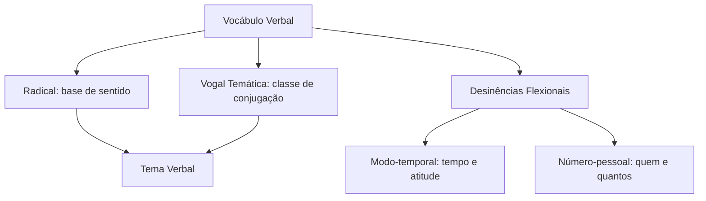
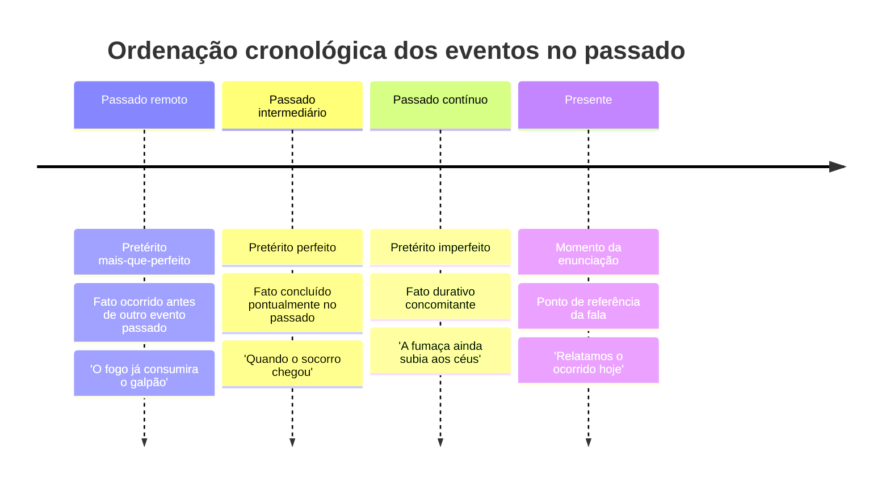
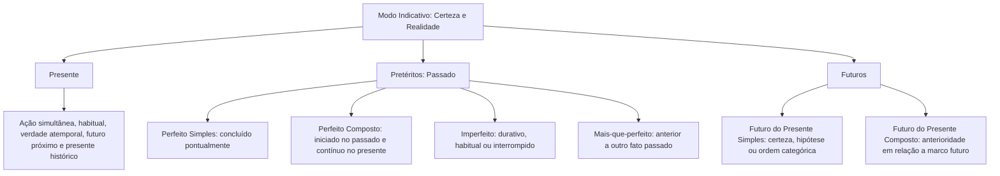

O verbo é a classe mais dinâmica e estruturante da língua portuguesa. Ele situa ações, estados, mudanças e fenômenos naturais no tempo. Sobre o verbo as orações se organizam. Em concursos públicos, as bancas não exigem apenas tabelas decoradas. O examinador cobra os efeitos de sentido provocados pela escolha de cada tempo e modo no texto. Neste capítulo, você estudará a morfologia verbal e os valores semânticos dos tempos do modo indicativo para resolver questões com precisão.

> [!objetivos]
> - Identificar os elementos mórficos da forma verbal (radical, vogal temática e desinências).
> - Reconhecer as três conjugações regulares e os paradigmas de flexão verbal.
> - Distinguir os valores semânticos do presente do indicativo além do momento da fala.
> - Contrastar o pretérito perfeito, o imperfeito e o mais-que-perfeito simples e composto.
> - Empregar o futuro do presente simples, a sua forma composta e locuções equivalentes.

## Noções iniciais e estrutura morfológica do verbo

O verbo é uma classe de palavras variável. Ele se flexiona em modo, tempo, número e pessoa, além de exprimir voz. Substantivos e adjetivos flexionam apenas em gênero e número. Já o verbo reúne dados sintáticos e discursivos em suas desinências. Do ponto de vista semântico, o verbo pode designar ação (*combater*, *patrulhar*), estado (*estar*, *permanecer*), mudança de estado (*tornar-se*, *virar*) ou fenômeno meteorológico (*chover*, *ventar*).

A flexão de **pessoa** indica a posição no discurso. A primeira pessoa designa quem fala (*eu*, *nós*). A segunda pessoa indica com quem se fala (*tu*, *vós*). A terceira pessoa aponta de quem ou do que se fala (*ele*, *ela*, *eles*, *elas*). Em termos práticos, a terceira pessoa abrange qualquer sujeito substantivo, como uma guarnição, uma viatura ou uma instituição pública.

A flexão de **número** ajusta a forma verbal ao sujeito no singular ou no plural. O **modo** reflete a atitude do enunciador diante do fato: certeza (modo indicativo), dúvida ou hipótese (modo subjuntivo) e ordem ou pedido (modo imperativo). O **tempo** localiza o fato em relação ao momento da fala: presente, pretérito (passado) ou futuro. O tempo gramatical nem sempre coincide com o tempo cronológico real. A língua permite narrar fatos passados ou projetar fatos futuros com formas do presente.

Para analisar a construção morfológica dos verbos na norma culta, decompomos o vocábulo em unidades menores:

1. **Radical**: segmento básico nos verbos regulares que concentra o significado lexical. Retiram-se as terminações do infinitivo (*-ar*, *-er*, *-ir*) para encontrá-lo: *resgat-* em *resgatar*; *socorr-* em *socorrer*; *cumpr-* em *cumprir*.
2. **Vogal temática (VT)**: vogal agregada ao radical para indicar a conjugação e receber as desinências. A língua portuguesa possui três conjugações:
   - **1ª conjugação**: vogal temática **-a-** (*salvar*, *operar*, *marchar*);
   - **2ª conjugação**: vogal temática **-e-** (*atender*, *prender*, *socorrer*), incluindo o verbo *pôr* e seus derivados (*repor*, *compor*, *dispor*), antigos derivados de *ponere*;
   - **3ª conjugação**: vogal temática **-i-** (*extinguir*, *dirigir*, *prevenir*).
3. **Tema**: união do radical com a vogal temática (*resgata-*, *socorre-*, *cumpri-*). O tema recebe as desinências. Na 1ª pessoa do singular do presente do indicativo (*eu resgato*), a vogal temática não aparece por assimilação mórfica.
4. **Desinência modo-temporal (DMT)**: morfema que explicita o tempo e o modo da forma verbal. O sufixo *-va-*, por exemplo, marca o pretérito imperfeito do indicativo na 1ª conjugação (*resgatavam*).
5. **Desinência número-pessoal (DNP)**: morfema que aponta a pessoa gramatical e o número do sujeito. A terminação *-mos*, por exemplo, indica a 1ª pessoa do plural (*resgatamos*).

A estrutura mórfica do verbo pode ser visualizada no esquema a seguir:

A tabela abaixo detalha a segmentação morfológica de verbos em diferentes tempos e pessoas, evidenciando o papel de cada constituinte:

| Forma verbal | Radical | Vogal temática | Tema | Desinência modo-temporal | Desinência número-pessoal |
| --- | --- | --- | --- | --- | --- |
| *resgatávamos* | *resgat-* | *-a-* | *resgata-* | *-va-* (pret. imperf. ind.) | *-mos* (1ª pessoa plural) |
| *socorreríeis* | *socorr-* | *-e-* | *socorre-* | *-ria-* (fut. pret. ind.) | *-is* (2ª pessoa plural) |
| *cumprísseis* | *cumpr-* | *-i-* | *cumpri-* | *-sse-* (pret. imperf. subj.) | *-is* (2ª pessoa plural) |
| *patrulharemos* | *patrulh-* | *-a-* | *patrulha-* | *-re-* (fut. pres. ind.) | *-mos* (1ª pessoa plural) |
| *atendêramos* | *atend-* | *-e-* | *atende-* | *-ra-* (pret. mais-que-perf.) | *-mos* (1ª pessoa plural) |

> [!bizu] Identificação rápida de conjugação
> Para descobrir a conjugação de qualquer forma verbal flexionada na prova, transporte o verbo para o infinitivo impessoal: terminou em *-ar* pertence à 1ª conjugação; em *-er* ou com base no verbo *pôr*, pertence à 2ª; em *-ir*, pertence à 3ª.

## O modo indicativo e seus valores comunicativos

O **modo indicativo** é a modalidade verbal empregada quando o emissor expressa um fato com certeza. Ele veicula realidade palpável e convicção sólida. O modo subjuntivo, em contraste, transmite dúvida, hipótese ou desejo. Já o indicativo projeta o fato como consumado, em curso no presente ou certo no futuro.

A compreensão dos tempos do indicativo exige distinguir o momento da fala e o momento do evento. O momento da fala é o instante em que o texto é enunciado. O momento do evento é quando a ação ocorre no mundo real. As bancas cobram com frequência as transposições temporais. Nelas, o autor usa um tempo fora do seu valor padrão para gerar polidez, vivacidade ou ênfase discursiva.

Na redação oficial e na atividade policial ou militar, o modo indicativo predomina amplamente. Relatórios de serviço, partes diárias e autos de ocorrência demandam relato objetivo da realidade. O redator não supõe; ele registra o que foi verificado. A escolha de cada tempo orienta a cronologia dos fatos para o leitor. O presente situa o observador. Os pretéritos organizam os acontecimentos anteriores. Os futuros antecipam metas e deveres operacionais.

### Mecanismos de coesão textual: emprego de tempos e modos verbais

Na estruturação do período e do texto, os mecanismos de coesão textual dependem decisivamente do emprego adequado de tempos e modos verbais. A coesão temporal garante a harmonia entre as orações. Ela orienta o leitor sobre a sucessão dos acontecimentos sem ambiguidades. Em uma narrativa, por exemplo, o pretérito imperfeito constrói o cenário de fundo: a chuva caía, o vento soprava e o rio subia. Quando surge um fato novo e instantâneo que quebra essa continuidade, o redator emprega o pretérito perfeito: o alarme soou.

Se um evento já ocorrera antes dessa ruptura, o pretérito mais-que-perfeito assegura a anterioridade cronológica: a equipe já levantara o posto antes de o socorro chegar. O emprego correto dos tempos e modos verbais funciona como elo gramatical. Ele conecta parágrafos, amarra causas e efeitos e impede que o sentido original do texto seja invertido.

## Presente do indicativo: valores semânticos e empregos

O **presente do indicativo** indica, em seu valor básico, uma ação ou estado que ocorre rigorosamente no momento em que se produz a enunciação. Contudo, em textos dissertativos e narrativos, o presente assume uma expressiva variedade de funções contextuais que são exploradas com frequência pelas bancas.

A conjugação do presente do indicativo nas três conjugações regulares toma como paradigmas os verbos *resgatar* (1ª), *atender* (2ª) e *cumprir* (3ª):

| Pessoa | 1ª Conjugação (*resgatar*) | 2ª Conjugação (*atender*) | 3ª Conjugação (*cumprir*) |
| --- | --- | --- | --- |
| *Eu* | *resgato* | *atendo* | *cumpro* |
| *Tu* | *resgatas* | *atendes* | *cumpris* |
| *Ele / Ela* | *resgata* | *atende* | *cumpre* |
| *Nós* | *resgatamos* | *atendemos* | *cumprimos* |
| *Vós* | *resgatais* | *atendeis* | *cumpris* |
| *Eles / Elas* | *resgatam* | *atendem* | *cumprem* |

Os principais valores semânticos assumidos pelo presente do indicativo no texto formal compreendem:

1. **Fato pontual coincidente com a fala**: descreve um evento que se desenrola no exato instante em que o locutor se manifesta.
   - Exemplo: "O comandante geral *assina* neste instante a ordem de serviço da operação."
2. **Hábito ou ação reiterada no presente**: retrata rotinas, procedimentos repetidos ou costumes funcionais que ultrapassam o momento efêmero da fala.
   - Exemplo: "Os bombeiros de Pernambuco *inspecionam* hidrantes urbanos todas as manhãs."
3. **Verdade universal ou atemporal (presente gnômico)**: veicula postulados científicos, definições conceituais, leis físicas ou máximas éticas que independem de marcos temporais específicos.
   - Exemplo: "A combustão *exige* a presença simultânea de combustível, comburente e calor."
4. **Futuro próximo planejado ou certo**: substitui o futuro do presente simples para exprimir um evento futuro tido como irrevogável, planejado ou imediatamente subsequente.
   - Exemplo: "A equipe de resgate *viaja* amanhã cedo para reforçar as buscas no interior."
5. **Presente histórico ou narrativo**: situa fatos ocorridos no passado sob a forma do presente gramatical. Seu propósito estilístico é trazer o acontecimento para o primeiro plano visual do leitor, conferindo-lhe dramaticidade, dinamismo e verossimilhança imediata.
   - Exemplo: "Em 1824, os revolucionários pernambucanos *proclamam* a Confederação do Equador e *enfrentam* as tropas imperiais."

A tabela a seguir consolida esses empregos com seus respectivos efeitos semânticos:

| Matiz semântico | Função no discurso | Exemplo prático de prova |
| --- | --- | --- |
| Coincidente com a fala | Ação simultânea à enunciação | "O rádio da guarnição *transmite* o alerta agora." |
| Hábito ou iteração | Conduta rotineira ou permanente | "O policial militar *registra* o boletim após a ronda." |
| Verdade atemporal | Princípio geral ou definição conceitual | "O calor intenso *dilata* as estruturas metálicas." |
| Futuro próximo | Ação futura considerada certa | "O coronel *apresenta* o novo plano tático na próxima semana." |
| Presente histórico | Fato passado relatado no presente | "Em 1988, a Assembleia Nacional Constituinte *promulga* a Carta Magna." |

> [!atencao] Distinção entre simultaneidade estrita e generalização habitual
> Uma das armadilhas prediletas da banca examinadora consiste em afirmar que qualquer forma no presente do indicativo descreve uma ação que ocorre exclusivamente no instante em que o locutor fala. Isso frequentemente é falso: orações como "O Corpo de Bombeiros *atende* a ocorrências em todo o Estado" exprimem caráter atemporal e habitual, e não um ato limitado ao segundo da emissão sonora.

## Pretérito perfeito do indicativo: aspecto concluído

O **pretérito perfeito do indicativo** indica um fato que teve início e término pontuais no passado, encontrando-se perfeitamente concluído e delimitado antes do momento da enunciação. Seu aspecto verbal é terminativo (ou perfectivo), expressando a ação acabada em sua totalidade.

O pretérito perfeito regular apresenta as seguintes desinências paradigmáticas:

| Pessoa | 1ª Conjugação (*resgatar*) | 2ª Conjugação (*atender*) | 3ª Conjugação (*cumprir*) |
| --- | --- | --- | --- |
| *Eu* | *resgatei* | *atendi* | *cumpri* |
| *Tu* | *resgataste* | *atendeste* | *cumpriste* |
| *Ele / Ela* | *resgatou* | *atendeu* | *cumpriu* |
| *Nós* | *resgatamos* | *atendemos* | *cumprimos* |
| *Vós* | *resgatastes* | *atendestes* | *cumpristes* |
| *Eles / Elas* | *resgataram* | *atenderam* | *cumpriram* |

> [!bizu] Homonímia na 1ª pessoa do plural
> Na 1ª conjugação (*nós resgatamos*, *nós levantamos*), a forma do pretérito perfeito é graficamente idêntica à do presente do indicativo no padrão brasileiro. O reconhecimento do tempo decorre do contexto sintático e temporal: "Ontem nós *resgatamos* a vítima e *levantamos* o acampamento" (pretérito perfeito); "Hoje nós *resgatamos* vidas e *levantamos* a bandeira" (presente).

### Pretérito perfeito composto do indicativo

A forma simples do pretérito perfeito retrata fato pontual e finalizado. Já o **pretérito perfeito composto do indicativo** tem comportamento semântico diferente. Ele resulta da união do verbo auxiliar *ter* (ou *haver*) no **presente do indicativo** com o **particípio** do verbo principal:

    Pretérito Perfeito Composto = ter / haver (no presente) + particípio

Esse tempo composto expressa ação iniciada no passado que **continua a ocorrer no presente**. Ele indica hábito, repetição contínua ou estado duradouro até o instante da fala.

- Exemplo: "O tenente *tem coordenado* treinamentos de salvamento em altura nas últimas semanas."

O oficial não treinou a tropa uma única vez no passado. Ele iniciou a coordenação e continua a desempenhá-la agora. A locução *vem coordenando* (*vir no presente + gerúndio*) substitui a forma composta mantendo o sentido durativo.

> [!pegadinha] O tempo composto que não terminou
> As bancas costumam afirmar que a frase "Tenho estudado para o concurso" descreve uma ação integralmente concluída no passado, em razão da presença do vocábulo *pretérito*. Trata-se de erro grosseiro: o pretérito perfeito composto do indicativo indica prolongamento no tempo e incompletude no instante da fala. A ação ainda não acabou!

## Pretérito imperfeito do indicativo: aspecto durativo e habitual

O **pretérito imperfeito do indicativo** expressa um fato passado que não foi observado em sua conclusão pontual. Trata-se de uma ação contínua, prolongada, habitual ou interrompida por outro acontecimento no passado. Seu aspecto é imperfectivo (inacabado em relação ao referencial temporal adotado).

Na identificação mórfica, o pretérito imperfeito do indicativo caracteriza-se por duas desinências fundamentais:
- Verbos de **1ª conjugação**: recebem o sufixo modo-temporal **-va-** (*resgatava*, *patrulhava*, *operava*);
- Verbos de **2ª e 3ª conjugações**: recebem a terminação **-ia-** (*atendia*, *socorria*, *cumpria*, *saía*);
- Os verbos anômalos *ser* (*era*), *ter* (*tinha*) e *vir* (*vinha*) possuem formas particulares preservadas no uso comum.

A tabela comparativa a seguir ilustra a conjugação do pretérito imperfeito:

| Pessoa | 1ª Conjugação (*resgatar*) | 2ª Conjugação (*atender*) | 3ª Conjugação (*cumprir*) |
| --- | --- | --- | --- |
| *Eu* | *resgatava* | *atendia* | *cumpria* |
| *Tu* | *resgatavas* | *atendias* | *cumprias* |
| *Ele / Ela* | *resgatava* | *atendia* | *cumpria* |
| *Nós* | *resgatávamos* | *atendíamos* | *cumpríamos* |
| *Vós* | *resgatáveis* | *atendíeis* | *cumpríeis* |
| *Eles / Elas* | *resgatavam* | *atendiam* | *cumpriam* |

Os principais contextos de emprego do pretérito imperfeito envolvem:

1. **Ação habitual ou repetida no passado**: fatos rotineiros no pretérito.
   - Exemplo: "Na infância, o jovem *amava* as histórias de bombeiros e *corria* para ver as viaturas passarem."
2. **Ação durativa em andamento interrompida por evento pontual**: cenário de fundo para fato pontual.
   - Exemplo: "Enquanto a chuva *caía* e *chovia* na serra, o militar *viajava* pela rodovia e *executava* o patrulhamento; nada mais lhe *importava* senão o dever."
3. **Ação planejada que não se concretizou**: frustração de expectativa.
   - Exemplo: "A equipe *pretendia* vistoriar a encosta, mas o temporal bloqueou a subida."
4. **Expressão de polidez ou modéstia**: atenuação de pedidos.
   - Exemplo: "Senhor oficial, eu *queria* pedir autorização para revisar o plano de contingência."

## Pretérito mais-que-perfeito: anterioridade no passado

O **pretérito mais-que-perfeito do indicativo** expressa um evento pretérito que ocorreu **antes de outro fato também já passado**. Ele estabelece uma hierarquia cronológica estrita no pretérito, sinalizando o fato mais antigo de uma narrativa.

### Forma simples e desinência -ra

Na modalidade simples, o pretérito mais-que-perfeito leva a desinência átona **-ra-** (com acento na 1ª e na 2ª pessoa do plural: *-ráramos*, *-ráreis*). O verbo *levantar* flexiona-se como *levantara*, *levantaras*, *levantara*, *levantáramos*, *levantáreis*, *levantaram*; o verbo *beber*, como *bebera*, *beberas*, *bebera*, *bebêramos*, *bebêreis*, *beberam*; e o verbo *cair*, como *caíra*, *caíras*, *caíra*, *caíramos*, *caíreis*, *caíram*.

- Exemplo: "O comandante *pedira* reforço e a equipe já *levantara* o posto quando a viatura que *invertera* o sentido chegou ao local."

Há dois fatos no passado: a chegada da viatura e o levantamento anterior do posto. O levantamento ocorreu primeiro. Por isso, recebe o pretérito mais-que-perfeito (*levantara*).

### Forma composta e equivalência semântica

Na linguagem culta contemporânea, a forma composta substitui frequentemente a simples. Ela combina o auxiliar *tinha* ou *havia* no pretérito imperfeito com o particípio do verbo principal:

    Pretérito Mais-Que-Perfeito Composto = tinha / havia + particípio

- Exemplo: "Quando a viatura chegou, a guarnição já *havia levantado* os bloqueios; nada fora *largado* ou *invertido* sem prévio planejamento."

A troca da forma simples pela composta (*levantara* por *havia levantado*) preserva a correção gramatical e o sentido original do período.

O esquema abaixo ilustra a linha cronológica dos pretéritos do indicativo:

A tabela a seguir contrasta as três modalidades pretéritas fundamentais:

| Tempo verbal | Morfema característico | Noção semântica nuclear | Exemplo contextualizado |
| --- | --- | --- | --- |
| Pretérito Perfeito Simples | *-i*, *-ou*, *-eu*, *-iu* | Ação concluída pontualmente no passado | "A guarnição *conteve* o vazamento de gás." |
| Pretérito Perfeito Composto | *tenho/tem* + particípio | Ação iniciada no passado que perdura até o presente | "O batalhão *tem realizado* simulados frequentes." |
| Pretérito Imperfeito | *-va-* (1ª conj.) / *-ia-* (2ª e 3ª) | Ação contínua, repetida ou habitual no passado | "Os recrutas *treinavam* técnicas de salvamento aquático." |
| Pretérito Mais-Que-Perfeito Simples | *-ra-* átono | Ação passada anterior a outro evento pretérito | "O suspeito *fugira* antes da chegada da radiopatrulha." |
| Pretérito Mais-Que-Perfeito Composto | *tinha/havia* + particípio | Equivalente semântico pleno da forma simples | "O suspeito *havia fugido* antes da chegada da radiopatrulha." |

> [!exemplo] Equivalência contextual do pretérito perfeito com valor de mais-que-perfeito
> Em certas orações temporais introduzidas por conectivos que já denotam anterioridade inequívoca (como *depois que*, *logo que*, *assim que*), a norma gramatical e autores clássicos como Celso Cunha e Evanildo Bechara admitem o uso do pretérito perfeito no lugar do mais-que-perfeito sem prejuízo da clareza cronológica:
> - "Assim que *concluiu* (ou *concluíra*) o cerco tático, o comandante determinou o avanço da tropa."

## Futuro do presente do indicativo: certezas, hipóteses e comandos

O **futuro do presente do indicativo** projeta um acontecimento em momento posterior ao instante em que se fala. Ele se divide em forma simples e forma composta, desempenhando papéis sintáticos e estilísticos notáveis.

As desinências regulares do futuro do presente simples são caracterizadas pelo sufixo *-rá-* / *-re-* associado às pessoas gramaticais:

| Pessoa | 1ª Conjugação (*resgatar*) | 2ª Conjugação (*atender*) | 3ª Conjugação (*cumprir*) |
| --- | --- | --- | --- |
| *Eu* | *resgatarei* | *atenderei* | *cumprirei* |
| *Tu* | *resgatarás* | *atenderás* | *cumprirás* |
| *Ele / Ela* | *resgatará* | *atenderá* | *cumprirá* |
| *Nós* | *resgataremos* | *atenderemos* | *cumpriremos* |
| *Vós* | *resgatareis* | *atendereis* | *cumprireis* |
| *Eles / Elas* | *resgatarão* | *atenderão* | *cumprirão* |

Os principais usos e valores do futuro do presente incluem:

1. **Fato futuro tido como certo**: manifesta certeza ou compromisso formal do enunciador.
   - Exemplo: "O Governo de Pernambuco *nomeará* os novos aspirantes a oficial no segundo semestre."
2. **Dúvida ou probabilidade em frases interrogativas**: em certos contextos, expressa incerteza sobre fatos presentes.
   - Exemplo: "Quem *será* aquele cidadão prestando depoimento?" (equivale a: "Quem pode ser aquele homem?").
3. **Valor imperativo categórico ou prescritivo**: substitui o imperativo para criar mandamentos legais ou deveres institucionais.
   - Exemplo: "nenhuma pena passará da pessoa do condenado" (CF, art. 5º, XLV). O futuro expressa imposição absoluta.
4. **Substituição por locução verbal**: no uso diário, a forma simples *farei* ou *atuará* cede espaço à locução *ir no presente + infinitivo* (*vou fazer*, *vai atuar*), mantendo a referência futura.

### Futuro do presente composto

O **futuro do presente composto do indicativo** resulta do auxiliar *ter* ou *haver* no futuro do presente simples combinado com o particípio do verbo principal:

    Futuro do Presente Composto = terei / haverá + particípio

Sua função semântica é indicar um **fato futuro que estará concluído antes de outro fato também futuro**:

- Exemplo: "Quando a perícia desembarcar em Caruaru, os policiais já *terão concluído* o isolamento da área."

O desembarque ocorrerá no futuro. O término do isolamento também ocorrerá no futuro, mas antes daquele desembarque. Em perguntas, o tempo pode sugerir suposição sobre o passado: "Não *terá agido* o militar em estrito cumprimento do dever legal?"

A tabela a seguir sintetiza os valores semânticos do futuro do presente:

| Construção verbal | Classificação técnica | Valor semântico no texto | Exemplo prático |
| --- | --- | --- | --- |
| *patrulhará* | Futuro do presente simples | Certeza de evento posterior à enunciação | "O pelotão *patrulhará* a rodovia estadual." |
| *terá concluído* | Futuro do presente composto | Ação futura finalizada antes de outro marco futuro | "Ao meio-dia, o bombeiro já *terá isolado* o foco do incêndio." |
| *vai inspecionar* | Locução verbal (*ir* + infinitivo) | Futuro imediato ou planejado de uso corrente | "O coronel *vai inspecionar* os novos veículos de resgate." |
| *não furtarás* | Futuro com valor imperativo | Ordem categórica ou imposição de dever legal | "O servidor público *guardará* sigilo sobre assuntos da repartição." |
| *será verdade?* | Futuro epistêmico de incerteza | Dúvida ou hipótese formulada pelo falante | "*Estará* a corporação devidamente aparelhada para o evento?" |

> [!pegadinha] Grafia: terminação -am versus terminação -ão
> Uma das falhas mais punidas pelas bancas consiste na confusão entre as terminações *-am* (átona, indicativa da 3ª pessoa do plural do pretérito perfeito ou do presente) e *-ão* (tônica e nasal, indicativa da 3ª pessoa do plural do futuro do presente).
> - "Ontem os soldados *resgataram* os feridos" (pretérito perfeito, sílaba tônica em *ga*);
> - "Amanhã os soldados *resgatarão* os feridos" (futuro do presente, sílaba tônica em *rão*).

## Mapa do capítulo

A tabela abaixo compendia a matriz de tempos do indicativo, servindo como consulta rápida:

| Tempo do Indicativo | Estrutura formal | Ideia central expressa | Exemplo com o verbo *operar* |
| --- | --- | --- | --- |
| Presente | Radical + DNP | Ação no agora, rotina ou verdade atemporal | "A guarnição *opera* com cautela." |
| Pretérito Perfeito Simples | Desinências *-ei, -ou, -eu, -iu* | Evento perfeitamente findo no passado | "A guarnição *operou* com êxito ontem." |
| Pretérito Perfeito Composto | *tenho/tem* + particípio | Ação iterativa que se estende até o presente | "O grupamento *tem operado* sem descanso." |
| Pretérito Imperfeito | Desinência *-va-* ou *-ia-* | Ação duradoura ou habitual no passado | "Naquela época, a equipe *operava* no litoral." |
| Pretérito Mais-Que-Perfeito Simples | Desinência *-ra-* átono | Ação passada concluída antes de outro evento pretérito | "A tropa *operara* no setor antes do temporal." |
| Pretérito Mais-Que-Perfeito Composto | *tinha/havia* + particípio | Equivalência do mais-que-perfeito simples | "A tropa *havia operado* no setor antes do temporal." |
| Futuro do Presente Simples | Desinência *-rei, -rá, -remos* | Certeza de evento posterior à fala | "A corporação *operará* novos helicópteros." |
| Futuro do Presente Composto | *terei/terá* + particípio | Ação futura terminada antes de outro fato vindouro | "À noite, o oficial já *terá operado* o equipamento." |

### Para fixar

- O modo indicativo expressa fatos sob a ótica da certeza, da realidade e da convicção discursiva.
- A estrutura morfológica verbal congrega radical, vogal temática, tema, desinência modo-temporal e desinência número-pessoal.
- O presente do indicativo exprime ações simultâneas, hábitos, verdades universais, futuro próximo planejado e narrativa histórica.
- O pretérito perfeito simples marca acontecimentos pontuais e integralmente finalizados no passado.
- O pretérito perfeito composto (*ter/haver no presente + particípio*) indica ação iniciada no passado que continua a ocorrer no presente.
- O pretérito imperfeito caracteriza ações habituais no pretérito, processos em andamento interrompidos ou polidez comunicativa.
- O pretérito mais-que-perfeito simples (*desinência -ra*) e o composto (*tinha/havia + particípio*) expressam anterioridade em relação a outro fato passado.
- O futuro do presente simples projeta eventos posteriores, podendo veicular comandos normativos categóricos ou dúvidas em indagações.
- O futuro do presente composto denota ação vindoura que estará concluída antes da ocorrência de outro evento futuro.
- As formas verbais oxítonas em *-ão* indicam futuro do presente plural, enquanto as paroxítonas em *-am* indicam pretérito ou presente.
