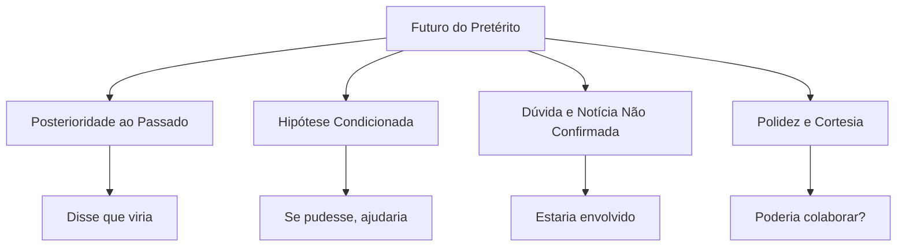
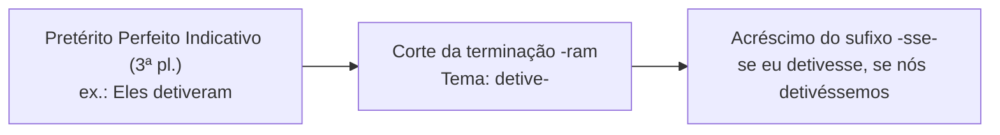
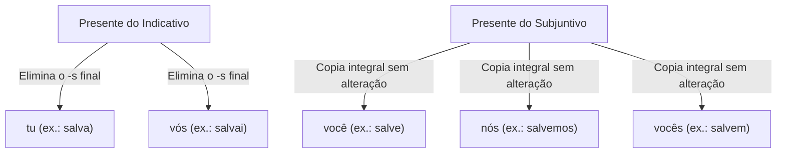
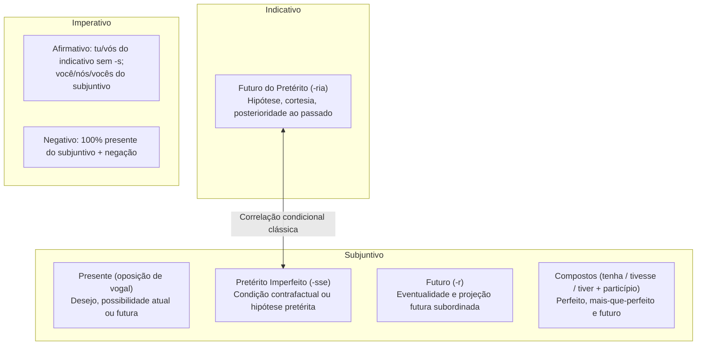

O domínio dos modos verbais é decisivo no estudo do emprego das classes de palavras, revelando a atitude discursiva do autor e viabilizando a correta resolução de itens de morfossintaxe. Enquanto o modo indicativo expressa certeza e objetividade, o subjuntivo projeta hipóteses, desejos, dúvidas e fatos incertos. O imperativo, por sua vez, organiza o discurso persuasivo, orientando condutas e emitindo ordens ou instruções diretas.

Neste capítulo, você fechará o estudo do modo indicativo com o futuro do pretérito e aprofundará todas as formas do modo subjuntivo e do imperativo. As bancas cobram reiteradamente as nuances semânticas desses tempos, a correlação entre pretérito imperfeito do subjuntivo e futuro do pretérito, a distinção entre futuro do subjuntivo e infinitivo flexionado e as regras de uniformidade de tratamento. Compreender esses mecanismos assegura precisão gramatical e interpretação textual refinada na prova.

> [!objetivos]
> - Empregar o futuro do pretérito simples e composto reconhecendo seus valores de hipótese, cortesia e incerteza.
> - Conjugar e diferenciar os tempos simples e compostos do modo subjuntivo.
> - Distinguir com segurança o futuro do subjuntivo do infinitivo flexionado em verbos regulares e irregulares.
> - Compreender o sistema de formação do modo imperativo afirmativo e negativo, evitando a mistura de pessoas gramaticais.
> - Reconhecer as particularidades morfológicas de verbos irregulares no imperativo e no subjuntivo.

## Futuro do pretérito do indicativo: formas e valores discursivos

O futuro do pretérito do indicativo é caracterizado pela desinência modo-temporal **-ria-** em todas as pessoas gramaticais (*levantaria*, *beberia*, *cairia*). Trata-se de um tempo que situa o fato como posterior a um ponto de referência no passado. No plano temporal estrito, o acontecimento narrado é futuro em relação a um marco pretérito já estabelecido na oração principal.

Apesar de integrar o modo indicativo, o futuro do pretérito frequentemente expressa atenuação, possibilidade ou condição. Antigamente a tradição gramatical o chamava de modo condicional. Seu emprego não indica certeza categórica, mas sim consequência dependente de circunstâncias ou polidez.

O quadro abaixo resume a conjugação regular desse tempo nos paradigmas das três conjugações verbais.

| Pessoa gramatical | 1ª conjugação (*operar*) | 2ª conjugação (*beber*) | 3ª conjugação (*cair*) |
| --- | --- | --- | --- |
| Eu | operaria | beberia | cairia |
| Tu | operarias | beberias | cairias |
| Ele / Ela | operaria | beberia | cairia |
| Nós | operaríamos | beberíamos | cairíamos |
| Vós | operaríeis | beberíeis | cairíeis |
| Eles / Elas | operariam | beberiam | cairiam |

A primeira e a terceira pessoas do singular apresentam formas idênticas (*eu operaria*, *ele operaria*). O contexto sintático e o sujeito explícito desfazem eventual ambiguidade na leitura da frase.

### Valores semânticos do futuro do pretérito simples

Nas provas de concurso público, o examinador não se limita à identificação morfológica. Ele cobra os efeitos de sentido gerados pelo futuro do pretérito no texto:

1. **Fato posterior a marco passado**: expressa ação que ocorreria após determinado evento já transcorrido. Exemplo: *O comandante afirmou que a tropa chegaria ao amanhecer e desenvolveria nova tática*.
2. **Fato condicionado a hipótese**: indica consequência que decorreria do cumprimento de condição prévia no pretérito imperfeito do subjuntivo (*-sse*). Exemplo: *Se a corporação recebesse recursos, patrulharia uma área mais extensa*.
3. **Incerteza, probabilidade ou boato jornalístico**: recurso para relatar informações não confirmadas oficialmente ou estimativas. Exemplo: *Segundo testemunhas, o suspeito estaria armado e teria comparsas no local*.
4. **Polidez e atenuação de pedidos**: substitui o presente ou o imperativo para conferir tom cortês ao diálogo. Exemplo: *O senhor poderia apresentar o documento de identificação?*

> [!exemplo] Valores discursivos em contexto operacional
> - **Ação posterior ao passado**: *O perito garantiu que o laudo ficaria pronto em cinco dias.*
> - **Hipótese condicionada**: *Se houvesse efetivo, abriríamos o posto avançado.*
> - **Dúvida / Estimativa**: *O prejuízo causado pelo incêndio chegaria a três milhões de reais.*
> - **Polidez institucional**: *Gostaria de solicitar acesso aos autos da sindicância.*

> [!pegadinha] O futuro do pretérito não expressa certeza absoluta
> Em provas, bancas afirmam que substituir o pretérito imperfeito do indicativo (*era*, *estava*) pelo futuro do pretérito (*seria*, *estaria*) reforça a convicção do autor. Isso é falso. O futuro do pretérito atenua a afirmação, transformando fato assertivo em conjectura, probabilidade ou hipótese.

### Futuro do pretérito composto

O futuro do pretérito composto é formado pelo verbo auxiliar *ter* (ou *haver*) no futuro do pretérito simples mais o particípio do verbo principal (*teria cumprido*, *haveria operado*).

Esse tempo composto expressa fato que teria ocorrido no passado caso uma condição tivesse sido satisfeita. Trata-se de hipótese contrafactual: *Se o socorro tivesse chegado antes, o bombeiro teria evitado o desabamento*. Em perguntas retóricas, denota dúvida sobre fato pretérito: *Quem teria autorizado a alteração na escala de serviço?* Em avaliações técnicas, indica probabilidade: *O defeito elétrico teria contribuído para o início das chamas*.

## Modo subjuntivo: hipótese, incerteza e desejo

O modo subjuntivo é o domínio da subjetividade na língua. Enquanto o indicativo enuncia fatos tidos como certos, o subjuntivo apresenta acontecimentos como incertos, prováveis, desejados ou hipotéticos.

Sua vocação sintática é a subordinação. O subjuntivo aparece após verbos de vontade, dúvida, sentimento ou temor (*desejo que*, *duvido que*, *temo que*), além de conjunções subordinativas condicionais, concessivas, finais e temporais. Nem sempre indica irrealidade: em orações concessivas regidas por *embora*, o fato pode ser real, mas a sintaxe exige o subjuntivo: *Embora chova em Olinda, a viatura mantém a ronda ostensiva*. Em orações temporais de incerteza, ocorre o mesmo: *Enquanto a abstinência de álcool não for comprovada, o motorista não reassumirá o volante*.

### Presente do subjuntivo

O presente do subjuntivo expressa fato incerto no presente ou desejo no futuro. Ele deriva da 1ª pessoa do singular do presente do indicativo, invertendo a vogal temática:

- Na **1ª conjugação** (*-ar*), a desinência torna-se **-e-** (*que eu salve*, *que tu salves*, *que ele salve*). Verbos em *-ear* ganham *i*: *que o fiscal passeie*.
- Na **2ª e 3ª conjugações** (*-er* e *-ir*), a desinência torna-se **-a-** (*que eu beba*, *que tu bebas*, *que ele caia*, *que nós cumpramos*).

| Pessoa | 1ª conjugação (*salvar*) | 2ª conjugação (*beber*) | 3ª conjugação (*cair*) |
| --- | --- | --- | --- |
| Que eu | salve | beba | caia |
| Que tu | salves | bebas | caias |
| Que ele / ela | salve | beba | caia |
| Que nós | salvemos | bebamos | caiamos |
| Que vós | salveis | bebais | caiais |
| Que eles / elas | salvem | bebam | caiam |

O contraste modal entre indicativo e subjuntivo gera efeitos cobrados em prova:

- *Há cidadãos que **cometem** infrações por desconhecimento.* (Indicativo: fato real e categórico).
- *Há quem **cometa** infrações por pura distração.* (Subjuntivo: hipótese ou atitude eventual).

> [!bizu] Gatilho para o presente do subjuntivo
> Para conjugar qualquer verbo no presente do subjuntivo, use a frase-guia: **"O comandante quer que eu..."**.
> - Quer que eu *salve* (1ª conjugação: termina em *-e*).
> - Quer que eu *beba* (2ª conjugação: termina em *-a*).
> - Quer que eu *caia* ou *parta* (3ª conjugação: termina em *-a*).

### Pretérito imperfeito do subjuntivo

O pretérito imperfeito do subjuntivo exprime condição, conjectura ou desejo. Sua marca é a desinência **-sse-** em todas as formas (*levantasse*, *bebesse*, *caísse*).

Sua formação baseia-se na 3ª pessoa do plural do pretérito perfeito do indicativo. Retira-se a terminação *-ram* e acrescenta-se *-sse-*:

- *Eles operaram* → tema *opera-* → *se eu operasse*, *se nós operássemos*.
- *Eles beberam* → tema *bebe-* → *se eu bebesse*, *se nós bebêssemos*.
- *Eles caíram* → tema *caí-* → *se eu caísse*, *se nós caíssemos*.

Essa derivação aplica-se aos verbos irregulares: *eles foram* → *se eu fosse*; *eles tiveram* → *se eu tivesse*; *eles puseram* → *se eu pusesse*; *eles viram* → *se eu visse*; *eles vieram* → *se eu viesse*.

No plano semântico, o pretérito imperfeito do subjuntivo expressa:

1. **Ação subordinada posterior a marco pretérito**: *O delegado duvidou que a testemunha dissesse a verdade*.
2. **Hipótese contrafactual ou desejo**: *Se todos escutassem o alerta, o acidente não aconteceria*. Também em narrativas de meta: *O primeiro pelotão que conquistasse a colina dominaria o vale*.

> [!atencao] Acentuação gráfica no imperfeito do subjuntivo
> No pretérito imperfeito do subjuntivo, a 1ª e a 2ª pessoas do plural recebem acento gráfico obrigatório por serem proparoxítonas: *se nós resgatássemos*, *se vós resgatásseis*, *se nós caíssemos*. O esquecimento desse acento é penalizado pela banca.

### Tempos compostos do subjuntivo: perfeito e mais-que-perfeito

O subjuntivo possui duas formas compostas com os auxiliares *ter* ou *haver*:

1. **Pretérito perfeito composto do subjuntivo**: formado por *tenha/haja* mais o particípio (*tenha operado*). Expressa fato passado concluído ou evento que se supõe terminado antes de marco futuro.
   - *Fato passado*: *Espero que a equipe tenha localizado os sobreviventes.*
   - *Futuro anterior*: *Acredito que o laudo já tenha saído quando chegarmos.*
2. **Pretérito mais-que-perfeito composto do subjuntivo**: estruturado por *tivesse/houvesse* mais o particípio (*tivesse operado*). Denota ação irreal no passado, um fato que não ocorreu e gerou consequência contrafactual.
   - *Exemplo*: *Se o alarme tivesse soado a tempo, os brigadistas teriam evacuado o prédio sem feridos.*

### Futuro do subjuntivo simples e composto

O futuro do subjuntivo expressa ação eventual ou hipotética que poderá ocorrer no futuro. Surge com conectivos condicionais ou temporais (*se*, *caso*, *quando*, *assim que*, *enquanto*).

Sua formação deriva da 3ª pessoa do plural do pretérito perfeito do indicativo. Retira-se a terminação *-ram* e acrescenta-se a desinência **-r-**:

- *Eles salvaram* → *quando eu salvar*, *quando tu salvares*, *quando eles salvarem*.
- *Eles beberam* → *quando eu beber*, *quando nós bebermos*, *quando eles beberem*.
- *Eles caíram* → *quando eu cair*, *quando tu caíres*, *quando eles caírem*.
- *Eles sobraram* → *se sobrarem recursos orçamentários, compraremos viaturas*.

O **futuro do subjuntivo composto** (*tiver/houver operado*) marca ação futura concluída antes de outro fato futuro: *Assim que a guarnição tiver concluído a ronda, o tráfego será liberado*.

| Tempo do subjuntivo | Estrutura | Sentido expresso | Exemplo de aplicação |
| --- | --- | --- | --- |
| Presente | Radical + vogal oposta (*-e* / *-a*) | Desejo ou probabilidade atual/futura | *Tomara que o reforço chegue logo.* |
| Pretérito imperfeito | Tema do pretérito + *-sse-* | Hipótese, condição contrafactual | *Se a escala permitisse, faríamos treino.* |
| Pretérito perfeito composto | *Tenha/haja* + particípio | Passado concluído ou futuro anterior | *Duvido que o réu tenha confessado.* |
| Pretérito mais-que-perfeito | *Tivesse/houvesse* + particípio | Ação irreal no passado | *Se tivéssemos chegado, o dano seria menor.* |
| Futuro simples | Tema do pretérito + *-r-* | Hipótese ou eventualidade futura | *Quando a ordem chegar, agiremos.* |
| Futuro composto | *Tiver/houver* + particípio | Ação futura concluída antes de outra | *Quando tivermos finalizado o laudo, sairemos.* |

## Futuro do subjuntivo versus infinitivo flexionado

O confronto entre **futuro do subjuntivo** e **infinitivo flexionado** é clássico nas bancas. Nos verbos regulares das três conjugações, as formas são idênticas na escrita e na pronúncia:

- Infinitivo de *combater*: *combater*, *combateres*, *combater*, *combatermos*, *combaterdes*, *combaterem*.
- Futuro do subjuntivo de *combater*: *(quando eu) combater*, *combateres*, *combater*, *combatermos*, *combaterdes*, *combaterem*.

Apesar da semelhança gráfica, a função sintática é distinta. O futuro do subjuntivo expressa hipótese temporal ou condicional dependente de conjunção subordinativa (*se*, *quando*). O infinitivo atua como nome substantivo e introduz orações reduzidas, comumente antecedido de preposição (*para*, *por*, *ao*, *sem*).

### O teste prático da substituição pelo verbo fazer

Para distinguir essas formas com rapidez, utilize a substituição pelo verbo irregular **fazer**:

1. Troque mentalmente a forma verbal analisada pelas formas de *fazer*:
   - Se couber **fizer**, a forma estará no **futuro do subjuntivo**.
   - Se couber **fazer**, a forma estará no **infinitivo**.

Examine a aplicação do teste nas seguintes sentenças:

- Frase 1: *Ao **terminar** o expediente, os militares recolheram o material.*
  - Teste: *Ao **fazer** o expediente...* (Infinitivo). Logo, *terminar* é **infinitivo**.
- Frase 2: *Quando o comandante **terminar** o expediente, poderemos sair.*
  - Teste: *Quando o comandante **fizer** o expediente...* (Subjuntivo). Logo, *terminar* é **futuro do subjuntivo**.

> [!bizu] O macete do verbo fazer
> Diante de verbos regulares, troque a forma sob dúvida por *fazer*:
> - Encaixou **fizer**? Trata-se de **futuro do subjuntivo** (*Quando você entregar a escala* → *Quando você fizer*).
> - Encaixou **fazer**? Trata-se de **infinitivo** (*Para você entregar a escala* → *Para você fazer*).

### Verbos irregulares com formas divergentes

Enquanto os regulares mascaram a diferença, verbos irregulares notáveis (*ver*, *vir*, *ter*, *pôr*) exibem radicais distintos no futuro do subjuntivo e no infinitivo.

A tabela abaixo apresenta o contraste direto nesses verbos fundamentais.

| Verbo no infinitivo | Infinitivo flexionado (modelo *fazer*) | Futuro do subjuntivo (modelo *fizer*) | Exemplo no subjuntivo |
| --- | --- | --- | --- |
| Ver | ver, veres, ver, vermos, verdes, verem | vir, vires, vir, virmos, virdes, virem | *Se você **vir** a fumaça, avise.* |
| Vir | vir, vires, vir, virmos, virdes, virem | vier, vieres, vier, viermos, vierdes, vierem | *Quando o socorro **vier**, embarque.* |
| Ter | ter, teres, ter, termos, terdes, terem | tiver, tiveres, tiver, tivermos, tiverdes, tiverem | *Se o militar **tiver** dúvidas, consulte a norma.* |
| Pôr | pôr, pores, pôr, pormos, pordes, porem | puser, puseres, puser, pusermos, puserdes, puserem | *Quando você **puser** o cinto, avise.* |
| Manter (*ter*) | manter, manteres, mantermos... | mantiver, mantiveres, mantivermos... | *Caso a tropa **mantiver** a calma, vencerá.* |
| Propor (*pôr*) | propor, propores, propormos... | propuser, propuseres, propusermos... | *Se o instrutor **propuser** o teste, cumpra.* |
| Intervir (*vir*) | intervir, intervires, intervirmos... | intervier, intervieres, interviermos... | *Se o policial **intervier**, evitará o roubo.* |
| Prever (*ver*) | prever, preveres, prevermos... | previr, previres, previrmos... | *Assim que o perito **previr** o risco...* |

Observe a distinção entre **ver** e **vir**: *vir* é infinitivo do verbo de deslocamento (*é tempo de vir*), mas é futuro do subjuntivo de ver (*quando você vir o perigo*). O futuro do subjuntivo de *vir* é *vier* (*quando ele vier ao plantão*).

> [!pegadinha] Troca de radicais em verbos derivados
> Bancas criam construções erradas apoiadas no infinitivo: *"Se você manter a posição..."* ou *"Quando o agente intervir..."*. O correto exige o radical primitivo: *se você mantiver* (como *tiver*), *quando o agente intervier* (como *vier*), *se o oficial propuser* (como *puser*).

## Modo imperativo: formação, uniformidade e formas especiais

O modo imperativo expressa ordens, instruções normativas, pedidos, conselhos ou súplicas. Liga-se à função apelativa da linguagem. O imperativo **não possui a 1ª pessoa do singular (*eu*)**, pois não se emite ordem direta a si mesmo no diálogo. Divide-se em **afirmativo** e **negativo**.

### Formação do imperativo afirmativo

O imperativo afirmativo possui composição híbrida:

1. As pessoas **tu** e **vós** derivam do **presente do indicativo**, mediante a **supressão do -s final**:
   - Tu salvas → **salva** (tu).
   - Vós salvais → **salvai** (vós).
   - Tu bebes → **bebe** (tu).
   - Vós bebeis → **bebei** (vós).
   - Tu cais → **cai** (tu).
   - Vós caís → **caí** (vós).
2. As demais pessoas (**você**, **nós**, **vocês**) derivam **integralmente do presente do subjuntivo**, sem alteração:
   - Que ele salve → **salve** (você).
   - Que nós salvemos → **salvemos** (nós).
   - Que eles salvem → **salvem** (vocês).
   - Que ele beba → **beba** (você).
   - Que eles bebam → **bebam** (vocês).

### Formação do imperativo negativo

O imperativo negativo é homogêneo: **todas as pessoas derivam do presente do subjuntivo**, com a partícula de negação (*não*, *nunca*).

- *Não salves* (tu)
- *Não salve* (você)
- *Não salvemos* (nós)
- *Não salveis* (vós)
- *Não salvem* (vocês)
- *Não bebas* (tu); *Não cometas* imprudências (tu); *Não beba* álcool (você)

A tabela compara o imperativo afirmativo e negativo nas três conjugações.

| Pessoa | 1ª conjugação: afirmativo / negativo | 2ª conjugação: afirmativo / negativo | 3ª conjugação: afirmativo / negativo |
| --- | --- | --- | --- |
| Tu | Opera / Não operes | Bebe / Não bebas | Cumpre / Não cumpras |
| Você | Opere / Não opere | Beba / Não beba | Cumpra / Não cumpra |
| Nós | Operemos / Não operemos | Bebamos / Não bebamos | Cumpramos / Não cumpramos |
| Vós | Operai / Não operais | Bebei / Não bebais | Cumpri / Não cumpram |
| Vocês | Operem / Não operem | Bebam / Não bebam | Cumpram / Não cumpram |

### Princípio da uniformidade de tratamento

O princípio da uniformidade de tratamento veda a mistura de pessoas gramaticais no mesmo enunciado: ou se usa a 2ª pessoa (*tu*, *te*, *teu*), ou se adota a 3ª pessoa (*você*, *o/a/lhe*, *seu*).

- *Errado (mistura tu e você)*: ***Vem** para o plantão e traga a **sua** escala.* (*Vem* é de *tu*; *traga* e *sua* são de *você*).
- *Certo no padrão "tu"*: ***Vem** para o plantão e traze a **tua** escala.*
- *Certo no padrão "você"*: ***Venha** para o plantão e traga a **sua** escala.*

> [!atencao] Uniformidade em avisos operacionais
> Observe a correção em orientações de serviço:
> - Errado: *Faze o relatório e envie os dados ao comando.* (Mistura o imperativo de *tu* com o de *você*).
> - Certo na 2ª pessoa: *Faze o relatório e envia os dados ao comando.*
> - Certo na 3ª pessoa: *Faça o relatório e envie os dados ao comando.*

### Particularidades morfológicas

1. **Verbos em -zer e -zir**: admitem apócope do *-e* na 2ª pessoa do singular do imperativo afirmativo:
   - *Fazer*: **faze** ou **faz** (tu).
   - *Dizer*: **dize** ou **diz** (tu).
   - *Trazer*: **traze** ou **traz** (tu).
   - *Conduzir*: **conduze** ou **conduz** (tu).
2. **Verbo ser**: apresenta formas específicas no imperativo:
   - Afirmativo: **sê** (tu), **seja** (você), **sejamos** (nós), **sede** (vós), **sejam** (vocês).
   - Negativo: *não sejas* (tu), *não seja* (você), *não sejamos* (nós), *não sejais* (vós), *não sejam* (vocês).
3. **Verbo ir**: exibe no afirmativo: **vai** (tu), **vá** (você), **vamos** (nós), **ide** (vós), **vão** (vocês).

## Mapa do capítulo

A tabela a seguir consolida os principais eixos conceituais trabalhados ao longo do capítulo.

| Modo e tempo verbal | Morfema característico | Valor primordial | Armadilha de prova |
| --- | --- | --- | --- |
| Futuro do pretérito indicativo | *-ria-* (*cantaria*) | Fato posterior ao passado, hipótese ou polidez | Achar que expressa certeza categórica |
| Presente do subjuntivo | Vogal temática trocada (*-e* / *-a*) | Desejo, probabilidade no presente ou futuro | Confundir com presente do indicativo em orações adjetivas |
| Pretérito imperfeito subjuntivo | *-sse-* (*cantasse*) | Hipótese, condição contrafactual | Esquecer o acento proparoxítono em *nós* e *vós* |
| Futuro do subjuntivo | *-r-* no tema do pretérito | Eventualidade subordinada futura | Confundir com o infinitivo nos verbos regulares |
| Imperativo afirmativo | Derivação mista (indicativo e subjuntivo) | Ordem, conselho, instrução positiva | Misturar as pessoas *tu* e *você* no mesmo período |
| Imperativo negativo | Integral do presente do subjuntivo | Proibição, desestímulo de conduta | Usar formas do indicativo precedidas da partícula *não* |

### Para fixar

- O futuro do pretérito (*-ria*) expressa fato posterior a marco passado, hipótese condicionada, incerteza factual ou polidez discursiva.
- A correlação clássica irreal conecta o pretérito imperfeito do subjuntivo (*-sse*) ao futuro do pretérito do indicativo (*-ria*).
- O pretérito mais-que-perfeito composto do subjuntivo (*tivesse/houvesse + particípio*) indica ação contrafactual que não se concretizou no passado.
- O presente do subjuntivo deriva da primeira pessoa do singular do presente do indicativo, invertendo a vogal temática (*-ar* vira *-e*; *-er/-ir* vira *-a*).
- Para distinguir futuro do subjuntivo de infinitivo, substitua a forma pelo verbo *fazer*: o encaixe de *fizer* aponta subjuntivo, e o de *fazer*, infinitivo.
- Verbos irregulares notáveis apresentam radicais divergentes: *ver* gera *vir* no futuro do subjuntivo; *vir* gera *vier*.
- Os verbos derivados seguem a flexão da matriz primitiva: *manter* gera *mantiver*; *propor* gera *propuser*; *intervir* gera *intervier*.
- O imperativo afirmativo forma *tu* e *vós* a partir do presente do indicativo sem o *-s* final; as demais pessoas vêm sem alteração do presente do subjuntivo.
- O imperativo negativo é inteiramente formado pelas pessoas correspondentes do presente do subjuntivo antecedidas de negação.
- O princípio da uniformidade de tratamento veda misturar formas de segunda pessoa (*tu*) com formas de terceira pessoa (*você*) na mesma frase.
