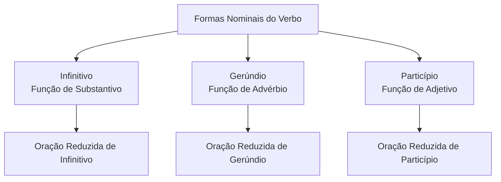
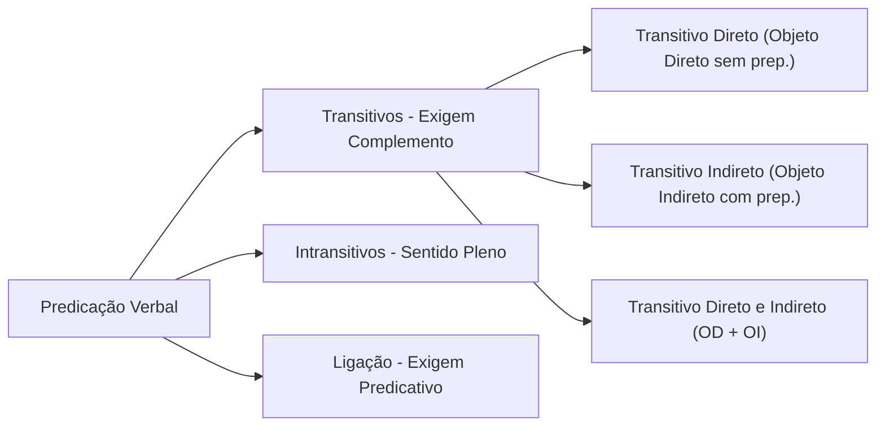
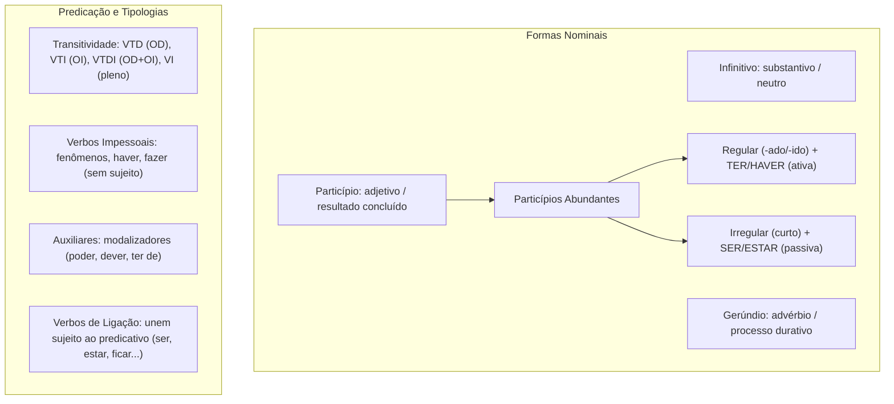

O estudo das formas nominais e da predicação verbal representa etapa indispensável para compreender a estrutura morfossintática do período e o emprego das classes de palavras. O verbo não atua isolado no enunciado. Ele estabelece vínculos com seus complementos, orienta a coesão textual e pode assumir funções semelhantes às das classes nominais, aproximando-se de substantivos, adjetivos ou advérbios.

Neste capítulo, você analisará o comportamento do infinitivo, do gerúndio e do particípio, com ênfase no emprego correto dos particípios abundantes. Em seguida, examinará a transitividade verbal em suas nuances contextuais, os verbos impessoais e unipessoais, o valor argumentativo dos auxiliares modalizadores e a tipologia dos verbos de ligação. O domínio desses pontos é cobrado frequentemente pelas bancas em questões de regência, concordância e reescrita.

> [!objetivos]
> - Identificar as três formas nominais do verbo e reconhecer suas funções substantiva, adjetiva e adverbial.
> - Compreender os múltiplos valores circunstanciais expressos pelo gerúndio em orações reduzidas.
> - Aplicar a regra geral de emprego dos particípios abundantes regulares e irregulares, evitando erros comuns.
> - Determinar a transitividade dos verbos a partir da análise sintática do contexto oracional.
> - Distinguir verbos impessoais e unipessoais e identificar os valores dos auxiliares e verbos de ligação.

## Formas nominais do verbo e orações reduzidas

As formas nominais do verbo são o **infinitivo**, o **gerúndio** e o **particípio**. Recebem essa denominação porque não apresentam, em sua estrutura básica, desinências de tempo e de modo, podendo desempenhar papéis sintáticos típicos dos nomes:

1. **Infinitivo**: expressa a ação verbal em potência, de modo neutro e conceitual. Atua frequentemente como **substantivo**: *Nadar fortalece a musculatura* (= *A natação fortalece...*); *Fumar prejudica a capacidade respiratória dos combatentes* (= *O fumo prejudica...*).
2. **Gerúndio**: manifesta a ação em curso ou em desenvolvimento contínuo. Desempenha tipicamente papel de **advérbio**, indicando circunstâncias variadas: *Chegando à ocorrência, os socorristas avaliaram a cena* (= circunstância temporal).
3. **Particípio**: assinala o resultado da ação concluída. Funciona eminentemente como **adjetivo**, concordando em gênero e número com o substantivo: *A quantia arrecadada foi destinada ao fundo comunitário* (= *A quantia que foi arrecadada...*).

Além de constituírem tempos compostos e locuções verbais (*estou operando*, *tinha cumprido*, *venho estudando*), as formas nominais encabeçam as chamadas **orações reduzidas**. Essas orações não possuem conectivo introdutório (conjunção ou pronome relativo) e trazem o verbo em uma das três formas nominais.

### Infinitivo impessoal e infinitivo flexionado

O infinitivo apresenta duas modalidades distintas na língua portuguesa:

- **Infinitivo impessoal**: forma pura e invariável (*terminar*, *prender*, *partir*). Expressa a ideia verbal de maneira vaga, sem personalizar a ação e sem referência a sujeito gramatical determinado: *É fundamental respeitar as normas de trânsito em Recife*.
- **Infinitivo flexionado (pessoal)**: recebe desinências número-pessoais (*terminares*, *terminarmos*, *terminardes*, *terminarem*), apontando um sujeito específico: *É fundamental respeitarmos as normas de trânsito*. O infinitivo flexionado singular (*ele respeitar*) possui a mesma grafia do modo impessoal; contudo, classifica-se como pessoal quando atrelado a sujeito expresso ou contextualizável.

A tabela abaixo sintetiza as principais características das formas nominais.

| Forma nominal | Terminação regular | Função sintática típica | Exemplo em oração reduzida | Paráfrase desenvolvida correspondente |
| --- | --- | --- | --- | --- |
| Infinitivo | *-ar*, *-er*, *-ir*, *-or* | Substantivo | *Ao sair da viatura, o policial acionou o rádio.* | *Quando saiu da viatura...* |
| Gerúndio | *-ndo* | Advérbio | *Cumprindo a ordem, a tropa recuou com segurança.* | *Porque cumpriu a ordem...* |
| Particípio | *-ado*, *-ido* (ou irregular) | Adjetivo | *Concluído o inquérito, os autos subiram ao juízo.* | *Logo que o inquérito foi concluído...* |

## Carga semântica e valores circunstanciais do gerúndio

O valor básico do gerúndio é exprimir um processo em andamento, durativo e inacabado (*estou lavrando o auto de infração*). Na locução de continuidade, ele indica aspecto progressivo e pode alternar-se com construções preposicionadas equivalentes: *A guarnição está investigando o fato* equivale à fórmula lusitana *A guarnição está a investigar*.

Em orações subordinadas reduzidas, o gerúndio estabelece uma rede diversificada de relações circunstanciais com a oração principal. A identificação desses sentidos é recorrente em itens de coesão textual:

1. **Tempo**: expressa simultaneidade ou marco temporal imediato. Exemplo: *Chegando ao batalhão, o sargento assumiu o posto de comando*. (= *Quando chegou ao batalhão*).
2. **Condição**: indica hipótese necessária para a realização de outro fato. Exemplo: *Mantendo a calma durante o resgate, a vítima facilitará a retirada*. (= *Se mantiver a calma*).
3. **Modo**: aponta a forma ou o meio pelo qual a ação se consumou. Exemplo: *O perito identificou a substância analisando os resíduos no microscópio*. (= *por meio da análise*).
4. **Causa**: justifica o motivo da oração principal. Exemplo: *Percebendo o perigo iminente na encosta, os moradores deixaram as casas*. (= *Visto que perceberam o perigo*).
5. **Concessão**: expressa ressalva que não impede o fato principal. Exemplo: *Mesmo enfrentando forte neblina na serra, o helicóptero pousou em segurança*. (= *Embora enfrentasse neblina*).
6. **Valor adjetivo**: caracteriza um substantivo antecedente, substituindo oração adjetiva. Exemplo: *Apreendemos documentos comprovando a fraude contábil*. (= *documentos que comprovavam a fraude*).

> [!atencao] Gerúndio versus oração adjetiva
> A substituição de uma oração reduzida de gerúndio por uma oração adjetiva pode alterar a nuance aspectual do enunciado. Dizer *detetives investigando a ocorrência* ressalta a ação em andamento naquele exato momento, enquanto *detetives que investigam* denota um hábito permanente ou atribuição funcional. A banca costuma explorar essa sutil diferença de sentido ético e semântico em dados divulgados oficialmente.

A tabela a seguir sistematiza as cargas semânticas do gerúndio com exemplos operacionais.

| Relação semântica | Exemplo com oração reduzida | Paráfrase explicativa desenvolvida | Conectivo subordinativo equivalente |
| --- | --- | --- | --- |
| Temporal | *Ouvindo o sinal de emergência, os bombeiros correram.* | *Assim que ouviram o sinal de emergência...* | *quando*, *assim que* |
| Causal | *Temendo represálias da quadrilha, a testemunha calou-se.* | *Como temia represálias da quadrilha...* | *porque*, *já que*, *como* |
| Condicional | *Treinando diariamente no estande, você aprimorará o tiro.* | *Se você treinar diariamente no estande...* | *se*, *caso* |
| Modal | *A guarnição entrou no imóvel arrombando o portão lateral.* | *...por meio do arrombamento do portão.* | *por meio de*, *mediante* (locuções; a NGB não lista conjunção modal) |
| Concessiva | *Mesmo chovendo torrencialmente, o policiamento continuou.* | *Embora chovesse torrencialmente...* | *embora*, *ainda que* |

## Particípios abundantes: regras de emprego e armadilhas

Denominam-se **verbos abundantes** aqueles que possuem duas formas equivalentes para a mesma função gramatical, fenômeno que ocorre primordialmente no particípio. Nesses casos, coexistem:

- O **particípio regular**: formado pelo radical acrescido das desinências *-ado* (1ª conjugação) ou *-ido* (2ª e 3ª conjugações): *pagado*, *aceitado*, *acendido*, *imprimido*, *elegido*.
- O **particípio irregular**: caracterizado por forma abreviada, frequentemente com alteração no radical ou terminação em consoante: *pago*, *aceito*, *aceso*, *impresso*, *eleito*.

### A regra de ouro na aplicação dos particípios

Para garantir rigor gramatical na norma culta, aplica-se a seguinte diretriz clássica:

1. O **particípio regular** deve ser utilizado na **voz ativa**, acompanhado dos verbos auxiliares **ter** ou **haver**:
   - *O empresário **havia aceitado** a proposta de conciliação.*
   - *A administração **tinha pagado** todos os fornecedores do Estado.*
   - *O escrivão **tinha imprimido** o termo de declarações antes do depoimento.*
2. O **particípio irregular** deve ser empregado na **voz passiva** ou em orações com predicativo, acompanhado dos verbos auxiliares **ser** ou **estar**:
   - *A proposta de conciliação **foi aceita** pelo empresário.*
   - *Os fornecedores do Estado **foram pagos** pela administração.*
   - *O termo de declarações **estava impresso** sobre a mesa da delegacia.*

> [!bizu] Memorização da regra dos particípios
> Associe as letras iniciais para nunca mais esquecer a combinação:
> - **T**ER / **H**AVER pedem a forma **R**egular (*longa* terminada em *-ado/-ido*).
> - **S**ER / **E**STAR pedem a forma **I**rregular (*curta*).
> - Frase de apoio: *"Ele **tinha pagado** a conta, mas ela já **estava paga**."*

Gramáticos atuais aceitam também *ganho*, *gasto* e *pago* com *ter* e *haver* (*tinha pago*). Se a questão cobrar a regra, siga a tradicional acima.

O quadro comparativo a seguir reúne os principais verbos com particípio duplo mais cobrados em concursos.

| Verbo no infinitivo | Particípio regular (com *ter/haver*) | Particípio irregular (com *ser/estar*) | Aplicação correta na voz ativa | Aplicação correta na voz passiva |
| --- | --- | --- | --- | --- |
| Aceitar | aceitado | aceito | *O réu havia aceitado o acordo.* | *O acordo foi aceito pelo réu.* |
| Acender | acendido | aceso | *O vigia tinha acendido as luzes.* | *As luzes foram acesas pelo vigia.* |
| Entregar | entregado | entregue | *O carteiro havia entregado a intimação.* | *A intimação foi entregue pelo carteiro.* |
| Encher | enchido | cheio | *A chuva havia enchido o reservatório.* | *O reservatório estava cheio de água.* |
| Extinguir | extinguido | extinto | *A lei tinha extinguido o cargo público.* | *O cargo público foi extinto pela lei.* |
| Imprimir | imprimido | impresso | *O setor havia imprimido os mapas.* | *Os mapas foram impressos pelo setor.* |
| Limpar | limpado | limpo | *A equipe tinha limpado o quartel.* | *O alojamento foi limpo pela equipe.* |
| Morrer | morrido | morto | *A vítima havia morrido no hospital.* | *O suspeito foi morto em confronto.* |
| Pagar | pagado | pago | *O governo havia pagado as diárias.* | *As diárias foram pagas pelo governo.* |
| Suspender | suspendido | suspenso | *O juiz tinha suspendido a audiência.* | *A audiência foi suspensa pelo juiz.* |
| Tingir | tingido | tinto | *O artesão tinha tingido o tecido.* | *O tecido foi tinto com corante natural.* |
| Fixar | fixado | fixo | *O comando havia fixado o aviso.* | *O aviso estava fixo no mural.* |
| Misturar | misturado | misto | *O laboratorista havia misturado reagentes.* | *O composto misto foi analisado.* |
| Soltar | soltado | solto | *O carcereiro havia soltado o detento.* | *O detento foi solto por ordem judicial.* |
| Expressar | expressado | expresso | *O diretor havia expressado sua discordância.* | *O repúdio ficou expresso na ata.* |
| Eleger | elegido | eleito | *A categoria havia elegido os delegados.* | *Os delegados foram eleitos pela tropa.* |

### Armadilhas e falsos particípios abundantes

Bancas examinadoras adoram criar alternativas com formas inexistentes no padrão culto. Fique alerta aos seguintes casos:

1. **Os verbos trazer e chegar não são abundantes**: possuem exclusivamente o particípio regular terminado em *-ido*. As formas *"trago"* e *"chego"* como particípio são erros grosseiros na modalidade padrão. O correto é *tinha trazido* e *havia chegado*.
2. **O verbo escrever não admite particípio regular**: o único particípio registrado é a forma irregular **escrito**. A palavra *"escrevido"* não existe na língua portuguesa.
3. **O verbo dizer possui apenas dito**: construções como *"dizido"* inexistem formalmente.
4. **O verbo fazer possui apenas feito**: não se admite *"fazido"*.
5. **O verbo abrir possui apenas aberto**: não se tolera *"abrido"*.
6. **O verbo cobrir possui apenas coberto**: a forma *"cobrido"* é rejeitada pela norma culta.

> [!pegadinha] Formas inventadas em prova
> Examine a frase: *"O suspeito já tinha trago a arma e havia chego ao local antes dos policiais"*. Em prova, essa oração está absolutamente incorreta. Redige-se corretamente: *O suspeito já tinha **trazido** a arma e havia **chegado** ao local antes dos policiais*.

### Particípio com valor adverbial e distinção em relação ao adjetivo

Assim como o gerúndio, o particípio pode introduzir orações reduzidas com valor adverbial:

- **Tempo**: *Concluído o treinamento tático, os militares retornaram à base.* (= *Depois que se concluiu o treinamento*).
- **Condição**: *Superada esta barreira burocrática, iniciaremos as nomeações.* (= *Caso seja superada a barreira*).
- **Causa**: *Atingido por estilhaços, o combatente recebeu atendimento médico imediato.* (= *Porque foi atingido*).
- **Concessão**: *Cercado por três viaturas, o fugitivo ainda tentou resistir à prisão.* (= *Embora estivesse cercado*).

Para distinguir se uma forma isolada é adjetivo ou particípio em contexto ambíguo, verifique a presença de agente: se houver agente da passiva expresso (*a medida foi tomada pelo governador*), trata-se incontestavelmente de verbo no particípio.

## Transitividade verbal e dinamicidade contextual

A transitividade verbal indica a necessidade que certos verbos apresentam de receber complementos para integrar plenamente o sentido da oração. Essa classificação não é um rótulo estático do dicionário, mas uma propriedade que decorre do papel exercido pelo verbo no contexto da frase:

1. **Verbo Transitivo Direto (VTD)**: exige complemento que se liga a ele diretamente, **sem preposição obrigatória**. Esse complemento chama-se **objeto direto**: *A guarnição apreendeu o armamento ilegal*. Quem apreende, apreende algo (*o armamento ilegal* = objeto direto).
2. **Verbo Transitivo Indireto (VTI)**: exige complemento intermediado por **preposição obrigatória** regida pelo próprio verbo. Esse complemento denomina-se **objeto indireto**: *Os servidores confiam no comando da instituição*. Quem confia, confia em algo ou alguém (*no comando da instituição* = objeto indireto regido pela preposição *em*).
3. **Verbo Transitivo Direto e Indireto (VTDI)**: necessita concomitantemente de dois complementos, um direto e outro indireto. Denomina-se também bitransitivo: *O instrutor ministrou o curso tático aos novos soldados*. (*O curso tático* = objeto direto; *aos novos soldados* = objeto indireto).
4. **Verbo Intransitivo (VI)**: não exige complemento sintático para integrar seu núcleo de sentido, trazendo significação plena. Pode vir acompanhado de adjuntos adverbiais que indicam lugar, tempo, modo ou instrumento: *O suspeito correu desesperadamente pela avenida*. (*Correu* é intransitivo; *desesperadamente* é adjunto adverbial de modo; *pela avenida* é adjunto adverbial de lugar). O policial permaneceu em ação prolongada, dedicando atenção ao dever e observando o pedestre que estava bebendo água tranquilamente.

> [!exemplo] Variação da transitividade conforme o contexto
> - *O temporal passou rapidamente sobre a cidade.* → **Intransitivo** (indica ação que transcorreu; *rapidamente* e *sobre a cidade* são adjuntos adverbiais).
> - *O projeto não passou de uma tentativa fracassada.* → **Transitivo Indireto** (rege a preposição *de*; *de uma tentativa* é objeto indireto).
> - *O soldado passou a mensagem ao sargento.* → **Transitivo Direto e Indireto** (*a mensagem* = OD; *ao sargento* = OI).
> - *O candidato passou no concurso público.* → **Intransitivo** na regência consagrada, com *no concurso* atuando como adjunto adverbial de lugar/circunstância.

## Classificação especial dos verbos: impessoais e unipessoais

Determinados verbos afastam-se do paradigma comum de conjugação por não admitirem sujeito ou por restringirem sua flexão a pessoas gramaticais específicas:

### Verbos impessoais

Os verbos impessoais não possuem sujeito sintático associado. Conjugam-se exclusivamente na **terceira pessoa do singular**, e suas orações são classificadas como orações sem sujeito:

1. **Verbos que exprimem fenômenos meteorológicos**: *chover*, *ventar*, *nevar*, *trovejar*, *relampejar*, *anoitecer*. Exemplo: *Choveu torrencialmente durante toda a madrugada em Caruaru*. Se empregados em sentido figurado, admitem sujeito e plural: *Choveram reclamações na ouvidoria*.
2. **Verbo haver com sentido de existir ou acontecer**: *Havia muitos pedestres na avenida quando a colisão ocorreu*. É incorreto pluralizar o verbo: *"Houveram muitos pedestres"* constitui erro clássico em concurso.
3. **Verbos haver e fazer indicando tempo decorrido**: *Há três meses o regimento não realizava manobras de campo*; *Faz dois anos que os novos oficiais se formaram*. As formas permanecem sempre no singular.

### Verbos unipessoais

Os verbos unipessoais admitem sujeito gramatical, mas conjugam-se apenas na **terceira pessoa (do singular ou do plural)**:

1. **Vozes e ruídos de animais**: *latir*, *miar*, *rosnar*, *mugir*, *relinchar*. O cão late; os cães latem.
2. **Verbos que tomam orações substantivas como sujeito**: *convir*, *cumprir*, *importar*, *parecer*, *urgir*, *constar*. Exemplo: *Cumpre aos policiais garantir a segurança pública*. A oração *garantir a segurança pública* funciona como sujeito oracional do verbo *cumpre*.

> [!atencao] Concordância com o verbo haver
> Quando o verbo *haver* atua como principal em locução verbal com sentido de existir, ele transmite sua impessoalidade ao verbo auxiliar:
> - Certo: *Deve haver soluções viáveis para a crise.*
> - Errado: *Devem haver soluções viáveis para a crise.*
> Em contrapartida, com o verbo *existir* (que é pessoal), o auxiliar flexiona normalmente: *Devem existir soluções viáveis para a crise*.

## Verbos auxiliares e modalizadores discursivos

Uma **locução verbal** é constituída por dois ou mais verbos que desempenham conjuntamente a função de um único verbo. Em sua estrutura típica, identificam-se:

- O **verbo auxiliar**: sofre as flexões de tempo, modo, número e pessoa, ajustando-se gramaticalmente ao sujeito da oração.
- O **verbo principal**: permanece invariável em uma das três formas nominais (infinitivo, gerúndio ou particípio) e concentra o sentido lexical da ação.

Além de marcar tempo e aspecto, os verbos auxiliares exercem função primordial como **modalizadores discursivos**, expressando a avaliação, a atitude ou o grau de certeza do locutor sobre o fato:

| Verbo auxiliar | Matiz modalizador expresso | Exemplo de aplicação em texto |
| --- | --- | --- |
| Poder | Possibilidade ou dúvida | *O temporal pode provocar novos deslizamentos na barreira.* |
| Poder | Permissão formal | *Os visitantes podem acessar o quartel mediante autorização.* |
| Poder | Capacidade física ou intelectual | *O mergulhador de resgate pode suportar baixas temperaturas.* |
| Dever | Probabilidade ou suposição | *A comitiva ministerial deve chegar por volta das dez horas.* |
| Dever | Obrigação jurídica ou moral | *O servidor público deve agir com probidade e presteza.* |
| Ter de / Ter que | Necessidade ineludível ou imposição | *A guarnição tem de apresentar o relatório ainda hoje.* |
| Haver de | Desejo convicto ou fatalidade | *Os aprovados hão de honrar a farda militar em Pernambuco.* |
| Parecer | Certeza atenuada ou aparência | *O condutor parecia desconhecer as regras de trânsito locais.* |
| Começar a | Aspecto incoativo (início da ação) | *Os bombeiros começaram a isolar a área sinistrada.* |
| Estar para | Iminência imediata do fato | *O laudo pericial está para sair nas próximas horas.* |
| Acabar de | Ação recentemente concluída | *O comboio de viaturas acabou de cruzar a ponte.* |

## Verbos de ligação e a expressão do estado

Os verbos de ligação (copulativos) distinguem-se radicalmente dos verbos nocionais por não expressarem ações, processos ou fenômenos autônomos. Sua função primordial consiste em estabelecer um elo sintático e semântico entre o **sujeito** e um atributo que lhe é conferido, denominado **predicativo do sujeito**.

O elemento essencial da predicação nos verbos de ligação reside no próprio predicativo. Dependendo do verbo escolhido, a relação com o sujeito revela diferentes tipologias de estado:

1. **Estado permanente**: expresso tradicionalmente pelo verbo *ser*. Indica característica inerente, duradoura ou essencial. Exemplo: *O capitão é rigoroso no cumprimento dos prazos regulamentares*. Mesmo flexionado no pretérito (*era rigoroso*), indica traço duradouro naquele período histórico.
2. **Estado transitório ou circunstancial**: manifestado pelos verbos *estar* e *andar*. Reflete condição momentânea ou passageira. Exemplo: *A guarnição está atenta às movimentações suspeitas*; *O militar anda preocupado com os exames físicos*.
3. **Estado continuado**: marcado pelos verbos *permanecer* e *continuar*. Sinaliza a persistência de uma condição previamente iniciada. Exemplo: *Apesar dos apelos, o acesso ao local permaneceu interditado pelos agentes*; *A diretora continuou bem-humorada durante a reunião sobre moralidade administrativa*.
4. **Mudança de estado**: assinalada pelos verbos *ficar*, *tornar-se*, *virar*, *cair*. Revela transição de uma condição para outra. Exemplo: *O tenente ficou satisfeito com a rapidez da resposta operacional*; *O acusado virou réu após o acolhimento da denúncia*.
5. **Estado aparente**: traduzido pelo verbo *parecer*. Expressa percepção subjetiva ou impressão externa. Exemplo: *A estrutura metálica parecia sólida antes da perícia técnica*.

> [!pegadinha] Verbo de ligação versus verbo intransitivo
> Um verbo não é de ligação por natureza intrínseca, mas pela presença efetiva de um predicativo do sujeito. Observe o contraste:
> - *Os policiais estavam apreensivos.* → **Verbo de ligação** (liga o sujeito ao predicativo *apreensivos*).
> - *Os policiais estavam no pátio do batalhão.* → **Verbo intransitivo** (indica localização; *no pátio* é adjunto adverbial de lugar, não predicativo).
> - *A sentinela anda rápido.* → **Verbo intransitivo** (expressa ação de caminhar; *rápido* é adjunto adverbial de modo).
> - *A sentinela anda apreensiva.* → **Verbo de ligação** (expressa estado passageiro; *apreensiva* é predicativo do sujeito).

## Mapa do capítulo

A tabela abaixo sintetiza os principais eixos conceituais trabalhados ao longo do capítulo.

| Tópico gramatical | Regra de funcionamento | Armadilha de prova frequente | Solução segura para acertar |
| --- | --- | --- | --- |
| Particípios abundantes | Regular com *ter/haver*; irregular com *ser/estar* | Empregar *"tinha impresso"* ou *"foi pagado"* | Lembrar da regra: TER/HAVER pedem a forma regular |
| Falsos particípios | Trazer e chegar só admitem *trazido* e *chegado* | Aceitar *"tinha trago"* ou *"havia chego"* | Eliminar qualquer alternativa com *"trago"* ou *"chego"* |
| Gerúndio circunstancial | Expressa tempo, causa, condição, modo ou concessão | Confundir valor durativo com oração adjetiva estática | Desenvolver a oração reduzida com conectivo equivalente |
| Verbo haver impessoal | Sentido de existir ou tempo: sempre na 3ª pessoa do singular | Pluralizar o verbo: *"houveram incidentes"* | Manter o verbo invariável no singular (*houve incidentes*) |
| Transitividade contextual | Depende da relação sintática estabelecida no período | Decorar transitividade fixa em dicionário | Analisar se há objeto direto, indireto ou adjunto adverbial |
| Verbo de ligação | Exige obrigatoriamente predicativo do sujeito | Confundir adjunto adverbial de lugar com predicativo | Verificar se o termo expressa estado ou circunstância local |

### Para fixar

- O infinitivo desempenha papel de substantivo; o gerúndio, papel de advérbio; o particípio, papel de adjetivo.
- As formas nominais estruturam locuções verbais, tempos compostos e orações subordinadas reduzidas.
- O gerúndio indica processo contínuo e expressa valores de tempo, causa, condição, modo, concessão ou qualificação.
- Na regra dos particípios abundantes, as formas regulares em *-ado/-ido* unem-se a *ter* e *haver* na voz ativa.
- As formas irregulares dos particípios unem-se aos verbos *ser* e *estar* na construção da voz passiva.
- Os verbos *trazer* e *chegar* admitem exclusivamente *trazido* e *chegado*; as formas *"trago"* e *"chego"* não existem como particípio.
- O verbo *escrever* admite apenas o particípio *escrito*; a forma *"escrevido"* constitui desvio repudiado na norma culta.
- A transitividade é dinâmica: o mesmo verbo pode ser transitivo direto, indireto ou intransitivo dependendo do contexto.
- O verbo *haver* com sentido de existir ou tempo transcorrido é impessoal e permanece sempre na 3ª pessoa do singular.
- Verbos de ligação exigem obrigatoriamente predicativo do sujeito, expressando estado permanente, transitório, continuado, aparente ou de mudança.
