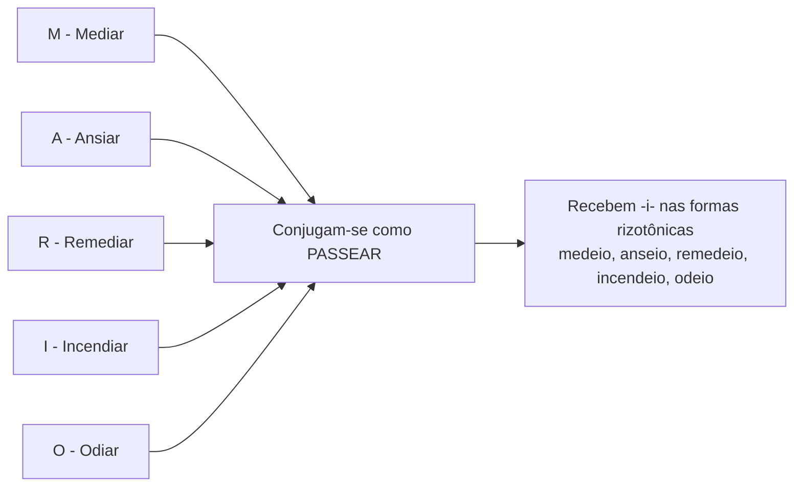
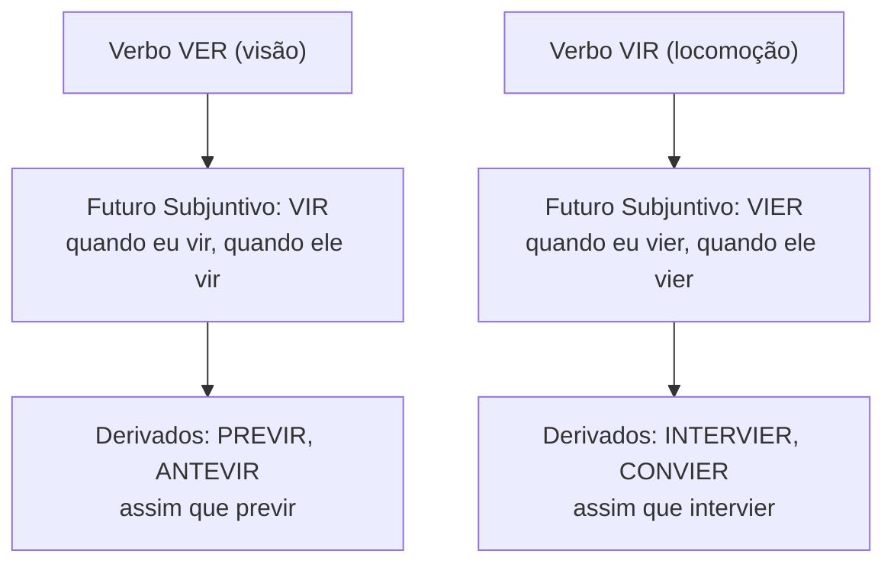
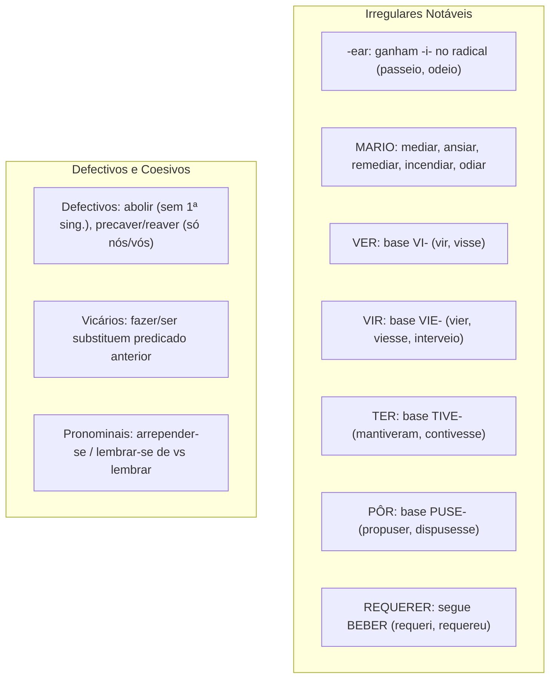

A morfologia verbal atinge seu ponto mais exigente no estudo dos verbos irregulares. No estudo do emprego das classes de palavras e da estrutura morfossintática do período, o examinador explora formas que desafiam o senso comum. Determinadas formas alteram radicais ou simplesmente não existem na norma culta. O domínio dessas particularidades assegura precisão gramatical e coesão textual em provas de concurso.

Determinados verbos irregulares recebem o rótulo de verbos traiçoeiros, dissimulados e polêmicos. Eles induzem o candidato ao erro por apresentarem flexões inesperadas. Neste capítulo, você dominará as regras de verbos em *-ear* e *-iar*, o mnemônico MARIO e as matrizes *ver*, *vir*, *ter* e *pôr*. Também estudará o confronto entre *querer* e *requerer*, as lacunas dos defectivos e o papel dos verbos vicários e pronominais. As bancas cobram esses tópicos com frequência.

> [!objetivos]
> - Classificar os verbos quanto à regularidade flexional em regulares, irregulares, anômalos e defectivos.
> - Aplicar as regras de conjugação para verbos em *-ear* e *-iar*, dominando as exceções do mnemônico MARIO.
> - Conjugar com segurança os verbos *ver*, *vir*, *ter*, *pôr* e seus derivados nos tempos de maior incidência.
> - Diferenciar a flexão de *requerer* em relação a *querer*, evitando analogias indevidas.
> - Reconhecer as limitações dos verbos defectivos e identificar a função coesiva dos verbos vicários e pronominais.

## Classificação geral dos verbos quanto à flexão

Na língua portuguesa, os verbos agrupam-se em categorias estruturais conforme a estabilidade de seus elementos mórficos:

1. **Verbos regulares**: mantêm o radical inalterado durante toda a flexão. Adotam as desinências padrão de sua conjugação (*cantar*, *atender*, *cumprir*).
2. **Verbos irregulares**: sofrem alterações no radical ou se afastam das desinências padrão (*caber*, *dizer*, *trazer*, *ouvir*).
3. **Verbos anômalos**: reúnem radicais históricos totalmente distintos. Os únicos verbos anômalos são **ser** (*sou*, *fui*, *era*, *seja*) e **ir** (*vou*, *fui*, *ia*, *vá*).
4. **Verbos defectivos**: não possuem conjugação completa. Faltam-lhes certas pessoas ou tempos por motivos eufônicos (*abolir*, *precaver*, *reaver*).
5. **Verbos abundantes**: possuem duas ou mais formas equivalentes para a mesma flexão, principalmente no particípio (*pago* e *pagado*).

A tabela abaixo resume essas categorias estruturais.

| Categoria | Radical | Desinências | Exemplos |
| --- | --- | --- | --- |
| Regulares | Fixo e inalterado | Seguem o paradigma | *operar*, *resgatar* |
| Irregulares | Sofre modificações | Apresentam variações | *dar*, *saber*, *trazer* |
| Anômalos | Raízes múltiplas | Matrizes históricas distintas | *ser*, *ir* |
| Defectivos | Pode variar | Faltam formas específicas | *falir*, *banir*, *precaver* |
| Abundantes | Pode admitir duplicidade | Duplo particípio | *eleger*, *imprimir* |

A principal tática da banca consiste em conjugar um verbo irregular como se ele fosse regular.

## Verbos em -ear e -iar: a regra e o mnemônico MARIO

A conjugação dos verbos terminados em *-ear* e *-iar* exige atenção aos detalhes:

### Verbos em -iar: regra geral da regularidade

Os verbos terminados em **-iar** são, em regra, regulares. Eles seguem o paradigma do verbo **criar**: *eu crio*, *tu crias*, *ele cria*, *nós criamos*, *vós criais*, *eles criam*. O radical permanece estável.

Seguem esse modelo os verbos: *copiar* (*copio*), *variar* (*vario*), *espiar* (*espio*), *guiar* (*guio*), *avaliar* (*avalio*).

### Verbos em -ear: irregularidade com epêntese de -i-

Os verbos terminados em **-ear** são sistematicamente irregulares. Nas formas rizotônicas (com acento tônico no radical: *eu*, *tu*, *ele*, *eles*), esses verbos recebem a letra **-i-** após o radical:

- Modelo **passear**: *eu passeio*, *tu passeias*, *ele passeia*, *eles passeiam*.
- Nas formas arrizotônicas, o acento recai na desinência, mantendo a forma original: *nós passeamos*, *vós passeais*.
- No presente do subjuntivo: *que eu passeie*, *que tu passeies*, *que ele passeie*, *que eles passeiem*; mas *que nós passeemos*, *que vós passeeis*.

Seguem passear verbos como: *nomear* (*nomeio*), *bloquear* (*bloqueio*), *frear* (*freio*), *recear* (*receio*).

### A exceção dos verbos MARIO

Cinco verbos em *-iar* não seguem *criar*. Eles conjugam-se como verbos em *-ear*, recebendo *-i-* nas formas rizotônicas. É o grupo **MARIO**:

- **M**ediar → *eu medeio*, *ele medeia*, *que eles medeiem*.
- **A**nsiar → *eu anseio*, *ele anseia*, *que nós ansiemos*.
- **R**emediar → *eu remedeio*, *ele remedeia*, *que eles remedeiem*.
- **I**ncendiar → *eu incendeio*, *ele incendeia*, *que eles incendeiem* (inclui *intermediar*).
- **O**diar → *eu odeio*, *ele odeia*, *que eles odeiem*.

> [!pegadinha] O verbo mobiliar
> O verbo *mobiliar* não pertence ao grupo MARIO. Ele é regular na escrita, mas a tônica recai no radical: *eu mobílio*, *tu mobílias*, *ele mobília*, *eles mobíliam*. Não existe a forma *"mobeleio"*.

A tabela compara os três modelos de conjugação.

| Pessoa | *Copiar* (regular em *-iar*) | *Passear* (irregular em *-ear*) | *Mediar* (exceção MARIO) |
| --- | --- | --- | --- |
| Presente Indicativo (Eu) | copio | passeio | medeio |
| Presente Indicativo (Ele) | copia | passeia | medeia |
| Presente Indicativo (Nós) | copiamos | passeamos | mediamos |
| Presente Subjuntivo (Que eu) | copie | passeie | medeie |
| Presente Subjuntivo (Que nós) | copiemos | passeemos | mediemos |

## Verbos em -uar, -uir e -oar

Esses grupos vocálicos trazem particularidades ortográficas importantes:

1. **Verbos em -uar**: são regulares como *atenuar* (*atenuo*, *atenua*). Em *averiguar* e *apaziguar*, o Acordo Ortográfico retirou o trema e o acento agudo do *u* tônico. Escreve-se *averigue* sem acento (com *u* tônico) ou *averígue* (com *i* tônico).
2. **Verbos em -uir**: na 2ª e na 3ª pessoas do singular do presente do indicativo, terminam em **-is** e **-i**: *ele possui*, *ele influi*, *ele diminui*. O verbo **arguir** perdeu o acento gráfico: *eu arguo*, *tu arguis*, *ele argui*, *nós arguímos*, *eles arguem*.
3. **Verbos em -oar**: seguem *doar*, *abençoar*, *perdoar*. O hiato **-oo-** não leva acento circunflexo: *eu perdoo*, *eles perdoam*, *o voo*.

| Verbo | 1ª pessoa sing. pres. | 3ª pessoa sing. pres. | 3ª pessoa pl. pres. | Atenção ortográfica |
| --- | --- | --- | --- | --- |
| Possuir | possuo | possui | possuem | Termina em *-i* na 3ª do singular |
| Influir | influo | influi | influem | Sem acento no *-ui* |
| Arguir | arguo | argui | arguem | Perdeu acento no *u* tônico |
| Perdoar | perdoo | perdoa | perdoam | Sem acento no hiato *-oo-* |

## Verbos ver, vir e derivados: distinções capitais

O confronto entre as famílias de **ver** e **vir** é clássico nas bancas. Cada verbo possui seu próprio paradigma:

### Família do verbo ver (visão)

O verbo *ver* adota a base **VI-** no pretérito e no subjuntivo:
- Pretérito perfeito: *eu vi*, *ele viu*, *nós vimos*, *eles viram*.
- Pretérito imperfeito do subjuntivo: *se eu visse*, *se nós víssemos*.
- Futuro do subjuntivo: *quando eu vir*, *quando tu vires*, *quando ele vir*, *quando nós virmos*, *quando eles virem*.
- Presente do indicativo: *ele vê*, *eles veem* (sem acento no hiato).

Seus derivados (**prever**, **antever**, **rever**, **entrever**) seguem essa mesma matriz:
- *Se o oficial **previsse** a tempestade...*
- *Quando o perito **previr** a falha...* (nunca *"quando prever"*).
- *Os bombeiros **preveem** novos focos de fogo.*

### Família do verbo vir (locomoção)

O verbo *vir* adota a base **VIE-** no pretérito e no subjuntivo:
- Pretérito perfeito: *eu vim*, *ele veio*, *nós viemos*, *eles vieram*.
- Pretérito imperfeito do subjuntivo: *se eu viesse*, *se nós viéssemos*.
- Futuro do subjuntivo: *quando eu vier*, *quando ele vier*, *quando nós viermos*, *quando eles vierem*.
- Presente do indicativo: *ele vem*, *eles vêm* (com acento diferencial no plural).

Seus derivados (**intervir**, **convir**, **provir**, **advir**, **sobrevir**) seguem a matriz:
- *O delegado **interveio** na ocorrência.* (nunca *"interviu"*).
- *Se a tropa **interviesse** no conflito...* (nunca *"intervisse"*).
- *Quando a guarnição **intervier** no caso...* (nunca *"quando intervir"*).
- *Os recursos **provêm** de dotação estadual.*

> [!bizu] Regra rápida de ver versus vir
> - Sentido de enxergar no futuro do subjuntivo: use **VIR** (*Se eu vir fumaça, aviso*).
> - Sentido de locomover-se no futuro do subjuntivo: use **VIER** (*Se o reforço vier, avançamos*).

### O confronto prover versus provir

Diferencie os verbos **prover** e **provir**:

- **Provir** (originar-se) deriva de *vir*: *provém*, *proveio*, *proviesse*, *provier*. Exemplo: *A verba provém do tesouro*.
- **Prover** (abastecer, fornecer) segue *ver* no presente (*provejo*, *provê*, *proveem*) e no presente do subjuntivo (*proveja*). Nos outros tempos, **é regular da 2ª conjugação (como beber)**:
  - Pretérito perfeito: *ele proveu* (nunca *"proviu"*).
  - Imperfeito do subjuntivo: *se ele provesse* (nunca *"provisse"*).
  - Futuro do subjuntivo: *quando ele prover* (nunca *"provir"*).

| Tempo | *Ver* | *Prever* | *Vir* | *Intervir* | *Prover* |
| --- | --- | --- | --- | --- | --- |
| Pretérito Perfeito (3ª sing.) | viu | previu | veio | interveio | proveu |
| Pretérito Perfeito (3ª pl.) | viram | previram | vieram | intervieram | proveram |
| Imperfeito Subjuntivo (3ª sing.) | visse | previsse | viesse | interviesse | provesse |
| Futuro Subjuntivo (3ª sing.) | vir | previr | vier | intervier | prover |
| Presente Indicativo (3ª pl.) | veem | preveem | vêm | intervêm | proveem |

## Verbo ter e derivados: base flexional TIVE- e acento de número

Os derivados de **ter** (**deter**, **conter**, **manter**, **obter**, **reter**, **abster-se**, **entreter**) seguem a matriz primitiva em todos os tempos.

A chave está na base **TIVE-**, empregada em quatro tempos:

1. **Pretérito perfeito**: *teve*, *tiveram*. Derivados: *manteve*, *mantiveram*; *deteve*, *detiveram*; *obteve*, *obtiveram*. Não diga *"deteram"* ou *"manteram"*.
2. **Pretérito mais-que-perfeito**: *tivera*, *tivéramos*. Derivados: *mantivera*, *detivera*.
3. **Imperfeito do subjuntivo**: *se eu tivesse*. Derivados: *se contivesse*, *se mantivesse*. Não diga *"contesse"* ou *"mantesse"*.
4. **Futuro do subjuntivo**: *quando eu tiver*. Derivados: *quando a polícia detiver*, *quando mantivermos*. Nunca diga *"quando deter"*.

### Acento diferencial de número

Na 3ª pessoa do presente do indicativo, a grafia distingue singular e plural:
- Primitivo: *ele tem* (sem acento) / *eles têm* (com acento circunflexo).
- Derivados:
  - Singular com acento agudo: *ele mantém*, *ele detém*, *ele obtém*, *ele retém*.
  - Plural com acento circunflexo: *eles mantêm*, *eles detêm*, *eles obtêm*, *eles retêm*.

> [!pegadinha] A armadilha de abater
> O verbo *abater* **não deriva de ter**. Trata-se do verbo regular *bater* com prefixo *a-*. Conjuga-se como *beber*: *eles abateram* (e não *"abativeram"*), *se abatessem* (e não *"abativessem"*).

| Pessoa | Pretérito Perfeito | Imperfeito do Subjuntivo | Futuro do Subjuntivo | Presente do Indicativo |
| --- | --- | --- | --- | --- |
| Ele / Ela | manteve | mantivesse | mantiver | mantém |
| Eles / Elas | mantiveram | mantivessem | mantiverem | mantêm |
| Ele / Ela | deteve | detivesse | detiver | detém |
| Eles / Elas | detiveram | detivessem | detiverem | detêm |

## Verbo aderir e similares: modelo ferir

O verbo **aderir** pertence à 3ª conjugação e conjuga-se pelo modelo de **ferir**.

A vogal **-e-** do radical vira **-i-** na **1ª pessoa do singular do presente do indicativo** e em **todo o presente do subjuntivo**:

- Presente do indicativo: *eu adiro*. Nas outras pessoas, o radical mantém *-e-*: *tu aderes*, *ele adere*, *nós aderimos*, *vós aderis*, *eles aderem*.
- Presente do subjuntivo: *que eu adira*, *que tu adiras*, *que ele adira*, *que nós adiramos*, *que vós adirais*, *que eles adiram*.
- Imperativo afirmativo: *adere tu*, *adira você*, *adiramos nós*, *aderi vós*, *adiram vocês*.

Seguem esse modelo: **divergir** (*divirjo*, *divirja*), **convergir** (*convirjo*), **transferir** (*transfiro*), **repelir** (*repilo*), **expelir** (*expilo*), **mentir** (*minto*), **vestir** (*visto*), **despir** (*dispo*), **sugerir** (*sugiro*), **advertir** (*advirto*), **diferir** (*difiro*, *difira*), **gerir** (*giro*), **competir** (*compito*).

> [!atencao] Subjuntivo em orações concessivas
> Em orações concessivas, a banca formula frases como *"Embora os peritos diferem..."*. Isso é incorreto. A conjunção *embora* exige o presente do subjuntivo: *Embora os laudos **difiram*** (ou *divirjam*).

O verbo **polir** não troca *e* por *i*. Ele troca a vogal **-o-** por **-u-** nas formas rizotônicas: *eu pulo*, *tu pules*, *ele pule*, *eles pulem*; *que eu pula*; mas *nós polimos*, *vós polis*.

## Verbo pôr e derivados: base flexional PUSE-

O verbo **pôr** descende do latim *ponere* (antigo *poer*). Por isso, pertence à **2ª conjugação** (vogal temática *-e-*).

O verbo primitivo **pôr** mantém acento circunflexo para se diferenciar da preposição átona **por** (*vou pôr o capacete por segurança*). Seus derivados oxítonos (**compor**, **dispor**, **propor**, **repor**, **supor**, **opor**, **interpor**) **não recebem acento gráfico no infinitivo**.

A conjugação assenta-se na base **PUSE-**:
- Pretérito perfeito: *pus*, *pôs*, *pusemos*, *puseram*. Derivados: *propôs*, *propuseram* (nunca *"proporam"*).
- Pretérito mais-que-perfeito: *pusera*. Derivados: *propusera*, *dispusera*.
- Imperfeito do subjuntivo: *se eu pusesse*. Derivados: *se propusesse*, *se dispusesse*.
- Futuro do subjuntivo: *quando eu puser*. Derivados: *quando propuser*, *quando dispuser* (nunca *"quando propor"*).

| Tempo | *Pôr* | *Propor* | *Dispor* |
| --- | --- | --- | --- |
| Presente Indicativo (1ª sing.) | ponho | proponho | disponho |
| Presente Indicativo (3ª sing.) | põe | propõe | dispõe |
| Presente Indicativo (3ª pl.) | põem | propõem | dispõem |
| Pretérito Perfeito (3ª sing.) | pôs | propôs | dispôs |
| Pretérito Perfeito (3ª pl.) | puseram | propuseram | dispuseram |
| Imperfeito Subjuntivo (3ª sing.) | pusesse | propusesse | dispusesse |
| Futuro Subjuntivo (3ª sing.) | puser | propuser | dispuser |

## O confronto querer versus requerer

O verbo **requerer não é derivado de querer**. Trata-se de um falso cognato flexional.

Enquanto *querer* usa as bases **QUIS-** e **QUEIR-**, o verbo *requerer* conjuga-se como um verbo **regular da 2ª conjugação (modelo beber)** na maioria das formas. Ele só é irregular na 1ª pessoa do presente do indicativo (*eu requeiro*) e no presente do subjuntivo (*requeira*).

| Tempo verbal | *Querer* (base *quis-*) | *Requerer* (modelo *beber*) | Erro comum em prova |
| --- | --- | --- | --- |
| Presente Indicativo (1ª sing.) | quero | requeiro | Dizer *"requero"* |
| Pretérito Perfeito (3ª sing.) | quis | requereu | Dizer *"requis"* |
| Pretérito Perfeito (3ª pl.) | quiseram | requereram | Dizer *"requiseram"* |
| Mais-Que-Perfeito | quisera | requerera | Dizer *"requisera"* |
| Imperfeito Subjuntivo | se quisesse | se requeresse | Dizer *"se requisesse"* |
| Futuro Subjuntivo | quando quiser | quando requerer | Dizer *"quando requiser"* |
| Presente Subjuntivo | que queira | que requeira | Dizer *"que requera"* |

> [!pegadinha] O pretérito de requerer
> Observe a frase: *O candidato requereu a isenção da taxa e, se requeresse no prazo, teria o benefício*. A frase está correta. As formas *"requís"* e *"requisesse"* são erros criados pela banca.

## Verbo aprazer e particularidades consonantais

O verbo **aprazer** (agradar) é defectivo e unipessoal no uso corrente. Ele segue historicamente as formas de *haver* com a consoante **v**:
- Pretérito perfeito: *aprouve* (*A decisão aprouve ao colegiado*).
- Pretérito mais-que-perfeito: *aprouvera*.
- Imperfeito do subjuntivo: *se nos aprouvesse*.
- Futuro do subjuntivo: *quando lhe aprouver*.

### Adaptações consonantais diante de -o e -a

Certos verbos ajustam consoantes para preservar o som do radical:
- **Pedir e medir**: ganham **-ç-** na 1ª pessoa do presente do indicativo e em todo o presente do subjuntivo: *eu peço*, *que eu peça*; *eu meço*, *que eu meça*.
- **Valer**: ganha **-lh-**: *eu valho*, *que ele valha*.
- **Eleger** e verbos em *-ger* ou *-gir*: trocam **-g-** por **-j-** diante de *-o* e *-a*: *eu elejo*, *que ele eleja*; *eu protejo*, *que eu proteja*; *eu dirijo*, *que dirijamos*.

## Verbos defectivos: lacunas morfológicas e armadilhas

Os verbos defectivos não possuem o paradigma completo. Faltam-lhes formas específicas:

### O modelo abolir

Muitos defectivos da 3ª conjugação não possuem a **1ª pessoa do singular do presente do indicativo**. Como o presente do subjuntivo e o imperativo negativo derivam dela, esses verbos **não têm presente do subjuntivo nem imperativo negativo**:

- Verbos desse grupo: *abolir*, *banir*, *colorir*, *demolir*, *explodir*, *ruir*, *brandir*, *delir*, *exaurir*, *puir*, *fulgir*, *aturdir*, *extorquir*.
- De *abolir*, existem apenas: *tu aboles*, *ele abole*, *nós abolimos*, *vós abolis*, *eles abolem*. Não existe *"eu abolo"*.
- Consequentemente, não existem formas como *"que ele abola"*. Usa-se uma paráfrase verbal (*desejo que o juiz determine a abolição...*).

### Os casos especiais de precaver e reaver

Dois defectivos aparecem com frequência em certames:

1. **Precaver**: no presente do indicativo, só possui a 1ª e 2ª pessoas do plural: **nós precavemos** e **vós precaveis**. Não existem as formas de singular nem a 3ª do plural (*"eu precavenho"*, *"ele precavê"* não existem). Não há presente do subjuntivo (*"que eu me precaveja"* é erro). Nos outros tempos, é regular: *ele precavia*, *ele precaveu*, *se ele precavesse*.
2. **Reaver**: deriva de *haver*, mas só existe nas formas em que *haver* traz a letra **v**:
   - No presente do indicativo de *haver*, apenas *nós havemos* e *vós haveis* têm *v*. De *reaver*, só existem: **nós reavemos** e **vós reaveis**. Formas como *"eu reavenho"* ou *"ele reavê"* não existem.
   - Nos pretéritos com *v*, conjuga-se normalmente: *eu reouve*, *ele reouve*, *nós reouvemos*, *eles reouveram*; *se eu reouvesse*; *quando reouver*.

> [!bizu] Resumo dos defectivos
> Guarde estes limites para a prova:
> - *Precaver* e *Reaver* só têm **nós** e **vós** no presente do indicativo.
> - *Reaver* segue *haver* apenas onde aparece a consoante **v** (*reouve*, *reouvera*, *reouvesse*).

| Defectivo | Formas no presente do indicativo | Formas no presente do subjuntivo | Formas no pretérito perfeito |
| --- | --- | --- | --- |
| Abolir | aboles, abole, abolimos, abolis, abolem | Não possui | aboli, aboliu, aboliram |
| Banir | banes, bane, banimos, banis, banem | Não possui | bani, baniu, baniram |
| Precaver | precavemos, precaveis | Não possui | precavi, precaveu, precavemos |
| Reaver | reavemos, reaveis | Não possui | reouve, reouvemos, reouveram |
| Falir | falimos, falis | Não possui | fali, faliu, faliram |

### Falsos defectivos: verbos com conjugação completa

Alguns verbos parecem defectivos, mas possuem conjugação integral:
- **Caber**: conjuga-se em todas as pessoas (*eu caibo*, *ele coube*, *que eu caiba*).
- **Valer**: possui todas as formas (*eu valho*, *tu vales*, *que eu valha*).
- **Polir**: possui todas as formas (*eu pulo*, *tu pules*, *que eu pula*).

## Verbos vicários e verbos pronominais

No estudo da coesão textual, destacam-se duas categorias funcionais relevantes:

### Verbos vicários

Um **verbo vicário** atua como mecanismo coesivo de substituição. Ele é empregado para **retomar um verbo ou predicado anterior**, evitando repetição desnecessária no texto.

Os verbos vicários mais comuns são **fazer** e **ser**, em geral acompanhados do pronome **o**:
- *O comandante mandou recuar, e os soldados assim **o fizeram**.* (*Fizeram* substitui o predicado *recuaram*).
- *Se o policial disparou, **foi** porque a integridade física de civis corria risco.* (*Foi* retoma a causa da ação).

> [!atencao] O verbo vicário não traz sentido lexical próprio
> O verbo *fazer* só é vicário quando retoma semanticamente uma oração anterior. Dizer *o soldado fez a ronda* não configura verbo vicário, pois o verbo atua ali em seu sentido pleno de executar tarefa.

### Verbos pronominais essenciais e acidentais

Os verbos pronominais conjugam-se com pronomes oblíquos integrantes da mesma pessoa do sujeito:

1. **Essencialmente pronominais**: não existem na língua sem o pronome reflexivo. O pronome é parte integrante da palavra e não exerce função sintática de objeto. Exemplos: *arrepender-se*, *queixar-se*, *atrever-se*, *suicidar-se*, *abster-se*.
   - *O acusado não **se arrependeu** do delito cometido.* (O pronome é partícula integrante).
2. **Acidentalmente pronominais**: verbos transitivos que admitem uso reflexivo quando o sujeito pratica e sofre a ação. Exemplos: *ferir-se*, *cortar-se*, *abraçar-se*.
3. **Regência de lembrar e esquecer**:
   - Usados **com pronome**, exigem a preposição **de** (VTI): *Eu **me esqueci do** plantão*; *O oficial **se lembrou da** escala*.
   - Usados **sem pronome**, são transitivos diretos e repelem a preposição (VTD): *Eu **esqueci o** plantão*; *O oficial **lembrou a** escala*.

## Mapa do capítulo

A tabela abaixo sintetiza as principais matrizes flexionais e suas armadilhas.

| Verbo / Grupo | Regra estrutural | Forma correta | Erro comum em concurso |
| --- | --- | --- | --- |
| MARIO (*mediar*, *ansiar*...) | Ganham *-i-* nas formas rizotônicas | *eu medeio*, *que eles anseiem* | *"eu medio"*, *"que ansem"* |
| Derivados de *ter* | Base *TIVE-* no pretérito e subjuntivo | *eles mantiveram*, *se contivesse* | *"eles manteram"*, *"se contesse"* |
| Derivados de *vir* | Base *VIE-* no pretérito e subjuntivo | *o delegado interveio* | *"o delegado interviu"* |
| Futuro subjuntivo *ver* vs *vir* | *Ver* gera *vir*; *vir* gera *vier* | *se você vir a fumaça* | *"se você ver a fumaça"* |
| Prover | Regular da 2ª conjugação no pretérito | *ele proveu*, *se provesse* | *"ele proviu"*, *"se provisse"* |
| Requerer | Regular como *beber* no pretérito | *ele requereu*, *eles requereram* | *"ele requis"*, *"eles requiseram"* |
| Pôr e derivados | Base *PUSE-* nos pretéritos | *se ele propuser*, *eles supuseram* | *"se ele propor"*, *"eles suporam"* |
| Precaver e reaver | Só possuem *nós* e *vós* no presente | *nós precavemos*, *ele reouve* | *"eu me precavenho"*, *"ele reavê"* |
| Lembrar / Esquecer | Pronominal pede *de*; não pronominal repele *de* | *esqueci o fato* / *esqueci-me do fato* | *"esqueci do fato"* (sem pronome) |

### Para fixar

- Os verbos em *-iar* são regulares (modelo *criar*); os em *-ear* recebem *-i-* nas formas rizotônicas (modelo *passear*).
- O grupo MARIO (*mediar*, *ansiar*, *remediar*, *incendiar*, *odiar*) reúne os verbos em *-iar* conjugados como *passear*.
- O futuro do subjuntivo de *ver* é *vir* (*quando eu vir*); o futuro do subjuntivo de *vir* é *vier* (*quando eu vier*).
- Os derivados de *ter* adotam a base *TIVE-*: *mantiveram*, *detivesse*, *contiver*; *abater* é regular de *bater*.
- Os derivados de *vir* adotam a base *VIE-*: *interveio*, *intervieram*, *interviesse*; não use *"interviu"*.
- O verbo *prover* conjuga-se como *beber* no pretérito (*proveu*, *provesse*); *provir* deriva de *vir* (*proveio*).
- O verbo *requerer* não deriva de *querer*: segue o modelo de *beber* (*requeiro*, *requereu*, *requereram*, *requeresse*).
- O verbo *pôr* integra a 2ª conjugação e adota a base *PUSE-*: *propôs*, *propuseram*, *propusesse*, *propuser*.
- Verbos defectivos como *abolir* e *banir* não possuem a 1ª pessoa do singular do presente nem o presente do subjuntivo.
- Os verbos *precaver* e *reaver* só admitem *nós* e *vós* no presente do indicativo; *reaver* só existe onde *haver* traz a letra *v*.
