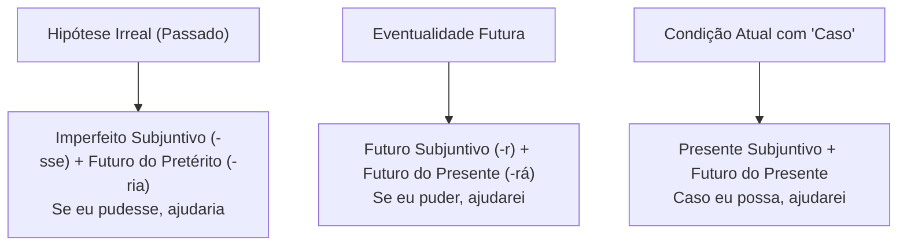
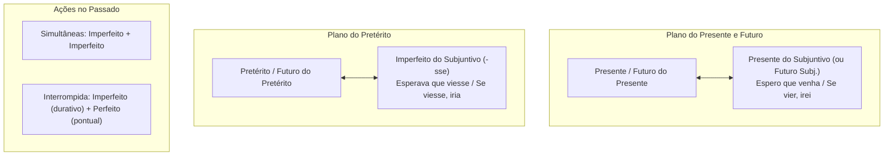

A correlação verbal constitui um dos pilares mais decisivos no estudo dos mecanismos de coesão textual. Ela orienta também o correto emprego das classes de palavras. O encadeamento de ideias em um período composto depende da harmonia entre as formas verbais. Os tempos e modos precisam manter a sequência lógica pretendida. Quando isso não ocorre, o texto perde a coerência e fere a norma culta.

Neste capítulo, você compreenderá as regras que prescrevem a combinação adequada dos tempos verbais. Estudará os pares clássicos que estruturam orações condicionais e concessivas. Analisará a compatibilidade entre o plano do presente (pres.) e o plano do pretérito (pret.). Verá também as exigências sintáticas do modo subjuntivo em orações subordinadas. As bancas cobram a correlação verbal em questões de reescrita e identificação de erros de articulação.

> [!objetivos]
> - Compreender o conceito de correlação verbal e sua relevância para a coesão temporal do período.
> - Aplicar com precisão os pares clássicos de correlação entre modo subjuntivo e modo indicativo.
> - Identificar as combinações harmônicas de tempos verbais no plano do presente e no plano do pretérito.
> - Reconhecer os erros mais frequentes de descompasso temporal explorados pelas bancas examinadoras.
> - Analisar particularidades estilísticas como o conectivo "como" causal e o advérbio "talvez".

## Noções iniciais e princípio da correlação verbal

A **correlação verbal** (ou consecutio temporum) é a correspondência harmônica estabelecida entre as formas verbais de um período composto. Essa relação assegura a sequência lógica das ideias expressas pelo enunciador. Não se trata de impor tempos idênticos em todas as orações. A regra exige que o tempo da oração subordinada dialogue coerentemente com o tempo da oração principal.

O princípio organizador da correlação é a **coerência temporal**. O ponto de partida da enunciação define o plano discursivo do enunciado:

1. **Plano do presente e futuro**: expressa fatos atuais, habituais ou previsões vindouras. Combina-se com formas do presente ou futuro do indicativo e do subjuntivo. Exemplo: *O comandante afirma que a tropa cumprirá a missão com zelo*.
2. **Plano do pretérito**: relata fatos já consumados ou processos históricos. Articula-se com formas do pretérito perfeito, imperfeito, mais-que-perfeito e futuro do pretérito. Exemplo: *O comandante afirmou que a tropa cumpriria a missão com zelo*.

### Subordinação com que integrante no plano do pretérito

Quando o verbo da oração principal está no pretérito do indicativo (*afirmou*, *declarou*, *soube*), a oração subordinada substantiva pode acolher diferentes tempos:

- *O delegado declarou que o homem **fugia**.* (Ação simultânea no passado: pretérito imperfeito).
- *O delegado declarou que o homem **roubara** o cofre da repartição.* (Ação anterior ao depoimento: pretérito mais-que-perfeito).
- *O delegado declarou que o homem **fugiria**.* (Ação posterior ao depoimento: futuro do pretérito).
- *O delegado declarou que a nova diretriz **valerá** para todos.* (Ação projetada para o futuro).

> [!exemplo] Relações temporais e contextuais
> Em apuração técnica, a intervenção providencial dos bombeiros propiciara o rescaldo antes do desabamento. Durante os trabalhos nas instalações, os peritos analisaram microvestígios com microscópio óptico para perscrutar detalhes. Aplique esse método para superar impasses na apuração e comprovar a materialidade do fato. Essa façanha técnica teria entrado para a história da corporação caso o método inédito se confirmasse. Como chovesse muito naquele dia, não pudemos sair a campo logo cedo. Do ponto de vista histórico, lembra-se que Barbier adaptou um código militar tátil para a leitura de cegos. Quando mudanças na rotina se impuserem no quartel, os contratos serão rigorosamente fiscalizados. Por mais que nos esforcemos, nada apagará o que então se dera naquele salvamento real. A revelação dos dados garantiu a libertação dos inocentes. Se soubéssemos antes sobre o perigo, a saída não teria sido adiada. Cada achado representou uma descoberta drástica para a perícia. Esperava-se que o oficial tivesse procurado apoio prévio. Se existisse risco estrutural no prédio extinto, o laudo técnico apontaria a falha.

## Os pares clássicos de correlação verbal

A maioria dos itens de concurso sobre correlação verbal concentra-se em três estruturas paradigmáticas. Dominar essas fórmulas permite resolver questões com rapidez.

### Par clássico 1: hipótese contrafactual no passado

Expressa uma condição hipotética ou irreal situada no passado. Sua consequência projeta-se no futuro do pretérito:

- **Estrutura**: Pretérito imperfeito do subjuntivo (**-sse**) + Futuro do pretérito do indicativo (**-ria**).
- **Fórmula de memória**: *"Se eu pudesse, faria"*.
- **Exemplo operacional**: *Se a corporação **possuísse** equipamentos modernos, **atenderia** às ocorrências com maior rapidez*.
- **Forma composta equivalente**: Pretérito mais-que-perfeito do subjuntivo (*tivesse + particípio*) + Futuro do pretérito composto (*teria + particípio*): *Se o socorro **tivesse chegado** antes, o bombeiro **teria evitado** a tragédia*.

### Par clássico 2: eventualidade factível no futuro

Expressa uma condição realizável ou uma eventualidade provável no futuro:

- **Estrutura**: Futuro do subjuntivo (**-r**) + Futuro do presente do indicativo (**-rá/-rei**).
- **Fórmula de memória**: *"Se eu puder, farei"* ou *"Quando eu puder, farei"*.
- **Exemplo operacional**: *Se as inovações tecnológicas **avançarem** nas corporações militares, **resolverão** gargalos antigos*.
- **Variação aceita**: O futuro do presente pode ser substituído por locução equivalente (*vai resolver*) ou pelo imperativo (*Se você mantiver a calma, prossiga*).

### Par clássico 3: hipótese presente com conjunção que pede subjuntivo

Ocorre com conjunções como *caso*, *ainda que*, *por mais que*:

- **Estrutura**: Presente do subjuntivo (**-e/-a**) + Futuro do presente (ou Presente do indicativo).
- **Fórmula de memória**: *"Caso eu possa, farei"*.
- **Exemplo operacional**: *Caso a autoridade **autorize** a operação, as equipes **iniciarão** as buscas imediatamente*.

A tabela abaixo resume essas correlações fundamentais.

| Par de correlação | Tempo da oração subordinada | Tempo da oração principal | Frase-modelo de fixação | Efeito semântico produzido |
| --- | --- | --- | --- | --- |
| Par 1 (Irreal / Passado) | Pretérito imperfeito subjuntivo (*-sse*) | Futuro do pretérito indicativo (*-ria*) | *Se a equipe recebesse apoio, venceria.* | Hipótese improvável ou irrealizada |
| Par 1 Composto | Mais-que-perfeito subjuntivo (*tivesse*) | Futuro do pretérito composto (*teria*) | *Se tivesse chovido, teria apagado o fogo.* | Ação contrafactual no passado |
| Par 2 (Factível / Futuro) | Futuro do subjuntivo (*-r*) | Futuro do presente indicativo (*-rá*) | *Se a equipe receber apoio, vencerá.* | Hipótese realizável e provável |
| Par 3 (Desejo / Presente) | Presente do subjuntivo (*-e/-a*) | Futuro do presente ou Presente ind. | *Caso o apoio venha, venceremos.* | Possibilidade aberta no presente |

> [!bizu] Gatilho das terminações correlatas
> Lembre-se da rima morfológica entre as desinências:
> - O sufixo **-SSE** sempre chama o sufixo **-RIA** (*se estudasse, passaria*).
> - O sufixo **-R** no subjuntivo chama a terminação de futuro **-RÁ** (*se estudar, passará*).
> - A conjunção **CASO** pede presente do subjuntivo e projeta futuro (*caso estude, passará*).

## Outras correlações no indicativo e no subjuntivo

Além das orações condicionais, a harmonia dos tempos governa outras estruturas sintáticas:

### Ações simultâneas e ações interrompidas no passado

Ao narrar eventos históricos ou operacionais no passado, a combinação de tempos indica duração e pontualidade:

1. **Ações contínuas e simultâneas no passado**: dois verbos no **pretérito imperfeito do indicativo** marcam processos paralelos: *Enquanto os bombeiros combatiam o fogo na fachada, os socorristas retiravam os moradores pelos fundos*.
2. **Ação contínua interrompida por fato pontual**: o verbo durativo fica no **pretérito imperfeito**. O verbo pontual interceptador fica no **pretérito perfeito**: *A patrulha realizava a ronda preventiva quando um disparo quebrou o silêncio da rua*.

### Regra de ouro da compatibilidade de planos temporais

A maioria dos desvios decorre do cruzamento indevido entre planos temporais distintos. A banca explora essas misturas:

- **O futuro do presente** aceita combinação com verbos no **presente ou no futuro**: *Garantirei que os procedimentos sejam cumpridos*.
- **O futuro do pretérito** exige correlação com tempos do **pretérito**: *Garantiria que os procedimentos fossem cumpridos*.

> [!pegadinha] Mistura indevida de planos temporais
> Analise os seguintes períodos incoerentes muito comuns em provas:
> - *Incorreto*: *"Se a guarnição mantivesse a disciplina, resolverá a crise."* (Mistura hipótese pretérita com consequência futura).
>   - *Correções*: *Se mantiver, resolverá* OU *Se mantivesse, resolveria*.
> - *Incorreto*: *"Quem caminhasse pelas ruas de Olinda virá a constatar os casarios coloniais."*
>   - *Correções*: *Quem caminhar... virá* OU *Quem caminhasse... viria*.
> - *Incorreto*: *"O secretário afirmou que haverá reforço no efetivo assim que as turmas se formassem."*
>   - *Correção*: *afirmou que haveria reforço... assim que se formassem*.

A tabela abaixo cataloga os erros de correlação mais comuns e suas correções.

| Construção incorreta | Erro sintático identificado | Forma corrigida no plano do futuro | Forma corrigida no plano do pretérito |
| --- | --- | --- | --- |
| *"Se eu pudesse, viajarei"* | Imperfeito subj. + Futuro presente | *Se eu puder, viajarei* | *Se eu pudesse, viajaria* |
| *"Se as tropas chegassem, conterão o fogo"* | Imperfeito subj. + Futuro presente | *Se chegarem, conterão* | *Se chegassem, conteriam* |
| *"Caso nós consigamos, resolveríamos tudo"* | Presente subj. + Futuro pretérito | *Caso consigamos, resolveremos* | *Se conseguíssemos, resolveríamos* |
| *"Ninguém acreditará que o time vencesse"* | Futuro presente + Imperfeito subj. | *Ninguém acreditará que vença* | *Ninguém acreditaria que vencesse* |
| *"Esperava que o laudo chegue logo"* | Pretérito imperfeito + Presente subj. | *Espero que chegue logo* | *Esperava que chegasse logo* |

## Harmonia modal: o tempo da subordinada herda o tempo da principal

Quando uma oração subordinada exige o modo subjuntivo, seu tempo depende da oração principal:

1. **Oração principal no presente ou futuro do indicativo**: exige a subordinada no **presente do subjuntivo** (ou pretérito perfeito composto do subjuntivo para fatos anteriores):
   - *O comandante **exige** que todos os soldados **apresentem** o uniforme.* (Presente + Presente do subjuntivo).
   - *O comandante **exigirá** que todos os soldados **tenham concluído** o teste.* (Futuro + Pretérito perfeito do subjuntivo).
2. **Oração principal no pretérito ou futuro do pretérito**: exige a subordinada no **pretérito imperfeito do subjuntivo** (ou mais-que-perfeito composto do subjuntivo):
   - *O comandante **exigiu** que todos os soldados **apresentassem** o uniforme.* (Pretérito + Imperfeito do subjuntivo).
   - *O comandante **exigiria** que todos os soldados **tivessem concluído** o teste.* (Futuro do pretérito + Mais-que-perfeito do subjuntivo).

A locução *"vir a"* ilustra essa submissão:
- *Será fundamental que a lei **venha** a vigorar em Pernambuco.* (Futuro do presente + Presente do subjuntivo).
- *Seria fundamental que a lei **viesse** a vigorar em Pernambuco.* (Futuro do pretérito + Imperfeito do subjuntivo).

| Tempo da oração principal | Tempo exigido na subordinada | Exemplo de harmonização |
| --- | --- | --- |
| Presente do indicativo (*espero*) | Presente do subjuntivo (*venha*) | *Espero que o reforço chegue sem atraso.* |
| Futuro do presente (*esperarei*) | Presente do subjuntivo (*venha*) | *Esperarei que a perícia protocole o laudo.* |
| Pretérito perfeito (*esperei*) | Pretérito imperfeito subjuntivo (*viesse*) | *Esperei que o reforço chegasse a tempo.* |
| Pretérito imperfeito (*esperava*) | Pretérito imperfeito subjuntivo (*viesse*) | *Esperava que a perícia protocolasse o laudo.* |
| Futuro do pretérito (*esperaria*) | Pretérito imperfeito subjuntivo (*viesse*) | *Esperaria que o reforço chegasse a tempo.* |

### Casos especiais: "como" causal e o advérbio "talvez"

Dois fenômenos merecem destaque especial na correlação modal:

1. **O conectivo "como" causal com imperfeito do subjuntivo**: no padrão formal, a oração causal anteposta com *como* aceita o pretérito imperfeito do subjuntivo com sentido de indicativo. Exemplo: *Como **chovesse** intensamente na serra, a viatura reduziu a velocidade*. Nessa construção, *como chovesse* equivale a *como chovia* ou *já que chovia*. Trata-se de uso culto legítimo.
2. **O advérbio "talvez" e a atração do subjuntivo**: o advérbio *talvez* expressa incerteza e exige o modo subjuntivo. Exemplo: *Talvez a guarnição **consiga** resgatar os animais ilesos*; *Talvez os bombeiros **precisassem** de reforço especializado*. Empregar o indicativo após *talvez* é considerado erro em concursos públicos.

> [!atencao] Equivalência entre locuções e tempos verbais
> Lembre-se das substituições perfeitamente legítimas que mantêm a correlação:
> - A locução **ter de / ter que** + infinitivo equivale a **dever** + infinitivo: *Os policiais têm de cumprir o protocolo* = *Os policiais devem cumprir o protocolo*.
> - O pretérito mais-que-perfeito composto equivale ao simples: *A equipe já **tinha chegado** quando o chamado ocorreu* = *A equipe já **chegara**...*.
> - Os auxiliares *ter* e *haver* alternam-se livremente: *Espero que **tenha sido** lavrado o flagrante* = *Espero que **haja sido** lavrado o flagrante*.

> [!atencao] Harmonia temporal implícita em orações reduzidas
> Em orações reduzidas, a correlação lógica com a oração principal permanece ativa. Exemplo: *Ao se extrair do conflito por um recuo estratégico, o negociador poderá reavaliar as exigências dos suspeitos*. A forma verbal *poderá* expressa consequência lógica da ação anterior.

## Mapa do capítulo

A tabela abaixo resume as regras centrais para consulta rápida.

| Mecanismo de correlação | Fórmula clássica | Sentido transmitido | Armadilha de concurso |
| --- | --- | --- | --- |
| Hipótese irreal | *-sse* + *-ria* | Fato improvável ou contrafactual | Misturar *-sse* com futuro do presente (*-rá*) |
| Eventualidade futura | *-r* (subj.) + *-rá* | Ação futura provável e factível | Usar infinitivo no lugar do futuro do subjuntivo |
| Condição com "caso" | Presente subj. + Futuro presente | Possibilidade imediata ou futura | Empregar indicativo após a conjunção *caso* |
| Causal formal com "como" | *Como* + imperfeito subj. | Causa no passado (*como chovesse*) | Achar que o subjuntivo denota dúvida |
| Atração por "talvez" | *Talvez* + subjuntivo | Dúvida ou probabilidade subjetiva | Usar o modo indicativo após o advérbio *talvez* |

### Para fixar

- Correlação verbal é a coerência harmônica e lógica entre tempos e modos no período composto.
- O tempo da oração principal orienta o plano temporal da oração subordinada (presente/futuro ou pretérito).
- A fórmula *"se eu pudesse, faria"* conecta o imperfeito do subjuntivo (*-sse*) ao futuro do pretérito (*-ria*).
- A fórmula *"se eu puder, farei"* liga o futuro do subjuntivo (*-r*) ao futuro do presente (*-rá*).
- A fórmula *"caso eu possa, farei"* articula o presente do subjuntivo ao futuro do presente.
- É incorreto cruzar planos temporais incompatíveis, como juntar hipótese no imperfeito do subjuntivo com futuro do presente (*"se eu pudesse, viajarei"*).
- Duas formas no pretérito imperfeito do indicativo marcam ações contínuas e simultâneas no passado.
- O pretérito imperfeito combinado com o pretérito perfeito indica ação durativa interrompida por fato pontual.
- O conectivo *como* causal aceita imperfeito do subjuntivo no registro formal (*como chovesse* = porque chovia).
- O advérbio de dúvida *talvez* atrai obrigatoriamente a flexão no modo subjuntivo (*talvez cheguemos a tempo*).
