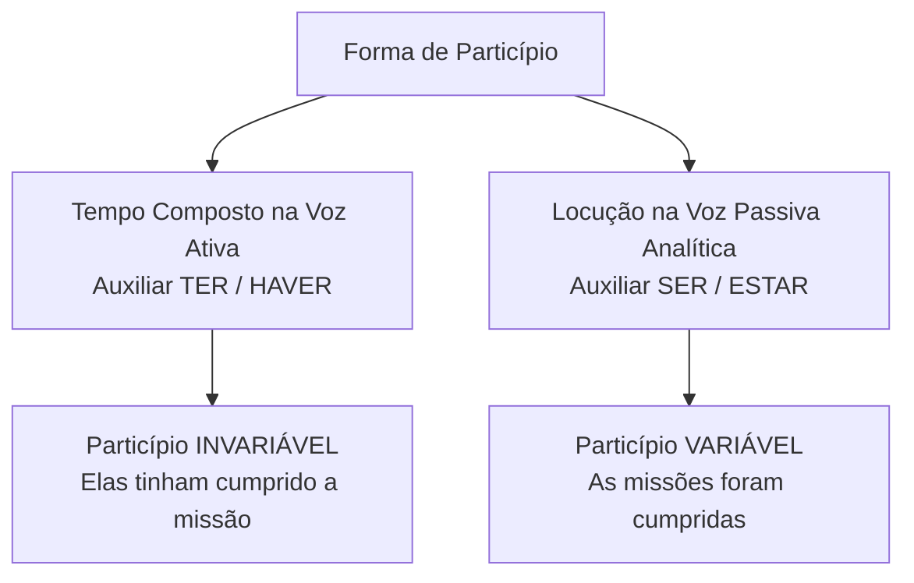
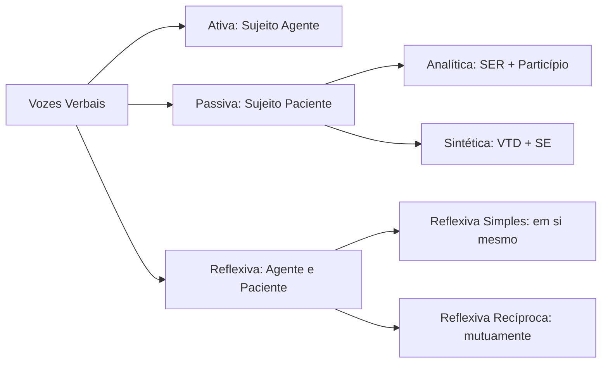
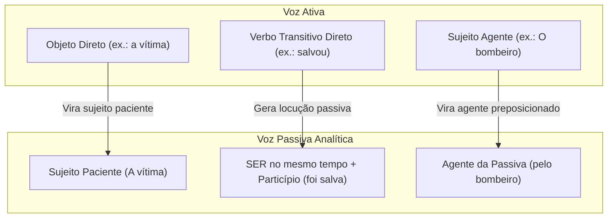
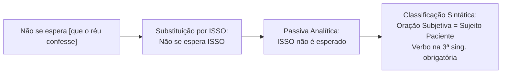
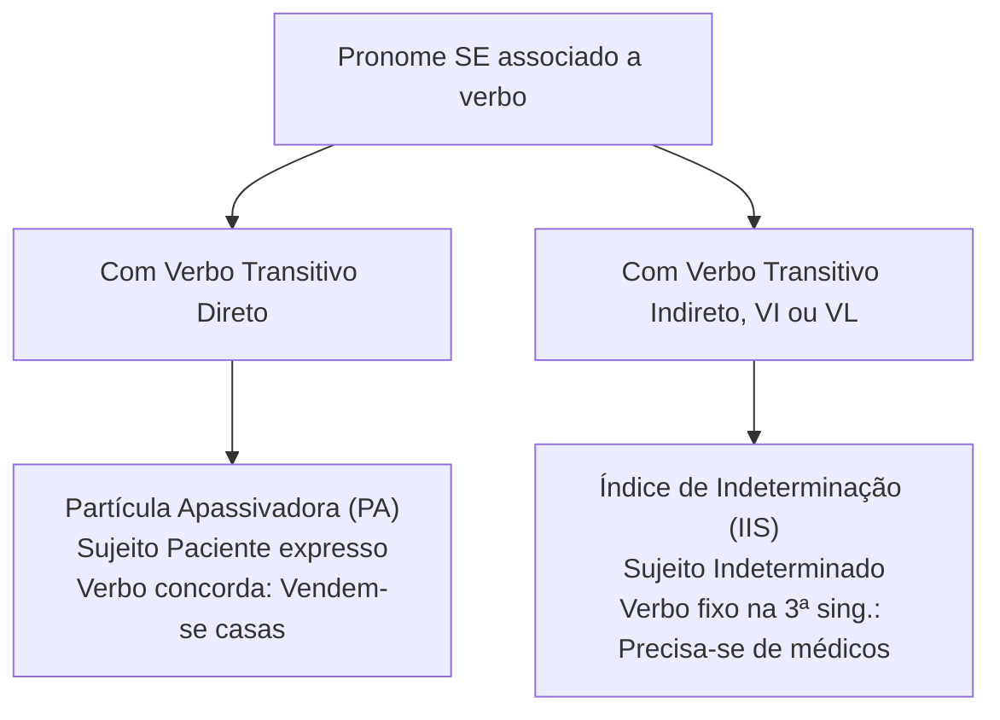

O estudo das vozes verbais e das locuções representa um dos pontos mais frequentes e decisivos em concursos públicos. No âmbito do emprego das classes de palavras e dos mecanismos de coesão textual, as vozes definem o papel do sujeito como agente ou paciente do processo verbal. Essa escolha textual determina a perspectiva do discurso, destacando quem pratica o ato ou enfatizando o resultado produzido pela ação.

Neste capítulo, você aprenderá a distinguir locução verbal de tempo composto e a analisar as regras de concordância do particípio. Em seguida, dominará a classificação das vozes ativa, passiva (analítica e sintética), reflexiva e recíproca. Estudará as técnicas de transposição de vozes, os casos em que a passiva é impossível e a distinção entre partícula apassivadora e índice de indeterminação do sujeito. As bancas cobram esses temas em itens de sintaxe, concordância e reescrita de períodos.

> [!objetivos]
> - Diferenciar a estrutura de uma locução verbal da formação de um tempo composto.
> - Classificar as vozes verbais em ativa, passiva analítica, passiva sintética, reflexiva e recíproca.
> - Aplicar o método de conversão entre voz ativa e vozes passivas mantendo o sentido e a correção.
> - Identificar as restrições sintáticas que impedem a conversão de determinadas orações para a voz passiva.
> - Distinguir com segurança a partícula apassivadora do índice de indeterminação do sujeito.

## Locução verbal versus tempo composto: estrutura e particípio

Uma **locução verbal** é formada pela união de um verbo auxiliar com um verbo principal em forma nominal (infinitivo, gerúndio ou particípio). O conjunto atua sintaticamente como um único verbo: *deve cumprir*, *está investigando*, *foi socorrido*.

Um **tempo composto**, por sua vez, é uma modalidade específica de locução verbal formada exclusivamente pelos verbos auxiliares **ter** ou **haver** associados ao **particípio** do verbo principal: *tem estudado*, *havia terminado*, *tivera saído*.

A distinção morfológica e sintática mais importante entre essas estruturas reside no comportamento do **particípio**:

1. **No tempo composto da voz ativa**: o particípio é absolutamente **invariável**, terminando sempre em *-o*. Ele não se flexiona para concordar com o sujeito:
   - *O policial havia terminado o relatório.*
   - *As policiais haviam terminado o relatório.* (O particípio *terminado* permanece invariável).
   - *Elas têm cumprido todas as missões com dedicação.*
2. **Na locução verbal da voz passiva (analítica)**: o particípio se ajusta ao gênero e ao número do sujeito que sofre a ação:
   - *O relatório foi terminado pelo policial.*
   - *A ocorrência foi terminada pela guarnição.*
   - *Os relatórios foram terminados pelos peritos.*
   - *As missões foram cumpridas com sucesso.*

### Conversão de tempos compostos na voz passiva

Quando uma oração ativa com tempo composto é convertida para a voz passiva, o tempo composto original é rigorosamente mantido. Apenas se insere o verbo auxiliar **ser** no particípio (*sido*):

- *Voz ativa*: *O comandante havia planejado as manobras táticas.*
- *Voz passiva*: *As manobras táticas haviam **sido** planejadas pelo comandante.*
- *Voz ativa*: *O perito terá concluído os exames periciais amanhã.*
- *Voz passiva*: *Os exames periciais terão **sido** concluídos pelo perito amanhã.*

A tabela abaixo compara essas duas estruturas verbais.

| Critério de comparação | Tempo composto da voz ativa | Locução verbal da voz passiva |
| --- | --- | --- |
| Verbos auxiliares típicos | *Ter* ou *Haver* | *Ser*, *Estar*, *Ficar* |
| Flexão do particípio | Invariável (terminação em *-o*) | Ajusta-se em gênero e número ao sujeito |
| Voz expressa pelo enunciado | Voz ativa (sujeito pratica a ação) | Voz passiva (sujeito sofre a ação) |
| Exemplo no singular | *A equipe havia registrado o fato.* | *O fato havia sido registrado pela equipe.* |
| Exemplo no plural | *As equipes haviam registrado os fatos.* | *Os fatos haviam sido registrados pelas equipes.* |

## As vozes verbais: ativa, passiva, reflexiva e recíproca

A voz verbal indica a relação sintática e semântica existente entre o **sujeito** e a **ação verbal expressa na oração**:

1. **Voz ativa**: o sujeito é o **agente** do processo verbal. Ele pratica a ação expressa pelo verbo. Exemplo: *O policial deteve o suspeito na praça*. O sujeito *o policial* é o executor direto da prisão.
2. **Voz passiva analítica**: o sujeito é o **paciente**. Ele recebe, sofre ou suporta o efeito da ação verbal. A estrutura é formada pelo verbo auxiliar *ser* (ou *estar*) mais o particípio do verbo principal. Exemplo: *O suspeito foi detido pelo policial na praça*. O termo *pelo policial* desempenha a função de **agente da passiva**.
3. **Voz passiva sintética (pronominal)**: o sujeito também é paciente. Ele recebe a ação por meio de um verbo transitivo direto acompanhado do pronome apassivador **se**. O agente da passiva quase sempre permanece oculto. Exemplo: *Deteve-se o suspeito na praça*.
4. **Voz reflexiva**: o sujeito é simultaneamente **agente e paciente**. Ele pratica a ação sobre si mesmo. Exemplo: *O combatente feriu-se com a própria faca tática*. O pronome *se* atua como objeto direto (*feriu a si mesmo*). Certos autores se julgam superiores ao analisar condutas alheias, aplicando o pronome a si próprios.
5. **Voz reflexiva recíproca**: expressa uma ação mútua entre dois ou mais sujeitos, em que um pratica a ação no outro. Exemplo: *Os comandantes cumprimentaram-se cordialmente após a reunião*.

> [!atencao] Sentido passivo versus voz passiva sintática
> Nem toda frase com sentido de recebimento configura voz passiva sintática. Em orações como *O soldado levou uma advertência* ou *O motorista tomou uma multa*, o sujeito sofre as consequências no mundo real. Sintaticamente, todavia, a voz é ativa, pois o sujeito realiza formalmente a predicação dos verbos *levar* e *tomar*. Da mesma forma, quando um agente flagrou o infrator escondido no galpão, a voz ativa estrutura o período.

A tabela a seguir sistematiza as vozes verbais com exemplos operacionais.

| Tipo de voz verbal | Papel do sujeito sintático | Estrutura gramatical | Exemplo de aplicação | Função do pronome *se* |
| --- | --- | --- | --- | --- |
| Voz ativa | Agente (pratica a ação) | Sujeito + Verbo + Complemento | *A viatura interceptou o carro.* | Não se aplica |
| Voz passiva analítica | Paciente (recebe a ação) | Sujeito paciente + *Ser* + Particípio | *O carro foi interceptado pela viatura.* | Não se aplica |
| Voz passiva sintética | Paciente (recebe a ação) | Verbo transitivo direto + *SE* | *Interceptou-se o carro em fuga.* | Partícula apassivadora |
| Voz reflexiva simples | Agente e paciente simultâneo | Sujeito + Verbo transitivo + *SE* | *O bombeiro protegeu-se do calor.* | Objeto direto (a si mesmo) |
| Voz reflexiva recíproca | Agentes e pacientes mútuos | Sujeito plural + Verbo + *SE* | *Os policiais apoiaram-se na mata.* | Objeto direto recíproco |

## Conversão entre voz ativa e voz passiva analítica

A transposição entre voz ativa e voz passiva analítica é uma das exigências mais recorrentes em concursos públicos. O método exige a aplicação de quatro etapas sistemáticas:

1. O **objeto direto** da voz ativa torna-se o **sujeito paciente** da voz passiva.
2. O **sujeito agente** da voz ativa torna-se o **agente da passiva**, introduzido pela preposição *por* (ou pelas contrações *pelo*, *pela*, *pelos*, *pelas*) e, raramente, pela preposição *de*.
3. O verbo transitivo principal assume a forma de **particípio**, ajustando-se em gênero e número ao novo sujeito paciente.
4. O verbo auxiliar **ser** é conjugado no **mesmo tempo e modo** do verbo principal da oração ativa original.

Observe a aplicação prática dessa transposição em diferentes contextos de prova:

- *Voz ativa*: *O próximo governo não encontrará um ambiente sereno.*
  - *Voz passiva*: *Um ambiente sereno não será encontrado pelo próximo governo.* (O verbo *encontrará* no futuro do presente gera *será encontrado*).
- *Voz ativa*: *As excursões de turistas desatentos descaracterizam a essência histórica dos museus e monumentos.*
  - *Voz passiva*: *A essência histórica dos museus e monumentos é descaracterizada pelas excursões de turistas desatentos.*
- *Voz ativa*: *O desafiante derrotou o campeão no torneio.*
  - *Voz passiva*: *O campeão foi derrotado pelo desafiante no torneio.*
- *Voz ativa*: *O garçom atendeu os convidados com presteza.*
  - *Voz passiva*: *Os convidados foram atendidos pelo garçom com presteza.*
- *Voz ativa*: *Antigos povos teriam utilizado essas rotas marítimas.*
  - *Voz passiva*: *Essas rotas marítimas teriam sido utilizadas por antigos povos.*
- *Voz ativa*: *Os policiais flagraram o suspeito comendo na cantina.*
  - *Voz passiva*: *O suspeito comendo na cantina foi flagrado pelos policiais.*
- *Voz ativa*: *As normas de defesa do consumidor proíbem cobranças abusivas na praça.*
  - *Voz passiva*: *Cobranças abusivas são proibidas pelas normas de defesa do consumidor.*
- *Voz ativa*: *Os agricultores davam sinais de vigor antes da estiagem prolongada.*
  - *Voz passiva*: *Sinais de vigor eram dados pelos agricultores antes da estiagem prolongada.*
- *Voz ativa*: *O governador instituiu um plano eficaz de segurança pública.*
  - *Voz passiva*: *Um plano eficaz de segurança pública foi criado pelo governador.*
- *Voz ativa*: *A brigada inspecionou os canais de irrigação no sertão.*
  - *Voz passiva*: *Os canais de irrigação foram inspecionados pela brigada no sertão para que se resolva o problema.*
- *Voz ativa*: *As normas permitem a assinatura do termo e o pagamento das taxas.*
  - *Voz passiva*: *A assinatura do termo e o pagamento das taxas são permitidos pelas normas.* (Com sujeito composto de gêneros diferentes, o particípio *permitidos* vai para o masculino plural).
- *Voz ativa*: *A sentinela ouviu a voz de Wagner no posto avançado.*
  - *Voz passiva*: *A voz de Wagner foi ouvida pela sentinela.*

> [!pegadinha] Agente da passiva com a preposição "de"
> Embora a preposição *por* seja a regra geral, o agente da passiva pode ser introduzido pela preposição *de* em construções tradicionais: *A viatura estava cercada **de policiais*** (= por policiais); *A praça foi tomada **de manifestantes***. A banca costuma indagar se esse termo é adjunto adverbial; a resposta correta é agente da passiva.

A tabela abaixo sintetiza as equivalências temporais na transposição.

| Tempo verbal na voz ativa | Verbo modelo na voz ativa | Estrutura na voz passiva analítica | Exemplo passivo completo |
| --- | --- | --- | --- |
| Presente do indicativo | *combate* | *é combatido(a)* | *O crime é combatido pela polícia.* |
| Pretérito perfeito | *combateu* | *foi combatido(a)* | *O crime foi combatido pela polícia.* |
| Pretérito imperfeito | *combatia* | *era combatido(a)* | *O crime era combatido pela polícia.* |
| Pretérito mais-que-perfeito | *combatera* | *fora combatido(a)* | *O crime fora combatido pela polícia.* |
| Futuro do presente | *combaterá* | *será combatido(a)* | *O crime será combatido pela polícia.* |
| Futuro do pretérito | *combateria* | *seria combatido(a)* | *O crime seria combatido pela polícia.* |
| Tempo composto pretérito | *havia combatido* | *havia sido combatido(a)* | *O crime havia sido combatido pela polícia.* |

## Voz passiva sintética: regras e concordância

A **voz passiva sintética** (também chamada de pronominal) é formada pela união de um **verbo transitivo direto (ou bitransitivo)** com o pronome apassivador **se**:

- Fórmula: Verbo Transitivo Direto + SE + Sujeito Paciente

Sua finalidade comunicativa é destacar o resultado da ação, omitindo deliberadamente quem a executou. O agente da passiva quase nunca é expresso nessa modalidade sintática.

### Regra capital de concordância verbal

Na voz passiva sintética, o elemento sem preposição que acompanha o verbo **não é objeto direto**. Ele é o **sujeito paciente da oração**. Consequentemente, o verbo deve concordar obrigatoriamente com esse sujeito em número e pessoa:

- *Sujeito paciente no singular*: o verbo permanece no singular.
  - *Identificou-se a falha técnica no sistema.* (Falha técnica = sujeito paciente singular).
  - *Publicou-se o edital do concurso em Pernambuco.*
- *Sujeito paciente no plural*: o verbo flexiona obrigatoriamente no plural.
  - *Identificaram-se as falhas técnicas no sistema.* (Falhas técnicas = sujeito paciente plural).
  - *Publicaram-se os editais dos concursos estaduais.*
  - *Castigam-se os culpados com rigor.* (Os culpados = sujeito paciente plural).

> [!bizu] O teste da conversão analítica
> Para confirmar se o termo após o *se* é sujeito paciente, converta a oração para a voz passiva analítica com o verbo *ser*:
> - *Apurou-se a falha* → *A falha foi apurada.* (Deu certo? O termo é sujeito paciente singular).
> - *Apuraram-se as falhas* → *As falhas foram apuradas.* (Deu certo? O termo é sujeito paciente plural).
> Se a frase aceitar a conversão com o verbo *ser*, o *se* é obrigatoriamente partícula apassivadora.

### Colocação pronominal e palavras atrativas

Na voz passiva sintética, as regras de colocação pronominal aplicam-se com rigor. Diante de palavras negativas, pronomes relativos ou advérbios, a próclise torna-se obrigatória:

- Certo: *Não **se registraram** incidentes na manifestação.*
- Errado: *Não registraram-se incidentes na manifestação.* (A palavra negativa atrai o pronome).
- Certo: *Não se contabilizaram perdas materiais durante o rescaldo.*

## Impossibilidade de conversão para a voz passiva

Para que uma oração ativa admita conversão para a voz passiva, ela exige obrigatoriamente um **objeto direto**. O objeto direto é o único termo sintático que pode transformar-se em sujeito paciente.

Sem objeto direto, a conversão para a voz passiva é gramaticalmente impossível. Não admitem transposição passiva:

1. **Verbos transitivos indiretos (VTI)**: exigem objeto regido por preposição obrigatória. A preposição impede que o termo se converta em sujeito paciente. Exemplos: *Gosto de frutos do mar*; *O policial confiava em seu parceiro*; *A tropa precisava de munição*. (Não existe *"Munição era precisada pela tropa"*).
2. **Verbos intransitivos (VI)**: não pedem complemento verbal, pois trazem sentido completo. Exemplos: *O prédio desabou*; *A vítima morreu*; *O comboio partiu ao meio-dia*.
3. **Verbos de ligação (VL)**: unem o sujeito a um predicativo, sem relação transitiva de objeto. Exemplos: *O tenente permaneceu sereno*; *O dia estava ensolarado*.
4. **Verbo ter com valor de posse material**: construções como *Eu tinha dois cães* não admitem passiva (*"Dois cães eram tidos por mim"* é inaceitável).
5. **Verbo haver impessoal**: *Havia dez viaturas no pátio* não admite conversão passiva.

> [!atencao] Exceções consagradas: obedecer, responder e pagar
> Alguns verbos transitivos indiretos admitem voz passiva na tradição normativa por razões históricas e literárias:
> - *As ordens do comando foram obedecidas pela tropa.* (O verbo *obedecer* é VTI, mas aceita passiva).
> - *A pergunta difícil foi respondida pelo candidato.*
> - *Os funcionários foram pagos pelo tesouro estadual.* (Com objeto de pessoa).

## Implicações sintáticas e a oração como sujeito paciente

Nas provas, um dos itens mais desafiadores envolve a presença de uma **oração subordinada substantiva como sujeito paciente**:

Examine a estrutura:
- *Não se espera [que o governo reduza os recursos operacionais].*

Ao analisar sintaticamente esse período, muitos candidatos afirmam erroneamente que a oração iniciada pela conjunção *que* funciona como objeto direto do verbo *esperar*. Isso é incorreto:

1. O pronome **se** atua como partícula apassivadora do verbo transitivo direto *esperar*.
2. Substitua a oração entre colchetes pelo pronome substantivo demonstrativo **isso**: *Não se espera isso*.
3. Transponha mentalmente para a passiva analítica: *Isso não é esperado*.
4. Conclusão: a oração *que o governo reduza os recursos* é uma **oração subordinada substantiva subjetiva**, funcionando como **sujeito paciente** da oração principal. Por ser sujeito oracional, o verbo principal permanece fixo na 3ª pessoa do singular.

## Voz passiva sintética versus índice de indeterminação do sujeito

O confronto entre **partícula apassivadora (PA)** e **índice de indeterminação do sujeito (IIS)** é a pegadinha número um em questões de sintaxe verbal. A identificação depende da transitividade do verbo:

### Partícula apassivadora

- **Exigência**: Verbo Transitivo Direto (VTD) ou Bitransitivo (VTDI) acompanhado de *se*.
- **Estrutura sintática**: o termo não preposicionado é o **sujeito paciente**.
- **Concordância**: o verbo concorda obrigatoriamente com o sujeito em número (singular ou plural).
- **Exemplo**: *Alugam-se salas comerciais* (= *Salas comerciais são alugadas*).

### Índice de indeterminação do sujeito

- **Exigência**: Verbo Transitivo Indireto (VTI), Verbo Intransitivo (VI) ou Verbo de Ligação (VL) acompanhado de *se*.
- **Estrutura sintática**: o sujeito é gramaticalmente indeterminado. O termo preposicionado atua como objeto indireto ou adjunto adverbial.
- **Concordância**: o verbo permanece **obrigatoriamente na terceira pessoa do singular**, sendo proibida a flexão no plural.
- **Exemplos**:
  - *VTI*: *Precisa-se de peritos criminais.* (E nunca *"Precisam-se de peritos"*).
  - *VTI*: *Trata-se de ocorrências graves.* (E nunca *"Tratam-se de ocorrências"*).
  - *VI*: *Vive-se com tranquilidade no interior.*
  - *VL*: *Fica-se apreensivo em situações de crise.*

> [!pegadinha] O erro clássico de concordância com preposição
> Examine a frase: *"Tratam-se de medidas urgentes adotadas pelo governo."* Essa frase comete um erro gravíssimo de concordância. Como o verbo *tratar* é transitivo indireto (rege a preposição *de*), o termo *de medidas urgentes* é objeto indireto, e o *se* é índice de indeterminação do sujeito. O verbo não tem com quem concordar e deve ficar no singular: *Trata-se de medidas urgentes*.

A tabela comparativa a seguir consolida a distinção definitiva entre as duas estruturas.

| Critério de distinção | Partícula apassivadora (PA) | Índice de indeterminação do sujeito (IIS) |
| --- | --- | --- |
| Transitividade do verbo | Transitivo Direto (VTD) ou Bitransitivo (VTDI) | Transitivo Indireto (VTI), Intransitivo (VI) ou Ligação (VL) |
| Função do termo associado | Sujeito paciente (sem preposição) | Objeto indireto (preposicionado) ou adjunto |
| Flexão do verbo | Flexiona no singular e no plural conforme o sujeito | Fixo exclusivamente na 3ª pessoa do singular |
| Conversão para passiva com "ser" | Plenamente possível (*casas são vendidas*) | Absolutamente impossível |
| Exemplo com plural | *Vendem-se imóveis valorizados.* | *Precisa-se de novos servidores estaduais.* |

## Mapa do capítulo

A tabela abaixo sintetiza os principais eixos conceituais trabalhados ao longo do capítulo.

| Tópico essencial | Regra de funcionamento | Armadilha comum em concurso | Método seguro de resolução |
| --- | --- | --- | --- |
| Particípio no tempo composto | Invariável com *ter* e *haver* na ativa | Variar particípio: *"elas tinham saídas"* | Manter o particípio terminado em *-o* |
| Particípio na voz passiva | Ajusta-se em gênero e número ao sujeito | Não concordar: *"as armas foram apreendido"* | Ajustar o particípio ao sujeito paciente |
| Transposição de vozes | *Ser* assume o tempo e modo do verbo ativo | Trocar o tempo verbal na conversão | Identificar o tempo original e aplicar no verbo *ser* |
| Passiva sintética | Verbo concorda com o sujeito paciente | Deixar no singular: *"Apurou-se os fatos"* | Converter para passiva analítica com *ser* |
| Verbo com preposição + SE | Sujeito indeterminado; verbo no singular | Flexionar no plural: *"Tratam-se de leis"* | Reconhecer o VTI e manter na 3ª pessoa singular |
| Oração como sujeito | Oração com *que* após VTD + *se* é sujeito | Achar que a oração é objeto direto | Trocar a oração por *isso* (*isso não é esperado*) |

### Para fixar

- No tempo composto da voz ativa com *ter* ou *haver*, o particípio permanece invariável.
- Na locução verbal da voz passiva analítica com *ser*, o particípio ajusta-se ao gênero e número do sujeito paciente.
- Na transposição da ativa para a passiva analítica, o verbo auxiliar *ser* assume o tempo e o modo do verbo original.
- Para haver voz passiva, a oração ativa precisa conter obrigatoriamente um objeto direto.
- Verbos transitivos indiretos, intransitivos e de ligação não admitem transposição para a voz passiva.
- Na voz passiva sintética (VTD + *se*), o verbo concorda obrigatoriamente com o sujeito paciente no singular e no plural.
- Com verbo transitivo indireto regido de preposição, o pronome *se* é índice de indeterminação do sujeito.
- Com índice de indeterminação do sujeito, o verbo fica obrigatoriamente fixo na terceira pessoa do singular.
- A oração subordinada com *que* associada a VTD + *se* desempenha a função de sujeito paciente (oração subjetiva).
- O agente da passiva é introduzido tipicamente pela preposição *por*, admitindo raramente a preposição *de*.
