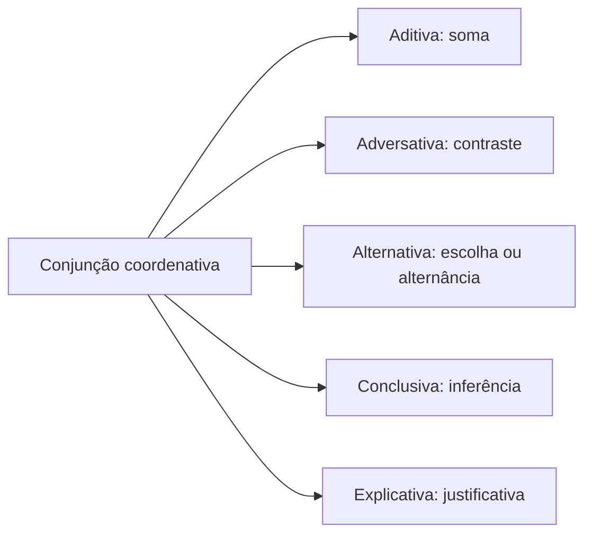

Conjunções coordenativas organizam ideias que podem existir como orações independentes. A relação entre elas, porém, orienta a leitura: pode somar, opor, oferecer alternativas, concluir ou justificar. Em provas de reescrita, a banca costuma trocar um conectivo por outro e perguntar se a frase mantém sentido e correção. A resposta exige observar a relação lógica no contexto, a posição do conectivo e, em certos casos, a pontuação.

> [!objetivos]
> - Distinguir coordenação de subordinação no período.
> - Classificar as cinco relações coordenativas.
> - Reconhecer usos especiais de “e”, “ou”, “ainda”, “senão” e “pois”.
> - Avaliar substituições e seus efeitos sobre coesão e argumentação.

## Coordenação, conectivos e coesão

Conjunção é palavra ou expressão que liga termos ou orações e explicita uma relação entre eles. Em “a equipe registrou e conferiu os dados”, a conjunção “e” liga dois verbos de mesmo sujeito. Em “o portão abriu, mas o alarme permaneceu ligado”, ela une duas orações independentes e marca contraste. A conjunção também pode conectar frases e parágrafos, orientando a progressão de um texto.

Na coordenação, as orações não exercem função sintática uma na outra. Em “cheguei cedo, mas não encontrei vaga”, as duas orações têm estrutura própria. Na subordinação, uma oração funciona como sujeito, complemento ou adjunto da outra. Em “quando cheguei, a reunião começou”, a oração com “quando” acrescenta uma circunstância temporal à principal. Retirar a conjunção é um teste inicial, mas a classificação depende da relação sintática e semântica, não apenas de a frase continuar compreensível.

Além de conjunções simples, há locuções conjuntivas (“no entanto”, “visto que”, “por isso”) e pares correlatos (“não só… mas também”, “ora… ora”). Para interpretar, basta identificar o valor do conjunto; a nomenclatura não deve desviar a atenção do sentido. Um conectivo é também recurso de coesão: retoma uma ideia, estabelece contraste ou mostra como a informação nova se relaciona à anterior.

| Relação coordenativa | Ideia central | Conectivos frequentes |
| --- | --- | --- |
| Aditiva | soma ou sequência | e, nem, bem como, não só… mas também |
| Adversativa | contraste ou ressalva | mas, porém, contudo, todavia, entretanto |
| Alternativa | escolha ou alternância | ou, quer… quer, ora… ora, seja… seja |
| Conclusiva | inferência ou resultado lógico | logo, portanto, por isso, então, pois |
| Explicativa | justificativa do que se afirmou | porque, que, pois, porquanto |

> [!bizu] Leia a relação antes de decorar o nome
> Pergunte se a segunda parte soma, contrasta, escolhe, conclui ou justifica. Só então associe o conectivo à classificação. O mesmo vocábulo pode mudar de valor em outro contexto.

## Adição e oposição

As aditivas somam termos ou fatos. “E” é a forma mais comum; “nem” equivale a “e não” e soma elementos negativos: “não telefonou nem enviou mensagem”. Também indicam soma “bem como” e construções correlatas como “não apenas organizou os arquivos, mas também revisou os prazos”. Nesse par, “mas também” não expressa oposição: completa a correlação aditiva. “Tampouco” é advérbio com valor próximo a “nem”: “não confirmou a presença, tampouco justificou a ausência”.

A conjunção “e” pode marcar sequência temporal (“abriu a porta e entrou”), além de mera adição. Em “falou baixo e todos ouviram”, o contexto pode sugerir contraste ou surpresa: a segunda informação quebra uma expectativa. Por isso, a classificação semântica não depende só da lista de conjunções. Uma vírgula pode substituir “e” entre orações independentes, mas elimina o conectivo explícito: “o sinal tocou, os candidatos entraram”.

“Nem” já incorpora a ideia de adição negativa. Em geral, “não assinou nem devolveu o formulário” é suficiente. “E nem” pode ocorrer quando “nem” equivale a “nem sequer” ou quando “e” tem outro valor, mas não se deve tratá-lo como obrigatório em toda sequência negativa. “Sequer” significa “ao menos” em contexto negativo: “não leu sequer o resumo”.

> [!pegadinha] “Mas também” pode somar
> Certo: “Não só conferiu o material, mas também o arquivou.”
>
> Errado: classificar “mas também” como adversativa nessa correlação. A estrutura inteira significa “além de conferir, arquivou”.

As adversativas exprimem contraste, compensação, ressalva ou retificação. São frequentes “mas”, “porém”, “contudo”, “todavia” e “entretanto”. Em “o percurso era longo, mas seguro”, há contraste entre extensão e segurança. Em “não foram dois dias, mas três”, há retificação. “Senão” pode equivaler a “mas sim” em “não foi o rádio, senão o telefone que tocou”.

A posição importa. “Mas” inicia a oração adversativa e não costuma ser deslocado para o interior dela. “Porém”, “contudo”, “todavia” e “entretanto” podem aparecer intercalados, isolados por vírgulas: “A equipe, porém, já havia saído”. Assim, se uma reescrita deslocar “mas” para depois do sujeito, não basta dizer que os vocábulos têm sentido semelhante; é preciso verificar se a estrutura é aceitável.

A ordem também afeta o foco argumentativo. Em “o relatório estava incompleto, mas era útil”, a informação após “mas” recebe destaque. A frase “era útil, mas estava incompleto” ressalta a limitação. Reescrever invertendo as orações pode preservar uma oposição geral, mas alterar a ênfase do autor.

## Alternância, conclusão e explicação

As alternativas apresentam escolha, alternância ou equivalência. “Ou” pode ser simples ou repetido (“ou a equipe corrige, ou o sistema bloqueia”), e as correlações “quer… quer”, “ora… ora”, “seja… seja” distribuem possibilidades. A escolha pode ser exclusiva (“estude ou descanse”, no contexto em que só uma opção cabe) ou inclusiva (“se sofrer um acidente ou presenciar um, acione o serviço”), quando as duas condições podem acontecer. O contexto decide.

Há também “ou” com valor de equivalência explicativa: “Recife, ou capital pernambucana, recebe visitantes”. A expressão seguinte renomeia a primeira. “Senão” tem valores distintos: aditivo após “não só” (“não só na sede, senão também no posto”), adversativo equivalente a “mas sim” (“não foi descuido, senão falha de comunicação”) e alternativo equivalente a “caso contrário” (“registre a ocorrência, senão perderá o prazo”). O sentido é determinado pela construção, não pela palavra isolada.

Conjunções conclusivas apresentam uma inferência ou conclusão: “portanto”, “logo”, “assim”, “por conseguinte”, “por isso” e “então”. Em “o prazo terminou; portanto, a inscrição não será aceita”, a segunda oração decorre da primeira dentro do raciocínio. Uma conclusão não é necessariamente uma consequência física; pode ser uma inferência argumentativa. “Destarte” também é conclusivo, embora seja mais formal.

“Pois” muda de classificação conforme a posição. No início da oração, em geral, introduz justificativa: “Leve o casaco, pois a temperatura caiu”. Depois do verbo, intercalado por vírgulas, pode ser conclusivo: “A temperatura caiu; leve, pois, o casaco”. A pontuação é uma pista, mas a relação de sentido precisa confirmar a leitura.

As explicativas justificam uma afirmação anterior. “Porque”, “que”, “pois” e “porquanto” são frequentes: “Feche a janela, porque o vento está forte”. O imperativo na primeira oração é uma pista, já que a segunda costuma justificar o conselho ou ordem. “Porquanto” equivale a “porque” nesse uso. “Já que”, “visto que” e “uma vez que” também podem introduzir justificativa. Evite confundir “afinal”, “por isso” e “contudo”: o primeiro pode introduzir explicação ou conclusão no contexto, o segundo tende a concluir, e o terceiro opõe.

> [!exemplo]
> A coordenadora diz: “Encerre o atendimento, pois o sistema ficará indisponível”. “Pois” vem no início da oração justificativa e equivale a “porque”. Em “o sistema ficará indisponível; encerre, pois, o atendimento”, o conectivo intercalado apresenta uma conclusão.

## O papel de “ainda” e a reescrita

“Ainda” não é conjunção coordenativa por si só, mas pode contribuir para relações de sentido e costuma aparecer em questões de coesão. Pode indicar continuidade temporal (“ainda aguarda resposta”), adição (“revisou o texto e ainda conferiu os anexos”), reforço (“saiu ainda agora”), ressalva (“se ainda houver tempo, revise”) ou oposição equivalente a “mesmo assim” (“perdeu o ônibus e ainda chegou antes”). Identifique o que a palavra modifica antes de substituí-la.

| Uso de “ainda” | Equivalência possível | Frase própria |
| --- | --- | --- |
| Tempo | até agora | A equipe ainda não recebeu a escala. |
| Adição | além disso | Preparou o lanche e ainda separou água. |
| Oposição | mesmo assim | Estava cansada e ainda concluiu o relatório. |
| Ressalva | ao menos | Se ainda não puder comparecer, avise. |
| Reforço temporal | neste exato momento | O chamado chegou ainda agora. |

Na reescrita, examine três aspectos: a relação semântica, a posição e o efeito de foco. Substituir “mas” por “porém” tende a preservar oposição, embora exija ajuste de pontuação se o conectivo for deslocado. Trocar “por isso” por “porque” inverte conclusão e justificativa. Trocar “ou” por “e” pode converter escolha em soma. Alterar a ordem das orações pode deslocar a informação enfatizada.

Uma notícia pode tratar de um regime democrático, de enchentes climáticas, de legislação estadual, de tributos como o ICMS, de rotas terrestres ou de satélites. O vocabulário específico não muda o papel do conectivo. “O plano estadual foi revisto porque os custos subiram” introduz causa; “os custos subiram, mas a tarifa ficou estável” opõe fatos; “os custos subiram, portanto o orçamento será revisto” apresenta inferência. Ainda que o texto trate de áreas limpas ou de metas ecológicas, a classificação decorre da relação entre as orações.

| Grafia | Função ou sentido | Exemplo autoral |
| --- | --- | --- |
| porque | explicação ou causa | A equipe aguardou porque faltava uma autorização. |
| por que | pergunta ou relativo | Por que a escala mudou? A razão por que mudou não foi explicada. |
| por quê | pergunta no fim | A escala mudou por quê? |
| o porquê | substantivo | O porquê da mudança foi registrado. |
| senão | caso contrário, mas sim, exceto | Avise, senão ninguém saberá. |
| se não | condição + negação | Se não houver aviso, a equipe seguirá o plano. |

A coesão não exige conectivos em todas as frases. Uma pausa ou a justaposição pode ligar orações, desde que a pontuação esteja adequada. Também não se deve inserir conjunção apenas para “melhorar” a fluidez se o novo conectivo atribuir uma relação que o texto não apresenta. Na leitura de parágrafo, recupere a ideia anterior e verifique o que a seguinte faz: acrescenta, limita, conclui, explica ou abre alternativas?

> [!pegadinha] A banca pode preservar a gramática e mudar o sentido
> “O treinamento foi curto, mas eficaz” e “O treinamento foi curto, portanto eficaz” são frases formalmente possíveis. A segunda, porém, afirma uma conclusão que não decorre necessariamente da primeira. Correção gramatical e equivalência semântica são critérios diferentes.

## Conectivos ambíguos e pistas de contexto

Alguns conectivos aparecem em mais de uma relação semântica. O “e” normalmente soma (“a viatura saiu e a equipe iniciou a vistoria”), mas pode introduzir oposição quando a segunda informação frustra uma expectativa (“o equipamento era antigo, e funcionava muito bem”). A conjunção “ou” costuma expressar escolha, mas pode equivaler a uma explicação (“a capital, ou sede do governo, concentra os serviços”). “Senão” também é polissêmico: equivale a “mas sim” em uma correção, a “além de” na correlação “não só” e a “caso contrário” em uma ameaça ou condição implícita.

A leitura do contexto deve considerar o conteúdo proposicional, isto é, o que cada oração afirma. Se a segunda oração explica uma ordem, a relação tende a ser explicativa. Se deriva uma conclusão de dados anteriores, tende a ser conclusiva. Uma oração não se torna causal apenas por aparecer depois da outra. Em “o acesso foi suspenso, pois havia risco”, a existência de risco justifica a suspensão. Em “havia risco, portanto o acesso foi suspenso”, a segunda oração é apresentada como resultado lógico. A ordem pode variar, mas a direção da inferência deve ser identificada.

A pontuação ajuda a reconhecer a estrutura, mas não substitui a interpretação. Uma conjunção adversativa normalmente é antecedida por vírgula quando liga orações. Conectivos intercalados, como “contudo” e “entretanto”, ficam entre vírgulas. Em enumerações simples, o “e” costuma dispensar vírgula antes, mas a vírgula pode ser necessária por motivo sintático ou para separar orações extensas. Em “o grupo revisou os mapas, os rádios e os formulários”, a enumeração simples não pede vírgula antes do último “e”.

| Conectivo | Valor frequente | Outro uso possível | Teste contextual |
| --- | --- | --- | --- |
| e | adição | contraste ou sequência | A segunda ideia soma ou surpreende? |
| ou | escolha | explicação por equivalência | As expressões nomeiam o mesmo referente? |
| pois | explicação | conclusão quando deslocado | A oração justifica ou infere? |
| senão | alternativa | correção ou soma correlata | Pode ser trocado por “caso contrário”, “mas sim” ou “também”? |
| ainda | continuidade | adição, oposição ou ressalva | O que permanece, soma ou contraria a expectativa? |

> [!exemplo] Comparar para classificar
> “A chuva aumentou, e o rio transbordou” sugere sequência e possível consequência. “A chuva aumentou, mas o rio não transbordou” marca contraste. “O rio transbordou, pois a chuva aumentou” apresenta justificativa. O assunto é semelhante, mas cada conectivo orienta uma leitura diferente.

## Ortografia e forma dos conectivos

A grafia correta do conectivo também pode ser cobrada. “Por que” separado aparece em perguntas diretas ou indiretas (“Por que o acesso fechou?”; “não explicou por que saiu”) e pode equivaler a “pelo qual” (“a razão por que lutou”). “Porque” junto introduz causa ou explicação (“saiu porque recebeu um chamado”). “Por quê” recebe acento quando aparece no fim de uma pergunta ou antes de pausa forte (“Saiu por quê?”). “O porquê” é substantivo e pode vir acompanhado de artigo (“ninguém explicou o porquê da mudança”).

“Senão” junto e “se não” separado também não são intercambiáveis em todos os contextos. Use “senão” com sentido de “caso contrário”, “mas sim”, “exceto” ou “a não ser”: “registre o fato, senão ele será esquecido”; “não era falha, senão atraso”; “não havia senão duas opções”. Use “se não” quando “se” é conjunção condicional e “não” modifica o verbo: “se não houver vaga, a equipe aguardará”. Um teste é inserir outro verbo ou termo: “se não houver” conserva “se” e a negação separadamente.

“Mas” é conjunção adversativa; “mais” indica quantidade ou intensidade: “a escala tem mais servidores, mas menos veículos”. “Porém” e “porquanto” também não se confundem: o primeiro opõe; o segundo costuma justificar ou indicar causa. A semelhança gráfica não estabelece equivalência semântica. Em revisão de texto, confira acento e separação gráfica em conjunto com o valor da palavra.

> [!atencao] Três pares para revisar
> “Mas” opõe; “mais” quantifica. “Porque” explica; “por que” pode formular pergunta. “Senão” equivale a “caso contrário” em muitos usos; “se não” reúne condição e negação.

Uma questão pode oferecer reescrita com alteração de classe ou de forma. Ao substituir “porque” por “por isso”, por exemplo, a oração subordinada explicativa pode virar uma conclusão coordenada; a estrutura e a pontuação podem precisar de ajuste. A norma ortográfica orienta a escrita dos vocábulos, enquanto a análise sintática esclarece sua função. Ambas devem ser verificadas: uma alternativa pode preservar a intenção, mas conter grafia incorreta, ou grafar corretamente um conectivo que muda a relação lógica.

Para avaliar uma reescrita, formule a relação em palavras simples antes de escolher a alternativa: “soma”, “contrasta”, “oferece opção”, “infere” ou “justifica”. Depois leia a frase substituída inteira. Observe se os verbos continuam adequados, se o conectivo ocupa posição aceitável e se a nova redação enfatiza a mesma informação. Esse procedimento evita decidir apenas por listas decoradas.

## Mapa do capítulo

| Valor | Pergunta de leitura | Exemplo |
| --- | --- | --- |
| Aditivo | Que informação se soma? | Conferiu e assinou. |
| Adversativo | Que expectativa se quebra? | Estava tarde, mas continuou. |
| Alternativo | Quais são as opções? | Ou liga, ou envia mensagem. |
| Conclusivo | Que inferência decorre? | O prazo venceu; logo, encerrou. |
| Explicativo | Que afirmação é justificada? | Avise, porque haverá mudança. |

### Para fixar
- Coordenadas não exercem função sintática umas nas outras; subordinadas exercem.
- Os cinco valores coordenativos são adição, oposição, alternância, conclusão e explicação.
- “Nem” já pode equivaler a “e não”; “mas também” soma na correlação “não só… mas também”.
- “Mas” inicia a oração adversativa; “porém”, “contudo”, “todavia” e “entretanto” podem ser intercalados.
- “Ou” pode indicar escolha exclusiva, alternativa inclusiva ou equivalência; o contexto define.
- “Senão” pode somar, opor ou apresentar alternativa, conforme a estrutura.
- “Pois” no início da oração tende a explicar; deslocado entre vírgulas após o verbo, pode concluir.
- Uma reescrita pode continuar gramatical e, ainda assim, mudar a relação lógica ou o foco.
