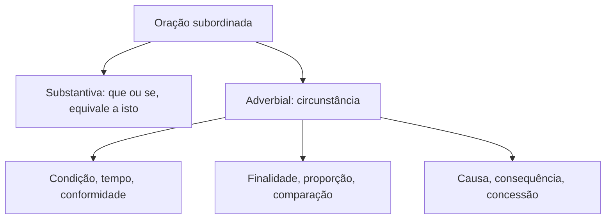

O emprego das classes de palavras inclui reconhecer conjunções subordinativas, que ligam orações em relação de dependência sintática. Algumas introduzem uma oração que completa a principal; outras acrescentam circunstâncias, como tempo, causa ou condição. A classificação é importante para a análise do período e para questões de substituição: conectivos próximos podem produzir relações diferentes ou exigir ajuste verbal. Este capítulo organiza as conjunções integrantes e os nove valores adverbiais mais cobrados.

> [!objetivos]
> - Distinguir conjunções integrantes e adverbiais.
> - Aplicar o teste de substituição por “isto” às orações substantivas.
> - Reconhecer os nove sentidos das subordinativas adverbiais.
> - Diferenciar causa, explicação e consequência.
> - Avaliar a correção e o efeito de reescritas com conectivos.

## Subordinação e conjunções integrantes

A conjunção subordinativa introduz uma oração dependente. A oração iniciada pelo conectivo é subordinada; a outra é a principal. Essa relação pode completar um termo ou acrescentar uma circunstância. Em “quando a equipe chegou, a reunião começou”, a oração temporal modifica o acontecimento principal. Em “é necessário que a equipe chegue”, a oração iniciada por “que” funciona como sujeito de “é necessário”.

| Relação sintática | O que a oração faz | Pergunta de verificação |
| --- | --- | --- |
| Substantiva | Ocupa uma posição de substantivo | A oração pode ser substituída por “isto”? |
| Adverbial | Acrescenta circunstância à principal | Que circunstância o trecho expressa? |

As conjunções integrantes são “que” e “se”. Elas não indicam, por si, causa, tempo ou condição. Sua função é introduzir uma oração substantiva, que pode ser substituída pelo pronome “isto”. A oração substantiva desempenha função típica de um nome: pode ser sujeito, objeto, complemento nominal, predicativo ou aposto. A posição não basta para identificar a função; é preciso substituir e analisar o lugar que “isto” ocupa.

| Oração substantiva | Função sintática | Exemplo de teste |
| --- | --- | --- |
| Subjetiva | sujeito | É importante que você confirme → Isto é importante. |
| Objetiva direta | objeto direto | Espero que responda → Espero isto. |
| Objetiva indireta | objeto indireto | Insistiu em que todos fossem → Insistiu nisto. |
| Completiva nominal | complemento nominal | Tenho certeza de que virá → Tenho certeza disto. |
| Predicativa | predicativo do sujeito | A dúvida é se haverá vaga → A dúvida é isto. |
| Apositiva | aposto | Só pediu uma coisa: que o ouvissem → pediu isto. |

Em “é evidente que o portão está fechado”, a oração “que o portão está fechado” equivale a “isto”: “isto é evidente”. Logo, exerce função de sujeito, não de complemento do adjetivo. A estrutura de “é claro que…” costuma aparecer em item que tenta levar o leitor a classificar a oração pela proximidade do adjetivo. Use o teste completo e não apenas a palavra imediatamente anterior.

Quando a oração objetiva indireta ou completiva nominal é introduzida por conjunção integrante, a preposição pode aparecer antes dela: “duvidou de que o dado fosse correto”; “tinha receio de que o prazo terminasse”. A preposição pertence à regência do verbo ou nome, enquanto “que” introduz a oração. Em “não sei se haverá atendimento”, “se” é integrante porque a oração completa o verbo “sei”.

> [!pegadinha] “Se” pode ter funções diferentes
> Em “não sei se a equipe chegou”, o “se” introduz uma pergunta indireta e é integrante. Em “se a equipe chegar, iniciaremos a vistoria”, apresenta condição e é conjunção adverbial. Em “alugam-se salas”, a partícula “se” tem outra função; não classifique por reconhecimento visual isolado.

A sequência “ter ou haver + que/de + infinitivo”, como “temos que conferir” ou “hei de comparecer”, forma uma locução verbal. Nessa análise escolar, o elemento “que” ou “de” liga o verbo auxiliar ao infinitivo; não introduz oração substantiva equivalente a “isto”. Compare “tenho que estudar”, em que estudar é a ação devida, com “sei que estudou”, em que a oração equivale ao conteúdo que sei.

## Orações adverbiais e condição

As conjunções adverbiais introduzem orações que funcionam como adjunto adverbial da principal. Elas indicam circunstâncias e respondem, em sentido amplo, a perguntas como: em que condição, quando, por quê, com que finalidade ou apesar de quê? As nove classificações são condicional, conformativa, final, proporcional, temporal, comparativa, causal, consecutiva e concessiva. A função é adverbial, mas cada grupo expressa relação semântica própria.

A oração condicional apresenta hipótese ou requisito para que a principal se realize. Conectivos frequentes: “se”, “caso”, “desde que”, “contanto que”, “a menos que”, “a não ser que”, “salvo se” e “sem que”. Também “quando” pode significar “se” em certos períodos. O subjuntivo é comum porque a situação é hipotética, mas a classificação deve ser feita pelo sentido, não por um único tempo verbal.

Ao trocar “se” por “caso”, pode ser necessário ajustar o modo verbal: “Se eu puder, aviso” e “Caso eu possa, aviso”. Em “quando houver mudança, atualize o cadastro”, “quando” é temporal; em “um procedimento é válido quando respeita o regulamento”, pode equivaler a “se” e indicar condição. A substituição por “enquanto” no segundo exemplo criaria simultaneidade e alteraria a relação.

> [!exemplo]
> “Se o rádio falhar, a equipe usará o equipamento reserva.” A falha é a condição para o uso previsto. “Caso o rádio falhe” preserva a relação, com ajuste verbal. “Embora o rádio falhe” introduz concessão e não mantém a mesma ideia.

## Conformidade, finalidade, proporção e tempo

As conformativas mostram que um fato ocorre de acordo com outro. “Como”, “conforme”, “consoante” e “segundo” podem introduzir oração conformativa: “a equipe procedeu conforme determinava o protocolo”. A locução “de acordo com” tem valor semelhante, mas é prepositiva quando não vem seguida de oração desenvolvida: “de acordo com o protocolo”. Observe o verbo: “segundo o protocolo” não contém oração; “segundo orienta o protocolo” contém.

As finais exprimem propósito. “Para que”, “a fim de que”, “que” e, em certos contextos, “porque” podem introduzir finalidade: “organizou os documentos para que a auditoria avançasse”. A preposição “para” antes de infinitivo também pode marcar finalidade: “organizou os documentos para facilitar a auditoria”. Não confunda propósito com causa. O motivo explica por que algo ocorreu; a finalidade indica o resultado pretendido.

As proporcionais exprimem variação paralela. São comuns as locuções “à medida que” e “à proporção que”, além de correlações como “quanto mais… mais” ou “quanto menos… menos”. “Ao passo que” também pode introduzir esse valor. Em “à medida que o prazo se aproxima, cresce a procura”, a mudança de um fato acompanha a do outro. “Na medida em que” costuma expressar causa, equivalente a “porque”; “à medida que” é proporcional. As combinações “na medida que” e “à medida em que” não são recomendadas na norma-padrão.

As temporais localizam uma ação no tempo. “Quando”, “enquanto”, “mal”, “logo que”, “assim que”, “tão logo”, “toda vez que” e “sempre que” são frequentes. “Enquanto” costuma indicar simultaneidade; “mal” pode equivaler a “assim que”. Em “mal chegou, recebeu o aviso”, o recebimento ocorre logo após a chegada. “Desde que” pode ser temporal (“desde que mudou, não voltou”) ou condicional (“desde que cumpra o requisito, poderá entrar”); verifique o sentido.

| Relação | Conectivos ou estrutura | Exemplo inventado |
| --- | --- | --- |
| Condição | se, caso, contanto que | Se a senha vencer, solicite outra. |
| Conformidade | conforme, como, segundo | Agiu conforme previa a escala. |
| Finalidade | para que, a fim de que | Reuniu a equipe para que todos soubessem da alteração. |
| Proporção | à medida que, quanto mais… mais | À medida que o turno avançava, o movimento diminuía. |
| Tempo | quando, enquanto, assim que | Assim que o portão abriu, os candidatos entraram. |

> [!atencao] Acento e sentido
> “À medida que” tem crase e indica proporção; “na medida em que” indica causa. A diferença de grafia acompanha uma diferença de sentido.

## Comparação, causa e consequência

As comparativas estabelecem semelhança ou diferença entre fatos. “Como”, “assim como”, “tal qual”, “mais (do) que”, “menos (do) que”, “tanto quanto” e “tão… quanto” são comuns. A oração comparativa pode ter o verbo omitido porque ele é recuperável: “a equipe chegou tão cedo quanto o supervisor (chegou)”. Em “a servidora revisou o texto como o colega revisa mapas”, “como” compara modos de agir; não exprime oposição.

As causais apresentam a razão ou o motivo do fato principal. Entre os conectivos estão “porque”, “porquanto”, “visto que”, “já que”, “uma vez que”, “pois que”, além de “como” no início de certos períodos (“como o sistema estava fora do ar, a inscrição foi adiada”). “Na medida em que” também pode introduzir causa. A oração causal pode vir antes ou depois da principal: em qualquer posição, é a oração iniciada pelo conectivo que nomeia a causa.

A causa pode ser reescrita como expressão prepositiva ou oração reduzida, se a regência permitir. “Não compareceu porque estava doente” pode virar “não compareceu por estar doente”. A transformação muda a forma verbal e a estrutura, mas preserva a justificativa. “Visto que” e “já que” também podem ser equivalentes em muitos contextos. Examine se a troca preserva a relação e se a frase continua bem formada.

| Forma desenvolvida | Forma reduzida possível | Valor preservado |
| --- | --- | --- |
| Não saiu porque estava cansado. | Não saiu por estar cansado. | Causa |
| Organizou os dados para que fossem lidos. | Organizou os dados para facilitar a leitura. | Finalidade |
| Embora estivesse atrasada, chegou. | Apesar do atraso, chegou. | Concessão |

As consecutivas apresentam o resultado decorrente da oração principal. Entre as locuções consecutivas estão “de modo que” e “de forma que”; também se usam construções com “sorte” e “maneira”. A conjunção “que” aparece ligada a um intensificador: “tão”, “tanto”, “tal” ou “tamanho”. Exemplo: “O aviso foi tão claro que ninguém pediu nova explicação”. O aviso claro é a causa; a ausência de pedidos é o efeito. O conectivo consecutivo inicia a consequência.

> [!resolvido] Identifique o lado da causa e do efeito
> “O treinamento foi tão intenso que todos terminaram cansados.” Que fato decorre do treinamento intenso? “Todos terminaram cansados.” Portanto, “que” introduz consequência. Em “todos terminaram cansados porque o treinamento foi intenso”, “porque” introduz a causa.

A diferença entre causa e explicação merece cuidado. Em “a rua está molhada porque choveu”, a chuva pode ser a causa material do estado da rua. Em “choveu, porque a rua está molhada”, a rua molhada é apresentada como indício ou justificativa da afirmação, não como causa da chuva. A vírgula e a plausibilidade ajudam. Alguns casos admitem mais de uma leitura, e gramáticos não traçam sempre uma fronteira absoluta. Quando uma questão contrapuser causa e explicação, explicite a relação lógica entre os fatos em vez de depender apenas da conjunção.

> [!pegadinha] Classifique o que vem depois do conectivo
> Em “estava tão cansado que adormeceu”, a oração depois de “que” é consequência. A classificação se refere ao sentido da oração subordinada introduzida, não ao que aparece antes dela.

## Concessão e conectivos de mais de um valor

A concessiva apresenta um fato contrário à expectativa, mas que não impede a realização da principal. São frequentes “embora”, “ainda que”, “mesmo que”, “posto que”, “por mais que”, “se bem que”, “apesar de que” e “não obstante”. A locução prepositiva “apesar de” tem valor concessivo diante de infinitivo ou nome. Em geral, a oração concessiva desenvolvida usa o subjuntivo: “embora estivesse tarde, a equipe concluiu o relatório”.

“Posto que” equivale a “embora”, e não a “porque” na norma-padrão. “Conquanto” equivale a “embora”; “porquanto” é normalmente causal ou explicativa. As palavras diferem por uma sílaba, mas exprimem relações diferentes. “Apesar de” pode virar “embora”, com ajuste: “apesar de estar cansada, continuou” / “embora estivesse cansada, continuou”. Ao transformar concessiva em adversativa, ajuste a estrutura e o verbo: “Embora fosse difícil, concluiu” / “Era difícil, mas concluiu”.

Concessivas e adversativas compartilham oposição, mas distribuem o foco de maneira diferente. Na adversativa, tende a ganhar destaque o trecho depois do conectivo: “o procedimento foi demorado, mas seguro”. Na concessiva, o foco fica na principal: “embora demorado, o procedimento foi seguro”. A substituição pode ser gramatical, mas nem sempre preserva a ênfase argumentativa.

Alguns conectivos assumem valores diferentes: “como” pode indicar conformidade (“como foi combinado”), comparação (“correu como um atleta”) ou causa (“como estava tarde, saiu”). “E” pode somar ou introduzir contraste; “pois” pode explicar ou concluir; “quando” pode indicar tempo, condição e, em leitura específica, causa. “Desde que” é temporal ou condicional. “Sem que” pode expressar condição (“sem que haja autorização, não entre”) ou consequência negativa (“passou sem que ninguém percebesse”).

| Par de valores | Exemplo contrastivo | Como decidir |
| --- | --- | --- |
| Temporal / condicional | Quando chegar, avise / É válido quando há registro | “Assim que” ou “se” substituem sem mudar? |
| Conformativo / comparativo | Fez como foi orientado / Corre como um atleta | Há acordo com padrão ou semelhança? |
| Causa / consequência | Saiu porque escureceu / Escureceu tanto que saiu | Qual oração é motivo e qual é resultado? |
| Causa / proporção | Na medida em que faltavam dados / À medida que chegavam | Há justificativa ou variação paralela? |
| Concessão / adversidade | Embora chovesse, saiu / Chovia, mas saiu | O foco recai na principal ou no trecho após “mas”? |

> [!bizu] Duas equivalências úteis
> “Porquanto” equivale a “porque”; “embora” introduz concessão. A primeira introduz justificativa, a segunda introduz concessão.

## Reescrita e leitura de período

A substituição de conectivos precisa preservar a relação sintático-semântica. Comece localizando a oração introduzida e identifique sua função: completa um verbo ou nome? Então pode ser integrante. Indica circunstância? Teste o sentido adverbial. Em seguida, compare a frase original e a proposta, observando modo e tempo verbal, posição do conectivo, pontuação e foco. Uma alternativa pode ter conectivo sinônimo, mas exigir ajuste no verbo. “Se puder” não se transforma em “caso puder”; a norma pede “caso possa”.

Em período longo, localize o verbo de cada oração e delimite a principal e as subordinadas. Depois pergunte qual oração depende da outra e que informação ela acrescenta. Essa decomposição facilita questões de coesão e sequenciação: um conectivo no início do parágrafo pode retomar o raciocínio anterior e anunciar contraste ou conclusão. Para avaliar a troca de um conector entre parágrafos, leia também a frase precedente. O sentido não está contido apenas no vocábulo isolado.

A ortografia integra a resposta. “Por que” separado aparece em pergunta ou com valor relativo; “porque” junto introduz causa ou explicação. “À medida que” marca proporção, com crase; “na medida em que” costuma ser causal. “Conquanto” é concessivo e “porquanto”, explicativo ou causal. Uma reescrita precisa manter grafia, sentido e estrutura.

> [!pegadinha] A conjunção pode ser equivalente, mas a flexão não
> “Embora estivesse indisposta, compareceu” não aceita simplesmente “mas estivesse indisposta”. A estrutura adversativa pede “Estava indisposta, mas compareceu”. A relação se conserva com mudança de organização e modo verbal.

## Leitura aplicada e relações em texto

A classificação de uma oração também depende do período completo. Leia a oração principal sem o trecho subordinado e observe o que falta: se falta um conteúdo que complete um verbo ou nome, pode haver oração substantiva; se a principal permanece completa e recebe circunstância, pode haver oração adverbial. O teste “isto” ajuda com as substantivas, mas não serve para classificar as adverbiais. Estas podem, em muitos casos, ser substituídas por um advérbio ou por uma expressão circunstancial.

| Pergunta feita à oração | Resposta provável | Exemplo independente |
| --- | --- | --- |
| O que se deseja? | Substantiva objetiva direta | Desejo que a reunião comece. |
| Em que circunstância? | Adverbial | Quando a reunião começar, registre a ata. |
| Com qual objetivo? | Final | Organize os documentos para que a consulta seja rápida. |
| Sob que requisito? | Condicional | Se a senha expirar, peça nova credencial. |
| Apesar de qual fato? | Concessiva | Embora a senha tenha expirado, o acesso permaneceu aberto. |

Em questões de interpretação, preste atenção também ao que o autor pretende demonstrar. Suponha que o texto diga: “O edital foi publicado, embora ainda faltem orientações”. A existência de orientações pendentes criaria a expectativa de que o edital não fosse publicado; a concessiva mostra que a publicação ocorreu apesar dessa circunstância. Se a frase fosse “o edital foi publicado porque as orientações ficaram prontas”, a oração causal explicaria a publicação. Em “as orientações ficaram tão claras que ninguém pediu esclarecimentos”, a subordinada consecutiva relata um resultado.

Conectores ajudam a reconstruir relações de coesão entre as frases. “Além disso” adiciona uma informação; “contudo” limita ou opõe; “por isso” apresenta uma conclusão; “já que” oferece justificativa. Se um parágrafo começa por “ainda assim”, retome o trecho anterior e descubra qual expectativa foi contrariada. Se começa por “portanto”, procure as premissas que fundamentam a inferência. Não classifique uma expressão sem ler a frase que a precede.

> [!exemplo] Uma sequência de razões
> “O acesso foi limitado porque houve falha no cadastro. Como os dados precisavam ser conferidos, a equipe iniciou nova verificação. A rotina foi tão cuidadosa que não restou divergência. Embora o processo demorasse, todos receberam resposta.” O primeiro conectivo introduz motivo; o segundo também oferece causa; “tão… que” apresenta resultado; “embora” marca concessão.

Uma mesma temática pode conter construções diversas. “A pesquisa sobre mudanças climáticas começou quando os dados foram reunidos” apresenta tempo. “Se a temperatura subir, o plano será atualizado” apresenta condição. “A equipe descreveu o ambiente conforme os indicadores mostravam” apresenta conformidade. “Os dados foram tão claros que permitiram comparar áreas terrestres e marinhas” apresenta consequência. O tema não determina a classificação: são a conjunção e o vínculo entre as orações que importam.

Textos de prova também podem tratar de assuntos como ICMS, satélites, política estadual, áreas limpas, fontes ecológicas ou regras de comércio. Em cada frase, separe os verbos e identifique o trecho introduzido pelo conectivo. “A gestão estadual alterou a taxa porque os custos aumentaram” contém causa; “à medida que os custos diminuíam, o comércio crescia” contém proporção. Um exemplo sobre anonimato, confissão ou eleitorado pode ser analisado pelo mesmo método. A referência temática não muda a regra de classificação.

> [!pegadinha] O assunto não classifica a oração
> Termos de economia, geografia ou política não tornam uma oração causal, temporal ou concessiva. A relação vem do conector em uso e do sentido que ele estabelece no período.

Na reescrita, a banca pode trocar uma oração desenvolvida por uma reduzida. “Como não tinha recebido a convocação, o candidato não compareceu” pode ser reestruturada como “Por não ter recebido a convocação, o candidato não compareceu”. A conjunção causal dá lugar a uma preposição e infinitivo composto; o agente continua sendo o candidato. Já uma troca por “apesar de” converteria a relação em concessão e não preservaria a mesma justificativa. Verifique se o fato funciona como causa ou como obstáculo que não impediu o resultado.

## Mapa do capítulo

| Tipo | Sentido | Pista comum |
| --- | --- | --- |
| Integrante | Integra conteúdo substantivo | que / se; troca por “isto” |
| Condicional | Hipótese ou requisito | se, caso, contanto que |
| Conformativa | Acordo com referência | conforme, segundo, como |
| Final | Objetivo | para que, a fim de que |
| Proporcional | Variação paralela | à medida que, quanto mais… |
| Temporal | Localização no tempo | quando, enquanto, assim que |
| Comparativa | Semelhança ou grau | como, tal qual, tão… quanto |
| Causal | Motivo | porque, já que, visto que |
| Consecutiva | Resultado | tão/tanto/tal… que |
| Concessiva | Expectativa frustrada | embora, ainda que, posto que |

### Para fixar
- “Que” e “se” integrantes introduzem orações substantivas, substituíveis por “isto”.
- “Ter/haver + que/de + infinitivo” não é oração substantiva introduzida por integrante.
- “Quando” pode indicar tempo ou condição; teste com “assim que” ou “se”.
- “Conforme” e “segundo” são conformativos quando introduzem oração; sem verbo, podem ser preposições.
- “À medida que” é proporcional; “na medida em que” é causal.
- A oração causal apresenta motivo; a consecutiva apresenta resultado, muitas vezes com intensificador.
- Causa e explicação podem ter limite interpretativo tênue; analise plausibilidade e pontuação.
- “Embora” é concessiva; “porquanto” costuma ser causal ou explicativo.
- Na adversativa, destaca-se o trecho após o conectivo; na concessiva, a oração principal.
