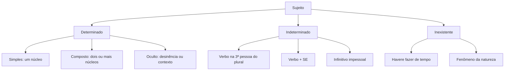

Estudar a classe de uma palavra é olhar para ela sozinha: *casa* é substantivo, *rapidamente* é advérbio. Estudar sintaxe é olhar para o que essa palavra faz dentro da frase: em "a casa caiu", *casa* é o sujeito; em "voltei para casa", *casa* completa o sentido de um verbo com preposição. A mesma palavra, funções diferentes. É esse olhar funcional que a banca cobra, tanto na questão que pede o nome do termo quanto na que pede a reescrita de uma frase. Este capítulo monta a base: o que é função sintática, como o sujeito e o predicado se organizam e como classificar cada tipo de sujeito, inclusive os casos em que a oração não tem sujeito nenhum.

> [!objetivos]
> - Explicar o que é função sintática e por que a mesma palavra pode ter funções diferentes.
> - Separar sujeito e predicado e identificar o núcleo de cada um.
> - Classificar o sujeito em simples, composto, oculto, indeterminado e inexistente.
> - Reconhecer as três formas de indeterminar o sujeito, com atenção ao *se*.
> - Distinguir sujeito (função sintática) de referente (retomada no texto).

## O que a sintaxe estuda

Sintaxe é a parte da gramática que estuda as relações entre as palavras dentro da oração. Essas relações recebem nomes, que são as **funções sintáticas**. Uma função sintática não é uma propriedade da palavra: é um papel que ela assume naquela frase, naquele lugar.

Veja o comportamento de *o bombeiro* em três frases diferentes.

- O bombeiro socorreu a criança. (sujeito)
- A criança chamou o bombeiro. (objeto direto)
- O capacete do bombeiro ficou na viatura. (adjunto adnominal)

A palavra é a mesma. O que muda é a posição e a relação com o verbo. Por isso a primeira regra de estudo é esta: **para classificar um termo, olhe para a frase inteira, nunca para a palavra isolada**.

O caminho prático tem quatro passos.

1. Localize o verbo ou a locução verbal. É o centro da oração.
2. Pergunte quem ou o que pratica ou sofre a ação, conforme o caso.
3. Observe se há preposição obrigatória ligando o termo ao verbo ou ao nome.
4. Confirme com a substituição por um pronome ou pela voz passiva.

O passo 4 é o que separa o aluno que adivinha do aluno que acerta. Quase toda função tem um teste: um pronome que a substitui, uma transformação que só ela aceita.

> [!bizu] O verbo é o centro
> Achar o verbo resolve metade da questão: o sujeito concorda com ele, o objeto completa o seu sentido e o adjunto adverbial indica a circunstância da ação. Antes de classificar qualquer termo, sublinhe o verbo.

### Frase, oração e período

Três termos aparecem juntos e não são sinônimos.

- **Frase** é todo enunciado com sentido completo, mesmo sem verbo. "Socorro!" é frase.
- **Oração** é o enunciado organizado em torno de um verbo ou de uma locução verbal. "O soldado chegou cedo" é uma oração.
- **Período** é a frase organizada em uma ou mais orações. Se tem um verbo, é período simples; se tem dois ou mais, é período composto.

Assim, "O soldado chegou cedo" é, ao mesmo tempo, frase, oração e período simples. Já "O soldado chegou cedo e assumiu o posto" é uma frase com duas orações, ou seja, um período composto.

| Unidade | Definição | Exemplo |
| --- | --- | --- |
| Frase | enunciado com sentido completo | Bom dia! |
| Oração | enunciado com verbo ou locução verbal | O plantão começou às sete. |
| Período simples | uma oração | O plantão começou às sete. |
| Período composto | duas ou mais orações | O plantão começou e a equipe se apresentou. |

Essa distinção importa porque muitas questões pedem "quantas orações há no período" ou "o período é simples ou composto". A contagem é sempre pelo número de verbos ou locuções verbais, e não pelo número de ideias.

> [!atencao] Locução verbal conta como um verbo
> Em "A guarnição vai inspecionar o quartel", há uma locução verbal (*vai inspecionar*) e, portanto, uma única oração. Não conte *vai* e *inspecionar* como dois verbos: auxiliar e principal formam um só núcleo verbal.

## Sujeito e predicado

Toda oração se organiza em dois grandes blocos, com poucas exceções. O **sujeito** é o termo sobre o qual se declara algo. O **predicado** é o que se declara sobre o sujeito.

Em "A equipe de resgate chegou rápido", *a equipe de resgate* é o sujeito e *chegou rápido* é o predicado. O núcleo do sujeito é *equipe*; o núcleo do predicado é *chegou*.

A identificação do sujeito se faz por duas perguntas ao verbo: **quem?** ou **o que?** antes dele. Em "O sargento organizou o treinamento", a pergunta "quem organizou o treinamento?" devolve "o sargento". É o sujeito.

> [!exemplo] O teste em uma ocorrência
> "Os dois caminhões do quartel saíram às seis." Pergunta ao verbo: quem saiu às seis? Resposta: *os dois caminhões do quartel*. Sujeito composto, com dois núcleos (*caminhões* e *quartel*? não: o núcleo é *caminhões*; *do quartel* apenas especifica). Cuidado com esse detalhe — ele volta na seção de sujeito determinado.

O predicado, por sua vez, se classifica pelo que o seu núcleo é. Se o núcleo é um verbo significativo, o predicado é **verbal**. Se o núcleo é um nome (com verbo de ligação), é **nominal**. Se há verbo significativo e nome, é **verbo-nominal**. O capítulo *Predicativo, tipos de predicado e termos acessórios* detalha cada um; aqui basta guardar a lógica: verbo significativo pede complemento, verbo de ligação pede predicativo.

### Predicação verbal: o que cada verbo pede

Antes de nomear qualquer termo, é preciso saber o que o verbo pede. Essa é a **predicação verbal**, e ela decide se o termo seguinte é objeto, complemento ou simples acompanhamento.

- **Verbo intransitivo**: tem sentido completo e não pede complemento. "O alarme tocou." O verbo não exige nada depois dele; o que aparecer será adjunto adverbial.
- **Verbo transitivo direto**: pede complemento sem preposição obrigatória. "O soldado abriu o portão."
- **Verbo transitivo indireto**: pede complemento com preposição. "O candidato precisava de calma."
- **Verbo transitivo direto e indireto**: pede os dois complementos. "O fiscal entregou o comprovante ao candidato."
- **Verbo de ligação**: não indica ação; liga o sujeito a uma característica. "O quartel estava silencioso."

| Predicação | O que pede | Exemplo |
| --- | --- | --- |
| Intransitivo | nada | Os meninos jogam no campo do batalhão. |
| Transitivo direto | complemento sem preposição | A empresa decidiu exportar a produção. |
| Transitivo indireto | complemento com preposição | A liderança da equipe insistiu no treino. |
| Transitivo direto e indireto | os dois complementos | Mandei o convite ao comandante. |
| De ligação | predicativo | O relatório parecia incompleto. |

Essa classificação não é decorativa. Ela explica, por exemplo, por que "os barcos chegaram" não tem objeto: *chegar* é intransitivo. Explica também por que o comentário indelicado de um fiscal pode virar caso de prova: em "o comentário indelicado irritou a turma", o verbo é transitivo direto, e o termo sem preposição é o objeto direto.

> [!atencao] A mesma forma verbal muda de predicação
> Muitos verbos mudam de predicação conforme o sentido. "O prazo acabou" (intransitivo) e "a equipe acabou o relatório" (transitivo direto). "O cabo assistiu ao treino" (transitivo indireto, com preposição) e "o enfermeiro assistiu o ferido" (transitivo direto, no sentido de prestar socorro). Classifique pela frase, não pelo verbo no dicionário.

### A ordem não define a função

O sujeito costuma vir antes do predicado, mas isso é hábito, não regra. Em "Chegou o reforço", o sujeito é *o reforço*, que aparece depois do verbo. Em "Ao comandante coube a decisão", o sujeito é *a decisão*.

Por isso, nunca classifique por posição. Classifique por pergunta e por concordância: o verbo concorda com o sujeito, e essa concordância denuncia quem é quem. Em "Chegaram os reforços", o verbo no plural confirma que *os reforços* é o sujeito.

> [!pegadinha] Sujeito posposto
> A banca escreve a frase na ordem indireta e pede a classificação do termo que vem depois do verbo. "Faltaram ao plantão três soldados" tem sujeito *três soldados*, e não objeto direto. O teste é a concordância: o verbo está no plural por causa de *três soldados*.

## Sujeito determinado

O sujeito é **determinado** quando é possível apontar quem é. Há três tipos.

**Sujeito simples** tem um único núcleo. "O cadete apresentou o relatório." Núcleo: *cadete*.

**Sujeito composto** tem dois ou mais núcleos. "O cadete e o sargento apresentaram o relatório." Núcleos: *cadete* e *sargento*.

**Sujeito oculto**, também chamado elíptico ou desinencial, não aparece escrito, mas é identificável pela desinência do verbo ou pelo contexto. "Chegamos cedo ao quartel." O verbo na primeira pessoa do plural indica que o sujeito é *nós*. Em "O comandante reuniu a tropa e, em seguida, liberou o pelotão", o sujeito de *liberou* é o mesmo de *reuniu*, ou seja, *o comandante*.

Note bem: o sujeito oculto é determinado, porque se sabe quem é. O que falta é a palavra escrita, não a identificação. Isso separa o sujeito oculto do sujeito indeterminado. Gramáticos chamam esse sujeito de **omitido** ou **elíptico**, e a pista está na desinência: a terminação do verbo flexiona para indicar a pessoa. Em "mandei o ofício ontem", a terminação *-ei* aponta para *eu*; em "partimos cedo", *-mos* aponta para *nós*.

Um cuidado: o sujeito oculto também aparece em sequência, quando a segunda oração herda o sujeito da primeira. "O comandante vistoriou o alojamento e liberou a tropa." O sujeito de *liberou* não está escrito, e não é preciso repeti-lo. Se a banca perguntar quantos sujeitos há nas duas orações, a resposta é: dois sujeitos gramaticais, ambos *o comandante*, um expresso e outro oculto.

A tabela abaixo reúne os tipos de sujeito determinado com o teste de cada um.

| Tipo | Como reconhecer | Exemplo |
| --- | --- | --- |
| Simples | um só núcleo | A viatura chegou. |
| Composto | dois ou mais núcleos | A viatura e a ambulância chegaram. |
| Oculto | não escrito, mas identificável pela desinência ou pelo contexto | Chegamos antes do alarme. |
| Oculto por contexto | sujeito da oração anterior | O major assinou o ofício e o enviou ao comando. |

O esquema abaixo resume a classificação inteira, que serve para todo o capítulo.

> [!esquema] Núcleo do sujeito: o que não é núcleo
> - Artigo, pronome, numeral e adjetivo acompanham o núcleo, mas não são o núcleo.
> - Locução adjetiva com "de" especifica o núcleo: em *a equipe do quartel*, o núcleo é *equipe*.
> - Em *os dois bombeiros*, o núcleo é *bombeiros*.
> - O núcleo nunca está dentro de uma preposição essencial: *de plantão* não pode ser núcleo.

## Sujeito indeterminado

O sujeito é **indeterminado** quando a oração tem sujeito, mas não se pode ou não se quer dizer quem é. A língua tem três recursos para isso.

O primeiro é o verbo na **terceira pessoa do plural**, sem que o contexto indique quem pratica a ação. "Bateram na porta do quartel durante a madrugada." Não há, no texto, um antecedente plural que explique quem bateu. Se houvesse, o sujeito seria oculto, e não indeterminado.

O segundo é o verbo na terceira pessoa do singular acompanhado da partícula **se**. Essa partícula, nesse uso, é chamada de **partícula indeterminadora do sujeito** (PIS). Ela aparece com verbos que não são transitivos diretos: intransitivos, transitivos indiretos e de ligação.

- Precisa-se de voluntários. (transitivo indireto: *precisar de*)
- Vive-se bem em Recife. (intransitivo)
- Era-se mais rigoroso antigamente. (de ligação)

O terceiro é o **infinitivo impessoal**, geralmente com verbo no singular e sem sujeito expresso, em enunciados de sentido geral. "É preciso estudar com método." "Convém chegar cedo."

> [!atencao] PIS × partícula apassivadora
> Com o *se*, a decisão depende da transitividade. Verbo transitivo direto ou transitivo direto e indireto: o *se* é **apassivador**, e o que parecia objeto é o sujeito paciente. "Venderam-se as bicicletas" = as bicicletas foram vendidas (sujeito *as bicicletas*, verbo no plural). Verbo intransitivo, transitivo indireto ou de ligação: o *se* é **indeterminador**, e o sujeito não existe na frase (verbo sempre na 3ª pessoa do singular).

Esse é um dos pontos mais explorados em prova, porque muda a concordância. Em "Alugam-se casas", o verbo fica no plural: *casas* é sujeito paciente. Em "Precisa-se de costureiras", o verbo fica no singular: *de costureiras* é objeto indireto e o sujeito é indeterminado. Quem troca um pelo outro erra a concordância.

> [!pegadinha] O "se" não é sempre o mesmo
> A banca coloca as duas construções lado a lado e pede a correta. *Consertam-se relógios* (apassivadora, plural obrigatório) não é o mesmo caso de *Conserta-se relógios* — esta segunda é errada justamente porque *relógios* é sujeito paciente. Já *Trata-se de assuntos urgentes* fica no singular: o verbo é transitivo indireto, e *de assuntos urgentes* é o complemento.

## Sujeito x referente

Uma confusão comum em prova de interpretação: sujeito e referente não são a mesma coisa. **Sujeito** é função sintática da oração. **Referente** é o ser ou objeto do mundo (ou do texto) a que o termo remete.

Considere: "O coronel recebeu o relatório. Ele estava incompleto." Na segunda oração, *ele* é sujeito. O referente de *ele*, porém, é *o relatório*, e não o coronel. A concordância gramatical não decide o referente: decide o contexto.

Por isso, quando a questão pergunta "a que se refere o pronome", a resposta é o referente. Quando pergunta "qual é a função sintática do termo", a resposta é o papel na oração (sujeito, objeto direto, adjunto adnominal). São duas perguntas diferentes, e a banca gosta de misturá-las no enunciado.

| Pergunta da banca | O que se procura | Exemplo de resposta |
| --- | --- | --- |
| Qual é o sujeito da oração? | função sintática | "ele" |
| A que termo se refere "ele"? | referente no texto | "o relatório" |
| Qual é o núcleo do sujeito? | palavra central do sujeito | "equipe", em "a equipe do quartel" |
| O sujeito é simples ou composto? | quantidade de núcleos | simples |

> [!exemplo] Retomada e ambiguidade
> "O tenente avisou o soldado de que a troca havia mudado. Ele não entendeu." O pronome *ele* é sujeito, mas o referente é ambíguo: pode ser o tenente ou o soldado. Em prova, a ambiguidade costuma ser o defeito apontado na reescrita, e a correção é repetir o nome ou reorganizar a frase: "O tenente avisou o soldado de que a troca havia mudado, mas o soldado não entendeu."

O mesmo raciocínio vale para os termos que retomam ideias inteiras. Em "A guarnição chegou atrasada, o que gerou reclamação", o pronome relativo retoma toda a oração anterior, e não um substantivo. Chama-se referência oracional, e a função sintática do termo continua sendo sujeito de *gerou*.

## Oração sem sujeito

Há orações em que não existe sujeito, nem determinado nem indeterminado: o verbo é impessoal. Elas aparecem em contextos fixos, e a banca cobra tanto a classificação quanto a concordância (o verbo fica sempre na terceira pessoa do singular).

- **Haver** no sentido de existir ou de tempo decorrido. "Havia três viaturas no pátio." "Havia dois anos que ele servia ali."
- **Fazer** indicando tempo ou fenômeno climático. "Faz dois meses que o curso começou." "Fez muito calor no treinamento."
- **Ser** indicando hora, data ou distância. "São cinco horas." "É 29 de outubro." "Daqui ao quartel são três quilômetros."
- **Estar** indicando tempo ou clima. "Está frio hoje."
- Verbos que indicam **fenômenos da natureza**. "Choveu durante toda a noite." "Ventou forte na costa."

Agrupando, os casos mais cobrados são os de *haver* e *fazer* com ideia de tempo, porque neles o verbo não varia: "Havia cinco candidatos", e nunca "Haviam cinco candidatos".

> [!atencao] Haver e existir
> *Haver*, no sentido de existir, é impessoal e fica no singular: "Havia muitas vagas". *Existir* é pessoal e concorda com o sujeito: "Existiam muitas vagas". A troca de um pelo outro é a pegadinha mais comum de concordância com verbos impessoais.

> [!bizu] Três verbos que nunca vão para o plural no sentido impessoal
> **Haver** (existir), **fazer** (tempo) e **ser** (hora) ficam no singular. Guarde a frase: "havia, fazia e era" — nunca "haviam, faziam e eram" nesses sentidos.

Quando *haver* e *fazer* entram em locução com outro verbo, a impessoalidade se transmite ao auxiliar: "Vai fazer dois anos que ele se formou" (e não "vão fazer"). Já com *existir* a concordância é normal: "Vão existir novas regras".

## Frases para treinar a classificação

A leitura de frases prontas, com a análise ao lado, consolida o que os testes ensinam. Analise cada uma antes de ler a explicação.

- "O voto é obrigatório para os maiores de dezoito anos." Sujeito *o voto*, simples; o predicado é nominal, porque o verbo *é* liga o sujeito ao adjetivo *obrigatório*.
- "As emendas foram votadas na sessão da noite." Sujeito *as emendas*, simples e paciente; o agente da passiva não aparece.
- "Os direitos fundamentais são inalienáveis." Sujeito simples, núcleo *direitos*; *fundamentais* e *inalienáveis* são características, não núcleos.
- "Ladrões roubaram três caixas do depósito." Sujeito simples, *ladrões*. Se a frase fosse apenas "roubaram três caixas do depósito", o sujeito seria indeterminado, por falta de antecedente no texto.
- "É custoso manter a disciplina no plantão noturno." O sujeito é a oração *manter a disciplina no plantão noturno*. Quando o sujeito é oracional, o verbo fica na terceira pessoa do singular.
- "É provável surgirem novas regras." Mesmo caso: o sujeito é a oração reduzida *surgirem novas regras*.
- "Se o candidato morasse mais perto, chegaria a pé." Sujeito *o candidato*, simples, na primeira oração; na segunda, o sujeito é oculto e se recupera pelo contexto.
- "Crescem as dúvidas dos candidatos." Sujeito posposto *as dúvidas dos candidatos*, simples; o verbo no plural confirma o núcleo *dúvidas*.
- "Os bancos do pátio amanheceram molhados." Sujeito simples, núcleo *bancos*; *molhados* é predicativo, e não núcleo do sujeito.
- "As respostas do setor não correspondem ao pedido." Sujeito simples *as respostas do setor*; o verbo é transitivo indireto e *ao pedido* é objeto indireto.
- "O cabo recusa a escala extra." Sujeito simples; o verbo é transitivo direto e *a escala extra* é objeto direto, sem preposição.
- "O motorista preferiu sair pela porta lateral." Sujeito simples *o motorista*; *sair pela porta lateral* completa o sentido de *preferiu*.

Repare que os dois últimos casos exigem distinguir predicação antes de nomear o termo. Sem esse passo, o aluno chama de objeto o que é sujeito e de sujeito o que é complemento. Essas são as noções iniciais que sustentam toda a análise sintática do volume.

### Análise rápida em tabela

A tabela traz dezessete frases curtas com o sujeito já identificado. Cubra a coluna da direita e classifique antes de conferir.

| Frase | Sujeito | Classificação |
| --- | --- | --- |
| Anunciei a escala antes do recolher. | eu, não escrito | oculto |
| O comando mandou reforçar a guarda. | o comando | simples |
| Foi admitido no curso o candidato que recorreu. | o candidato que recorreu | simples, posposto |
| A equipe de futebol do batalhão joga no campo de terra. | a equipe de futebol do batalhão | simples, núcleo *equipe* |
| Os recursos do setor são limitados. | os recursos do setor | simples, predicativo *limitados* |
| O pedido genérico foi indeferido pelo operador. | o pedido genérico | simples, paciente |
| Os cães ferozes do canil latiram a noite inteira. | os cães ferozes do canil | simples, núcleo *cães* |
| O circo armou a lona ao lado do quartel. | o circo | simples |
| Consultei o edital antes da inscrição. | eu, não escrito | oculto |
| O fiscal desconfia da assinatura. | o fiscal | simples |
| Paira dúvida sobre a validade do ato. | dúvida | simples, posposto |
| A inconstitucionalidade da regra foi reconhecida. | a inconstitucionalidade da regra | simples |
| As conclusões do relatório são discutíveis. | as conclusões do relatório | simples |
| A norma superveniente alterou o prazo de recurso. | a norma superveniente | simples |
| Os pneus da viatura estavam ruins. | os pneus da viatura | simples, predicativo *ruins* |
| O fumo tomou o corredor em minutos. | o fumo | simples |
| Compareceram dezenove candidatos ao teste. | dezenove candidatos | simples, posposto |
| As provas mostram que o método funciona. | as provas | simples |
| É difícil jogar com o vento contra. | jogar com o vento contra | oracional |

Nenhuma das frases acima tem sujeito indeterminado, e isso não é acaso. A indeterminação exige uma marca formal: terceira pessoa do plural sem antecedente, *se* com verbo de predicação incompleta ou infinitivo de sentido geral. Sem a marca, o sujeito é determinado, mesmo que a frase seja curta.

> [!pegadinha] Sujeito oracional não leva verbo no plural
> A banca escreve "É custoso manter a disciplina" e oferece como correta a leitura de que o sujeito é *a disciplina*. Não é: *a disciplina* é objeto direto de *manter*, e o sujeito é a oração inteira. Por isso o verbo *é* não vai para o plural.

## Mapa do capítulo

A tabela reúne os tipos de sujeito, o teste de reconhecimento e um exemplo curto de cada um.

| Tipo de sujeito | Teste rápido | Exemplo |
| --- | --- | --- |
| Simples | um núcleo | O plantão começou. |
| Composto | dois ou mais núcleos | O plantão e o treino começaram. |
| Oculto | desinência ou oração anterior | Começamos cedo. |
| Indeterminado | 3ª pessoa do plural sem antecedente | Chamaram pelo rádio. |
| Indeterminado com SE | verbo intransitivo, transitivo indireto ou de ligação + se | Precisa-se de água. |
| Inexistente | haver, fazer, ser de tempo; fenômeno natural | Havia duas viaturas. |

### Para fixar

- Função sintática é o papel do termo na oração; a mesma palavra muda de função conforme a frase.
- O sujeito se acha pela pergunta ao verbo (quem? o que?), confirmada pela concordância, nunca pela posição.
- Sujeito simples tem um núcleo; composto, dois ou mais; oculto é identificável pela desinência ou pelo contexto.
- Sujeito indeterminado por verbo na 3ª pessoa do plural exige que não haja antecedente no texto.
- Com *se*, verbo transitivo direto leva partícula apassivadora e sujeito paciente; verbo transitivo indireto, intransitivo ou de ligação leva partícula indeterminadora e sujeito indeterminado.
- Oração sem sujeito: *haver* e *fazer* de tempo, *ser* de hora e data, *estar* de clima e verbos de fenômeno natural.
- *Haver* impessoal fica no singular; *existir* concorda com o sujeito.
- Sujeito é função sintática; referente é o termo do texto a que o pronome remete.
- Locução verbal conta como um único verbo para efeito de contagem de orações.
