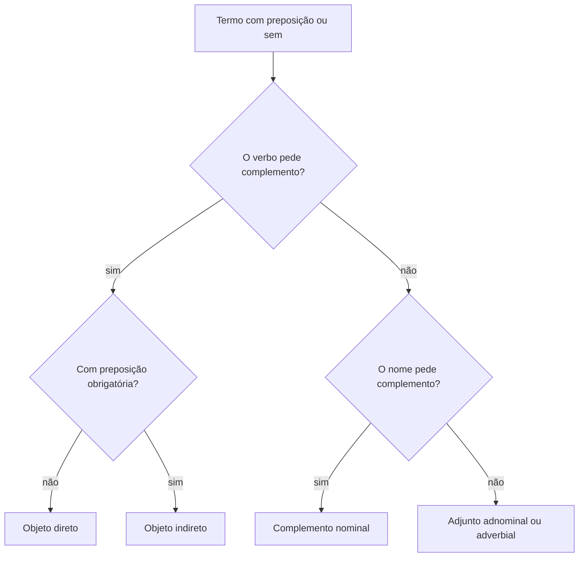

Depois dos termos essenciais, entram em cena os termos que completam o sentido de verbos e de nomes. É aqui que a banca separa quem decorou nomes de quem sabe testar: o mesmo trecho com preposição pode ser objeto indireto, complemento nominal ou adjunto adnominal, e o nome dado ao termo muda a análise inteira da frase. Este capítulo ensina a reconhecer o objeto direto, o objeto indireto, o complemento nominal e o adjunto adnominal, com os testes que resolvem cada caso. No fim, o predicativo do sujeito fecha a comparação mais cobrada: a diferença entre caracterizar o sujeito e apenas acompanhar um substantivo.

> [!objetivos]
> - Identificar o objeto direto pelos testes do pronome e da voz passiva.
> - Reconhecer o objeto indireto, inclusive quando o verbo aceita os dois complementos.
> - Explicar quando o objeto direto vem preposicionado e quando é pleonástico.
> - Diferenciar complemento nominal de adjunto adnominal pela natureza do nome completado.
> - Distinguir predicativo do sujeito de adjunto adnominal.

## Termos integrantes e termos acessórios

Os termos da oração se dividem em três grupos. Os **essenciais** são o sujeito e o predicado. Os **integrantes** completam o sentido de um verbo ou de um nome: objeto direto, objeto indireto, complemento nominal e agente da passiva. Os **acessórios** acrescentam informação sem serem exigidos: adjunto adnominal, adjunto adverbial, aposto e vocativo.

A diferença entre integrante e acessório não é de importância, é de necessidade. Se o termo é exigido pelo verbo ou pelo nome, ele é integrante. Se pode sair sem deixar a frase incompleta, é acessório. Compare:

- O sargento encontrou **o relatório**. (integrante: *encontrar* pede o quê?)
- O sargento encontrou **o relatório antigo**. (o adjetivo *antigo* é acessório)
- O sargento encontrou **o relatório do setor**. (o termo com preposição é acessório, e não integrante)

O esquema abaixo mostra como a pergunta pelo complemento se ramifica.

Muita questão erra porque o aluno procura o complemento do nome errado. Em "a garantia do direito", é preciso perguntar primeiro qual nome está sendo completado: *garantia*. O termo *do direito* completa *garantia*, e não o verbo da oração.

> [!atencao] Preposição não decide sozinha
> A presença de preposição não transforma o termo em objeto indireto. O que decide é a exigência do verbo. Em "o comandante gosta de disciplina", a preposição é exigida pelo verbo e o termo é objeto indireto. Em "o comandante chegou de disciplina nova", a preposição nasce da ideia de modo, e o termo é adjunto adverbial.

## Objeto direto

**Objeto direto** é o complemento de verbo transitivo direto, ligado a ele sem preposição obrigatória. Ele completa o sentido do verbo e indica o ser sobre o qual recai a ação.

Dois testes identificam o objeto direto com segurança.

1. **Substituição por pronome oblíquo átono** *o, a, os, as*: "O fiscal entregou o comprovante" → "O fiscal entregou-o".
2. **Passagem para a voz passiva analítica**: o objeto direto vira sujeito paciente. "O comprovante foi entregue pelo fiscal."

| Teste | Frase ativa | Resultado |
| --- | --- | --- |
| Pronome átono | O plantão recebeu as queixas. | O plantão recebeu-as. |
| Voz passiva | O plantão recebeu as queixas. | As queixas foram recebidas pelo plantão. |
| Pronome átono | A equipe preparou os carros. | A equipe preparou-os. |

Nenhum dos dois testes funciona com objeto indireto. "O candidato precisa de calma" não vira "o candidato precisa-a" nem "a calma é precisada pelo candidato". Por isso, quando a banca pede para transformar em voz passiva e a frase não aceita a transformação, o complemento não é objeto direto.

### Objeto direto preposicionado

Há casos em que a preposição aparece, mas ela não é exigida pelo verbo. O objeto continua direto, porque o verbo é transitivo direto. É o **objeto direto preposicionado**. Os casos mais comuns são estes.

- **Pronome oblíquo tônico**: "A mim ninguém enganou." O pronome *mim* exige a preposição, e o objeto segue direto.
- **Nome próprio ou pessoa determinada**, por clareza: "O setor consultou ao comandante antes da decisão."
- **Expressão de quantidade ou parte**: "O tenente bebeu do café e saiu."
- **Verbos de sentimento**: "O soldado amava a sua corporação" aceita "amava à corporação" em registro literário.
- **Para evitar ambiguidade**: "O cabo cumprimentou ao coronel, e não ao major."

O uso da preposição pode mudar o sentido, e é aí que a banca cobra interpretação. "O caçador feriu o cão" indica que o cão foi atingido. Já "o caçador feriu ao cão" é construção rejeitada pela norma, mas "o caçador atirou ao cão" indica direção do disparo. A preposição muda a relação, e o aluno precisa testar o sentido antes de nomear a função. Em alguns casos, a escolha da preposição busca apenas eufonia, isto é, um som mais agradável: por isso se diz "assisti ao filme", e não "assisti o filme", no sentido de ver.

> [!pegadinha] Preposição "a" com verbo transitivo direto
> A banca marca o termo preposicionado como objeto indireto e espera que o aluno aceite. Verifique o verbo antes: se ele é transitivo direto, o termo preposicionado é objeto direto preposicionado. "O testemunho surpreendeu a todos" não tem objeto indireto: *a todos* é objeto direto preposicionado.

### Objeto direto pleonástico

O objeto pode vir repetido: uma vez como palavra, outra como pronome. Essa repetição é o **objeto direto pleonástico**, usada para dar ênfase. "As queixas, o comandante já as recebeu." "A mim, ninguém me convenceu."

Na análise, contam-se dois objetos: o pleonástico (*as*, *me*) e o antecipado (*as queixas*, *a mim*). A banca costuma perguntar quantas vezes o objeto aparece e qual é a função do pronome.

> [!exemplo] Objeto direto em uma ocorrência real
> "Os condutores ignoraram a sinalização provisória." Objeto direto: *a sinalização provisória*. O núcleo é *sinalização*; *provisória* é adjunto adnominal. Na voz passiva: "a sinalização provisória foi ignorada pelos condutores". O agente da passiva é *pelos condutores*.

## Objeto indireto

**Objeto indireto** é o complemento de verbo transitivo indireto, ligado a ele por preposição obrigatória. Completa o sentido do verbo e indica normalmente o destinatário, o alvo ou o assunto da ação.

- O sargento obedeceu **ao regulamento**. (obediência a algo)
- A equipe precisava **de reforço**. (necessidade de algo)
- O comando insistiu **no treinamento**. (insistência em algo)

O teste típico é a substituição por *lhe, lhes*, quando o complemento é pessoa: "O comando entregou o ofício ao tenente" → "O comando entregou-lhe o ofício". Quando o complemento não é pessoa, a substituição por *lhe* costuma soar mal: "obedeceu-lhe" é possível, mas "precisava-lhe" não é usado. Nesse caso, o teste é a própria exigência da preposição.

| Verbo | Preposição exigida | Objeto indireto |
| --- | --- | --- |
| obedecer | a | ao regulamento |
| precisar | de | de pessoal |
| insistir | em | no prazo |
| gostar | de | do serviço |
| assistir (ver) | a | ao treino |
| informar | a | aos candidatos |

O verbo **assistir** merece atenção. No sentido de ver ou presenciar, é transitivo indireto, com a preposição *a*: "assisti ao treino". No sentido de prestar auxílio, é transitivo direto: "o enfermeiro assistiu o ferido". A banca explora essa diferença em questões de regência. O verbo *pedir* admite as duas construções: "pedi o comprovante ao setor" tem objeto direto (*o comprovante*) e objeto indireto (*ao setor*).

> [!bizu] Dois complementos, dois testes
> Se o verbo pede dois complementos, o primeiro teste é a voz passiva: só o que vira sujeito paciente é objeto direto. O que sobra é objeto indireto. "O fiscal entregou o comprovante ao candidato" → "o comprovante foi entregue ao candidato pelo fiscal". Objeto direto: *o comprovante*; objeto indireto: *ao candidato*.

## Complemento nominal

**Complemento nominal** é o termo que completa o sentido de um nome: substantivo abstrato, adjetivo ou advérbio. Vem sempre com preposição e tem caráter de alvo, de destinatário ou de paciente.

- A defesa **do direito** exige prova. (completa o substantivo abstrato *defesa*)
- O setor é favorável **ao acordo**. (completa o adjetivo *favorável*)
- O relatório foi escrito favoravelmente **ao réu**. (completa o advérbio *favoravelmente*)

Três marcas ajudam a reconhecer:

1. O nome completado é abstrato e precisa do complemento para ter sentido completo.
2. O termo tem valor passivo, de alvo: *a defesa do direito* é a defesa que recai sobre o direito.
3. A preposição é exigida pelo nome: *favorável a*, *dependente de*, *atento a*.

> [!exemplo] Complemento nominal com valor de alvo
> Na denúncia, o promotor descreveu "a corrupção de agentes públicos". O termo *de agentes públicos* completa o substantivo abstrato *corrupção* e indica quem é corrompido. É complemento nominal. Se a frase fosse "a atuação de agentes públicos", o termo indicaria quem age, e a análise seria outra.

## Adjunto adnominal

**Adjunto adnominal** é o termo que acompanha um substantivo para caracterizá-lo ou determiná-lo. Não é exigido pelo nome; acrescenta informação. Podem exercer essa função artigos, adjetivos, locuções adjetivas, pronomes adjetivos e numerais.

- **O** comandante **novo** chegou com **três** pastas **do setor**.
- Os artigos *o* e *os*, o adjetivo *novo*, o numeral *três* e a locução adjetiva *do setor* são adjuntos adnominais.

A diferença central em relação ao complemento nominal é o tipo de relação. O adjunto adnominal caracteriza, qualifica, determina, indica posse ou origem. O complemento nominal completa um nome abstrato com valor de alvo.

A tabela abaixo compara os dois com os critérios que a banca usa.

| Critério | Complemento nominal | Adjunto adnominal |
| --- | --- | --- |
| Nome completado | substantivo abstrato, adjetivo ou advérbio | substantivo concreto ou abstrato |
| Valor do termo | alvo, paciente, destinatário | posse, agente, origem, qualidade |
| Necessidade | exigido pelo nome | dispensável |
| Preposição | sempre | quando houver locução adjetiva |
| Exemplo | a investigação da corrupção | a investigação do delegado |

Repare na última linha. "A investigação da corrupção" indica o que foi investigado: valor passivo, complemento nominal. "A investigação do delegado" indica quem investigou: valor ativo, adjunto adnominal. A palavra *investigação* é a mesma, e o que muda é o papel do termo seguinte.

> [!atencao] Substantivo concreto não pede complemento nominal
> Se o nome completado é concreto, o termo com preposição é adjunto adnominal. "A porta do quartel" não tem complemento nominal: *quartel* apenas localiza a porta. O mesmo vale para "o telhado da casa" e "o pneu do carro".

> [!pegadinha] O clássico da banca
> A questão troca agente por paciente. "A prisão do suspeito" (quem foi preso: complemento nominal) e "a prisão do policial" (quem prendeu, leitura possível: adjunto adnominal). Sem contexto, a frase é ambígua, e a banca cobra exatamente essa ambiguidade na reescrita. O jeitinho de responder pela palavra isolada falha nesses casos: leia a frase inteira e pergunte quem pratica e quem sofre a ação.

## Predicativo do sujeito

**Predicativo do sujeito** é o termo que atribui uma característica ao sujeito, por meio de verbo de ligação. Ele concorda com o sujeito em gênero e número.

- O quartel **estava silencioso**.
- Os candidatos **permaneceram calmos**.
- A prova **parecia difícil**.

O predicativo também aparece com verbos significativos, quando indica estado resultante ou modo: "O soldado voltou cansado", "a equipe chegou preparada". Nesse caso, o verbo é intransitivo e o predicativo funciona como atributo, às vezes chamado de predicativo circunstancial.

A confusão mais frequente é com o adjunto adnominal. A diferença está na presença do verbo de ligação: o predicativo se liga ao sujeito *por meio* do verbo; o adjunto adnominal se liga diretamente ao substantivo, sem verbo intermediário.

- O comandante **novo** assumiu o posto. (*novo* é adjunto adnominal: acompanha o substantivo)
- O comandante **está novo** no posto. (*novo* é predicativo: atributo do sujeito, ligado por *está*)

Outro teste útil: retire o termo. Se a frase fica sem informação essencial sobre o estado do sujeito, é predicativo. Se fica apenas menos detalhada, é adjunto adnominal.

Atenção a *dever*, que não é verbo de ligação. Em "o candidato deve cumprir o prazo", *deve cumprir* é locução verbal, e *o prazo* é objeto direto do verbo principal. Já em "o candidato deve explicações ao setor", *dever* é o verbo principal e *explicações* é o objeto direto.

> [!esquema] Três perguntas que decidem
> - O termo completa um verbo? Objeto direto (sem preposição) ou indireto (com preposição).
> - O termo completa um nome? Complemento nominal, se o nome é abstrato e o termo é alvo.
> - O termo acompanha um substantivo sem intermediário? Adjunto adnominal. Com verbo de ligação, é predicativo do sujeito.

## Reescrita: o que muda quando o termo muda

Reconhecer o termo é o primeiro passo da sintaxe da oração e do período. A estrutura morfossintática do período depende dessa análise: só depois de saber qual termo completa qual verbo é possível reconhecer as relações de coordenação entre orações e entre termos da oração. Uma reescrita que troca o objeto direto de lugar, sem ajustar a concordância, muda a estrutura inteira.

Compare as duas versões: "o comando entregou os ofícios ao setor" e "os ofícios foram entregues ao setor pelo comando". A segunda versão só existe porque o termo *os ofícios* é objeto direto. Se o termo fosse objeto indireto, a passagem para a voz passiva seria impossível. O aluno que sabe testar escreve a reescrita pedida sem hesitar.

O mesmo raciocínio vale para a troca de preposição. "O relatório alude ao problema antigo" não aceita "alude o problema": o verbo pede a preposição. Já "o fiscal indaga o motivo da ausência" não aceita "indaga ao motivo", porque o verbo é transitivo direto. A banca oferece as duas construções e pede a correta: quem conhece a predicação do verbo acerta pelo teste, não pela memória.

## Análise em tabela

A tabela traz frases prontas com o termo em análise. Classifique antes de ler a terceira coluna.

| Frase | Termo em análise | Função |
| --- | --- | --- |
| O instrutor surpreendeu os recrutas. | os recrutas | objeto direto |
| Provo a inocência do cliente. | a inocência do cliente | objeto direto |
| O júri absolveu o réu. | o réu | objeto direto |
| O candidato deve cumprir o prazo. | o prazo | objeto direto (locução verbal) |
| O fiscal indaga o motivo da ausência. | o motivo da ausência | objeto direto |
| O regulamento faculta ao aluno a escolha. | ao aluno | objeto indireto |
| O regulamento faculta ao aluno a escolha. | a escolha | objeto direto |
| A equipe esperou o resultado. | o resultado | objeto direto |
| A arma ficou no cofre. | no cofre | adjunto adverbial |
| Considero o relatório completo. | completo | predicativo do objeto |
| O instrutor pediu que ajudassem os novatos. | que ajudassem os novatos | objeto direto oracional |
| O relatório alude ao problema antigo. | ao problema antigo | objeto indireto |
| O órgão oferece garantia de um ano. | garantia de um ano | objeto direto |
| O eleitor cobra transparência. | transparência | objeto direto |
| A encomenda atrasada chegou. | atrasada | adjunto adnominal |
| O resgate de uma onça mobilizou a guarnição. | de uma onça | complemento nominal |
| A turbulência do voo assustou os passageiros. | do voo | adjunto adnominal |
| O salva-vidas ensinou o grupo a surfar. | a surfar | oração objetiva direta |
| O instrutor surpreendeu a todos com a notícia. | a todos | objeto direto preposicionado |
| O setor dispõe de material suficiente. | de material suficiente | objeto indireto |
| A equipe depende do aval do comando. | do aval do comando | objeto indireto |
| A entrega dos exames atrasou. | dos exames | complemento nominal |
| A chegada dos enfermeiros atrasou. | dos enfermeiros | adjunto adnominal (agente) |
| O menu do sistema mudou. | do sistema | adjunto adnominal |
| O cozinheiro preparou o jantar. | o jantar | objeto direto |
| Os fregueses pediram bombons. | bombons | objeto direto |
| Os fregueses pediram ao gerente uma encomenda. | ao gerente | objeto indireto |
| O sentimento de igualdade racial cresceu. | de igualdade racial | complemento nominal |
| O candidato ficou surpreso com a nota. | surpreso | predicativo do sujeito |
| O investigador ignorou as queixas. | as queixas | objeto direto |
| A ignorância da norma prejudica o candidato. | da norma | complemento nominal |

Três linhas da tabela mostram o critério em ação. Em *a entrega dos exames*, o termo indica o que foi entregue: valor passivo. Em *a chegada dos enfermeiros*, o termo indica quem chegou: valor ativo. Em *o resgate de uma onça*, o termo indica o animal resgatado: também passivo. A palavra abstrata não decide sozinha; o papel semântico decide.

Duas frases fecham o raciocínio, com cuidados que rendem questão. Em "comi o pão do rancho", o sujeito é oculto e *o pão do rancho* é objeto direto. Em "o ferido começou a sangrar", não há objeto nenhum: *sangrar* é intransitivo, e a locução verbal pede apenas o adjunto adverbial de lugar. Já em "o instrutor pediu que ajudassem os novatos", o objeto direto é a oração inteira, e o verbo *ajudar* tem o seu próprio objeto dentro dela. Confundir esses níveis é o erro mais comum na contagem de termos.

> [!atencao] Não misture o nível da oração com o nível do termo
> O objeto direto pode ser uma oração inteira. Nesse caso, dentro dela há outro verbo, com sujeito e complementos próprios. Na prova, leia primeiro o período e marque as orações; depois analise os termos de cada uma.

## Mapa do capítulo

O quadro reúne os quatro termos do capítulo com o teste que separa cada um.

| Termo | Completa | Teste decisivo | Exemplo |
| --- | --- | --- | --- |
| Objeto direto | verbo transitivo direto | vira sujeito na voz passiva | recebeu as queixas |
| Objeto indireto | verbo transitivo indireto | preposição exigida pelo verbo | obedeceu ao regulamento |
| Complemento nominal | nome abstrato, adjetivo ou advérbio | valor de alvo, preposição exigida pelo nome | a defesa do direito |
| Adjunto adnominal | substantivo | caracteriza, indica posse ou agente | a viatura do quartel |
| Predicativo do sujeito | sujeito, via verbo de ligação | concorda com o sujeito | o quartel estava silencioso |

### Para fixar

- Objeto direto é o complemento sem preposição obrigatória, e o teste é a voz passiva: ele vira sujeito paciente.
- Objeto indireto é o complemento com preposição exigida pelo verbo, substituível por *lhe* quando é pessoa.
- Objeto direto preposicionado mantém a função de direto: a preposição vem do pronome tônico, da clareza ou do sentido.
- Objeto direto pleonástico é a repetição do objeto por ênfase: conta duas vezes na análise.
- Complemento nominal completa substantivo abstrato, adjetivo ou advérbio, com valor de alvo.
- Adjunto adnominal acompanha substantivo para caracterizar, indicar posse, origem ou agente.
- Em "a investigação do suspeito" o termo é complemento nominal; em "a investigação do delegado" é adjunto adnominal.
- Substantivo concreto pede adjunto adnominal, nunca complemento nominal.
- Predicativo do sujeito se liga ao sujeito por verbo de ligação e concorda com ele; adjunto adnominal se liga direto ao substantivo.
