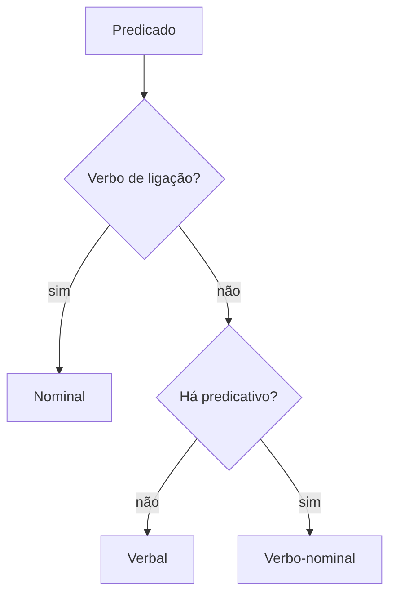

Os termos acessórios completam o quadro da oração: dizem o que se atribui ao sujeito ou ao objeto, como o falante chama o interlocutor, que circunstância acompanha a ação e quem pratica a ação na voz passiva. Este capítulo trata do predicativo do objeto, dos três tipos de predicado, do vocativo, do aposto, do adjunto adverbial e do agente da passiva. A meta é prática: cada termo vem com o teste que o separa do vizinho mais parecido, porque é nessa vizinhança que a banca monta a questão.

> [!objetivos]
> - Identificar o predicativo do objeto e o verbo que o introduz.
> - Classificar o predicado em verbal, nominal e verbo-nominal.
> - Reconhecer vocativo e os tipos de aposto.
> - Classificar o adjunto adverbial e distingui-lo de objeto indireto.
> - Identificar o agente da passiva e diferenciá-lo de adjunto adverbial.

## Predicativo do objeto

**Predicativo do objeto** é o termo que atribui uma característica ao objeto direto. Aparece com verbos que expressam julgamento, nomeação ou transformação: *considerar*, *julgar*, *achar*, *eleger*, *nomear*, *chamar*, *tornar*.

- O conselho **elegeu o sargento coordenador**.
- A banca **julgou a prova complexa**.
- O comando **nomeou o cabo chefe de equipe**.

Em "o conselho elegeu o sargento coordenador", o objeto direto é *o sargento*, e *coordenador* é o predicativo do objeto, porque atribui a ele a nova condição. Sem o predicativo, a frase continua gramatical: "o conselho elegeu o sargento". O que se perde é a informação sobre o resultado da eleição.

A confusão com o adjunto adnominal é frequente. A diferença está na relação: o adjunto adnominal caracteriza o substantivo de modo inerente ou permanente; o predicativo do objeto indica condição atribuída pela ação do verbo.

| Frase | Termo | Função | Por quê |
| --- | --- | --- | --- |
| Elegeram o candidato presidente. | presidente | predicativo do objeto | condição atribuída pelo verbo |
| O candidato presidente discursou. | presidente | adjunto adnominal | característica que acompanha o nome |
| Julguei o relatório confuso. | confuso | predicativo do objeto | julgamento do sujeito |
| O relatório confuso foi refeito. | confuso | adjunto adnominal | qualidade do substantivo |

> [!pegadinha] Predicativo do objeto ou do sujeito
> A banca troca os dois. Em "o instrutor considerou o aluno preparado", *preparado* refere-se ao aluno, que é objeto direto: predicativo do objeto. Em "o instrutor saiu preparado", *preparado* refere-se ao instrutor, que é sujeito: predicativo do sujeito. O teste é perguntar a quem o atributo se refere.

## Tipos de predicado

O predicado se classifica pelo núcleo. Se o núcleo é um verbo significativo, o predicado é **verbal**. Se o núcleo é um nome, ligado ao sujeito por verbo de ligação, o predicado é **nominal**. Se há os dois núcleos, é **verbo-nominal**.

No predicado nominal, o verbo não indica ação: apenas liga o sujeito ao predicativo. Os verbos de ligação mais comuns são *ser*, *estar*, *ficar*, *parecer*, *permanecer*, *continuar*, *tornar-se*.

- A situação **permanecia estável**. (nominal: *estável* é o núcleo)
- O plantão **chegou desanimado**. (verbo-nominal: *chegou* e *desanimado*)
- A equipe **vistoriou o radar**. (verbal: *vistoriou*)

| Tipo | Núcleo | Exemplo | Observação |
| --- | --- | --- | --- |
| Verbal | verbo significativo | O tráfego parou. | o verbo basta |
| Nominal | nome (predicativo) | O clima estava estável. | verbo de ligação não é núcleo |
| Verbo-nominal | verbo e nome | Os cães voltaram irritados. | verbo significativo + predicativo |

O predicado verbo-nominal combina duas informações: a ação e o estado. Em "os cães voltaram irritados", *voltaram* informa a ação e *irritados* informa o estado do sujeito ao voltar. Nas provas, a classificação costuma vir acompanhada de pergunta sobre o predicativo.

> [!atencao] Verbo de ligação com predicativo do objeto não existe
> Quando o verbo é de ligação, o predicativo é do sujeito. Predicativo do objeto só aparece com verbo significativo transitivo direto, como *considerar*, *julgar* e *nomear*. Se a questão falar de predicativo do objeto com o verbo *ser*, desconfie.

## Vocativo

**Vocativo** é o termo que chama o interlocutor. Fica isolado por vírgula e não pertence nem ao sujeito nem ao predicado: é um termo independente.

- **Comandante**, a tropa está formada.
- Avisem o plantão, **senhores**, assim que o radar apitar.
- **Óscar**, confira as embarcações antes da saída.

O vocativo pode vir no começo, no meio ou no fim da frase. A vírgula é obrigatória, e a banca cobra a sua ausência como erro de pontuação. compare "o comandante, a tropa está formada" (vocativo, chamamento) com "o comandante da tropa está formado" (sujeito com adjunto adnominal).

> [!exemplo] Quando a vírgula muda a função
> "O sargento, o cabo chamou." Com a vírgula, *o sargento* é vocativo e *o cabo* é sujeito. Sem a vírgula, "o sargento o cabo chamou" tem *o sargento* como sujeito e *o cabo* como objeto direto. A mesma sequência de palavras, duas análises.

## Aposto

**Aposto** é o termo que explica, especifica, enumera ou resume outro termo da oração. Também vem isolado por pontuação, e a classificação depende do tipo de relação.

- **Explicativo**: explica o termo anterior, com vírgulas. "Recife, **capital de Pernambuco**, fica no litoral."
- **Especificativo**: especifica, sem vírgula, geralmente com nome próprio. "O rio **Capibaribe** corta a cidade."
- **Enumerativo**: enumera os elementos do termo anterior. "Precisamos de três itens: **água, comida e cobertor**."
- **Resumitivo**: resume uma série com um pronome ou substantivo de sentido coletivo. "Provas, exames, recursos, **tudo** foi protocolado."
- **Distributivo**: distribui o termo anterior um a um. "Os dois irmãos, **um** bombeiro, **outro** policial, servem em Recife."

| Tipo de aposto | Marca | Exemplo |
| --- | --- | --- |
| Explicativo | entre vírgulas | O cabo, o mais antigo da equipe, assumiu o posto. |
| Especificativo | sem vírgula | A praia de Boa Viagem recebeu o treino. |
| Enumerativo | dois-pontos ou vírgula | Compramos três itens: corda, lanterna e rádio. |
| Resumitivo | pronome ou coletivo | Serviço, estudo, família, tudo se organiza. |
| Distributivo | elemento por elemento | Os candidatos, um do Recife, outro de Caruaru, chegaram. |

A diferença entre aposto explicativo e adjunto adnominal aparece na pontuação. Em "o cabo, o mais antigo da equipe, assumiu o posto", o trecho entre vírgulas é aposto explicativo. Em "o cabo mais antigo da equipe assumiu o posto", o mesmo conteúdo passa a restringir o substantivo, e a função é de adjunto adnominal.

## Adjunto adverbial

**Adjunto adverbial** é o termo que indica a circunstância da ação verbal: tempo, lugar, modo, causa, fim, instrumento, companhia, intensidade, dúvida, negação, concessão, condição, meio e preço. Não é exigido pelo verbo, e por isso é acessório.

- O alarme tocou **às cinco da manhã**. (tempo)
- A guarnição saiu **para o quartel**. (lugar)
- O resgate foi feito **com corda**. (instrumento)
- A viatura parou **por causa do tráfego**. (causa)
- **Talvez** o radar não funcione. (dúvida)

| Circunstância | Pergunta | Exemplo |
| --- | --- | --- |
| Tempo | quando? | O treino começou cedo. |
| Lugar | onde? | As embarcações ficaram no cais. |
| Modo | como? | A equipe respondeu com calma. |
| Causa | por quê? | A operação parou por causa da chuva. |
| Instrumento | com o quê? | O cabo abriu a porta com o pé de cabra. |
| Intensidade | quanto? | O candidato estudou muito. |

A distinção com o objeto indireto se faz pela exigência: se a preposição é pedida pelo verbo, o termo é objeto indireto; se a preposição apenas indica circunstância, é adjunto adverbial. "Depende do clima" (objeto indireto: o verbo exige) e "chegou com o clima seco" (adjunto adverbial de companhia ou de modo). A banca explora justamente a preposição que parece igual e não é.

> [!bizu] Retire o termo e veja se a frase fecha
> Se a frase continua completa sem o termo, ele é adjunto adverbial. Se fica faltando algo que o verbo pede, é complemento. Foi assim que você diferenciou objeto indireto de adjunto adverbial no capítulo anterior.

## Agente da passiva

**Agente da passiva** é o termo que pratica a ação quando o verbo está na voz passiva analítica. É introduzido por *por*, *pelo*, *pela* e, em casos específicos, por *de*.

- O radar **foi vistoriado pela equipe**.
- As embarcações **foram vistoriadas pelo sargento**.
- A praia **estava cercada de curiosos**.

O uso de *de* aparece com verbos como *cercar*, *acompanhar*, *conhecer* e *temer*: "o local estava cercado de viaturas", "a equipe é conhecida de todos". Nesses casos, o termo continua sendo agente da passiva.

O agente pode ser omitido, e isso é comum: "o radar foi vistoriado". A voz passiva sem agente aparece quando o interesse está no fato, não em quem o praticou.

A confusão clássica é entre agente da passiva e adjunto adverbial de causa ou de meio. O teste é a transformação para a voz ativa: só o termo que vira sujeito na ativa é agente da passiva. Em "a viatura foi danificada pela chuva", a ativa correspondente seria "a chuva danificou a viatura", e o termo é agente. Em "a viatura foi danificada pela via esburacada", não há ação praticada por *a via*: o termo é adjunto adverbial de causa ou de meio.

> [!atencao] Agente da passiva não é sujeito
> Na voz passiva, o sujeito é o paciente, isto é, o termo que sofre a ação. O agente da passiva é acessório e pode até ser retirado. Quem confunde os dois erra a classificação do sujeito em toda a questão.

## Análise em tabela

| Frase | Termo | Função |
| --- | --- | --- |
| O instrutor julgou o relatório confuso. | confuso | predicativo do objeto |
| O relatório confuso foi refeito. | confuso | adjunto adnominal |
| A diretoria elegeu a empresária presidente. | presidente | predicativo do objeto |
| A empresária presidente viajou. | presidente | adjunto adnominal |
| A situação permanecia estável. | estável | predicativo do sujeito (predicado nominal) |
| O artilheiro chegou desanimado. | desanimado | predicativo do sujeito (verbo-nominal) |
| Os órgãos estatais divulgaram o edital. | estatais | adjunto adnominal |
| Os órgãos estatais agiram rapidamente. | rapidamente | adjunto adverbial de modo |
| O latrocínio foi registrado pela delegacia. | pela delegacia | agente da passiva |
| A menina soltou a pipa cultural. | cultural | adjunto adnominal |
| Preceitos morais orientam a conduta. | morais | adjunto adnominal |
| A identidade cultural da região se mantém. | da região | adjunto adnominal |
| As perguntas complexas ficaram sem resposta. | sem resposta | adjunto adverbial |
| O malandro dormiu na praia. | na praia | adjunto adverbial de lugar |
| Os pássaros e os gatos convivem no pátio. | no pátio | adjunto adverbial de lugar |
| O edital, documento oficial, resume as regras. | documento oficial | aposto explicativo |
| Homens, mulheres e crianças: todos saíram. | todos | aposto resumitivo |
| O instrutor iconoclasta trocou o método. | iconoclasta | adjunto adnominal |
| O terreno parecia movediço. | movediço | predicativo do sujeito |
| A praia era vigiada pelos salva-vidas. | pelos salva-vidas | agente da passiva |
| Os carros esportivos ficaram no pátio. | esportivos | adjunto adnominal |
| O menino preferiu dormir no alojamento. | dormir no alojamento | oração objetiva direta |
| O relatório foi minimamente revisado. | minimamente | adjunto adverbial de intensidade |
| A interatuação entre os órgãos agilizou o caso. | entre os órgãos | complemento nominal |
| A babá chegou antes do plantão. | antes do plantão | adjunto adverbial de tempo |

Toda essa análise é a base da estrutura morfossintática do período. A sintaxe da oração e do período estuda cada termo e também a coordenação entre orações e entre termos da oração, assunto dos próximos capítulos.

As linhas de *estável* e *desanimado* mostram a diferença entre predicado nominal e verbo-nominal. Em "a situação permanecia estável", o verbo não indica ação; em "o artilheiro chegou desanimado", há ação (*chegou*) e estado (*desanimado*). Já a linha da *empresária* mostra o predicativo do objeto: a condição de presidente nasce da eleição.

## Mapa do capítulo

| Termo | Função essencial | Teste rápido |
| --- | --- | --- |
| Predicativo do objeto | atribui condição ao objeto direto | a quem se refere o atributo? |
| Vocativo | chama o interlocutor | vem isolado por vírgula |
| Aposto | explica, especifica ou resume | pode ser retirado sem quebrar a frase |
| Adjunto adverbial | indica circunstância | não é exigido pelo verbo |
| Agente da passiva | pratica a ação na passiva | vira sujeito na voz ativa |

### Para fixar

- Predicativo do objeto atribui condição ao objeto direto e aparece com verbos como *considerar*, *julgar*, *eleger* e *nomear*.
- O predicativo do objeto só existe com verbo significativo; com verbo de ligação, o predicativo é do sujeito.
- Predicado verbal tem núcleo no verbo; nominal, no predicativo do sujeito; verbo-nominal, nos dois.
- Vocativo é termo independente, sempre isolado por vírgula, e não pertence ao sujeito nem ao predicado.
- Aposto explicativo vem entre vírgulas; especificativo vem sem vírgula e restringe o termo.
- Adjunto adverbial não é exigido pelo verbo; se o verbo exige a preposição, o termo é objeto indireto.
- Agente da passiva se reconhece pela passagem para a voz ativa: ele vira o sujeito.
- *Por* pode introduzir agente da passiva ou adjunto adverbial de causa; só o teste da voz ativa decide.
