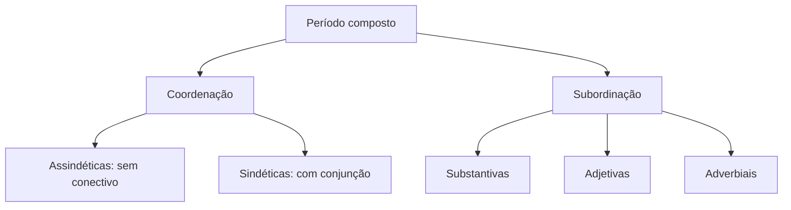

Até aqui, cada capítulo analisou uma oração por vez. Agora o estudo sobe de nível: o período composto, formado por duas ou mais orações unidas por coordenação ou por subordinação. A banca cobra esse assunto em três frentes — contar orações, classificar a oração destacada e reescrever o período mantendo o sentido. As noções iniciais de sintaxe já estão postas; aqui o foco é a combinação de orações. Este capítulo monta as duas primeiras frentes: separa coordenação de subordinação, apresenta as coordenadas, as subordinadas substantivas e as subordinadas adjetivas, com atenção especial às adjetivas explicativas e restritivas, cuja diferença muda o sentido da frase.

> [!objetivos]
> - Distinguir período simples de composto e contar as orações de um período.
> - Separar coordenação de subordinação pelo teste da independência.
> - Classificar as orações subordinadas substantivas em seus seis tipos.
> - Reconhecer orações substantivas justapostas e reduzidas.
> - Diferenciar oração adjetiva explicativa de restritiva e explicar o efeito de sentido.

## Do período simples ao composto

**Frase** é o enunciado com sentido completo. **Oração** é o enunciado organizado em torno de um verbo ou de uma locução verbal. **Período** é a frase com uma ou mais orações. Com uma oração, o período é simples; com duas ou mais, é composto.

A contagem de orações tem uma regra só, e a gramática normativa é clara nela: conte os verbos e as locuções verbais, não as ideias. "Cheguei cedo e percebi o movimento na entrada" tem duas orações, porque há duas formas verbais em orações independentes. "O mecânico conferiu o motor e o time seguiu viagem" tem duas formas verbais e, portanto, duas orações. Já "o mecânico vai conferir o motor" tem uma locução verbal e uma única oração.

No período composto, as orações se relacionam de dois modos. Na **coordenação**, cada oração tem estrutura própria e não exerce função sintática na outra. Na **subordinação**, uma oração exerce função sintática dentro da outra: pode ser sujeito, objeto, complemento de nome ou adjunto.

Períodos longos exigem um método. Marque primeiro todos os verbos, depois separe as orações por barra e só então classifique cada uma. Em "quem mora na ilha depende do barco, que sai na terça-feira", há três orações: *quem mora na ilha*, *depende do barco* e *que sai na terça-feira*. A primeira é sujeito de *depende*; a terceira caracteriza *o barco*. Sem a marcação prévia, o aluno classifica a oração errada.

O esquema abaixo organiza o período composto.

> [!bizu] O teste da independência
> Separe as orações e leia cada uma sozinha. Se as duas fizerem sentido completo, há coordenação. Se uma delas depende da outra para que o sentido se feche, há subordinação. "Cheguei cedo e saí tarde": as duas se sustentam sozinhas. "Percebi que ele chegou cedo": *que ele chegou cedo* completa o sentido de *percebi*.

## Orações coordenadas

As orações coordenadas se classificam pelo conectivo que as une. Quando não há conectivo, a coordenada é **assindética**: "Acordei, tomei café, saí". Quando há conjunção, é **sindética**, e o tipo de conjunção define a relação.

- **Aditivas**: somam ideias. *e*, *nem*. "O sargento chegou e assumiu o posto."
- **Adversativas**: opõem ideias. *mas*, *porém*, *contudo*, *todavia*. "A equipe tentou, mas o acesso estava bloqueado."
- **Alternativas**: apresentam escolha. *ou*, *ora... ora*. "Ou o candidato recorre, ou aceita o resultado."
- **Conclusivas**: concluem a partir da anterior. *logo*, *portanto*, *assim*. "O prazo venceu; portanto, o pedido está atrasado."
- **Explicativas**: justificam a anterior. *pois*, *porque*, *que*. "Venha cedo, que a fila é grande."

O critério decisivo é a relação de sentido, não a lista decorada. A conjunção *e* pode indicar oposição em contextos específicos: "Estudou muito e não foi aprovado". A banca explora essas ocorrências, e a leitura do contexto resolve.

Dois cuidados fecham a seção. *Apesar de* não está na lista das coordenadas: introduz oração subordinada adverbial concessiva, assunto do próximo capítulo. E *assim* pode ser conclusivo ("chegou cedo; assim, pôde revisar o material") ou modal, como adjunto adverbial.

> [!atencao] Coordenada explicativa × subordinada causal
> As duas apresentam motivo. Na explicativa, a primeira oração costuma ser uma ordem, um pedido ou uma opinião, e o conectivo vem depois de pausa: "Saia agora, que o portão vai fechar"; "Deve ter chovido, porque o chão está molhado". Ela justifica o que se disse, e não é a causa do fato. Na causal, a subordinada traz a causa de um fato expresso na principal, em geral sem vírgula: "O treino foi suspenso porque chovia" (a chuva causou a suspensão).

## Orações subordinadas substantivas

A oração subordinada **substantiva** exerce função de substantivo dentro da principal. Ela pode ser sujeito, objeto direto, objeto indireto, complemento nominal, predicativo ou aposto. São seis tipos, e a tabela reúne cada um com o teste de identificação.

| Tipo | Função na principal | Como testar | Exemplo |
| --- | --- | --- | --- |
| Subjetiva | sujeito | troque por "isso" antes do verbo | Convém que ele venha. |
| Objetiva direta | objeto direto | troque por "isso" depois do verbo transitivo direto | Ignoro se ele virá. |
| Objetiva indireta | objeto indireto | a preposição fica antes do conectivo | Precisava de que o avisassem. |
| Completiva nominal | complemento nominal | completa nome abstrato com preposição | Tenho esperança de que ele volte. |
| Predicativa | predicativo do sujeito | fica depois do verbo de ligação | A vantagem é que o custo cai. |
| Apositiva | aposto | vem depois de dois-pontos ou vírgula | Só peço uma coisa: que me ouçam. |

A ordem de análise é sempre a mesma. Primeiro localize o verbo da oração principal. Depois pergunte que função a oração seguinte exerce em relação a ele ou a um nome da principal.

Em "convém que ele venha", o verbo *convém* não tem sujeito expresso antes dele. A oração *que ele venha* é o sujeito: "isso convém". Em "ignoro se ele virá", a oração *se ele virá* é objeto direto de *ignoro*: "ignoro isso".

> [!exemplo] Objetiva indireta e predicativa no mesmo período
> "Precisava de que o setor fornecesse o horário, porque a instalação ficava no interior." A primeira oração subordinada é objetiva indireta: a preposição *de* aparece antes do conectivo *que*, e o verbo *precisar* a exige. A segunda, introduzida por *porque*, é adverbial causal, assunto do próximo capítulo. Identificar cada uma exige separar os níveis do período.

### Substantivas justapostas

Quando não há conectivo, a oração substantiva fica **justaposta**. O sinal é a pausa, marcada por dois-pontos ou vírgula. "Só peço uma coisa: que me acompanhem." "Desejo isto: que o candidato seja ouvido."

A justaposição não muda a função: a oração continua exercendo papel de aposto ou de objeto, conforme o termo que a antecede. O que não existe é a conjunção integradora.

> [!pegadinha] Oração sem conectivo não é coordenada por isso
> A banca apresenta uma oração justaposta e afirma que, por não ter conjunção, ela é coordenada assindética. Não é: a classificação depende da função sintática, não da presença do conectivo. Se a oração completa o sentido do verbo ou de um nome, ela é subordinada substantiva, ainda que justaposta.

### Substantivas reduzidas

A subordinada substantiva pode vir **reduzida**, com o verbo no infinitivo, no gerúndio ou no particípio, sem conectivo. "É necessário estudar" equivale a "é necessário que se estude". "O comandante pediu para sair" equivale a "pediu que saísse".

Para classificar a reduzida, desenvolva a oração mentalmente, com *que* ou *se* e o verbo conjugado. A função aparece na versão desenvolvida, e a classificação é a mesma.

## Orações subordinadas adjetivas

A oração subordinada **adjetiva** exerce a função de adjunto adnominal: caracteriza um substantivo da oração principal. É introduzida por pronome relativo — *que*, *quem*, *cujo*, *onde*, *o qual* — e sempre se refere a um termo antecedente.

- O candidato **que estudou** foi aprovado.
- A viatura, **que estava na reserva**, foi acionada.

A classificação depende da pontuação, e a diferença é de sentido.

A **restritiva** delimita o antecedente: indica que se fala apenas de uma parte do conjunto. Vem sem vírgulas. Em "os alunos que entregaram o trabalho foram dispensados", só os que entregaram foram dispensados.

A **explicativa** acrescenta informação sobre o antecedente inteiro, como um comentário. Vem entre vírgulas. Em "os alunos, que entregaram o trabalho, foram dispensados", todos os alunos entregaram e todos foram dispensados.

| Tipo | Pontuação | Efeito | Exemplo |
| --- | --- | --- | --- |
| Restritiva | sem vírgula | limita o antecedente | Os candidatos que faltaram serão eliminados. |
| Explicativa | entre vírgulas | acrescenta informação | Os candidatos, que faltaram, serão eliminados. |

A supressão da oração confirma a leitura. Na restritiva, retirar a oração muda o alcance da afirmação: "os candidatos serão eliminados" passa a valer para todos. Na explicativa, retirar a oração deixa a informação principal intacta.

> [!pegadinha] A vírgula muda o número de pessoas atingidas
> A questão apresenta as duas versões e pede a diferença de sentido. "Os bombeiros que chegaram de manhã controlaram o incêndio" indica um grupo específico. "Os bombeiros, que chegaram de manhã, controlaram o incêndio" indica que todos chegaram de manhã. A vírgula não é detalhe de estilo: ela altera o sentido.

### Adjetivas com função de sujeito ou de objeto

Cuidado com um detalhe estrutural. A oração adjetiva pode conter o sujeito ou o objeto do seu próprio verbo, mas os termos exigidos pela oração principal continuam sendo dela. Em "o relatório que o setor enviou estava incompleto", a oração adjetiva *que o setor enviou* tem objeto direto *que*, e o sujeito de *estava* é *o relatório*. Misturar os dois níveis é o erro que mais aparece nas questões de análise.

## Análise em tabela

| Período | Oração em destaque | Classificação |
| --- | --- | --- |
| Mandei o relatório e o setor confirmou o recebimento. | e o setor confirmou o recebimento | coordenada aditiva |
| Nasci no interior, mas estudo no Recife. | mas estudo no Recife | coordenada adversativa |
| Convém que a equipe chegue antes do feriado. | que a equipe chegue antes do feriado | subordinada substantiva subjetiva |
| Ignoro se o setor forneceu o horário. | se o setor forneceu o horário | subordinada substantiva objetiva direta |
| A configuração exige que se reinstale o programa. | que se reinstale o programa | subordinada substantiva objetiva direta |
| O candidato precisava de que o órgão respondesse. | de que o órgão respondesse | subordinada substantiva objetiva indireta |
| A vantagem é que o custo cai. | que o custo cai | subordinada substantiva predicativa |
| Só peço uma coisa: que me escutem. | que me escutem | subordinada substantiva apositiva |
| Os estrangeiros que moram aqui votam. | que moram aqui | subordinada adjetiva restritiva |
| Os estrangeiros, que moram aqui, votam. | que moram aqui | subordinada adjetiva explicativa |
| A equipe que atendeu as vítimas foi elogiada. | que atendeu as vítimas | subordinada adjetiva restritiva |
| O time, que jogou mal, foi vaiado. | que jogou mal | subordinada adjetiva explicativa |
| É preciso pautar o trabalho em dados. | pautar o trabalho em dados | subordinada substantiva subjetiva reduzida |
| A empresa de telecomunicações foi contratada e o serviço começou na terça. | e o serviço começou na terça | coordenada aditiva |
| Nem o sargento nem o cabo sabiam do horário. | nem o sargento nem o cabo | sujeito composto |
| O resgate da tartaruga mobilizou a guarnição. | da tartaruga | complemento nominal |
| O atraso pareceu um contratempo pequeno. | um contratempo pequeno | predicativo do sujeito |

As linhas finais mostram por que a pontuação decide. A mesma oração, com e sem vírgula, recebe nomes diferentes e produz efeitos diferentes na leitura.

Duas observações fecham a análise. A primeira: o sujeito composto com *nem* não é oração coordenada, porque não há dois verbos — é apenas um sujeito com dois núcleos. A segunda: o termo que completa um substantivo abstrato continua sendo complemento nominal mesmo quando aparece dentro de um período composto, como em *o resgate da tartaruga*. Classificar oração e classificar termo são tarefas diferentes, feitas no mesmo período.

## Reescrita e coesão no período composto

A reescrita de um período composto depende de saber qual oração exerce qual função. Substituir uma oração por um substantivo equivalente é o exercício mais frequente: a substituição preserva o sentido e testa a análise.

- "O setor enviou o relatório" vira o substantivo *o envio do relatório pelo setor*.
- "A equipe chegará cedo" vira *a chegada da equipe*.
- "O time guarani venceu o torneio" vira *a vitória do time guarani*.

Quando a oração é subordinada substantiva, a troca por um nome funciona sem alterar a estrutura. Quando é adjetiva, a troca por um adjetivo ou locução adjetiva resolve: "o soldado que toca violão" vira *o soldado violonista*; "a defesa pautada em dados" é a versão reduzida de "a defesa que se pautou em dados".

A coesão textual depende desses mecanismos. Referenciação, substituição e repetição controlada mantêm o texto ligado, e os conectores indicam a relação entre as orações. Um período com conectivo errado muda o sentido: "a vítima gritou desesperadamente porque o resgate demorou" é causa; "a vítima gritou desesperadamente, mas o resgate demorou" é oposição.

Compare as duas versões: "o grupo misto de bombeiros e policiais chegou cedo, e o incêndio foi controlado" e "o grupo misto de bombeiros e policiais chegou cedo; por isso, o incêndio foi controlado". As duas são aceitáveis, mas a segunda torna explícita a relação de conclusão. A banca costuma pedir a reescrita que mantém o sentido original, e essa tarefa exige reconhecer a relação entre as orações antes de trocar palavras.

> [!exemplo] Reescrita que erra o alvo
> Período original: "A equipe, que atuou no resgate fluvial, foi elogiada." Uma reescrita possível é "a atuação da equipe no resgate fluvial foi elogiada". O que não se pode fazer é "a equipe atuou no resgate fluvial foi elogiada": a oração adjetiva explicativa precisa virar nome ou adjetivo, e não ficar solta ao lado de outra oração.

## Mapa do capítulo

| Estrutura | Função | Marca |
| --- | --- | --- |
| Coordenada assindética | soma ou sequência sem conectivo | pausa |
| Coordenada sindética | relação indicada por conjunção | *e*, *mas*, *ou*, *logo*, *pois* |
| Substantiva | exerce função de nome | *que*, *se* ou justaposição |
| Adjetiva restritiva | limita o antecedente | sem vírgula |
| Adjetiva explicativa | comenta o antecedente | entre vírgulas |
| Reduzida | verbo em forma nominal | infinitivo, gerúndio, particípio |

### Para fixar

- Período composto tem duas ou mais orações; conte os verbos e as locuções verbais.
- Coordenação: as orações não exercem função sintática uma na outra. Subordinação: uma exerce função na outra.
- As subordinadas substantivas são seis: subjetiva, objetiva direta, objetiva indireta, completiva nominal, predicativa e apositiva.
- Na objetiva indireta, a preposição aparece antes do conectivo.
- Oração substantiva justaposta não tem conectivo, mas continua subordinada, porque exerce função sintática.
- Reduzida se classifica depois de desenvolvida com *que* ou *se*.
- Adjetiva restritiva vem sem vírgula e limita o antecedente; explicativa vem entre vírgulas e acrescenta informação.
- Na adjetiva, o pronome relativo exerce função dentro da própria oração.
