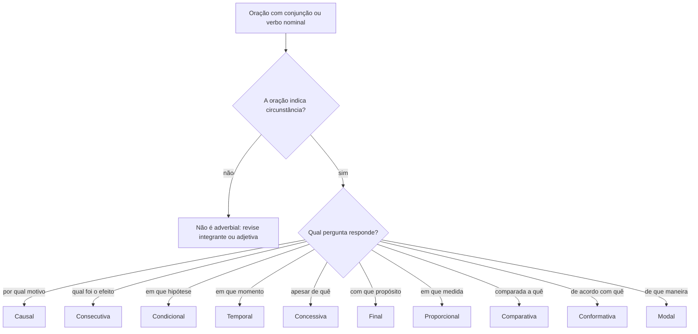
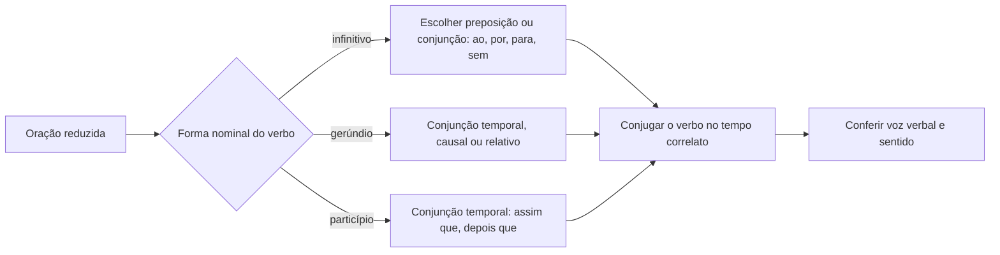
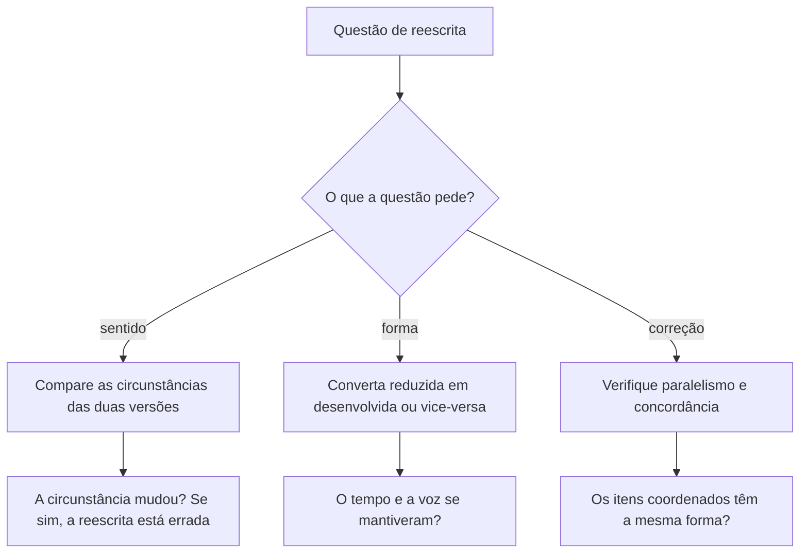

Uma oração adverbial faz o serviço de um advérbio: diz em que circunstância o fato da oração principal acontece. A diferença é de forma, não de papel. O advérbio resolve com uma palavra; a oração traz conjunção e verbo conjugado, ou uma preposição e um verbo em forma nominal. Duas perguntas resolvem a maior parte das questões. A primeira: qual circunstância a oração exprime? A segunda: ela está desenvolvida ou reduzida? Este capítulo responde às duas e, no fim, junta as duas habilidades na reescrita, onde entra o paralelismo. É a parte do conteúdo que mais aparece em prova, porque uma troca de conectivo muda o sentido sem mudar a correção.

> [!objetivos]
> - Reconhecer a oração adverbial pela pergunta de circunstância e pela conjunção.
> - Separar causa de consequência, concessão de condição e tempo de proporção.
> - Converter orações reduzidas em desenvolvidas e voltar, mantendo tempo e voz.
> - Identificar o paralelismo sintático quebrado em enumerações e coordenações.
> - Explicar o paralelismo semântico e corrigir comparações mal montadas.

## O que faz uma oração ser adverbial

Compare as duas frases a seguir.

- Saí cedo por causa da chuva.
- Saí cedo porque a chuva começou a apertar.

Na primeira, a circunstância de causa vem em um termo nominal: uma locução prepositiva mais um substantivo. Na segunda, a mesma causa vem em uma **oração subordinada adverbial causal**: existe uma conjunção (*porque*) e existe um verbo conjugado (*começou*). A função é a mesma. A forma é diferente.

Deste ponto saem duas consequências práticas. A primeira: a classificação da oração adverbial se faz pela **circunstância**, não pelo conectivo isolado. A segunda: o conectivo pode servir a mais de uma circunstância, e aí só o contexto decide. *Como* introduz causa em "Como chovia, cancelei a viagem" e conformidade em "Fiz como você pediu". Sem ler as duas orações, não há classificação possível.

O procedimento é sempre o mesmo. Localize a oração que depende de outra, pergunte qual circunstância ela exprime e confirme pela conjunção. Depois, olhe para o verbo: se está conjugado, a oração está **desenvolvida**; se está em forma nominal (infinitivo, gerúndio ou particípio), está **reduzida**. Guarde essa ordem de raciocínio, porque a banca cobra as duas etapas em sequência.

> [!bizu] A pergunta antes do conectivo
> Pergunte "sob que circunstância?" e aceite a resposta em uma palavra: tempo, causa, condição, fim, concessão, consequência, proporção, comparação, conformidade, modo. Se a resposta cabe em uma palavra, a oração é adverbial e essa palavra é a classificação.

### As dez circunstâncias em um quadro

| Circunstância | Conjunções e locuções típicas | Pergunta de teste |
| --- | --- | --- |
| Causal | porque, visto que, já que, porquanto, como | por qual motivo? |
| Consecutiva | de sorte que, de modo que, que (após tão, tanto, tamanho) | qual foi o efeito? |
| Condicional | se, caso, contanto que, desde que, salvo se, a menos que | em que hipótese? |
| Temporal | quando, enquanto, mal, assim que, depois que, sempre que | em que momento? |
| Concessiva | embora, ainda que, mesmo que, posto que, não obstante, por mais que | apesar de quê? |
| Final | para que, a fim de que, porque (= para que) | com que propósito? |
| Proporcional | à medida que, à proporção que, ao passo que, quanto mais... mais | em que medida? |
| Comparativa | como, tal qual, mais que, menos que, tanto quanto | comparada a quê? |
| Conformativa | conforme, consoante, segundo, como | de acordo com quê? |
| Modal | sem que, gerúndio sem conjunção | de que maneira? |

O quadro serve de mapa, não de lista para decorar. Duas linhas merecem atenção especial. A **consecutiva** costuma aparecer sem conjunção própria: o *que* se apoia em um intensificador da oração principal (*tão*, *tanto*, *tamanho*, *tal*). A **modal** não consta da nomenclatura oficial e, por isso, quase nunca é a resposta esperada; ela aparece na prova como distrator, quando a banca troca a circunstância verdadeira por "modo".

## Causa, consequência e o efeito de uma vírgula

Causa e consequência olham para o mesmo par de fatos por lados opostos. Na causal, a oração subordinada informa o motivo; na consecutiva, informa o resultado.

| Frase | Oração em destaque | Classificação |
| --- | --- | --- |
| Acendi uma vela, visto que acabara a luz. | *visto que acabara a luz* | causal |
| A escuridão era tamanha que acendi uma vela. | *que acendi uma vela* | consecutiva |
| A confissão era tão forte que dispensava os indícios. | *que dispensava os indícios* | consecutiva |
| Como não havia diesel, o gerador parou. | *como não havia diesel* | causal |

Repare no mecanismo da consecutiva: o *que* precisa de um termo de intensidade na oração principal para existir. Sem *tão*, *tanto* ou *tamanho*, o *que* deixa de ser consecutivo. É esse detalhe que separa a consequência da simples adição.

Na causal, a lista de conectivos é maior e inclui *haja vista*, que equivale a *devido a*. Há também a velha confusão entre causa e explicação. A causa responde por que algo aconteceu e costuma vir antes do efeito no mundo real. A explicação apenas justifica um pedido, uma ordem ou uma afirmação. Em "Estude, que a prova é difícil", o *que* explica a recomendação e não descreve a origem de um fato. Em "Passei porque estudei", há causa. A distinção é sutil e raramente é o foco da questão, mas aparece quando o enunciado pede a reescrita do período.

> [!atencao] A vírgula muda a relação
> "Os recibos passaram a circular porque eram mais seguros de portar" é causa. "Os recibos passaram a circular, porque eram mais seguros de portar" continua sendo causa, mas a vírgula destaca a explicação. Já "Ele não veio, porque estava doente" e "Ele não veio porque estava doente" só se distinguem pelo contexto: na primeira leitura, a doença é a explicação apresentada; na segunda, a causa do fato. Não invente regra rígida onde a norma não tem uma.

## Condição, tempo e concessão

Três circunstâncias que a banca troca entre si, porque todas mexem com a expectativa do leitor.

A **condicional** apresenta uma hipótese de que depende o fato principal. Conectivos: *se*, *caso*, *desde que*, *contanto que*, *a menos que*, *salvo se*, *a não ser que*, *sem que* e *uma vez que* seguido de subjuntivo. Note que *uma vez que* tem dois empregos: com verbo no subjuntivo, é condição ("uma vez que pague, exija o recibo"); com verbo no indicativo, costuma ser causa ("uma vez que pagou, pode exigir o recibo").

A **temporal** situal o fato no tempo. Conectivos: *quando*, *enquanto*, *antes que*, *depois que*, *logo que*, *sempre que*, *todas as vezes que*, *assim que*, *agora que* e *mal*, que equivale a *assim que*. "Mal o ônibus partiu, o celular tocou" não fala de mal algum: fala de tempo.

A **concessiva** apresenta um fato que criaria a expectativa contrária e, ainda assim, não impede o fato principal. Conectivos: *embora*, *ainda que*, *mesmo que*, *posto que*, *conquanto*, *por mais que*, *se bem que*, *malgrado*, *não obstante*. O verbo vai normalmente ao subjuntivo, porque o fato é apresentado como hipótese admitida.

| Oração | Circunstância | Teste que confirma |
| --- | --- | --- |
| Caso pague à vista, exija o recibo. | condicional | a compra só ocorre na hipótese |
| Enquanto o gerador funcionava, o posto atendia. | temporal | marca o intervalo de tempo |
| Embora estivesse cercado de costumes antigos, mudou o método. | concessiva | admite o obstáculo e nega o efeito |
| Não obstante durma pouco, está sempre animado. | concessiva | verbo no subjuntivo, obstáculo admitido |

O par *não obstante* confunde muita gente porque aparece nas duas listas. Como conjunção concessiva, vem com subjuntivo: "não obstante tenha medo, nunca deixo de tentar". Como conjunção adversativa, vem com indicativo e liga orações independentes: "estudei pouco, não obstante fui aprovado". O verbo, portanto, é o critério de desempate.

Outro cruzamento clássico é entre concessão e condição na estrutura *sem que*. "Sem que estude, não há como passar" é condição negativa: equivale a "se não estudar". "Sem se preparar, passou no concurso" é concessão: o fato esperado seria a reprovação. De novo, o contexto decide, e a pergunta de teste é a expectativa quebrada.

## Finalidade, proporção, comparação, conformidade e modo

A **final** indica propósito e é introduzida por *para que*, *a fim de que*, *de sorte que*, *de modo que* e pelo *que* com valor de *para que*. A estrutura mais comum na prova é *para* mais infinitivo, que já é uma reduzida: "estudo para passar". Cuidado com o falso amigo *porque* de finalidade: em "fiz o que pude porque você passasse logo", o subjuntivo denuncia o valor final, equivalente a *para que você passasse*.

A **proporcional** liga dois fatos que crescem ou diminuem juntos. Conectivos: *à proporção que*, *à medida que*, *ao passo que* e as correlações *quanto mais... mais*, *quanto menos... menos*. Essas correlações são pares, e a banca gosta de quebrar o par, trocando um dos termos.

A **comparativa** compara dois termos e também trabalha com correlações: *tanto... quanto*, *mais... que*, *menos... que*, *tal qual*, *assim como*. Nessas estruturas, o verbo da segunda oração costuma ficar implícito, porque é o mesmo da primeira: "ele estuda tanto quanto o tio" esconde um *estuda* no fim.

A **conformativa** diz que um fato ocorreu de acordo com outro. Conectivos: *conforme*, *consoante*, *segundo*, *como*. É a leitura de *como* em "a prova correu como tínhamos treinado".

A **modal**, como já foi dito, não está na lista oficial. Ela aparece como adjunto adverbial de modo em forma de oração, quase sempre em gerúndio: "os convidados saíram sem que ninguém percebesse" equivale a "saíram discretamente". Prova disso é que o gerúndio costuma exprimir ação simultânea: "viu um sobrevivente chorando", "aprendeu lendo os clássicos", "rosnava mostrando os dentes".

## Orações reduzidas e desenvolvidas

Toda oração subordinada pode aparecer de duas formas. A **desenvolvida** traz um conectivo (conjunção integrante, pronome relativo ou conjunção adverbial) e o verbo conjugado. A **reduzida** dispensa o conectivo e deixa o verbo em forma nominal: infinitivo, gerúndio ou particípio. Ela pode vir com preposição, mas não com conjunção.

Converter uma na outra é uma operação de duas etapas. Primeiro, insira ou retire o conectivo. Depois, conjugue ou nominalize o verbo, ajustando o tempo e a voz. A segunda etapa é onde os candidatos erram.

| Reduzida | Desenvolvida equivalente | O que mudou |
| --- | --- | --- |
| Ao me ver, não me cumprimente. | Quando me vir, não me cumprimente. | entrou *quando*, verbo foi ao futuro do subjuntivo |
| Vi alguém chorando. | Vi alguém que chorava. | entrou pronome relativo, verbo foi ao imperfeito |
| Terminado o serviço, saiu. | Assim que terminou o serviço, saiu. | entrou *assim que*, verbo foi ao perfeito |
| Li um livro explicando o tema. | Li um livro que explicava o tema. | passou de gerúndio a relativo mais imperfeito |

As reduzidas de infinitivo são as mais cobradas, porque assumem muitas funções. Nas substantivas, o infinitivo pode ser sujeito ("não é legal comprar produtos falsos"), objeto direto ("dizem ter se casado"), objeto indireto ("depende de ter constância"), predicativo ("a única forma de passar é estudar"), complemento nominal ("tinha medo de reprovar") e aposto ("só resta uma opção: estudarmos"). Nas adverbiais, o infinitivo cobre causa, concessão, consequência, condição, fim e tempo.

> [!esquema] As quatro estruturas que a prova ama
> - *Ao* + infinitivo: tempo. "Ao chegar, avise" = quando chegar.
> - *A* + infinitivo: condição. "A persistirem os sintomas, consulte" = se os sintomas persistirem.
> - *Por* + infinitivo: causa. "Por ser capacitado, ganhava bem" = porque era capacitado.
> - *Sem* + infinitivo: concessão ou condição negativa, conforme o contexto. "Sem se preparar, passou" (concessão); "sem se preparar, não passará" (condição).

Há também reduzidas fixas, que não se desenvolvem com naturalidade e não devem ser forçadas: "coube-nos pagar a conta", "não há mais tentar ou negociar", "além de ser gentil, era paciente", "em vez de viver chorando, pense em você", "longe de desanimar, empolgou-se". A banca não pede a conversão dessas.

Duas armadilhas merecem registro. A primeira: ao desenvolver, não se pode mudar a voz verbal. Se a reduzida está na passiva ("terminado o serviço"), a desenvolvida também fica na passiva ("assim que o serviço foi terminado"). A segunda: a conversão pode ter mais de uma leitura. "Em se plantando, tudo dá" aceita tempo ("quando se planta") e hipótese ("se se plantar"). Nesses casos, a resposta da prova é a que o enunciado sustenta.

> [!atencao] O conectivo que parece temporal e não é
> O *mal* de "mal saiu, o ônibus passou" não é advérbio de modo nem substantivo: é conjunção temporal, equivalente a *assim que*. Do mesmo modo, *logo que* e *agora que* marcam tempo, e não causa. Já *à medida que* pede duas grandezas que avançam juntas; se a frase só descreve simultaneidade, o adequado é *enquanto*.

## Paralelismo sintático

Paralelismo é o uso de estruturas simétricas em uma coordenação ou enumeração. A regra é simples: só se coordenam constituintes da mesma espécie. Adjetivo com adjetivo, substantivo com substantivo, termo preposicionado com termo preposicionado, oração desenvolvida com oração desenvolvida. Quando um dos itens muda de forma, a frase fica torta, mesmo que continue compreensível.

Veja o caso clássico. "Tenho um primo inteligente e que ganha bem." Aparentemente não há erro, mas há: o primeiro item é um adjetivo, o segundo é uma oração adjetiva. Os dois exercem a mesma função, mas não têm a mesma forma. Para ajustar, iguale a forma em qualquer direção: "tenho um primo inteligente e rico" (dois adjetivos) ou "tenho um primo que é inteligente e rico" (uma oração com dois atributos).

O mesmo raciocínio vale para adjuntos. "Estudo por estar desempregado e porque quero melhorar de vida" mistura uma reduzida de infinitivo com uma desenvolvida. Duas saídas: "estudo por estar desempregado e por querer melhorar de vida" ou "estudo porque estou desempregado e porque quero melhorar de vida". Ambas são corretas; a escolha depende do ritmo que se quer.

| Frase sem paralelismo | Ajuste simétrico |
| --- | --- |
| A firma planeja uma nova manifestação pública e interditar o viaduto principal. | A firma planeja uma nova manifestação pública e a interdição do viaduto principal. |
| Mande-me notícias das manobras de minha tia e se meu tio encontrou os papéis. | Mande-me notícias das manobras de minha tia e dos papéis encontrados por meu tio. |
| Ele enriqueceu com aplicações arriscados, isto é, especulando na bolsa. | Ele enriqueceu com aplicações arriscadas, isto é, com especulação na bolsa. |
| João é rude e sem paciência. | Aceitável: adjetivo e locução adjetiva são equivalentes. |

A última linha mostra a exceção que a norma admite: adjetivo e locução adjetiva são estruturas equivalentes, assim como advérbio e locução adverbial. "Anda sempre rapidamente e com pressa" passa. Já substantivo e oração não são equivalentes, e aí o paralelismo se quebra de fato.

Os conectivos que estabelecem paralelismo são os aditivos (*e*, *nem*, *não só... mas também*, *tanto... quanto*) e os alternativos (*ou... ou*, *quer... quer*, *seja... seja*). Quando o conectivo é correlato, cada metade pede a mesma estrutura do outro lado. Erros de paralelismo aparecem muito em enumerações de sujeitos, complementos e adjuntos, e também nos pares *isto é*, *ou seja* e *quer dizer*, que exigem simetria entre o termo explicado e a explicação.

> [!pegadinha] Reescrita que "só troca a palavra"
> A banca costuma propor a substituição de um termo por outro de classe diferente e perguntar se a correção se mantém. Se a troca quebra o paralelismo de uma coordenação, a frase fica incorreta, mesmo que a substituição isolada fosse legítima. Confira sempre o par inteiro, não só o termo trocado.

## Paralelismo semântico

Se o paralelismo sintático cuida da forma, o paralelismo semântico cuida da lógica. A estrutura pode estar simétrica e a comparação, ainda assim, sem sentido. O caso mais comum é o da comparação entre elementos que não pertencem à mesma classe de coisas.

"O salário do bombeiro é maior do que o do guarda." Sintaticamente, há dois termos coordenados; semanticamente, compara-se salário com salário. Se a frase fosse "o salário do bombeiro é maior do que o guarda", comparar-se-ia salário com pessoa. O ajuste exige repetir o termo comum: "o salário do bombeiro é maior do que o do guarda". O mesmo ocorre em "a taxa de homicídios cresceu mais do que os roubos": ou se comparam taxas com taxas, ou se comparam números absolutos com números absolutos.

Há três padrões que rendem questão. No primeiro, falta o termo repetido, como nos exemplos acima. No segundo, o termo repetido aparece, mas em outra função: "ele gosta mais de estudar do que de trabalhar" está correto porque os dois lados são complementos do mesmo verbo; já "ele gosta mais de estudar do que trabalha" compara um complemento com uma oração, e a leitura fica truncada. No terceiro, a ordem dos termos cria ambiguidade: "conheci a irmã do réu que morava em Recife" não diz quem morava onde, e a informação fica duvidosa.

| Comparação | Problema | Correção |
| --- | --- | --- |
| O efetivo do batalhão é menor do que a companhia. | compara efetivo com unidade | menor do que o da companhia |
| A renda cresceu mais do que os preços. | compara crescimento com preço | mais do que os preços cresceram |
| Ele prefere correr a nadar. | nenhum: dois infinitivos | correta |
| Gosto de ler e de que me contem histórias. | mistura substantivo e oração | gosto de ler e de ouvir histórias |

O paralelismo semântico também explica por que certas correlações soam mal. Em "quanto mais estudo, mais sorte tenho nas provas", os dois lados são proporcionais e a frase funciona. Em "quanto mais estudo, tenho sorte", falta o segundo *mais* e a correlação se desfaz. A simetria aqui é de estrutura e de sentido ao mesmo tempo.

## Reescrita: onde o conteúdo vira nota

Nas questões de reescrita, três operações se repetem: trocar o conectivo mantendo o sentido, converter reduzida em desenvolvida e restabelecer o paralelismo. Cada uma tem um teste próprio.

Na troca de conectivo, pergunte se a circunstância se mantém. Trocar *porque* por *embora* muda causa em concessão e derruba a reescrita. Trocar *para* por *por* muda finalidade em causa. Trocar *ao* por *por* muda tempo em causa, como em "ao coletar o dado" (tempo) e "por coletar o dado" (causa).

Na conversão de forma, confira tempo e voz. "Ao suprimir as formas de tráfico" é tempo; "e suprimir as formas de tráfico" é adição. A correção gramatical se mantém nas duas, mas o sentido muda, e é isso que o enunciado cobra.

No paralelismo, leia a coordenação inteira. A pergunta é sempre a mesma: os dois lados têm a mesma forma e pertencem à mesma classe? Se a resposta for não, a reescrita está errada, por mais elegante que soe.

> [!exemplo] Uma frase, três leituras
> "Cercado de hábitos antigos por todos os lados, o serviço resiste a mudanças." A oração inicial é adjetiva reduzida de particípio com valor causal: equivale a "porque está cercado". Se o particípio viesse depois da principal ("o serviço resiste a mudanças, cercado de hábitos"), a leitura causal se enfraqueceria e a temporal ganharia força. A posição da oração participa do sentido.

> [!resolvido] Proporção ou tempo?
> "À medida que o tempo passa, a confiança cresce." A conjunção é proporcional, porque as duas grandezas avançam juntas; *enquanto* daria apenas simultaneidade, sem a ideia de escala. Já em "ao passo que a equipe crescia, os custos subiam", há proporção com carga de contraste, e a banca costuma explorar essa segunda leitura.

## Mapa do capítulo

| Se você precisa... | Faça isto | Cuidado com |
| --- | --- | --- |
| Classificar uma adverbial | pergunte a circunstância antes de olhar o conectivo | *como* e *não obstante* têm dois valores |
| Separar causa de consequência | procure o intensificador (*tão*, *tanto*) antes do *que* | consequência exige termo intensivo |
| Separar condição de concessão | veja se a oração admite o fato e nega o efeito | *sem* + infinitivo pode ser as duas |
| Converter reduzida em desenvolvida | insira o conectivo e conjugue o verbo | tempo e voz precisam ser mantidos |
| Reconhecer reduzida | verbo em infinitivo, gerúndio ou particípio | preposição não é conjunção |
| Consertar paralelismo | iguale a forma dos itens coordenados | adjetivo e locução adjetiva são equivalentes |
| Avaliar comparação | confira se os dois lados são da mesma classe | falta do termo repetido é o erro mais comum |

### Para fixar

- Adverbial é a oração que exprime circunstância do fato principal, com conjunção ou verbo em forma nominal.
- A pergunta de circunstância classifica; o conectivo só confirma, porque *como* e *não obstante* têm dois valores.
- Consecutiva exige termo intensivo na principal: *tão*, *tanto*, *tamanho*, *tal*.
- Concessiva admite o obstáculo e nega o efeito esperado; o verbo vai ao subjuntivo.
- Condicional apresenta hipótese: *se*, *caso*, *contanto que*, *a menos que*, *sem que*.
- Desenvolvida tem conectivo e verbo conjugado; reduzida tem verbo em forma nominal.
- *Ao* + infinitivo é tempo, *por* + infinitivo é causa, *para* + infinitivo é finalidade.
- Paralelismo sintático exige itens da mesma forma; paralelismo semântico exige itens da mesma classe.
- Em comparação, repita o termo comum ou use o possessivo: "o do guarda".
- Na reescrita, confira três coisas: circunstância, tempo verbal e simetria dos itens.
