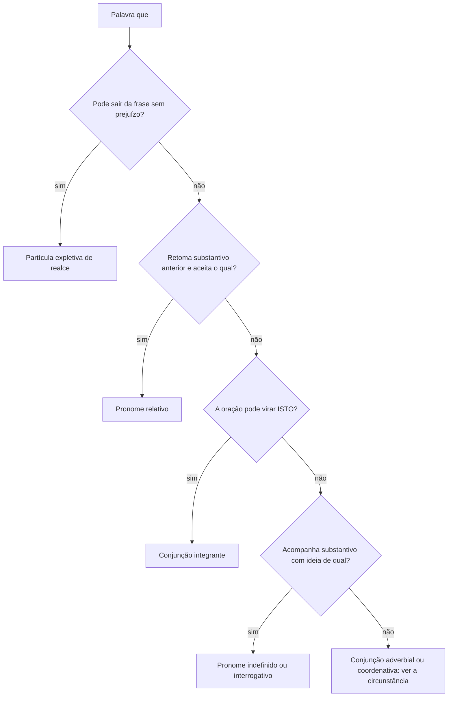
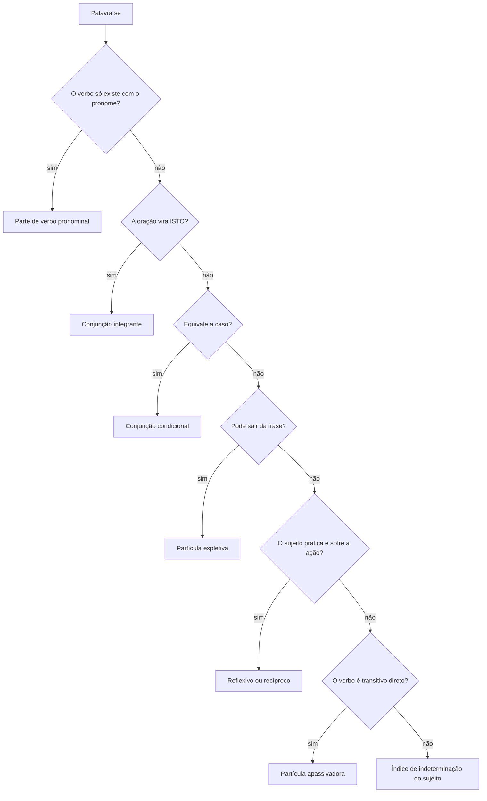
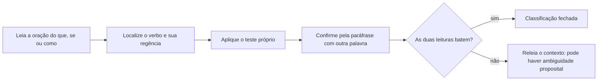

Três palavras pequenas carregam boa parte das questões de sintaxe: *que*, *se* e *como*. Todas mudam de função conforme o lugar em que aparecem, e a banca explora justamente essa mobilidade. Não existe resposta decorada. Existe um teste que se aplica em segundos: substituir a palavra por outra, retirá-la da frase ou olhar para o verbo que a acompanha. Este capítulo organiza as funções de cada uma, na ordem em que a pergunta de prova aparece, e termina com os cruzamentos que mais confundem: integrante contra relativo, apassivadora contra indeterminação.

> [!objetivos]
> - Listar as classes e funções da palavra *que*, com o teste de cada uma.
> - Distinguir conjunção integrante de pronome relativo pelo teste do ISTO.
> - Reconhecer a partícula expletiva e explicar por que ela pode sair da frase.
> - Separar *se* apassivador, índice de indeterminação, reflexivo e conjunção.
> - Classificar *como* em cada contexto, inclusive nas interrogativas indiretas.

## Por que essas três palavras rendem questão

Uma palavra como *cadeira* tem sempre a mesma classe. Já *que* pode ser pronome, conjunção, advérbio, substantivo, preposição acidental e até interjeição. *Se*, por sua vez, oscila entre pronome, conjunção e partícula. *Como* circula entre advérbio, conjunção e preposição. A classificação depende, sempre, do contexto sintático, e é por isso que a prova gosta tanto delas: a mesma palavra, na mesma posição da frase, pode mudar de função conforme o verbo e o antecedente.

O caminho de resolução tem duas etapas fixas. Primeiro, olhe para a palavra e pergunte o que ela está fazendo: liga orações? retoma um substantivo? acompanha um verbo? intensifica um adjetivo? Segundo, confirme com o teste próprio daquela função. Testes errados geram respostas erradas, e o erro mais comum é aplicar o teste do ISTO em uma oração adjetiva, ou o inverso.

| Palavra | Funções possíveis | Teste decisivo |
| --- | --- | --- |
| que | pronome relativo, pronome indefinido, pronome interrogativo, conjunção integrante, conjunção adverbial, conjunção coordenativa, advérbio de intensidade, substantivo, preposição acidental, partícula expletiva | pode sair sem prejuízo? pode virar ISTO? retoma antecedente? |
| se | pronome reflexivo, pronome recíproco, partícula apassivadora, índice de indeterminação do sujeito, conjunção integrante, conjunção condicional, partícula expletiva, parte de verbo pronominal | o verbo pede preposição? admite passiva? virou ISTO? |
| como | advérbio de modo, advérbio de intensidade, conjunção conformativa, comparativa, causal, temporal, integrante, preposição acidental | equivale a *de que modo*, *conforme*, *porque* ou *no papel de*? |

> [!bizu] A ordem certa dos testes
> Antes de classificar, localize o verbo da oração e veja se ele pede complemento com ou sem preposição. Essa informação resolve metade das questões de *se* e quase todas as de *que* pronome relativo. Só depois aplique o teste da substituição.

## As funções da palavra que

O uso mais simples é o de **preposição acidental**, quando liga dois verbos e equivale a *de*: "tenho que estudar", "primeiro que tudo". Não é preposição de verdade, porque a lista das preposições é fechada; daí o nome.

Como **pronome relativo**, retoma um antecedente substantivo e abre uma oração adjetiva: "o candidato que estuda passa". Nesse papel, o *que* pode ser substituído por *o qual* e suas flexões, e é isso que o confirma.

Como **pronome indefinido**, acompanha um substantivo e tem ideia de *qual* ou assume valor exclamativo: "que ideia foi aquela?", "que mulher obstinada!". Como **pronome interrogativo**, pergunta de forma direta ou indireta: "(o) que houve aqui?", "não sei que intenções ele tem". A interrogativa indireta dispensa o ponto de interrogação e costuma vir com verbos como *saber*, *perguntar*, *ignorar*.

Como **substantivo**, vem sempre acentuado: "aquela mulher tem um quê de mistério". Como **advérbio de intensidade**, acompanha adjetivo ou advérbio: "que chato!", "que longe fica". Como **interjeição**, exprime emoção isolada: "quê! não acredito nisso".

A **partícula expletiva** merece parágrafo próprio, porque é a função que mais aparece em prova. Ela não exerce função sintática: apenas reforça. O teste é a retirada — se a frase continua correta e com o mesmo sentido básico, a palavra era de realce.

| Frase com realce | Sem o realce | Conclusão |
| --- | --- | --- |
| Você é que decide. | Você decide. | *é que* é expletivo |
| Fui eu que paguei a dívida. | Eu paguei a dívida. | estrutura *ser + que* de realce |
| Quase que caí da escada. | Quase caí da escada. | *que* reforça o advérbio |
| Naturalmente que aceitei. | Naturalmente aceitei. | *que* dá ênfase à resposta |

A construção *ser + que* é a mais cobrada. Vale notar que nem todo *que* depois do verbo *ser* é expletivo: em "o estudo é que rende", o realce está claro; já em "é certo que ele vem", o *que* é conjunção integrante e a oração é sujeito. A diferença está no que sobra quando se retira a palavra.

Como **conjunção**, o *que* cobre um território enorme. Pode ser integrante (introduz oração substantiva), consecutiva (apoiada em *tão*, *tanto*, *tamanho*), final (*para que*), temporal (*agora que*), concessiva (*pouco que seja*), comparativa (*mais do que*), explicativa ("estude, que a prova se aproxima"), aditiva ("ele fala que fala") e até alternativa ("que chova, que faça sol, irei").

## Que pronome relativo: a função dentro da oração

Quando o *que* é relativo, além de ligar as orações ele exerce uma função sintática dentro da oração que introduz. Descobrir essa função é o que a banca cobra. O macete é substituir o *que* pelo antecedente e reescrever a oração.

| Frase | Substituição | Função do que |
| --- | --- | --- |
| O bombeiro que chegou primeiro abriu a porta. | o bombeiro chegou primeiro | sujeito |
| O filme que assisti era antigo. | assisti ao filme | objeto direto (sem preposição) |
| A norma a que obedecemos é antiga. | obedecemos à norma | objeto indireto |
| A proposta de que discorda é polêmica. | discorda da proposta | complemento nominal |
| A menina cujos pais chegaram sorriu. | os pais da menina chegaram | adjunto adnominal |
| O atleta que o treinador elogiou venceu. | o treinador elogiou o atleta | objeto direto |
| O livro a que ele se referiu sumiu. | ele se referiu ao livro | objeto indireto |

Duas observações práticas. A primeira: a preposição que aparece antes do *que* pertence à função, não à palavra. Se a função pede *a*, *de*, *em* ou *por*, a preposição vem junto: "a que obedecemos", "de que discorda". A segunda: no papel de adjunto adnominal, o relativo é *cujo*, que concorda com o substantivo seguinte e não admite artigo depois de si.

Há ainda o relativo com função de predicativo ("o bombeiro que ele é merece respeito") e de agente da passiva ("o muro que foi erguido pelos alunos"). São menos frequentes, mas aparecem em questões de alto nível.

> [!pegadinha] O que relativo depois de verbo de ligação
> "Ele não é o profissional que parece." O *que* retoma *profissional* e funciona como predicativo do sujeito da oração adjetiva, não como objeto direto. Trocar a função muda a explicação inteira, e a banca monta alternativas com as duas leituras.

## Conjunção integrante contra pronome relativo

Este é o cruzamento que mais derruba candidato. Os dois *que* ligam orações, mas fazem trabalhos diferentes.

O teste decisivo é a substituição por ISTO. Se a oração inteira pode ser trocada por *isto*, o *que* é conjunção integrante e a oração é substantiva: "quero que você exploda" vira "quero isto"; "é preciso que estudemos" vira "é preciso isto". Nesse caso, o *que* não retoma nada.

Se a oração não aceita ISTO e o *que* retoma um substantivo anterior, é pronome relativo: "o aluno que estuda passa" não vira "o aluno isto passa". O antecedente existe e a oração descreve esse antecedente.

| Critério | Conjunção integrante | Pronome relativo |
| --- | --- | --- |
| Substituição por ISTO | possível | impossível |
| Antecedente | não há | obrigatório |
| Tipo de oração | substantiva | adjetiva |
| Função da oração | sujeito, objeto, complemento, aposto | adjunto adnominal do antecedente |
| Troca por *o qual* | não | sim |

Aplicado o teste, a classificação da oração substantiva sai de graça. Se a oração é sujeito: "é claro que ele faltou". Se é objeto direto: "percebi que ele faltou". Se é objeto indireto: "discordo de que aumentem tributos". Se é complemento nominal: "a certeza de que vou passar me anima". Se é predicativa: "a verdade é que ninguém leu". Se é apositiva: "só peço uma coisa: que me escutem".

> [!exemplo] Dois testes, uma frase
> "A certeza de que a equipe vence me anima." Retire a oração e fica "a certeza me anima" — funciona, mas o sentido fica incompleto, porque *certeza* é nome abstrato que pede complemento. Troque por ISTO: "a certeza disto me anima". O teste passa, então o *que* é integrante e a oração é complemento nominal. Note que o *de* não pertence ao *que*: pertence ao nome *certeza*.

## A palavra se

O *se* tem tantas funções que vale montar o mapa antes de decidir.

| Função | Exemplo | Como reconhecer |
| --- | --- | --- |
| Partícula apassivadora | Venderam-se os livros. | verbo transitivo direto, sujeito paciente |
| Índice de indeterminação | Precisa-se de médicos. | verbo transitivo indireto ou de ligação, verbo na 3ª pessoa do singular |
| Pronome reflexivo | A menina machucou-se. | o sujeito pratica e sofre a ação |
| Pronome recíproco | Os atletas abraçaram-se. | ação mútua entre dois ou mais sujeitos |
| Conjunção integrante | Não sei se ele vem. | a oração vira ISTO |
| Conjunção condicional | Se estudar, passa. | equivale a *caso* |
| Partícula expletiva | Ele riu-se de mim. | pode sair sem prejuízo |
| Parte de verbo pronominal | Ele arrependeu-se da decisão. | o verbo só existe com o pronome |

A distinção mais cobrada é entre apassivadora e índice de indeterminação. O critério é o tipo de verbo. Com verbo transitivo direto, o *se* apassiva: o objeto vira sujeito paciente e o verbo concorda com ele. "Venderam-se as casas" equivale a "as casas foram vendidas"; o verbo fica no plural porque o sujeito é plural.

Com verbo transitivo indireto ou de ligação, o *se* indetermina o sujeito e o verbo fica obrigatoriamente na terceira pessoa do singular. "Precisa-se de enfermeiros" não admite "precisam-se". O mesmo vale para "trata-se de casos graves" e "é-se feliz aqui".

| Estrutura | Análise | Concordância |
| --- | --- | --- |
| Alugam-se casas. | apassivadora, sujeito *casas* | plural obrigatório |
| Aluga-se casa. | apassivadora, sujeito *casa* | singular obrigatório |
| Necessita-se de voluntários. | indeterminação, sem sujeito | singular obrigatório |
| Confia-se nos indícios. | indeterminação (confiar em) | singular obrigatório |
| Vacinaram-se as crianças. | apassivadora | plural |
| Trata-se de doenças raras. | indeterminação | singular |

O **reflexivo** aparece quando o sujeito é ao mesmo tempo agente e paciente: "o menino cortou-se". Se o sujeito é plural e a ação é mútua, o pronome é **recíproco**: "as moças cumprimentaram-se". O contexto decide, e a prova costuma explicitar com "um ao outro" quando quer recíproco. Já o **expletivo** pode ser retirado: "ele riu-se de mim" continua correta em "ele riu de mim". E o pronome que faz parte do verbo não sai de jeito nenhum: "ele arrependeu-se" é a única forma culta; "ele arrependeu" está errado.

## A palavra como

O *como* é o mais escorregadio dos três, porque quase sempre introduz comparação e, ainda assim, raramente é classificado como comparativo. Vamos por partes.

Como **advérbio de modo**, responde a *de que modo*: "ele agiu como um profissional". Como **advérbio de intensidade**, reforça: "como é bonito este lugar". Como **preposição acidental**, indica função ou papel: "ele trabalha como guarda", "a cidade ficou como sede do comando". Nesse último uso, o *como* não introduz oração: introduz um termo nominal.

Como **conjunção conformativa**, diz que um fato ocorreu de acordo com outro: "tudo saiu conforme o combinado"; "a prova foi como tínhamos treinado". A equivalência com *conforme* confirma.

Como **conjunção comparativa**, compara dois termos: "ele corre como um atleta", "estuda como o irmão". Nesse caso, o verbo da segunda parte costuma ficar implícito, porque é o mesmo da primeira.

Como **conjunção causal**, aparece no início do período e equivale a *porque*: "como chovia, cancelei a viagem". Como **conjunção temporal**, equivale a *quando*, em usos mais raros: "como chegou, todos se calaram". Como **conjunção integrante**, introduz oração substantiva, às vezes com sentido interrogativo indireto: "não sei como ele conseguiu".

| Frase | Valor do como | Teste |
| --- | --- | --- |
| Trabalha como bombeiro. | preposição acidental (função) | equivale a *no papel de* |
| Fez como o chefe mandou. | conjunção conformativa | equivale a *conforme* |
| Ele luta como um leão. | conjunção comparativa | há termo de comparação |
| Como estava doente, faltou. | conjunção causal | equivale a *porque* |
| Não sei como ele passou. | conjunção integrante | a oração vira ISTO |
| Como é bonita a praia! | advérbio de intensidade | reforça o adjetivo |

> [!atencao] O como do cargo e o como da comparação
> "Ele falou como médico" é ambíguo: pode significar que falou no exercício da função (preposição acidental) ou que falou à maneira de um médico (comparação). Esse tipo de ambiguidade é justamente o que a prova explora, e a leitura correta vem do contexto, não da palavra. Se a frase aceita a paráfrase "no papel de", a classificação é a de preposição.

## Interrogativas indiretas e o jogo do realce

As interrogativas indiretas merecem atenção porque reúnem as três palavras. Em "não sei se ele vem", o *se* é conjunção integrante e a oração é objeto direto. Em "não sei como ele passou", o *como* é integrante e a oração também é objeto direto. Em "não sei que intenções ele tem", o *que* é pronome interrogativo, porque acompanha *intenções* e tem valor de *quais*.

A diferença entre "não sei que intenções ele tem" e "sei que ele tem boas intenções" é o valor da palavra: no primeiro caso, há pergunta disfarçada; no segundo, há afirmação. O teste é a paráfrase: se cabe *quais*, é interrogativo; se a oração informa um fato, o *que* é integrante.

> [!resolvido] Três análises em sequência
> "Percebi que ele se referiu ao caso que tratamos." O primeiro *que* é conjunção integrante: "percebi isto". O *se* faz parte do verbo *referir-se*, que só existe assim. O segundo *que* é pronome relativo com função de objeto direto: "tratamos o caso". Note que a preposição *a* pertence ao verbo *referir*, não ao *que*.

## Reescrita e análise: o caminho de prova

As questões de prova raramente pedem a classificação solta. Elas pedem a análise de um trecho, a substituição de um termo ou o julgamento de uma reescrita. Por isso vale treinar o caminho completo, do verbo à classificação, com frases parecidas com as que aparecem nos cadernos.

Primeiro caso. "O barco que roubava carga no porto foi apreendido." Localize o verbo da oração adjetiva: *roubava*. Ele pede objeto direto, e o sujeito é o próprio antecedente *barco*. Logo, o *que* é pronome relativo com função de sujeito. Se a frase fosse "o barco que apreenderam no porto estava vazio", o *que* seria objeto direto, porque quem apreende apreende algo.

Segundo caso. "As nuvens que se movimentam depressa anunciam chuva." Aqui há duas palavras em análise. O *que* é relativo sujeito de *movimentam*; o *se* faz parte do verbo *movimentar-se*, que, nesse sentido, só aparece com o pronome. Trocar o *se* por apassivadora seria erro, porque não há objeto direto para virar sujeito paciente.

Terceiro caso. "É provável que os tributos incidam sobre o consumo." O teste do ISTO funciona: "é provável isto". O *que* é conjunção integrante e a oração é sujeito do predicado *é provável*. Note o subjuntivo em *incidam*, exigido pela estrutura de hipótese.

Quarto caso. "As testemunhas vestiram-se como pede o protocolo." O *se* é reflexivo, porque cada testemunha se vestiu. O *como* é conformativo, porque equivale a *conforme*. Se a frase fosse "as testemunhas vestiram-se como atores", a leitura passaria a comparativa.

Quinto caso. "A confissão espontânea que ele fez reduziu a pena." O *que* retoma *confissão* e funciona como objeto direto de *fez*. Já em "a confissão de que ele se lembra é outra", a preposição obrigatória denuncia objeto indireto: quem se lembra, lembra-se de algo.

Sexto caso. "Os enfermos que preferiam o silêncio não reclamaram." O relativo é sujeito de *preferiam*, e o verbo concorda com o antecedente plural. Esse detalhe de concordância é o que separa a análise correta da resposta apressada.

> [!esquema] Roteiro de seis passos
> 1. Isole a oração introduzida por *que*, *se* ou *como*.
> 2. Identifique o verbo dessa oração.
> 3. Veja a regência do verbo: direta ou com preposição.
> 4. Aplique o teste do ISTO para separar integrante de relativo.
> 5. Substitua o relativo pelo antecedente e nomeie a função.
> 6. Confira a concordância e a presença da preposição obrigatória.

Esse roteiro tem uma virtude prática: ele não depende de decorar listas. Em uma questão de reescrita, o caminho é o mesmo, com uma etapa extra. Depois de analisar, compare a versão proposta com a original e pergunte se a função sintática se manteve. Se a banca troca *que* integrante por relativo, ou *se* apassivador por índice de indeterminação, a frase pode continuar inteligível e ainda assim estar errada.

Um exemplo de armadilha. "A empresa informou que os clientes se cadastraram." Se a reescrita propuser "a empresa informou os clientes que se cadastraram", o sentido muda: a primeira versão informa um fato; a segunda diz que a empresa informou algo a alguém. O *que* deixa de ser integrante e passa a ser relativo, e a transitividade do verbo muda de rumo.

Outro exemplo. "Não se sabe como o incêndio começou." O *se* é índice de indeterminação, porque *saber*, nessa acepção, é transitivo direto com sujeito indeterminado pela própria construção; o verbo fica no singular. O *como* é conjunção integrante, e a oração funciona como sujeito paciente da estrutura. Reescrever como "não se sabem como o incêndio começou" quebra a concordância.

> [!bizu] Três perguntas que resolvem quase tudo
> O verbo pede preposição? A oração vira ISTO? A palavra pode sair? Com essas três respostas você classifica a maioria dos *que* e dos *se* de prova, sem decorar lista de conjunções.

## Erros que a banca monta de propósito

O primeiro erro é trocar a função do relativo: dizer que em "o livro que li" o *que* é objeto indireto, quando *ler* é transitivo direto. A preposição antes do relativo é a pista; sem preposição, a função é direta.

O segundo é tratar o *se* apassivador como indeterminação e deixar o verbo no singular: "vende-se casas" está errado porque o sujeito *casas* é plural. O inverso também aparece: "precisam-se de médicos" erra ao concordar com o objeto.

O terceiro é confundir *como* comparativo com *como* conformativo. Se a frase diz que algo ocorreu de acordo com um modelo, é conformidade; se coloca dois termos em paralelo, é comparação.

O quarto é apagar o realce e mudar o sentido. Em "ele é que decidiu", retirar o *é que* mantém o sentido básico; já em "é claro que ele decidiu", retirar o *que* destrói a estrutura, porque ali não há realce, há oração sujeito.

O quinto é ignorar a regência do verbo que vem depois do relativo. "A norma que obedecemos" está errada porque *obedecer* pede *a*: o certo é "a norma a que obedecemos". Esse detalhe rende questão em quase toda prova de reescrita.

| Erro montado pela banca | Por que está errado | Versão correta |
| --- | --- | --- |
| O livro que gostei era curto. | *gostar* pede *de* | o livro de que gostei |
| Vendem-se apartamento no centro. | sujeito plural, verbo no singular | vendem-se apartamentos |
| Precisam-se de voluntários. | indeterminação exige singular | precisa-se de voluntários |
| Ele falou como o chefe mandou, ou seja, como um chefe. | mistura conformidade e comparação em paralelo | ele falou como o chefe mandou, isto é, conforme as ordens |
| Achei que ele se arrependeu do erro. | *arrepender-se* exige o pronome | achei que ele se arrependeu do erro (correta) |

A última linha mostra um detalhe importante: nem toda construção com *se* é erro. *Arrepender-se* é verbo pronominal, e a presença do pronome é obrigatória. Quem apaga o *se* achando que está diante de uma partícula expletiva comete o erro inverso.

Não ache que essas distinções são decoráveis. Em "o remédio que o curou custava pouco", o relativo é sujeito de *curou*; em "o remédio que ele encontrava no armário", o relativo é objeto direto de *encontrava*. Os cadernos são ricos em frases desse tipo, e o hábito de aplicar o teste resolve o caso até quando a frase engana.

Um último detalhe de nomenclatura. Quando a oração substantiva aparece sem conectivo, ela é chamada de **justaposta**: "só peço uma coisa: que me escutem" pode virar "só peço uma coisa: escutem-me". O mesmo ocorre nas interrogativas indiretas: "perguntei se ele vinha" e "perguntei como ele vinha". Os enganos que cercam esse ponto vêm de uma armadilha escondida: a palavra parece conjunção, mas a função é de pronome. Os processos de análise que a banca representará em prova seguem sempre a mesma ordem, verbo, regência e teste, e é por isso que treinar o roteiro vale mais do que decorar listas. As piores respostas são justamente as que tentam encaixar a frase em uma lista decorada de conjunções.

Por fim, cuidado com o *que* de realce em orações curtas. "Achei que ele viria" não tem realce nenhum: o *que* é integrante e a oração é objeto direto. Já "acho eu que ele virá" tem o *que* em outra posição, e o deslocamento do sujeito cria ênfase sem mudar a análise. A posição da palavra ajuda, mas não substitui o teste.

## Mapa do capítulo

| Pergunta da prova | Caminho | Resposta típica |
| --- | --- | --- |
| Qual a função do *que*? | pode sair? retoma antecedente? vira ISTO? | expletiva, relativo ou integrante |
| Função do relativo | substitua pelo antecedente e veja o papel | sujeito, objeto, complemento, adjunto |
| *Se* apassivador ou índice? | verifique a transitividade do verbo | direto: apassivadora; indireto: indeterminação |
| Tipos de *se* | verbo pronominal? ISTO? *caso*? reflexivo? | oito funções possíveis |
| Valor do *como* | *conforme*, *porque*, *de que modo*, *no papel de* | conformidade, causa, modo, função |
| Interrogativa indireta | cabe *quais*? | pronome interrogativo |
| Reescrita com relativo | confira a regência do verbo | preposição obrigatória antes do *que* |

### Para fixar

- *Que* pode ser pronome, conjunção, advérbio, substantivo, preposição acidental e interjeição.
- Partícula expletiva é a que sai da frase sem prejuízo: *é que*, *quase que*, *naturalmente que*.
- Conjunção integrante aceita ISTO; pronome relativo retoma antecedente e aceita *o qual*.
- Relativo com função de objeto indireto exige preposição: "a que obedecemos".
- *Se* apassivador acompanha verbo transitivo direto e o verbo concorda com o sujeito paciente.
- *Se* índice de indeterminação exige verbo transitivo indireto e terceira pessoa do singular.
- *Se* reflexivo indica sujeito agente e paciente; recíproco indica ação mútua.
- *Como* conformativo equivale a *conforme*; comparativo coloca dois termos em paralelo.
- *Como* preposição acidental indica função: "trabalha como bombeiro".
- Interrogativa indireta não tem ponto de interrogação e costuma vir com *saber* ou *perguntar*.
