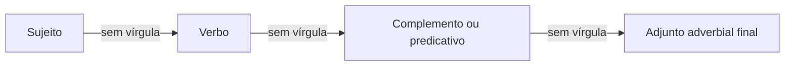
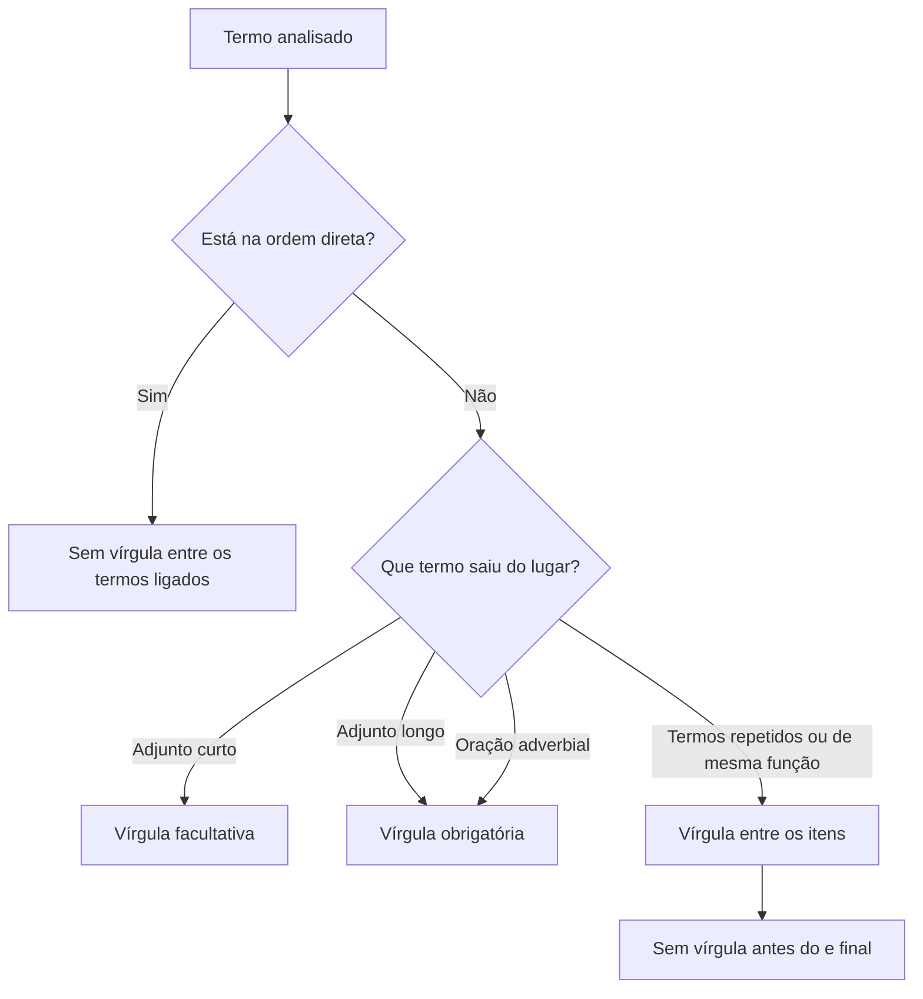

A pontuação organiza a estrutura morfossintática do período. O emprego dos sinais de pontuação mostra onde um termo começa, onde termina e como cada função sintática se liga às demais para produzir sentido e coerência. Este capítulo apresenta alguns conceitos essenciais sobre a vírgula, o sinal mais exigido nas provas: quando ela é proibida na ordem direta e fluida, como a sua presença ou supressão provoca mudança semântica, quando seu uso é obrigatório ou facultativo nos termos e orações deslocados e como separar os elementos de uma série enumerativa. O volume começa aqui porque todas as regras dos próximos capítulos partem da organização natural da sentença.

> [!objetivos]
> - Identificar os pontos da ordem direta em que a vírgula é proibida.
> - Explicar por que a vírgula não marca pausa de respiração.
> - Decidir se a vírgula é obrigatória ou facultativa com adjuntos e orações adverbiais deslocados.
> - Pontuar enumerações, repetições e listas abertas e fechadas.

## Pontuação serve à sintaxe, não à respiração

Muita gente pontua "onde dá vontade de respirar". Esse hábito produz erros. O fôlego varia de pessoa para pessoa. A gramática, não. Por isso a regra de prova é simples: a vírgula acompanha a **estrutura** da frase.

A pontuação cumpre duas funções:

- **Função sintática**: marca os limites de termos e orações (o que é intercalado, deslocado ou coordenado).
- **Função semântica**: muda ou esclarece o sentido (o que é restritivo ou explicativo, quem é chamado ou quem age).

A banca explora as duas. Na primeira, pede para apontar a vírgula errada. Na segunda, pergunta se a retirada ou a troca de lugar de uma vírgula muda o sentido.

> [!atencao] Pausa na leitura não é critério
> Frase longa não autoriza vírgula entre termos ligados. "Pausar ao ler" nunca justifica pontuar. Só a relação entre os termos justifica.

Ao ler uma frase de prova, siga este roteiro:

1. Localize o verbo e o sujeito.
2. Veja se há termo fora do lugar (deslocado) ou inserido no meio (intercalado).
3. Veja se há termos repetidos ou de mesma função (enumeração).
4. Só então decida onde a vírgula entra ou sai.

## A ordem direta e as vírgulas proibidas

Na nossa língua, a ordem natural de organização de uma sentença é chamada de **ordem direta**, frequentemente resumida pela sigla **SuVeCA**: **Su**jeito + **Ve**rbo + **C**omplemento + **A**djuntos adverbiais. Quando o enunciado segue essa sequência natural e fluida, sem inclusão de outros termos no meio, as estruturas mantêm vínculo sintático imediato e **não podem ser separadas por vírgula**. Veja exemplos de sentenças na ordem direta:

- Eu comprei um veículo novo na semana passada.
- O servidor foi trabalhar de ônibus ontem.
- Nós temos orgulho da história da corporação.

Qualquer inversão desses elementos ou a inclusão de algum termo intercalado entre eles traz implicações diretas na pontuação, justamente para que o leitor continue enxergando a função sintática e o sentido original da frase. Dois princípios gerais orientam quase todas as questões de prova sobre esse tema:

1. **Princípio dos adjuntos deslocados**: termos que indicam circunstância adverbial vêm normalmente no final do período segundo a ordem direta; quando estiverem deslocados para o início ou para o meio da oração, geralmente devem ser separados por pontuação.
2. **Princípio do esclarecimento**: expressões que desenvolvem o sentido de termos anteriores ou acrescentam uma explicação, comentário ou detalhe (como apostos explicativos, predicativos deslocados e orações interferentes) devem ficar devidamente isoladas por pontuação.

Na ordem direta, há cinco separações principais que prejudicam a correção gramatical:

1. **Entre sujeito e verbo.** A vedação vale mesmo quando o sujeito é longo, composto ou formado por uma oração inteira.
2. **Entre verbo e complemento** (objeto direto ou objeto indireto), inclusive quando o complemento é uma oração subordinada substantiva iniciada por "que" ou "se" (como em "Acho que o resultado sairá hoje", em que inserir vírgula logo após "Acho" separaria o verbo do seu complemento).
3. **Entre verbo de ligação e predicativo do sujeito.**
4. **Entre o nome (substantivo, adjetivo ou advérbio) e seu complemento nominal ou adjunto adnominal.**
5. **Entre o objeto e o predicativo do objeto.**

A tabela compara o erro de pontuação e a redação correta em cada caso.

| Relação entre os termos | Errado | Certo |
| --- | --- | --- |
| Sujeito e verbo | A guarnição do quartel de Olinda, chegou ao local. | A guarnição do quartel de Olinda chegou ao local. |
| Verbo e objeto direto | O comandante comprou, novos equipamentos para a empresa. | O comandante comprou novos equipamentos para a empresa. |
| Verbo e objeto oracional | O fiscal disse, que o prazo terminara ontem. | O fiscal disse que o prazo terminara ontem. |
| Verbo de ligação e predicativo | O cabo é, instrutor de natação e corrida. | O cabo é instrutor de natação e corrida. |
| Nome e complemento ou adjunto | Tenho um barco, de corrida e receio, do mar agitado. | Tenho um barco de corrida e receio do mar agitado. |
| Objeto e predicativo do objeto | A diretoria considerou, justa a decisão final. | A diretoria considerou justa a decisão final. |

> [!pegadinha] Sujeito longo atrai a vírgula
> Em períodos longos, as bancas costumam inserir uma vírgula logo antes do verbo para confundir o candidato. Por exemplo, em "A cada ano, quase uma em cada dez pessoas daquela região adoece por falta de saneamento", inserir uma vírgula antes de "adoece" prejudicaria a correção gramatical, pois separaria o núcleo do sujeito do seu verbo.

Há, porém, casos em que algum termo aparece **intercalado** entre os elementos da ordem direta. Quando isso acontece, o termo intercalado deve ficar devidamente isolado por duas vírgulas (ou por parênteses ou travessões): "O candidato, sem pensar duas vezes, inscreveu-se no concurso ontem à noite". Repare que as vírgulas não separam o sujeito do verbo; elas isolam o adjunto intercalado. Por isso, o par de vírgulas funciona em conjunto: suprimir apenas uma delas é erro grave.

> [!exemplo] Par de vírgulas quebrado
> - Errado: Os bombeiros, para chegar mais cedo atravessaram a avenida.
> - Certo: Os bombeiros, para chegar mais cedo, atravessaram a avenida.
>
> A segunda vírgula fecha a oração intercalada. Sem ela, resta uma única vírgula separando indevidamente o sujeito "Os bombeiros" do verbo "atravessaram".

Existe também uma divergência entre gramáticos a respeito de períodos em que o sujeito é uma oração relativa sem antecedente com o mesmo verbo repetido, como em "Quem compra, compra algo" ou em provérbios como "Quem tem boca, vai a Roma". Alguns gramáticos admitem a vírgula quando se quer marcar pausa maior antes da segunda parte, por verem ali duas orações (a iniciada pelo pronome "quem" e a principal); outros a tratam como facultativa. Na visão tradicional cobrada na quase totalidade das provas de concurso, contudo, prevalece a regra geral: **não se usa vírgula entre sujeito e verbo**, mesmo que o sujeito seja oracional ("Quem estuda com constância alcança a vaga"). Outros casos especiais — como destacar por vírgula um predicativo deslocado ("O aluno, atento, revisou a matéria") ou antecipar um objeto oracional ("Que haverá mudança no edital, todos já sabem") — ocorrem por ênfase estilística, mas não anulam a regra fundamental da ordem direta.

## Como a vírgula muda o sentido

Em diversas construções, a presença, a supressão ou a mudança de posição de uma vírgula mantém a frase gramaticalmente correta, mas altera a função sintática dos termos e muda por completo o sentido do período. Quando um item de prova pergunta se a retirada de determinada vírgula "preserva o sentido original e a coerência", é preciso testar o impacto sintático e semântico da alteração.

O primeiro caso clássico ocorre nas **orações subordinadas adjetivas**. Sem vírgula, a oração tem valor **restritivo**, limitando a informação a apenas uma parte do grupo. Com vírgulas, a oração passa a ter valor **explicativo**, generalizando a característica para a totalidade do grupo:

- Os servidores que fizeram greve levaram falta. (Somente a parcela que fez greve levou falta; os demais trabalharam normalmente.)
- Os servidores, que fizeram greve, levaram falta. (Todos os servidores fizeram greve e todos levaram falta.)

Por essa razão, quando o substantivo antecedente designa um ser único, somente a forma explicativa entre vírgulas faz sentido lógico. Escrever "Minha mãe que mora em Caruaru é médica" daria a entender que o falante possui mais de uma mãe. O correto é isolar a explicação: "Minha mãe, que mora em Caruaru, é médica".

O segundo caso envolve a distinção entre **vocativo** (termo independente usado para chamar o interlocutor) e **sujeito acompanhado de aposto explicativo**:

- João, o auditor multou a empresa. ("João" é vocativo, com quem se fala; "o auditor" é o sujeito que praticou a ação de multar.)
- João, o auditor, multou a empresa. ("João" é o sujeito do verbo "multou", e "o auditor" é aposto explicativo que esclarece quem é João.)

O terceiro caso diz respeito ao deslocamento da vírgula em frases com advérbios de negação, pronomes ou expressões adverbiais, alterando a qual verbo ou termo a palavra se liga:

- Não, espere por mim! (O falante pede que a outra pessoa aguarde e vá junto com ele.)
- Não espere por mim! (O falante orienta a outra pessoa a seguir em frente sem esperar.)
- Vamos perder nada, foi resolvido. (Sentido positivo: nenhuma perda ocorrerá, pois o problema já teve solução.)
- Vamos perder, nada foi resolvido. (Sentido negativo: haverá perda, porque nenhuma solução foi alcançada.)
- Quando visito a família, durante o feriado prolongado, costumo descansar no interior. (Com o termo entre vírgulas ou mudando a posição de uma delas, altera-se o verbo modificado pela circunstância de tempo: se a visita ocorre no feriado ou se o descanso ocorre no feriado.)
- Disseram que escrever, para eles, aconteceu naturalmente. (Isolada por vírgulas, a expressão "para eles" indica opinião ou referência: na visão deles, o ato de escrever fluiu com naturalidade. Se as duas vírgulas forem suprimidas — "Disseram que escrever para eles aconteceu naturalmente" —, a expressão "para eles" passa a funcionar como complemento de "escrever", mudando o sentido original.)

A tabela reúne pares frequentes em prova.

| Frase | Efeito da pontuação | Frase contrastante | Efeito |
| --- | --- | --- | --- |
| Os cadetes que faltaram serão punidos. | Só parte dos cadetes faltou. | Os cadetes, que faltaram, serão punidos. | Todos faltaram. |
| Cabo Lima, o sargento chamou o motorista. | Lima é chamado; o sargento age. | Cabo Lima, o sargento, chamou o motorista. | Lima é o sargento e age. |
| Vamos comer, soldados. | Convite aos soldados (vocativo). | Vamos comer soldados. | Sentido absurdo: soldados são o alimento. |
| Não aceite, assine. | Recusa a oferta e manda assinar. | Não, aceite assine. | Frase sem sentido: mudança errada. |

> [!bizu] Teste de supressão
> Para saber se um termo entre vírgulas é acessório, apague-o. Se a frase continua completa e com o mesmo sentido essencial, ele estava corretamente isolado. Se o sentido muda, as vírgulas não cabem.

## Adjuntos e orações adverbiais deslocados

Os **adjuntos adverbiais** expressam circunstâncias relacionadas ao processo verbal — como tempo, lugar, modo, motivo, condição, concessão, instrumento e finalidade. Podem vir na forma de um advérbio simples, de uma locução adverbial ou até de **orações subordinadas adverbiais**, introduzidas por conjunções e locuções conjuntivas (*quando*, *embora*, *porque*, *como*, *conforme*, *à medida que*, *para que*). Na linguagem das bancas, "marcar", "separar" e "isolar" aparecem muitas vezes como equivalentes, embora "isolar" indique mais especificamente o termo entre duas vírgulas, "anteposto" indique o termo colocado no início e "intercalado" o que vem no meio da oração.

Na posição final (ordem direta), os termos adverbiais não exigem pontuação:

- Vou jogar xadrez no clube da cidade durante a folga. (Adjuntos na posição final.)
- Inscrevi-me no concurso público com bastante antecedência. (Adjunto de modo no final.)

Quando saem da posição final e aparecem deslocados (antepostos ou intercalados), a regra para a prova distingue três situações:

- **Adjunto adverbial de curta extensão** (formado por uma ou duas palavras, como um advérbio isolado): o emprego da vírgula é **facultativo**. Exemplos: "Agora(,) a segurança da vila está garantida"; "Hoje(,) vou estudar até mais tarde"; "De manhã(,) a equipe revisou o planejamento".
- **Adjunto adverbial de longa extensão** (normalmente com três ou mais palavras): a vírgula é **obrigatória** segundo a orientação tradicional dos manuais de gramática. Exemplos: "Nos dias atuais, a preparação exige disciplina diária"; "Depois de quatro horas de buscas na mata, a patrulha localizou a trilha". (Embora alguns gramáticos admitam dispensar a vírgula por ritmo de leitura — como em "A essa hora da madrugada você ainda trabalha?" —, nas questões objetivas prevalece de forma segura a obrigatoriedade para três ou mais palavras.)
- **Oração subordinada adverbial** anteposta ou intercalada: a vírgula é **obrigatória**, independentemente da extensão da oração. Essa exigência vale tanto para as orações desenvolvidas (com conjunção e verbo finito) quanto para as orações reduzidas de infinitivo, gerúndio ou particípio.

> [!bizu] Contagem de palavras e orações adverbiais
> Adjunto adverbial com até duas palavras deslocado: vírgula facultativa ("Ontem a turma saiu cedo"). Três palavras ou mais: vírgula obrigatória ("No começo da madrugada, a viatura partiu"). Já se houver verbo — formando uma oração subordinada adverbial anteposta ou intercalada —, a vírgula é sempre obrigatória, mesmo que a oração tenha apenas duas palavras ("Saindo cedo, você evita o trânsito").

A tabela resume a regra por posição.

| Termo adverbial | Posição | Vírgula | Exemplo |
| --- | --- | --- | --- |
| Adjunto de curta extensão | Início (anteposto) | Facultativa | Ontem(,) o pelotão treinou. |
| Adjunto de curta extensão | Meio (intercalado) | Facultativa (em par) | O pelotão(,) ontem(,) treinou. |
| Adjunto de longa extensão | Início (anteposto) | Obrigatória | Na manhã de ontem, o pelotão treinou. |
| Adjunto de longa extensão | Meio (intercalado) | Obrigatória (em par) | O pelotão, na manhã de ontem, treinou. |
| Oração adverbial | Início (anteposta) | Obrigatória | Quando o alarme soou, o alojamento esvaziou. |
| Oração adverbial | Meio (intercalada) | Obrigatória (em par) | O alojamento, quando o alarme soou, esvaziou. |
| Oração adverbial | Fim (posposta) | Facultativa | O alojamento esvaziou(,) quando o alarme soou. |

Veja exemplos variados de orações subordinadas adverbiais deslocadas, desenvolvidas e reduzidas:

- Temporal intercalada: No entanto, *quando os treinos físicos são intensos e prolongados*, o atleta precisa de hidratação adequada.
- Condicional anteposta: *Se houvesse maior incentivo à cultura*, os jovens teriam novas opções de formação.
- Concessiva anteposta: *Embora os recursos econômicos fossem escassos*, o município preservou seu patrimônio histórico.
- Conformativa anteposta: *Conforme determina o regulamento*, o plantão começa às sete horas.
- Final intercalada: O candidato decidiu que, *para não perder o foco*, manteria uma rotina fixa de estudos.
- Reduzida de infinitivo: *A persistirem os alertas meteorológicos*, a Defesa Civil interditará a encosta.
- Reduzida de gerúndio: *Havendo necessidade*, novas equipes serão deslocadas para a fronteira.
- Reduzida de particípio: *Concluído o processo administrativo*, o relatório seguiu para publicação.

> [!pegadinha] Falsa aparência de termo isolado entre vírgulas
> Nem sempre um trecho situado entre duas vírgulas foi isolado como unidade única. Às vezes, cada vírgula pertence a uma regra diferente. Observe: "Esse fenômeno é, também, o que impulsiona as migrações contemporâneas, que transformam a nova cultura local". O segmento "o que impulsiona as migrações contemporâneas" não está isolado por ser explicativo: a primeira vírgula fecha o isolamento facultativo do advérbio "também", e a segunda vírgula abre a oração adjetiva explicativa iniciada por "que". Da mesma forma, em "Os três batalhões atuaram juntos e, cada um a seu modo, contribuíram para o socorro", não se pode suprimir a vírgula após a conjunção "e", porque ela abre o par que isola o adjunto intercalado "cada um a seu modo".

## Enumeração, repetição e lista aberta

Uma das funções da vírgula mais recorrentes em provas é separar **elementos coordenados de uma série enumerativa** — termos que exercem a mesma função sintática em relação ao mesmo núcleo ou verbo, ou orações coordenadas dispostas em sequência. A enumeração pode envolver qualquer função sintática:

- Sujeitos: *A educação*, *a saúde*, *a alimentação*, *o trabalho*, *a moradia*, *o lazer* e *a segurança* figuram entre os direitos sociais previstos na Constituição.
- Objetos diretos: Para o alojamento, comprei *frutas*, *legumes*, *cereais* e *carnes magras*.
- Complementos nominais: O gestor tinha receio *da omissão*, *do improviso* e *da perda de prazos*.
- Predicativos do sujeito: Aqueles antigos líderes eram *rígidos*, *autoritários* e *intransigentes*.
- Adjuntos adverbiais: Para enfrentar essas transformações na sociedade, o planejamento urbano exige *flexibilidade*, *análise de cenários alternativos* e *integração do patrimônio histórico*, sob pena de ficar à deriva de interesses puramente econômicos.

Duas regras comandam a série enumerativa padrão:

1. **Lista taxativa (fechada) com "e"**: antes do último item da enumeração, o emprego da conjunção "e" (ou "ou" / "nem") indica que a lista terminou, sem vírgula antes do conectivo. Exemplo: "Foram convocados três grandes jogadores para a partida: Lucas, Rafael e Mateus" (a lista se encerra nesses três nomes).
2. **Lista exemplificativa (aberta) sem "e"**: quando se usa vírgula em vez da conjunção antes do último termo, sugere-se que a enumeração permanece aberta e que outros elementos poderiam ser acrescentados. Exemplo: "O torneio reuniu grandes jogadores: Lucas, Rafael, Mateus" (há outros atletas além dos citados).

Quando o conectivo é repetido intencionalmente antes de cada elemento para produzir ênfase — figura de sintaxe chamada **polissíndeto** —, a vírgula passa a ser usada antes de cada conjunção: "O investigador apurou desvios, e fraudes, e conluios, e toda sorte de irregularidades". Com a conjunção aditiva negativa "nem" repetida, também se emprega vírgula: "Não aceitou acordo, nem apresentou defesa, nem compareceu à audiência".

A vírgula também separa a repetição enfática da mesma palavra e a repetição de uma estrutura no início de orações sucessivas (figura denominada **anáfora**):

- Palavra repetida: O náufrago *nadou*, *nadou*, *nadou* até alcançar a areia da praia; na arquibancada, o torcedor *chorou*, *chorou* de emoção.
- Anáfora e orações coordenadas assindéticas: *É dever*, *é compromisso*, *é responsabilidade* de todos zelar pelo bem público.

Por fim, quando duas orações independentes são coordenadas pela conjunção "e" (como em "Os satélites monitoram o desmatamento e as equipes terrestres fiscalizam as reservas"), a substituição da conjunção "e" por uma vírgula mantém a correção gramatical e a coerência do período, convertendo a coordenação sindética em assindética.

A tabela organiza as formas de enumeração e repetição.

| Padrão | Pontuação | Efeito de sentido |
| --- | --- | --- |
| Série comum (taxativa) | A, B e C. | O "e" encerra a lista fechada; sem vírgula antes dele. |
| Série sem conectivo (exemplificativa) | A, B, C. | Sugere lista aberta ou ritmo enumerativo contínuo. |
| Polissíndeto | A, e B, e C. | Ênfase expressiva: vírgula antes de cada "e". |
| "Nem" repetido | Nem A, nem B, nem C. | Vírgula antes de cada ocorrência de "nem". |
| Repetição de palavra ou anáfora | nadou, nadou, nadou | Ideia de intensidade, duração ou reforço rítmico. |

> [!atencao] Uma só vírgula nunca separa o sujeito composto do verbo
> Mesmo que uma enumeração forme um sujeito composto extenso ("O delegado, o perito, o escrivão e os agentes analisaram o laudo"), jamais se coloca vírgula após o último núcleo do sujeito antes do verbo "analisaram". A vírgula separa apenas os núcleos coordenados entre si, nunca o sujeito inteiro do seu predicado.

## Mapa do capítulo

O fluxograma resume as decisões sobre a vírgula tratadas neste capítulo.

A tabela revisa as regras e as armadilhas de prova.

| Situação | Regra | Armadilha |
| --- | --- | --- |
| Sujeito e verbo | Sem vírgula | Sujeito longo com vírgula |
| Verbo e complemento | Sem vírgula | Vírgula antes de "que" integrante |
| Termo intercalado | Par de vírgulas | Retirar uma só |
| Adjunto curto deslocado | Facultativa | Chamar de obrigatória |
| Adjunto longo ou oração adverbial anteposta | Obrigatória | Dispensar a vírgula |
| Adjetiva sem vírgula | Restritiva | Dizer que o sentido não muda |
| Série com "e" final | Sem vírgula antes do "e" | Pôr vírgula antes do último item |
| Polissíndeto | Vírgula antes de cada "e" | Chamar de erro |

### Para fixar

- A vírgula marca a estrutura da frase; não marca pausa de respiração.
- Na ordem direta, não há vírgula entre sujeito e verbo, nem entre verbo e complemento.
- Termo intercalado exige as duas vírgulas; retirar uma só é erro.
- Vírgula muda o sentido: adjetiva com vírgula explica, sem vírgula restringe.
- Vocativo e aposto se distinguem: o vocativo chama; o aposto explica um termo da frase.
- Adjunto adverbial curto deslocado: vírgula facultativa.
- Adjunto adverbial longo deslocado, três palavras ou mais: vírgula obrigatória.
- Oração adverbial anteposta ou intercalada: vírgula obrigatória, também nas reduzidas.
- Na série comum, não há vírgula antes do "e" final.
- Polissíndeto exige vírgula antes de cada "e"; com "nem" repetido também.
