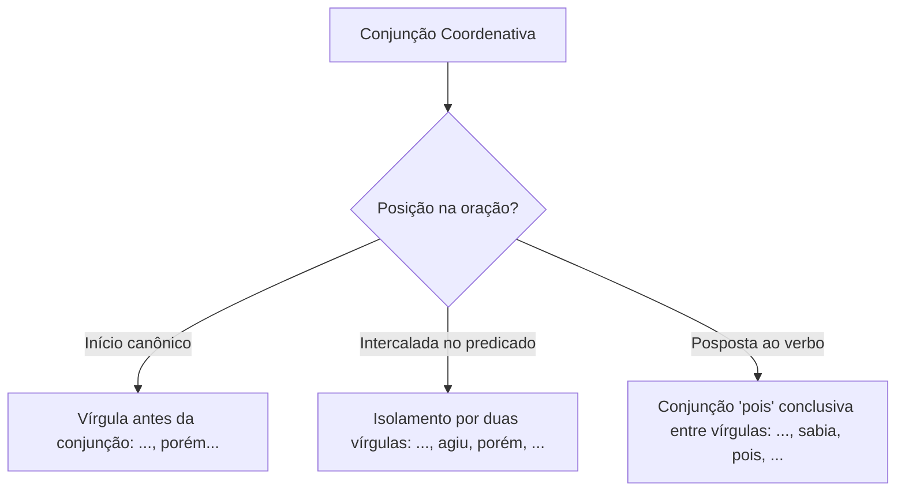
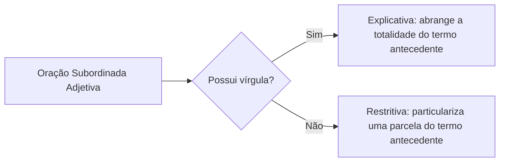
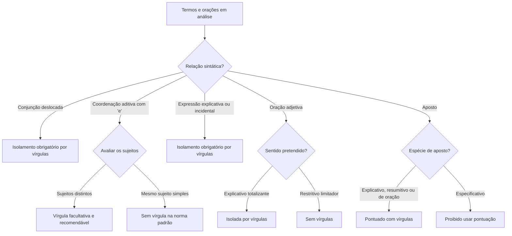

A pontuação do período composto constitui um dos temas de maior sofisticação nos concursos públicos. Compreender como os sinais gráficos articulam orações coordenadas e subordinadas permite dominar a progressão lógica do texto. O candidato que domina essa mecânica evita falhas graves de coesão e desvios formais de pontuação.

Neste capítulo, estudaremos o emprego da vírgula nas orações coordenadas. Daremos ênfase ao deslocamento de conjunções e às regras aplicáveis ao conectivo aditivo "e". Em seguida, analisaremos o isolamento de expressões explicativas, retificativas e orações interferentes. Por fim, examinaremos a distinção entre orações adjetivas explicativas e restritivas, as peculiaridades do objeto pleonástico e as regras estritas do aposto.

> [!objetivos]
> - Aplicar o isolamento por vírgulas em conjunções coordenativas deslocadas e reconhecer a posição fixa da conjunção adversativa "mas".
> - Dominar as hipóteses de obrigatoriedade, facultatividade e vedação da vírgula antes da conjunção aditiva "e".
> - Isolar corretamente expressões explicativas, retificativas, palavras denotativas de situação e orações interferentes.
> - Distinguir o valor sintático e semântico de orações adjetivas explicativas e restritivas, bem como pontuar adequadamente as diferentes espécies de aposto.

## Conjunções coordenativas deslocadas e orações coordenadas

A posição natural de uma conjunção coordenativa situa-se no início da oração que ela introduz. Nessa colocação canônica, a pontuação regular exige uma vírgula antes do conectivo. Essa vírgula marca a fronteira entre as orações coordenadas:
- A equipe treinou com afinco, *porém* não obteve a vaga.
- O prazo oficial expirou, *portanto* o sistema não aceita novos inscritos.

Contudo, quando a conjunção coordenativa surge **deslocada** para o interior da oração ou posposta ao verbo, a norma culta impõe seu **isolamento obrigatório por vírgulas**. Se a conjunção iniciar uma oração após ponto e vírgula, ela deve vir isolada por vírgula em relação aos termos contíguos.

Conjunções como "porém", "todavia", "contudo", "entretanto", "no entanto", "portanto" e "logo" aceitam livre deslocamento. Já a conjunção conclusiva "pois" possui regra específica. Para assumir sentido conclusivo, deve vir obrigatoriamente **posposta ao verbo** e isolada por vírgulas. Se posicionada antes do verbo, "pois" terá valor estritamente explicativo ou causal.

Veja os exemplos de deslocamento:
- O plano de resgate era audacioso; continha, *porém*, riscos calculados.
- Os laudos periciais divergiam; a comissão técnica, *portanto*, solicitou novos exames.
- O réu conhecia as penalidades legais; agiu, *pois*, com plena consciência do ilícito.
- O candidato deseja a aprovação. Logo, *evito* perder tempo com distrações.

> [!atencao] A imutabilidade do "mas"
> A conjunção adversativa "mas" não admite deslocamento. Ela deve figurar obrigatoriamente no início da oração coordenada adversativa. A pontuação padrão coloca a vírgula antes de "mas", e nunca depois dele, salvo se houver termo intercalado imediatamente posterior (ex.: "Houve protestos, mas, naquele instante, todos silenciaram").

A separação de orações coordenadas sindéticas e assindéticas segue o princípio da enumeração:
- A viatura chegou ao local, os socorristas avaliaram a cena e o trânsito fluiu.
- Agasalhe-se bem, que a noite promete frio intenso.
- Seja pela força da lei, seja pelo dever cívico, a ordem pública será mantida.

Também se separam por vírgula as **orações aditivas reduzidas de gerúndio**. Elas expressam ideia de consequência ou sequência cronológica equivalente ao conectivo "e":
- O transformador elétrico explodiu, *desencadeando um incêndio perigoso* (= e desencadeou um incêndio).
- A tromba d'água atingiu a serra, *desalojando centenas de famílias* (= e desalojou famílias).

## O emprego da vírgula antes da conjunção aditiva "e"

O uso da vírgula antes da conjunção coordenativa aditiva "e" é frequente em concursos. A regra geral prescreve que o conectivo "e" liga orações ou termos com o mesmo sujeito sem vírgula. Entretanto, a norma culta prevê hipóteses em que a pontuação é obrigatória, facultativa ou desaconselhável.

A tabela a seguir sistematiza as regras essenciais para o emprego da vírgula diante do conectivo aditivo.

| Situação sintática | Exigência da vírgula | Justificativa gramatical | Exemplo na norma culta |
| --- | --- | --- | --- |
| Polissíndeto aditivo | Obrigatória | Repetição intencional da conjunção para ênfase expressiva. | O cidadão reclama, e reclama, e reclama da burocracia estatal. |
| Ambiguidade potencial | Obrigatória | Impedir falsa associação de sujeito com objeto direto. | O guarda deteve o suspeito, e o pedestre chamou a viatura. |
| Sujeitos diferentes | Facultativa (recomendável) | Marcar a transição entre agentes oracionais distintos. | A capitã liderou o socorro, e a equipe encontrou os feridos. |
| Valor adversativo (oposição) | Facultativa (recomendável) | O conectivo "e" possui valor equivalente a "mas" ou "porém". | O soldado treinou muito, e não atingiu a pontuação mínima. |
| Mesmo sujeito simples | Desaconselhável | Evitar ruptura indevida entre o sujeito e o segundo verbo. | O oficial redigiu a portaria e assinou o despacho final. |

Quando duas orações coordenadas aditivas possuem **sujeitos gramaticais distintos**, o emprego da vírgula antes de "e" é **facultativo**. A tradição gramatical considera esse uso altamente recomendável para conferir clareza à leitura:
- A legislação regula a convivência desde o dia em que *nascemos*, e ela orienta nossas condutas até o instante em que *morremos*, para que os cidadãos *saibam* conciliar seus *interesses* com a *integração* e a *inserção* social.
- Os *educadores* realizavam as oficinas formativas na ala *norte*, e coube à equipe *gestora* arrecadar as taxas de ocupação territorial.
- A casa rústica *protegia* os moradores do vendaval *temível*, e no interior dela a família se *esforçava* por manter a calma enquanto a maré *sobe* e as ondas *altas* *aumentam* o risco.

> [!bizu] Sujeitos distintos e o "e" aditivo
> Identifique sempre os sujeitos de cada oração coordenada pelo conectivo:
> - Oração 1: "O sargento organizou a fila..." (Sujeito: "O sargento").
> - Oração 2: "...e os soldados distribuíram os mantimentos." (Sujeito: "os soldados").
> Havendo sujeitos distintos, a vírgula antes do "e" é plenamente lícita e recomendável.

Na ocorrência de valor adversativo, quando o conectivo "e" introduz contraste, a vírgula também se faz oportuna:
- A equipe correu contra o tempo, e não conseguiu evitar o desabamento.

Existe uma exceção de caráter estilístico registrada na doutrina clássica. Quando o sujeito é idêntico em ambas as orações, o redator pode empregar vírgula ou travessão antes do "e" para realçar a ação:
- Na véspera do concurso, o jovem deitara cedo, e *sonhou* com a sonhada aprovação militar.
- Na véspera do concurso, o jovem deitara cedo — e *sonhou* com a vitória.

## Expressões explicativas, retificativas e orações interferentes

No desenvolvimento textual, o redator recorre a termos que esclarecem, corrigem, ilustram ou orientam o raciocínio. Essas estruturas, que incluem locuções explicativas e palavras denotativas de situação, devem vir **obrigatoriamente isoladas por vírgulas** ou sinais correlatos.

As principais expressões desse grupo compreendem:
- **Explicativas e exemplificativas**: *isto é*, *ou seja*, *a saber*, *por exemplo*, *com efeito*, *por assim dizer*.
- **Retificativas**: *ou melhor*, *ou antes*, *aliás*, *digo*.
- **Palavras denotativas de situação ou remate**: *afinal*, *enfim*, *ora*, *agora*, *então*, *inclusive*.

A tabela seguinte ilustra o uso normativo dessas expressões no texto formal.

| Categoria discursiva | Expressões típicas | Padrão de pontuação | Exemplo na norma padrão |
| --- | --- | --- | --- |
| Retificação | ou melhor, aliás, ou antes | Isolamento obrigatório por vírgulas | A perícia sairá na sexta-feira, ou melhor, na quinta-feira à tarde. |
| Explicação | isto é, ou seja, a saber | Isolamento obrigatório por vírgulas | A corporação adotou medidas firmes, isto é, reforçou o plantão. |
| Exemplificação | por exemplo, a citar | Isolamento obrigatório por vírgulas | Vários atletas experientes disputaram a prova, por exemplo, o cabo Mendes. |
| Inclusão enfática | inclusive, até | Isolamento obrigatório por vírgulas | A nova norma prevê penalidades, instituindo, inclusive, sanções duras. |
| Situação e transição | afinal, ora, enfim | Isolamento por vírgula no início ou meio | Afinal, quem poderá responder pelo dano causado ao patrimônio? |

As expressões explicativas e acessórias podem ser delimitadas por parênteses ou travessões duplos. Essa pontuação evidencia seu caráter acessório:
- O novo comandante, entre outros oficiais ilustres, defendeu a reforma do quartel.
- O novo comandante (entre outros oficiais ilustres) defendeu a reforma do quartel.
- O novo comandante — entre outros oficiais ilustres — defendeu a reforma do quartel.

As **orações interferentes** (ou incidentais) constituem uma interrupção da linha sintática. Elas introduzem uma reflexão, um comentário ou uma advertência do autor no meio da frase:
- O coronel, *todos no regimento sabiam disso*, mantinha conduta austera.
- A decisão superior, *descobriu-se mais tarde*, continha vício formal grave.
- Por trás do depósito, um corredor estreito, com arquivos antigos sob poeira fina pelo chão, *esconde* os processos encerrados.

Essas orações exigem isolamento por vírgulas ou travessões. A retirada de apenas uma das pontuações quebra a harmonia sintática do período.

## Orações adjetivas explicativas e restritivas

As orações subordinadas adjetivas exercem papel semelhante ao de um adjunto adnominal, qualificando um substantivo ou pronome antecedente. Introduzidas por pronomes relativos ("que", "quem", "o qual", "cujo", "onde"), essas orações dividem-se em duas categorias semânticas:

1. **Oração adjetiva explicativa (com vírgulas)**: acrescenta uma informação acessória e generalizante, atribuindo a propriedade a todos os seres do conjunto antecedente. Pode ser suprimida sem alterar o significado essencial do núcleo nominal.
2. **Oração adjetiva restritiva (sem vírgulas)**: particulariza e limita o sentido do antecedente, restringindo a declaração a um subconjunto específico. Não admite vírgulas, pois a delimitação é parte indispensável da mensagem.

A inclusão ou supressão de vírgulas em orações adjetivas altera o sentido original do texto, mantendo a frase correta:
- Enunciado restritivo: O militar *que viaja a serviço* recebe diárias de alimentação. (Somente aquele que viaja recebe a parcela).
- Enunciado explicativo: O homem, *que vence adversidades pela perseverança*, merece admiração. (Afirmação universal sobre a natureza humana).

Quando o antecedente nomeia um ser único no universo ou já inteiramente determinado, a oração adjetiva deve ser explicativa, com vírgulas **obrigatórias**:
- A Carta Magna de 1988, *que consolidou os direitos sociais no art. 6º*, rege o ordenamento jurídico nacional. (Há uma única Constituição de 1988).
- O planeta Marte, *que atrai os cientistas*, possui atmosfera rarefeita.

O mesmo princípio aplica-se a termos reduzidos de valor adjetivo sem conectivo relativo expresso:
- A conduta violenta colide com os ideais de paz *decorrentes da convivência democrática*. (Sem vírgula: valor restritivo).
- A conduta violenta colide com os ideais de paz, *decorrentes da convivência democrática*. (Com vírgula: valor explicativo).
- Nas antigas instalações rurais da serra, onde *passávamos* o treinamento de campo e o posto *ficava* junto ao vale, o clima era ameno.
- A iluminação excessiva das metrópoles *infiltra* o quarto em que *dormimos*, prejudicando o descanso noturno.
- O desequilíbrio ecológico eleva a *mortalidade* da fauna silvestre, sobretudo em áreas afetadas por *desmatamento*.
- Os antigos fortes *costeiros* que conservam sua estrutura primitiva atraem visitantes.

A tabela a seguir confronta as duas espécies de orações adjetivas.

| Critério de análise | Oração adjetiva explicativa | Oração adjetiva restritiva |
| --- | --- | --- |
| Pontuação obrigatória | Sempre isolada por vírgulas, travessões ou parênteses. | Não admite pontuação de isolamento. |
| Alcance semântico | Universal: refere-se à totalidade do substantivo. | Delimitador: seleciona um subgrupo restrito. |
| Supressão no texto | Pode ser retirada sem alterar a referência nominal. | Sua supressão compromete a definição do núcleo nominal. |
| Exemplo clássico | Os soldados, que concluíram o treino, foram elogiados. | Os soldados que concluíram o treino foram elogiados. |

> [!pegadinha] A armadilha de retirar apenas uma vírgula
> As bancas propõem frequentemente: "A supressão da vírgula após a palavra X manteria a correção gramatical". Se o termo explicativo estiver intercalado entre vírgulas, suprimir somente uma delas gera erro grave, pois deixa uma vírgula solta separando sujeito e predicado:
> - Frase original: "As intervenções urbanas, causadas por enchentes severas, exigem verbas."
> - Retirada indevida de uma vírgula: "As intervenções urbanas causadas por enchentes severas, exigem verbas." (Incorreto).
> - Para tornar o termo restritivo mantendo a correção, é imperativo suprimir **as duas vírgulas** do par.

## Objeto direto pleonástico e pontuação do aposto

O **objeto direto pleonástico** ocorre quando um complemento verbal é antecipado na oração por motivo de ênfase estilística e, em seguida, é retomado por um pronome oblíquo átono junto ao verbo. A norma culta exige separar o termo inicial por vírgula em relação à oração que o retoma:
- Os novos armamentos da tropa, o comandante *os* inspecionou cuidadosamente antes da missão.
- Aos valorosos socorristas, a comunidade agradeceu-*lhes* com calorosa homenagem pelo resgate.

> [!exemplo] Objeto direto pleonástico
> - "As ordens emanadas do quartel, os soldados as executam prontamente."
> O termo "As ordens emanadas do quartel" funciona como objeto direto antecipado, retomado pelo pronome átono "as". A vírgula é obrigatória para demarcar essa reiteração enfática.

O **aposto** é o termo de valor substantivo que se agrega a outro termo nominal para explicá-lo, resumi-lo, especificá-lo ou distribuí-lo. O comportamento da pontuação depende da modalidade do aposto:

1. **Aposto explicativo**: detalha ou esclarece um antecedente substantivo. É acessório e deve vir **isolado por vírgulas**, travessões ou parênteses:
   - O agente etiológico identificado no laudo, micro-organismo causador de infecção *aguda*, exige rígida assepsia hospitalar.
   - O capitão do *time* que *venceu* o torneio, atleta que *inspirava* os jovens e *jurou* lealdade à equipe, *caminha* com orgulho ao lado das *lindas* bandeiras da corporação.
2. **Aposto resumitivo (ou recapitulativo)**: sintetiza por meio de um pronome indefinido (tudo, nada, ninguém) uma série de termos precedentes. Separa-se por vírgula ou travessão simples:
   - Treino diário, disciplina tática, preparo mental, *tudo* contribui para o êxito operacional a que *aderimos*.
3. **Aposto distributivo (ou enumerativo)**: enumera e discrimina partes de um todo, podendo vir introduzido por dois-pontos ou vírgula:
   - Os dois instrutores dividiram as turmas da formação: este *alertou* a defesa civil e aquele ficou com o salvamento aquático.
   - O oficial adquiriu duas *canetas* táticas de sinalização: uma de tinta *vermelha* e outra de luz fluorescente.
4. **Aposto de oração**: avalia o teor de uma oração inteira, habitualmente precedido de vírgula e introduzido por "o que":
   - O alarme de emergência soou no quartel, *o que mobilizou imediatamente as viaturas*.
5. **Aposto especificativo**: individualiza um substantivo genérico (nomes de cidades, rios, ruas, pessoas, leis e títulos). É o **único tipo de aposto que não leva pontuação**:
   - A cidade de Olinda possui relevância cultural e histórica.
   - O crime de latrocínio foi esclarecido com rapidez pelos peritos.
   - O poeta Carlos Drummond de Andrade retratou dilemas humanos.

A tabela a seguir consolida as espécies de aposto e seus respectivos regimes de pontuação.

| Espécie de aposto | Regra de pontuação | Função comunicativa | Exemplo prático |
| --- | --- | --- | --- |
| Explicativo | Sempre entre vírgulas, travessões ou parênteses. | Esclarece ou qualifica um antecedente substantivo. | Recife, a veneza brasileira, atrai milhares de visitantes. |
| Resumitivo | Precedido de vírgula ou travessão simples. | Resume uma série por meio de pronome indefinido. | Coragem, vigor físico, retidão, nada faltava ao bombeiro. |
| Distributivo | Precedido de dois-pontos, travessão ou vírgula. | Discrimina partes de uma totalidade indicada. | Dois cadetes se destacaram: um no tiro e outro no salvamento. |
| De oração | Precedido de vírgula (habitualmente com "o que"). | Avalia ou resume o conteúdo da oração anterior. | A barragem transbordou na madrugada, o que isolou o povoado. |
| Especificativo | Totalmente proibido o uso de pontuação. | Individualiza um substantivo comum genérico. | O estado de Pernambuco estruturou novos centros de apoio. |

> [!atencao] Aposto especificativo não leva vírgula
> O aposto especificativo liga-se diretamente ao nome que individualiza. Inserir vírgula em "A praia de Boa Viagem", "O livro Vidas Secas" ou "O estado de Pernambuco" é erro grave de pontuação.

O aposto explicativo também pode aparecer anteposto ao substantivo principal, caso em que deve vir separado por vírgula da oração que o sucede:
- Símbolo da bravura militar, Pernambuco reverencia seus heróis da Restauração.

> [!pegadinha] Aposto explicativo versus vocativo em prova
> As bancas costumam tentar induzir o candidato a classificar o aposto explicativo como vocativo:
> - "A doutora Helena Vasconcelos, pesquisadora titular do instituto, divulgou relevante estudo."
> O termo entre vírgulas não é vocativo (não há chamamento a um interlocutor), mas sim aposto explicativo que detalha a qualificação da pesquisadora. O vocativo exige apelo direto ao destinatário ("Doutora Helena Vasconcelos, apresente suas conclusões aos presentes").

## Mapa do capítulo

A tabela seguinte reúne os pontos cardeais examinados no capítulo, proporcionando uma consulta rápida para a resolução de questões.

| Estrutura em análise | Padrão de pontuação exigido | Armadilha clássica da banca |
| --- | --- | --- |
| Conjunção "mas" | Vírgula antes do conectivo; nunca após ele. | Propor deslocamento do "mas" para o interior da oração. |
| Conjunções deslocadas | Isolamento obrigatório por vírgulas (porém, portanto). | Considerar a pontuação de isolamento facultativa. |
| Conectivo "e" com sujeitos distintos | Vírgula facultativa e recomendável antes de "e". | Afirmar que a vírgula antes de "e" é categoricamente proibida. |
| Expressões explicativas | Isolamento obrigatório por vírgulas (isto é, por exemplo). | Alegar que a vírgula indica suspensão por dúvida do autor. |
| Oração adjetiva restritiva | Sem pontuação; restringe a extensão do antecedente. | Inserir vírgula e afirmar que o sentido do texto não se altera. |
| Oração adjetiva explicativa | Entre vírgulas; abrange a totalidade do termo. | Retirar apenas uma vírgula do par em termo intercalado. |
| Aposto especificativo | Sem vírgula junto ao substantivo individualizado. | Pontuar nomes próprios como se fossem apostos explicativos. |
| Objeto pleonástico | Separado por vírgula em relação à oração de retomada. | Supor que a vírgula separa sujeito de verbo. |

### Para fixar

- Conjunções coordenativas deslocadas para o interior da oração (porém, contudo, portanto) devem vir obrigatoriamente isoladas por vírgulas.
- A conjunção adversativa "mas" não admite deslocamento e exige vírgula antes de sua ocorrência na oração.
- A conjunção conclusiva "pois" deve vir posposta ao verbo e isolada por vírgulas; antes do verbo, "pois" é explicativa ou causal.
- A vírgula antes do "e" aditivo é obrigatória no polissíndeto e para desfazer ambiguidades graves de interpretação.
- Diante de orações com sujeitos gramaticais distintos, o uso da vírgula antes do "e" é facultativo e recomendável.
- Expressões explicativas e retificativas (isto é, ou seja, aliás, por exemplo) são obrigatoriamente isoladas por vírgulas.
- Orações interferentes inserem comentários do autor e devem ser demarcadas por par de vírgulas ou de travessões.
- A oração adjetiva explicativa vem entre vírgulas e atribui característica universal; a adjetiva restritiva não leva vírgulas e delimita um subconjunto.
- Suprimir apenas uma das vírgulas de um termo adjetivo intercalado constitui erro gravíssimo por deixar vírgula isolada entre sujeito e predicado.
- O aposto explicativo deve vir entre vírgulas, ao passo que o aposto especificativo (cidade de Olinda, poeta Drummond) rejeita qualquer pontuação.
