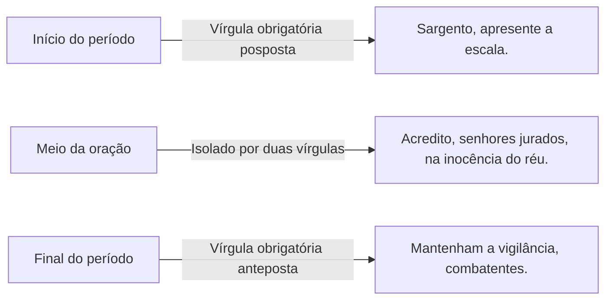
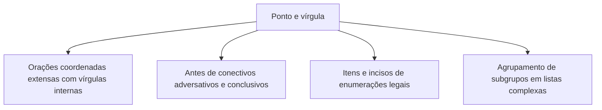

A pontuação compreende sinais de pausas relativas e recursos de estruturação enunciativa que ultrapassam o emprego básico da vírgula. O domínio do vocativo, das omissões elípticas, do ponto e vírgula, dos dois-pontos e das reticências é indispensável para interpretar textos densos e pontuar com exatidão no padrão culto.

Neste capítulo, estudaremos o isolamento obrigatório do vocativo e sua distinção em relação ao aposto explicativo. Em seguida, veremos como a vírgula vicária atua nas figuras de linguagem de omissão, como a elipse e o zeugma. Na sequência, examinaremos a disciplina normativa do ponto e vírgula e a articulação de enunciados pelos dois-pontos. Por fim, analisaremos as funções expressivas e textuais das reticências.

> [!objetivos]
> - Isolar o vocativo em qualquer posição da oração e diferenciá-lo categoricamente do sujeito e do aposto explicativo.
> - Identificar as figuras de sintaxe de omissão (elipse e zeugma) e aplicar corretamente a vírgula vicária.
> - Empregar o ponto e vírgula na coordenação de orações extensas, em enumerações com subdivisões internas e antes de conectivos.
> - Utilizar os dois-pontos para introduzir explicações, orações apositivas, discursos diretos e enumerações, além de reconhecer o papel das reticências.

## O isolamento obrigatório do vocativo

O **vocativo** é o termo independente da oração que expressa um chamamento, uma interpelação ou uma invocação direta ao interlocutor real ou imaginário. Por não manter vínculo sintático com o sujeito nem com o predicado, o vocativo deve vir **obrigatoriamente isolado por vírgulas** (ou ponto de exclamação, quando no início enfático de um período).

A posição do vocativo na frase é móvel, podendo surgir no início, no meio ou no encerramento da oração:
- Posição inicial: *Capitão*, o plano de evacuação foi aprovado pelo comando.
- Posição inicial no trato cotidiano: *Seu Raimundo*, sua experiência enriquece o trabalho comunitário do bairro.
- Posição intercalada: Informamos a todos, *senhores cidadãos*, que a defesa civil está atuando no local.
- Posição final: Apresentem os relatórios de vistoria técnica, *colegas de equipe*.



A distinção entre vocativo e **sujeito** constitui uma armadilha frequente em provas. O vocativo é a pessoa com quem se fala (segunda pessoa do discurso), ao passo que o sujeito é o ser sobre o qual se faz uma declaração verbal. A simples colocação de uma vírgula transforma a função sintática e a flexão verbal:
- Frase 1 (com vocativo): Felipe, apresente as novas diretrizes ao batalhão. (Imperativo dirigido ao ouvinte "Felipe").
- Frase 2 (com sujeito): Felipe apresenta as novas diretrizes ao batalhão. (Declaração no presente do indicativo com o sujeito "Felipe").

> [!atencao] Vocativo nunca exerce função de sujeito
> O vocativo jamais desempenha o papel de sujeito da oração. Ele é um termo acessório independente. Na frase "Militares, avancem com cautela", o termo "Militares" é vocativo; o sujeito da forma verbal "avancem" é elíptico ("vocês").

Outro confronto frequente envolve o vocativo e o **aposto explicativo**. O aposto esclarece um substantivo precedente na terceira pessoa, enquanto o vocativo interpela o destinatário da mensagem. Compare:
- Frase com vocativo: "Patrícia, entregue a pauta da reunião ao comitê de imprensa."
- Frase com aposto: "A jornalista Patrícia, comunicadora experiente, entregou a pauta da reunião."

A tabela a seguir contrasta o vocativo com o sujeito e o aposto explicativo em termos estruturais e funcionais.

| Estrutura sintática | Função discursiva | Relação com a oração | Exemplo na norma padrão |
| --- | --- | --- | --- |
| Vocativo | Interpela ou chama o interlocutor diretamente. | Termo independente; sem ligação com o verbo. | Tenente Marcos, verifique a pressão da rede de água. |
| Sujeito determinado | Ser de quem se declara algo na oração. | Termo essencial; concorda com o verbo. | O tenente Marcos verificou a pressão da rede de água. |
| Aposto explicativo | Esclarece ou qualifica um substantivo anterior. | Termo acessório; refere-se a um núcleo nominal. | Marcos, o tenente do batalhão, verificou a pressão da água. |

Em enunciados de redação oficial e correspondências militares, o vocativo antecede o corpo da comunicação, vindo seguido de vírgula na tradição moderna: "Senhor Secretário,", "Prezado Oficial,".

## Figuras de omissão e a vírgula vicária: elipse e zeugma

A língua portuguesa utiliza recursos estilísticos e de economia linguística baseados na supressão de termos que o contexto permite recuperar. No âmbito das **figuras de linguagem de construção** (edital geral:3), destacam-se duas modalidades fundamentais de omissão: a **elipse** e o **zeugma**.

A **elipse** consiste na omissão de um termo que não foi formalmente enunciado no período, mas cuja presença é facilmente inferida pela situação discursiva, pelo contexto semântico ou pelas desinências gramaticais:
- No quartel, silêncio absoluto. (Omissão do verbo "havia" ou "reinava").
- Eu nasci no sertão, mas cresci na capital; no serviço militar, apenas cumpro o que as leis mandam. (Omissão de sujeitos pronominais recuperados pelas desinências).
- Na casa de mamãe, comida *caseira*, *cereais*, *legumes* frescos e cuidado com os *afazeres* *domésticos*; na rotina de *solteiro*, contas deixadas embaixo da porta e pouca atenção à lida *doméstica*. (Omissão de "havia").
- Aos amigos, lealdade incondicional; aos *inimigos*, o rigor da lei. (Omissão da forma verbal "dedicamos" ou "oferecemos").

O **zeugma**, por sua vez, é uma espécie particular de elipse. Ele se caracteriza pela omissão de uma palavra ou expressão que **já foi expressamente citada** em uma oração anterior dentro do mesmo período:
- O primeiro grupo produziu compostos voláteis; o segundo, substâncias sólidas. (Omissão do verbo "produziu", já expresso na primeira oração).
- O pai foi lavrador *pobre* no interior; o filho, oficial respeitado na capital. (Omissão do verbo "foi").
- Durante a semana, *viajei* a serviço e *ficava* no alojamento; no domingo de descanso, preferia ir ao *teatro*, *jogar* *xadrez* ou comparecer a *festas* familiares antes da balada noturna. (Omissão de verbo de ação).

Quando a elipse ou o zeugma envolve a supressão de uma forma verbal, a pontuação culta recorre à chamada **vírgula vicária** (ou vírgula de zeugma). Esse sinal substitui o verbo omitido, demarcando a elipse verbal para garantir clareza e ritmo ao período.

> [!bizu] A vírgula vicária e o zeugma
> A palavra "vicário" significa aquilo que substitui algo ou ocupa o lugar de outrem. A vírgula vicária é aquela empregada especificamente para indicar a omissão de um verbo já enunciado anteriormente na frase:
> - O sargento comandava o resgate; o cabo, a triagem dos feridos.
> A vírgula após "o cabo" substitui o verbo "comandava" e classifica-se como vírgula vicária.

Observe outro exemplo de zeugma em construções paralelas: na escala do quartel, a primeira companhia assumia o turno diurno e, nos fins de semana, o plantão noturno. A vírgula após "semana" assinala o zeugma do verbo "assumia", evitando a repetição da mesma forma verbal.

A tabela a seguir sistematiza as diferenças entre as figuras de omissão e o papel da pontuação.

| Figura de linguagem | Definição gramatical | Menção prévia do termo | Emprego da vírgula vicária | Exemplo demonstrativo |
| --- | --- | --- | --- | --- |
| Elipse | Omissão de termo subentendido pelo contexto. | Não mencionado formalmente no período. | Opcional ou recomendável para marcar verbo implícito. | Na casa materna, roupa lavada; na minha, despesas acumuladas. |
| Zeugma | Omissão de termo já enunciado anteriormente. | Mencionada de forma expressa no próprio texto. | Padrão formal para marcar o verbo reiterado. | Os veteranos buscavam reconhecimento; os novatos, aprendizado. |
| Coexistência de regras | Combinação de coordenação e omissão verbal. | Verbo expresso na oração inicial da série. | Vírgula comum coordena orações; vicária marca o verbo. | O pai era militar, o filho, médico, o neto, engenheiro. |

Em enunciados com várias orações coordenadas contíguas, podem coexistir vírgulas com funções distintas. Na frase "O pai era militar, o filho, médico, o neto, engenheiro", as vírgulas após "militar" e "médico" separam as orações coordenadas entre si, ao passo que as vírgulas após "filho" e "neto" exercem função vicária, marcando o verbo de ligação omitido ("era"). Esse mecanismo também se harmoniza com as garantias do art. 6º da Constituição ao estruturar direitos sociais sucessivos.

## O emprego do ponto e vírgula

O **ponto e vírgula** (;) representa uma pausa de intensidade intermediária: é mais enfática do que a vírgula e menos conclusiva do que o ponto final. Sua principal finalidade reside na organização visual e sintática de períodos complexos, evitando que o acúmulo de vírgulas confunda as relações de coordenação.

O ponto e vírgula cumpre três funções normativas basilares na língua escrita culta:

1. **Separar orações coordenadas de certa extensão que já possuem vírgulas internas**: quando uma oração coordenada já contém termos deslocados, apostos ou orações adverbiais entre vírgulas, utiliza-se o ponto e vírgula para delimitar o término de um bloco oracional autônomo e o início de outro.
2. **Separar itens em séries enumerativas e textos normativos**: é o sinal padronizado pela técnica legislativa para encerrar incisos, alíneas e parágrafos de diplomas legais (como no art. 7º da Constituição Federal de 1988), bem como em listas técnicas complexas.
3. **Anteceder conjunções adversativas e conclusivas em períodos coordenados**: substitui a vírgula antes de conectivos como "porém", "contudo", "todavia", "portanto", "por isso", conferindo maior peso pausativo ao contraste ou à dedução.



Veja a aplicação antes de conectivos:
- O réu foi condenado penalmente pelo colegiado militar; *portanto* perdeu o cargo e as prerrogativas funcionais.
- O plano operacional continha falhas evidentes; *contudo* a dedicação da tropa garantiu o salvamento.

Após o ponto e vírgula, a oração seguinte inicia-se com letra minúscula (salvo se a primeira palavra for substantivo próprio). Se a conjunção vier logo após o ponto e vírgula, o uso de vírgula imediatamente posterior ao conectivo é facultativo: "foi condenado; portanto(,) perdeu o cargo".

O ponto e vírgula também organiza **subgrupos e pares** dentro de uma enumeração abrangente:
- O oficial recebia diárias para custeio de viagens; os sargentos, indenizações regulares de transporte.
- Os atacantes titulares treinavam finalizações a gol; os defensores, jogadas aéreas defensivas.
- Foram escaladas duas duplas de vistoria e um supervisor: tenente Moura, cabo Farias; subtenente Lira, soldado Ramos; capitão Nogueira, coordenador da operação. (O ponto e vírgula delimita cada subgrupo da lista).

> [!pegadinha] Ponto e vírgula não separa orações subordinadas
> O ponto e vírgula é um pontuador de coordenação. Ele opera exclusivamente entre elementos de mesma hierarquia funcional ou orações independentes. É proibido usar ponto e vírgula para separar uma oração subordinada da oração principal:
> - Incorreto: Conforme a escuridão caía sobre a serra; o temporal tornava-se ruidoso.
> - Correto: Conforme a escuridão caía sobre a serra, o temporal tornava-se ruidoso.
> Por se tratar de oração subordinada adverbial proporcional anteposta, a pontuação cabível é unicamente a vírgula obrigatória.

## O emprego dos dois-pontos

O sinal de **dois-pontos** (:) possui natureza eminentemente prospectiva. Ele anuncia ao leitor que o segmento subsequente trará uma explicação, um detalhamento, uma citação textual, uma síntese ou uma discriminação daquilo que acabou de ser enunciado.

As principais hipóteses normativas de emprego dos dois-pontos compreendem:

1. **Introduzir oração de caráter explicativo ou causal**: liga duas orações coordenadas, estabelecendo vínculo equivalente a conectivos causais ou explicativos ("pois", "porque", "visto que", "já que"):
   - A operação foi suspensa ao anoitecer: a forte *tempestade* impedia a visibilidade na serra e *fechava* as estradas (= pois a tempestade impedia).
   - O atleta realizou exercícios *físicos* intensos: desejava liberar endorfina e superar suas marcas na pista.
   - A forma como enxergamos a preservação ambiental define o futuro das cidades: a poluição por plástico e o *vazamento* de resíduos ameaçam ecossistemas e poluem os rios urbanos.
2. **Introduzir oração subordinada substantiva apositiva**: funciona como um aposto em formato de oração completa, esclarecendo um substantivo abstrato antecedente:
   - A rotina exigia renúncias diárias em prol de uma arte paciente: a culinária tradicional regional, que não se entrega como simples *mercadoria*.
   - A tese sociológica analisava duas *proposições* e *afirmações* sobre os *casais* contemporâneos e partia de uma *proposição* *falsa*: a de que a vida conjugal sobreviveria por *milagre*, sem *privacidade* e sem diálogo constante.
3. **Introduzir discurso direto ou citação literal**: com verbos de elocução (dizer, perguntar, responder, ordenar), os dois-pontos preparam a reprodução textual da fala alheia, habitualmente entre aspas ou travessão:
   - O comandante advertiu a tropa: "A disciplina é o alicerce de nossas vitórias".
4. **Introduzir enumerações e apostos distributivos**: discrimina os componentes de um conjunto citado no período:
   - A corporação adquiriu três novos itens: capacetes com viseira, luvas térmicas e botas antiderrapantes.

A tabela seguinte ilustra os usos dos dois-pontos e suas possibilidades de alternância com outros sinais de pontuação.

| Emprego dos dois-pontos | Função sintática associada | Sinais ou termos substitutos | Exemplo demonstrativo |
| --- | --- | --- | --- |
| Explicação / causa | Liga orações com valor de esclarecimento. | Vírgula + conjunção ("pois", "visto que") | É hora de agir: o prazo final aproxima-se rapidamente. |
| Oração apositiva | Esclarece substantivo abstrato da oração principal. | Travessão ou vírgula simples | Ele tinha uma meta inegociável: ser aprovado no certame. |
| Discurso direto | Abre a transcrição da fala literal de alguém. | Travessão em parágrafo seguinte | O oficial indagou: "Quem estava de guarda no paiol?". |
| Enumeração / aposto | Discrimina itens de um todo previamente citado. | Travessão simples | Conheci duas capitais nordestinas: Recife e Fortaleza. |

> [!exemplo] Dois-pontos explicativos e a substituição por conjunção
> Em itens típicos de prova, é comum verificar qual conectivo oracional tem a propriedade de substituir os dois-pontos mantendo o sentido primitivo:
> - "Eu tive uma grande vantagem na carreira: aprendi a superar frustrações desde cedo."
> Como o segmento posterior explica em que consistiu a vantagem, os dois-pontos podem ser substituídos por vírgula acompanhada da conjunção explicativa "pois" ou da locução "visto que" ("..., pois aprendi a superar..."). Conectivos adversativos ("mas") ou conclusivos ("portanto") alterariam o sentido.

> [!pegadinha] Dois-pontos de discurso direto versus aposto
> Não confunda a citação literal com o aposto introduzido por dois-pontos:
> - Citação: O delegado indagou: "Onde o veículo foi abandonado?". (Verbo de dizer exigindo discurso direto).
> - Aposto explicativo: A análise partia de uma premissa clara: a de que a segurança pública depende da integração entre polícia e bombeiros. (Dois-pontos introduzindo esclarecimento da premissa, sem fala de personagem).

## O emprego das reticências

O sinal de **reticências** (...) caracteriza-se pela suspensão voluntária do fluxo sintático ou melódico da frase. Ele indica que o pensamento não foi inteiramente completado, deixando ao interlocutor a tarefa de intuir a continuidade ou conferindo ao enunciado uma atmosfera de hesitação, suspense, ironia ou comoção.

Os principais empregos das reticências na língua padrão são:

1. **Interrupção de pensamento ou frase inacabada**: o falante suspende a declaração antes de expressar a ideia final:
   - Planejamos todas as etapas do resgate, envidamos os maiores esforços, mas...
   - Eu usei todos os argumentos possíveis para convencê-lo, porém...
2. **Hesitação, dúvida ou timidez discursiva**: o discurso é entrecortado por pausas sucessivas que revelam incerteza:
   - Eu pretendia... na verdade... enfim, prefiro não comentar sobre o ocorrido.
3. **Prolongamento expressivo do som ou da ideia**: sugere persistência temporal ou eco de sentimentos no texto literário:
   - E a chuva continuava caindo sobre as ruínas...
4. **Indicação de supressão textual (entre parênteses ou colchetes)**: na citação acadêmica ou documental, as reticências encapsuladas `(...)` indicam a omissão intencional de trechos do texto original que não interessam à argumentação:
   - "A segurança pública, dever do Estado (...), é exercida para a preservação da ordem pública e da incolumidade das pessoas e do patrimônio."

> [!atencao] Reticências e supressão de texto citado
> Em redações e análises documentais, o emprego de reticências soltas sem parênteses no meio de uma citação literal pode sugerir hesitação do autor citado. Para indicar tecnicamente que uma frase ou parágrafo foi suprimido, a norma da ABNT exige que as reticências venham entre parênteses `(...)` ou entre colchetes `[...]`.

Após as reticências, a palavra seguinte inicia-se com letra minúscula se a frase der continuidade ao período suspenso. Se as reticências encerrarem uma oração completa, a frase seguinte iniciará com letra maiúscula.

## Mapa do capítulo

```mermaid Escolha de pontuação: vocativo, omissões e sinais intermediários
flowchart TD
  A{Qual é a função do termo ou segmento?}
  A -- Chamamento direto ao interlocutor --> B[Vocativo: sempre isolado por vírgula]
  A -- Omissão de verbo já expresso --> C[Zeugma: marcado por vírgula vicária]
  A -- Enumeração com vírgulas internas ou incisos --> D[Ponto e vírgula]
  A -- Esclarecimento, citação ou fala direta --> E[Dois-pontos]
  A -- Ideia inacabada ou hesitação --> F[Reticências]
```

A tabela seguinte sistematiza as regras e sinais de pontuação examinados no capítulo, oferecendo um guia rápido de aplicação prática.

| Sinal de pontuação | Função sintática central | Regra de aplicação em prova |
| --- | --- | --- |
| Vírgula com vocativo | Isolar a interpelação direta ao interlocutor. | Obrigatória em qualquer posição; vocativo nunca é sujeito. |
| Vírgula vicária | Marcar a elipse ou zeugma de um verbo. | Substitui a forma verbal omitida para evitar repetição. |
| Ponto e vírgula | Pausa média entre orações coordenadas autônomas. | Usado antes de adversativas/conclusivas e em incisos de leis. |
| Ponto e vírgula (proibição) | Não pode ser empregado entre orações subordinadas. | Separar oração subordinada da principal com (;) é erro. |
| Dois-pontos explicativos | Introduzir esclarecimento ou causa do segmento anterior. | Podem ser substituídos por vírgula + "pois" ou "visto que". |
| Dois-pontos de discurso | Introduzir a reprodução textual da fala alheia. | Precedem a citação literal com aspas ou travessão. |
| Reticências expressivas | Indicar corte de raciocínio, hesitação ou suspense. | Suspendem a oração inacabada; entre parênteses marcam supressão. |

### Para fixar

- O vocativo é um termo independente de chamamento e deve vir sempre isolado por vírgulas, em qualquer posição da frase.
- O vocativo não se confunde com o sujeito: o sujeito concorda com o verbo e não é isolado por vírgula em relação ao predicado.
- A elipse consiste na omissão de um termo inferido pelo contexto, ao passo que o zeugma é a omissão de uma palavra já expressa.
- A vírgula vicária é o sinal empregado formalmente para indicar a elipse de um verbo omitido no período.
- O ponto e vírgula assinala uma pausa intermediária entre a vírgula e o ponto final, operando na coordenação de orações.
- É cabível o ponto e vírgula antes de conjunções adversativas e conclusivas, bem como no encerramento de incisos legais.
- O ponto e vírgula jamais deve ser utilizado para separar orações subordinadas de sua oração principal.
- Os dois-pontos anunciam esclarecimento, aposto oracional, enumeração discriminada ou discurso direto de outrem.
- Quando possuem caráter explicativo, os dois-pontos podem ser substituídos por vírgula acompanhada de conjunção causal ou explicativa.
- As reticências marcam a suspensão intencional da ideia, a hesitação discursiva ou a supressão de trechos citados quando entre parênteses.
