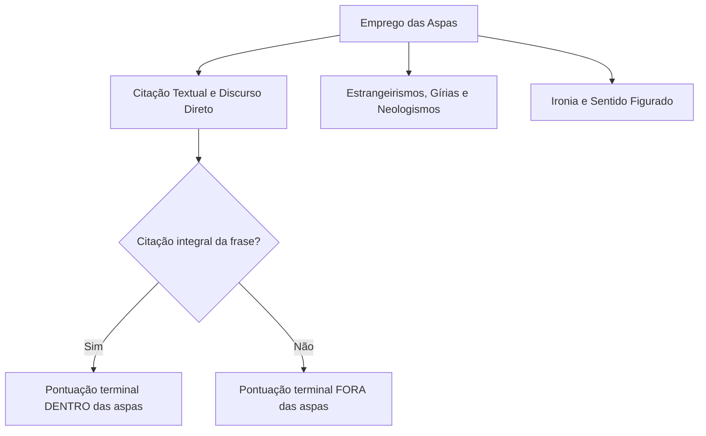
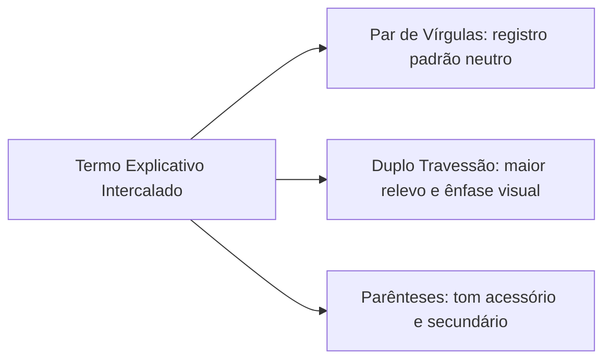
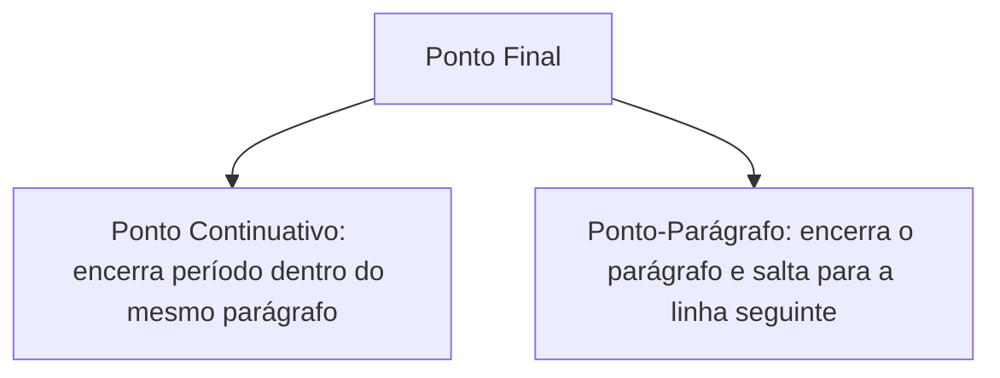
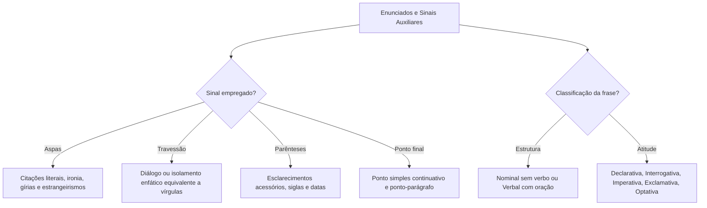

A compreensão integral da pontuação exige o domínio dos sinais complementares e terminais da língua escrita. Além da vírgula e do ponto e vírgula, a norma culta dispõe de recursos pontuativos de grande valor estilístico e semântico, como as aspas, o travessão, os parênteses e o ponto final. Cada um desses sinais desempenha funções sintáticas precisas na organização do período e na expressividade do discurso.

Neste capítulo, estudaremos as regras normativas de emprego das aspas em citações literais, estrangeirismos e efeitos de ironia. Em seguida, veremos como o travessão e os parênteses atuam no isolamento de termos acessórios e na alternância com as vírgulas. Na sequência, examinaremos a dinâmica do ponto final continuativo e do ponto-parágrafo. Por fim, classificaremos os tipos de frase quanto à sua estrutura sintática e à atitude comunicativa do falante.

> [!objetivos]
> - Aplicar as aspas em citações literais, discursos diretos, neologismos, estrangeirismos e expressões de valor irônico.
> - Empregar o travessão e os parênteses no isolamento de segmentos intercalados, reconhecendo as possibilidades de substituição mútua.
> - Compreender as funções do ponto continuativo e do ponto-parágrafo, evitando a fragmentação indevida de orações subordinadas.
> - Classificar os tipos de frase quanto à organização sintática (nominal e verbal) e quanto ao sentido (declarativa, interrogativa, imperativa, exclamativa e optativa).

## O emprego das aspas

As **aspas** (“ ”) são sinais gráficos duplos empregados para destacar palavras, expressões ou períodos inteiros no corpo do texto. Elas assinalam uma modulação na voz do autor ou uma ruptura com o registro neutro da narrativa.

As principais funções normativas das aspas compreendem:

1. **Citação textual e discurso direto**: indicam a reprodução literal das palavras pronunciadas ou escritas por outrem. É a transcrição exata do pensamento alheio:
   - Em relatório oficial, o capitão destacou: "As buscas foram mantidas em ritmo contínuo durante toda a noite".
   - Uma senhora nervosa a bordo da aeronave exclamou: "Nós precisamos descer imediatamente!".
2. **Estrangeirismos, neologismos, arcaísmos e gírias**: demarcam termos que não pertencem ao léxico vernáculo padrão ou que refletem uso coloquial:
   - Pressione a tecla "delete" para reiniciar o procedimento técnico.
   - O jovem tentou "causar" nas redes sociais com publicações polêmicas.
   - A linguagem informal de rua por vezes recorre a um palavrão entre aspas para expressar revolta momentânea.
3. **Ironia e sentido figurado**: sinalizam que o vocábulo foi utilizado com acepção especial, diversa do seu significado literal, sugerindo sarcasmo ou reserva crítica:
   - Os negociadores chegaram a um rápido "entendimento", embora os conflitos continuem nas ruas.
   - O suposto "especialista" em segurança cometeu equívocos primários na análise do laudo.

A combinação das aspas com os sinais terminais de pontuação exige atenção rigorosa às regras de posição gráfica.

> [!atencao] Pontuação com aspas: dentro ou fora?
> O posicionamento do ponto final em relação às aspas depende da extensão da citação:
> - **Ponto DENTRO das aspas**: quando a citação textual constitui um período gramatical completo e independente:
>   O instrutor advertiu: "A disciplina tática salva vidas no teatro de operações."
> - **Ponto FORA das aspas**: quando o trecho entre aspas integra uma oração do próprio autor, correspondendo a apenas parte do enunciado:
>   O comandante declarou que as decisões operacionais foram tomadas "com estrita observância das normas vigentes".

Na tipografia moderna, os estrangeirismos consolidados costumam ser grafados em *itálico*, reservando-se as aspas para a citação direta e a marcação de ironia.

## O emprego do travessão

O **travessão** (—) é um traço horizontal mais longo do que o hífen e a meia-risca. Ele cumpre funções comunicativas centrais tanto na reprodução de diálogos quanto na estruturação sintática do período composto.

Na norma padrão, o travessão atua em duas frentes fundamentais:

1. **Indicar a mudança de interlocutor em diálogos**: marca o início da fala direta de uma personagem ou separa a réplica do comentário do narrador:
   - — Sargento, qual é a previsão para a conclusão do isolamento perimétrico?
   - — Concluiremos em trinta minutos, capitão — respondeu o graduado com firmeza.
2. **Isolar termos ou orações intercaladas de caráter explicativo ou enfático**: funciona como alternativa elegante ao par de vírgulas ou aos parênteses, conferindo maior destaque visual ao segmento:
   - Aquele armamento antigo — se é que merece tal classificação — apresentava falhas no mecanismo.
   - A obesidade infantil — problema que afeta diversas faixas de idades no país — exige reeducação alimentar preventiva.

O emprego do travessão duplo para isolar apostos e orações interferentes é amplamente intercambiável com o par de vírgulas. Em uma frase como "O antigo regimento interno — documento redigido no século passado, que deixou aos comandantes instruções detalhadas sobre a rotina dos quartéis para tornar o serviço padronizado — permanece no acervo histórico", o aposto extenso pode ser isolado tanto por travessões duplos quanto por vírgulas, sem prejuízo sintático.

A tabela a seguir confronta o comportamento do travessão em relação ao par de vírgulas e aos parênteses.

| Sinal de pontuação | Grau de destaque discursivo | Equivalência funcional | Exemplo prático |
| --- | --- | --- | --- |
| Par de vírgulas | Destaque moderado e neutro. | Padrão sintático geral. | O tenente, que era experiente, assumiu o posto. |
| Duplo travessão | Destaque enfático e expressivo. | Substituto das vírgulas para realce. | O tenente — que era experiente — assumiu o posto. |
| Parênteses | Tom acessório e complementar. | Reduz o relevo do termo intercalado. | O tenente (que era experiente) assumiu o posto. |

> [!pegadinha] Vírgula imediata após o travessão de fechamento
> Quando um segmento delimitado por travessões encerra-se em um ponto do período que já exigiria vírgula por regra própria, essa vírgula deve ser colocada **logo após o segundo travessão**:
> - Frase analisada: "Minha filha — amor de minha vida —, não tema os desafios da carreira militar."
> A vírgula após o travessão é indispensável para isolar o vocativo "Minha filha". Para verificar a correção, retire mentalmente o termo entre travessões: "Minha filha, não tema os desafios...". A vírgula permanece necessária.

O travessão simples também pode introduzir esclarecimentos conclusivos em substituição ao sinal de dois-pontos:
- A corporação persegue um ideal supremo — garantir a paz social.

## O emprego dos parênteses

Os **parênteses** ( ) têm a função de segregar no texto uma informação acessória, um esclarecimento circunstancial, uma reflexão lateral ou uma indicação documental. Eles indicam que o leitor pode ler a frase principal sem interrupção conceitual, tomando a informação encapsulada como subsídio secundário.

Os principais casos de uso dos parênteses incluem:

1. **Inserção de explicações e dados acessórios**:
   - A Academia de Polícia Militar (situada no bairro do Paissandu) realizou solenidade festiva.
   - Os novos soldados foram designados para o batalhão central (antiga sede administrativa).
2. **Indicações bibliográficas, citações de leis e siglas**:
   - Conforme prescreve o Código Penal Militar (Decreto-Lei 1.001/1969), o superior deve zelar pela disciplina.
   - A comissão foi instituída pela Secretaria de Defesa Social (SDS).
3. **Indicação de estados emotivos ou rubricas de teatro**:
   - O réu permaneceu em silêncio (aparentando profunda serenidade) durante a oitiva.

Quanto à pontuação externa, os parênteses não anulam a pontuação ordinária da oração. Se a frase em que se inserem demandar vírgula ou ponto, o sinal de pontuação deve ser colocado **após o parêntese de fechamento**:
- Quando o alerta soou (por volta das três horas da manhã), as equipes deixaram o alojamento.

## O ponto final: ponto continuativo e ponto-parágrafo

O **ponto final** (.) indica a conclusão de um período sintático estruturado sob a forma declarativa. Ele representa a pausa mais extensa da entoação gramatical, assinalando que a unidade de sentido oracional foi plenamente formulada.

A contagem do número de períodos de um texto é realizada primordialmente pela contagem dos pontos terminais (ponto final, de interrogação e de exclamação). O ponto final divide-se formalmente em duas modalidades funcionais:

1. **Ponto simples (ou continuativo)**: encerra uma oração ou período composto, prosseguindo-se o texto na mesma linha com inicial maiúscula. Conecta raciocínios articulados dentro do mesmo parágrafo temático:
   - A disciplina assegura a eficácia das tropas. Sem planejamento logístico, contudo, as operações fracassam.
2. **Ponto-parágrafo**: encerra o último período de um bloco temático maior, havendo salto de linha e recuo de margem para o início de um novo parágrafo. Marca a transição entre etapas da argumentação.

Um dos problemas recorrentes em redações para concursos é a criação de **fragmentos oracionais** por emprego indevido de ponto final. Uma oração subordinada não pode ser separada da oração principal por ponto final, pois não possui autonomia semântica.

> [!exemplo] Ponto final indevido gerando fragmento de oração subordinada
> - Incorreto (fragmento): Os policiais adquiriram coletes modernos. Que custaram caro ao erário estadual.
> - Correto: Os policiais adquiriram coletes modernos, que custaram caro ao erário estadual.
> A oração adjetiva explicativa ("que custaram caro...") não pode abrir período autônomo após ponto final.

Outra armadilha envolve a substituição do pronome demonstrativo "Isso" pela locução relativa "o que":
- Período original: O hiperconsumismo desenfreado impulsionou o descarte contínuo de recursos naturais finitos. Isso tem transformado negativamente o planeta.
- Se o redator substituir "Isso" por "O que", o ponto final deve virar **vírgula**:
  "O modelo de consumo voraz impulsionou a exaustão de bens naturais finitos, o que tem afetado nocivamente o ecossistema e ameaçado o equilíbrio ecológico."
- Eu durmo pouco durante o plantão, o que atrapalha meu repouso diurno.

> [!atencao] Ponto-parágrafo versus ponto continuativo
> O ponto-parágrafo não se diferencia do ponto simples pela sua forma gráfica, mas pela sua função textual. O ponto simples conclui um período mantendo o fluxo do parágrafo; o ponto-parágrafo conclui uma unidade temática, exigindo nova linha e novo parágrafo.

## Tipos de frase

A **frase** é todo enunciado linguístico de sentido completo capaz de estabelecer comunicação eficiente entre os indivíduos. Ela se inicia após uma pausa, encerra-se com ponto terminal e possui entoação e melodia próprias.

A divisão das frases orienta-se por duas vertentes analíticas: sob a ótica da **organização morfossintática** e sob o enfoque da **intenção discursiva do enunciador**.

### Classificação quanto à organização morfossintática

1. **Frase nominal (inarticulada)**: não possui verbo em sua composição. Estrutura-se em torno de um substantivo ou nome, apoiando-se fortemente na situação discursiva e no contexto imediato:
   - "Fogo!"
   - "Silêncio no auditório!"
   - "Socorro!"
   - "Perigo de morte na rodovia."
   - "Que calor intenso!"
2. **Frase verbal (articulada ou oração)**: estrutura-se em torno de um verbo ou de uma locução verbal. Apresenta elaboração sintática completa, bipartindo-se normalmente em sujeito e predicado:
   - O pelotão desfilou pela avenida central do Recife.
   - As viaturas estão prontas para o atendimento emergencial.

### Classificação quanto ao sentido e atitude do falante

A atitude do emissor perante o conteúdo transmitido define os cinco tipos fundamentais de frase:

1. **Frase declarativa**: veicula uma constatação, um juízo de valor ou a exposição objetiva de um fato. Possui entoação descendente e termina graficamente em ponto final ou reticências. Subdivide-se em:
   - **Afirmativa**: expõe o conteúdo sem palavras de negação ("O efetivo do corpo de bombeiros realizou o resgate").
   - **Negativa**: contém advérbio ou expressão negativa ("O suspeito não apresentou resistência à prisão").
2. **Frase interrogativa**: manifesta um questionamento do falante, dividindo-se em:
   - **Interrogativa direta**: formula pergunta explícita, apresenta entoação ascendente e termina com ponto de interrogação ("Onde o incêndio teve início?").
   - **Interrogativa indireta**: encaixa a indagação em período composto após verbos de questionamento (saber, indagar, perguntar). Possui entoação descendente e termina em **ponto final** ("Desejo saber onde o incêndio teve início").
3. **Frase imperativa**: exprime ordem, mandamento, conselho, proibição ou súplica. Emprega verbo no modo imperativo e encerra-se com ponto final ou ponto de exclamação ("Evacuem o edifício imediatamente!"; "Mantenham a calma.").
4. **Frase exclamativa**: traduz fortes emoções, surpresa, espanto ou admiração. Apresenta entoação descendente com pico enfático e termina graficamente em ponto de exclamação ("Como foi rápida a chegada do socorro!"; "Que coragem admirável!").
5. **Frase optativa**: exprime um desejo sincero, uma bênção ou aspiração. Utiliza comumente o verbo no modo subjuntivo e termina com ponto de exclamação ou ponto final ("Bons ventos o conduzam em sua nova missão!"; "Que tudo ocorra em paz!").

> [!pegadinha] Declarativa e afirmativa não estão no mesmo nível hierárquico
> As bancas examinadoras exploram frequentemente a confusão conceitual entre frase declarativa e afirmativa. A frase declarativa é uma categoria ampla quanto ao sentido. A frase afirmativa é apenas uma subespécie da declarativa (em oposição à declarativa negativa). Portanto, classificar uma oração afirmativa como "frase declarativa" está plenamente correto na análise morfossintática.

> [!bizu] A interrogativa indireta termina com ponto final
> Em questões de prova, fique atento à pontuação das perguntas indiretas. Frases como "Gostaria de saber quando sairá o edital." terminam obrigatoriamente em **ponto final**, e não em ponto de interrogação. Além disso, o conectivo "quando" ou "por que" permanece sem acento por não estar em posição final absoluta.

A tabela a seguir consolida as classificações de frase sob a perspectiva discursiva.

| Tipo de frase quanto ao sentido | Atitude comunicativa | Pontuação gráfica usual | Exemplo demonstrativo |
| --- | --- | --- | --- |
| Declarativa afirmativa | Afirma um fato ou juízo sem negação. | Ponto final (.) | A patrulha inspecionou as imediações da represa. |
| Declarativa negativa | Nega um fato por meio de termo negativo. | Ponto final (.) | O motorista não havia consumido bebidas alcoólicas. |
| Interrogativa direta | Pergunta explícita com entoação ascendente. | Ponto de interrogação (?) | Quando terá início a solenidade de formatura? |
| Interrogativa indireta | Pergunta encaixada em oração completiva. | Ponto final (.) | Perguntei quando teria início a formatura militar. |
| Imperativa | Ordem, mandamento, conselho ou apelo. | Exclamação (!) ou ponto (.) | Fechem as comportas de segurança agora! |
| Exclamativa | Expressa emoção viva, admiração ou espanto. | Ponto de exclamação (!) | Quanta bravura demonstraram os socorristas! |
| Optativa | Exprime desejo ou aspiração formal. | Exclamação (!) ou ponto (.) | Deus ilumine seus caminhos nesta caminhada! |

## Mapa do capítulo

A tabela seguinte sintetiza os usos normativos dos sinais auxiliares e dos tipos de frase.

| Elemento estudado | Regra central de pontuação | Ponto crítico em questões de prova |
| --- | --- | --- |
| Aspas em citações integrais | O ponto final fica dentro das aspas. | Citações fragmentárias levam o ponto fora das aspas. |
| Travessão em intercalações | Substitui o par de vírgulas com maior ênfase. | Outros sinais (como vírgula) após travessão seguem regra própria. |
| Parênteses | Isolam esclarecimentos puramente acessórios. | Não eliminam a pontuação natural do período envolvente. |
| Ponto continuativo | Conclui período mantendo o fluxo do parágrafo. | Não pode separar orações subordinadas da oração principal. |
| Ponto-parágrafo | Conclui unidade temática com salto de linha. | Marca a mudança de estágio argumentativo do texto. |
| Frase nominal | Sentido completo sem estrutura verbal ("Fogo!"). | Característica marcante de chamados e advertências breves. |
| Interrogativa indireta | Pergunta subordinada com ponto final. | Não aceita ponto de interrogação na modalidade indireta. |
| Declarativa afirmativa | Subdivisão da declarativa ao lado da negativa. | Declarativa e afirmativa não são categorias excludentes. |

### Para fixar

- As aspas isolam citações literais, palavras estrangeiras, neologismos, gírias e vocábulos empregados com sentido irônico.
- Na citação de frase completa e autônoma, o ponto final fica dentro das aspas; na citação de segmento parcial, o ponto fica fora.
- O travessão marca a mudança de interlocutor em diálogos e isola termos intercalados com maior realce visual que as vírgulas.
- A vírgula posicionada logo após o segundo travessão é lícita quando exigida pela estrutura sintática externa do período.
- Os parênteses isolam explicações acessórias, siglas e indicações bibliográficas, sem cancelar a pontuação exigida pela frase.
- O ponto simples (continuativo) encerra o período na mesma linha; o ponto-parágrafo encerra o bloco temático saltando para o parágrafo seguinte.
- O ponto final não deve separar orações subordinadas da principal, sob pena de gerar fragmentos textuais incorretos.
- Frase nominal possui sentido completo e não tem verbo; frase verbal estrutura-se em torno de um verbo ou locução.
- As frases quanto ao sentido classificam-se em declarativas (afirmativas ou negativas), interrogativas, imperativas, exclamativas e optativas.
- A frase interrogativa indireta formula indagação encaixada em período composto e encerra-se obrigatoriamente com ponto final.
