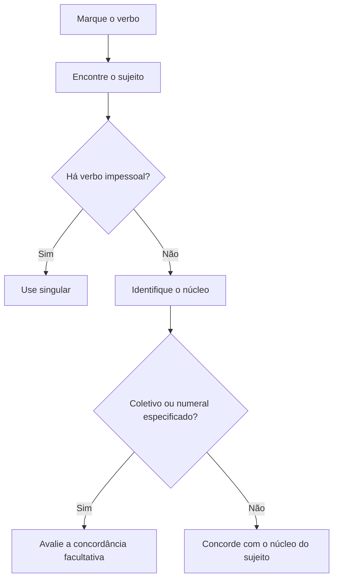

A concordância verbal exige que o verbo se ajuste ao sujeito em pessoa e número. Em prova, o desafio raramente está na frase curta; aparece quando o núcleo fica distante do verbo ou quando um substantivo próximo tenta atrair a flexão. Este capítulo ensina a localizar o sujeito antes de escolher a forma verbal e reúne os casos com coletivos, numerais, ter e vir, haver e existir. Essas regras servem de base para as estruturas mais complexas dos próximos capítulos.

> [!objetivos]
> - Identificar o sujeito e seu núcleo, mesmo com termos intercalados.
> - Distinguir sujeito simples, composto, oculto, indeterminado e oração sem sujeito.
> - Aplicar as concordâncias facultativas com coletivos, partitivos e numerais.
> - Diferenciar haver impessoal de existir e reconhecer as formas de ter e vir no plural.

## Como localizar o sujeito

Concordância é a correspondência de marcas gramaticais entre termos relacionados. Na concordância verbal, o verbo varia em pessoa (eu, tu, ele, nós, vós, eles) e número (singular ou plural) conforme o sujeito. Sujeito é o termo sobre o qual se declara algo; seu núcleo é a palavra central, normalmente um substantivo ou pronome. Adjunto adnominal é o termo que acompanha e especifica um nome, muitas vezes introduzido por preposição. O adjunto pode conter substantivo plural sem se tornar outro núcleo do sujeito.

Para analisar uma frase de ordem indireta, marque o verbo e pergunte “quem?” ou “o que?” pratica, sofre ou apresenta o fato. Depois retire mentalmente intercalações e localize o núcleo. A ordem direta — sujeito, verbo, complementos e circunstâncias — ajuda a conferir a relação. A concordância se estabelece com o sujeito sintático, não com o termo mais próximo nem necessariamente com quem age no mundo real.

Considere: “A rotina de inspeções, apesar das mudanças de turno, **exige** atenção”. Perguntamos: o que exige atenção? “A rotina de inspeções”. O núcleo é “rotina”; “de inspeções” especifica a rotina, e a intercalação não muda o singular. Já em “A vistoria e o treinamento **exigem** planejamento”, há dois núcleos coordenados, “vistoria” e “treinamento”; o sujeito é composto e o verbo vai ao plural.

| Tipo de sujeito | Como reconhecer | Exemplo próprio |
| --- | --- | --- |
| Simples | Um núcleo | A equipe de apoio chegou cedo. |
| Composto | Dois ou mais núcleos | A equipe e o motorista chegaram cedo. |
| Oculto ou desinencial | A terminação verbal permite recuperar o pronome | Revisamos o relatório (nós). |
| Indeterminado | Não se identifica o agente; verbo na 3.ª pessoa do plural ou construção com “se” | Chamaram no portão; trabalha-se muito aqui. |
| Oração sem sujeito | Verbo impessoal: sem sujeito gramatical | Há vagas; choveu durante a noite. |

> [!exemplo]
> Certo: “O registro das ocorrências e das providências **permanece** no sistema.” Núcleo: “registro”. Errado: “O registro das ocorrências e das providências **permanecem** no sistema.” Os termos depois de “de” completam a especificação do registro; não formam sujeito composto.

> [!pegadinha]
> A distância entre sujeito e verbo não altera a regra. Encontre o núcleo antes de flexionar. Em “Os relatórios, após conferência cuidadosa da equipe, **seguem** para a chefia”, o núcleo plural é “relatórios”; em “A conferência dos relatórios **segue** para a chefia”, o núcleo singular é “conferência”.

## Sujeito simples, composto e expressão resumitiva

Com sujeito simples, o verbo concorda com o núcleo. O núcleo pode estar cercado por complementos, adjuntos, orações adjetivas ou enumerações dependentes. Não confunda o núcleo de uma expressão nominal com os substantivos de uma locução preposicionada. “A necessidade de equipamentos, uniformes e veículos **aumentou**”: o sujeito é “a necessidade”, núcleo singular; “equipamentos”, “uniformes” e “veículos” completam o sentido de necessidade.

O sujeito composto tem mais de um núcleo, normalmente unidos por “e”, e em regra leva o verbo ao plural. “A comandante e o motorista **conferiram** a lista.” Se o sujeito vier depois do verbo, também se admite a ordem inversa: “**Chegaram** a comandante e o motorista.” A posição não transforma o sujeito composto em simples. Em estruturas com expressões de síntese como “tudo isso”, “nada”, “ninguém” ou “o conjunto”, a forma verbal acompanha o termo resumitivo: “A conferência, a assinatura e o envio, **tudo isso ocorreu** no mesmo turno.”

O termo resumitivo pode aparecer depois de uma enumeração e funcionar como núcleo singular. Para evitar a atração dos itens listados, isole a enumeração entre pausas e pergunte qual palavra retoma o conjunto. “A escala, o mapa e os avisos, **nada ficou** sem revisão.” A forma “ficaram” não concordaria com “nada”. Se a enumeração não for retomada por um resumo singular, use a regra própria do sujeito composto.

Há diferença entre um núcleo com determinantes e vários núcleos coordenados. Em “O comandante do posto e da unidade **aprovou** a escala”, há um único núcleo, “comandante”; os dois complementos apontam os lugares sob sua responsabilidade. Em “O comandante do posto e a chefe da unidade **aprovaram** a escala”, existem dois núcleos: “comandante” e “chefe”. Artigos, repetições de preposição e sentido ajudam a desfazer ambiguidades.

> [!bizu]
> Circule o núcleo, não todos os substantivos. A pergunta “quem/o que + verbo?” encontra o sujeito; a pergunta “qual é a palavra central do sujeito?” encontra o núcleo que comanda a concordância regular.

## Coletivos, partitivos e porcentagens

Expressões como “a maioria de”, “a metade de”, “parte de”, “um grupo de”, “a equipe de” e “um conjunto de” podem apresentar um núcleo coletivo ou partitivo seguido de um determinante. Determinante é o termo que delimita ou especifica o nome e, nessas expressões, costuma vir com “de”: “a maioria **dos candidatos**”. Como o determinante também contém um substantivo, a norma admite, em diversos casos, a concordância com o núcleo coletivo/partitivo (singular) ou com o nome especificador (plural). Essa concordância semântica dá destaque aos indivíduos do conjunto.

Assim, são possíveis “A maioria dos fiscais **chegou**” e “A maioria dos fiscais **chegaram**”. A primeira forma concorda com “maioria”; a segunda, com “fiscais”. Com coletivo sem especificador, permanece a regra do núcleo: “A equipe **chegou**”; se o próprio coletivo estiver no plural, o verbo acompanha: “As equipes **chegaram**”. Quando coletivo e determinante estão ambos no singular, a forma plural não encontra núcleo plural que a sustente: “A maioria do efetivo **compareceu**”.

| Construção | Concordância regular | Outra forma admitida |
| --- | --- | --- |
| A maioria dos agentes... | chegou | chegaram |
| A metade da carga... | foi conferida | — |
| Um grupo de voluntários... | iniciou | iniciaram |
| A equipe... | saiu | — |
| Os 30% dos inscritos... | foram chamados | — |

Com percentuais ou frações seguidos de nome especificador, pode-se concordar com a porcentagem/parte ou com o determinante, observando o número e o sentido. “Quarenta por cento dos convocados **compareceram**” salienta as pessoas; “Quarenta por cento da carga **foi** conferida” concorda com a expressão numérica ou com “carga”. Quando a expressão vem precedida de artigo ou pronome demonstrativo, como “os”, “esses” ou “aqueles”, o verbo acompanha esse determinante: “**Os** 30% dos inscritos **foram** chamados”. A forma “aqueles 30% foi” quebra a concordância.

As frações em geral levam o verbo ao número do numerador: “Um quinto dos equipamentos **foi** substituído”; “Dois quintos **foram** substituídos”. Em certas construções com numerador um e nome plural, encontra-se também a concordância com o nome especificador (“um terço dos presentes chegaram”). Como a escolha depende da análise e do uso registrado, em prova siga o contexto e evite declarar que uma variante é sempre impossível. Já com número decimal e unidade, a parte inteira abaixo de dois costuma ficar no singular: “1,7 milhão foi arrecadado”; a partir de dois, use plural: “2,3 milhões foram arrecadados”.

> [!pegadinha]
> Certo: “Aqueles 20% do orçamento **foram reservados**.” Errado: “Aqueles 20% do orçamento **foi reservado**.” O demonstrativo que determina a expressão numérica orienta a flexão; não escolha a forma apenas por proximidade com o substantivo singular “orçamento”.

## Milhão, bilhão e milhar

“Milhão”, “bilhão” e “milhar” são substantivos masculinos. Em “dois milhões de pessoas”, o numeral determina o substantivo “milhões”; por isso, os elementos ligados diretamente a esse núcleo ficam no masculino: “os milhares de pessoas”, “alguns milhões”. O nome que vem depois de “de” pode, no entanto, controlar o adjetivo ou particípio que se refere às pessoas: “Dois milhões de pessoas **foram atendidas**”. Quando o modificador pode ser entendido como referente ao grupo numérico ou aos indivíduos, a concordância pode refletir essa interpretação; reescreva para eliminar ambiguidade quando necessário.

Em números decimais, observe a parte inteira: “1,4 milhão de reais **foi** destinado” (parte inteira um) e “2,4 milhões de reais **foram** destinados” (parte inteira dois). Quando há determinante e a construção admite leitura dos componentes, aparecem duas concordâncias: “Um milhão de moradores **chegou** à praça” (milhão) e “Um milhão de moradores **chegaram** à praça” (moradores). Em provas, a flexão nominal deve respeitar o referente: “milhão” continua masculino mesmo que o conjunto seja composto por mulheres.

> [!exemplo]
> Um relatório do quartel registra “1,6 milhão de litros foi armazenado”. O verbo no singular acompanha “1,6 milhão”. Em “2,6 milhões de litros foram armazenados”, o numeral a partir de dois está no plural, assim como o verbo e o particípio. Se a frase disser “Os 1,6 milhão de litros foram armazenados”, o plural é puxado pelo artigo “os” que determina o grupo.

## Ter, vir e haver

Na terceira pessoa do plural, “ter” e “vir” recebem circunflexo: “eles **têm**”, “eles **vêm**”. Os derivados conservam a oposição gráfica: “mantém/mantêm”, “intervém/intervêm”, “contém/contêm”, “provém/provêm”. O acento distingue singular e plural, não é enfeite. Já “ver” apresenta “vê” no singular e “veem” no plural, sem acento no plural; “rever” segue o padrão: “revê/reveem”.

“Haver” com sentido de existir, ocorrer ou indicar tempo decorrido é impessoal: não possui sujeito e fica na terceira pessoa do singular. “Há documentos pendentes”; “Houve duas ocorrências”; “Há três meses não chove”. Na locução verbal, a impessoalidade alcança o auxiliar: “**Deve haver** documentos”, não “devem haver documentos”. “Existir”, “ocorrer” e “acontecer”, ao contrário, têm sujeito e concordam: “**Existem** documentos”; “**Ocorreram** duas ocorrências”. Para tempo decorrido, “fazer” também fica no singular: “**Faz** três meses”.

| Sentido | Forma verbal | Exemplo |
| --- | --- | --- |
| Haver = existir | Impessoal: singular | Há novas orientações no mural. |
| Haver = ocorrer | Impessoal: singular | Houve mudanças na escala. |
| Haver = tempo decorrido | Impessoal: singular | Há duas semanas não há expediente. |
| Existir / ocorrer | Verbo pessoal: concorda | Existem orientações; ocorreram mudanças. |
| Fazer = tempo decorrido | Impessoal: singular | Faz duas semanas. |

Verbos de fenômeno natural também costumam ser impessoais quando descrevem o clima: “**Choveu** durante a madrugada”. Em sentido figurado, podem ter sujeito e concordar com ele: “**Choveram** pedidos de informação”. Analise o sentido e o sujeito antes de usar a terminação do verbo.

> [!pegadinha]
> Certo: “Pode haver novas chamadas” e “Podem existir novas chamadas”. Errado: “Podem haver novas chamadas.” Em ambas as locuções, o auxiliar acompanha o verbo principal: haver impessoal mantém o singular; existir tem sujeito plural e permite “podem existir”.

Casos de serviço e de notícia ajudam a testar a diferença. “Houve incidentes durante a inspeção” tem haver impessoal; “Ocorreram incidentes durante a inspeção” tem sujeito plural posposto. “Existiam conexões encanadas no edifício” concorda com “conexões”, enquanto “havia conexões” fica no singular. Em “Faz duas semanas que os fiscais não chegam”, o sujeito da oração subordinada é “os fiscais”, mas “faz” expressa tempo e permanece impessoal.

## Conferência de concordância em frases longas

Uma revisão confiável percorre três etapas. Primeiro, circule o verbo e marque o sujeito, inclusive quando ele é uma oração. Segundo, sublinhe o núcleo ou os núcleos; preposições como “de” e “com” costumam introduzir termos ligados ao núcleo, mas não se deve decidir apenas pela preposição. Terceiro, examine se há uma regra especial: partitivo, relativo, verbo impessoal: sujeito composto, expressão resumitiva ou passiva com “se”. Essa sequência evita flexionar pelo substantivo que chama atenção, mas não controla a forma verbal.

Compare: “A população de bairros distantes, desprovida de condições mínimas de atendimento, aguarda retorno” e “Os moradores de bairros distantes, desprovidos de condições mínimas de atendimento, aguardam retorno”. No primeiro período, “população” é o núcleo singular; no segundo, “moradores” é plural. A palavra “desprovida/desprovidos” concorda com o substantivo ao qual se liga, mas não determina a forma de “aguarda/aguardam”. Não deixe um adjetivo intercalado ser confundido com o núcleo do sujeito.

Outro contraste aparece em “O eleitorado dos municípios compareceu” e “Os eleitores dos municípios compareceram”. “Eleitorado” é um coletivo singular; “eleitores” é plural. Em “A maioria do eleitorado compareceu”, núcleo e determinante estão no singular, logo não há a alternância para plural que existe em “a maioria dos eleitores compareceu/compareceram”. O núcleo “maioria” oferece uma forma; o especificador plural “eleitores” permite a outra. Quando a banca pergunta por correção, avalie se a forma corresponde a uma das possibilidades previstas, não se é a única escolha estilística.

> [!exemplo]
> Certo: “Mais de um milhão de dólares foi reservado para reparar a rede.” Também pode ocorrer “foram reservados”, com concordância pelo nome plural, se o sentido focalizar os dólares. “Mais de dois milhões foram reservados” exige leitura plural do conjunto numérico. Em qualquer das frases, mantenha coerência entre verbo e particípio.

Uma matilha que atravessa uma área, um conjunto de voluntários que se reúne e uma parte de equipamentos que se perde apresentam núcleos coletivos ou partitivos. O verbo pode indicar o conjunto como unidade (“a matilha avançou”) ou os integrantes como foco (“a matilha de cães avançaram”). O sentido de grupo, a presença do determinante e o padrão pedido pelo enunciado ajudam a escolher. Se o próprio determinante está no singular — “um conjunto de equipamento” —, a concordância plural não aparece por mera proximidade com uma palavra em plural em outra parte da frase.

Em itens com “mais de um”, “menos de dois” e “cerca de”, o verbo acompanha o numeral que organiza a expressão: “Mais de um candidato chegou”; “Mais de dois candidatos chegaram”; “Cerca de quarenta candidatos chegaram”. A expressão “mais de um” no plural pode surgir quando houver reciprocidade ou repetição distributiva (“mais de um servidor se cumprimentaram”), mas essa construção depende de contexto e é menos direta. A banca costuma opor o número expresso à palavra mais próxima; leia a expressão completa e confira o sentido.

> [!bizu]
> Em frases de concordância, a proximidade é uma pista, não uma prova. Recoloque a oração em ordem direta, identifique núcleo e função dos termos, e só depois escolha singular ou plural.

Em frases de seleção, os termos “matilha”, “bando” e “torcedores” ajudam a distinguir coletivo de nome de indivíduos. “A matilha avançou”; “um bando de voluntários avançou/avançaram”; “os torcedores chegaram ao estádio”. A concordância nominal acompanha referentes: “os torcedores estavam revoltados”, “o torcedor ficou revoltado”. “Os torcedores ficaram frios após a chuva” concorda o adjetivo com o sujeito, ao passo que “a sala ficou fria” troca o núcleo para feminino singular.

Se a frase diz que algumas candidatas se queixaram de um atraso, o verbo concorda com o sujeito plural: “As alunas se queixaram”. Não se deixe enganar pelo complemento: em “a queixa das alunas foi registrada”, o núcleo é “queixa” e o verbo fica no singular. Do mesmo modo, “o futebol parou”, com “futebol” como sujeito, não concorda com “fábrica” em “o futebol que se praticava perto da fábrica parou”. A referência espacial não vira sujeito só por estar perto do verbo.

Certos verbos de percepção e movimento ajudam a perceber sujeitos pospostos. “Chegaram torcedores de vários municípios”; “Passaram candidatos pelo corredor”; “As pessoas passassem pela portaria” teria sujeito plural se a construção estivesse em modo e tempo adequados. O plural não depende de “as pessoas” anteceder a forma: depende de ser sujeito. “A copa recebeu torcedores” põe “copa” como sujeito; “os torcedores chegaram à copa” traz o grupo como sujeito. A análise deve considerar a função, não a associação temática entre as palavras.

“Dois bilhões de moradores” é plural, enquanto “um bilhão” é singular; a forma do verbo deve acompanhar a expressão numérica ou, quando a estrutura permitir, o substantivo especificador. “As ONGs mantêm equipes de apoio” pede “mantêm”, plural de “manter”. Em “A equipe do orfanato trabalha perto da base”, “equipe” é singular. “Uma lareira aquece a sala” e “as salas ficam frias” ajudam a observar que adjetivos, ao contrário do verbo de outra oração, acompanham o substantivo que descrevem.

> [!esquema]
> - Ache o sujeito antes de flexionar.
> - Diferencie núcleo de determinante.
> - Verifique se o verbo é impessoal.
> - Com coletivo especificado, examine as duas concordâncias possíveis.

Os verbos de movimento também aparecem em frases como “Saem os caminhões” e “Restam duas vagas”: o sujeito pode vir depois e ainda assim controlar o plural. “As companhias foram chamadas”, “as medidas foram feitas” e “os laboratórios permanecem abertos” mostram que o plural não depende de um único padrão lexical. “As pessoas receberam condições de higiene” e “os torcedores intimidam os adversários” completam a análise com sujeitos antepostos. O item gramatical sempre pode ser explicado pela relação entre verbo e núcleo, sem depender da frase decorada.

## Mapa do capítulo

| Pista na frase | O que fazer |
| --- | --- |
| Núcleo singular com termos preposicionados | Manter verbo no singular. |
| Mais de um núcleo coordenado | Em regra, levar o verbo ao plural. |
| Coletivo/partitivo com determinante plural | Concordância pode acompanhar o núcleo ou o especificador. |
| Numeral determinado por artigo/pronome | Concordar com o determinante. |
| Haver = existir, ocorrer ou tempo | Usar terceira pessoa do singular, inclusive no auxiliar. |
| Existir e ocorrer | Localizar o sujeito e concordar com ele. |

### Para fixar
- O verbo regular concorda em pessoa e número com o núcleo do sujeito.
- Termos preposicionados e intercalações podem afastar o sujeito, mas não mudam o núcleo.
- Sujeito composto leva, em regra, o verbo ao plural; termo resumitivo singular pede verbo singular.
- Coletivo ou partitivo com especificador plural admite concordância com o núcleo ou com o especificador.
- Artigo ou pronome antes da porcentagem determina a concordância: “aqueles 20% foram”.
- Milhão, bilhão e milhar são masculinos; com decimal, a parte inteira orienta singular ou plural.
- Ter/vir no plural: têm/vêm; derivados: mantêm/intervêm; ver no plural: veem.
- Haver impessoal e fazer de tempo ficam no singular; existir e ocorrer concordam com o sujeito.

