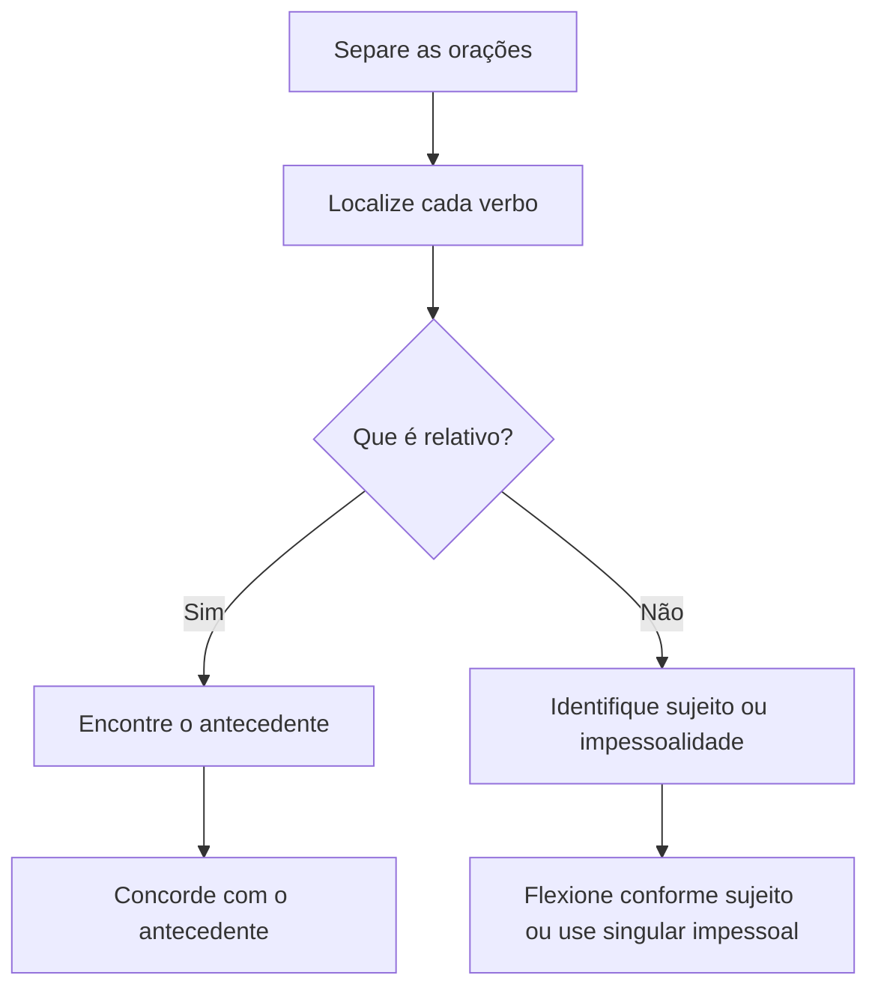

Este capítulo trata de frases em que a concordância depende de interpretar a função de um pronome ou de uma oração inteira. O ponto central é encontrar o antecedente de “que” e distinguir “haver” impessoal de usos pessoais. Em seguida, veremos predicativos, sujeito oracional, voz passiva e locuções verbais. O método continua válido: identifique a estrutura, reconheça quem controla a flexão e só então avalie a frase.

> [!objetivos]
> - Fazer o verbo concordar corretamente com os antecedentes de que e quem.
> - Distinguir concordância facultativa de concordância obrigatória em expressões relativas.
> - Reconhecer sujeito oracional e construções passivas com se.
> - Aplicar a concordância em predicativos e locuções verbais.

## Expressões com que e núcleo singular

Em frases como “O efeito das chuvas que interromperam o serviço”, a oração iniciada por “que” modifica um nome anterior. “Que” é pronome relativo: retoma um antecedente e exerce função sintática na oração subordinada. Para concordar o verbo que vem depois, descubra qual termo o pronome retoma. A dificuldade surge quando há um núcleo singular (“efeito”) e um substantivo plural dentro do complemento (“chuvas”): dependendo do sentido e da organização da frase, o antecedente pode ser um ou outro.

Compare: “O conjunto de medidas que **foram anunciadas** será aplicado amanhã” e “O conjunto de medidas que **foi anunciado** será aplicado amanhã”. Na primeira, “que” retoma “medidas”; na segunda, retoma “conjunto”. Ambas as leituras são possíveis se o contexto admitir. A concordância no singular não é simples atração pelo núcleo mais próximo: é uma análise em que o antecedente de “que” é singular. Para não mudar o sentido, pergunte qual entidade foi anunciada.

Com expressões como “um dos”, “uma das”, “um daqueles” e “a maioria dos”, a oração relativa pode referir-se ao termo plural do complemento ou à expressão singular que organiza o grupo. “Ela foi uma das servidoras que **participaram** da operação” destaca as servidoras; “Ela foi uma das servidoras que **participou** da operação” pode destacar uma integrante dentro do grupo, conforme a construção e o sentido pretendido. A prova frequentemente verifica a possibilidade de reescrita sem alteração de sentido; não aceite a forma alternativa se ela mudar o referente.

Quando a retomada é clara, a concordância não é livre. Em “A equipe selecionou os relatórios que **apresentam** inconsistências”, o antecedente de “que” é “relatórios”, por isso o plural. Em “A equipe selecionou os relatórios que **apresenta** inconsistências”, o relativo só poderia retomar “equipe”, mas o sentido deixa a equipe como quem apresenta inconsistências; a estrutura e o contexto precisam sustentar essa interpretação. Evite a ideia mecânica de que o verbo sempre concorda com o substantivo mais próximo.

> [!exemplo]
> Certo: “A relação de equipamentos que **foram testados** está anexada.” O relativo retoma “equipamentos”. Também é possível “A relação de equipamentos que **foi testada** está anexada”, se o documento testado foi a relação. A flexão indica qual termo foi retomado.

> [!pegadinha]
> A concordância com o termo plural do complemento não é uma regra automática para toda oração com “que”. O pronome precisa ter antecedente compatível com a ideia expressa pelo verbo. Se só as medidas podem ser executadas, não use singular como se “conjunto” fosse o agente dessa ação.

## Que, quem e expressões interrogativas

Quando “que” é pronome relativo, o verbo concorda com seu antecedente: “Fui eu que **organizei** a escala”; “Foram elas que **organizaram** a escala”. O relativo não traz pessoa ou número próprios; ele retoma o nome ou pronome anterior. Em “os servidores que atuam”, o sujeito da oração subordinada é “que”, com antecedente “servidores”, e o verbo vai ao plural.

“Quem” normalmente leva o verbo à terceira pessoa do singular: “Fui eu quem **organizou** a escala”; “Somos nós quem **responde** pelo material”. Também se encontra concordância com o antecedente, especialmente com pronomes pessoais: “Fui eu quem **organizei**”; “Somos nós quem **respondemos**”. A forma escolhida deve ser coerente e o contexto pode favorecer uma construção. Em itens objetivos, a questão costuma perguntar se determinada forma está correta, não se é a única possível.

Em perguntas como “Quem **chegou**?” e “Quem **foram** os responsáveis?”, é preciso separar o pronome interrogativo do verbo ser que liga sujeito e predicativo. Com “quem” como sujeito de verbo de ação, a terceira pessoa do singular é a forma regular. Já com o verbo ser e um predicativo plural que identifica a resposta, é comum a concordância com o predicativo: “Quem **foram** os responsáveis?”; “Que **são** aquelas marcas?”.

Nos pronomes indefinidos plurais “quais”, “quantos”, “alguns” seguidos de “de nós/de vós”, há duas construções: “Quais de nós **resolverão** a tarefa?” (o verbo concorda com o pronome plural) e “Quais de nós **resolveremos** a tarefa?” (concordância com “nós”). Em “algum de nós”, o núcleo é singular: “Algum de nós **resolverá**”. A concordância deve acompanhar a forma do pronome que estrutura o sujeito ou o pronome pessoal que o falante assume como foco.

| Construção | Regra mais comum | Exemplo |
| --- | --- | --- |
| Pronome relativo que | Concorda com o antecedente | Fui eu que conferi. |
| Pronome quem | Terceira pessoa do singular; pode concordar com antecedente pessoal | Fui eu quem conferiu/conferi. |
| Quais de nós | Com “quais” ou com “nós” | Quais de nós farão/faremos a revisão? |
| Quem interrogativo + ser | Pode concordar com o predicativo identificador | Quem foram os responsáveis? |

## Sujeito oracional e predicativo

Sujeito oracional é uma oração inteira que ocupa a função de sujeito. Como a oração é tratada como uma unidade singular, o verbo da oração principal costuma ficar na terceira pessoa do singular: “**Revisar os formulários** exige atenção”; “**Que a equipe tenha chegado** cedo parece provável”. Para localizar essa estrutura, substitua a oração por “isso”: “Isso exige atenção”; “Isso parece provável”. A substituição ajuda a revelar o sujeito e evita que o verbo concorde por engano com um nome interno da oração.

Expressões como “é necessário”, “é bom”, “é proibido” podem ficar no masculino singular quando têm valor geral e o substantivo aparece sem artigo: “É necessário cautela”; “É proibido estacionar”. Se o nome vier determinado por artigo, o predicativo concorda: “É necessária **a** cautela”; “É proibida **a** entrada”. O sujeito pode ser uma oração (“É proibido estacionar”) ou um substantivo (“É proibida a entrada”). Antes de flexionar, observe se há artigo ou outro determinante que define o substantivo.

Predicativo é a qualidade, estado ou identificação atribuída ao sujeito ou objeto por um verbo de ligação ou de percepção/julgamento. Em “Os documentos parecem completos”, “completos” é predicativo do sujeito e concorda com “documentos”. Em “A comissão considerou os registros inconsistentes”, “inconsistentes” é predicativo do objeto e concorda com “registros”. Não confunda predicativo com advérbio: em “A comissão analisou cuidadosamente os registros”, “cuidadosamente” modifica o verbo e não varia.

> [!bizu]
> Troque a oração candidata a sujeito por “isso”. Se a frase continuar bem formada — “Isso parece urgente” —, o verbo principal tende ao singular. Depois verifique se uma expressão invariável como “é necessário” tem substantivo com artigo explícito.

## Voz passiva e partícula se

Na voz passiva, o sujeito recebe a ação. Na passiva analítica, o verbo “ser” mais particípio concorda com esse sujeito: “Os equipamentos foram inspecionados”; “A sala foi isolada”. O termo agente da passiva, se indicado, não é o sujeito: “Os equipamentos foram inspecionados pela equipe”. O plural de “equipamentos” controla tanto “foram” quanto “inspecionados”.

Na passiva sintética, o pronome “se” acompanha verbo transitivo direto ou transitivo direto e indireto e o substantivo paciente funciona como sujeito: “**Divulgam-se** os resultados” equivale a “Os resultados são divulgados”; “**Aluga-se** uma sala” equivale a “Uma sala é alugada”. Se o sujeito estiver no plural, o verbo também: “**Entregaram-se** os certificados”. A preposição pode fazer diferença: “Precisa-se **de** voluntários” não é passiva sintética, pois o verbo “precisar” exige complemento preposicionado; trata-se de sujeito indeterminado e o verbo fica na terceira pessoa do singular.

| Construção | Função do se | Concordância |
| --- | --- | --- |
| Publicam-se editais | Partícula apassivadora; editais é sujeito | Verbo no plural |
| Publica-se um edital | Partícula apassivadora; edital é sujeito | Verbo no singular |
| Precisa-se de técnicos | Índice de indeterminação; sujeito indeterminado | Terceira pessoa do singular |
| Vive-se bem no alojamento | Índice de indeterminação | Terceira pessoa do singular |

> [!pegadinha]
> Certo: “**Analisam-se** os pedidos” e “**Necessita-se de** analistas”. Errado: “Analisam-se de analistas”. Teste a equivalência passiva: “os pedidos são analisados” funciona; “analistas são necessitados” não corresponde ao uso com “de”.

## Locuções verbais e verbos impessoais

Locução verbal é o conjunto de auxiliar e verbo principal que expressa uma ação ou estado. O auxiliar costuma receber as marcas de pessoa, número, tempo e modo; o verbo principal aparece no infinitivo, gerúndio ou particípio. Quando o verbo principal é impessoal: a impessoalidade se estende ao auxiliar: “**Deve haver** alternativas”, “**Pode fazer** dois anos”, “**Vai haver** mudanças”. Não se diga “devem haver alternativas”, porque “haver” com sentido de existir não tem sujeito plural.

Se o verbo principal é pessoal: o auxiliar concorda com o sujeito: “**Devem existir** alternativas”; “**Podem ocorrer** mudanças”. O sujeito pode ficar entre o auxiliar e o verbo principal, mas sua posição não altera a relação. Em “Os documentos podem ser enviados”, o sujeito plural “documentos” controla “podem”; “ser enviados” forma a passiva. Em “A solicitação pode ser enviada”, os auxiliares e o particípio estão no singular e feminino conforme “solicitação”.

Além de “haver” existencial, há usos em que “haver” tem sujeito e concorda: “Eles **hão** de retornar” (auxiliar de valor modal); “Os fiscais **haviam** encerrado o turno” (auxiliar de tempo composto). O teste é o sentido e a estrutura. Haver impessoal pode ser substituído por “existir” sem tornar-se pessoal: “Havia vagas” = “Existiam vagas”, mas “havia” continua invariável por sua própria regra. Em tempos compostos, “haver” acompanha o sujeito: “Os fiscais haviam retornado”.

O verbo “tratar-se”, na construção impessoal “trata-se de”, fica na terceira pessoa do singular: “**Trata-se de** duas solicitações urgentes”. O complemento introduzido por “de” não é sujeito. Essa construção é diferente de “os técnicos tratam-se com respeito”, em que há sujeito plural e o pronome integra o verbo pronominal “tratar-se” no sentido de tratar uns aos outros. Leia a oração toda para não generalizar a regra de uma expressão fixa a qualquer ocorrência do verbo.

## Concordância aplicada à revisão de períodos

Uma frase comprida pode conter várias orações, cada qual com seu verbo e seu sujeito. Separe-as antes de revisar. Em “O relatório que os administradores enviaram informa que houve avanços”, “administradores” controla “enviaram”; “relatório” controla “informa”; “haver” existencial fica no singular em “houve avanços”. O substantivo mais próximo de cada forma não basta: “avanços” não faz o verbo impessoal ir ao plural.

Considere uma notícia hipotética: “O programa de mobilidade que começou no Grajaú informou que haveria novas linhas para o Uber e para o transporte coletivo”. O sujeito de “começou” é “programa”; “que” retoma programa. “Informou” também tem esse sujeito. “Haveria” significa existiria, portanto continua singular apesar de “linhas”. Se o período fosse “Novas linhas seriam anunciadas”, a passiva concordaria com “linhas”. O nome de um bairro ou aplicativo não altera o mecanismo sintático.

Compare ainda “As cotas que foram criadas para o mestrado serão revistas” com “A regra que foi criada para as cotas será revista”. No primeiro período, “que” retoma “cotas” e exige plural em “foram criadas”; no segundo, retoma “regra” e pede singular. Em “a discussão sobre cotas terminou”, o verbo principal concorda com “discussão”, não com “cotas”. O núcleo do sujeito pode estar vários termos antes do verbo, como ocorre em textos de divulgação e relatórios administrativos.

> [!exemplo]
> Certo: “As providências que foram adotadas impediram nova fragmentação do cadastro.” “Foram adotadas” retoma “providências”; “impediram” também concorda com “providências”. Errado: “As providências que foi adotado impediram...”, que mistura singular no relativo com antecedente plural.

Não escreva “houveram avanços” quando o sentido for “ocorreram avanços”: prefira “houve avanços” ou “ocorreram avanços”. Para suceder, o verbo pessoal concorda com o que ocorreu: “Sucedem-se etapas”, “Sucederam fatos relevantes”. A diferença evita uma generalização falsa: haver não é sempre impessoal; é impessoal nas acepções existencial, de ocorrência e temporal. Em “Os fiscais houveram por bem encerrar o procedimento”, há uso pessoal e construção própria, não equivalente ao existencial.

O mesmo exame vale em textos eleitorais, acadêmicos e de serviço. “As decisões eleitorais que terminaram ontem foram publicadas”; “O cemitério que os técnicos inspecionaram permaneceu fechado”; “Terminei a revisão das frases que me pareceram custosas”. Em cada caso, o antecedente do relativo e o sujeito principal podem ser diferentes. A pessoa “eu” fica oculta em “terminei”, enquanto “frases” é antecedente de “pareceram”. A concordância em uma oração não obriga outra oração a usar a mesma pessoa ou número.

As construções impessoais também aparecem dentro de orações subordinadas: “A comissão concluiu que havia exceções”; “O setor sabia que fazia meses que o sistema não atualizava”; “Parece que houve mudanças”. A flexão do verbo principal da frase não contamina o verbo subordinado. Se houver sujeito expresso, em contrapartida, ele controla seu verbo: “Os gestores concluíram que os avanços eram insuficientes”. Marque cada verbo separadamente, especialmente quando as orações forem introduzidas por “que”.

Examine estas três construções: “O relatório hospedado no portal que os técnicos terminaram foi publicado”; “A pesquisa eleitoral que terminou ontem foi divulgada”; “O curso que os servidores morassem perto não é condição para a inscrição”. Nas duas primeiras, a retomada de “que” depende do sentido: técnicos terminaram o relatório; a pesquisa terminou ontem. No terceiro período, a forma “morassem” não tem antecedente claro e a frase falha em sentido e construção; não se deve tentar salvá-la apenas fazendo verbo concordar com “servidores”. A concordância é parte da análise, mas não corrige uma oração mal estruturada.

> [!pegadinha]
> Não aceite o singular ou plural por mera atração. Pergunte: qual termo “que” retoma? Qual é o sujeito de cada oração? O uso de “haver” tem sentido existencial? A resposta a essas perguntas resolve a maior parte dos itens de concordância com subordinadas.

Em exercícios sobre relativos, frases com antecedente singular e plural podem aparecer lado a lado. “A infelicidade que atormenta o morador parece profunda” tem “infelicidade” como antecedente; “as conquistas que os atletas alcançaram serão celebradas” tem “conquistas”. “A equipe que me convidou chegou cedo” faz o relativo retomar “equipe”. Em “os moradores que almejam melhorias”, “que” retoma o nome plural. O mesmo raciocínio funciona com sujeitos de ação (“ouviam”, “lerão”) e com estados, desde que a relação de sentido seja possível.

Uma sequência longa pode combinar verbos no futuro e no passado: “Seremos nós aqueles que herdaremos o relatório”; “Eles serão os candidatos que saberão a resposta”; “A equipe elaborou uma lista que será enviada aos administradores”. O relativo pode retomar “nós”, “candidatos” ou “lista” conforme a estrutura. Flexione o verbo da oração principal de forma independente: “seremos”, “serão”, “elaborou”. Não aplique a regra do antecedente de um relativo a todos os verbos da frase.

Em textos narrativos, o tempo verbal também não se confunde com a concordância. “As turbas que ouviam o anúncio permaneceram no pátio”; “O aviso que lerei amanhã explica os requisitos”; “O resultado que herdaram foi contestado”. Palavras como “tormentoso”, “sombrio” e “descontentes” podem ser adjetivos ou predicativos, mas devem ser vinculadas ao substantivo correspondente. Adjetivo não controla a flexão de um verbo de outra oração.

> [!exemplo]
> Certo: “Os gestores que ouviram o alerta, embora descontentes, disseram que a mudança era custosa.” “Ouviram” e “disseram” têm como sujeito os gestores; “era” concorda com “mudança”. O adjetivo plural “descontentes” também se refere aos gestores, mas não muda o singular do verbo “era”.

O gerúndio pode integrar locução com auxiliar flexionado: “Os fiscais estão examinando o prazo” (sujeito plural); “Está decorrendo o prazo” (sujeito singular posposto). Do mesmo modo, “Os linchadores que foram identificados serão julgados” retoma sujeito plural, mas “o caso que atormentará os moradores será examinado” retoma antecedente singular. A posição e o sentido definem a função, não apenas a proximidade.

Considere também as estruturas “A leitura desses avisos inviabiliza a saída” e “As instruções antecipam o horário previsto”. Em ambas, um núcleo singular ou plural controla o verbo; não se escolhe a flexão pela primeira palavra da frase. “Os simulados que os candidatos fizeram foram corrigidos” tem oração relativa no plural e passiva plural. “Aqueles que estudaram com os sábios apresentarão o relatório” exige plural em “estudaram” e “apresentarão”, enquanto “nós” pode ser retomado por “que” em “somos nós que apresentaremos”.

Palavras como “vetor” e “gigantes” podem aparecer em qualquer contexto: “O vetor que representa as forças foi desenhado”; “Os gigantes que aparecem na lenda foram descritos”. O singular de “foi desenhado” concorda com “vetor”; o plural de “foram descritos” retoma “gigantes”. O termo “superficialidade” é um substantivo abstrato singular: “A superficialidade da análise foi criticada”. A flexão depende de função e antecedente, não do tema do texto.

O pronome “aqueles” é plural e pode funcionar como antecedente: “Aqueles que aceitaram a tarefa serão chamados”; “Aqueles que a banca selecionou foram chamados”. Uma expressão como “sessenta participantes” também cria núcleo plural, ao passo que “a maioria dos sessenta participantes” pode permitir concordância com o partitivo ou com o determinante. Em linguagem formal, evite tratar “a maioria” como plural por regra fixa ou como singular obrigatório em todos os contextos.

Os termos “reféns” e “aprisionar” podem surgir em frases com voz passiva: “Os reféns foram libertados”; “Os agentes tentaram impedir que os civis fossem aprisionados”. Em “tentaram impedir”, o sujeito plural controla o auxiliar; em “fossem aprisionados”, o sujeito paciente plural controla a locução passiva. A oração subordinada não transfere seu sujeito para a principal. Em “É possível inovar sem alterar a norma”, a oração infinitiva pode funcionar como sujeito singular: “isso é possível”.

> [!bizu]
> Leia frases acriticamente apenas como rascunhos: para julgá-las, transforme cada oração em uma unidade, localize seu sujeito e identifique a função dos pronomes relativos. A impressão de que uma forma “soa plural” não substitui a análise.

Um exemplo de leitura com antecedentes sucessivos: “Os editores organizaram uma mostra de fotos que parecia frágil, embora despertasse estímulos para o debate”. “Organizaram” concorda com “editores”; “parecia” retoma “mostra”; “despertasse” retoma o pronome relativo de valor singular que se refere à mostra. A palavra “fotos” está dentro da oração relativa, mas não é automaticamente o antecedente de todos os verbos seguintes. Em “as fotos que pareciam frágeis”, ao contrário, o adjetivo e o verbo estão no plural porque retomam “fotos”.

Compare também “A obsessão que parecia dominar os operários preocupava a direção” com “Os operários que pareciam preocupados procuraram a direção”. Na primeira, “parecia” tem antecedente singular “obsessão”; na segunda, “pareciam” retoma “operários”. Se a frase for “O tema pode interessar aos visitantes das galerias”, o infinitivo “interessar” não muda, e “pode” concorda com “tema”. Se for “Os temas podem interessar aos visitantes”, o sujeito plural pede “podem”.

No modo subjuntivo, “É possível que aqueles que leiam o aviso compreendam a orientação”. “Leiam” concorda com “aqueles”; “compreendam” também tem sujeito plural. Em “É possível que a pessoa que leia o aviso compreenda”, ambos ficam no singular. Não se escolhe entre subjuntivo e indicativo pela concordância, mas pelo modo exigido pela construção; depois se ajusta a pessoa e o número. Um setor identificado como “07” ou uma referência “nos anexos” não funciona como sujeito se apenas acrescenta local ou circunstância.

Em “Haverá exposição na galeria” e “Haverá várias exposições”, haver existencial não varia; em “As exposições ocorrerão na galeria”, o verbo pessoal concorda com “exposições”. Esse contraste serve para desfazer um erro frequente em comentários apressados: a forma “haverão” só cabe em usos pessoais do verbo haver, como “eles haverão de responder”, e não com sentido de existir. A análise da função verbal evita generalizar uma forma a outra acepção.

> [!exemplo]
> Certo: “Os visitantes que pisarem no piso molhado serão orientados.” Errado: “Os visitantes que pisar no piso molhado serão orientados.” O relativo retoma “visitantes”, e “pisarem” concorda com esse antecedente plural; na oração principal, “serão” também concorda com “visitantes”.

## Mapa do capítulo

| Estrutura | Centro da concordância |
| --- | --- |
| Que relativo | Antecedente que o pronome retoma |
| Quem | Singular como padrão; concordância com antecedente pessoal também possível |
| Sujeito em forma de oração | Singular na oração principal |
| Passiva sintética | Sujeito paciente concorda com o verbo |
| Sujeito indeterminado com se | Verbo na terceira pessoa do singular |
| Locução com verbo impessoal | Auxiliar permanece no singular |

### Para fixar
- “Que” relativo concorda com o antecedente; a forma deve preservar o sentido da retomada.
- “Quem” costuma levar o verbo ao singular, mas admite concordância com antecedente pessoal em certas construções.
- “Quais de nós farão/faremos” ilustra concordância com o pronome plural ou com “nós”.
- Uma oração inteira como sujeito costuma levar o verbo principal ao singular.
- Com substantivo sem artigo, “é necessário” pode ser invariável; com artigo, concorda: “é necessária a cautela”.
- Na passiva sintética, o sujeito paciente controla o verbo: “publicam-se editais”.
- Com “se” indeterminador e complemento preposicionado, o verbo fica no singular: “precisa-se de técnicos”.
- Haver impessoal mantém no singular também o auxiliar: “deve haver”; existir concorda: “devem existir”.

