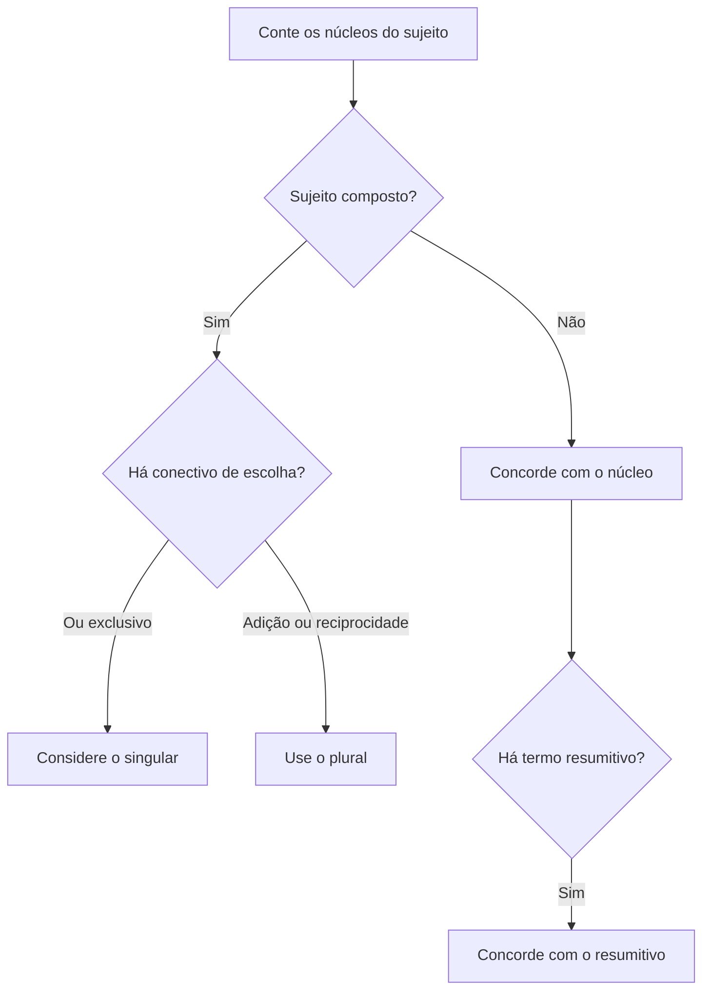

Quando o sujeito reúne dois ou mais núcleos, a forma verbal depende de como eles se relacionam: coordenação aditiva, reciprocidade, enumeração resumida ou escolha entre alternativas. A regra geral favorece o plural, mas há situações de proximidade e de sentido que permitem o singular. Este capítulo organiza os casos para que a decisão seja feita pela estrutura e não por um atalho baseado apenas na palavra “e” ou “ou”.

> [!objetivos]
> - Aplicar a concordância com sujeito composto anteposto e posposto.
> - Reconhecer a regra dos nomes próprios no plural e dos infinitivos.
> - Distinguir sujeitos ligados por e, ou, nem, conectivos correlativos e expressões resumitivas.
> - Identificar concordância recíproca e construções com “um e outro”.

## Sujeito composto e posição do verbo

Sujeito composto apresenta mais de um núcleo. Se vier antes do verbo, a regra geral é o plural: “A médica e o condutor **organizaram** a evacuação”. A pessoa gramatical dos núcleos também importa. Quando há participantes de pessoas diferentes, prevalece a pessoa de menor número ordinal: a primeira pessoa (nós) prevalece sobre a segunda e a terceira; a segunda (vós) prevalece sobre a terceira. Assim, “Eu e a equipe **sairemos**”; “Tu e os colegas **fareis** o percurso” (ou “farão” se a forma de tratamento usada for “vocês”).

A regra não depende da quantidade de palavras no sujeito. Em “O comandante do posto e da base **participou**”, “comandante” é um só núcleo com dois complementos; o verbo fica no singular. Em “O comandante do posto e a chefe da base **participaram**”, dois núcleos, cada qual com seu artigo e complemento, formam sujeito composto. A banca costuma remover ou repetir artigos para tornar a interpretação mais clara. Leia a frase e conte os núcleos, não os substantivos encontrados ao acaso.

Quando o sujeito composto aparece depois do verbo, a concordância no plural permanece adequada: “**Chegaram** a ambulância e a equipe de apoio”. Em certos contextos, também se admite concordância com o núcleo mais próximo: “**Chegou** a ambulância e a equipe de apoio”. A forma singular é chamada atrativa; ela não autoriza o singular em qualquer sujeito composto anteposto. Se houver inversão, procure o sujeito posposto antes de julgar a forma.

| Posição e composição | Forma recomendada | Observação |
| --- | --- | --- |
| Sujeito composto antes do verbo | A chefe e o motorista chegaram. | Plural como regra geral. |
| Sujeito composto depois do verbo | Chegaram a chefe e o motorista. | Plural claro e seguro. |
| Sujeito posposto e verbo junto ao primeiro núcleo | Chegou a chefe e o motorista. | Singular por atração pode ocorrer. |
| Primeira pessoa junto a terceira | Eu e os técnicos voltaremos. | Primeira pessoa prevalece. |

> [!exemplo]
> Certo: “O relatório e a planilha **foram entregues** ao setor.” Errado: “O relatório e a planilha **foi entregue** ao setor.” Como o sujeito composto vem antes do verbo, a banca espera plural; a proximidade de “planilha” não cria sujeito simples.

## Infinitivos e nomes próprios no plural

O infinitivo é a forma verbal terminada em -ar, -er ou -ir; pode aparecer flexionado ou não. Quando dois ou mais infinitivos funcionam como sujeito e designam ações ou conceitos gerais, é comum a concordância no singular: “**Revisar e registrar** faz parte da rotina” (o conjunto das tarefas). Se os infinitivos forem apresentados como ações distintas ou vierem determinados por artigos, a forma plural é possível ou preferível: “**O revisar e o registrar** são etapas diferentes”. O sentido e a determinação orientam a leitura.

Depois de preposição, a flexão do infinitivo é frequentemente facultativa, sobretudo quando se trata de sujeito próprio e claro: “A equipe saiu sem **conferir** os nomes” / “sem **conferirem** os nomes” (a equipe como agente plural). A forma não flexionada é muito frequente quando o sujeito é geral ou já está expresso; a flexionada evidencia o sujeito plural. Não confunda a flexão do infinitivo com concordância do verbo principal da oração: “É importante **os técnicos revisarem** o mapa”.

Com nomes de obras e títulos no plural, o verbo tende a concordar com o artigo singular que introduz o título: “**Os Sertões** é uma obra de referência”; “**As Crônicas** será publicado em edição nova”. Se a frase mencionar diretamente os elementos que compõem o título, o plural pode ser motivado pelo sentido: “Os Sertões e outras obras **foram estudados**”. O título deve estar marcado como título ou destacado pelo contexto; sem isso, o leitor pode interpretar os nomes como sujeito comum plural.

> [!pegadinha]
> Certo: “**Os Lusíadas** é um poema épico.” O artigo identifica um título singular, embora a expressão contenha forma plural. Errado, neste sentido: “Os Lusíadas são um poema épico.” Se “lusíadas” designasse várias pessoas ou objetos, seria outra construção e a concordância seria plural.

## Núcleos ligados por e, nem e séries correlativas

Núcleos ligados por “e” normalmente formam sujeito composto e pedem verbo no plural: “O rádio e o telefone **funcionaram**”. Se os núcleos forem entendidos como uma unidade, um par, uma ideia única ou sinônimos, pode ocorrer singular: “A paciência e a persistência **é** o que mantém o grupo unido” (duas qualidades concebidas como conjunto); em prosa formal, o plural costuma ser mais claro: “A paciência e a persistência **são** fundamentais”. A possibilidade do singular depende da interpretação unitária, não de uma licença geral para ignorar o plural.

As expressões “tanto... como”, “não só... mas também”, “assim como” e “bem como” geralmente adicionam elementos e conduzem ao plural: “Tanto a equipe médica como os motoristas **receberam** instruções”. Se a oração destacar apenas o núcleo mais próximo ou uma série com valor de acréscimo progressivo, alguns contextos aceitam singular, mas a opção plural evita dúvida. Com “nem... nem”, o plural é usual quando os dois núcleos participam da negação: “Nem a chuva nem o vento **impediram** a saída”.

Quando o sujeito inclui expressões como “um e outro”, “nem um nem outro”, pode aparecer singular ou plural: “Um e outro **aceitou/aceitaram** a proposta”; “Nem um nem outro **compareceu/compareceram**”. Em construções com recíproca (“um ao outro”, “entre si”), prefere-se o plural, pois a ação envolve mais de um participante: “Os dois fiscais **cumprimentaram-se**”; “A chefe e a auxiliar **ajudaram-se**”. O pronome recíproco esclarece que a ação é mútua.

| Conexão entre os núcleos | Tendência de concordância | Exemplo |
| --- | --- | --- |
| e com soma de referentes | Plural | A técnica e o soldado chegaram. |
| tanto... como / não só... mas também | Plural | Tanto a chefe como os agentes participaram. |
| um e outro | Singular ou plural | Um e outro assinou/assinaram. |
| ação recíproca | Plural | Os colegas se apoiaram. |
| dois termos com sentido unitário | Singular pode ocorrer; plural é claro | A calma e a precisão são essenciais. |

> [!exemplo]
> Na ocorrência, “A comandante e o socorrista **orientaram-se** mutuamente” tem sujeito composto e ação recíproca. A forma “orientou-se” faria parecer que apenas um dos dois orientou a si próprio ou que houve uma leitura diferente.

## Termos resumitivos e alternativas com ou

Após uma lista, palavras resumitivas como “tudo”, “nada”, “ninguém”, “cada um” retomam o conjunto e funcionam como núcleo singular: “Os mapas, as lanternas e as cordas, **tudo foi** conferido”; “O calor, a fumaça, a falta de luz, **nada impediu** a equipe”. O plural da enumeração não controla o verbo quando há um resumitivo expresso como sujeito. Sem resumitivo, a enumeração pode ser sujeito composto: “Mapas, lanternas e cordas **foram conferidos**”.

Com “ou”, analise se há exclusão ou inclusão. Se apenas uma opção pode ocorrer, o verbo tende ao singular: “O chefe ou o substituto **assinará** o documento”. Se ambos podem praticar a ação ou a conjunção soma alternativas, o plural pode ser mais adequado: “A técnica ou os auxiliares **prepararão** o material” (qualquer um deles poderá fazê-lo; a concordância pode seguir o plural por atração ou interpretação conjunta). Em “o agente ou os agentes”, a flexão pode indicar se a alternativa é singular ou plural. O contexto deve esclarecer se há escolha excludente, equivalência ou inclusão.

Quando “ou” liga termos sinônimos ou correções explicativas, o verbo pode concordar com o núcleo mais próximo ou com a expressão entendida como unidade. Em “O medo ou a apreensão **dominou** o grupo”, as palavras nomeiam estados próximos e o singular ressalta uma ideia. O plural também pode ser usado se os dois estados forem tratados como distintos: “O medo e a apreensão **dominaram** o grupo”. Em questão de reescrita, mantenha o sentido, pois mudar de conjunção pode alterar se os elementos são exclusivos, equivalentes ou cumulativos.

> [!pegadinha]
> Não conclua que toda conjunção “ou” exige singular. “O auxiliar ou os bombeiros **farão** a vistoria” pode ter concordância com a forma plural ou com o núcleo mais próximo. Verifique o número de cada alternativa e o sentido expresso no contexto.

## Silepse e interpretação do sujeito composto

Silepse é a concordância feita com a ideia, e não com a forma gramatical explícita. A silepse de número pode ocorrer com nomes coletivos quando o falante enfatiza os integrantes: “A equipe chegaram cedo”, por exemplo, aproxima o verbo dos membros da equipe e aparece em usos expressivos. Em prova que pede a norma-padrão formal, a resposta mais segura é a concordância gramatical: “A equipe chegou”. A figura de linguagem não deve ser confundida com uma concordância comum facultativa em expressões partitivas especificadas.

Em “A maioria dos servidores compareceu”, a forma singular é concordância gramatical com “maioria”. Em “A maioria dos servidores compareceram”, o verbo concorda com o termo plural do complemento, possibilidade reconhecida pela norma. Isso não é necessariamente silepse: a estrutura com partitivo admite variação. Já “O grupo de trabalho deliberaram” não tem essa construção partitiva normalmente usada para dupla concordância; no padrão formal, prefira “O grupo deliberou”. Identifique a classe da expressão antes de nomear a variação.

Há frases em que a concordância é determinada por semântica e pode ser reescrita sem ambiguidade. “Muitas famílias se queixaram da falta de transporte” tem o sujeito plural explícito; “A associação de famílias se queixou” tem o coletivo singular. Em “A planta e a flor foram inseridas no registro”, dois núcleos coordenados pedem plural; “A planta da flor foi inserida” tem núcleo singular e relação diferente. A mudança de um artigo ou de uma preposição pode mudar a contagem dos núcleos e também o sentido.

| Análise | Núcleo(s) | Forma verbal |
| --- | --- | --- |
| A equipe de campo chegou. | equipe | Singular |
| A equipe e o motorista chegaram. | equipe + motorista | Plural |
| A maioria dos fiscais chegou/chegaram. | maioria / fiscais | Singular ou plural, conforme a concordância escolhida |
| Os relatórios, tudo foi arquivado. | tudo | Singular |

> [!exemplo]
> Certo: “A coordenação e os supervisores se reuniram para rever as dimensões do abrigo.” Dois núcleos praticam a ação. Certo: “A coordenação dos supervisores se reuniu.” Agora há um núcleo singular com complemento. Errado: “A coordenação dos supervisores se reuniram” se a frase pretende referir-se à coordenação como unidade.

O plural também pode surgir quando o sujeito reúne referentes com características diferentes. Em “Ulisses e Penélope foram inseridos na lista de personagens”, o sujeito é composto e o verbo vai ao plural. Em “O personagem Ulisses, hospedado no abrigo do acervo, foi aprovado na seleção”, sujeito simples e participio singular. “Aprovados” concordaria com um sujeito plural, por exemplo “Ulisses e os demais candidatos foram aprovados”. O exercício consiste em não confundir nomes próprios, termos intercalados e núcleos coordenados.

Um exemplo com objetos cotidianos: “Bolo e café foram servidos na sala” apresenta coordenação aditiva; “O bolo com café foi servido na sala” pode ter um núcleo singular (“bolo”) acompanhado por um complemento. Em “A cama, a mesa e a cadeira, tudo ficou coberto”, o resumo “tudo” controla o verbo; sem o termo resumitivo, “a cama, a mesa e a cadeira ficaram cobertas”. Os substantivos finais ajudam a perceber gênero e número dos adjetivos, mas a concordância verbal depende do núcleo do sujeito.

Em texto de divulgação, a banca pode aproximar esse tema da linguagem figurada. A silepse é uma figura de construção quando a concordância segue a ideia e não a forma aparente; não é uma regra genérica para qualquer frase. “A gente estamos cansados” aparece na fala espontânea com sentido de “nós”, mas, na escrita formal, recomenda-se “A gente está cansada/cansado”, de acordo com o gênero do falante e a forma singular “a gente”. “Morreram centenas de árvores” está no plural porque “centenas” é o núcleo; “morreu um conjunto de árvores” toma o conjunto como unidade. Compreendermos essa diferença evita chamar de figura toda concordância facultativa.

Adjetivos e particípios podem revelar uma estrutura sociocultural, mas a flexão continua sendo gramatical. “Os moradores, inseridos em comunidades diversas, organizaram o encontro” traz “inseridos” no masculino plural em referência a moradores. “A comunidade, inserida em um contexto rural, organizou o encontro” muda o núcleo para singular feminino. A concordância não depende da dimensão social da expressão: a análise formal é a mesma em frases sobre cultura, trabalho, estudo ou segurança pública.

> [!pegadinha]
> A palavra “e” não garante plural se não liga núcleos de sujeito. Em “O receio de incêndio e fumaça aumentou”, pode haver apenas um núcleo (“receio”) com complementos coordenados. Compare com “O incêndio e a fumaça aumentaram o risco”, em que dois núcleos praticam a ação.

## Como responder à banca

Itens de concordância podem pedir uma frase correta, a forma obrigatória, uma possibilidade de reescrita ou o efeito de uma troca. Cada comando exige raciocínio diferente. Se a pergunta pede “deverá flexionar-se no plural”, localize as opções em que o sujeito está no plural, inclusive com sujeito posposto. Em “Contra as correntes reagiu a sensatez”, o núcleo singular é “sensatez”; a inversão não autoriza “reagiram”. Em “Não surpreendem as forças do destino”, o núcleo plural “forças” vem depois do verbo e exige plural.

Se o enunciado pede para preservar o sentido, confira se a nova flexão troca o antecedente ou a ideia de exclusão/inclusão. “A ou B assinará” pode indicar escolha excludente; “A e B assinarão” informa soma. “Nem a equipe nem o diretor compareceram” focaliza os dois referentes; “nenhum dos dois compareceu” resume os dois em um pronome singular. A terminação verbal, nesse caso, ajuda a tornar visível a interpretação.

Na identificação de erros, procure também concordância entre nome e adjetivo, locução verbal e particípio. “As unidades ficaram menores” concorda no feminino plural; “a unidade ficou menor” no singular. Em “O diretor e os técnicos estavam preparados”, sujeito e predicativo são plurais. A palavra “preparado” não concordaria com “diretor” sozinho se a característica se aplica aos dois. Faça uma revisão de cada relação, sem presumir que um erro em uma parte determina erro nas demais.

O plural de “ter” é “têm”, com circunflexo; o plural de “vir” é “vêm”. O plural de “ver” é “veem”, sem acento. Essas grafias aparecem dentro de orações relativas: “as equipes que vêm”, “os agentes que têm”, “os servidores que veem”. A escolha gráfica depende do sujeito da oração relativa. Em “um dos agentes que têm experiência”, o pronome relativo retoma “agentes”, por isso “têm”; em “o agente que tem experiência”, retoma “agente”, singular.

O futuro do verbo deve acompanhar os núcleos: “Vós e os colegas sereis recebidos” usa a segunda pessoa plural; com “vocês”, escreva “vocês serão recebidos”. “Os responsáveis saberão a sequência” traz sujeito plural; “A equipe saberá a sequência” é singular. O particípio pode ser “reproduzidos” se retoma substantivo masculino plural, mas “reproduzida” se retoma “imagem”. A flexão de gênero e número do particípio é nominal; a do auxiliar é verbal.

Os pronomes de tratamento pedem terceira pessoa, embora se dirijam diretamente ao interlocutor: “Vossa Senhoria encaminhará o ofício”; “Vossas Senhorias encaminharão os documentos”. Quando o substantivo plural é retomado por pronome, mantenha coerência: “As instituições impõem regras” e “elas são respeitadas”. Em “A instituição impõe regra”, tudo fica no singular. Termos como “respeito”, “equidade” ou “graduação” dentro de complementos não determinam a concordância de outro sujeito.

Uma frase como “As instituições que elaborou o protocolo serão revisadas” está incoerente: o relativo retoma “instituições”, logo o verbo adequado é “elaboraram”. Em “O protocolo que as instituições elaboraram será revisado”, o singular “será” concorda com “protocolo”, enquanto “elaboraram” concorda com “instituições”. Cada verbo tem seu sujeito, ainda que os dois apareçam na mesma oração composta.

Em uma situação de atendimento, “As pessoas que aprenderão o protocolo serão orientadas” usa relativo com antecedente plural; “Nós que estivermos de serviço receberemos as instruções” alinha primeira pessoa plural no antecedente pronominal. Um adjetivo pode acompanhar mais de um núcleo: “A desigualdade e a falta de acesso foram discutidas”. Se o substantivo singular for o núcleo, escreva “A desigualdade de acesso foi discutida”. O contexto sociocultural pode ser amplo, mas a concordância continua baseada na estrutura.

O verbo “existir” é pessoal: “Existe uma carteira no armário”; “Existem carteiras no armário”. Compare com haver: “Há uma carteira”; “Há carteiras”. Uma pessoa chamada Cláudio e seus colegas podem estar na frase: “Cláudio e os agentes perseguiram o suspeito”; o plural decorre dos núcleos coordenados. Em “A carteira e as impressões digitais foram recolhidas”, confira também os particípios e o gênero do conjunto; quando gêneros diferentes se combinam, o masculino plural é a concordância total não marcada.

Em textos administrativos, “O respeito e a equidade orientam as instituições” reúne dois núcleos; “A gradação dos procedimentos orienta a análise” apresenta apenas “gradação”. “Os candidatos que foram perseguidos registraram queixa” mantém o plural em ambas as orações, enquanto “o candidato que foi perseguido registrou queixa” passa ao singular em cada verbo. A coerência interna da frase facilita a leitura e evita mudar o referente durante uma reescrita.

## Mapa do capítulo

| Forma do sujeito | Regra prática |
| --- | --- |
| Núcleos ligados por e antes do verbo | Plural; observar pessoa gramatical. |
| Núcleos depois do verbo | Plural é seguro; pode haver atração pelo mais próximo. |
| Infinitivos | Sentido geral pode ser singular; ações determinadas admitem plural. |
| Título de obra plural | Verbo no singular com artigo de título singular. |
| Expressão resumitiva | Verbo concorda com “tudo”, “nada”, “ninguém”. |
| Ou | Singular em alternativa exclusiva; plural possível conforme sentido e estrutura. |

### Para fixar
- Sujeito composto anteposto pede plural como regra geral.
- Entre pessoas diferentes, nós prevalece sobre eu/vós/eles; vocês leva o verbo à terceira pessoa plural.
- Com sujeito composto posposto, o plural é a forma mais clara; o singular pode concordar por atração com o núcleo próximo.
- Infinitivo depois de preposição pode ficar flexionado ou não, conforme o sujeito e a ênfase.
- Título de obra com artigo singular pode levar o verbo ao singular: “Os Sertões é”.
- E soma núcleos; conectivos correlativos aditivos normalmente também pedem plural.
- Um e outro aceita singular ou plural; ações recíprocas favorecem o plural.
- Termo resumitivo singular controla o verbo, mesmo após uma enumeração plural.
- Ou pode indicar exclusão, inclusão ou equivalência; o contexto define a concordância adequada.

