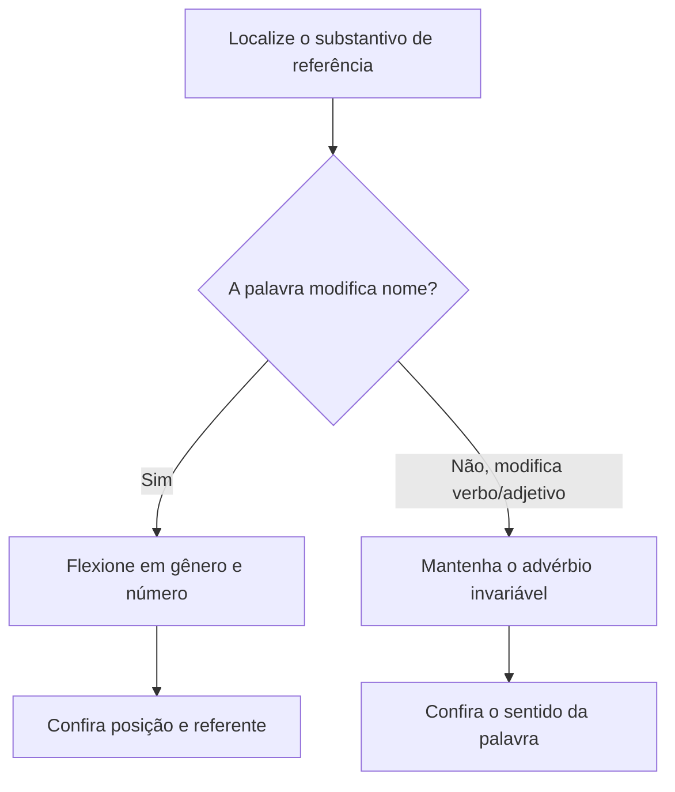

O verbo “ser” admite concordâncias especiais porque liga um sujeito a uma característica, quantidade ou identificação. A segunda parte do capítulo aborda concordância nominal: como artigos, adjetivos, pronomes e particípios acompanham os substantivos, e como palavras como “meio”, “bastante” e “só” mudam de forma conforme sua função. Em questões de reescrita, a chave é descobrir a quem cada termo se refere antes de corrigir sua flexão.

> [!objetivos]
> - Aplicar a concordância especial do verbo ser em identificação, tempo, distância e quantidade.
> - Flexionar adjetivos que se referem a um ou mais substantivos.
> - Diferenciar adjetivo de advérbio e reconhecer palavras variáveis e invariáveis.
> - Corrigir concordância de particípios, expressões de quantidade e “tal... qual”.

## Concordância do verbo ser

O verbo “ser” pode ligar o sujeito a um predicativo, termo que identifica ou caracteriza esse sujeito: “A chefe **é** engenheira”; “As salas **são** amplas”. Quando sujeito e predicativo diferem em número, em geral o verbo concorda com o sujeito: “A principal dificuldade **são** os atrasos” admite concordância com o predicativo, sobretudo quando este está no plural e nomeia o que o sujeito representa; “Os atrasos **são** a principal dificuldade” tem concordância direta com sujeito plural. Nas construções de identificação com pessoa, costuma prevalecer a pessoa ou pronome sujeito: “Eu **sou** a responsável”.

Com sujeito representado por “tudo”, “nada”, “isso”, “aquilo” ou por nome de coisa, o verbo pode concordar com o sujeito ou com o predicativo, sendo frequente a concordância com o predicativo plural: “Nem tudo **são** problemas”; “A prioridade **são** os atendimentos urgentes”. Se o sujeito nomeia pessoa, a concordância tende a seguir esse sujeito: “As coordenadoras **são** a referência da equipe”. A escolha deve manter a relação de identificação, sem tratar a regra como absoluta fora da estrutura.

Com “que” ou “quem” interrogativo, é comum concordar com o predicativo: “Que **são** estas marcas?”; “Quem **foram** os responsáveis?”. Para horas, distância e datas, o verbo concorda com a expressão numérica ou com o predicativo: “**São** nove horas”; “Da base ao portão **são** dois quilômetros”. Em quantidade ou medida avaliada como suficiente, necessário, muito ou pouco, o verbo fica no singular: “Cem minutos **é suficiente**”; “Dois quilos **é pouco**”. Nas datas, são aceitas “Hoje **é** 5 de maio” e “Hoje **são** 5 de maio”.

| Contexto com ser | Forma característica | Exemplo |
| --- | --- | --- |
| Sujeito pessoa ou pronome pessoal | Concorda com o sujeito | Nós somos responsáveis. |
| Sujeito “tudo/isso” ou coisa | Pode acompanhar sujeito ou predicativo | Nem tudo são urgências. |
| Que/quem interrogativo | Concorda com o predicativo identificador | Quem foram as testemunhas? |
| Hora e distância | Concorda com a expressão numérica | São oito horas; são três quilômetros. |
| Avaliação de quantidade | Singular | Dez minutos é suficiente. |
| Data | Singular ou plural | Hoje é/são 5 de maio. |

A expressão expletiva “é que” é invariável: “As equipes **é que** organizam o atendimento”. Se “ser” aparece separado do “que” e não compõe essa expressão, deve concordar: “**São** as equipes que organizam o atendimento”. A substituição por “justamente” pode ajudar: “As equipes justamente organizam...” conserva a função enfática, ao passo que o “ser” em “são as equipes que...” participa da estrutura de concordância.

> [!pegadinha]
> Certo: “**São** os documentos que comprovam a entrega.” Errado: “**É** os documentos que comprovam a entrega.” “Ser” não está na locução invariável “é que”; ele concorda com o sujeito “documentos”.

## Adjetivo ligado a mais de um substantivo

Adjetivo é a palavra que atribui qualidade, estado ou característica a um substantivo. Quando se refere a dois ou mais substantivos, sua forma depende da posição e da função. Depois dos substantivos, pode concordar com o mais próximo (concordância atrativa) ou com todos (concordância total): “Foram separados os mapas e as fichas **novas**” (atrativa, com “fichas”); “Foram separados os mapas e as fichas **novos**” (plural masculino abrangendo grupo misto). Antes dos substantivos, a regra segura é concordar com o mais próximo: “**Nova** ficha e mapa foram separados” soa diferente da concordância plural, por isso a posição deve ser observada.

Quando o adjetivo funciona como predicativo do sujeito posposto, também pode haver concordância atrativa ou plural: “Estavam **organizadas** a lista e a planilha”; “Estavam **organizados** a lista e a planilha”. A forma feminina singular aponta para o nome mais próximo; o masculino plural abrange os dois. Como a frase pode ficar ambígua, uma reescrita direta — “A lista e a planilha estavam organizadas” — deixa claro qual leitura se deseja.

Se o adjetivo se refere a nomes próprios ou termos de parentesco, costuma ir ao plural: “Conheci as pesquisadoras Ana e Lúcia, **dedicadas** ao projeto”; “Vieram a mãe e a irmã, **preocupadas**”. O predicativo do objeto em regra concorda com o conjunto de objetos: “A comissão julgou **adequadas** a escala e a lista”; “Consideraram **inconsistentes** o registro e o mapa”. A posição anteposta não deve levar a esquecer que o predicativo atribui a qualidade aos objetos.

> [!exemplo]
> Certo: “A equipe considerou **inadequados** o formulário e a planilha.” O adjetivo é predicativo do objeto composto. Também é possível reordenar: “A equipe considerou o formulário e a planilha inadequados.” Errado: “A equipe considerou inadequado o formulário e a planilha”, se a intenção for qualificar ambos.

## Particípios e adjetivos compostos

Particípio pode integrar uma locução verbal ou funcionar como adjetivo. Em locução com “ter” ou “haver”, o particípio regular em geral não varia: “A equipe **tinha revisado** as fichas”; “As equipes **haviam concluído** os relatórios”. Na voz passiva formada com “ser” ou como adjetivo, concorda com o sujeito ou substantivo: “As fichas foram **revisadas**”; “Os relatórios concluídos foram arquivados”. Identifique o auxiliar e a função da forma participial antes de flexionar.

Adjetivos compostos normalmente flexionam o segundo elemento, enquanto o primeiro permanece invariável: “acordos político-administrativos”, “relações luso-brasileiras”. Há exceções convencionais, sobretudo em nomes de cores compostos por substantivos ou em formas lexicalizadas, como “azul-marinho” e “cor-de-rosa”, que permanecem invariáveis: “camisas azul-marinho”, “fitas cor-de-rosa”. Como algumas combinações de cor admitem divergência de análise, prefira exemplos inequívocos e consulte o vocabulário quando a dúvida for de grafia ou registro lexical.

O adjetivo “possível” varia em expressões superlativas com artigo: “as orientações **mais claras possíveis**”; “a orientação **mais clara possível**”. O artigo marca o número da estrutura, e o adjetivo concorda com o substantivo. Compare também “a mais rápida resposta possível” e “as respostas mais rápidas possíveis”. Não transforme “possível” em advérbio invariável nesses contextos.

| Forma | Exemplo correto | Ponto de atenção |
| --- | --- | --- |
| Particípio com ter/haver | As equipes tinham revisado as fichas. | Particípio invariável. |
| Particípio na passiva com ser | As fichas foram revisadas. | Concorda com o sujeito. |
| Adjetivo depois de nomes | Livro e ficha novos/novo(a). | Atrativa ou plural total, conforme contexto. |
| Cor composta lexicalizada | Camisas azul-marinho. | Forma invariável. |
| Mais... possível | As rotas mais curtas possíveis. | Flexiona conforme artigo e referente. |

> [!pegadinha]
> Certo: “As ordens tinham sido **cumpridas**” (passiva com ser) e “As equipes tinham **cumprido** as ordens” (tempo composto com ter). Errado: “As equipes tinham cumpridas as ordens.”

## Advérbio, adjetivo e palavras variáveis

Advérbio modifica verbo, adjetivo ou outro advérbio e é invariável; adjetivo modifica substantivo e varia para concordar com ele. “A equipe trabalhou **meio** cansada” contém “meio” como advérbio de intensidade (um pouco); “A equipe percorreu **meia** trilha” emprega numeral/adjetivo concordando com “trilha”. A expressão de horário é “meio-dia e **meia**”, porque se subentende meia hora. “Meio-dia e meio” não corresponde à norma-padrão nesse sentido.

“Só” significa “somente” quando advérbio e não varia: “**Só** os motoristas assinaram”. Significa “sozinho” quando adjetivo e concorda: “As equipes ficaram **sós**”. “Bastante” pode ser advérbio invariável (“treinaram bastante”) ou pronome/adjetivo concordando com substantivo (“bastantes exercícios”). “Muito” segue a mesma distinção: “dormiram muito”; “muitas horas”. “Caro” e “barato” variam quando caracterizam um nome (“equipamento caro”, “peças baratas”) e são invariáveis em uso adverbial (“custaram caro”). “Junto” varia como adjetivo (“documentos juntos”) e fica invariável em “junto a” com valor preposicional (“junto à entrada”).

Alguns substantivos podem atuar como qualificadores e normalmente permanecem invariáveis: “ataques surpresa”, “camisas laranja”. “Alerta” costuma ser invariável quando significa em estado de vigilância: “As equipes permaneceram alerta”. “Menos” é invariável: “menos ocorrências”, nunca “menas ocorrências”. Em caso de dúvida, pergunte se a palavra acompanha diretamente um substantivo como adjetivo/pronome ou se modifica verbo, adjetivo ou quantidade como advérbio.

| Palavra | Função e comportamento | Exemplo |
| --- | --- | --- |
| meio | Advérbio: invariável | Estavam meio cansadas. |
| meio/meia | Numeral/adjetivo: varia | Meio turno; meia hora. |
| só | Advérbio “somente”: invariável | Só a equipe entrou. |
| só/sós | Adjetivo “sozinho”: varia | As agentes ficaram sós. |
| bastante | Advérbio: invariável | Estudaram bastante. |
| bastantes | Pronome/adjetivo: varia | Resolveram bastantes questões. |
| menos | Invariável | Havia menos vagas. |

> [!bizu]
> Faça a pergunta “modifica um nome ou modifica uma ação?”. Se qualifica o substantivo, tende a variar; se intensifica verbo, adjetivo ou advérbio, tende a permanecer invariável. A função na frase vale mais que a palavra isolada.

## Outras concordâncias nominais

Expressões como “é bom”, “é necessário”, “é proibido” e “é permitido” permanecem no masculino singular quando o substantivo aparece sem determinante: “É proibido **entrada** de veículos” (uso geral, embora a redação mais clara seja “É proibido entrar”); se há artigo ou pronome, o adjetivo concorda: “É proibida **a** entrada”; “É necessária **esta** autorização”. O mesmo raciocínio vale para “anexo”, “incluso”, “obrigado”, “mesmo”, “próprio” e “quite”, que são adjetivos variáveis: “seguem anexas as folhas”, “estamos quites”. Já as locuções “em anexo” e “em apenso” são invariáveis: “os documentos seguem em anexo”.

Em “tal... qual”, “tal” concorda com o termo anterior, e “qual” com o seguinte: “A equipe é **tal qual** a anterior”; “As equipes são **tais quais** as anteriores”; “A equipe é **tal quais** as anteriores”. A concordância é cruzada e pode parecer estranha à primeira vista. “Meio-dia e meia” é outra combinação que a banca explora: o numeral “meia” concorda com “hora” implícita, ao passo que “meio” em “meio cansadas” funciona como advérbio invariável.

Vale revisar a referência do adjetivo em frases com nomes concretos. “A vereadora arranjou cravos vermelhos para o vaso” faz “vermelhos” concordar com “cravos”; “A vereadora arranjou rosas vermelhas” acompanha “rosas”. Se ela comprou os dois tipos, pode escrever “cravos e rosas vermelhos” para abranger o conjunto ou “cravos e rosas vermelhas” pela atração do nome mais próximo. “Vandercleverson estava alegre” liga o predicativo ao sujeito masculino; “A criança estava alegre” mantém o feminino do nome, ainda que se refira a menino.

Na reescrita, observe se o adjetivo está ligado a um nome ou ao conteúdo da oração. “A encomenda diária tornava a espera longa” tem “diária” ligado a “encomenda”; “a alegria das crianças” traz “das crianças” como complemento de alegria, não como sujeito de “tornava”. “As raízes do alfabeto permaneceram pouco conhecidas” concorda “conhecidas” com “raízes”, mas “pouco” intensifica o adjetivo e não varia. Um deputado pode considerar determinada frase clara, mas a análise deve apontar exatamente o substantivo a que o adjetivo se refere.

> [!exemplo]
> Certo: “Seguem **inclusas** as planilhas e o comprovante está **anexo**.” Cada adjetivo acompanha seu referente. Certo também: “Os arquivos seguem **em anexo**.” Errado: “Seguem inclusos as planilhas”, pois “inclusos” está referido a “planilhas”, feminino plural.

Observe também adjetivos em frases longas: “A moradora entusiasmada foi à sala examinar o relatório” traz predicativo ou adjunto feminino singular; “As equipes continuam entusiasmadas” concorda no feminino plural. Em “Paguei os móveis usados”, “usados” acompanha “móveis”; em “a dona viajou”, o verbo concorda com o sujeito singular. “Os provérbios hindus moldam destinos” apresenta sujeito plural e adjetivo masculino plural. “A viagem do marido foi tranquila” traz núcleo singular feminino, embora “marido” seja complemento preposicionado.

Uma frase com particípio pode ter auxiliar em tempos diferentes: “Os fiscais haviam vindo à sala” concorda “haviam” com fiscais, enquanto “vindo” não varia no tempo composto. “Os documentos que viajaram no malote foram recebidos” tem relativo e passiva com sujeitos plurais. “Os garfos estavam limpos” apresenta masculino plural; “consumi vinhos e café” não pede adjetivo de cor, mas “vinhos tintos” concorda com o nome. “A cafeína é estimulante para os nervos” reúne artigo, substantivo e predicativo feminino singular.

“As raízes continuam vindo à tona” contém locução de gerúndio; “as ideias que fizeram a diferença” concorda o relativo com “ideias”. “A bela viagem e os destinos hindus foram comentados” combina substantivos de gêneros distintos, por isso o masculino plural pode retomar os dois. Se o adjetivo qualifica só “viagem”, mantenha “bela”; se qualifica só “destinos”, use “hindus”. Essa revisão de referentes resolve grande parte dos itens de concordância nominal.

Em um item numerado como “07”, a forma do verbo ainda depende do sujeito: “As facas estavam limpas e os garfos, organizados.” “O embasamento da proposta era sólido” tem núcleo singular; “Os patrões foram informados” usa sujeito plural; “Os funcionários fugiram do cofre” também concorda no plural. “As atividades desportivas foram suspensas” pede feminino plural, enquanto “o certificado de reservista ficou anexado” pede masculino singular. Os complementos “do cofre” e “de reservista” não controlam os verbos.

“Os candidatos viajaram depois da campanha” combina sujeito plural e verbo plural. Em “A campanha que o deputado organizou foi elogiada”, “que” retoma campanha, e “organizou” concorda com o deputado. O adjetivo “bela” acompanha campanha; “os responsáveis estavam quites” faz o adjetivo flexionar no plural. Esses exemplos mostram como a posição relativa dos substantivos pode mudar o antecedente e, por consequência, a concordância.

## Mapa do capítulo

| Caso | Regra para decidir |
| --- | --- |
| Verbo ser | Verificar tipo de sujeito, predicativo, quantidade, hora ou data. |
| Adjetivo de dois nomes | Observar posição e função sintática. |
| Particípio | Varia na passiva/adjetivo; não varia em tempo composto com ter/haver. |
| Meio, só, bastante | Identificar função antes de flexionar. |
| Menos, em anexo, alerta | Em usos indicados, ficam invariáveis. |
| Anexo, incluso, quite | Adjetivos que concordam com o referente. |

### Para fixar
- Com ser, pessoa tende a controlar a concordância; “tudo/isso” pode concordar com sujeito ou predicativo.
- Ser com horas, distâncias e “quem/que” interrogativos costuma concordar com o predicativo.
- Quantidade avaliada com “muito”, “pouco” ou “suficiente” pede singular; datas admitem singular ou plural.
- A locução enfática “é que” é invariável; “são os documentos que...” tem ser flexionado.
- Adjetivo depois de dois nomes pode concordar com o mais próximo ou com todos; antes, geralmente com o mais próximo.
- Particípio com ter/haver é invariável; na passiva com ser, concorda com o sujeito.
- Meio, só e bastante variam ou não conforme sejam adjetivos/pronomes ou advérbios.
- “Menos” é invariável; “anexo”, “incluso”, “obrigado” e “quite” concordam com o referente.
- “Tal” concorda com o termo anterior; “qual”, com o seguinte.

