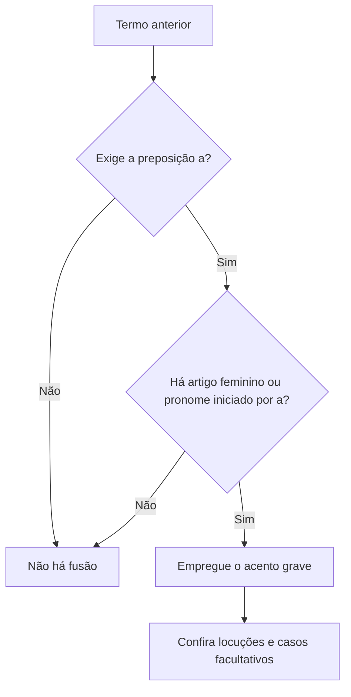

A crase é uma relação entre sons e elementos gramaticais, e seu sinal escrito é o acento grave (`à`, `às`). Para decidir se ele aparece, é necessário verificar simultaneamente a regência do termo anterior e a presença de artigo feminino ou de pronome iniciado por “a”. Este capítulo apresenta o procedimento de análise, os casos de uso obrigatório, proibido e facultativo, além de construções com lugares, locuções e expressões de tratamento. O conhecimento de regência dos capítulos anteriores fornece a primeira peça do diagnóstico.

> [!objetivos]
> - Explicar a fusão que o acento grave representa.
> - Aplicar testes para decidir se há crase.
> - Reconhecer casos obrigatórios, proibidos e facultativos.
> - Analisar pronomes, nomes de lugares e enumerações.
> - Distinguir crase gramatical de usos em expressões fixas.

## O que é crase e como identificá-la

Crase é a fusão de dois sons vocálicos iguais, frequentemente a preposição “a” com o artigo feminino “a” ou “as”. O acento grave marca por escrito essa fusão: “A equipe dirigiu-se à base” corresponde a “dirigiu-se a + a base”. O acento não é um enfeite e não deve ser usado apenas porque a palavra seguinte é feminina. É necessário que a palavra anterior exija a preposição “a” e que a seguinte aceite artigo feminino.

Comece identificando o termo regente. Se o verbo, o nome ou a expressão anterior não exigir a preposição “a”, não há crase pela regra de fusão. “A equipe visitou a base” tem objeto direto “a base”: o primeiro “a” é somente artigo. Já em “A equipe chegou à base”, “chegar” rege “a” na norma-padrão, e “base” vem com artigo feminino; há preposição mais artigo.

Um teste útil é substituir o nome feminino por um masculino equivalente. Se surgir “ao”, provavelmente havia preposição mais artigo no feminino: “chegou à base” / “chegou ao posto”. Se surgir apenas “o”, trata-se provavelmente de artigo sem preposição: “visitou a base” / “visitou o posto”. O teste é auxiliar: preserve o sentido e a estrutura. Outra verificação consiste em perguntar se o nome feminino está determinado por artigo, por exemplo, se a construção admite “a base” como referente identificado.

> [!esquema]
> **Diagnóstico em quatro passos**
> 1. Localize a palavra anterior e descubra se ela rege a preposição “a”.
> 2. Veja se o termo seguinte admite artigo feminino “a/as” ou começa por “a” em pronome demonstrativo.
> 3. Confira a estrutura com um equivalente masculino: “ao” costuma corresponder a “à”.
> 4. Se uma das condições faltar, escreva sem acento grave.

A crase também aparece quando a preposição “a” se combina com pronomes demonstrativos iniciados por “a”: “aquele”, “aquela”, “aquilo”, e com o relativo “a qual/as quais”. “Refiro-me àquela norma” corresponde a “refiro-me a + aquela norma”; “as regras às quais obedecemos” contém a preposição exigida por “obedecer” combinada com o artigo do relativo. Antes do pronome relativo “que”, não se escreve “à que”: “as regras a que obedecemos”.

O pronome demonstrativo “a” pode equivaler a “aquela”: “A norma atual é semelhante à que vigorava antes” (= àquela que). Nesse caso, a preposição se funde com o pronome demonstrativo. Diferente é o artigo que acompanha um nome: “A norma é semelhante à anterior” (a + a anterior, com “norma” subentendida) ou “A norma é semelhante àquela anterior”. A função sintática e a palavra omitida devem ser identificadas no contexto.

## Usos obrigatórios

Há crase obrigatória diante de substantivo feminino determinado quando o termo anterior rege “a”: “A decisão foi favorável à candidata”; “A equipe obedeceu às orientações”; “O relatório faz referência à vistoria”. A regência pode ser verbal, nominal ou de uma locução. A existência de um artigo não basta por si só: em “A equipe leu a orientação”, o verbo “ler” não exige preposição, portanto há somente artigo.

Também se usa crase com locuções adverbiais, prepositivas e conjuntivas femininas consagradas: “à tarde”, “às pressas”, “à direita”, “à vontade”, “à medida que”, “à procura de”, “à espera de”. Em muitas delas, o acento ajuda a marcar a expressão adverbial ou prepositiva. Compare “Ficou à espera do chamado” com “A espera terminou”: no primeiro caso, “à espera de” é locução; no segundo, “a” é artigo que determina o substantivo “espera”.

Nas indicações de horas determinadas, emprega-se crase: “A inspeção começará às oito horas”; “Chegou à uma hora da tarde”. A construção “da tarde” reforça que se trata da hora exata. Para indicar tempo futuro ou distância temporal, não se usa: “A equipe retorna daqui a uma hora”. No primeiro exemplo, “a” introduz uma medida de tempo; no segundo, há locução com hora indicada. A grafia depende do sentido, não apenas da palavra “hora”.

> [!exemplo]
> “O briefing ocorrerá às 14 horas” tem crase, pois a indicação exata de horário é uma locução adverbial feminina. “O briefing começará daqui a duas horas” não tem, porque “a” é preposição que introduz um intervalo futuro e não se funde a artigo.

Emprega-se ainda a crase na expressão “à moda de” ou “à maneira de”, mesmo quando o nome seguinte é masculino ou está implícito: “Preparou o peixe à moda pernambucana”; “O atleta fez um gesto à Pelé”, isto é, à maneira de Pelé. Se a expressão não estiver implícita nem houver artigo feminino, não force a crase: “bife a cavalo”, “frango a passarinho”. Nesses casos, o “a” faz parte de construção sem artigo feminino.

Nomes de lugares levam artigo de acordo com o uso. Um teste tradicional é combinar “voltar”: a forma de ida pode ser comparada à forma de retorno para confirmar a presença de artigo Assim, “A equipe viajou à Bahia” e “A equipe retornou da Bahia”, mas “A equipe viajou a Brasília” e “retornou de Brasília”. O teste é indício, não substitui o contexto. Um nome normalmente sem artigo pode recebê-lo quando especificado: “voltou à cidade antiga do Recife” apresenta artigo feminino diante de “cidade”; “voltou ao Recife” mantém o artigo masculino do topônimo.

> [!bizu]
> Para lugar, diga mentalmente “volto da” ou “volto de”. confira se o nome do destino admite artigo quando se descreve o retorno. Em nomes variáveis, confira o uso estabelecido e a determinação expressa no período.

Na enumeração, mantenha paralelismo. Se uma série apresenta complementos femininos, a preposição pode ser repetida em cada elemento: “A medida se aplica à triagem, à remoção e à comunicação”. Se a preposição aparece uma vez antes da série, pode reger todos os itens: “A medida se aplica a triagem, remoção e comunicação”, embora a determinação e o estilo possam recomendar artigo expresso. Quando a crase é indicada em cada item, a forma gráfica deve ser consistente. Em questão, avalie se a proposta preserva a relação sintática e a determinação de cada nome.

## Casos em que a crase é proibida

Não há crase antes de palavra masculina, pois não existe artigo feminino “a” para se fundir à preposição. Escreve-se “a pé”, “a prazo”, “a cavalo”, “a serviço”. A locução “à moda de” é exceção aparente: o feminino “moda” está implícito, e não há crase diretamente com o nome masculino. Também não se emprega crase antes de verbo: “começou a organizar”, “estava disposto a colaborar”. O “a” antes do infinitivo é preposição, sem artigo.

Em regra, não ocorre crase antes de pronomes pessoais (“a ela”, “a nós”), pronomes de tratamento como “Vossa Excelência” e “Vossa Senhoria”, pronomes indefinidos que não aceitam artigo (“a alguém”, “a ninguém”, “a toda pessoa”) nem pronomes demonstrativos “este/essa” quando não há artigo feminino. As formas “senhora”, “senhorita” e “doutora” admitem artigo e podem receber crase se houver preposição: “Entreguei o documento à senhora”. Já “Enviei a Vossa Excelência” não leva acento.

> [!pegadinha]
> Não generalize que “pronome nunca recebe crase”. O relativo “a qual” e demonstrativos iniciados por “a” admitem a fusão: “à qual”, “àquela”, “àquilo”. O fator decisivo é a presença da preposição e a forma do pronome.

Não se usa crase diante de substantivo feminino empregado em sentido geral e indeterminado quando ele não recebe artigo: “O relatório fez referência a falhas” (falhas em geral); compare com “fez referência às falhas apontadas”, em que se trata de falhas determinadas. A presença de adjetivo não define sozinha se o substantivo é determinado: “a falhas graves” pode continuar genérico. É o contexto que esclarece se o referente é específico.

As palavras “casa” e “terra” podem aparecer sem artigo quando têm sentido não especificado. “Voltou a casa” significa que voltou para sua própria casa; “retornou a terra” pode significar que alcançou terra firme. Com especificação, admite-se artigo: “voltou à casa da irmã”; “retornou à terra prometida”. Em expressões como “casa de apoio”, a determinação do sintagma pode levar ao artigo: “dirigiu-se à casa de apoio indicada”.

Entre palavras repetidas, em geral não ocorre crase: “gota a gota”, “face a face”, “dia a dia”, “uma a uma”. O “a” é preposição entre termos repetidos, sem artigo que forme a fusão. Também não se emprega crase depois de outra preposição que já introduziu o sintagma: “perante a comissão”, “desde a madrugada”, “contra a ordem”. A preposição não pode duplicar-se como “mediante à apresentação”.

> [!atencao]
> Depois da preposição “até”, pode haver a sequência “até a” sem crase ou “até à”, quando se analisa “até” seguido da preposição “a” e de artigo. O acento é facultativo nessa construção locativa: “Caminhou até a/à entrada”. Não confunda com “até” inclusivo: “Até a comandante participou”, em que “até” significa “inclusive” e “a” é apenas artigo.

Antes do artigo indefinido “uma”, normalmente não ocorre crase: “Entregou o aviso a uma agente”. Uma exceção gráfica importante é a indicação de hora exata: “A reunião começa à uma hora”. Não se aplica a exceção a expressões como “daqui a uma hora”, que indicam intervalo futuro.

## Casos facultativos e usos que mudam o sentido

O acento pode ser facultativo quando o artigo feminino também é facultativo. Isso ocorre antes de pronome possessivo adjetivo, que acompanha um substantivo: “Enviei o ofício a sua chefe” ou “à sua chefe”. Em muitos contextos, as duas formas são corretas. Se o possessivo substituir um substantivo omitido, a crase tende a ser obrigatória quando há preposição e artigo: “Falei à minha chefe, não à sua [chefe]”. O segundo “à” retoma o substantivo elíptico e não é facultativo nesse padrão.

Antes de nome próprio feminino, o artigo pode variar por região ou familiaridade: “Enviei um convite a Camila” ou “à Camila”. A crase é possível quando o nome admite artigo e a regência exige “a”. A escolha deve respeitar a construção do texto e a variedade adotada, sem afirmar que todo nome feminino exige artigo. Se houver pronome de tratamento (“a senhora Camila”), a análise muda.

A sequência “até a” pode ser interpretada como a preposição “até” seguida de artigo, ou “até” seguida da preposição “a” e do artigo, produzindo “até à”. Em casos de movimento com destino, ambas as grafias são aceitas em uso normativo: “Fui até a/à entrada”. Se “até” significa também, não se forma a locução: “Inclusive a chefe assinou”. O contexto separa as duas estruturas.

A ausência de crase pode alterar o grau de determinação. “Entregou a mensagem a diretora” tende a apresentar “diretora” sem artigo, enquanto “entregou a mensagem à diretora” identifica uma diretora determinada. A crase não é facultativa por regra geral; ela somente pode ser omitida se a construção também dispensar o artigo e o sentido resultante continuar adequado. Não transforme toda crase diante de substantivo feminino singular em opção estilística.

> [!exemplo]
> “O comandante fez referência a candidata” pode tratar de qualquer candidata, sem artigo, embora a frase precise de contexto. “Fez referência à candidata” identifica uma pessoa específica. A mudança do acento acompanha a mudança no artigo e na leitura do referente.

A locução “a distância” pode variar segundo a determinação. Em uso genérico, escreve-se “observar a distância”; quando a distância vem especificada, usa-se “à distância de cinquenta metros”. Já “à mão”, “à vista” e “à prestação” podem aparecer como locuções com acento, mas expressões como “a mão levantada” podem ter “a” como artigo e não locução. Examine o papel sintático, não memorize apenas a sequência de letras.

## Casos de prova e paralelismo

A análise do acento grave fica mais segura quando se comparam frases mínimas. “A equipe chegou a uma unidade” não recebe crase porque “uma” já é artigo indefinido e a regra geral não permite somar a ele um artigo definido. “À uma hora” é uma locução de horário exato, caso convencional em que o acento aparece. “Chegou a uma hora de distância” descreve intervalo, portanto não se confunde com o horário. A mesma forma visível pode ter funções diferentes em contextos diversos.

O par “a vista” e “à vista” também ilustra mudança de construção. “A vista do mirante é ampla” contém artigo antes do substantivo “vista”. “O equipamento foi pago à vista” é locução que indica modalidade de pagamento. A interpretação da expressão é indispensável. Em “a mão direita”, o artigo acompanha “mão”; em “escreveu à mão”, há uma locução adverbial. Na prova, destaque mentalmente o bloco inteiro antes de decidir.

> [!exemplo]
> O relatório pode registrar “O técnico fez a inspeção a distância”, se o sentido for observar sem aproximação e a expressão estiver usada sem especificação; “A observação foi realizada à distância de quarenta metros” marca medida determinada. O contexto decide se existe artigo ou uma locução com valor especificado.

A crase em enumerações precisa respeitar a estrutura compartilhada pelos itens. “A coordenação deu prioridade à prevenção, à resposta e à recuperação” repete preposição e artigo em cada complemento. “Deu prioridade à prevenção, resposta e recuperação” pode manter uma única preposição antes da série, com os substantivos em coordenação, conforme o estilo. Já “à prevenção, a resposta e recuperação” mistura estruturas sem uma razão sintática clara. As bancas frequentemente apresentam alternativas de reescrita e pergunta se a correção foi preservada; o paralelismo ajuda a detectar omissão de preposição ou artigo.

| Construção | Análise | Forma recomendada |
| --- | --- | --- |
| referência a relatório | nome exige “a”; masculino sem artigo feminino | referência ao relatório |
| referência a norma | feminino genérico sem artigo | referência a norma |
| referência à norma | preposição + artigo feminino determinado | referência à norma vigente |
| referência àquela norma | preposição + demonstrativo | referência àquela norma |
| norma a que me referi | preposição antes do relativo “que” | a que, sem acento |

> [!pegadinha]
> A expressão “à que” costuma estar errada quando “que” é pronome relativo sem artigo. Compare “a proposta a que me referi” e “a proposta à qual me referi”. “À que” só é correto quando o “a” é pronome demonstrativo (equivale a “aquela”) e vem regido de preposição: “Esta proposta é semelhante à que apresentei” (= semelhante àquela que apresentei).

As formas de tratamento exigem distinguir a expressão específica. “Enviei o pedido a Vossa Senhoria” não leva crase: “Vossa Senhoria” não admite artigo feminino nessa construção. “Entreguei o formulário à senhora” pode ter crase, porque “senhora” admite artigo. O mesmo raciocínio pode aplicar-se a “senhorita” e “doutora”, se houver preposição regida pelo verbo ou nome: “Apresentei-me à doutora responsável”. Não generalize a regra de uma forma de tratamento para todas.

O pronome indefinido também requer precisão. Em “Não contou a ninguém”, “ninguém” não admite artigo, portanto não ocorre crase. Em “Entregou a outras equipes”, pode haver artigo facultativo e, dependendo do contexto, a forma “às outras equipes” é possível. “As demais equipes” apresenta artigo, e depois de preposição pode formar crase: “Entregou os avisos às demais equipes”. A frase “pronome nunca leva crase” é ampla demais.

Os demonstrativos iniciados por “a” podem formar crase com uma preposição exigida: “Não me oponho àquela decisão”, “A medida se aplica àquilo que foi combinado”. A segunda forma pode parecer estranha porque “aquilo” não é feminino, mas o acento marca a fusão da preposição “a” com o início do demonstrativo. Não é artigo feminino diante do nome “aquilo”. O teste precisa considerar a classe do pronome.

## Expressões que mudam com a determinação

Substantivo sem artigo pode ter interpretação geral: “A comissão presta atenção a reclamações” significa que considera reclamações em geral; “presta atenção às reclamações protocoladas ontem” aponta um conjunto definido. O artigo pode ser omitido ou expresso por escolha de determinação, mas essa escolha pode modificar o sentido. Não se deve dizer que a crase é facultativa se as duas versões significam coisas diferentes.

A mesma leitura aparece com “entidade”, “partido” e “usurpação”. “A doação foi destinada a entidade filantrópica” pode referir-se a uma entidade qualquer; “foi destinada à entidade filantrópica do bairro” especifica uma instituição. “A comparação se fez a roubo” pode tratar de modo geral, enquanto “comparou o ato ao roubo descrito” tem artigo masculino. O paralelismo entre os termos coordenados pode orientar a presença de artigos, mas a intenção comunicativa e a sintaxe prevalecem.

> [!atencao]
> Nem toda palavra acompanhada de adjetivo é específica. “A uma candidata experiente” continua com artigo indefinido; “a candidata experiente” pode ser definida pelo contexto. A crase depende do artigo efetivamente presente, não de uma impressão vaga de que o substantivo foi qualificado.

“Casa” e “terra” têm usos convencionais sem artigo em certas expressões. “Voltar a casa” significa retornar ao próprio lar; “voltar à casa de apoio” indica uma casa caracterizada pelo complemento. “Chegar a terra” pode opor-se a estar no mar; “chegar à terra firme” especifica o destino. Se o contexto trata de um local conhecido, o artigo pode ser empregado. A decisão não vem da palavra isolada, mas do referente.

A expressão “à moda de” pode aparecer reduzida: “O músico compôs à Villa-Lobos” quer dizer à maneira de Villa-Lobos. O nome masculino não recebe artigo feminino; a crase está ligada ao substantivo “moda” subentendido. Já “frango a passarinho” e “bife a cavalo” não contêm a locução “à moda de” na norma tradicional. Não basta detectar um nome de pessoa ou um alimento para aplicar essa exceção.

> [!bizu]
> Quando o nome seguinte é masculino, pergunte se existe uma expressão feminina oculta, como “à moda de”. Se não existir e não houver outro contexto especial, a crase é proibida: “a prazo”, “a cavalo”, “a serviço”.

### Um último teste para a crase

O contraste também aparece em vocabulário abstrato. “A rigidez administrativa prejudica o serviço” apresenta artigo e sujeito; “a medida se opõe à rigidez administrativa” depende da regência de opor-se a. Em “doei equipamentos a uma entidade”, o artigo é indefinido; “doei recursos à entidade” pode identificar uma destinatária conhecida. “Os regulamentos rígidos” podem ser especificados, mas “a regulamentos rígidos” pode significar quaisquer normas desse tipo. A decisão deve seguir o contexto, não uma lista mecânica.

Expressões como “à maneira de Florence” ou “à moda de Circe” podem conter a locução implícita, mas os nomes próprios não acionam a crase por conta própria. “Amei a atuação” é transitivo direto; “aludi à atuação” exige preposição. A palavra “relacionada” rege “a” em “relacionada à suspensão”, se o nome estiver determinado. “Cassação do mandato” e “suspensão do mandato” trazem artigo dentro do complemento; “resistente à suspensão” recebe crase por regência de “resistente a”. A referência a outros nomes, como York, Bermudas ou linhas comerciais, não altera essa análise.

> [!pegadinha]
> O sinal grave não acompanha automaticamente nomes femininos nem palavras que parecem formais. “A comissão avaliou a suspensão” tem objeto direto; “A comissão foi favorável à suspensão” tem preposição regida por “favorável” e artigo feminino. A pergunta pelo termo regente resolve a diferença.

 Em um cenário de resgate, a fragata pode retornar de uma operação; “a milhas da costa” indica distância sem artigo, ao passo que “à distância de cinco milhas” especifica a medida. A equipe não deve escrever uma chamada de treinamento “à gargalhadas”; a forma correta é “às gargalhadas”. Em questão 08, a comissão pode almoçar à uma hora, se for horário exato, visando à organização do exercício. A palavra “desenhei” exigiria objeto direto, mas “desenhei a rota” não leva crase. “Cedesse à disciplina” pode ter fusão se “ceder a” reger o nome determinado. “Airlines” é apenas nome próprio estrangeiro; a crase decorre da sintaxe portuguesa da frase.

 Em nomes de produtos, como Cutty Sark ou Chanel, e em palavras importadas, como whisky e scotch, verifique a função de cada “a”; nem a marca nem o nome estrangeiro cria crase. Uma pessoa tentadora ou acamada também não muda a regência, e a palavra “meca” só recebe crase em estrutura sintática que reúna as duas condições.

## Mapa do capítulo

| Situação | Regra prática | Exemplo |
| --- | --- | --- |
| Preposição + artigo feminino | Crase obrigatória, se ambos presentes | Dirigiu-se à base |
| Masculino / verbo / pronome pessoal | Sem artigo feminino, não há fusão | A pé; a organizar; a ela |
| Locução feminina / hora exata | Usa-se acento grave | À tarde; às oito |
| Possessivo adjetivo / nome feminino | Artigo pode ser facultativo | A/à sua chefe; a/à Joana |
| Lugar | Verifique artigo e uso | À Bahia; a Brasília |
| Relativo / demonstrativo | A fusão pode ocorrer | À qual; àquela |

### Para fixar

- Crase exige preposição “a” e artigo feminino “a/as” ou pronome iniciado por “a”.
- O teste masculino ajuda: “à base” corresponde a “ao posto” quando a regência é a mesma.
- Usa-se crase em locuções femininas e em indicações de horas exatas.
- “À moda de” pode estar implícita antes de nome masculino: “à Pelé”.
- A crase não ocorre antes de masculino, verbo, pronome pessoal reto, palavra repetida ou depois de preposição.
- “Vossa Excelência” não recebe crase; “senhora” pode recebê-la se houver regência.
- Nomes de lugares variam: confira se o topônimo admite artigo e aplique o teste do retorno.
- O uso facultativo antes de possessivo ou nome feminino depende de o artigo também ser facultativo.
- “À qual” e “àquela” podem conter fusão; “à que” é inadequado na construção relativa usual.

