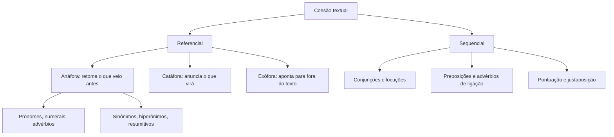

Um texto bem escrito não repete a mesma palavra a cada frase, e também não deixa o leitor perdido sobre de quem ou de que se fala. Quem faz esse trabalho é a coesão: o conjunto de recursos que liga as palavras, as frases e os parágrafos. Este capítulo mostra como a coesão retoma o que já foi dito, como ela anuncia o que ainda virá e quais palavras fazem esse serviço. A prova de Língua Portuguesa cobra isso em quase todo texto: "a que se refere o termo destacado?", "qual a função do pronome nesta frase?", "a troca da expressão mantém o sentido?". O capítulo seguinte continua o assunto com a coesão sequencial, a coerência e a reescrita.

> [!objetivos]
> - Distinguir coesão referencial de coesão sequencial.
> - Reconhecer a retomada (anáfora), a antecipação (catáfora) e a referência a algo fora do texto.
> - Aplicar os pronomes demonstrativos no tempo, no espaço e no texto.
> - Identificar numerais, advérbios, hiperônimos e termos resumitivos usados como elementos de coesão.
> - Perceber a ligação entre orações feita só pela pontuação.

## O que é coesão e quais são os seus tipos

**Coesão** é a ligação entre as partes de um texto. Ela aparece nas palavras e nos recursos que fazem uma frase "puxar" a seguinte. Sem coesão, o texto vira uma lista de frases soltas.

Os estudiosos costumam separar dois grandes grupos de elementos coesivos:

- **Coesão referencial**: evita repetir a mesma palavra. Ela retoma algo que já apareceu ou antecipa algo que vai aparecer. Usa pronomes, advérbios, numerais, sinônimos e outros termos que "apontam" para um referente.
- **Coesão sequencial**: organiza a progressão das ideias. Usa conjunções, preposições, advérbios de ligação e a própria pontuação para marcar relações de causa, oposição, tempo e conclusão. Esse segundo tipo é o assunto do próximo capítulo.

O esquema abaixo organiza os dois tipos e mostra onde cada recurso se encaixa.

Atenção a uma ideia que a banca explora, em textos de argumentação e de descobertas científicas, por exemplo: um bom texto combina **repetição de ideias** com **informação nova**. O texto que só repete é redundante. O que só traz novidade, sem dialogar com o que veio antes, perde o fio. A coesão referencial resolve o primeiro problema: permite voltar à ideia sem repetir a palavra.

> [!bizu] Coesão = ligação
> Quando a questão fala em coesão, pense em "ligação": quem está ligado a quem? Pergunte sempre ao termo destacado: "estou no lugar de quê?" ou "estou anunciando o quê?".

## Anáfora, catáfora e referência fora do texto

Todo elemento de coesão referencial tem um **referente**: a palavra, a expressão ou a ideia à qual ele remete. A posição do referente dá o nome ao fenômeno.

- **Anáfora**: o termo retoma um referente que **já apareceu**. É o caso mais comum.
- **Catáfora**: o termo antecipa um referente que **ainda vai aparecer**.
- **Exófora** (ou referência dêitica): o referente está **fora do texto**, na situação em que ele foi escrito ou dito.

| Fenômeno | Para onde aponta | Exemplo |
| --- | --- | --- |
| Anáfora | para trás, no próprio texto | O sargento chegou cedo. **Ele** abriu o portão. |
| Catáfora | para frente, no próprio texto | Quero **isto**: dormir oito horas. |
| Exófora | para fora do texto | Entregue o relatório **amanhã**. |

Na frase "O sargento chegou cedo. Ele abriu o portão", o pronome *ele* aponta para trás, para *o sargento*: é anáfora. Em "Quero isto: dormir oito horas", o pronome *isto* anuncia o que vem depois dos dois-pontos: é catáfora.

Na referência exofórica, o leitor só entende o termo se conhecer a situação. Considere o bilhete "Nos vemos aqui amanhã". O *aqui* depende do lugar onde o bilhete foi deixado. O *amanhã* depende do dia em que foi escrito. O *nos* depende de quem escreveu. Nenhum desses três referentes está no texto.

> [!atencao] Anafórico não é sinônimo de "pronome pessoal"
> Qualquer elemento que retoma algo anterior é anafórico: pronome (reto, oblíquo ou demonstrativo), relativo, numeral, advérbio ou expressão nominal. O pronome *estas*, por exemplo, pode ser anafórico se retomar um termo já citado. O que define a anáfora é a direção da retomada, e não a classe da palavra.

> [!pegadinha] "Cá" e "lá" nem sempre são anafóricos
> Em versos de saudade da terra natal, como "Minha terra tem palmeiras, onde canta o sabiá", os advérbios *cá* e *lá* indicam o lugar onde o poeta está e o lugar de onde veio. Esses lugares são conhecidos pela situação do poeta, e não por um termo escrito antes. Afirmar que são anafóricos é erro: o uso é exofórico. Antes de marcar "anafórico", confirme que o referente está mesmo no texto.

## Os pronomes como instrumento de coesão

O pronome existe para ocupar o lugar de um nome. Por isso ele é o recurso mais intuitivo de coesão referencial. Cada classe de pronome retoma de um jeito.

| Pronome | Como retoma | Exemplo próprio |
| --- | --- | --- |
| Pessoal reto | substitui o sujeito já citado | A tenente chegou. **Ela** assinou a escala. |
| Pessoal oblíquo | substitui o complemento já citado | Conheço o instrutor e **o** admiro. |
| Possessivo | indica o dono do que foi citado | O cabo perdeu o rádio; **seu** chamado ficou sem resposta. |
| Demonstrativo | aponta o referente no tempo, no espaço ou no texto | **Esse** problema já foi resolvido. |
| Relativo | liga a oração ao termo antecedente | O curso **que** fiz começa em março. |
| Indefinido | resume ou generaliza | Vieram vinte; **alguns** desistiram. |

O pronome possessivo merece cuidado. Em "o autor lembra a democracia ateniense e suas relações com a retórica", a pergunta que decide a questão é: "relações de quem?". A resposta indica o referente. Se houver duas possibilidades, o texto fica ambíguo, e a banca pode pedir justamente isso.

Os pronomes relativos (*que*, *o qual*, *cujo*, *onde*, *quem*) retomam o antecedente e ao mesmo tempo ligam duas orações. O relativo pode retomar um termo qualquer da frase anterior: "O rádio e a televisão chegaram, avanços que desorientaram gerações inteiras" (o *que* retoma *avanços*). Em "A viatura, que estava no pátio, pegou fogo", o *que* retoma *a viatura*. Se trocarmos o relativo pelo antecedente, a ligação aparece: "A viatura estava no pátio" e "a viatura pegou fogo".

O **artigo definido** também retoma. Em "Havia vários militares na fila. Os militares reclamavam do calor", o artigo *os* mostra que o leitor já conhece o termo, porque ele apareceu antes. Com o artigo indefinido a lógica é a inversa: *um militar* introduz alguém novo.

> [!exemplo] Retomada com pronomes
> "A comandante inspecionou o pelotão. **Ela** elogiou a pontualidade, **que** havia melhorado muito, e entregou a **cada um** o seu certificado. **Isso** animou a tropa." Aqui, *ela* retoma *a comandante*; *que* retoma *a pontualidade*; *cada um* e *seu* retomam os integrantes do pelotão; *isso* retoma toda a ação anterior.

## Pronomes demonstrativos: tempo, espaço e texto

Os demonstrativos *este*, *esse* e *aquele* (com suas flexões e as formas *isto*, *isso*, *aquilo*) são os campeões das questões de coesão. Eles "demonstram": situam o referente por uma de três medidas. A lógica das três é a mesma: três pessoas do discurso, três graus de distância.

| Forma | Espaço | Tempo | Texto |
| --- | --- | --- | --- |
| este, esta, isto | perto de quem fala | presente | o que **vai ser dito** ou o mais **próximo** |
| esse, essa, isso | perto de quem ouve | passado recente ou futuro próximo | o que **já foi dito** |
| aquele, aquela, aquilo | longe dos dois | passado ou futuro distante | o mais **distante** |

**No espaço.** O demonstrativo acompanha a posição de quem fala. "Este caderno que está na minha mão" é do falante. "Esse caderno que está na sua mão" é do ouvinte. "Aquele caderno lá na estante" está longe dos dois. Quando o demonstrativo aponta para o espaço, o referente está fora do texto, e o uso é dêitico.

**No tempo.** *Este* marca o período em que estamos: "este mês", "neste ano". *Esse* marca um tempo próximo, mas já passado ou ainda por vir: "nesse dia em que nos vimos", "nessa semana que vem". *Aquele* marca tempo distante: "naquele ano da formatura".

**No texto.** Aqui está o uso que mais cai. Em geral:

- ***Este*** **anuncia** o que será dito: "Esta é a regra: chegue dez minutos antes." É catáfora.
- ***Esse*** **retoma** o que já foi dito: "Chegue dez minutos antes. Essa regra vale para todos." É anáfora.
- Quando há dois termos citados, ***este*** retoma o **mais próximo** (o último) e ***aquele*** o **mais distante** (o primeiro).

"Mariana e Rafael são instrutores; **este** ensina salvamento aquático e **aquela**, primeiros socorros." O *este* volta para *Rafael*, o último citado. O *aquela* volta para *Mariana*, a mais afastada.

> [!atencao] Regra de prova, com uma ressalva
> A regra "esse retoma, este anuncia" é a mais segura. Na escrita culta real, *este* também retoma o que acabou de ser dito, quando o assunto está "perto" do autor. Por isso, uma questão que fala de *estas* retomando um termo recém-citado costuma ser considerada correta. Se a questão exigir escolher entre *este* e *esse*, procure o contexto: há localização no espaço? Há palavra como *aqui* ou *aí*?

> [!pegadinha] Aqui pede este; aí pede esse
> O advérbio de lugar orienta o demonstrativo. Em "Aqui, neste escritório, ...", o demonstrativo correto é *neste*, porque *aqui* indica perto de quem escreve. Trocar por *nesse* geraria incorreção. A mesma ligação vale para *aí* e *esse*, e para *lá* e *aquele*.

> [!bizu] Este, esse, aquele pela ordem das pessoas
> Eu falo: **este**. Você ouve: **esse**. Terceiros, longe: **aquele**. A ordem das letras (e, e, a) acompanha a ordem de proximidade.

## Numerais e advérbios que retomam

Os **numerais** também retomam termos. O mais comum é o par *o primeiro / o segundo*, que substitui os demonstrativos *aquele / este* quando a ordem pode confundir.

"A cabo Luana e o soldado Davi foram ao quartel. **A primeira** abriu o cofre; **o segundo** conferiu o armário." Os numerais evitam dúvida sobre quem fez o quê, o que o *este / aquele* pode não resolver.

Outros numerais retomam grupos: *ambos* e *ambas* (os dois), *os dois*, *as três*, *todos os quatro*. Em "O quartel recebeu uma bomba e um gerador. **Ambos** chegaram danificados", *ambos* retoma os dois equipamentos. "A tenente e eu revisamos o plano. **Nós dois** achamos o prazo curto" também usa numeral para voltar aos dois sujeitos.

Os **advérbios** de lugar e de tempo retomam ou antecipam circunstâncias:

- *aqui, aí, ali, lá, cá* retomam um lugar já citado: "Moro em Olinda; aqui o carnaval é famoso." (*aqui* = Olinda).
- *então, antes, depois, hoje, nessa época* retomam um momento: "Em 1990 ele entrou na corporação; **então** era só um rapaz."
- *assim* retoma um modo: "Ela montou a barraca de modo seguro; **assim**, ninguém se machucou."

O advérbio também pode ser catafórico: "Tenho saudade de **lá**: de Gravatá." O *lá* antecipa o lugar que a frase só nomeia depois do sinal.

## Termos que resumem e termos que substituem

Uma boa parte da coesão acontece com palavras comuns que retomam outras mais específicas. Os recursos a seguir aparecem em quase toda prova.

### Termos resumitivos

Quando o texto enumera vários elementos, uma palavra pode **resumir tudo** e abrir o período seguinte. É o caso de *tudo isso*, *isso tudo*, *tais fatos*, *essas medidas*, *os outros*, *a rotina*.

"Treinar, estudar, descansar: **tudo isso** compõe a preparação." O *tudo isso* retoma os três verbos. Se uma questão disser que ele retoma só o último, está errada.

### Sinônimos, hiperônimos e hipônimos

O texto pode retomar um termo por outro de sentido próximo. O advento da informática trouxe verbos que ilustram a ideia: *ticar* uma caixa de seleção e *clicar* nela são ações próximas, mas o primeiro é de uso mais restrito.

- **Sinônimo**: palavra de sentido semelhante. *Carro* e *automóvel*.
- **Hiperônimo**: palavra de sentido mais **amplo**, que inclui outras. *Veículo* inclui *carro*.
- **Hipônimo**: palavra de sentido mais **específico**, incluída no grupo maior. *Caminhão* é hipônimo de *veículo*.

A relação é de "gênero" e "espécie". "O **diesel** subiu de preço e o **combustível** pesou no orçamento" é outro caso: *diesel* é hipônimo e *combustível*, hiperônimo. "O **bombeiro** entrou no prédio. **O profissional** já havia treinado essa manobra." Aqui, *o profissional* é hiperônimo de *bombeiro*. Voltar de um hipônimo para um hiperônimo (do específico para o geral) é o caminho mais comum na coesão.

> [!atencao] Hiperônimo não é sinônimo
> *Animal* retoma *cão*, mas não é sinônimo dele. O retorno vai do específico ao geral. Se a questão disser "gato é hiperônimo de animal", ela inverteu a relação. O hiperônimo é o mais amplo.

### Antonomásia

É a retomada de um nome próprio por uma característica que identifica a pessoa. "Machado de Assis publicou *Dom Casmurro*. **O Bruxo do Cosme Velho** criou Capitu." A expressão *O Bruxo do Cosme Velho* retoma o nome próprio. O compositor Chico Buarque, retomado como "o artista" e "o músico", segue a mesma lógica. Também funciona o caminho inverso, de um nome comum para uma descrição: "o capitão" e "o comandante do quartel".

### Simbolização, nominalização, redução e sigla

- **Simbolização**: troca de uma entidade por um símbolo que a representa. "A Coroa decidiu" retoma o rei; "a Casa Branca", o governo dos Estados Unidos.
- **Nominalização**: troca de um verbo ou adjetivo por um substantivo. "Os impostos foram **recolhidos**. Esse **recolhimento** foi menor." Outro exemplo: "A prova é **difícil**. Essa **dificuldade** preocupa."
- **Redução e ampliação**: alternância entre a forma longa e a curta de um nome. "O Corpo de Bombeiros Militar de Pernambuco abriu vagas. O **Corpo de Bombeiros** divulgou o edital. A **corporação** recebeu muitas inscrições."
- **Sigla**: o nome completo vem primeiro, seguido da sigla entre parênteses. Depois, usa-se só a sigla. "O Corpo de Bombeiros Militar de Pernambuco (CBMPE) publicou o edital. O CBMPE ainda divulgará o calendário." Usar a sigla antes do nome completo prejudica a clareza.

O quadro a seguir reúne os recursos de retomada e mostra como reconhecê-los.

> [!esquema] Recursos de coesão referencial
> - **Pronomes** (pessoais, possessivos, demonstrativos, relativos, indefinidos): trocam um nome já citado.
> - **Numerais** (*o primeiro*, *ambos*, *os dois*): retomam termos pela ordem ou pela quantidade.
> - **Advérbios** (*aqui*, *lá*, *então*, *assim*): retomam ou antecipam lugar, tempo e modo.
> - **Resumitivos** (*tudo isso*, *essas medidas*): condensam uma enumeração.
> - **Hiperônimos e sinônimos**: retomam o termo por outro mais amplo ou equivalente.
> - **Antonomásia, simbolização, nominalização, redução e sigla**: formas de reescrever o nome.

## Coesão por justaposição

Nem toda ligação precisa de palavra. Duas orações podem ficar lado a lado, separadas só por um sinal de pontuação, e o leitor entende a relação entre elas. Esse recurso chama-se **justaposição**. O sinal pode ser dois-pontos, ponto e vírgula, vírgula ou ponto.

- "Preciso sair agora: estou atrasado." Os dois-pontos sugerem **explicação** (equivalem a *pois* ou *porque*).
- "Estudou muito; não passou." O ponto e vírgula sugere **oposição** (equivale a *mas* ou *porém*).
- "Acordou, tomou café, saiu." A vírgula organiza uma **sequência** de ações.

A banca pergunta qual conjunção pode ocupar o lugar do sinal sem mudar o sentido. Para responder, descubra primeiro a relação lógica entre as orações (explicação, oposição, conclusão, adição) e só depois escolha o conectivo. "Choveu a noite toda; a rua alagou" admite *e, por isso a rua alagou* (consequência), e não *mas* (oposição).

Também há coesão por **omissão** (elipse): o termo é deixado de lado porque o leitor o recupera facilmente. "Maria entrou e [Maria] sentou" não repete o sujeito. A elipse economiza palavras sem perder a ligação.

> [!pegadinha] Trocar o sinal muda a relação
> Se uma questão pede para substituir os dois-pontos por uma conjunção, a conjunção precisa manter a relação original. Em "Saí cedo: havia trânsito", a conjunção correta é explicativa (*pois*). Trocar por *mas* cria uma oposição que a frase original não tinha.

## Como a banca cobra a coesão referencial

A questão costuma trazer um texto com um trecho destacado e uma afirmação sobre ele. Os modelos mais frequentes são três:

1. **Identificar o referente**: "o termo *que* retoma *saltos de época*". Faça a substituição: coloque o suposto referente no lugar do termo destacado e veja se a frase continua fazendo sentido.
2. **Classificar o recurso**: "*tudo isso* é um termo resumitivo" ou "*aqui* é elemento anafórico". Confira se o referente está dentro ou fora do texto.
3. **Julgar a troca**: "a substituição de *neste* por *nesse* mantém a correção". Verifique a ideia de tempo, de espaço ou de texto.

O teste da substituição vale em todos os casos. Retire o termo destacado e ponha o referente. Se o sentido se mantém, a retomada está correta. Se mudar, a afirmação da questão provavelmente é falsa.

> [!exemplo] Teste da substituição
> Frase original: "Para proteger as tartarugas, o melhor é vigiá-las na desova. Os animais que a comunidade vigia raramente somem." Substituição de *as* (em *vigiá-las*): "vigiar as tartarugas". Faz sentido. Já *os animais*, no segundo período, é uma generalização: refere-se a todos os animais vigiados pela comunidade, e não apenas às tartarugas. Se a questão disser que são o mesmo referente, está errada.

## Mapa do capítulo

A tabela abaixo reúne o capítulo: cada recurso, o que ele faz e uma pista para reconhecê-lo na prova.

| Recurso | Função | Pista de reconhecimento |
| --- | --- | --- |
| Pronome pessoal e possessivo | retoma o nome já citado | pergunte "de quem?" |
| Pronome relativo | retoma o antecedente e liga orações | troque pelo antecedente |
| Demonstrativo no texto | *este* anuncia; *esse* retoma | veja a direção do referente |
| Numeral | retoma pela ordem ou quantidade | *o primeiro*, *ambos*, *os dois* |
| Advérbio | retoma lugar, tempo ou modo | *aqui*, *lá*, *então*, *assim* |
| Resumitivo | condensa uma enumeração | *tudo isso*, *essas medidas* |
| Hiperônimo | retoma do específico para o geral | *cão* → *animal* |
| Justaposição | liga orações só pela pontuação | descubra a relação lógica |

### Para fixar
- Coesão referencial evita repetir palavras; coesão sequencial marca a progressão das ideias.
- Anáfora retoma o que já foi dito; catáfora anuncia o que virá; exófora aponta para fora do texto.
- Na referência ao texto, *este* anuncia, *esse* retoma, e *aquele* vai ao mais distante.
- Entre dois termos citados, *este* retoma o último e *aquele* o primeiro.
- *Aqui* pede *este*; *aí* pede *esse*; *lá* pede *aquele*.
- Os numerais *o primeiro*, *o segundo* e *ambos* evitam dúvida sobre o referente.
- Termos como *tudo isso* resumem toda a enumeração anterior, e não só o último item.
- O hiperônimo é o termo mais amplo (*animal*); o hipônimo é o específico (*cão*).
- Dois-pontos, ponto e vírgula e vírgula podem ligar orações sem conjunção; a relação lógica precisa ser mantida na reescrita.
- A sigla só aparece depois do nome completo.
