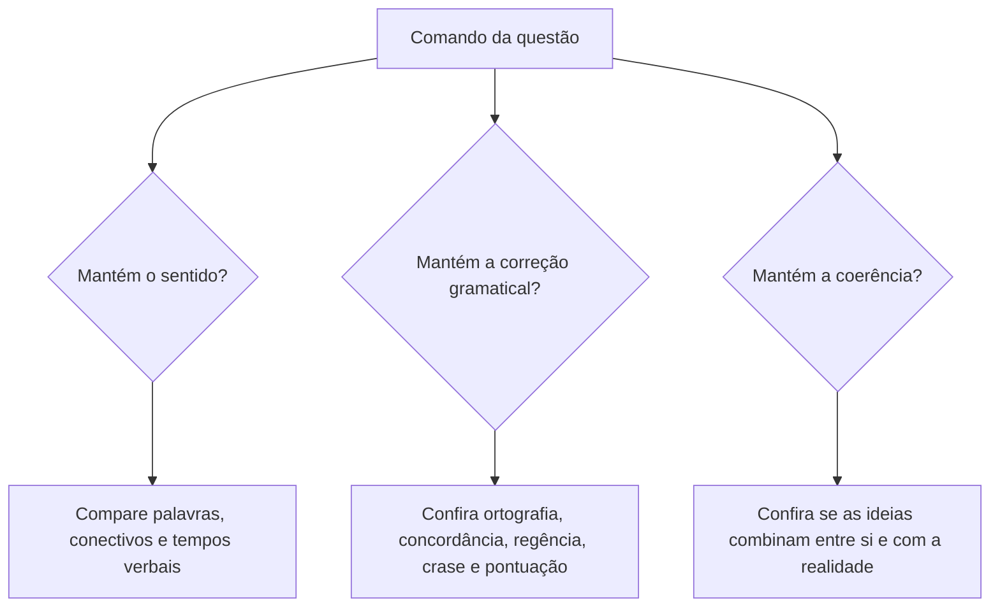

No capítulo anterior, a coesão serviu para retomar e antecipar. Agora ela serve para fazer o texto andar: as conjunções e outras palavras de ligação mostram se a ideia nova se soma à anterior, se a contraria ou se decorre dela. Este capítulo também ensina a diferença entre coesão e coerência e termina com a reescrita de frases, o tipo de questão que mistura sentido, correção gramatical e lógica. Ele fecha com a crase, porque a mudança de uma palavra na reescrita costuma pedir ou retirar o acento grave.

> [!objetivos]
> - Relacionar cada conectivo à ideia que ele expressa.
> - Distinguir coesão de coerência e reconhecer uma contradição.
> - Separar, em uma questão de reescrita, o que muda o sentido, a gramática ou a coerência.
> - Substituir um conectivo por outro mantendo a relação lógica.
> - Decidir quando ocorre a crase.

## Coesão sequencial: os conectivos fazem o texto avançar

Entre os mecanismos de coesão textual, a coesão sequencial dá **continuidade** ao texto e garante a progressão das ideias. Seu principal instrumento é o conectivo: conjunções, locuções conjuntivas, preposições e advérbios de ligação. Quem lê um *mas* já sabe que virá uma oposição. Quem lê *portanto* já espera uma conclusão. Quem lê *por outro lado* sabe que antes houve um primeiro lado.

Por isso o conectivo carrega dois movimentos ao mesmo tempo. Ele **retoma** o que foi dito e **prepara** o que virá. Em "Gosto de correr, mas não treino há meses", o *mas* se apoia na primeira oração e quebra a expectativa que ela criou.

A tabela abaixo reúne as relações de sentido mais cobradas e os conectivos de cada uma. Ela é a base para qualquer troca de palavra em uma reescrita.

| Relação | Conectivos mais comuns | Exemplo próprio |
| --- | --- | --- |
| Adição | e, nem, além disso, também | O cabo estudou **e** treinou. |
| Oposição | mas, porém, contudo, todavia, entretanto, no entanto | Treinou muito, **porém** não passou. |
| Alternância | ou, ora... ora, quer... quer | **Ou** estuda, **ou** perde a vaga. |
| Conclusão | logo, portanto, por isso, assim, então | Estudou; **logo**, passou. |
| Explicação | pois (depois do verbo), porque, que | Corra, **que** a prova é hoje. |
| Causa | porque, já que, visto que, uma vez que, como | Faltou **porque** estava doente. |
| Consequência | tão... que, de modo que, tanto que | Estudou **tanto que** passou. |
| Concessão | embora, ainda que, mesmo que, apesar de, conquanto | **Embora** cansada, continuou. |
| Condição | se, caso, contanto que, a menos que, desde que | **Se** treinar, passa. |
| Finalidade | para, a fim de, para que | Treina **para** passar. |
| Tempo | quando, assim que, logo que, enquanto | **Quando** soou o alarme, saiu. |

Quatro cuidados evitam a maior parte dos erros nessa tabela.

1. **Oposição não é concessão.** Na oposição ("Estudou, mas não passou"), os dois fatos são afirmados. Na concessão ("Embora tenha estudado, não passou"), o fato da oração principal acontece apesar de um obstáculo que não impediu.
2. **Causa não é conclusão.** *Porque* introduz a causa. *Logo* e *portanto* introduzem a consequência. Trocar um pelo outro inverte o raciocínio.
3. ***Pois* muda de função conforme a posição.** Depois do verbo, é conclusivo: "Estudou muito; deve, **pois**, passar". No início da oração, é explicativo ou causal e equivale a *porque*: "Leve água, **pois** o dia será quente".
4. ***Desde que* tem dois sentidos.** Pode marcar o tempo ("Desde que chegou, só trabalha") ou a condição ("Pode entrar, desde que se identifique"). O contexto decide; se há um verbo no subjuntivo que impõe um requisito, a ideia é de condição.

> [!pegadinha] Troca de conectivo com outra relação
> A banca propõe substituir *embora* por *porque*, *portanto* por *porém*, *se* por *quando*. Cada troca altera a relação lógica. Antes de olhar a gramática, pergunte: "a relação continua sendo a mesma?". Se a resposta for não, o sentido mudou.

> [!bizu] Pergunta-chave da relação
> Ligue as duas ideias com a frase "e daí?". Se a segunda ideia **explica** a primeira, é causa. Se a segunda **decorre** da primeira, é conclusão. Se a segunda **contraria** a expectativa, é oposição ou concessão.

Os pronomes anafóricos também ajudam a sequência. O texto que começa com *esse*, *isso* ou *desse modo* mostra que há uma informação anterior. O pronome *isso*, em particular, costuma retomar **toda uma ideia** (uma oração, um período ou um parágrafo), e não só uma palavra. Se a questão disser que ele retoma uma "crítica do autor" que não está naquele trecho, a afirmação é falsa: o referente é o fato descrito, e não a opinião sobre ele.

## Coerência: a lógica do texto

A coesão está nas palavras. A **coerência** está no sentido. Um texto é coerente quando suas ideias combinam entre si e com a realidade. Coesão e coerência andam juntas, mas não dependem uma da outra.

- **Coerência interna**: as ideias do próprio texto não se contradizem. O que o autor afirma no início não pode ser desfeito no fim.
- **Coerência externa**: as ideias não contrariam a realidade, a história ou os dados conhecidos. Dizer que "o inverno em Recife é o mais frio do país" fere a coerência externa.

A coerência se constrói pela **expectativa** que cada palavra cria. O conectivo é uma promessa; a frase seguinte precisa cumpri-la. A contradição quebra a promessa e gera incoerência.

> [!exemplo] Três tipos de incoerência
> - **Contradição de tom**: "Precisamos de medidas urgentes e imediatas. Portanto, vamos formar uma comissão para estudar o tema com calma, por anos." Urgência e calma não combinam.
> - **Conectivo que contraria a lógica**: "A soldado treinou todos os dias e, mesmo assim, foi aprovada." O *mesmo assim* promete um obstáculo, mas aprovação é o resultado esperado. O conectivo coerente seria *por isso*.
> - **Oposição sem oposição**: "Todos nos apoiam, mas ninguém nos critica." As duas ideias seguem na mesma direção, então o *mas* não tem lugar.

Uma frase pode ser coesa e incoerente: "Cancelei a viagem porque tinha muito dinheiro e muito tempo livre." A ligação (*porque*) está perfeita, mas a causa é absurda. Pode também ser coerente com pouca coesão, como um bilhete de ideias claras, só que sem conectivos.

> [!atencao] Sentido não é coerência
> A manutenção do sentido, na reescrita, é um julgamento diferente da manutenção da coerência. Mudar o sentido de uma frase **não** a torna incoerente. Trocar "estudaram e não jogaram bola" por "estudaram, mas não jogaram bola" muda a relação (de adição para oposição), mas a frase continua lógica. O erro é de **sentido**, e não de coerência.

## Reescrita de frases: o que a questão está pedindo

Boa parte das questões de gramática é, na verdade, de reescrita: o enunciado propõe uma nova redação e pergunta se ela está correta. O primeiro passo é ler o **comando**, porque ele define o que deve ser analisado.

Muitas questões pedem dois itens juntos: gramática e sentido, ou sentido e coerência. Analise cada um separadamente. Um erro gramatical não implica mudança de sentido, e uma mudança de sentido não implica erro gramatical.

**Para analisar o sentido**, observe quatro pontos:

- **Palavras trocadas.** Sinônimos aparentes podem ter significados diferentes. *Compreender* não é *representar*, e *maquinário* é mais amplo que *relógio*.
- **Conectivos.** A nova palavra precisa expressar a mesma relação. *Mas* e *porém* são equivalentes; *porque* e *portanto* não são.
- **Tempo e modo verbais.** Passar "treina" para "treinaria" ou "treinou" muda o sentido, porque muda o momento ou a certeza do fato.
- **Orações adjetivas.** A oração restritiva delimita o termo; a explicativa apenas acrescenta uma informação. "Os soldados que chegaram cedo foram dispensados" (só alguns foram dispensados) difere de "Os soldados, que chegaram cedo, foram dispensados" (todos chegaram cedo e todos foram dispensados). Trocar uma pela outra altera o sentido, mas normalmente mantém a correção gramatical.

**Para analisar a gramática**, passe pelos pontos mais cobrados:

- ortografia e acentuação;
- correlação dos tempos verbais;
- concordância verbal e nominal;
- regência verbal e nominal;
- crase;
- pontuação (por exemplo, a vírgula entre sujeito e verbo é proibida).

Uma frase pode ser reescrita de forma mais curta. A comparação "os moradores do campo são melhores que os da cidade" equivale a "os moradores da cidade são piores que os do campo". Mas "menos bons" é a ideia contrária de "melhores": ali o sentido mudou.

> [!pegadinha] Reescrita que parece igual
> A alternativa errada costuma trocar **uma** palavra no meio de uma frase longa: um verbo, um conectivo, um advérbio. Compare parte por parte, e não o conjunto. O erro raramente está onde a frase "soa" diferente.

## Crase: quando o *a* recebe o acento grave

O emprego do sinal indicativo de crase é tema de edital e aparece também fora da reescrita. Quem inicia o estudo deve pensar no jeito de testar a regra, mais do que em decorar listas.

A **crase** é a fusão de duas vogais *a*: a **preposição** *a*, pedida por um termo anterior, e o **artigo** *a(s)* ou o pronome *aquele(s)*, *aquela(s)*, *aquilo*, que acompanha o termo seguinte. O acento grave marca essa fusão: *à*, *às*. Na reescrita, ela costuma aparecer quando se troca o verbo ou o substantivo, porque cada um pede uma preposição própria.

A condição é dupla: precisa haver **preposição** e **artigo**. Sem uma das duas, não há crase.

Dois testes ajudam:

- **Troca pelo masculino.** Substitua a palavra feminina por uma masculina. Se aparecer *ao*, haverá crase: "Fui à praia" (fui **ao** parque). Se aparecer só *a*, não há: "Vi a praia" (vi **o** parque).
- **Volto da / volto de.** Com verbos de movimento, pergunte: "volto **da**?". Se sim, há crase: "Vou **à** Bahia" (volto **da** Bahia). Se aparece *de*, não há: "Vou a Recife" (volto **de** Recife).

O quadro seguinte resume os casos principais.

| Situação | Regra | Exemplo |
| --- | --- | --- |
| Antes de palavra masculina | não há crase | Fui a pé até o quartel. |
| Antes de verbo | não há crase | Ela começou a estudar. |
| Antes de pronome indefinido, de tratamento ou pessoal | não há crase (exceto *senhora*, *senhorita* e *dona*, que aceitam artigo) | Entreguei a ela; escrevi a Vossa Excelência; mas: falei à senhora. |
| Palavras repetidas | não há crase | Ficaram cara a cara. |
| Locuções femininas | há crase | Saiu à noite; chegou às pressas. |
| Horas determinadas | há crase | O treino vai das 6 às 8 horas. |
| Antes de *aquele* e *aquilo* | há crase (a + a) | Referi-me àquele caso. |
| Diante de possessivo ou nome próprio feminino | crase facultativa | Entreguei o relatório a(à) minha chefe. |

Observações de prova:

- Em locuções femininas (*à direita*, *à medida que*, *à procura de*), a crase é obrigatória.
- Diante de nome de lugar, aplique o teste *volto da*. "Vou à França" (volto **da** França) leva crase; "Vou a Brasília" (volto **de** Brasília) não leva, a menos que o nome venha determinado: "Vou à Brasília de Niemeyer".
- Antes de *casa* e *terra*, só há crase se a palavra estiver determinada: "Voltou a casa" (a própria casa), mas "Voltou à casa dos pais".
- Quando existe uma expressão masculina subentendida, como "à moda de" ou "à Luís XV" (à moda de Luís XV), a crase aparece mesmo diante de nome masculino.

> [!atencao] Sem preposição, sem crase
> Verbos como *amar*, *ver* e *encontrar* não pedem preposição. "Vi a diretora" não leva acento, ainda que a palavra seguinte seja feminina. O acento só nasce quando o termo anterior exige *a*: *obedecer a*, *assistir a*, *aludir a*.

## Mapa do capítulo

O quadro reúne o capítulo em uma sequência de perguntas que serve para resolver a maior parte das questões de coesão sequencial e reescrita.

| Pergunta | O que verificar | Ferramenta |
| --- | --- | --- |
| Qual a relação entre as ideias? | adição, oposição, causa, conclusão, concessão... | tabela de conectivos |
| O texto é coerente? | contradição interna ou com a realidade | expectativa criada pelo conectivo |
| A reescrita mantém o sentido? | palavras, conectivos, tempo e modo, restritiva e explicativa | comparação parte por parte |
| A reescrita mantém a gramática? | ortografia, concordância, regência, pontuação | lista de pontos de gramática |
| Há crase? | preposição + artigo, ou *aquele* | troca pelo masculino; *volto da* |

### Para fixar
- Coesão sequencial usa conectivos que retomam o que foi dito e preparam o que virá.
- Oposição (*mas*, *porém*) difere de concessão (*embora*, *ainda que*) e de causa (*porque*).
- *Pois* depois do verbo é conclusivo; no início da oração é explicativo ou causal.
- *Desde que* pode ser tempo ou condição, conforme o contexto.
- *Isso* costuma retomar toda uma ideia, e não apenas uma palavra.
- Coerência interna é a ausência de contradição no texto; coerência externa é a compatibilidade com a realidade.
- Mudar o sentido de uma frase não a torna incoerente; sentido e coerência são análises distintas.
- Oração adjetiva restritiva troca por explicativa: muda o sentido, mas a gramática segue correta.
- A crase exige preposição **mais** artigo; antes de masculino ou de verbo, não há crase.
- Teste do masculino (*ao*) e teste *volto da* resolvem a maioria das dúvidas de crase.
