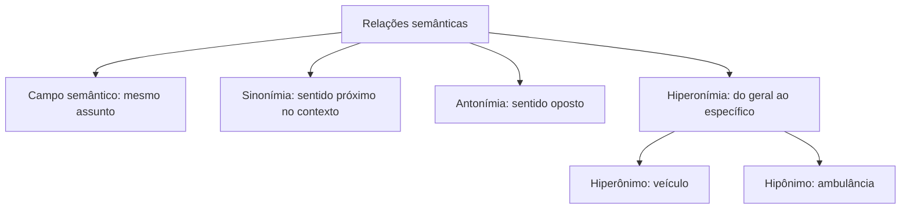

Semântica é o estudo do sentido das palavras e dos textos. Ela está presente em toda a gramática, porque cada conectivo, cada tempo verbal e cada preposição também carrega significado. Este capítulo trata da parte mais visível: como as palavras se agrupam por assunto, quando elas significam o que dizem ou algo além disso, e que relações de semelhança, oposição e inclusão existem entre elas. A prova cobra esse conteúdo em vocabulário no contexto, na troca de palavras numa reescrita e na interpretação de sentido figurado.

> [!objetivos]
> - Reconhecer o campo semântico de um conjunto de palavras.
> - Distinguir o sentido denotativo do sentido conotativo em um contexto.
> - Avaliar se duas palavras são sinônimas naquele texto específico.
> - Identificar antônimos e relações de oposição contextual.
> - Classificar uma palavra como hiperônimo ou hipônimo.

## Campo semântico

**Campo semântico** é o conjunto de palavras que se ligam a um mesmo assunto. Quem pensa em uma delas lembra das outras com facilidade. As palavras *mangueira*, *hidrante*, *escada*, *viatura*, *resgate*, *sinistro* e *capacete* formam, para quem trabalha no quartel, o campo semântico do combate a incêndio.

O campo semântico não tem lista fechada. Ele se forma no contexto e depende do repertório de quem lê. Para um jogador, *cartão* e *juiz* estão no campo do futebol. Para um comerciante, *cartão* pertence ao campo do pagamento. A mesma palavra pode migrar de campo conforme o assunto do texto.

Esse conceito tem uso direto na prova. Um dos fatores que dão **coerência** a um texto é a repetição de palavras do mesmo campo. Num texto sobre tecnologia, aparecem *rede*, *arquivo*, *senha*, *programa* e *aplicativo*. A banca pode afirmar que essas palavras pertencem ao mesmo campo semântico, e a afirmação é verdadeira. O campo também ajuda a descobrir o tema e a inferir o sentido de uma palavra desconhecida: se ela aparece rodeada de termos médicos, tem grande chance de ser um termo médico.

> [!bizu] Campo semântico = mesma "família de assunto"
> Palavras do mesmo campo não são sinônimas e nem precisam ser da mesma classe gramatical. *Bola*, *chutar* e *artilheiro* estão no campo do futebol e são um substantivo, um verbo e outro substantivo.

## Sentido denotativo e sentido conotativo

Toda palavra tem um sentido básico, o primeiro que vem à mente e o que aparece em primeiro lugar no dicionário. É o **sentido denotativo**: direto, objetivo, literal.

Num contexto específico, a mesma palavra pode adquirir um sentido novo, que depende de uma associação criada pelo autor. É o **sentido conotativo**, também chamado figurado ou simbólico.

| Aspecto | Denotativo | Conotativo |
| --- | --- | --- |
| Natureza | literal, dicionarizado | figurado, criado pelo contexto |
| Linguagem | objetiva, informativa | expressiva, subjetiva |
| Onde predomina | texto técnico, notícia, lei | poema, crônica, publicidade, fala cotidiana |
| Exemplo | "A raposa fugiu da jaula." | "Aquele negociador é uma raposa." |

Na primeira frase, *raposa* é o animal. Na segunda, a palavra é usada para dizer que a pessoa é esperta. A diferença está na intenção de quem escreve e no contexto que sustenta a leitura.

Alguns detalhes que a banca cobra:

- O dicionário também registra sentidos figurados. Mas o sentido **denotativo** é o primeiro, o do mundo real, não figurado. Os figurados costumam ser extensões do primeiro.
- Um mesmo texto pode usar a mesma expressão nos dois sentidos. Num poema que compara a escrita ao ato de separar feijão, a expressão pode ser literal quando fala do grão e figurada quando fala de selecionar palavras.
- O sentido conotativo precisa ser **coerente** com o contexto. Se a notícia diz que a população está "devorando" o planeta ao consumir recursos em excesso, o verbo é figurado e mantém coerência com o assunto.
- O autor pode jogar com os dois sentidos ao mesmo tempo, em frases de duplo sentido. Isso provoca humor ou crítica.

> [!exemplo] Dois sentidos na mesma frase
> "O sargento disse que a nova escala **queimou** o cabo Edson." Se a notícia fala de um incêndio no alojamento, *queimou* é literal. Se fala de uma escala desfavorável que prejudicou o cabo, a palavra é figurada. Só o contexto define.

> [!pegadinha] Figurado não é errado
> A banca pergunta qual frase usa a palavra em sentido figurado, ou qual dá "novo valor" a uma imagem repetida. Em "o ouro negro jorrou", a imagem *ouro negro* já é bastante conhecida e funciona como clichê. Uma imagem inédita, como "em flagrante delícia", reformula uma expressão comum e dá a ela um valor novo. O enunciado diz o que procurar: atenção à diferença entre repetir e reformular.

O sentido figurado é construído com as figuras de linguagem (metáfora, metonímia, ironia e outras), assunto do último capítulo deste volume. Por ora, guarde a ideia central: conotação é o sentido que a palavra ganha no contexto, além do literal.

## Sinônimos

**Sinônimos** são palavras de sentido próximo ou equivalente. *Casa* e *residência*, *começar* e *iniciar*, *rápido* e *veloz*.

Não existe sinonímia perfeita. Em geral, duas palavras só se equivalem **em um contexto determinado**. Fora dele, elas se afastam. Por isso a regra de ouro das questões de vocabulário é nunca olhar a palavra isolada.

Considere *marcar* e *agendar*. Em "marcar uma consulta", os dois verbos são trocáveis. Já em "o atacante marcou o gol" ou "aquela despedida me marcou", a troca por *agendar* fica sem sentido. O mesmo vale para *depositar*: em "depositar o pão na porta da casa", o sentido é *pôr, deixar*; trocar por *jogar* muda a cena e o tom.

Os fatores que impedem a troca perfeita são:

- **Registro**: *morrer* e *falecer* têm a mesma ideia, mas *falecer* é mais formal.
- **Regência**: *aspirar* (desejar) pede *a*; *almejar* não pede. A troca muda a estrutura.
- **Intensidade**: *gostar*, *adorar* e *idolatrar* estão na mesma direção, mas em graus diferentes.
- **Sentido contextual**: o significado depende da frase em que aparece.

> [!atencao] Sinônimo exige contexto
> Em questão de substituição, leia a frase inteira e peça a si mesmo: "no lugar desta palavra, a ideia continua a mesma?". A banca costuma colocar como alternativa errada uma palavra que é sinônima em outro contexto, mas não naquele.

Como descobrir o sentido de uma palavra que você não conhece?

1. **Contexto**: veja as palavras vizinhas e o que a frase sugere.
2. **Prefixos e radicais**: *des-* indica negação ou inversão (*desfazer*), *in-* indica negação (*inútil*), *anti-* indica oposição (*antídoto*), *co-* indica companhia (*coautor*).
3. **Palavras da mesma família**: *letargia* lembra *letárgico*, que é o estado de torpor.
4. **Leitura regular**: não há atalho melhor para ampliar o vocabulário.

Observe o caso de palavras parecidas que não são sinônimas. *Humano* refere-se ao ser humano; *humanitário* refere-se à ajuda ao próximo. *Frenético* indica agitação intensa; *ousado* indica coragem. *Notável* indica destaque; *solene* indica formalidade. Trocar uma pela outra modifica a mensagem, e a banca explora justamente essas aproximações enganosas.

## Antônimos

**Antônimos** são palavras de sentido oposto: *silêncio* e *barulho*, *subir* e *descer*, *claro* e *escuro*.

A antonímia também depende do contexto. Em "Não diga nada, acalme-se e respire", a ideia de *falar* aparece em oposição a *acalmar-se e respirar*, mesmo que o dicionário não os trate como antônimos. A oposição é construída pelo texto.

Há tipos diferentes de oposição:

| Tipo | Característica | Exemplo |
| --- | --- | --- |
| Contraditória | afirmar um nega o outro; não há meio-termo | vivo / morto; ligado / desligado |
| Gradual | há graus entre os dois extremos | quente / frio (morno no meio) |
| Recíproca | um pressupõe o outro | comprar / vender; ensinar / aprender |

O prefixo também forma antônimos: *legal / ilegal*, *possível / impossível*, *aprovar / desaprovar*, *cobrir / descobrir*. Mas atenção: nem toda sequência *in-* ou *des-* é prefixo de negação. Em *infância* e *desde*, as letras iniciais fazem parte da palavra, e não formam antônimo.

> [!pegadinha] Antônimo por aproximação
> A questão pede o antônimo de uma palavra e uma alternativa traz outra que "parece" oposta mas não é. Para *menosprezar*, o antônimo é *valorizar* ou *estimar*. A palavra *desassistir* (deixar sem assistência) não é antônimo de *menosprezar*. Confira se a oposição é de significado, e não só de aparência.

Uma dica prática: para testar se duas palavras são antônimas, ponha cada uma na mesma frase. "A diretora **elogiou** o plano" tem sentido contrário a "A diretora **criticou** o plano". Se o par produz sentidos opostos, é antonímia.

## Hiperônimos e hipônimos

Duas palavras podem ter uma relação de **inclusão**: uma é o grupo, outra é um membro. O grupo é o **hiperônimo** (sentido geral, "gênero"). O membro é o **hipônimo** (sentido específico, "espécie").

| Hiperônimo (geral) | Hipônimos (específicos) |
| --- | --- |
| Veículo | viatura, ambulância, caminhão |
| Atleta | nadador, corredor, goleiro |
| Felino | gato, onça, leão |
| Político | deputado, vereador, senador |
| Embarcação | navio, bote, canoa |

Duas ideias ajudam a fixar a relação:

- **A lógica é de pertencimento.** Todo hipônimo "é um" hiperônimo: o gato é um felino; o navio é uma embarcação. A recíproca não vale: nem todo felino é gato.
- **O contexto manda.** Em "o sargento foi atropelado; a ambulância levou o militar ao hospital", *militar* é hiperônimo de *sargento* e funciona como recurso de coesão. Em outro texto, *sargento* pode ser hiperônimo de *primeiro-sargento* e *segundo-sargento*.

Também usamos hiperônimos muito amplos para retomar um termo específico: *coisa*, *pessoa*, *fato*, *evento*, *elemento*, *acontecimento*. E há o caminho contrário, em que o texto anuncia o termo geral e depois o detalha: "Tragédia: queda de avião mata 56 pessoas. A cidade organizou um evento de condolências."

A banca cobra a relação de duas maneiras:

1. **Dar um par e pedir o tipo de relação.** Caderno e material escolar: hiperônimo e hipônimo. Cachorro e réptil: relação falsa, porque cachorro não é réptil.
2. **Dar uma definição incompleta e pedir o termo geral correto.** Nas definições de dicionário, o primeiro termo costuma ser um hiperônimo. "O martelo é uma ferramenta de carpinteiro" começa bem. "O martelo é um objeto de carpinteiro" também, mas é menos preciso. Um termo muito genérico demais ou de outra categoria é a alternativa errada.

> [!atencao] A inversão mais comum
> "Gato é hiperônimo de felino" está errada. O hiperônimo é o termo mais amplo: *felino*. Antes de responder, pergunte "qual contém qual?". O que contém é o hiperônimo.

## Como a banca cobra a semântica

As questões seguem alguns modelos que se repetem. Reconhecer o modelo economiza tempo.

- **Equivalência de sentido**: "a palavra destacada pode ser substituída por X sem prejuízo?". Teste a troca na frase inteira.
- **Sentido no contexto**: "o termo *patente* significa...". Em "patente injustiça", *patente* é *evidente, óbvio*, e não *impressionante*.
- **Campo semântico**: "as palavras X, Y e Z formam um bloco conceitual de...".
- **Denotativo ou conotativo**: "a expressão é usada em sentido figurado?".
- **Antônimo ou sinônimo**: "qual palavra tem sentido contrário?".
- **Hiperônimo**: "qual termo geral completa a definição?".

Alguns pares costumam aparecer como armadilhas porque têm sentidos que se aproximam, mas não coincidem: *patente* (evidente) e *latente* (oculto); *notório* (conhecido); *infligir* (aplicar pena) e *infringir* (violar a lei). Os dois últimos são parônimos, tema do próximo capítulo.

> [!exemplo] Raciocínio completo
> A questão cita "a carga horária é **exígua**" e pede o sentido. Passo 1: leia o contexto (a carga é baixa e causa preocupação). Passo 2: levante hipóteses (pequena, insuficiente). Passo 3: veja o prefixo e a família (*exiguidade*, ligado à escassez). Passo 4: confira a alternativa que combina com o contexto: *escassa*.

## Mapa do capítulo

A tabela a seguir reúne as relações de sentido, o que cada uma testa e o cuidado principal.

| Relação | Ideia | Cuidado de prova |
| --- | --- | --- |
| Campo semântico | palavras do mesmo assunto | depende do contexto; não é sinonímia |
| Denotação | sentido literal, do dicionário | é o primeiro sentido da palavra |
| Conotação | sentido figurado, criado pelo contexto | precisa ser coerente com o texto |
| Sinonímia | sentido próximo | só vale no contexto da frase |
| Antonímia | sentido oposto | pode ser contextual |
| Hiperonímia | geral → específico | o hiperônimo é o mais amplo |

### Para fixar
- Campo semântico é o conjunto de palavras ligadas a um mesmo assunto, e muda conforme o contexto.
- Denotação é o sentido literal; conotação é o sentido figurado criado pelo contexto.
- Não há sinônimos perfeitos: a troca só vale se o sentido da frase se mantiver.
- *Marcar* e *agendar* são sinônimos em "marcar consulta", mas não em "marcar um gol".
- A antonímia pode ser contextual: a oposição pode vir do texto e não do dicionário.
- Os prefixos *des-*, *in-* e *anti-* ajudam a formar antônimos, mas nem sempre indicam oposição.
- Hiperônimo é o termo geral (*animal*); hipônimo é o específico (*macaco*).
- Todo hipônimo "é um" hiperônimo, e a recíproca é falsa.
- Em substituição de palavras, compare registro, regência, intensidade e contexto.
- *Patente*, em "patente injustiça", significa evidente, e não impressionante.
