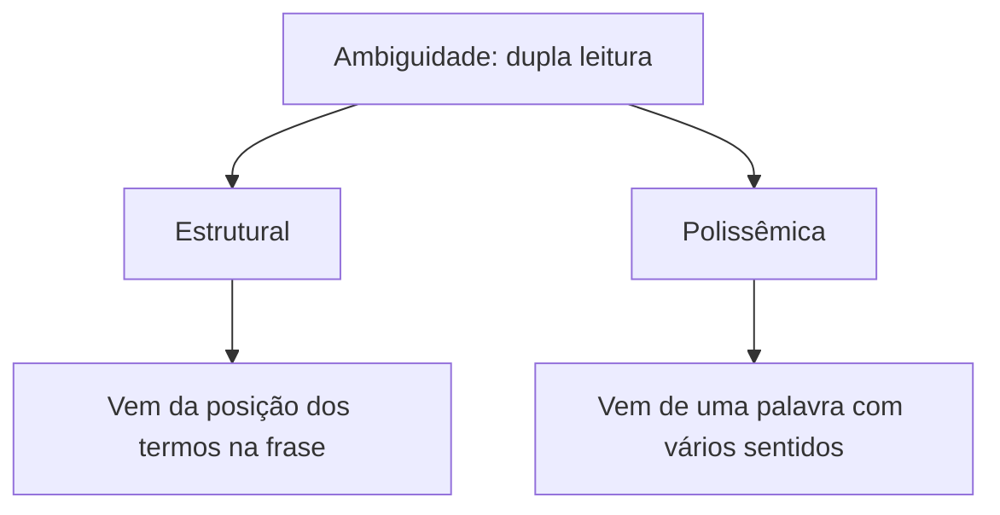

Este capítulo trata das palavras que enganam: as que se parecem na forma ou no som, as que carregam vários sentidos e as frases que podem ser lidas de duas maneiras. Nas provas, esses pontos aparecem em questões de vocabulário, de ortografia e de interpretação de tirinhas e charges. Um erro de uma letra, como *infligir* por *infringir*, muda o sentido e a resposta.

> [!objetivos]
> - Distinguir homônimos homógrafos, homófonos e perfeitos.
> - Usar corretamente os parônimos mais cobrados.
> - Diferenciar polissemia de homonímia.
> - Reconhecer a ambiguidade estrutural e a polissêmica e desfazê-las.

## Homônimos

**Homônimos** são palavras diferentes que têm a mesma forma, a mesma pronúncia ou ambas, mas significados distintos. Há três tipos.

| Tipo | O que têm em comum | Exemplos |
| --- | --- | --- |
| Homógrafos | mesma escrita, pronúncia diferente | *sede* (vontade de beber) e *sede* (local da diretoria) |
| Homófonos | mesma pronúncia, escrita diferente | *cela* (prisão) e *sela* (arreio); *concerto* (espetáculo) e *conserto* (reparo) |
| Perfeitos | mesma escrita e mesma pronúncia | *manga* (fruta) e *manga* (da camisa); *cabo* (militar) e *cabo* (fio) |

Nos homônimos perfeitos, as palavras costumam ser de **classes diferentes**: *canto* (substantivo) e *canto* (verbo cantar). O sentido só aparece no contexto: "o canto da sala" e "eu canto no coral".

Alguns homófonos são muito cobrados em ortografia: *cessão* (ato de ceder), *sessão* (reunião) e *seção* (divisão); *censo* (recenseamento) e *senso* (juízo); *acento* (sinal) e *assento* (lugar para sentar). Ao trocar a grafia, a pessoa troca o significado.

> [!bizu] Homógrafo, homófono, homônimo
> O prefixo *homo-* quer dizer "igual". **Grafo** é escrita: *homógrafo* é a escrita igual. **Fone** é som: *homófono* é o som igual. O homônimo perfeito é igual nas duas coisas.

## Parônimos

**Parônimos** são palavras parecidas na escrita ou na pronúncia, mas de sentidos diferentes. A semelhança leva a erros de ortografia e de vocabulário. O melhor jeito de estudar é marcar a parte que diferencia cada par e associar ao sentido.

| Par | Sentidos |
| --- | --- |
| absolver / absorver | inocentar / sugar, assimilar |
| aprender / apreender | adquirir conhecimento / capturar, confiscar |
| comprimento / cumprimento | medida de extensão / saudação ou execução |
| descriminar / discriminar | retirar o caráter de crime / distinguir ou tratar com preconceito |
| eminente / iminente | elevado, ilustre / prestes a acontecer |
| emigrar / imigrar | sair de um país / entrar em um país |
| flagrante / fragrante | evidente, no ato / perfumado |
| infligir / infringir | aplicar uma pena / violar uma norma |
| mandado / mandato | ordem judicial / período de exercício de um cargo ou procuração |
| ratificar / retificar | confirmar / corrigir |
| tráfego / tráfico | trânsito / comércio ilegal |
| soar / suar | produzir som / transpirar |
| deferir / diferir | atender um pedido / ser diferente ou adiar |
| delatar / dilatar | denunciar / aumentar |

Mais alguns pares frequentes: *docente* (relativo a quem leciona) e *discente* (relativo a quem estuda); *descrição* (relato) e *discrição* (reserva); *cavaleiro* (que monta) e *cavalheiro* (homem gentil); *sortir* (abastecer) e *surtir* (produzir efeito); *estada* (permanência de pessoa) e *estadia* (permanência de veículo ou prazo de navio no porto).

Atenção a casos em que a banca pega o aluno pela lógica:

- **Infligir e infringir**: infligem-se penas, castigos, derrotas; infringem-se leis, regras, normas. "O comandante infligiu a punição" e "o soldado infringiu o regulamento".
- **Mandado e mandato**: o juiz expede um mandado de busca; o prefeito exerce um mandato de quatro anos.
- **Iminente e eminente**: o risco é iminente (vai acontecer); o jurista é eminente (ilustre). Para memorizar, lembre que *iminente* começa com *i*, de "imediato".
- **Descriminar e discriminar**: discriminar também pode significar apenas distinguir ("discriminar os itens da nota"), sem carga negativa.
- **Ratificar e retificar**: quem ratifica confirma o que estava certo; quem retifica corrige o que estava errado.

> [!pegadinha] Troca indevida por parônimo
> Um tipo clássico de questão apresenta frases em que uma palavra foi trocada pelo parônimo errado: "o motorista **infligiu** as leis do trânsito", "o preso **dilatou** os comparsas", "a taxa é **bimestral**, isto é, cobrada duas vezes no mês". Procure a palavra que o sentido da frase pede e compare com a que está escrita. No último caso, o certo é *bimensal*: *bimestral* é a cada dois meses.

> [!atencao] Variantes não são parônimos
> *Infarte* e *infarto* são formas da mesma palavra, e o sentido não muda. Variantes aceitas (*cociente* e *quociente*, *flecha* e *frecha*) não mudam de significado; parônimos mudam.

## Polissemia

**Polissemia** é a propriedade de uma única palavra ter vários sentidos ligados entre si. A palavra é a mesma; o sentido varia conforme o contexto, em geral por extensão ou associação figurada.

Veja os sentidos de *natural*: "suco natural" (feito da fruta), "ele é natural de Caruaru" (nascido lá), "recurso natural" (da natureza), "uma atitude natural" (espontânea). Todos mantêm uma raiz comum de sentido.

Outro exemplo: *cabeça*. Pode ser a parte do corpo, o chefe de um grupo ("a cabeça da operação"), a ponta de um prego ou a capacidade de raciocinar ("ter cabeça fria").

O critério prático para diferenciar polissemia de homonímia é este:

- **Polissemia**: há **uma** palavra, com dois ou mais sentidos **relacionados**.
- **Homonímia**: há **duas** palavras diferentes que coincidem na forma, com sentidos **sem relação**, quase sempre de classes diferentes.

A fronteira é discutida até entre linguistas, por isso a prova costuma cobrar só o conceito: "palavra com mais de um sentido" é polissemia; "palavras diferentes com a mesma grafia ou pronúncia" é homonímia.

> [!exemplo] Polissemia ou homonímia?
> *Banco* de praça e *banco* onde se guarda dinheiro: sentidos sem relação, tratados em geral como homonímia. *Pé* do corpo, *pé* da mesa e *pé* da montanha: sentidos ligados pela ideia de base, logo polissemia.

## Ambiguidade

**Ambiguidade** é a possibilidade de uma frase ser lida de duas maneiras. É o duplo sentido. Pode ser proposital, como em piadas, propagandas e literatura. Em textos formais, é defeito, porque atrapalha a clareza.

Há dois tipos:

### Ambiguidade estrutural

Nasce da **organização** da frase. A mesma sequência de palavras admite dois agrupamentos.

- "Vi o policial correndo." Quem corria? O policial ou eu?
- "A tenente disse à cadete que sua escala saiu." A escala é da tenente ou da cadete?
- "Compramos as mangueiras e os extintores que estavam em promoção." Só os extintores ou os dois itens estavam em promoção?
- "João e Maria vão se casar." Um com o outro ou cada um com outra pessoa?
- "A venda dos terrenos foi um bom negócio." Os terrenos foram vendidos ou os terrenos venderam algo?

Para desfazer a ambiguidade estrutural, reorganize a frase: "Vi o policial que corria", "Quando corria, vi o policial"; "A tenente disse à cadete: 'Minha escala saiu'". O problema costuma estar na posição de um modificador, de um pronome possessivo ou de um pronome relativo.

### Ambiguidade polissêmica

Nasce de **uma palavra** com mais de um sentido. É a base de muitas charges. A palavra *bala*, por exemplo, pode ser o doce ou o projétil. A palavra *prender* pode ser fixar fisicamente ou capturar a atenção. Num anúncio, "não fique sem o seu garoto" brinca com o nome da marca e com a ideia de companhia.

Em prova, o humor de uma tirinha costuma estar nesse jogo. Pergunte: "qual palavra aceita dois sentidos nesta cena?". Em geral um dos sentidos é literal e outro é figurado.

Um caso especial é a **ironia** que depende do duplo sentido. Se o médico diz que o exame "não encontrou nada na cabeça", a leitura informativa é "sem doença", e a leitura irônica é "sem ideias". O contexto da piada decide qual leitura vale.

> [!atencao] Sentido literal e sentido figurado
> Em ambiguidade polissêmica, um dos sentidos é quase sempre literal e o outro, figurado. Ao julgar uma afirmação sobre a tirinha, confirme se a explicação cita os dois sentidos da mesma palavra. Se a questão disser que o humor vem da "declaração pouco convincente" de um personagem, mas o jogo é com uma palavra de dois sentidos, a afirmação está errada.

## Homonímia, polissemia e ambiguidade: como separar

| Conceito | Objeto | Pergunta que resolve |
| --- | --- | --- |
| Homonímia | duas palavras com a mesma forma | "são palavras diferentes?" |
| Polissemia | uma palavra, vários sentidos | "é a mesma palavra com sentidos ligados?" |
| Ambiguidade | uma frase com duas leituras | "a frase pode ser lida de dois jeitos?" |

A ambiguidade pode ser consequência da polissemia ou da homonímia: a palavra de vários sentidos gera frases de duplo sentido. Mas a ambiguidade também aparece sem nenhuma palavra polissêmica, só pela estrutura da frase.

Numa questão do tipo "em qual frase há ambiguidade?", a resposta é a que admite duas leituras razoáveis. As alternativas sem ambiguidade têm uma única interpretação possível, ainda que sejam estranhas ou vagas. Na dúvida, tente parafrasear cada alternativa de duas maneiras diferentes. Se só uma paráfrase fizer sentido, não há ambiguidade.

## Mapa do capítulo

A tabela abaixo reúne os conceitos do capítulo com um exemplo de cada.

| Conceito | Definição curta | Exemplo próprio |
| --- | --- | --- |
| Homógrafo | mesma escrita, som diferente | *sede* |
| Homófono | mesmo som, escrita diferente | *cela* / *sela* |
| Parônimo | forma ou som parecidos, sentidos diferentes | *infligir* / *infringir* |
| Polissemia | uma palavra, vários sentidos ligados | *natural* |
| Ambiguidade estrutural | duplo sentido pela organização da frase | "Vi o policial correndo." |
| Ambiguidade polissêmica | duplo sentido por uma palavra | *bala* |

### Para fixar
- Homógrafos têm a mesma escrita; homófonos, o mesmo som; os perfeitos, as duas coisas.
- Parônimos são parecidos, mas diferentes no sentido: *infligir* aplica pena; *infringir* viola norma.
- *Mandado* é ordem judicial; *mandato* é período de exercício de cargo ou procuração.
- *Iminente* é o que está prestes a acontecer; *eminente* é o que é elevado.
- *Ratificar* confirma; *retificar* corrige.
- Polissemia é uma palavra com vários sentidos relacionados; homonímia é a coincidência de forma entre palavras distintas.
- Ambiguidade é a dupla leitura de uma frase; é defeito em texto formal e recurso em humor e publicidade.
- Ambiguidade estrutural vem da posição dos termos; a polissêmica vem de uma palavra de vários sentidos.
- Para desfazer a ambiguidade estrutural, reorganize a frase ou troque o termo duvidoso.
- Variantes como *infarte* e *infarto* não são parônimos.
