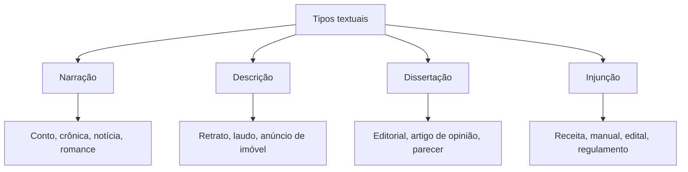
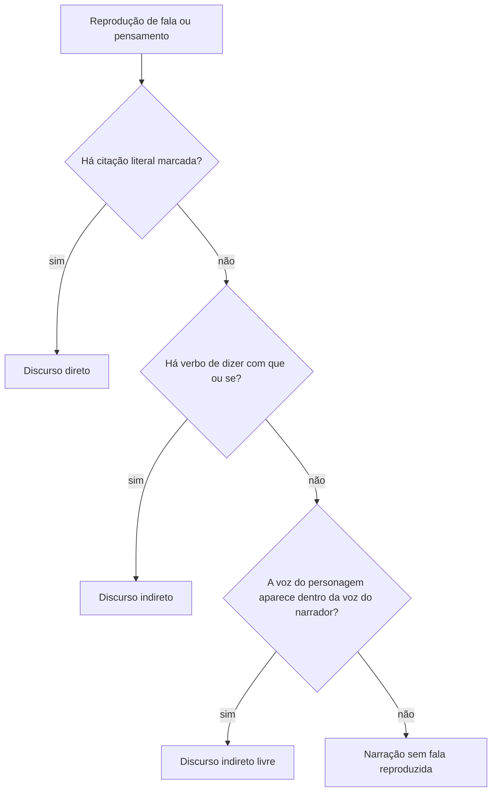

Todo texto que circula entre nós tem uma forma e um uso. A forma é o jeito como as frases se organizam: contar uma história, descrever um lugar, defender uma opinião, dar uma ordem. O uso é a situação em que o texto aparece: numa notícia, numa receita, numa carta, num manual de instruções. A prova de Língua Portuguesa cobra essa distinção quase sempre, porque ela decide o que o aluno deve procurar no texto e como deve reescrevê-lo. Este capítulo ensina a diferença entre tipo e gênero e detalha o primeiro tipo, a narração, com os tipos de narrador e as três maneiras de reproduzir a fala dos personagens.

> [!objetivos]
> - Distinguir tipo textual de gênero textual.
> - Reconhecer os elementos da narração e os tipos de narrador.
> - Identificar discurso direto, indireto e indireto livre.
> - Transpor uma fala do discurso direto para o indireto, ajustando pessoa, tempo e advérbios.
> - Perceber a opinião do autor ou do narrador no texto.

## Tipo e gênero: a diferença que a prova cobra

Os dois termos parecem sinônimos, mas não são.

- **Tipo textual** é a sequência de frases que organiza o texto por dentro. É o modo de dizer. Os tipos clássicos são **narração**, **descrição**, **dissertação** (ou exposição e argumentação) e **injunção** (ordem, instrução). A quantidade de tipos é pequena e fixa.
- **Gênero textual** é a forma concreta que o texto assume em uma situação social. É o texto que circula no dia a dia: notícia, crônica, conto, e-mail, ofício, bula de remédio, receita, tirinha, editorial. Os gêneros são muito numerosos e vão surgindo conforme a sociedade muda.

Um gênero raramente tem um só tipo. Uma notícia, por exemplo, narra o fato (narração), descreve o local (descrição) e pode trazer uma opinião de uma testemunha (dissertação). O que se chama de tipo predominante é o que organiza o texto como um todo.

| Critério | Tipo textual | Gênero textual |
| --- | --- | --- |
| Pergunta que responde | como o texto é construído? | em que situação o texto circula? |
| Quantidade | poucos e estáveis | muitos e em constante mudança |
| Exemplos | narração, descrição, dissertação, injunção | notícia, ofício, conto, receita, editorial |
| Como se reconhece | verbos, tempos verbais, organização das ideias | suporte, finalidade, interlocutores, estrutura típica |

> [!atencao] Lembrete de prova
> Se a questão pergunta "qual o gênero?", a resposta é um nome de texto que circula (carta, crônica, relatório). Se pergunta "qual o tipo predominante?", a resposta é narração, descrição, dissertação ou injunção. Quem responde "notícia" para tipo erra, e quem responde "narração" para gênero também.

> [!pegadinha] Um gênero, vários tipos
> A banca monta alternativas como "a receita é um texto exclusivamente injuntivo". A receita traz ordens (misture, leve ao forno), mas a lista de ingredientes é descritiva e a explicação do preparo pode ser expositiva. O tipo predominante é a injunção, mas o texto não é "exclusivamente" nada.

O mapa abaixo resume a relação entre tipo e gênero.

### Marcas linguísticas de cada tipo

Reconhecer o tipo predominante depende de olhar para a linguagem. Cada tipo costuma usar verbos, tempos e vocabulário característicos. As tipologias não são rígidas, mas as marcas ajudam a decidir.

| Tipo | Verbos e tempos | Palavras frequentes | Finalidade |
| --- | --- | --- | --- |
| Narração | verbos de ação; pretérito perfeito e imperfeito | advérbios de tempo (de repente, depois) | contar fatos que se sucedem |
| Descrição | verbos de ligação (ser, estar, parecer); imperfeito ou presente | adjetivos, comparações, indicações de lugar | mostrar como algo é, sem avançar no tempo |
| Dissertação | presente do indicativo | conectivos de causa, oposição e conclusão | explicar ou defender uma ideia |
| Injunção | imperativo, infinitivo, subjuntivo | verbos de comando, numerais de passos | orientar, mandar ou proibir |

Um exemplo ajuda a ver a diferença. Em "A fumaça subiu, o alarme tocou e as famílias saíram", há uma sequência de fatos: é narração. Em "A casa tinha paredes de tijolo, janelas altas e um quintal sombreado", nada acontece no tempo: é descrição. Em "O fogo se espalha com rapidez porque o ar entra pelas aberturas", há explicação de causa: é dissertação expositiva. Em "Saia pela porta lateral, não use o elevador e mantenha-se abaixado", há ordem: é injunção.

> [!pegadinha] Verbo de ligação não é narração
> A banca apresenta um trecho no pretérito imperfeito ("Era uma casa velha, as portas rangiam") e pergunta se é narração. Ele descreve um estado e não faz o tempo avançar. O imperfeito é característico da descrição, e o pretérito perfeito, da narração.

A reescrita de textos de gêneros diferentes (item que aparece em editais) depende dessa distinção. Um ofício e um bilhete podem trazer a mesma informação, mas o ofício usa vocabulário formal, fórmulas de tratamento e estrutura fixa, enquanto o bilhete é informal e curto. A **adequação** do registro à situação é o que se avalia quando a prova pede para trocar uma expressão por outra ou para reescrever um trecho em outro nível de formalidade.

## A narração

A **narração** conta fatos que acontecem no tempo, com personagens que agem em um lugar. O verbo principal expressa ação, e o tempo costuma ser o passado ("saiu", "viu"), mas pode ser o presente histórico ("Ele chega e vê o incêndio").

Os elementos da narrativa são cinco:

| Elemento | O que é | Pergunta |
| --- | --- | --- |
| Enredo | os fatos encadeados | o que aconteceu? |
| Personagens | quem participa dos fatos | com quem? |
| Tempo | quando e em que ritmo | quando? |
| Espaço | onde os fatos ocorrem | onde? |
| Narrador | quem conta a história | quem conta? |

O enredo costuma seguir uma sequência: **apresentação** (situação inicial), **complicação** (o conflito aparece), **clímax** (o ponto de maior tensão) e **desfecho** (a solução). Nem toda narrativa respeita a ordem, e o texto pode começar pelo fim ou voltar ao passado.

> [!exemplo] Mini-narrativa
> Às duas da madrugada, o sargento Ramos ouviu o alarme da central. Correu até a viatura, acelerou pela avenida vazia e chegou a um prédio em chamas. Subiu as escadas, resgatou uma idosa e voltou à rua antes que o teto desabasse. Aqui há personagem (Ramos), tempo (madrugada), espaço (o prédio), conflito (o incêndio) e desfecho (o resgate). O narrador está fora da história e a conta em terceira pessoa.

A organização do tempo é outro ponto cobrado. O **tempo cronológico** segue a sucessão normal dos fatos: primeiro um acontecimento, depois outro. O **tempo psicológico** é o tempo vivido pela mente do personagem: um minuto pode ocupar páginas, e uma década pode caber numa frase. Os recuos ao passado (*flashbacks*) e as antecipações mudam a ordem natural dos fatos. A prova pergunta se o texto segue ordem cronológica ou se há recuo, e a resposta está nos marcadores temporais ("anos antes", "na manhã seguinte").

A **fábula** é um bom exemplo de narração curta com moral. Em "A cigarra e a formiga", a cigarra passa o verão cantando e a formiga junta comida. Quando chega o inverno, a cigarra procura abrigo e pede alimento. A formiga pergunta o que ela fez durante o verão, e a cigarra responde que cantou. A formiga conclui: "Então dance agora." A história tem personagens (animais com traços humanos), tempo (as estações), conflito (a falta de alimento) e desfecho (a lição sobre a previdência). A moral aparece no final e traz o ponto de vista do autor.

### Tipos de narrador

O narrador é a voz que conta. Pode estar dentro ou fora do que narra, e a prova cobra a distinção.

1. **Narrador-personagem** (em primeira pessoa). Conta o que viveu ou testemunhou: "Cheguei ao quartel de manhã e logo percebi o clima tenso". Ele conhece só o que vê, sente e pensa.
2. **Narrador-observador** (em terceira pessoa). Está fora da história e relata o que vê dos fatos, sem entrar na cabeça dos personagens: "O soldado entrou, olhou para os colegas e sentou".
3. **Narrador onisciente** (em terceira pessoa). Sabe tudo, inclusive pensamentos e sentimentos dos personagens: "O soldado entrou, certo de que seria punido, e temeu o olhar do comandante".

| Tipo | Pessoa | Alcance do conhecimento |
| --- | --- | --- |
| Personagem | primeira pessoa | limitado ao que viveu |
| Observador | terceira pessoa | só o que se pode ver de fora |
| Onisciente | terceira pessoa | tudo, inclusive pensamentos |

> [!bizu] Quem conta e quanto sabe
> Pergunte duas coisas: o narrador participa da história? (se sim, é personagem) Ele sabe o que os personagens pensam? (se sim, é onisciente). Se não participa e só descreve o que se vê, é observador.

## Discurso direto, indireto e indireto livre

Quando o narrador reproduz a fala ou o pensamento de um personagem, ele escolhe entre três formas. A prova cobra a identificação da forma e a passagem de uma para outra.

### Discurso direto

O narrador **cita literalmente** a fala do personagem. Aparece com travessão, aspas ou dois-pontos, e a voz do personagem se mantém: "O capitão disse: — Amanhã entregaremos o relatório." Os verbos de dizer (disse, perguntou, respondeu) introduzem a fala.

### Discurso indireto

O narrador **conta o que o personagem disse**, com as palavras dele. Não há travessão, e a fala vem em uma oração subordinada, introduzida por **que** ou **se**: "O capitão disse que no dia seguinte entregariam o relatório." A voz do narrador substitui a do personagem.

### Discurso indireto livre

O narrador **mistura** a voz dele com a do personagem. Não há verbo de dizer nem pontuação marcada, mas o leitor percebe o pensamento ou a fala do personagem dentro da voz do narrador: "O capitão olhou para o relatório. Seria possível entregá-lo no dia seguinte? Claro que sim." As perguntas e exclamações revelam a voz do capitão, ainda que o texto esteja em terceira pessoa.

| Forma | Como aparece | Exemplo |
| --- | --- | --- |
| Direto | travessão, aspas ou dois-pontos | O cabo disse: — Estou cansado. |
| Indireto | oração subordinada com **que** ou **se** | O cabo disse que estava cansado. |
| Indireto livre | fusão das vozes, sem marcas | O cabo parou. Estava cansado demais para continuar. |

> [!pegadinha] Indireto livre não tem travessão
> A banca apresenta um trecho em terceira pessoa com pergunta ou exclamação e pergunta se é discurso direto. Não é: não há marca de citação. O que caracteriza o indireto livre é a voz do personagem se infiltrando na do narrador, sem verbo de dizer.

### Da fala direta para a indireta

Quando a questão pede a transposição, três ajustes são obrigatórios:

1. **Pessoa do verbo e pronomes.** A primeira pessoa vira terceira: "Eu preciso sair" passa a "ele disse que precisava sair".
2. **Tempo verbal.** O presente vira imperfeito, e o pretérito perfeito vira mais-que-perfeito, quando o verbo de dizer está no passado: "Estou pronto" → "disse que estava pronto"; "Cheguei cedo" → "disse que tinha chegado cedo".
3. **Advérbios e demonstrativos.** *Aqui* vira *ali*, *hoje* vira *naquele dia*, *amanhã* vira *no dia seguinte*, *este* vira *aquele*: "Voltarei aqui amanhã" → "disse que voltaria ali no dia seguinte".

Dois exemplos de passagem completa:

- Direto: *O atendente respondeu: — Prometo que entregarei os brinquedos amanhã.* Indireto: *O atendente respondeu que prometia que entregaria os brinquedos no dia seguinte.* O presente "prometo" virou imperfeito, a primeira pessoa virou terceira e *amanhã* virou *no dia seguinte*.
- Direto: *O chefe de seção perguntou ao guarda: — Você viu a passeata passar por aqui?* Indireto: *O chefe de seção perguntou ao guarda se ele tinha visto a passeata passar por ali.* A pergunta virou oração com *se*, *você* virou *ele*, e *aqui* virou *ali*.

Uma ordem no discurso direto ("Sentem-se!") vira oração subordinada com verbo no imperfeito do subjuntivo: "Ordenou que se sentassem". Uma pergunta ("Você viu o acidente?") vira oração iniciada por **se**: "Perguntou se ele tinha visto o acidente".

O caminho inverso, do indireto para o direto, exige o raciocínio oposto. Retire o *que* ou o *se*, volte o verbo ao tempo da fala (imperfeito vira presente), troque a terceira pessoa pela primeira ou segunda, e use dois-pontos ou travessão. A frase "O guarda disse que sairia dali em seguida" passa a "O guarda disse: — Saio daqui em seguida."

A prova também mistura formas: um mesmo parágrafo pode trazer discurso direto, indireto e indireto livre. Quando houver dúvida, procure por três sinais. O primeiro é a pontuação de citação (travessão, aspas, dois-pontos). O segundo é a conjunção *que* ou *se* depois de um verbo de dizer. O terceiro é a presença de exclamação, pergunta ou palavra de tom coloquial dentro de um trecho em terceira pessoa. Esses três sinais indicam, nessa ordem, o discurso direto, o indireto e o indireto livre.

> [!resolvido] Transposição passo a passo
> **Enunciado:** passe para o discurso indireto: *A tenente disse ao soldado: — Traga o relatório hoje e não saia daqui.*
> **Passo 1:** o verbo de dizer fica: "A tenente disse ao soldado".
> **Passo 2:** a ordem vira subordinada com subjuntivo no imperfeito: "que trouxesse o relatório".
> **Passo 3:** *hoje* vira *naquele dia* e *daqui* vira *dali*; o segundo verbo também vai ao subjuntivo: "e não saísse dali".
> **Resposta:** A tenente disse ao soldado que trouxesse o relatório naquele dia e não saísse dali.

## Opinião do autor e do narrador

Mesmo quando conta fatos, o texto pode trazer uma **avaliação** de quem escreve. Essa opinião se revela por adjetivos valorativos ("a decisão absurda"), advérbios de modo ("infelizmente", "felizmente"), verbos de opinião (considerar, achar, lamentar) e pela escolha do vocabulário. A diferença entre **fato** e **opinião** é o que a prova cobra: o fato pode ser verificado ("a viatura chegou às 14h"); a opinião é um juízo ("a chegada foi lenta demais").

No texto narrativo, o narrador pode expressar opinião em primeira ou em terceira pessoa. O leitor percebe porque o trecho deixa de ser apenas relato e passa a avaliar o que acontece. Em questões de interpretação, a pergunta típica é: "o autor se posiciona sobre o fato?". Procure a marca de avaliação.

> [!atencao] Narrador em terceira pessoa também opina
> Não é o narrador-personagem o único que opina. Um narrador onisciente pode comentar, julgar e ironizar. A banca costuma afirmar que o narrador em terceira pessoa "é sempre neutro". Não é.

## Narrar, relatar e noticiar

Narrar não é o mesmo que apenas relatar. **Narrar** é construir uma história com enredo, personagens e conflito, e quase sempre envolve criação. **Relatar** é registrar fatos reais na ordem em que ocorreram, em linguagem objetiva, como num relatório de ocorrência. **Noticiar** é informar um fato atual de interesse público, com título, resumo inicial e detalhes em ordem de importância.

A diferença aparece no foco narrativo e na linguagem. O texto narrativo ficcional pode ter narrador onisciente, imagens e tempo psicológico. O relatório de ocorrência usa narrador observador, fatos conferíveis e ordem cronológica estrita. A notícia coloca o fato mais importante no começo e deixa os detalhes para depois.

> [!exemplo] O mesmo fato em três gêneros
> **Conto:** "Naquela noite sem lua, o soldado Davi sentiu que o chão fatalmente cederia." **Relatório:** "Às 23h40, a equipe chegou ao local e constatou o desabamento parcial do piso." **Notícia:** "Piso desaba em galpão e equipe do Corpo de Bombeiros resgata dois trabalhadores." O fato é o mesmo, mas a linguagem, o foco e a estrutura mudam.

## Texto e situação: o nível de formalidade

O gênero também define o **registro** da linguagem. Em um ofício, usam-se vocabulário formal, concordância cuidada, pronomes de tratamento e verbos na terceira pessoa. Em uma conversa de aplicativo, o registro é informal, com abreviações e gírias. Reescrever um texto em outro gênero ou em outro nível de formalidade exige trocar essas marcas.

| Situação | Registro | Marcas |
| --- | --- | --- |
| Ofício a autoridade | formal | tratamento (Vossa Senhoria), vocabulário técnico, frases completas |
| Relatório interno | semiformal | linguagem objetiva, sem gírias |
| Mensagem a colega | informal | abreviações, expressões do dia a dia |
| Aviso afixado no quartel | formal e injuntivo | imperativo ou infinitivo, frases curtas |

Na reescrita, a regra é preservar o sentido e adaptar a forma. Se uma conversa de aplicativo diz "Cara, o treino foi cancelado, avisa todo mundo", a versão formal para um comunicado seria "Informamos que o treino foi cancelado. Solicitamos que os demais integrantes sejam avisados."

## Mapa do capítulo

O quadro reúne o capítulo. A ideia central é separar quatro camadas: o tipo, o gênero, o narrador e a forma como as falas são reproduzidas.

| Camada | Opções | Pista de reconhecimento |
| --- | --- | --- |
| Tipo textual | narração, descrição, dissertação, injunção | verbos de ação, qualidades, argumentos, ordens |
| Gênero textual | notícia, crônica, ofício, receita... | suporte, finalidade e estrutura |
| Narrador | personagem, observador, onisciente | pessoa e alcance do conhecimento |
| Discurso | direto, indireto, indireto livre | marcas de citação, que/se, fusão de vozes |

### Para fixar
- Tipo textual é o modo de organizar o texto; gênero textual é a forma social que o texto assume.
- Os tipos são narração, descrição, dissertação e injunção; os gêneros são numerosos e mudam com o tempo.
- Um gênero costuma misturar tipos, e o que se identifica é o tipo predominante.
- Os elementos da narrativa são enredo, personagens, tempo, espaço e narrador.
- O narrador pode ser personagem (primeira pessoa), observador ou onisciente (terceira pessoa).
- No discurso direto a fala é citada literalmente; no indireto, vem em oração com que ou se.
- O discurso indireto livre mistura a voz do narrador com a do personagem, sem verbo de dizer.
- Na passagem do direto para o indireto mudam a pessoa, o tempo verbal e os advérbios e demonstrativos.
- Pergunta no discurso direto vira oração com se; ordem vira subordinada com verbo no subjuntivo.
- Opinião aparece em adjetivos, advérbios e verbos de avaliação, e também em narrador de terceira pessoa.
