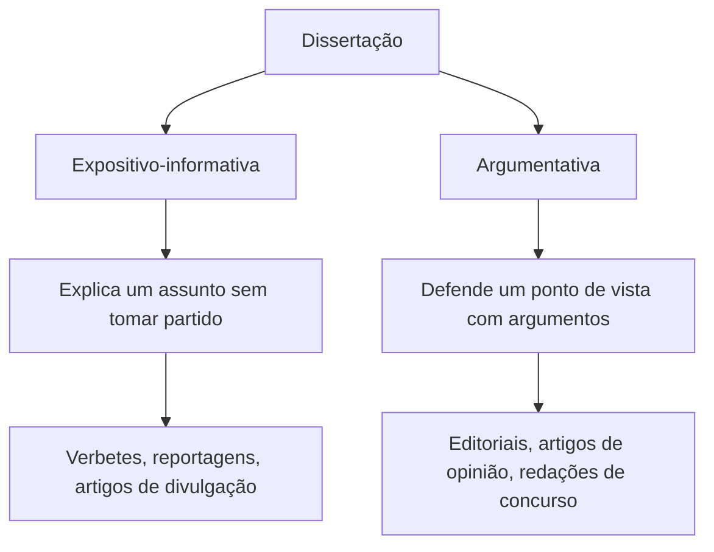
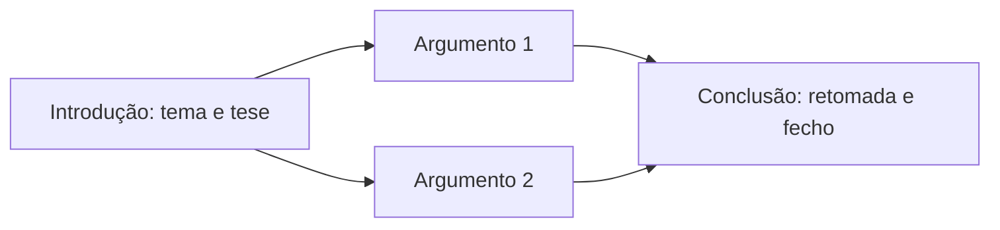
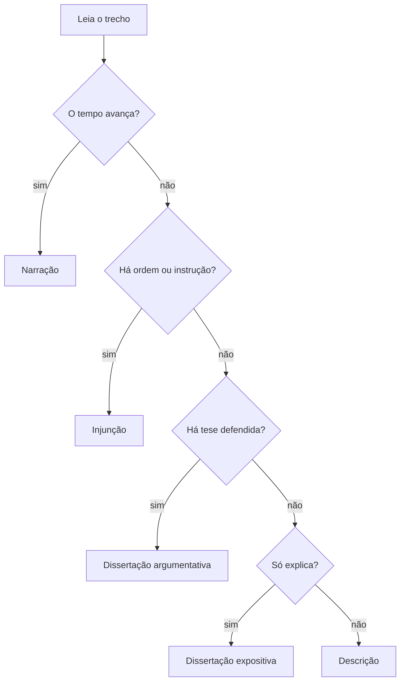

Depois da narração, vêm os três tipos que completam a classificação: a descrição, a injunção e a dissertação. A prova costuma apresentar um trecho curto e pedir que o candidato diga qual tipo predomina, ou então que ele reconheça a estrutura de um texto argumentativo. Quem domina as marcas de cada tipo acerta esse tipo de questão em segundos, sem precisar interpretar o texto inteiro. Este capítulo mostra como cada um se constrói, o que o distingue dos vizinhos e como o texto dissertativo se divide em introdução, desenvolvimento e conclusão.

> [!objetivos]
> - Reconhecer a descrição e separar a objetiva da subjetiva.
> - Identificar a injunção pelas marcas de ordem, instrução e conselho.
> - Diferenciar o texto expositivo-informativo do argumentativo.
> - Montar a estrutura de um parágrafo e de um texto argumentativo, da tese à conclusão.
> - Perceber as fórmulas de introdução mais comuns e o que cada uma sinaliza.

## Descrição: fotografar com palavras

Descrever é apresentar características de um ser, de um objeto, de um lugar ou de uma situação. O texto descritivo não faz o tempo andar: ele para a cena e mostra como as coisas são naquele momento. Por isso, o verbo dominante é o **verbo de ligação** (ser, estar, parecer, ficar, continuar) no presente ou no pretérito imperfeito, acompanhado de adjetivos, locuções adjetivas e referências de espaço.

Compare dois trechos.

- "O quartel **era** um prédio baixo, de paredes cinza, com janelas estreitas e um pátio de cimento no centro." Nada acontece; o leitor apenas vê o quartel.
- "O soldado **cruzou** o pátio, **abriu** a porta e **entrou** no alojamento." Aqui as ações se sucedem, e o texto é narrativo.

A diferença está no movimento. Quem descreve congela a imagem; quem narra faz a imagem andar.

### Descrição objetiva e subjetiva

| Aspecto | Descrição objetiva | Descrição subjetiva |
| --- | --- | --- |
| Foco | o objeto como ele é | a impressão de quem observa |
| Linguagem | denotativa, precisa, com medidas e dados | conotativa, com figuras de linguagem |
| Adjetivos | classificadores (de aço, retangular, de 2 metros) | valorativos (lindo, sombrio, acolhedor) |
| Onde aparece | manual técnico, laudo, anúncio de classificados | romance, crônica, poema |
| Exemplo | "Viatura de 4,5 metros, tração 4x4, tanque de 80 litros." | "A viatura reluzia, soberba, sob o sol da manhã." |

> [!bizu] Como separar as duas
> Se o texto pudesse ser conferido com uma régua, uma balança ou um documento, a descrição é **objetiva**. Se ele só faz sentido para quem sentiu a cena, é **subjetiva**. Adjetivo de avaliação (belo, horrível, imponente) é sinal quase certo de subjetividade.

A descrição ainda pode ser classificada pelo que descreve. A **topografia** descreve lugares, a **prosopografia** descreve o aspecto físico de uma pessoa, a **etopeia** descreve o caráter e os costumes, e o **retrato** reúne as duas últimas. Essas palavras raramente caem em prova, mas a ideia de que existe descrição de pessoa física e de pessoa moral ajuda a entender enunciados que falam em "caracterização do personagem".

### Como o texto descritivo se organiza

A descrição raramente segue um enredo, mas tem uma ordem. O autor escolhe um ponto de vista (de longe para perto, de cima para baixo, do todo para os detalhes) e mantém esse caminho. Quando o texto salta de um detalhe a outro sem critério, os **traços** ficam inacabados e a imagem se desfaz na cabeça do leitor. Por isso as bancas perguntam, às vezes, qual é o "princípio de organização" de um trecho descritivo: a resposta costuma ser espacial ("da entrada para o fundo da sala") ou por importância ("primeiro o que mais chama atenção").

Outra marca é a presença de **comparações e metáforas** na descrição subjetiva. Dizer que o pátio "parecia uma ilha de cimento no meio do mato" não informa medida alguma; transmite uma impressão. É o recurso do retrato literário.

> [!pegadinha] Descrever não é só listar adjetivos
> Um texto cheio de adjetivos não é necessariamente descritivo. Se os adjetivos aparecem dentro de uma sequência de ações ("o homem alto e magro **saiu**, **bateu** a porta e **sumiu**"), o tipo predominante continua sendo a narração. A pergunta certa é: o tempo corre ou está parado?

## Injunção: dizer o que fazer

O texto injuntivo, também chamado de instrucional ou prescritivo, orienta o leitor a agir. Ele não conta nem descreve; ele manda, aconselha, proíbe ou ensina um passo a passo. Aparece em receitas, manuais, bulas, regulamentos, avisos, editais e até em ordens de serviço.

As marcas mais frequentes são:

1. **Verbos no imperativo** ("Leia", "Aguarde", "Não fume").
2. **Verbos no infinitivo com valor de ordem** ("Manter distância", "Apresentar documento").
3. **Presente do indicativo ou futuro com valor de ordem** ("O candidato **apresenta** o documento", "O servidor **comparecerá** às 8 horas").
4. **Sequência numerada** ou marcada por conectivos de ordem (primeiro, depois, em seguida, por fim).
5. **Verbos de obrigação** ("deve", "é obrigatório", "fica proibido").

> [!exemplo] Três formas de dar a mesma ordem
> Todas as frases abaixo são injuntivas, ainda que só a primeira tenha o imperativo.
> - "Desligue os aparelhos eletrônicos."
> - "Desligar os aparelhos eletrônicos."
> - "Os aparelhos eletrônicos devem ser desligados."

> [!exemplo] Receita e rótulo: injunção no dia a dia
> Numa receita de sopa, o texto diz: "Aqueça o óleo, refogue a cebola por três minutos, junte duas colheres de sopa de arroz e deixe repousar." Num rótulo de sabão em pó, lê-se: "Aplique o produto sobre a mancha, esfregue com escova macia e enxague em água corrente." Em ambos, o objetivo é conduzir o leitor por uma sequência de passos, e a **progressão** das ações (primeiro, depois, por fim) não conta uma história: ensina um procedimento. É esse propósito que define o tipo, não a presença de verbos de ação.

Há injunção **forte**, que impõe (regulamento, norma, aviso de segurança), e injunção **suave**, que sugere (receita, dica, manual de uso). O grau de força muda o verbo e o tom, não o tipo.

> [!atencao] Ordem pode ser camuflada
> Um texto no presente ("A pessoa abre a embalagem, retira o produto e o mantém em local fresco") pode ser injuntivo se o objetivo for orientar. A banca gosta de esconder o imperativo para ver se o candidato reconhece a finalidade e não só a forma verbal.

## Dissertação: expor ou argumentar

Dissertar é apresentar ideias, explicá-las ou defendê-las. O texto dissertativo se apoia em conceitos, dados, exemplos e raciocínio. O verbo dominante é o presente do indicativo (valor atemporal) e o assunto é tratado de modo geral, sem tempo nem lugar marcados.

A dissertação se divide em dois grandes ramos.

### Texto expositivo-informativo

O texto expositivo-informativo explica, define, classifica ou relata um assunto de forma neutra. A intenção é fazer o leitor **compreender**, e não convencê-lo. A linguagem é objetiva e distanciada, com poucos adjetivos de valor, e a organização costuma seguir um destes caminhos:

- **Definição**: o que é o tema.
- **Classificação**: quais são os tipos ou as partes.
- **Comparação**: semelhanças e diferenças entre dois fenômenos.
- **Causa e consequência**: por que acontece e o que provoca.
- **Problema e solução**: qual é a dificuldade e como contorná-la.

Uma matéria que explica "como funciona uma central de atendimento de emergência" é expositiva: informa o processo sem exigir que o leitor concorde com algo.

### Texto argumentativo

O texto argumentativo defende uma **tese**, isto é, uma opinião a respeito de um tema, e procura convencer o leitor com argumentos. Os sinais mais fortes são o posicionamento claro do autor, os verbos de opinião ("acredito", "é preciso", "deve-se"), os operadores argumentativos (porém, portanto, além disso) e a presença de contra-argumentos.

| Critério | Expositivo-informativo | Argumentativo |
| --- | --- | --- |
| Objetivo | explicar | convencer |
| Posição do autor | neutra | declarada |
| Estrutura | definição, exemplo, dados | tese, argumentos, conclusão |
| Conectivos típicos | ou seja, isto é, por exemplo | porém, portanto, pois, embora |
| Exemplo de gênero | verbete, reportagem | editorial, artigo de opinião |

> [!pegadinha] Opinião disfarçada de informação
> Há textos que parecem apenas explicar, mas escolhem palavras e dados que conduzem o leitor a uma conclusão. Se o autor seleciona só fatos de um lado e usa adjetivos de valor, o texto é argumentativo, ainda que o tom seja sereno.

## A estrutura argumentativa

O texto argumentativo clássico tem três partes: **introdução**, **desenvolvimento** e **conclusão**. O parágrafo também pode seguir esse molde em miniatura.

1. **Introdução**: apresenta o tema e a tese. É a "promessa" do texto.
2. **Desenvolvimento**: defende a tese com argumentos, exemplos, dados, citações e comparações. Cada parágrafo costuma trazer uma ideia principal.
3. **Conclusão**: retoma a tese e fecha o raciocínio, às vezes com uma proposta de solução.

> [!resolvido] Localizando a tese
> **Trecho:** "A vacinação infantil é uma das medidas mais eficazes de saúde pública. Estudos mostram que a cobertura acima de 90% impede surtos. Por isso, os governos devem manter campanhas permanentes."
>
> **Resolução:** a primeira frase traz a opinião (a vacinação é eficaz), logo é a **tese**. A segunda frase sustenta com dado (**argumento**). A terceira, introduzida por "por isso", é a **conclusão** com proposta. Quando a prova pede "a ideia central do parágrafo", é quase sempre a tese.

Repare que o argumentativo nasce de um conflito de **interesses** ou de pontos de vista: quem escreve um editorial defende uma posição porque há outra possível. Um texto sem alternativa em jogo ("a água ferve a 100 graus ao nível do mar") não argumenta, apenas informa.

### Argumentos mais comuns

Para convencer, o autor pode recorrer a vários tipos de argumento. Convém reconhecê-los pelo efeito que causam.

| Tipo | Como funciona | Exemplo |
| --- | --- | --- |
| Autoridade | cita um especialista ou uma instituição | "Segundo a OMS, o sedentarismo..." |
| Exemplificação | apresenta um caso concreto | "Em 2019, a cidade X reduziu os acidentes..." |
| Dados e estatísticas | usa números | "Mais de 70% dos entrevistados..." |
| Causa e consequência | liga um fato ao seu efeito | "Como faltou treinamento, o erro se repetiu." |
| Comparação | aproxima duas realidades | "Assim como um motor precisa de óleo..." |
| Princípio ou senso comum | invoca valores aceitos | "Todos têm direito à vida." |

> [!atencao] Argumento não é a mesma coisa que fato
> Fato é o dado verificável. Argumento é o uso desse dado para sustentar uma tese. Uma questão pode perguntar "qual argumento o autor usa para defender...", e a resposta correta é o raciocínio, não a simples informação.

## Fórmulas de introdução

O começo do texto dissertativo costuma seguir alguns modelos. A banca nem sempre fala em "fórmulas", mas pede que o candidato reconheça **como** o autor abre o texto. Quatro delas aparecem com frequência.

- **Definição**: abre com o conceito do tema ("Ética é o conjunto de princípios que orientam a conduta...").
- **Citação**: apoia-se na fala de uma autoridade ("Segundo Aristóteles, o homem é um animal político...").
- **Dado ou fato histórico**: começa com um número ou com um acontecimento ("Em 2020, o mundo parou diante de uma pandemia...").
- **Pergunta**: desperta a atenção do leitor ("Até que ponto a tecnologia melhora a vida?").

Há ainda a **comparação**, a **alusão a uma obra** (filme, livro, música) e a **contextualização**, que situa o tema antes de apresentar a tese.

> [!bizu] Para a prova
> A introdução não diz tudo; ela abre o assunto e, geralmente na última frase, apresenta a tese. Se a questão perguntar onde está o posicionamento do autor, procure a frase que **toma partido** no fim do primeiro parágrafo.

> [!exemplo] A mesma tese com duas aberturas
> **Abertura por dado:** "Em 2022, mais de 30 mil pessoas morreram no trânsito brasileiro. Esse número mostra que a educação viária precisa de prioridade."
>
> **Abertura por pergunta:** "Quantas vidas ainda serão perdidas no trânsito até que a educação viária seja prioridade?"
>
> As duas defendem a mesma tese; só muda o recurso para atrair o leitor.

### A conclusão e o fechamento do raciocínio

A conclusão não repete o texto palavra por palavra: ela **confirma** a tese com firmeza e mostra o que decorre dela. Entre os fechamentos mais comuns estão a retomada da ideia central, a proposta de solução, o alerta e a pergunta retórica que deixa o leitor pensando. Quando a conclusão traz um fato novo, sem ligação com o desenvolvimento, o texto perde coesão, e a banca chama isso de "ruptura" ou "quebra de progressão".

Uma observação útil: textos de divulgação podem trazer **interferências discursivas**, isto é, trechos em que o autor se dirige ao leitor ("repita o gesto", "note que") ou convida a pensar. Elas não mudam o tipo; servem para manter a atenção e, quando o autor tenta seduzir o leitor com humor ou com vocabulário muito expressivo, indicam uma intenção persuasiva mais próxima da argumentação.

> [!atencao] Pura informação também pode orientar
> Um aviso como "o acesso é restrito a pessoas autorizadas" parece informar, mas na prática **ordena** (só entre quem tem autorização). Ao ler enunciados curtos, pergunte sempre qual é a finalidade do texto e não apenas qual é a forma da frase.

## Como distinguir os cinco tipos em poucos segundos

Quando o texto da questão é curto, vale seguir uma ordem de perguntas.

1. O tempo corre, com ações em sequência? É **narração**.
2. O tempo está parado, com características e qualidades? É **descrição**.
3. O texto manda, orienta ou ensina o que fazer? É **injunção**.
4. O texto explica sem tomar partido? É **dissertação expositiva**.
5. O texto defende um ponto de vista com argumentos? É **dissertação argumentativa**.

Lembre que o gabarito leva em conta o tipo **predominante**, e que o gênero pode misturar vários tipos.

Veja a aplicação em dois trechos curtos.

- "Retire a trava, aponte o bocal para a base do fogo e acione o gatilho em movimento de varredura." As formas "retire", "aponte" e "acione" são imperativos que conduzem uma sequência de passos: **injunção**.
- "O extintor de pó químico é indicado para fogos de classes B e C, pois interrompe a reação em cadeia da combustão." O trecho define e justifica sem pedir que o leitor concorde com nada além do fato: **dissertação expositiva**.

Se, no mesmo texto, o autor concluísse "por isso, todo posto de trabalho deveria ter ao menos dois extintores", surgiria uma recomendação sustentada por razões, e o trecho passaria a **argumentativo**. A fronteira entre expor e argumentar é a **tomada de posição**.

Outra armadilha frequente é confundir o tipo com o gênero: uma "receita" é gênero e injuntivo é o tipo; um "editorial" é gênero e argumentativo é o tipo. A banca costuma oferecer as duas palavras entre as alternativas para ver se o candidato troca uma pela outra.

## Mapa do capítulo

O quadro reúne os tipos estudados e as pistas de reconhecimento.

| Tipo | Objetivo | Verbo dominante | Pista rápida |
| --- | --- | --- | --- |
| Descrição | mostrar como é | ligação, presente ou imperfeito | tempo parado, adjetivos |
| Injunção | orientar a ação | imperativo, infinitivo | ordem, passo a passo |
| Dissertação expositiva | explicar | presente do indicativo | neutralidade, definição |
| Dissertação argumentativa | convencer | presente, com verbos de opinião | tese, conectivos adversativos |

### Para fixar
- Descrever é parar a cena e mostrar características; o verbo típico é o de ligação.
- Descrição objetiva usa dados e adjetivos classificadores; a subjetiva usa impressões e figuras.
- A injunção orienta ou ordena; aparece no imperativo, no infinitivo e no verbo de obrigação.
- A injunção pode vir camuflada no presente do indicativo.
- A dissertação expositiva explica sem tomar partido; a argumentativa defende uma tese.
- O texto argumentativo se divide em introdução (tema e tese), desenvolvimento e conclusão.
- Os argumentos mais comuns são autoridade, exemplificação, dados, causa e consequência, comparação e princípio.
- As introduções mais frequentes são por definição, citação, dado, pergunta e comparação.
- A tese costuma aparecer no fim do primeiro parágrafo.
- Na prova, identifique o tipo predominante, não o único.
