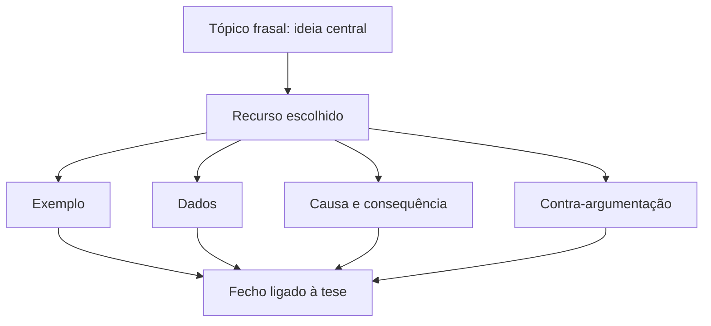
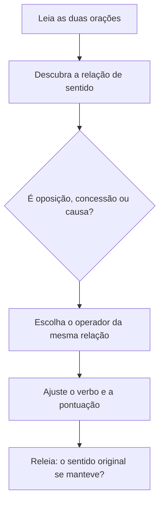

O desenvolvimento é a parte do texto em que a tese ganha sustentação. É nele que o autor escolhe argumentos, organiza a ordem em que serão apresentados e liga uma ideia à outra com palavras-chave que orientam o leitor: os **operadores argumentativos**. A prova de Língua Portuguesa mede dois domínios nesse ponto: saber qual relação de sentido cada operador cria (oposição, conclusão, concessão, causa, adição, alternância) e saber reescrever uma frase trocando o operador sem estragar o sentido. Este capítulo apresenta o desenvolvimento do parágrafo, os operadores mais cobrados e as recursos para argumentar.

> [!objetivos]
> - Explicar o que se espera do desenvolvimento de um texto argumentativo.
> - Reconhecer a relação de sentido criada por cada operador argumentativo.
> - Substituir um operador por outro equivalente e reorganizar orações sem mudar o sentido.
> - Identificar os recursos de desenvolvimento do parágrafo (exemplo, comparação, dados, causa e consequência, contra-argumentação).
> - Evitar os vícios mais comuns: circularidade, generalização e falta de progressão.

## O que se espera do desenvolvimento

Depois que a introdução apresenta o tema e a tese, o desenvolvimento precisa responder a uma pergunta simples: **por que o leitor deve concordar?** Cada parágrafo do desenvolvimento traz uma resposta parcial. Um bom desenvolvimento tem quatro qualidades.

1. **Unidade**: cada parágrafo gira em torno de uma ideia central, chamada de tópico frasal.
2. **Progressão**: cada parágrafo acrescenta algo novo; não repete o anterior com outras palavras.
3. **Coesão**: as frases se ligam por operadores, pronomes, sinônimos e retomadas.
4. **Coerência**: as ideias fazem sentido juntas e não se contradizem.

> [!atencao] Tópico frasal
> O tópico frasal é a frase que resume a ideia do parágrafo, quase sempre logo no começo. As demais frases explicam, exemplificam ou limitam essa ideia. Em questões de interpretação, se a banca pergunta "qual é a ideia central do segundo parágrafo?", comece pela primeira frase.

### Parágrafo bem construído

Um parágrafo argumentativo típico tem esta ordem:

| Parte | Função | Exemplo |
| --- | --- | --- |
| Tópico frasal | apresenta a ideia | "A formação continuada reduz os erros operacionais." |
| Desenvolvimento | explica ou prova | "Tropas que treinam toda semana respondem melhor a situações novas." |
| Exemplo ou dado | torna a ideia concreta | "Em 2021, a unidade X cortou em 30% os acidentes após o novo programa." |
| Fecho | liga ao tema do texto | "Logo, investir em treinamento é investir em segurança." |

## Operadores argumentativos

Operadores argumentativos (também chamados de conectores, conectivos ou articuladores) são palavras ou expressões que **ligam orações e parágrafos** e indicam a relação de sentido entre eles. A gramática os estuda como conjunções e locuções conjuntivas; a prova de interpretação os trata pelo efeito que causam no argumento. O erro mais comum é decorar a palavra sem entender a relação, e por isso o quadro a seguir organiza os operadores por **função**.

| Relação | Operadores | Efeito no argumento |
| --- | --- | --- |
| Adição | e, nem, além disso, ainda, também, não só... mas também | soma argumentos na mesma direção |
| Oposição (adversidade) | mas, porém, contudo, todavia, entretanto, no entanto | contrapõe duas ideias; o argumento mais forte vem **depois** |
| Concessão | embora, ainda que, mesmo que, conquanto, apesar de | admite um fato, mas não deixa que ele mude a conclusão |
| Causa | porque, pois, já que, visto que, uma vez que, como | apresenta a razão |
| Consequência | de modo que, tanto que, de sorte que, tão... que | apresenta o efeito |
| Conclusão | logo, portanto, por isso, assim, então, por conseguinte | fecha o raciocínio |
| Explicação | pois (após a oração), que, porquanto | justifica a afirmação anterior |
| Alternância | ou, ora... ora, quer... quer, seja... seja | oferece possibilidades |
| Condição | se, caso, desde que, a menos que, contanto que | estabelece a condição para algo ocorrer |
| Comparação | como, tal qual, assim como, mais... do que | aproxima ideias |
| Escala (ênfase) | até, inclusive, mesmo, pelo menos, ao menos | indica o argumento mais forte ou mais surpreendente de uma série |
| Finalidade | para, a fim de que, para que | indica o objetivo |
| Tempo | quando, enquanto, assim que, logo que, depois que | situa no tempo |

> [!bizu] Duas palavras para guardar
> Nas relações de **oposição**, o argumento mais forte está no que vem **depois** do "mas". Nas de **concessão**, o argumento forte está na oração principal, e a oração com "embora" admite um fato que não muda o resultado. "Embora estivesse cansado, concluiu a prova" e "Estava cansado, mas concluiu a prova" têm o mesmo sentido.

### A oposição e a concessão

Oposição e concessão se parecem, e a banca explora essa semelhança.

- **Oposição**: duas orações coordenadas. A segunda corrige ou limita a primeira. "O plano é bom, **porém** custa caro."
- **Concessão**: oração subordinada. A oração com o conectivo admite um fato contrário, sem lhe dar força. "**Embora** o plano custe caro, é bom."

> [!pegadinha] Conclusão com "pois"
> O "pois" muda de sentido conforme a posição. Antes do verbo, no início da oração, tem valor de **causa** ou **explicação**: "Estude, pois a prova é difícil." Depois do verbo e entre vírgulas, vale por "portanto" e indica **conclusão**: "A prova é difícil; deve, pois, estudar." A banca gosta dessa troca.

### Causa, consequência e conclusão

Não confunda as direções do raciocínio:

- **Causa → efeito**: "Choveu muito, **por isso** o rio transbordou." (conclusão)
- **Efeito ← causa**: "O rio transbordou **porque** choveu muito." (causa)

Em ambos os casos o fato é o mesmo; o que muda é o ponto de partida do raciocínio. Para testar, troque o operador por "por causa disso" (conclusão) ou "por causa de" (causa) e veja se a frase continua lógica.

> [!exemplo] Reescrita com troca de operador
> **Original:** "Embora o treinamento fosse intenso, os candidatos não desistiram."
>
> **Reescrita equivalente (oposição):** "O treinamento era intenso, mas os candidatos não desistiram."
>
> **Reescrita equivalente (concessão com "mesmo que" no passado):** "Mesmo com treinamento intenso, os candidatos não desistiram."
>
> Perceba que o sentido se mantém: o treinamento era duro e, ainda assim, ninguém desistiu.

## Reescrita de frases e parágrafos

A reescrita aparece nas provas como pergunta do tipo "a reescrita que mantém o sentido original do trecho é...". Para acertar, siga um roteiro curto:

1. **Identifique a relação** de sentido entre as orações (oposição, causa, concessão etc.).
2. **Troque o operador** por outro da mesma relação.
3. **Ajuste o verbo**, se necessário. Concessão com "embora" e "ainda que" exige subjuntivo; oposição com "mas" aceita indicativo.
4. **Confira pontuação**: o "mas" pede vírgula antes; o "embora" no início da frase pede vírgula depois da oração concessiva.
5. **Releia** para ter certeza de que não surgiu ideia nova nem se perdeu nenhuma.

### Reorganização de orações e períodos

Mudar a ordem das orações é outro tipo de reescrita. Algumas regras:

- A oração principal e a subordinada podem trocar de lugar. "Se estudar, passará." equivale a "Passará se estudar."
- Ao inverter, a pontuação muda: a oração subordinada antes da principal costuma ser separada por vírgula; depois dela, a vírgula é opcional ou dispensável.
- Transformar voz ativa em passiva e vice-versa mantém o sentido: "A banca elaborou a prova" e "A prova foi elaborada pela banca".
- Trocar oração desenvolvida por reduzida (com gerúndio, infinitivo ou particípio) mantém o sentido, desde que a relação se preserve: "Quando chegou, avisou" = "Ao chegar, avisou".

> [!resolvido] Questão de reescrita
> **Trecho:** "A norma é clara, no entanto o servidor a descumpriu."
>
> **Alternativas:**
> a) "A norma é clara; contudo o servidor a descumpriu." (oposição, mantém)
> b) "Como a norma é clara, o servidor a descumpriu." (causa, **altera**)
> c) "A norma é clara; logo o servidor a descumpriu." (conclusão, **altera**)
> d) "A norma é clara e o servidor a descumpriu." (adição, perde a oposição)
>
> **Resolução:** "no entanto" indica oposição. Só a alternativa a) mantém a mesma relação. As alternativas b) e c) criam ligação lógica inexistente; a d) apenas soma as ideias e apaga o contraste.

## Recursos para desenvolver um parágrafo argumentativo

Argumentar é escolher um caminho para convencer. Cada caminho pede operadores próprios e produz um efeito.

| Recurso | Como funciona | Operadores típicos |
| --- | --- | --- |
| Exemplificação | ilustra a ideia com um caso | por exemplo, como, a saber |
| Comparação | aproxima duas situações | assim como, tal qual, do mesmo modo |
| Causa e consequência | liga o fato ao efeito | porque, por isso, de modo que |
| Dados e estatísticas | usa números para provar | segundo, conforme, de acordo com |
| Citação de autoridade | apoia-se em especialista | para, segundo, conforme afirma |
| Contra-argumentação | admite a posição contrária e a rebate | embora, mas, no entanto |
| Definição | explica o conceito antes de usá-lo | isto é, ou seja, define-se como |

### A contra-argumentação

Um argumento forte reconhece a posição contrária e responde a ela. O esquema mais comum tem três passos: **concessão** (admite o outro lado), **oposição** (apresenta o ponto central) e **reforço** (sustenta a posição).

> [!exemplo] Concessão, oposição e reforço
> "É verdade que o exame físico seleciona poucos candidatos (concessão). No entanto, o serviço operacional exige condicionamento (oposição). Por isso, a exigência se justifica (reforço)."

### Vícios que enfraquecem o desenvolvimento

Alguns defeitos aparecem com frequência nos textos que a banca cita como exemplo de falha, e saber reconhecê-los ajuda a resolver questões de crítica ao texto.

- **Circularidade**: a conclusão repete a premissa com outras palavras ("A violência é ruim porque é prejudicial").
- **Generalização apressada**: de um caso isolado tira-se regra geral ("Um jovem errou, logo todos os jovens são irresponsáveis").
- **Argumento de autoridade vazio**: cita um nome sem relação com o assunto.
- **Falta de progressão**: o parágrafo diz o mesmo que o anterior.
- **Ruptura**: aparece ideia nova no meio de uma sequência, sem ligação.

> [!atencao] Operador mal escolhido muda o argumento
> Dizer "O orçamento aumentou, portanto a qualidade caiu" cria uma relação de conclusão que a realidade não confirma. Quando o operador não combina com o raciocínio, o resultado é incoerência. Nas questões, essa troca é a causa mais comum do erro nas alternativas.

## Relações entre parágrafos

Os operadores também ligam parágrafos inteiros. No começo de um parágrafo, expressões como "**Em primeiro lugar**", "**Além disso**", "**Por outro lado**", "**Em contrapartida**", "**Por fim**" e "**Em suma**" marcam a **sequenciação** do texto: indicam se o novo parágrafo soma, contrasta, enumera ou conclui.

| Expressão | Relação com o parágrafo anterior |
| --- | --- |
| Em primeiro lugar, em segundo lugar | enumeração de argumentos |
| Além disso, ademais, outrossim | adição |
| Por outro lado, em contrapartida | contraste |
| Dessa forma, assim, desse modo | consequência |
| Por fim, enfim, em suma | fechamento |
| Ou seja, isto é, em outras palavras | reformulação |

> [!bizu] Operador de abertura revela o plano do autor
> Se um parágrafo começa com "por outro lado", o autor vai contrapor a ideia anterior; se começa com "em suma", vai resumir. Muitas questões de interpretação são resolvidas só olhando o operador do início do parágrafo.

## Outros recursos de argumentação que a prova cobra

Além dos recursos da tabela, quatro formas de raciocinar aparecem com frequência nos textos de concurso. Reconhecê-las ajuda a entender a **intenção** do autor.

### Silogismo e raciocínio dedutivo

O silogismo é um raciocínio em três passos: uma regra geral, um caso particular e uma conclusão. O exemplo clássico é "todo mamífero é animal de sangue quente; o cavalo é mamífero; logo, o cavalo tem sangue quente". Se a regra geral for falsa, a conclusão cai, mesmo que a lógica esteja correta. Em textos argumentativos o silogismo costuma vir **abreviado** (entimema), com uma das partes subentendida: "Quem treina ganha condicionamento; por isso você deve treinar".

### Antítese e contraste

A antítese coloca duas ideias opostas lado a lado para reforçar uma delas: "A tecnologia aproxima quem está longe e afasta quem está perto". O contraste dá relevo à tese e costuma vir com operadores de oposição. O leitor atento percebe que, apesar do tom de equilíbrio, o autor privilegia um dos lados.

### Ironia

Na ironia, o autor diz o contrário do que pensa para criticar. Um exemplo é falar em "guerra limpa" ao se referir a ataques com bombas atômicas: a expressão só parece elogiosa se lida sem o contexto, e quem a lê com cuidado percebe a crítica. A ironia exige atenção ao **contexto**, porque o mesmo enunciado pode ser sério ou irônico conforme o texto. Aspas, exageros e adjetivos positivos aplicados a coisas negativas são pistas.

### Apelo à emoção e à moral

Alguns autores recorrem à beleza de uma imagem, à música de uma cena ou ao melindre de um assunto para sensibilizar o leitor antes de apresentar o argumento. Quando o texto passa a rotular quem pensa diferente como "moralistas", ou declara "repudiamos qualquer forma de violência", ele mistura argumento e juízo moral. Isso não invalida o texto, mas a questão pode pedir que o candidato perceba o **tom** (feroz, indignado, conciliador) e a posição do autor.

> [!pegadinha] Tom não é tese
> O tom indignado de um texto não é a tese. A tese é a ideia que o autor defende; o tom é a atitude com que a defende. Alternativas que trocam um pelo outro costumam estar erradas.

## Operadores e coesão: o elo com o capítulo seguinte

Os operadores são parte de um conjunto maior chamado **coesão textual**. Além deles, três mecanismos ligam as frases:

- **Referenciação**: pronomes e expressões que retomam algo já dito ("o comandante... ele... o oficial").
- **Substituição**: troca de uma palavra por sinônimo, hiperônimo ou expressão equivalente, para evitar repetição ("a corporação... a instituição").
- **Repetição**: retomada deliberada de uma palavra para dar ênfase ou clareza.

Os operadores cuidam da **sequenciação**: dizem em que direção o texto vai. Se a questão pergunta "que elemento retoma o termo X?" é referenciação; se pergunta "que relação o conectivo estabelece?" é operador. Em provas de reescrita, é comum que a mudança do conectivo exija ajuste do pronome ou do tempo verbal, e vice-versa.

> [!bizu] Tipo e operador andam juntos
> Em texto **narrativo** predominam operadores de tempo (depois, então, quando). Em texto **descritivo**, os de espaço (ao lado, no centro, ao fundo). Em texto **injuntivo**, os de ordem (primeiro, em seguida, por fim). Em texto **argumentativo**, os de oposição, causa e conclusão. Reconhecer o operador revela o tipo, e reconhecer o tipo prevê os operadores.

## Aplicação em textos de gêneros diferentes

O desenvolvimento muda de feição conforme o gênero, embora o tipo seja o mesmo. Veja três situações.

**Artigo de opinião sobre energias renováveis.** O autor defende que os municípios invistam em energia solar. O parágrafo de desenvolvimento apresenta o potencial de economia, cita o fato de que energias limpas reduzem desastres ambientais e fecha com "por isso, a prefeitura deve priorizar a instalação de painéis". Os operadores dominantes são de causa, consequência e conclusão, e o gênero pede linguagem formal.

**Crônica.** Um cronista como Rubem Braga pode partir de um fato miúdo do cotidiano e, no desenvolvimento, misturar narração, descrição e comentário. O texto parece despretensioso, mas conduz o leitor a uma reflexão. Aqui o operador raramente é o conectivo explícito; a progressão nasce da escolha das cenas. A prova pergunta, nesses casos, qual é a **tese implícita**.

**Texto sobre eleição e voto.** Quando o assunto é a participação cidadã, o autor costuma abrir com a definição do voto como direito e dever, passar ao contraste entre quem participa e quem se omite e concluir com um apelo. Os recursos são definição, antítese e apelo.

Em todos os casos, o candidato deve fazer as mesmas três perguntas: qual é a tese, que argumentos a sustentam e que operador liga um argumento ao outro. Se faltar uma das respostas, releia o parágrafo.

> [!exemplo] Do caos à ordem: reorganizando um parágrafo
> **Desordenado:** "Por isso, a cidade fez nova legislação. O trânsito era um caos, com filas e acidentes. Hoje há menos mortes." A ordem confunde porque a conclusão aparece antes da causa.
>
> **Reorganizado:** "O trânsito era um caos, com filas e acidentes. Por isso, a cidade fez nova legislação. Hoje há menos mortes." Agora o problema vem primeiro, a medida depois e o resultado por último, e o "por isso" aponta para trás, como deve.

Uma observação sobre a **apolínea**, termo que a banca às vezes usa em textos literários: refere-se ao equilíbrio e à ordem (de Apolo), em oposição ao impulso desordenado. Um parágrafo bem desenvolvido é, nesse sentido, apolíneo: tem medida, sequência e clareza. A palavra raramente cai, mas aparece em fragmentos de crítica de arte. Da mesma forma, a leitura de **alfabetos** e códigos diferentes (do latino ao cirílico) pode servir de exemplo de convenção: o que organiza um sistema de escrita é uma regra comum, e o que organiza um texto é a relação entre suas partes.

## Exercitando o olhar: cinco mini-argumentos

Leia cada trecho e diga a tipo de raciocínio e o operador central. São exemplos curtos, do tipo que a prova usa para testar a leitura.

1. **"O golfinho respira ar e amamenta os filhotes; logo, é mamífero, e não peixe."** Raciocínio dedutivo (silogismo): a característica geral dos mamíferos leva a uma conclusão sobre o golfinho. Operador: "logo".
2. **"Os testes nucleares espalharam estrôncio-90 pela atmosfera; seus efeitos, porém, só foram medidos décadas depois."** Dado científico seguido de oposição. Operador: "porém", que desloca a atenção para a demora.
3. **"No templo de Delfos, a inscrição convidava o visitante a conhecer a si mesmo; a síntese de toda a filosofia ocidental parecia caber ali."** Citação de autoridade e generalização. Operador implícito: o ponto e vírgula, que liga a inscrição à sua importância.
4. **"O sufrágio universal, exclusivamente conquistado por lutas, não pode ser tratado como favor."** Argumento histórico; o advérbio "exclusivamente" reforça que a conquista veio da mobilização, e a oração principal traz a tese.
5. **"Inovadoramente, a equipe do supervisor decidiu dedicar o turno a treinar situações de risco; os resultados traem a expectativa de quem duvidava."** Exemplificação de caso com avaliação positiva. O verbo "trair" aparece com sentido de contrariar, e o texto mostra o resultado como contra-argumento a uma crítica.

Repare em dois cuidados. Primeiro, o ponto e vírgula também funciona como operador: separa duas ideias relacionadas sem dizer a relação, e cabe ao leitor deduzi-la. Segundo, advérbios como "exclusivamente", "inovadoramente" e "supostamente" não são conectivos, mas orientam o argumento, porque revelam como o autor avalia o fato.

> [!atencao] Estrutura que as bancas reutilizam
> Muitos textos de prova distribuem os argumentos em ordem de importância: o primeiro argumento é o mais óbvio, o segundo traz dados e o terceiro, o mais forte, vem no fim. Quando o enunciado pedir "o argumento principal", releia o final do desenvolvimento antes de responder.

> [!exemplo] Argumentos em textos de outras épocas
> Textos antigos e modernos usam os mesmos recursos. Um cronista pode lembrar que as runas e o ogham, antigos alfabetos europeus, eram vistos como magia por quem não os lia; que a tradição espiritual de um povo etíope é citada por vezes como exemplo de resistência; que a defesa do voto feminino, feita por pioneiras como Leolinda Daltro, foi tratada como absurda em seu tempo; ou que ataques motivados por petróleo costumam vir com justificativas que muitos consideram absurdas. Cada caso vai da narração ao argumento por um **exemplo**, e o tigre que aparece vagando numa imagem poética é apenas ilustração. O que importa à prova é identificar a tese que o exemplo sustenta.

## Mapa do capítulo

O capítulo se resume em três ideias: o desenvolvimento sustenta a tese, os operadores indicam a relação entre as ideias e a reescrita só é válida quando o sentido original se preserva.

| Tema | Pergunta que a prova faz | Resposta |
| --- | --- | --- |
| Desenvolvimento | qual a função do parágrafo? | sustentar a tese com argumentos |
| Operador | qual a relação criada? | adição, oposição, concessão, causa, consequência, conclusão |
| Reescrita | mantém o sentido? | só se a relação de sentido permanecer |
| Recurso | como o autor convence? | exemplo, dados, comparação, causa, contra-argumentação |

### Para fixar
- O desenvolvimento sustenta a tese com argumentos, exemplos, dados e contra-argumentos.
- O tópico frasal resume a ideia do parágrafo e costuma ficar no começo.
- Operadores argumentativos indicam adição, oposição, concessão, causa, consequência, conclusão, explicação, alternância, condição e finalidade.
- Na oposição, o argumento mais forte vem depois do "mas"; na concessão, ele está na oração principal.
- O "pois" é causa quando abre a oração e conclusão quando vem depois do verbo, entre vírgulas.
- Reescrever sem alterar o sentido exige manter a relação lógica; trocar "mas" por "portanto" muda a ideia.
- Concessão com "embora" e "ainda que" pede subjuntivo.
- Reorganizar orações é possível, desde que a pontuação e a relação se preservem.
- A contra-argumentação segue o esquema concessão, oposição e reforço.
- Circularidade, generalização, argumento vazio e ruptura enfraquecem o texto.
