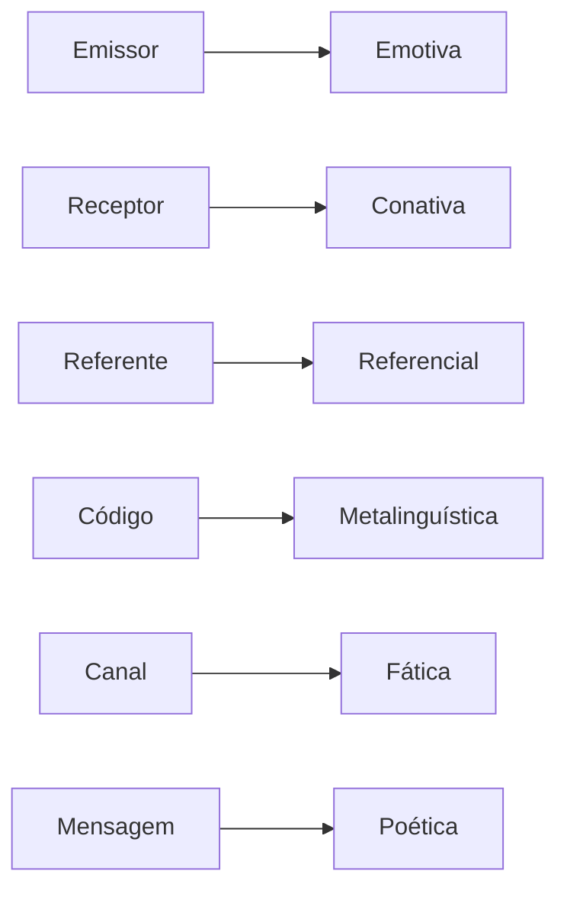
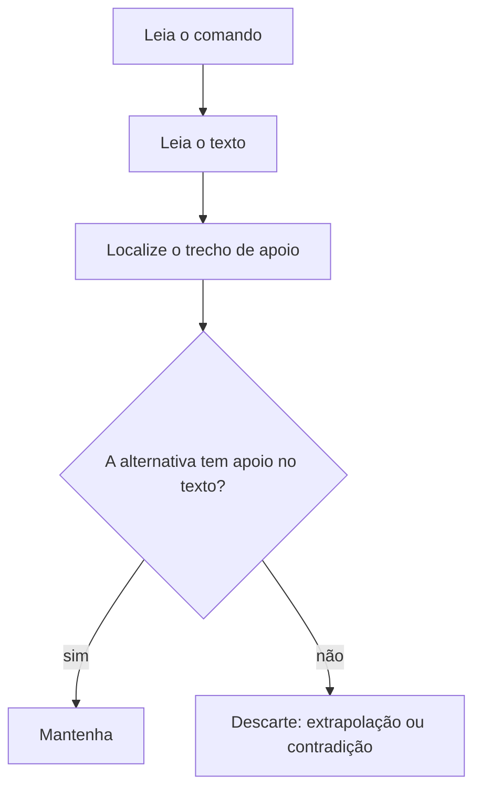

Toda mensagem nasce de alguém que quer algo: informar, convencer, desabafar, manter a conversa ou chamar a atenção para a própria forma do texto. Esse "algo" é a **função da linguagem** predominante. A prova pede que o candidato reconheça a função a partir de um trecho, e a resposta correta depende de saber qual elemento da comunicação está em destaque. O capítulo também apresenta as primeiras noções de interpretação, a diferença entre linguagem verbal e não verbal e entre linguagem literária e não literária, que preparam a leitura crítica do capítulo seguinte.

> [!objetivos]
> - Identificar os seis elementos da comunicação e a função que cada um origina.
> - Reconhecer a função predominante em um trecho curto.
> - Distinguir linguagem verbal de não verbal e literária de não literária.
> - Aplicar os primeiros passos da interpretação de texto: ler o comando, localizar a informação e inferir.

## Os seis elementos da comunicação

Para a teoria clássica, toda comunicação envolve seis elementos. Cada função da linguagem nasce do destaque dado a um deles.

| Elemento | O que é | Função que origina |
| --- | --- | --- |
| Emissor | quem fala ou escreve | emotiva (expressiva) |
| Receptor | quem recebe a mensagem | conativa (apelativa) |
| Mensagem | o que é dito | poética |
| Referente | o assunto, o contexto | referencial (informativa) |
| Código | o sistema de signos (a língua) | metalinguística |
| Canal | o meio físico ou psicológico | fática |

O esquema da comunicação funciona assim: o **emissor** codifica o **referente** numa **mensagem**, usando um **código** conhecido, e a transmite por um **canal** ao **receptor**. A mensagem transmitida pode falhar em qualquer ponto: ruído no canal (a ligação cai), código desconhecido (o receptor não fala a língua) ou referente ambíguo (as partes pensam em coisas diferentes). Quando a prova pergunta "qual elemento recai em destaque", o caminho é perguntar qual desses pontos o texto está evidenciando.

## As seis funções

### Referencial (informativa)

Foca no **referente**: informa fatos, dados e situações, com linguagem objetiva, na terceira pessoa e no presente ou no passado. Está nas notícias, nos relatórios, nos verbetes. "O incêndio atingiu três andares do edifício às 14 horas."

### Emotiva (expressiva)

Foca no **emissor**: revela sentimentos, impressões e opiniões, com a primeira pessoa, exclamações e reticências. Está em cartas pessoais, diários, poemas líricos. "Estou tão cansado, mas feliz demais com o resultado!"

### Conativa (apelativa)

Foca no **receptor**: quer convencer, persuadir ou mandar. Usa o vocativo, o imperativo e a segunda pessoa. Está em propagandas, discursos e avisos. "Doe sangue. Salve vidas."

### Fática

Foca no **canal**: testa se a comunicação funciona e mantém o contato. Aparece em saudações e expressões como "alô", "está me ouvindo?", "entendeu?", "oi, tudo bem?" ou no "como vai?" que não espera resposta longa.

### Metalinguística

Foca no **código**: a linguagem fala dela mesma. Um dicionário explicando uma palavra, um poema sobre poesia ou um filme sobre cinema são metalinguísticos. "Verbo é a palavra que indica ação, estado ou fenômeno."

### Poética

Foca na **mensagem**: valoriza a forma, o som, o ritmo, as imagens e as figuras. Aparece em poemas, letras de música e em slogans bem construídos. Pode estar em textos não literários, como "Pense. Pense Bem. Pense Bombril." (rima e repetição).

> [!bizu] Pergunta-chave para cada função
> Quem fala de si? **Emotiva**. A quem se dirige para pedir algo? **Conativa**. Do mundo? **Referencial**. Do próprio texto ou da língua? **Metalinguística**. Do contato? **Fática**. Do jeito de dizer? **Poética**.

> [!pegadinha] Função predominante não é função exclusiva
> Um mesmo texto pode ter várias funções. Uma propaganda usa a conativa para convencer, a referencial para dar dados e a poética para chamar a atenção. A prova sempre pergunta pela **predominante**, a que organiza o texto como um todo.

> [!exemplo] Identificando a função
> - "Alô? Está me ouvindo?" — **fática**: testa o canal.
> - "A palavra 'justiça' vem do latim iustitia." — **metalinguística**: fala da palavra, não da coisa.
> - "Ah, que saudade me invade nesta madrugada!" — **emotiva**: o eu lírico exprime sentimento.
> - "Alistem-se já!" — **conativa**: ordem dirigida ao receptor.
> - "O comando informou que a operação terminou às 6 horas." — **referencial**.

## Noções iniciais de interpretação de textos

Interpretar é extrair do texto o que ele diz, o que ele sugere e o que ele não permite concluir. A prova trabalha com três níveis.

1. **Compreensão**: o que está escrito, dito de modo explícito.
2. **Inferência**: o que se pode concluir com segurança a partir do texto (informação implícita).
3. **Extrapolação**: o que vai além do texto. Em geral, é o erro das alternativas incorretas.

### Passo a passo para responder

1. **Leia o comando** da questão antes do texto (o que se pede: ideia central, argumento, tom, inferência).
2. **Leia o texto** procurando a tese, os operadores e as palavras-chave.
3. **Volte ao texto** para localizar o trecho que sustenta a resposta; a opção correta sempre tem apoio.
4. **Elimine** alternativas que acrescentam informação, generalizam ("sempre", "nunca", "todos") ou contradizem o texto.

> [!atencao] Cuidado com a extrapolação
> Se a alternativa afirma algo "verdadeiro" no mundo real, mas que o texto não diz nem permite concluir, ela está errada. O gabarito mede a leitura do texto, não o conhecimento do candidato sobre o assunto.

## Função poética e valor estético

A função poética merece atenção porque é a mais confundida. Ela não é exclusiva dos poemas: aparece quando o texto chama atenção para o **modo** de dizer, em seus aspectos estilísticos e estéticos (rima, aliteração, ritmo, metáfora). Um verso de Drummond como "No meio do caminho tinha uma pedra" tem função poética pela repetição e pela musicalidade; já um slogan de primavera, como "Chegou a estação das flores", pode usar a mesma função com finalidade comercial. Por outro lado, um texto longo e bem escrito não é poético só por ser bonito: precisa colocar a forma em primeiro plano.

Há ainda um uso curioso do português antigo: palavras como "cousas" (hoje, "coisas") mostram que a língua muda, e o gosto estético do leitor também. Um poema do século XIX parece estranho a quem lê hoje, e a banca pode citar o texto antigo para testar se o candidato reconhece o assunto e a função, apesar do vocabulário.

> [!atencao] Estético não é sinônimo de ridículo
> Algumas alternativas dizem que o autor considera algo "ridículo" ou "belo" quando o texto só descreve. O adjetivo de valor precisa estar no texto ou ser inferido com segurança. Na dúvida, fique com a alternativa que usa só o que está escrito.

## Quando o texto se resume a uma só função

Textos curtos costumam ter uma função clara: o aviso rural "Cuidado: cão bravo" é conativo; o gráfico de preços do último ano é referencial; o diário de um recruta é emotivo. Já o texto de um **legislador** é referencial e injuntivo ao mesmo tempo: informa o que a lei diz e ordena o comportamento. Num artigo que informe "o prazo é de cinquenta dias", predomina a referencial.

> [!exemplo] Três textos, três funções
> - "O vento sopra do mar e o sol se esconde." — poética, se o foco for a imagem; referencial, se o foco for informar o clima. O contexto decide.
> - "Você já pensou em doar sangue?" — conativa, porque se dirige ao receptor e o convida à ação.
> - "Pois é, né..." — fática, porque só mantém o contato.

## Linguagem verbal e não verbal

A **linguagem verbal** usa palavras, faladas ou escritas. A **linguagem não verbal** usa imagens, gestos, cores, sons e símbolos: uma placa de trânsito, um semáforo, uma bandeira, uma sirene. A **linguagem mista** combina as duas, como nas charges, nas tirinhas, nos cartazes e nas histórias em quadrinhos.

Placas, mapas, gráficos, ícones de aplicativos e fardamentos funcionam como textos não verbais: cada elemento (cor, forma, posição) tem um significado que o leitor aprende por convenção. A cor vermelha numa placa indica proibição ou perigo; o verde, permissão ou segurança. Esse repertório é cultural, e por isso a banca pode pedir a interpretação de um símbolo com base no contexto.

Em questões com imagens, o candidato deve ler o texto verbal **junto** com o visual, porque o sentido muitas vezes nasce do contraste entre os dois. Uma charge em que o texto diz "tudo sob controle" enquanto a imagem mostra um incêndio produz ironia só com a leitura conjunta.

## Linguagem literária e não literária

| Característica | Linguagem literária | Linguagem não literária |
| --- | --- | --- |
| Objetivo | provocar emoção e reflexão | informar, orientar, explicar |
| Palavras | sentido figurado e plural | sentido literal e preciso |
| Forma | valoriza o som, o ritmo e as imagens | valoriza a clareza e a objetividade |
| Exemplo | poema, conto, romance | manual, notícia, lei |

O limite entre as duas não é rígido. Um poema pode usar linguagem técnica, e um manual pode ter uma metáfora feliz. O que decide é o **propósito dominante**: arte ou informação.

> [!bizu] Sentido denotativo e conotativo
> Linguagem não literária tende ao sentido **denotativo** (dicionarizado): "pedra" é um mineral. A literária usa o sentido **conotativo** (figurado): "ele tem um coração de pedra". Mas atenção: propagandas e crônicas, que não são literatura "pura", também usam conotação.

## Mapa do capítulo

O quadro resume as seis funções e a pista de reconhecimento.

| Função | Foco | Pista |
| --- | --- | --- |
| Referencial | assunto | terceira pessoa, dados |
| Emotiva | emissor | primeira pessoa, exclamação |
| Conativa | receptor | imperativo, vocativo |
| Fática | canal | "alô", "entendeu?" |
| Metalinguística | código | a língua explica a língua |
| Poética | mensagem | rima, ritmo, figuras |

### Para fixar
- São seis os elementos da comunicação, e cada um origina uma função da linguagem.
- Referencial informa; emotiva exprime sentimento; conativa convence ou manda.
- Fática testa o canal; metalinguística explica o código; poética valoriza a forma.
- A função predominante é a que organiza o texto, mesmo que haja outras.
- Interpretar envolve compreensão, inferência e extrapolação; a extrapolação leva ao erro.
- Leia o comando antes do texto e volte ao texto para confirmar a alternativa.
- Linguagem verbal usa palavras, não verbal usa imagens e símbolos, e a mista combina as duas.
- Linguagem literária explora o sentido figurado; a não literária prioriza a clareza.
