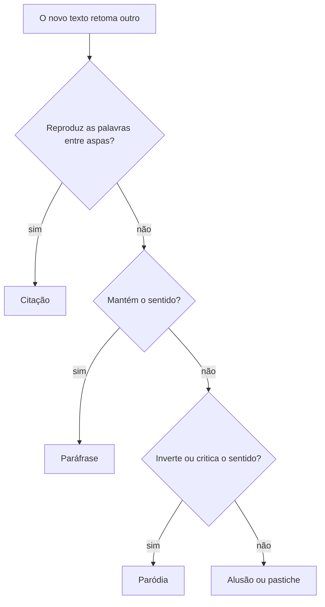
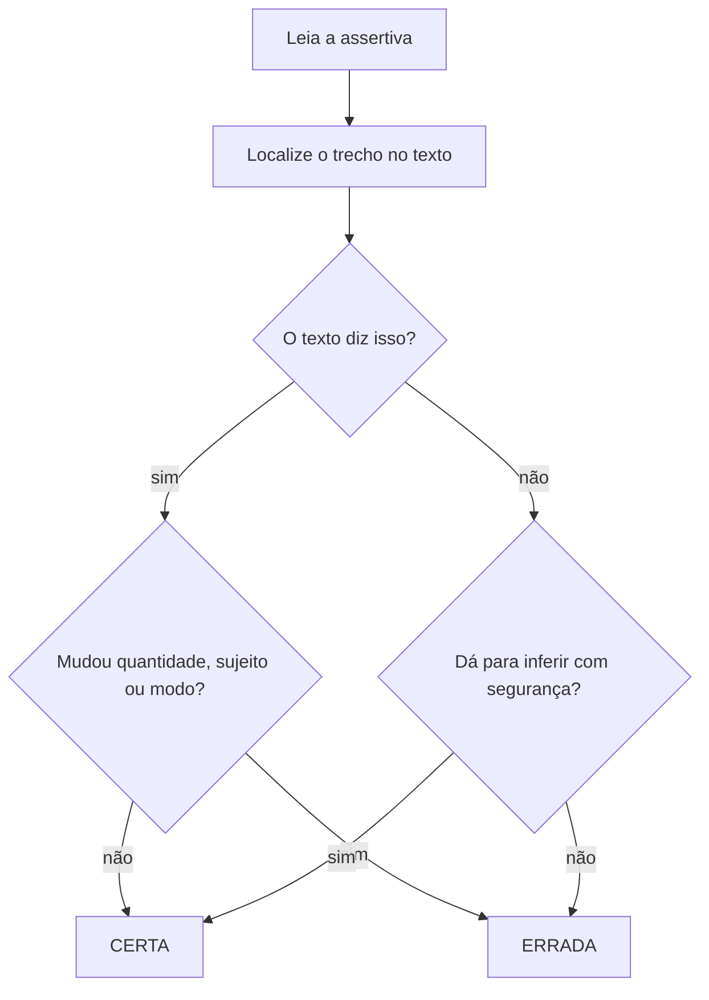

Nenhum texto nasce sozinho. Ele dialoga com outros textos, retoma ideias, cita autores, imita formas e responde a debates que já existem. Esse diálogo se chama **intertextualidade**, e as provas gostam de perguntar como o autor se relaciona com outro texto: se concorda, se critica, se parodia, se só cita. O capítulo trata também da arte de interpretar e compreender e da técnica de julgar assertivas, em que o candidato diz se cada afirmação é certa ou errada diante do texto. Esse é o formato das provas de certo ou errado e aparece em várias bancas.

> [!objetivos]
> - Reconhecer a intertextualidade e distinguir citação, paráfrase, paródia, alusão e epígrafe.
> - Distinguir compreensão, interpretação e extrapolação e aplicar a diferença nas questões.
> - Julgar assertivas como certas ou erradas, identificando os vícios mais comuns.
> - Aplicar um método de leitura que combina localização, inferência e eliminação.

## Intertextualidade

Intertextualidade é a presença de um texto dentro de outro. Pode ser explícita (o autor indica a fonte) ou implícita (o leitor precisa reconhecer). O texto retomado também se chama **texto de origem** ou intertexto.

| Forma | O que faz | Exemplo |
| --- | --- | --- |
| Citação | reproduz as palavras de outro, entre aspas | "Penso, logo existo", escreveu Descartes. |
| Alusão | faz referência rápida, sem reproduzir | "Ele enfrentou seu moinho de vento" (Dom Quixote) |
| Epígrafe | trecho que abre um texto e o orienta | frase de um poeta no início de um capítulo |
| Paráfrase | diz de outro modo, **mantendo** o sentido | "Quem tem pressa come cru" = "Pressa não combina com bom resultado" |
| Paródia | imita para **mudar** o sentido, em geral com humor ou crítica | letra de música adaptada para criticar a política |
| Pastiche | imita o estilo de outro autor | texto escrito "à maneira de" um escritor |

> [!bizu] Paráfrase mantém, paródia inverte
> Na **paráfrase**, o novo texto concorda com o original e o reescreve. Na **paródia**, o novo texto se apoia no original para dizer outra coisa, quase sempre contra ele. Se a questão fala em "crítica", "humor" ou "subversão", a palavra procurada é paródia.

### Tipos de relação

A intertextualidade pode ter funções diferentes:

- **Concordância**: o autor usa o outro texto como apoio (citação de autoridade, epígrafe).
- **Discordância**: o autor retoma o outro texto para criticá-lo (paródia, ironia).
- **Homenagem**: o texto evoca uma obra admirada (alusão, pastiche).
- **Ilustração**: o outro texto serve de exemplo ou analogia.

Para reconhecer a relação, olhe a **mudança**: o que o novo texto mantém e o que altera. As palavras trocadas revelam a intenção.

> [!exemplo] Paráfrase ou paródia?
> **Original:** "A vida é feita de escolhas."
>
> **Paráfrase:** "Viver é decidir entre caminhos." (mesmo sentido, outras palavras)
>
> **Paródia:** "A vida é feita de boletos." (usa a estrutura do original para criticar a rotina financeira)

> [!pegadinha] Citação não é plágio, mas precisa de marca
> Para a prova, uma frase entre aspas seguida do nome do autor é citação. Sem aspas e sem indicação de autoria, o trecho seria apropriação indevida. Em questões sobre o "texto A" e o "texto B", a banca pergunta qual relação o segundo estabelece com o primeiro; a resposta passa por identificar se há reprodução (citação), reescrita (paráfrase) ou transformação crítica (paródia).

## Interpretação e compreensão

As bancas distinguem três operações mentais, e muitos erros nascem de misturá-las.

| Operação | O que é | Exemplo |
| --- | --- | --- |
| Compreensão | entender o que está dito de forma explícita | "O prazo termina no dia 10" |
| Interpretação (inferência) | concluir o que o texto sugere sem dizer | "Se o prazo termina no dia 10, não há tempo de enviar dia 11" |
| Extrapolação | ir além do texto, com informações externas | "O prazo foi curto por falta de planejamento" (o texto não diz) |

A prova de certo ou errado, em especial, pune a extrapolação com muita frequência. A afirmação pode ser plausível, mas se o texto não a sustenta, o gabarito é **errado**.

### Inferência segura

Uma inferência é segura quando qualquer leitor atento chegaria à mesma conclusão a partir do texto. Algumas pistas ajudam:

- **Pressuposto**: ideia embutida em palavra ou expressão. "Ele **deixou** de fumar" pressupõe que fumava.
- **Subentendido**: ideia sugerida, que depende do contexto. "Está frio aqui" pode subentender "feche a janela".
- **Implicação lógica**: conclusão inevitável de dados do texto.

> [!atencao] Pressuposto x subentendido
> O pressuposto é **inegável** (aparece na palavra); o subentendido é **possível** (depende da intenção). Em prova, a conclusão baseada no pressuposto é válida; a baseada em subentendido só vale se o contexto forçar a leitura.

### Ideia central e ideias secundárias

A ideia central é a tese do texto; as secundárias são os argumentos e exemplos. Na prova, uma alternativa que toma um exemplo como ideia central costuma estar errada. Teste: se retirar a frase e o texto perder o sentido, ela é central; se perder só um exemplo, é secundária.

## Julgamento de assertivas

No formato certo/errado, cada afirmação ("assertiva") é comparada com o texto. O candidato julga se ela está de acordo com o que o texto diz ou permite concluir. O erro costuma estar em detalhes pequenos; por isso, a leitura precisa ser **comparativa**: texto de um lado, assertiva do outro.

### Vícios mais comuns nas assertivas erradas

| Vício | Como aparece | Exemplo |
| --- | --- | --- |
| Generalização | troca "alguns" por "todos", "às vezes" por "sempre" | Texto: "alguns candidatos faltaram". Assertiva: "os candidatos faltaram". |
| Troca de causa e consequência | inverte a ordem lógica | Texto: "choveu, e a estrada alagou". Assertiva: "a estrada alagou, por isso choveu". |
| Inversão de sentido | afirma o oposto | Texto: "a medida reduziu". Assertiva: "a medida aumentou". |
| Extrapolação | acrescenta informação | Texto fala de uma medida. Assertiva diz que "foi um fracasso". |
| Troca de sujeito | atribui a ação a outro | Texto: "o comandante autorizou". Assertiva: "o subcomandante autorizou". |
| Alteração de modalidade | muda "pode" por "deve" | Texto: "pode ser feito". Assertiva: "deve ser feito". |
| Fato ou opinião | confunde dado e avaliação | Texto: "alguns acham". Assertiva: "é consenso". |

> [!resolvido] Julgando uma assertiva
> **Texto:** "A maioria dos municípios pernambucanos realizou, em 2023, simulados de evacuação; contudo, poucos estenderam o treinamento às escolas particulares."
>
> **Assertiva 1:** "Todos os municípios pernambucanos fizeram simulados de evacuação em 2023." → **Errada** (generalização: o texto diz "a maioria").
> **Assertiva 2:** "O treinamento chegou a poucas escolas particulares." → **Certa** (paráfrase fiel).
> **Assertiva 3:** "As escolas particulares recusaram o treinamento." → **Errada** (extrapolação: o texto não fala em recusa).

> [!bizu] Palavras que acendem o alerta
> Desconfie de **"sempre", "nunca", "todos", "nenhum", "somente", "exclusivamente", "obrigatoriamente", "apenas"**. Elas absolutizam. Desconfie também dos verbos de certeza ("comprova", "demonstra", "prova") quando o texto usa verbos de dúvida ("sugere", "indica", "pode").

### Método em cinco passos

1. **Leia o texto inteiro** antes das assertivas.
2. **Sublinhe** nomes, números, quantificadores e operadores.
3. **Leia a assertiva** e identifique o que ela afirma.
4. **Procure** o trecho correspondente no texto.
5. **Compare** palavra por palavra: sujeito, ação, quantidade, modo, causa.

Se a afirmação é compatível com o texto sem acrescentar nada, é certa. Se acrescenta, inverte ou generaliza, é errada.

### O caso do "não" duplo e das negativas

Atenção às assertivas com negação. "Não é verdade que nenhum candidato faltou" equivale a "algum candidato faltou". Troque a negação por sua equivalente positiva para evitar tropeços:

| Frase | Equivale a |
| --- | --- |
| Não é verdade que todos passaram | Alguns não passaram |
| Não há ninguém que não saiba | Todos sabem |
| Nem todo candidato é aprovado | Alguns não são aprovados |

> [!pegadinha] "Nem todo" não é "nenhum"
> "Nem todo militar é oficial" diz que há militares que não são oficiais, mas não afirma que nenhum seja. Quem lê "nem todo" como "nenhum" erra a assertiva.

## Presumir, deduzir e reconhecer o humor

Dois verbos aparecem nos comandos e merecem cuidado. **Deduzir** é tirar uma conclusão que decorre necessariamente do texto. **Presumir** é supor algo provável, mas não garantido. Uma questão que pede o que se "deduz" exige apoio firme; a que pede o que se "presume" aceita um grau maior de probabilidade, ainda que sempre ancorado em pistas.

Outro ponto é o **texto humorístico** (piada, charge, tirinha). Seu sentido costuma depender de um desvio: uma palavra com duplo sentido, uma expectativa quebrada ou uma recorrência (repetição de um traço para criar graça). Na leitura de humor, o candidato precisa achar o ponto em que a leitura esperada é trocada por outra, e a questão normalmente pergunta onde está esse "pulo".

> [!exemplo] A graça está no desvio
> "Quando o mundo ficou conectado, o sábio do vilarejo retornou do ciberespaço dizendo que a mutação mais rápida das estrelas modernas era o aplicativo de mensagens." Há uma mistura intencional de registros (sábio, estrelas, aplicativo) que cria o efeito humorístico: o texto brinca com o grandioso para falar de algo banal. A competência esperada é perceber o contraste, e não explicar astronomia.

A simplicidade aparente é outra pista falsa. Muitos textos curtos escondem a ideia em uma só palavra; o sentido **reside** no verbo ou no advérbio. "Ele *ainda* não chegou" pressupõe que se espera sua chegada. "Ele *só* chegou ao meio-dia" sugere atraso. O alfabeto de pistas é pequeno (advérbios, verbos modais, conectivos), e quem o domina lê rápido.

### Alternativas que "competem" entre si

Em múltipla escolha, é comum que duas alternativas pareçam boas. Uma regra prática: a que compete com a certa costuma ser **mais ampla** que o texto (generalização) ou **mais específica** (detalhe inexistente). A correta geralmente repete o texto com outras palavras e na mesma medida. Se você hesita entre duas, compare a abrangência de cada uma com a do trecho.

## Outros três textos para treinar

**Texto 6 (idioma e extinção).** "Línguas extintas não voltam, mas o interesse por elas provoca estudos que, mesmo superadas as dificuldades iniciais, tornarão linguisticamente possível reconstruir parte do vocabulário."
- *Assertiva:* "Todas as línguas extintas serão reconstruídas." → **Errada**: o texto fala em "parte do vocabulário".
- *Assertiva:* "O interesse por línguas extintas incentiva pesquisas." → **Certa**.

**Texto 7 (rotatividade).** "A rotatividade de pessoal diminuiu depois que a empresa ofereceu novos benefícios; as políticas antigas, sucedidas por outras mais flexíveis, já não atraíam os funcionários."
- *Assertiva:* "A oferta de benefícios coincidiu com a queda da rotatividade." → **Certa**: o texto marca a ordem temporal ("depois que"), sem afirmar causa única.
- *Assertiva:* "Os benefícios foram a única causa da queda da rotatividade." → **Errada**: "única" é extrapolação.

**Texto 8 (ditado e discurso redentor).** "Diz o ditado que a esperança é a última que morre. Há quem a trate como força redentora; outros preferem uma ação humanitária concreta a lotear a culpa entre os envolvidos."
- *Assertiva:* "O autor critica quem prefere ação concreta." → **Errada**: o texto apenas apresenta a divergência, sem condenar nenhum lado. O verbo "preferir" é descritivo, não avaliativo.
- *Assertiva:* "O texto apresenta duas atitudes diante da esperança." → **Certa**.

Os vagalumes, as línguas extintas e o ditado popular não importam por si: servem de pano de fundo para o treino de leitura. O que a prova mede é a precisão com que o candidato compara a afirmação com o texto.

## Tipos de questão de interpretação

A prova costuma repetir alguns moldes. Reconhecê-los economiza tempo.

| Pergunta | O que testa | Como responder |
| --- | --- | --- |
| "Segundo o texto..." | compreensão | procure o trecho exato |
| "Infere-se do texto..." | inferência | ache o apoio lógico |
| "O autor pretende..." | intenção | olhe tese, tom e operadores |
| "O termo X refere-se a..." | coesão | volte à frase anterior |
| "A expressão Y tem valor de..." | sentido contextual | substitua por sinônimo |
| "Marque a alternativa **incorreta**" | atenção ao comando | descarte as corretas |

> [!atencao] Leia o comando duas vezes
> Um número alto de erros vem de "marque a **incorreta**" lido como "marque a correta". Sublinhe a palavra-chave do comando antes de olhar as alternativas.

## Treinando com cinco textos curtos

A melhor forma de fixar o método é aplicá-lo. Os trechos abaixo são originais e simulam o tamanho de um suporte de prova. Em cada um, aparece um tipo diferente de armadilha.

**Texto 1 (fábricas e desemprego).** "Quando as fábricas automatizaram a linha de montagem, o desemprego cresceu na região durante dois anos; depois, surgiram vagas em manutenção e programação."
- *Assertiva:* "A automação das fábricas causou desemprego definitivo na região." → **Errada**. O texto fala em dois anos de aumento e diz que surgiram novas vagas; "definitivo" é extrapolação.
- *Assertiva:* "Houve criação de vagas em áreas técnicas após o período de desemprego." → **Certa**.

**Texto 2 (vírus e imperfeição).** "O vírus se espalhou com rapidez porque a imperfeição das barreiras sanitárias permitiu que casos isolados passassem despercebidos."
- *Assertiva:* "A falha nas barreiras explica a rapidez da disseminação." → **Certa**: a relação de causa vem do "porque".
- *Assertiva:* "Todos os casos passaram despercebidos." → **Errada**: o texto fala em "casos isolados".

**Texto 3 (atendente).** "O atendente informou que o benefício só será pago se o formulário estiver completo; o examinador acrescentou que a assinatura é indispensável."
- *Assertiva:* "A assinatura é uma condição para o pagamento." → **Certa**: a conclusão decorre da soma das duas falas (formulário completo, com assinatura indispensável).
- *Assertiva:* "O pagamento será feito mesmo com formulário incompleto." → **Errada**: inversão do sentido.

**Texto 4 (advocacia e negociações).** "Na advocacia, as negociações de acordo costumam terminar mais rápido quando as partes se apressaram em apresentar documentos desde o início."
- *Assertiva:* "A pressa em entregar documentos favorece acordos mais rápidos, segundo o texto." → **Certa**. 
- *Assertiva:* "Toda negociação de acordo termina rápido." → **Errada**: o texto diz "costumam" e não "toda".

**Texto 5 (vaga-lumes e evolução).** "As luzes dos vaga-lumes atraem parceiros, mas algumas espécies sofisticadas imitam o sinal de outras para capturar presas. Trata-se de um comportamento evolutivo."
- *Assertiva:* "Todas as espécies de vaga-lume imitam sinais de outras." → **Errada** (generalização: "algumas espécies").
- *Assertiva:* "A imitação do sinal serve, em alguns casos, para caçar." → **Certa**.

> [!atencao] Número e porcentagem
> Textos com números exigem conferência cuidadosa. Se o texto cita 850 casos em um universo maior, a assertiva "a maioria dos casos" pode ser verdadeira ou falsa conforme o total. Sem o total no texto, o candidato não pode concluir que 850 é maioria, nem minoria: a assertiva que afirma isso extrapola.

### O raciocínio do examinador

Pensar como quem elabora a prova ajuda a evitar armadilhas. O examinador costuma criar as assertivas a partir de uma frase do texto, fazendo uma pequena alteração. As alterações seguem um catálogo conhecido:

1. **Troca de quantificador** (alguns, a maioria, todos).
2. **Troca de modalizador** (pode, deve, precisa; talvez, certamente).
3. **Inversão de causa e efeito**.
4. **Inclusão de informação inexistente** (um número, um nome, uma intenção).
5. **Retirada de uma condição** ("só se", "desde que").
6. **Troca de sujeito** ou de destinatário.
7. **Troca de tempo** (passado por futuro, fato por possibilidade).

Ao ler a assertiva, passe esse catálogo mentalmente e veja se alguma alteração aconteceu. Se nenhuma aconteceu, a chance de estar certa é grande.

### Quando o texto não basta

Há assertivas que não são nem certas nem erradas no sentido forte, porque dependem de informação que não está no texto. Nesses casos, nas provas de certo ou errado, o critério é considerar a assertiva **errada** quando ela afirma algo que o texto não permite concluir. Já em provas de múltipla escolha, o candidato deve escolher a alternativa **mais bem sustentada** pelo texto, mesmo que nenhuma pareça perfeita. Conhecer o estilo da banca faz diferença: algumas provas de certo ou errado punem o chute com a regra de desconto (uma errada anula uma certa); as de múltipla escolha, em geral, não.

> [!bizu] Estilo da banca
> Múltipla escolha: cinco alternativas, uma só correta, comandos como "assinale a alternativa correta" ou "incorreta". Certo ou errado: julgamento de cada item, com possibilidade de anular acertos por erro. A técnica de comparar texto e afirmação serve aos dois.

## Armadilhas em perguntas sobre tom e intenção

Perguntas sobre o "propósito" do autor também seguem padrões. Lembre-se da relação entre tipo e intenção:

- Texto **narrativo**: o autor quer relatar ou entreter.
- Texto **descritivo**: quer caracterizar.
- Texto **injuntivo**: quer orientar.
- Texto **argumentativo**: quer convencer.
- Texto **expositivo**: quer explicar.

Esse mapa serve para eliminar alternativas que atribuem ao autor uma intenção incompatível com o tipo. Num texto expositivo, por exemplo, uma alternativa que diga que o autor "pretende convencer o leitor a adotar a medida" provavelmente erra, porque a exposição apenas informa. Do mesmo modo, num editorial, dizer que o autor "se limita a relatar" ignora a tese.

E entre tom e vocabulário: adjetivos de valor negativo ("péssimo", "inaceitável") revelam crítica; verbos como "reconhecer", "admitir" e "concordar" revelam concessão; o uso de aspas em palavras comuns sugere ironia ou distanciamento.

## Mapa do capítulo

A ideia que organiza o capítulo é a **fidelidade ao texto**: a resposta certa sempre tem apoio no que está escrito, direta ou logicamente.

| Tema | Ideia principal | Armadilha |
| --- | --- | --- |
| Intertextualidade | um texto dialoga com outro | confundir paráfrase e paródia |
| Compreensão | entender o que está dito | ler além do que está escrito |
| Inferência | concluir com apoio lógico | tratar subentendido como certeza |
| Extrapolação | ir além do texto | marcar como certa por "parecer lógica" |
| Julgamento | comparar texto e assertiva | cair em generalizações |

### Para fixar
- Intertextualidade é a relação de um texto com outro, por citação, alusão, epígrafe, paráfrase, paródia ou pastiche.
- A paráfrase mantém o sentido do original; a paródia o transforma, em geral com crítica ou humor.
- Compreensão é o que está dito; interpretação é o que se infere; extrapolação é o que vai além do texto.
- Pressuposto é inegável; subentendido depende do contexto.
- Na assertiva errada, os vícios comuns são generalização, inversão, extrapolação, troca de sujeito e mudança de modalidade.
- Palavras absolutas como sempre, nunca, todos e somente exigem desconfiança.
- A assertiva certa não acrescenta nem inverte informação do texto.
- "Nem todo" equivale a "alguns não"; troque negações duplas por afirmações equivalentes.
- Leia o comando com atenção, principalmente quando pede a alternativa incorreta.
- Compare palavra por palavra: sujeito, ação, quantidade, modo e causa.
