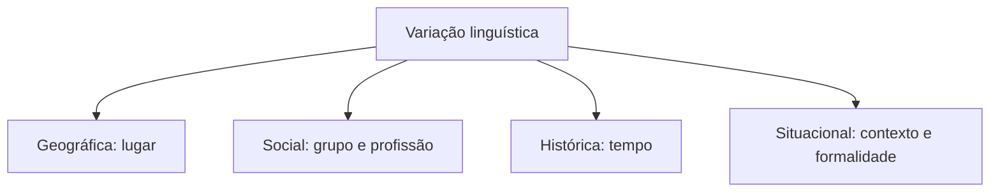
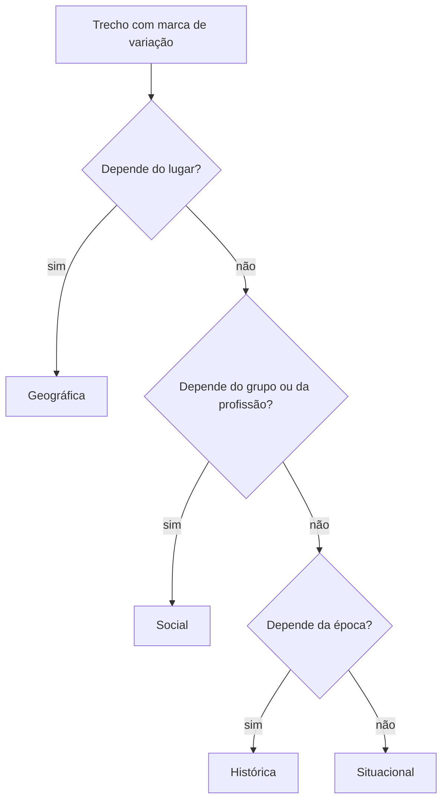

Ninguém fala como escreve, e ninguém fala em Recife como em Porto Alegre, nem um jovem de 18 anos como um senhor de 80. Essas diferenças não são erros: são **variação linguística**, um fato natural de qualquer língua viva. A prova de Língua Portuguesa trata do tema em textos que comparam falas regionais, registros formais e informais, gírias e jargões, e costuma pedir que o candidato reconheça o tipo de variação, valorize cada variedade sem preconceito e perceba quando a língua é adequada à situação. Este capítulo mostra os tipos de variação e explica o que é preconceito linguístico.

> [!objetivos]
> - Definir variação linguística e explicar por que ela é natural.
> - Distinguir variação geográfica, social, histórica e situacional.
> - Reconhecer o preconceito linguístico e seus argumentos mais comuns.
> - Diferenciar tipos de variação de níveis de linguagem.

## O que é variação linguística

Toda língua muda com o tempo, varia de um lugar para outro e se diversifica conforme quem a usa. Se não fosse assim, o português do século XIII continuaria igual ao de hoje e o falado em Portugal seria idêntico ao do Brasil. A mudança acompanha a sociedade: novas tecnologias, novos hábitos e novos grupos criam palavras e construções.

O ponto central é que **variação não é erro**. Cada variedade obedece a regras próprias e cumpre bem a função de comunicar dentro do grupo que a usa. Dizer "nós vai" quebra uma regra da norma-padrão, mas segue regras da variedade falada em muitas comunidades, e o ouvinte entende sem dificuldade. O erro, do ponto de vista da prova, só existe quando a variedade escolhida é **inadequada à situação**: usar gíria em um ofício, por exemplo.

## Tipos de variação

A tradição divide a variação em quatro tipos, cada um ligado a um fator.

| Tipo | Fator | Exemplo |
| --- | --- | --- |
| Geográfica (diatópica) | lugar | "macaxeira", "aipim" e "mandioca" para a mesma raiz |
| Social (diastrática) | grupo, escolaridade, idade, profissão | gírias de jovens, jargão jurídico, falar de comunidades rurais |
| Histórica (diacrônica) | tempo | "vossa mercê" → "você" → "cê" |
| Situacional (diafásica) | contexto, interlocutor, formalidade | conversa com amigo x ofício a uma autoridade |

Há ainda a variação entre **fala e escrita** (diamésica), que o capítulo seguinte aprofunda.

### Variação geográfica

É a que a maioria das pessoas percebe primeiro. Os falantes de regiões diferentes usam sotaques (modo de pronunciar), vocabulário e até construções distintas. O "r" retroflexo do interior paulista ("porrta"), o "s" chiado do carioca e o "t" e o "d" pronunciados "tchia" e "djia" em boa parte do Sudeste, mas "tia" e "dia" em boa parte do Nordeste, são exemplos de sotaque. As diferenças de vocabulário, como "bolacha" e "biscoito" ou "pão francês", "cacetinho" e "pãozinho", mostram que o mesmo objeto recebe nomes diferentes.

> [!bizu] Região x classe social
> Se o enunciado fala em "a fala típica de determinada região", pense em variação **geográfica**. Se fala em "o modo de falar de certo grupo de profissionais ou de idade", pense em **social**. As bancas costumam usar palavras-pista: "regional", "regionalismo" (geográfica); "gíria", "jargão", "grupo" (social).

### Variação social

Aqui entram o grau de escolaridade, a profissão, a idade e o grupo cultural. Os **jargões** são vocabulários técnicos de uma profissão (médicos, policiais, bombeiros); as **gírias** são palavras e expressões de grupos, muitas vezes jovens, que mudam rápido. O **dialeto social** que se aproxima da norma-padrão é o prestigiado, mas o prestígio é social, não linguístico: não há variedade "melhor" que outra do ponto de vista da comunicação.

### Variação histórica

A língua de séculos atrás é diferente da de hoje. "Vossa mercê" virou "vosmecê" e depois "você". Palavras desaparecem (arcaísmos) e outras surgem (neologismos). Quem lê um texto do século XVI percebe a distância e, ao mesmo tempo, reconhece que a língua é a mesma, porque a mudança ocorreu aos poucos.

### Variação situacional

É a que mais interessa ao dia a dia profissional. O mesmo falante muda de registro conforme a situação: usa linguagem descontraída com amigos e linguagem formal em um relatório. A adequação ao contexto é o que a prova chama de **competência comunicativa**.

> [!exemplo] Um falante, três registros
> - Para o colega: "Fala, mano, bora dar uma olhada nisso?"
> - Para o chefe: "Comandante, posso revisar o documento com o senhor?"
> - Em ofício oficial: "Solicito a Vossa Senhoria que determine a revisão do documento."
>
> O falante é o mesmo; a situação é que muda o registro.

## Norma-padrão, norma culta e variedades

Três termos aparecem juntos e se confundem.

| Termo | O que é |
| --- | --- |
| Norma-padrão | conjunto de regras fixadas pela gramática normativa, um modelo ideal de correção |
| Norma culta | variedade falada e escrita por pessoas com escolaridade alta e em situações formais, que se aproxima da norma-padrão |
| Variedades populares | modos de falar de comunidades de menor acesso à escola; legítimas, mas menos prestigiadas |

A prova de concurso cobra a **norma-padrão** em gramática (concordância, regência, crase). Mas, na parte de variação, exige o reconhecimento de que todas as variedades são válidas socialmente e que a escolha depende do contexto.

> [!atencao] Norma-padrão não é "a língua"
> A norma-padrão é um modelo, uma referência para a escrita formal. A língua real é a soma de todas as variedades. Afirmar que "só existe um jeito correto de falar" é uma visão que a gramática descritiva rejeita.

## Preconceito linguístico

Preconceito linguístico é o julgamento negativo de uma pessoa ou grupo pelo modo como fala. É uma forma de discriminação social disfarçada de cuidado com a língua. O pesquisador Marcos Bagno popularizou o tema ao reunir os mitos mais comuns:

1. **"Existe uma língua uniforme no Brasil."** Falso: o país é multilíngue e multidialetal.
2. **"Brasileiro não sabe português."** Falso: a língua materna se adquire naturalmente.
3. **"Português é muito difícil."** Falso: é difícil a norma-padrão, que se aprende na escola.
4. **"As pessoas sem instrução falam tudo errado."** Falso: falam outra variedade, com regras próprias.
5. **"O certo é falar como se escreve."** Falso: a fala tem dinâmica própria.
6. **"É preciso saber gramática para falar bem."** Falso: o falante nativo domina a gramática da sua variedade desde cedo.

> [!pegadinha] Defender a variação não é abolir a norma
> A banca costuma apresentar o texto em defesa da variação e propor alternativas extremas, como "a norma-padrão deve ser abolida". Esse não é o argumento. O que se defende é o **respeito** às variedades e o **ensino** da norma-padrão como mais uma ferramenta, necessária em contextos formais.

### Como o preconceito se manifesta

- Zombar do sotaque de uma região ("falar de nordestino").
- Corrigir em público a fala de alguém de menor escolaridade.
- Associar a pessoa à sua variedade ("falou assim, é ignorante").
- Excluir candidatos por critérios de fala, sem relação com a função.

O efeito é a discriminação social: o julgamento da língua vira julgamento da pessoa.

## Onde a variação aparece na língua

Cada **variante** é uma forma alternativa de dizer a mesma coisa. Elas se manifestam em três planos.

| Plano | O que varia | Exemplo |
| --- | --- | --- |
| Fonético (pronúncia) | os sons | "leite" x "leiti"; "porta" com r retroflexo x r fraco |
| Lexical (vocabulário) | as palavras | tangerina, mexerica, bergamota, mimosa |
| Morfossintático (gramática) | flexão e construção | "nós vamos" x "nós vai"; "a gente vai" |

O plano **lexical** é o mais cobrado, porque é fácil de mostrar em texto. A fruta chamada de tangerina em uma região pode ser mexerica em outra e bergamota em uma terceira, sem que ninguém esteja errado. Já no Sudeste e no Nordeste os nomes de comida, de brinquedo e de parentesco diferem de forma notável. O plano **morfossintático** é o mais sensível ao preconceito, porque a norma-padrão é mais rígida na gramática do que no vocabulário.

> [!exemplo] Três variantes para a mesma ideia
> - Lexical: "Peguei o **aipim** na feira." / "Peguei a **macaxeira** na feira."
> - Fonético: "Vou ao **mercadu**." / "Vou ao **mercado**."
> - Morfossintático: "A gente **vai**." / "Nós **vamos**."

### A pluralidade da língua e o ensino

A reavaliação das práticas de ensino de português passou a reconhecer a **pluralidade** de usos. Documentos oficiais de educação recomendam que a escola não trate a variedade do aluno como erro, mas amplie seu repertório com a norma-padrão. Quando a escola ensina que "tudo o que o aluno diz está errado", reforça o preconceito; quando ensina que existe uma forma esperada em cada situação, ensina a competência comunicativa.

Em concursos, isso se traduz em enunciados como "o texto defende que a escola deve..." e a resposta correta tende a ser a que **concilia** as duas posições: respeitar a variedade e ensinar a norma. Alternativas que radicalizam (abolir a norma ou condenar a variedade popular) costumam estar erradas.

### Variação e adequação

O que importa para a vida profissional é a **adequação**. Um militar que se dirige à tropa usa uma linguagem; ao escrever um documento oficial, usa outra; ao falar com a comunidade atendida, ajusta o vocabulário para ser entendido. Dominar a norma-padrão é uma habilidade a mais, que dá acesso a contextos em que ela é exigida. Isso não elimina a validade das demais variedades.

> [!bizu] Quando o texto usa aspas
> Em muitos textos, o autor coloca entre aspas uma palavra ou expressão de outra variedade ("o 'rapaz' do sítio disse que estava 'arto' de esperar"). As aspas assinalam que a palavra pertence a outro registro e que o autor reconhece o estranhamento. Reconhecer essa função das aspas resolve questões de interpretação.

### Casos de textos literários

Autores brasileiros incorporaram a variação em suas obras para dar voz a personagens. Quando um romance reproduz a fala sertaneja, o autor não "erra": usa a variedade como recurso de **caracterização**. A questão de prova pergunta, nesses casos, o efeito de sentido da variedade escolhida: aproximar o leitor do personagem, marcar a origem social, criar humor ou denunciar o preconceito. Se o personagem fala de modo popular e o narrador, de modo culto, o contraste mostra duas camadas sociais no mesmo texto.

> [!resolvido] Efeito da variedade no texto
> **Trecho:** o narrador descreve em norma culta a cena, e o personagem diz "Eu fizesse o que pudesse, mas ninguém vendesse o gado pra mim".
>
> **Pergunta:** que efeito a variedade do personagem produz?
>
> **Resolução:** a fala do personagem usa uma variedade popular (nesse caso, com uso incomum do subjuntivo) e marca sua origem social e regional, aproximando-o do leitor. Não se trata de erro do autor nem de recurso humorístico por si só: é **caracterização**. A resposta correta é a que fala em "marcar a identidade social e regional do personagem".

## Tipos x níveis

Os **tipos** de variação (geográfica, social, histórica, situacional) são os **fatores** que provocam a diferença. Os **níveis de linguagem** (formal e informal, culta e coloquial) são os **graus** de formalidade que o falante escolhe. A confusão é frequente. Resumo:

| Pergunta | Resposta |
| --- | --- |
| "Quais fatores diversificam a língua?" | tipos de variação |
| "Que grau de formalidade o texto adota?" | nível de linguagem |
| "Falar 'você' ou 'vosmecê' depende de quê?" | tempo e região (tipos) |
| "Falar 'tá' ou 'está' depende de quê?" | situação (nível) |

> [!resolvido] Qual variação?
> **Trecho:** "Em Pernambuco, é comum usar 'oxente' como interjeição de surpresa; em outros estados, usa-se 'nossa'."
>
> **Resolução:** a diferença se liga ao **lugar**, portanto é variação **geográfica**. Não é nível de linguagem, porque ambas as expressões são informais; também não é histórica, porque convivem hoje.

## Mapa do capítulo

O capítulo se resume em duas lições: a língua varia por vários fatores e nenhuma variedade é erro em si.

| Conceito | Ideia | Pista |
| --- | --- | --- |
| Variação geográfica | lugar | sotaque, regionalismo |
| Variação social | grupo | gíria, jargão, escolaridade |
| Variação histórica | tempo | arcaísmo, neologismo |
| Variação situacional | contexto | formal x informal |
| Preconceito linguístico | julgar a pessoa pela fala | mitos sobre "certo" e "errado" |

### Para fixar
- Variação linguística é a diferença natural no uso da língua; variação não é erro.
- Os quatro tipos são geográfica, social, histórica e situacional.
- Regionalismo e sotaque indicam variação geográfica; gíria e jargão, variação social.
- Arcaísmo e neologismo indicam variação histórica.
- A variação situacional depende do interlocutor e do grau de formalidade.
- Norma-padrão é o modelo da gramática normativa; norma culta é a variedade dos falantes escolarizados.
- Preconceito linguístico é julgar a pessoa pelo seu modo de falar.
- Defender a variação não é abolir a norma-padrão; é respeitar as variedades e ensinar a norma.
- Tipos de variação são os fatores; níveis de linguagem são os graus de formalidade.
- Inadequação ao contexto, e não a variedade em si, é o que a prova considera falha.
