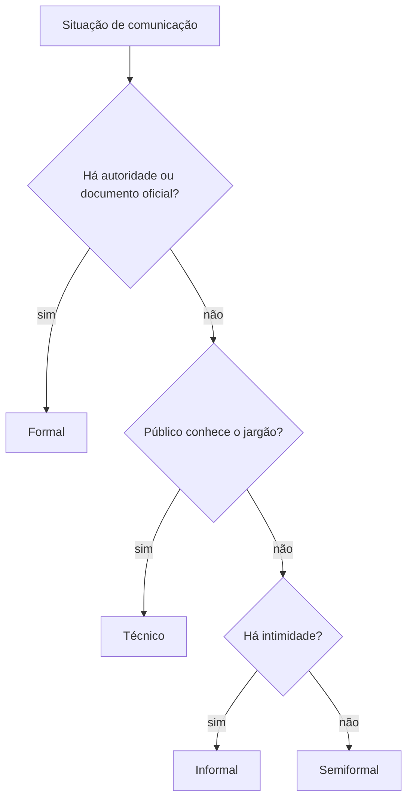

Dentro da variação situacional, o falante escolhe um **nível de linguagem** conforme o assunto, o interlocutor e o meio. O nível não mede a inteligência de quem fala: mede a adequação do registro à situação. A prova gosta de apresentar um trecho informal e perguntar como reescrevê-lo em registro formal, ou o inverso, e de perguntar em que situação um registro é adequado. Este capítulo organiza os níveis (formal, informal, técnico), a adequação e as diferenças entre a fala e a escrita.

> [!objetivos]
> - Distinguir linguagem formal, informal e técnica.
> - Julgar a adequação de um registro a uma situação.
> - Reconhecer marcas de oralidade na escrita e de escrita na fala.
> - Reescrever frases mudando o nível de formalidade.

## Níveis de linguagem

Nível de linguagem é o grau de formalidade e de cuidado com a norma-padrão que o falante emprega. Os mais cobrados são três.

| Nível | Características | Onde aparece |
| --- | --- | --- |
| Formal (culto) | segue a norma-padrão; vocabulário preciso; frases completas; sem gírias | ofícios, relatórios, leis, provas, discursos solenes |
| Informal (coloquial) | aproxima-se da fala; gírias, abreviações, contrações; construções soltas | conversas, mensagens, redes sociais, tirinhas |
| Técnico | termos específicos de uma área; precisão acima de estilo | manuais, laudos, protocolos, normas operacionais |

Os dois primeiros formam uma **escala**: há textos muito formais, pouco formais e semiformais. O terceiro **cruza** com os outros: a linguagem técnica pode ser formal (um laudo) ou informal (dois bombeiros combinando um procedimento com termos do ofício).

### Linguagem técnica

A linguagem técnica, também chamada de jargão profissional, é o vocabulário de uma área. No meio dos bombeiros, termos como "combate a incêndio", "salvamento", "resgate" e "APH" (atendimento pré-hospitalar) têm sentido preciso. Fora do meio, podem ser incompreensíveis ou ganhar outro sentido. A linguagem técnica pede **precisão**: cada termo corresponde a um conceito e não deve ser trocado por sinônimo informal sem perda de rigor.

> [!atencao] Técnico não é sinônimo de difícil
> A linguagem técnica é adequada para quem conhece a área. Para um público leigo, o mesmo conteúdo precisa de adaptação: explicar o termo, trocar a sigla pelo nome por extenso, usar exemplos. Uma questão sobre "adequação ao interlocutor" costuma tratar exatamente disso.

### Formal e informal

| Aspecto | Formal | Informal |
| --- | --- | --- |
| Vocabulário | preciso, culto | corrente, com gírias |
| Sintaxe | frases completas, concordância e regência padrão | frases curtas, elipses, construções soltas |
| Pronome de tratamento | "o senhor", "Vossa Senhoria" | "você", "tu", "cara" |
| Pontuação | completa e convencional | flexível, com reticências e emojis |
| Abreviações | pouco usadas | frequentes ("vc", "tá", "pra") |

> [!bizu] Resumindo: linguagem informal
> A linguagem informal é **espontânea**, usada entre pessoas próximas e em situações descontraídas. Ela admite contrações ("pra", "tá"), gírias, repetições e frases inacabadas. Informal não é "errado": é o registro certo para a situação certa. O problema surge quando ele invade um contexto que pede formalidade.

## Adequação e inadequação

Adequado é o registro que combina com a situação. O critério envolve quatro perguntas.

1. **Quem fala?** (cargo, idade, relação com o interlocutor)
2. **Com quem?** (autoridade, colega, público leigo)
3. **Sobre o quê?** (assunto sério ou leve)
4. **Por qual meio?** (documento, conversa, mensagem)

Respondidas as quatro, o registro adequado fica evidente. Um boletim de ocorrência pede linguagem formal e objetiva; uma conversa entre colegas após o expediente aceita informalidade; uma palestra para estudantes pede clareza e exemplos, sem jargões.

> [!exemplo] Adequado ou inadequado?
> - Num relatório oficial: "A parada rolou de boa, sem treta." → **inadequado** (gírias).
> - O mesmo conteúdo, adequado: "A ocorrência transcorreu sem incidentes."
> - Numa mensagem entre amigos: "Cheguei bem, valeu pela carona." → **adequado**.
> - A mesma mensagem enviada a um superior, inadequada se informal demais: "E aí, chefe, tudo certo? Cheguei, valeu."

### Adequar não é empobrecer

Passar do informal ao formal não significa usar palavras difíceis, e sim escolher as que combinam com a situação. "Ele não aparecendo mais, a gente ficou na mão" pode virar "Com a ausência dele, ficamos sem apoio". A segunda frase é mais formal, sem ser rebuscada. Por outro lado, o excesso de erudição também é inadequado: usar "outrossim" e "destarte" numa mensagem curta soa artificial. Nas provas, o termo para isso é **preciosismo**.

> [!pegadinha] Formal demais também é inadequação
> Uma conversa cotidiana em linguagem muito cerimoniosa soa estranha, assim como uma gíria num documento soa descuidada. A banca pode pedir a alternativa que "mantém a adequação ao contexto": ela evita os dois extremos.

## Fala e escrita

Fala e escrita são **modalidades** da língua, cada uma com características próprias. Não são níveis: uma fala pode ser formal (um discurso) e uma escrita, informal (um bilhete).

| Aspecto | Fala | Escrita |
| --- | --- | --- |
| Planejamento | espontânea, improvisada | planejada, revisável |
| Interação | imediata, com resposta do interlocutor | diferida, sem contato imediato |
| Recursos | entonação, gesto, expressão facial | pontuação, formatação, paragrafação |
| Estrutura | frases curtas, repetições, hesitações | frases mais elaboradas |
| Correção | corrige-se durante a fala | corrige-se antes de publicar |

### Marcas de oralidade

Quando um texto escrito traz marcas da fala, o autor as usa de propósito, para dar naturalidade. As mais comuns são:

- **Interjeições e marcadores conversacionais**: "né", "tá", "então", "aí".
- **Repetições e hesitações**: "eu, eu acho que, assim, talvez".
- **Elipses e frases interrompidas**: "Se eu soubesse...".
- **Gírias e abreviações**: "vc", "pq", "blz".
- **Uso de "a gente" por "nós"** e de "tu" ou "você" sem concordância padrão.

> [!resolvido] Reescrevendo do informal para o formal
> **Original:** "Cara, o treino foi cancelado porque choveu muito, aí a gente vai ter que marcar de novo."
>
> **Reescrita formal:** "O treinamento foi cancelado em razão das fortes chuvas e será remarcado."
>
> **O que mudou:** retirada da gíria ("cara"), do marcador "aí", da expressão "a gente vai ter que marcar" (substituída por verbo na voz passiva), e uso de "em razão de" no lugar de "porque". O sentido é o mesmo.

## Registro como traje

Uma comparação ajuda a lembrar da adequação: o nível de linguagem é como o **traje**. Quem vai a uma cerimônia de terno e quem vai à praia de bermuda não erram; erram se trocarem as roupas. O mesmo vale para a língua: um segredo contado a um amigo pode ser dito em linguagem solta, mas a mesma informação num documento pede o traje formal. Por isso a banca fala em "registro adequado" e não em "registro correto".

Há um cuidado inverso: quem exagera na formalidade corre o risco de parecer **pedante**, de soar artificial e de dificultar a comunicação. Se o objetivo é se fazer entender, o melhor registro é o que o interlocutor compreende sem esforço e o que respeita a situação. Em outras palavras, o ideal não é parecermos eruditos, e sim sermos claros.

### Variantes populares e dignidade da fala

Reportagens e documentários costumam dar voz a moradores de comunidades, como as favelas do Rio de Janeiro. Uma moradora da Rocinha que conta como foi seu dia fala numa variedade popular, com construções que se afastam da norma-padrão (por exemplo, a concordância de número simplificada: "os menino chegou"). Esse modo de falar não indica falta de inteligência: segue **regras gramaticais** próprias, apenas diferentes das da norma culta. Trata-se de uma das **variantes** da língua, tão legítima quanto qualquer outra.

O problema surge quando o registro popular é tratado como motivo de piada ou de exclusão. A cobertura jornalística que corrige a fala do entrevistado, ou que exibe a variante como "erro" para provocar riso, reforça o preconceito. Uma abordagem respeitosa **transcreve** a fala, preserva o sentido e, quando adapta, o faz sem ridicularizar. Em questões sobre esse tema, a alternativa certa costuma ser a que reconhece a legitimidade da variante e, ao mesmo tempo, aponta que a norma-padrão é exigida em contextos formais.

> [!bizu] Locutor, apresentador, repórter
> Os profissionais de comunicação usam o registro de acordo com o veículo. Um locutor de rádio jornalístico adota um registro semiformal, claro, sem gírias pesadas; um apresentador de programa de auditório aproxima-se do informal. O registro depende do **público** e da **finalidade**, não da escolaridade de quem fala.

> [!exemplo] A mesma notícia, dois registros
> **Registro mais formal (jornal impresso):** "A violência nas comunidades diminuiu após a instalação de bases comunitárias, segundo dados da secretaria."
>
> **Registro mais informal (conversa de rádio):** "Olha, a coisa melhorou nas comunidades depois que botaram as bases lá, segundo o pessoal da secretaria."
>
> Os fatos são os mesmos; mudam o vocabulário, a estrutura e o tom.

### Junção de fala e escrita: gêneros híbridos

Alguns gêneros juntam traços das duas modalidades. O e-mail profissional é escrito, mas pode ter tom conversacional. A entrevista transcrita é fala fixada na escrita. A mensagem de voz é fala gravada. O chat de equipe mistura escrita informal com termos técnicos. Em concurso, a pergunta é: que traço predomina e o que isso revela sobre a situação? A resposta sai de observar as marcas já estudadas (marcadores, abreviações, elipses, vocabulário).

Outro ponto importante é que as regras gramaticais da escrita formal **não valem do mesmo modo** para a fala. Na fala, é normal dizer "tá", "pra" e "né"; na escrita formal, são marcas de informalidade. Mas um texto escrito pode reproduzi-las de propósito, para criar um personagem ou simular uma conversa, e então o uso é um **recurso estilístico**, não um desvio.

## Mapa do capítulo

O quadro resume os níveis e a pista de reconhecimento.

| Conceito | Ideia | Pista |
| --- | --- | --- |
| Formal | norma-padrão, vocabulário preciso | ofício, relatório, discurso |
| Informal | espontâneo, próximo da fala | gíria, contração, abreviação |
| Técnico | termos de uma área | jargão, siglas |
| Adequação | registro compatível com a situação | quem, com quem, sobre o quê, por qual meio |
| Fala x escrita | modalidades distintas | oralidade, planejamento |

### Para fixar
- Nível de linguagem é o grau de formalidade; os principais são formal, informal e técnico.
- A linguagem formal segue a norma-padrão e é usada em documentos oficiais.
- A informal é espontânea, usa gírias e contrações e é adequada entre pessoas próximas.
- A linguagem técnica usa termos específicos de uma área e pede precisão.
- Adequação depende de quem fala, com quem, sobre o quê e por qual meio.
- Formal demais ou informal demais para a situação é inadequação.
- Fala e escrita são modalidades, não níveis; uma fala pode ser formal e uma escrita, informal.
- Marcas de oralidade: marcadores conversacionais, repetições, elipses, gírias e abreviações.
- Reescrever do informal ao formal exige trocar gírias, expressões soltas e conectivos coloquiais.
- Preciosismo (erudição excessiva) também é falha de adequação.
