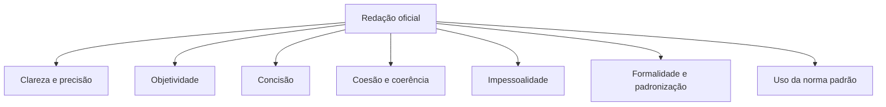

Todo oficial redige. Ofícios, relatórios, partes, requerimentos e e-mails institucionais fazem parte da rotina de quem comanda, e a banca cobra esse conhecimento de forma muito próxima do texto do Manual de Redação da Presidência da República. Este capítulo apresenta o que é a redação oficial, quem fala e para quem, e cada um dos atributos que o Manual exige. Os atributos são o ponto mais cobrado: as alternativas erradas costumam trocar um atributo pelo outro ou atribuir a ele uma consequência que não é a dele.

> [!objetivos]
> - Explicar o que é a redação oficial e quem são o emissor, a mensagem e o receptor.
> - Relacionar os atributos da redação oficial aos princípios do art. 37 da Constituição.
> - Distinguir clareza, precisão, objetividade, concisão, coesão, coerência, impessoalidade e formalidade.
> - Reconhecer o que o Manual recomenda sobre o uso da norma padrão e sobre o jargão burocrático.

## O que é a redação oficial

O Manual de Redação da Presidência da República é a principal referência do assunto e está na **3ª edição**, de dezembro de 2018. Ele trata da administração pública federal, mas é adotado como modelo nos Estados e Municípios e cobrado em concursos de todo o país.

Em uma frase, a redação oficial é o jeito de o **Poder Público escrever o que comunica e o que normatiza**: ofícios, requerimentos, portarias e demais atos. Como toda comunicação, ela tem três elementos.

| Elemento | Na redação oficial |
| --- | --- |
| Emissor | O serviço público: órgãos, entidades e agentes públicos que falam em nome da instituição |
| Mensagem | Um assunto de interesse público, ligado às atribuições do órgão |
| Receptor | O cidadão, uma empresa ou associação privada, ou outro órgão público, de qualquer dos Poderes |

Como quem fala é o serviço público, e não a pessoa do servidor, o texto não registra preferências, humor ou intimidade. A finalidade principal dos expedientes oficiais é **informar com clareza e objetividade**, e a dos atos normativos é estabelecer regras de conduta ou regular o funcionamento dos órgãos. A linguagem adequada é o meio de cumprir essas finalidades.

> [!atencao] Aridez não é requisito
> A redação oficial não precisa ser árida nem estática. O que a diferencia da literatura, do texto jornalístico ou da carta particular é a finalidade: comunicar com objetividade e a máxima clareza. Alternativas que afirmem que o texto oficial deve ser rebuscado, ou que não pode acompanhar a evolução da língua, estão erradas.

## Atributos e princípios constitucionais

Os atributos nascem do art. 37, caput, da Constituição, que submete a administração pública de qualquer Poder e esfera aos princípios da legalidade, impessoalidade, moralidade, publicidade e eficiência. Se a publicidade, a impessoalidade e a eficiência norteiam a administração, também norteiam os atos e as comunicações que ela produz.

Cada atributo se liga a um dos valores constitucionais.

| Princípio do art. 37 | Atributos que o realizam |
| --- | --- |
| Publicidade | Clareza e precisão: o texto só é público de verdade se for compreendido |
| Impessoalidade | Impessoalidade, formalidade e padronização |
| Eficiência | Objetividade e concisão: informar bem em pouco tempo |
| Legalidade e moralidade | Norma padrão e forma prevista, sem improviso nem privilégio |

O Manual relaciona sete características da redação oficial.

> [!bizu] Sigla de memória
> Pense em CPO CCI FN: **c**lareza e **p**recisão, **o**bjetividade, **c**oncisão, **c**oesão e coerência, **i**mpessoalidade, **f**ormalidade e padronização e **n**orma padrão. O que não está na lista, como "criatividade" ou "emotividade", é pegadinha.

## Clareza

Clareza é a qualidade básica de todo texto oficial. É claro o texto que se deixa compreender de imediato. Para o Manual, a transparência é requisito do Estado de Direito: o cidadão precisa entender o que o Estado escreve. Por isso, o princípio da publicidade não se esgota em publicar o texto, mas exige que ele seja claro.

O Manual sugere sete práticas para chegar à clareza.

1. Usar palavras e expressões simples, no sentido comum. Se o assunto é técnico, usa-se a nomenclatura da área.
2. Preferir frases curtas e orações na ordem direta, evitando intercalações excessivas. A ordem inversa é aceita quando evita ambiguidade.
3. Manter a uniformidade do tempo verbal.
4. Evitar regionalismos e neologismos.
5. Pontuar adequadamente.
6. Explicar o significado da sigla na primeira vez em que ela aparece.
7. Usar palavras de outro idioma apenas quando indispensáveis, em geral por serem consagradas ou sem tradução exata, e, nesse caso, grafá-las em itálico.

O resumo é: o texto deve ser entendido por todos e de imediato. Gíria, regionalismo, jargão técnico fora de lugar, sigla sem explicação e vocabulário muito complexo atrapalham.

## Precisão

A precisão complementa a clareza e se caracteriza por três cuidados.

- **Articular a linguagem** comum ou técnica para a perfeita compreensão da ideia.
- **Manter as mesmas palavras** para a mesma ideia, evitando sinônimos só por estilo.
- **Escolher palavras sem duplo sentido**, para não gerar ambiguidade.

O Manual lembra que a releitura é indispensável. Trechos obscuros quase sempre vêm da falta de revisão, e o domínio que o redator tem do assunto o leva a supor que tudo é óbvio para o leitor. Convém explicar termos técnicos, siglas, abreviações e conceitos específicos. A pressa também compromete a clareza, e a máxima citada é que não há assuntos urgentes, mas assuntos atrasados.

Veja um caso de duplo sentido. Na frase "O capitão informou ao subtenente que ele seria transferido", o pronome "ele" pode se referir a qualquer dos dois. A precisão exige reescrever: "O capitão informou ao subtenente que o subtenente seria transferido" fica repetitivo, e a solução melhor é "O capitão comunicou ao subtenente a transferência dele" com contexto claro, ou reorganizar a frase para não deixar dúvida sobre quem será transferido. A regra prática é que, se houver risco de o leitor entender duas coisas, o redator deve ajustar o texto, ainda que perca elegância.

> [!pegadinha] Jargão em súmulas
> "Em textos técnicos, como súmulas, deve-se empregar sempre que possível o jargão" é afirmação errada. O jargão limita a compreensão a um grupo; texto oficial é para todos.

## Objetividade e concisão

**Objetividade** é ir direto ao assunto, sem voltas nem redundâncias. Para isso, o redator precisa saber de antemão qual é a ideia principal e quais são as secundárias. As secundárias esclarecem, detalham ou exemplificam; as que nada acrescentam devem ser cortadas. A objetividade não torna o texto rude, nem elimina a delicadeza na expressão.

**Concisão** é a virtude de transmitir o máximo de informação com o mínimo de palavras. Não se confunde com economia de pensamento: não se cortam passagens substanciais só para encurtar o texto. Cortam-se palavras inúteis, redundâncias e trechos que repetem o que já foi dito.

O Manual dá o exemplo de um período prolixo sobre uma consulta popular, cheio de adjetivos e advérbios de valor afetivo, como "impressionante agilidade", "esmagadora e ampla maioria" e "efusiva e indubitável rejeição". Depois do corte, o texto fica com a informação essencial: o resultado da consulta foi apurado, a maioria rejeitou a mudança e prefere voltar ao fuso anterior.

| Antes | Depois |
| --- | --- |
| Adjetivos e advérbios de ênfase, subordinação excessiva, detalhes irrelevantes | Informação principal, sem adorno |
| Carga afetiva injustificável | Tom impessoal |

## Coesão e coerência

Coesão e coerência são o encadeamento do texto: palavras, frases e parágrafos entrelaçados, que dão continuidade uns aos outros. O Manual destaca quatro mecanismos.

| Mecanismo | O que faz | Exemplo |
| --- | --- | --- |
| Referência | Um termo remete a outro necessário à sua interpretação, por retomada ou por antecipação | "A Corporação publicou o edital. **Ela** divulgou o cronograma" (retomada); "A auditoria encontrou **estas** falhas: ausência de data e de assinatura" (antecipação) |
| Substituição | Um item lexical entra no lugar de outro ou de uma oração | "O Comandante-Geral assinou a portaria. **A autoridade** determinou a publicação em boletim" |
| Elipse | Omissão de um termo recuperável pelo contexto | "A lei fixa o princípio; o regulamento, o procedimento" (omite *fixa*) |
| Conjunção | Liga orações, períodos ou parágrafos | "O oficial atrasou a entrega, **porque** faltou um documento" |

> [!bizu] Pronome de retomada x de antecipação
> Use "esta/estas/este" quando o pronome **antecipa** o que vem depois dele (função catafórica) e "ele/ela" ou "essa" quando **retoma** o que já foi dito. É um detalhe que as bancas cobram em reescrita de frases.

Clareza e precisão não se alcançam isoladamente: dependem de todos os outros atributos. Por isso, uma alternativa que diga que a formalidade e a precisão exigem a norma padrão **ainda que prejudiquem a clareza** é falsa. Formalidade e precisão ajudam a clareza.

## Impessoalidade

A impessoalidade vem do art. 37 e tem dois sentidos: a administração não pode privilegiar nem prejudicar ninguém, e os atos administrativos, embora praticados por pessoas, resultam apenas da vontade estatal. Na redação oficial, o tratamento impessoal se explica por três razões.

1. **Impessoalidade do emissor.** O texto não traz impressões individuais, mesmo que seja assinado pelo chefe de uma seção. A comunicação é sempre em nome do serviço público, o que gera uma desejável padronização.
2. **Impessoalidade do receptor.** O destinatário, seja cidadão, empresa ou outro órgão, é concebido de forma homogênea. Nada de demonstrações de afeto ou de desafeto.
3. **Impessoalidade do assunto.** O assunto é sempre de interesse público. Não cabe tratar de interesses pessoais do servidor.

Não há lugar para as impressões pessoais que aparecem numa carta a um amigo, num artigo assinado de jornal ou num texto literário. Expressões como "encarecidamente" ferem a impessoalidade por carregarem emoção.

Há uma ressalva importante. Impessoalidade não proíbe a primeira pessoa quando o autor exerce uma atribuição própria. Formas como "cumpre-me informar" ou "indeferi o pedido" são naturais, porque quem fala é o agente no exercício do cargo.

> [!atencao] Primeira pessoa
> O uso da primeira pessoa **não fere**, por si só, a impessoalidade. O que a fere é a opinião, o afeto, a intimidade. A banca costuma julgar como errada a assertiva que diga que o verbo em primeira pessoa invalida o texto oficial.

## Formalidade e padronização

As comunicações oficiais obedecem a regras de forma. Isso vale para documentos impressos e também para os eletrônicos, como o e-mail e o documento criado em sistema, como o SEI. A formalidade tem dois lados: a **forma** do documento e a **civilidade** de tratamento, que inclui o uso correto dos pronomes de tratamento e um enfoque respeitoso do assunto.

Na prática, formalidade quer dizer que um e-mail institucional não tem o tom de uma conversa de mensagem instantânea: leva assunto claro, vocativo adequado, fecho próprio e identificação de quem assina. Já a padronização é o que permite que um documento produzido no Recife seja lido, em Brasília, com a mesma facilidade com que se lê um documento de lá. A padronização decorre do fato de a administração pública federal ser una: se é una, suas comunicações seguem o mesmo padrão. A digitação sem erros, o uso de papéis uniformes quando for necessária a impressão e a correta diagramação ajudam a uniformizar.

## Uso da norma padrão

Pelo caráter público e pela finalidade, os atos normativos e os expedientes requerem o **padrão culto**, aquele que respeita a gramática formal e usa um léxico compartilhado pelos falantes. Ele está acima das diferenças regionais e dos modismos.

O Manual faz três recomendações.

- A língua culta é contra a pobreza de expressão, e não contra a simplicidade.
- O padrão culto não significa linguagem rebuscada nem figuras de linguagem literárias.
- Dicionário e gramática são imperativos para um bom texto.

Conclusão importante: a língua dos documentos oficiais é a **norma padrão**, e não um dialeto próprio do serviço público. Dito de outro modo, **não há um "padrão oficial de linguagem"**. Preferem-se certas expressões e certas estruturas por tradição, mas isso não autoriza o jargão burocrático, o "burocratês", que deve ser evitado porque limita a compreensão.

> [!resolvido] Questão comentada
> **Enunciado:** num ofício que convida uma autoridade para uma solenidade e pede resposta até determinada data, o uso de frases diretas e de vocabulário comum torna a linguagem inadequada à comunicação oficial. Certo ou errado?
>
> **Resolução:** errado. Frases diretas e vocabulário comum são compatíveis com o padrão culto. A língua culta combate a pobreza de expressão, e não a simplicidade, e o Manual não pede texto rebuscado.

## Armadilhas frequentes em prova

As questões sobre atributos seguem alguns padrões que convém reconhecer.

- **Troca de atributo.** O enunciado descreve a objetividade e a alternativa chama de coesão. Leia a definição, não o nome.
- **Inversão de um adjetivo.** "A concisão exige eliminar trechos substanciais" é falsa; ela elimina o supérfluo. "A clareza admite o uso de jargão" é falsa; o jargão a prejudica.
- **Falsa oposição.** "A formalidade impede a simplicidade" ou "a impessoalidade torna o texto rude" opõem coisas que o Manual concilia. Simples e formal convivem; objetivo e delicado também.
- **Exagero.** "Sempre" e "nunca" costumam acompanhar alternativas erradas, como "a primeira pessoa nunca pode ser usada" ou "siglas nunca devem aparecer".
- **Fonte do atributo.** O Manual deriva os atributos dos princípios constitucionais da administração. Alternativas que ligam clareza à moralidade ou impessoalidade à legalidade, sem sentido, são pegadinhas de associação.
- **Meio eletrônico.** A formalidade e a padronização valem também para e-mail e documentos digitais; dizer que se aplicam apenas ao papel é erro.

> [!atencao] Concisão: virtude, não atributo isolado
> O Manual menciona a concisão entre as características, mas explica que ela é antes uma virtude do texto do que uma característica autônoma. Quando a questão pedir os "atributos" e a alternativa incluir a concisão, não a descarte: ela consta da lista.

## Reescrevendo para aplicar os atributos

Os atributos aparecem em prova não apenas como definição, mas como critério para reescrever frases. A tabela mostra versões inadequadas e a correção, com o atributo envolvido.

| Versão inadequada | Problema | Versão corrigida |
| --- | --- | --- |
| "Solicito, com todo respeito e humildade, que Vossa Senhoria tenha a gentileza de me atender com urgência." | Excesso de adorno e tom pessoal (concisão e impessoalidade) | "Solicito a Vossa Senhoria o atendimento da demanda, que é urgente." |
| "O pessoal da seção chegou a um acordo meio informal sobre a escala." | Gíria e imprecisão (clareza e precisão) | "A chefia e os servidores da seção ajustaram a escala." |
| "Estamos de olho no andamento do caso e, assim que der, a gente informa." | Coloquialismo e marcas de oralidade (formalidade) | "Acompanharemos o andamento e informaremos a Vossa Senhoria oportunamente." |
| "A comissão recebeu os documentos. A comissão analisou os documentos. A comissão aprovou os documentos." | Repetição sem coesão (coesão por substituição e elipse) | "A comissão recebeu os documentos, analisou-os e os aprovou." |
| "Achamos que o prazo foi, de certa forma, ultrapassado." | Opinião e imprecisão (impessoalidade e precisão) | "O prazo foi ultrapassado em dois dias." |

> [!bizu] Perguntas do revisor
> Ao revisar um texto, faça cinco perguntas. Isto é claro para quem nunca ouviu falar do assunto? Está direto e sem repetições? Fala em nome da instituição? Obedece à forma do documento? Está na norma culta? Se alguma resposta for "não", localize o atributo violado.

## Mapa do capítulo

| Atributo | Ideia central | Erro típico na alternativa |
| --- | --- | --- |
| Clareza | Compreensão imediata por todos | Admitir jargão ou regionalismo |
| Precisão | Mesma palavra para a mesma ideia, sem duplo sentido | Elogiar sinônimos por estilo |
| Objetividade | Ir direto ao assunto | Dizer que torna o texto rude |
| Concisão | Muito com poucas palavras | Confundir com cortar conteúdo |
| Coesão e coerência | Referência, substituição, elipse, conjunção | Trocar o nome do mecanismo |
| Impessoalidade | Emissor, receptor e assunto impessoais | Proibir qualquer primeira pessoa |
| Formalidade | Forma e civilidade, inclusive no e-mail | Dizer que não vale para meio eletrônico |
| Norma padrão | Culta e simples, sem burocratês | Exigir linguagem rebuscada |

### Para fixar

1. Redação oficial é a maneira pela qual o Poder Público redige as comunicações oficiais e os atos normativos; o Manual está na 3ª edição (2018).
2. O emissor é o serviço público, a mensagem é assunto de interesse público e o receptor pode ser o cidadão, uma instituição privada ou outro órgão.
3. Os atributos derivam do art. 37 da Constituição, com destaque para publicidade, impessoalidade e eficiência.
4. Clareza é compreensão imediata; deve-se evitar regionalismos, neologismos, jargão e siglas sem explicação, e grafar estrangeirismos em itálico.
5. Precisão pede as mesmas palavras para a mesma ideia e rejeita duplo sentido e sinonímia estilística.
6. Concisão exclui palavras inúteis, mas não elimina passagens substanciais.
7. Coesão e coerência usam referência, substituição, elipse e conjunção.
8. A impessoalidade se aplica ao emissor, ao receptor e ao assunto; a primeira pessoa no exercício de atribuição não a viola.
9. A formalidade vale também para meio eletrônico e inclui civilidade de tratamento.
10. Não existe padrão oficial de linguagem; existe o uso da norma culta, que não admite burocratês nem rebuscamento.
