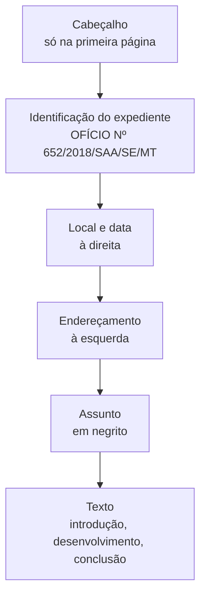

Depois de entender os atributos, é hora de aplicar a forma. Este capítulo trata de três assuntos que a banca cobra de modo literal: como tratar cada autoridade (pronomes de tratamento, vocativo e endereçamento), como fazer a concordância com esses pronomes e como se estrutura o documento no chamado padrão ofício. A atenção ao detalhe é decisiva: uma vírgula, um "A" no endereçamento ou o formato da data podem decidir a questão.

> [!objetivos]
> - Empregar corretamente os pronomes de tratamento no endereçamento, no vocativo e no corpo do texto.
> - Explicar o alcance do Decreto 9.758/2019 e sua relação com o Manual.
> - Aplicar a concordância com os pronomes de tratamento e distinguir "Sua" de "Vossa" Excelência.
> - Montar as partes do padrão ofício: cabeçalho, identificação, local e data, endereçamento, assunto e texto.

## Pronomes de tratamento

Os pronomes de tratamento têm origem na segunda pessoa do plural (*vós*) usada de modo indireto, para se referir a uma qualidade da pessoa a quem se fala. Na redação oficial há três momentos de uso.

| Momento | Onde aparece | Exemplo de forma |
| --- | --- | --- |
| Endereçamento | No bloco que indica o destinatário do expediente | "A Sua Excelência o Senhor" |
| Vocativo | No início do texto, invocando o destinatário; sempre seguido de **vírgula** | "Senhor Ministro," |
| Corpo do texto | No desenvolvimento, por extenso ou abreviado | "Vossa Excelência" ou "V. Exa." |

Para as autoridades de maior destaque, a combinação é a seguinte.

| Destinatário | Vocativo | Tratamento no texto | Abreviatura |
| --- | --- | --- | --- |
| Presidentes da República, do Congresso Nacional e do STF | Excelentíssimo Senhor + cargo, | Vossa Excelência | Não se abrevia |
| Vice-Presidente, ministros, parlamentares, magistrados de tribunais superiores | Senhor + cargo, | Vossa Excelência | V. Exa. |
| Oficial-general | Senhor + posto, | Vossa Excelência | V. Exa. |
| Demais postos militares | Senhor + posto, | Vossa Senhoria | V. Sa. |

No endereçamento, quem recebe Vossa Excelência é indicado por "A Sua Excelência o Senhor", e quem recebe Vossa Senhoria, por "Ao Senhor".

O Manual não lista mais todas as autoridades, porque as normas que garantem "Vossa Excelência" a cada categoria são muitas. Por isso, em prova, a tendência é que apareçam as autoridades expressamente citadas, em questões bem literais. Vale lembrar que o **oficial-general** é tratado por Vossa Excelência, e os demais oficiais, por Vossa Senhoria.

> [!bizu] Excelentíssimo só para chefe de Poder
> O vocativo "Excelentíssimo Senhor" é reservado aos **Chefes de Poder**. Os demais, ainda que tratados por Vossa Excelência, recebem apenas "Senhor" ou "Senhora" seguido do cargo. Assim, o procurador-geral de um Estado recebe "Senhor Procurador-Geral,", e não "Excelentíssimo Senhor Procurador-Geral,".

## Vocativo

O vocativo é uma invocação ao destinatário e vem seguido de vírgula. O Manual orienta o seguinte.

- Aos Chefes de Poder: "Excelentíssimo Senhor" ou "Excelentíssima Senhora" + cargo.
- Às demais autoridades: "Senhor" ou "Senhora" + cargo, como em "Senhora Senadora," e "Senhor Juiz,".
- A particulares: "Senhor" ou "Senhora" + a forma pela qual a instituição os trata, como "Senhor Contribuinte,"; também se admite "Senhor [Nome]," e "Prezado Senhor,".

Estão abolidos nas comunicações oficiais o uso de **Digníssimo (DD)** e de **Ilustríssimo (Ilmo.)**. O Manual recomenda ainda evitar o uso indiscriminado de "doutor": o tratamento por "Senhor" confere a formalidade desejada.

> [!pegadinha] Vossa Senhoria para ministro
> "O ministro presidente de um tribunal, ao escrever ao ministro presidente do STF, deve usar Vossa Senhoria porque ambos ocupam o mesmo nível" é errado. Ministros recebem **Vossa Excelência**. A igualdade de nível não muda o pronome.

## Decreto 9.758/2019

O decreto trouxe uma regra própria para a comunicação com agentes públicos **federais**: o único pronome de tratamento é **"senhor"**, flexionado no feminino e no plural, qualquer que seja o nível hierárquico, o cargo, a função ou a ocasião. Ele veda, para esses agentes, as formas Vossa Excelência ou Excelentíssimo, Vossa Senhoria, Vossa Magnificência, doutor, ilustre ou ilustríssimo, digno ou digníssimo e respeitável, mesmo abreviadas.

O decreto **não se aplica** em dois casos: às comunicações com autoridades estrangeiras ou de organismos internacionais, e às comunicações entre agentes da administração federal e agentes de outros Poderes, do Tribunal de Contas, da Defensoria, do Ministério Público ou de outros entes federativos, quando a outra parte exigir tratamento especial por norma própria.

Uma forma de organizar a regra:

| Situação | Pronome |
| --- | --- |
| Particular escrevendo a órgão federal | "Senhor", conforme o decreto |
| Ministério federal escrevendo a agência federal | "Senhor", conforme o decreto |
| Ministério federal escrevendo ao STF | Mantém-se "Excelência" |
| Particular escrevendo a senador | Mantém-se "Excelência" |

> [!atencao] Qual regra usar na prova
> Os editais costumam pedir o assunto "de acordo com o Manual", e o texto do Manual não foi alterado pelo decreto. Por isso, a literalidade do Manual continua sendo cobrada. Como as fontes oficiais divergem, a tendência é que as bancas evitem a questão em que o conflito fique evidente. Guarde as duas regras, lendo o comando da questão com cuidado. Para o oficial do Estado, o decreto é norma federal e não se aplica diretamente à comunicação entre órgãos estaduais.

## Concordância com pronomes de tratamento

Embora se refiram à segunda pessoa (a pessoa com quem se fala), os pronomes de tratamento levam o **verbo na terceira pessoa**, e os possessivos também ficam na terceira pessoa. A concordância é feita com o núcleo da expressão. Para facilitar, pense em "você": *Vossa Senhoria nomeará seu substituto*, e não "vosso substituto".

Adjetivos e particípios da voz passiva acompanham o **gênero do interlocutor**, e não o do substantivo que forma o pronome. Assim:

- homem: "Vossa Excelência está atarefado";
- mulher: "Vossa Excelência está atarefada".

Na prática, isso muda a forma de escrever as frases. Em vez de "Peço que Vós nos informeis", escreve-se "Peço que Vossa Senhoria nos informe". Em vez de "Vossa Excelência trouxe vossos documentos", escreve-se "Vossa Excelência trouxe seus documentos". E, se a autoridade for mulher, "Vossa Excelência está convidada", com o particípio no feminino, embora o pronome seja o mesmo. Esse último ponto é o que mais derruba candidatos, porque o pronome "Excelência" é feminino de qualquer modo.

### Sua Excelência × Vossa Excelência

| Forma | Quando usar | Onde aparece |
| --- | --- | --- |
| Sua Excelência | Para a **terceira pessoa**, de quem se fala | No endereçamento ("A Sua Excelência o Senhor") |
| Vossa Excelência | Para a pessoa **com quem se fala**, diretamente | No corpo do texto |

Um exemplo de aplicação: num ofício a um juiz-auditor, escreve-se "Convido-o para a cerimônia..." porque o pronome "o" retoma o destinatário, e, se a frase fosse reescrita com o pronome de tratamento, ficaria "Convido Vossa Excelência...". Se o juiz responde ao cerimonial, um servidor da assessoria é tratado por Vossa Senhoria.

## Cargos: interino, substituto e gênero

A identificação do signatário vem no fecho do documento e traz o nome e o cargo. Esse é o espaço em que aparecem as indicações de "interino" e "substituto" e a flexão de gênero dos cargos, assuntos desta seção. Na identificação do signatário, após o nome do cargo, podem aparecer "interino" e "substituto".

- **Interino:** quem é nomeado para ocupar transitoriamente um cargo vago.
- **Substituto:** quem é designado para exercer as atribuições do cargo vago, ou no afastamento e no impedimento do titular.

Os dois termos vão **depois do cargo, sem hífen, sem vírgula e em minúsculo**: "Diretor-Geral interino", "Secretário-Executivo substituto".

O cargo ocupado por mulher deve ser flexionado no feminino: Ministra de Estado, Secretária-Executiva interina, Coordenadora Administrativa.

Quanto ao hífen, o Manual lista os casos em que ele é usado.

| Caso | Exemplos |
| --- | --- |
| Cargos com o adjetivo "geral" | diretor-geral, relator-geral, ouvidor-geral |
| Postos e graus da diplomacia | primeiro-secretário, segundo-secretário |
| Postos da hierarquia militar | tenente-coronel, capitão-tenente |
| Cargos de hierarquia em empresas | diretor-presidente, diretor-adjunto, editor-chefe |
| Cargos com numeral | primeiro-ministro, primeira-dama |
| Cargos com "ex" ou "vice" | ex-diretor, vice-presidente |

Há uma exceção militar: quando o posto traz preposição ligando as palavras, **não se usa hífen**: general de exército, general de brigada, capitão de mar e guerra. Outra regra: pelo Acordo Ortográfico, o uso de inicial maiúscula em cargos e títulos é opcional, mas, com hífen, a escolha vale para todos os elementos (*Vice-Presidente* ou *vice-presidente*, nunca *Vice-presidente*).

## Padrão ofício

Até a segunda edição do Manual havia três expedientes distintos mais pela finalidade do que pela forma: o **aviso** (só de ministros, para autoridades de mesma hierarquia), o **ofício** (para e pelas demais autoridades) e o **memorando** (entre unidades de um mesmo órgão). Para uniformizar, a nova edição abandonou a distinção e adotou o **padrão ofício** para os três, com nomenclatura e diagramação únicas. Em consequência, hoje o ofício também serve às comunicações entre unidades do mesmo órgão.

### Cabeçalho e identificação

O cabeçalho aparece **apenas na primeira página**, centralizado. Contém o brasão de Armas da República no topo (não precisa ser colorido, e o uso de marca da instituição deve ser evitado), o nome do órgão principal e, quando necessário, os dos órgãos secundários, da maior para a menor hierarquia, separados por barra. O espaçamento entre linhas é simples. Endereço, telefone e sítio da instituição podem ir no rodapé.

A identificação do documento tem quatro elementos: o nome do expediente por extenso e em maiúsculas; a abreviatura de número na forma "Nº"; o número, o ano com quatro dígitos e as siglas do setor emissor, **da menor para a maior hierarquia**, separados por barra; e o alinhamento à margem esquerda. Exemplo: *OFÍCIO Nº 652/2018/SAA/SE/MT*.

### Local e data

| Elemento | Regra |
| --- | --- |
| Composição | Cidade e data, separadas por vírgula; sem sigla do Estado |
| Dia do mês | Ordinal apenas no dia 1º; cardinal nos demais; sem zero à esquerda |
| Mês | Inicial minúscula |
| Pontuação | Ponto-final depois da data |
| Alinhamento | À margem direita |

Exemplo: *Brasília, 2 de fevereiro de 2021.* Escrever "01 de fevereiro" ou "02 de fevereiro" é incorreto, e a cidade não leva "DF" depois do nome.

### Endereçamento

O endereçamento diz quem receberá o expediente. Traz o vocativo na forma de tratamento adequada, o nome, o cargo e o endereço, em duas linhas: a primeira com o logradouro (ou o setor, se o ofício é interno) e a segunda com o CEP e a cidade e a unidade da federação, separadas por barra, ponto ou travessão. Em ofício dentro do mesmo órgão, o CEP é dispensável. O alinhamento é à margem esquerda.

Para autoridade tratada por Vossa Excelência, escreve-se "A Sua Excelência o Senhor" ou "A Sua Excelência a Senhora". Para Vossa Senhoria, "Ao Senhor" ou "À Senhora". Não existe a forma "A Sua Senhoria o Senhor". O Manual aceita a crase diante de "Senhora".

### Assunto

O assunto resume o conteúdo do documento em poucas palavras.

- A palavra *Assunto* vem antes da frase, seguida de dois-pontos.
- A descrição começa com inicial maiúscula, **não usa verbo** e tem, em geral, de quatro a cinco palavras.
- O trecho todo, inclusive o título, vai em **negrito**.
- Termina com ponto-final e fica à esquerda.

Exemplos: *Assunto: Aquisição de computadores.*; *Assunto: Encaminhamento do Relatório de Gestão.* Por outro lado, "Assunto: Solicita a compra de computadores" está errado, porque contém verbo, e "Assunto - Compra" também, porque exige dois-pontos.

> [!exemplo] Esqueleto de um ofício no Corpo de Bombeiros
> OFÍCIO Nº 45/2026/SEÇÃO DE PESSOAL/COMANDO
>
> Recife, 3 de março de 2026.
>
> Ao Senhor
> Major João Ferreira
> Chefe da Seção de Logística
> Quartel do Comando-Geral
> 50000-000 Recife/PE
>
> Assunto: Solicitação de material de escritório.
>
> Senhor Major,
>
> 1. Solicito o fornecimento de material de escritório para a Seção de Pessoal.
> 2. O pedido se justifica pelo esgotamento do estoque.
> 3. Peço a Vossa Senhoria que informe o prazo de entrega.

O exemplo mostra a ordem das partes, o endereçamento "Ao Senhor" para Vossa Senhoria, o assunto sem verbo e os parágrafos numerados, porque o texto tem três parágrafos.

### Texto do documento

Nos documentos que não são de mero encaminhamento, o texto tem **introdução** (apresenta o assunto e coincide com o parágrafo de abertura), **desenvolvimento** (detalha, com uma ideia por parágrafo) e **conclusão** (reafirma ou reapresenta a posição). Na introdução, o Manual pede impessoalidade e rejeita fórmulas como "Tenho a honra de", "Tenho o prazer de" e "Cumpre-me informar que". Prefere as formas diretas: *Informo*, *Solicito*, *Comunico*.

Nos de **mero encaminhamento**, a estrutura muda. A introdução começa pela referência ao expediente que pediu o envio. Se o envio não foi solicitado, indica o motivo (encaminhar) e os dados do documento remetido: tipo, data, origem ou signatário e assunto. O desenvolvimento é facultativo, usado só se o autor quiser comentar o documento.

Formatação do texto:

| Item | Regra |
| --- | --- |
| Alinhamento | Justificado |
| Entrelinhas | Simples |
| Espaço entre parágrafos | 6 pontos após cada parágrafo |
| Recuo | 2,5 cm da margem esquerda |
| Numeração | Só quando há três ou mais parágrafos; não se numeram vocativo e fecho |
| Fonte | Calibri ou Carlito: corpo 12, citações recuadas 11, notas de rodapé 10 |

> [!resolvido] Questão comentada
> **Enunciado:** num documento padrão ofício expedido em Fortaleza em 8 de março de 2020, é adequado escrever "Fortaleza, 8 de março de 2020." alinhado à margem direita. Certo ou errado?
>
> **Resolução:** certo. A data traz cidade, vírgula, dia em numeral cardinal (só o dia 1º é ordinal), mês em minúscula e ponto-final, sem sigla do Estado, e vai à direita da página.

## Erros que mais derrubam o candidato

Algumas falhas se repetem e valem uma revisão final.

- **Confundir endereçamento e vocativo.** "A Sua Excelência o Senhor" é endereçamento; "Senhor Ministro," é vocativo. O primeiro fala *do* destinatário; o segundo fala *com* ele.
- **Pontuar o vocativo com dois-pontos ou ponto.** A pontuação correta é a vírgula.
- **Escrever "A Sua Senhoria o Senhor".** A fórmula inexiste; para Vossa Senhoria usa-se "Ao Senhor" ou "À Senhora".
- **Usar "Vosso" ou "Vossa" como possessivo.** Com os pronomes de tratamento, o possessivo é da terceira pessoa: seu, sua.
- **Numerar tudo.** A numeração dos parágrafos só existe quando há três ou mais; o vocativo e o fecho nunca são numerados.
- **Pôr a marca da instituição no lugar do brasão.** O Manual manda evitar a marca institucional no cabeçalho para não se sobrepor ao Brasão de Armas da República.

> [!atencao] Mesma pessoa, formas diferentes
> Uma mesma autoridade aparece com três formas num único ofício: "A Sua Excelência o Senhor" no endereçamento, "Senhor Ministro," no vocativo e "Vossa Excelência" no corpo. Se a alternativa usar a mesma forma nos três lugares, desconfie.

## Mapa do capítulo

| Tema | Regra central | Cuidado |
| --- | --- | --- |
| Vocativo | Sempre com vírgula; "Excelentíssimo" só para Chefe de Poder | Dar "Excelentíssimo" a ministro ou procurador |
| Oficial-general | Vossa Excelência | Dar Vossa Senhoria |
| Demais oficiais | Vossa Senhoria; endereçamento "Ao Senhor" | Escrever "A Sua Senhoria" |
| Decreto 9.758/2019 | "Senhor" para agente federal, com exceções | Aplicar a outros Poderes |
| Concordância | Terceira pessoa; adjetivo pelo sexo do interlocutor | Dizer "vosso" |
| Interino e substituto | Depois do cargo, sem hífen, minúsculos | Escrever com hífen ou vírgula |
| Padrão ofício | Aviso, ofício e memorando unificados | Manter a distinção antiga |
| Data | Local, dia cardinal (1º ordinal), mês minúsculo, direita | Usar "01" ou sigla do Estado |
| Assunto | Sem verbo, negrito, 4 a 5 palavras | Usar verbo ou omitir dois-pontos |

### Para fixar

1. O pronome de tratamento aparece no endereçamento, no vocativo e no corpo do texto; o vocativo é sempre seguido de vírgula.
2. "Excelentíssimo Senhor" é só para Chefes de Poder; os demais recebem "Senhor" ou "Senhora" e o cargo.
3. Oficial-general: Vossa Excelência; demais postos militares: Vossa Senhoria, com endereçamento "Ao Senhor".
4. Estão abolidos Digníssimo e Ilustríssimo, e o uso de "doutor" deve ser evitado.
5. O Decreto 9.758/2019 impõe "senhor" na comunicação com agentes federais, salvo autoridades estrangeiras e outros Poderes ou entes que exijam tratamento especial.
6. Pronomes de tratamento levam verbo e possessivo na terceira pessoa; o adjetivo concorda com o sexo do interlocutor.
7. "Sua Excelência" refere-se a terceira pessoa e aparece no endereçamento; "Vossa Excelência" dirige-se à pessoa com quem se fala.
8. "Interino" e "substituto" vão após o cargo, sem hífen nem vírgula e em minúsculo; cargo ocupado por mulher vai ao feminino.
9. O padrão ofício unificou o aviso, o ofício e o memorando; o cabeçalho só aparece na primeira página.
10. Data à direita, com cidade sem sigla, dia cardinal (exceto 1º), mês em minúsculo; assunto sem verbo, em negrito, com ponto-final.
