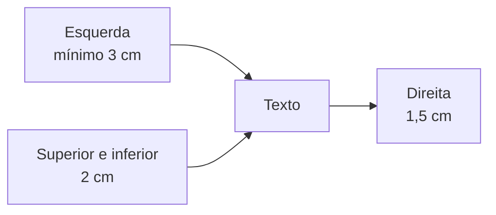

O capítulo anterior terminou no texto do ofício. Faltam o fecho, a assinatura e as regras de formatação, que o Manual descreve com minúcia e que as bancas cobram por literalidade. Aqui entram também o uso de siglas e acrônimos, as variações do ofício (circular, conjunto e conjunto circular) e dois expedientes mais raros, a exposição de motivos e a mensagem. O volume de regras é grande; a saída é organizar por quadro e memorizar os números.

> [!objetivos]
> - Escolher o fecho correto conforme a hierarquia e formatar o fecho e a assinatura.
> - Aplicar as regras de numeração de páginas e de formatação do padrão ofício.
> - Escrever siglas e acrônimos de acordo com o Manual e com o Decreto 9.191/2017.
> - Reconhecer as variações do ofício, a exposição de motivos e a mensagem.

## Fecho

O fecho arremata o texto e cumprimenta o destinatário. O Manual simplificou tudo e estabeleceu **apenas dois fechos**, escolhidos pela relação hierárquica.

| Destinatário | Fecho |
| --- | --- |
| Autoridade de hierarquia **superior** à do remetente, inclusive o Presidente da República | **Respeitosamente,** |
| Autoridade de mesma hierarquia, de hierarquia inferior ou outros casos | **Atenciosamente,** |

A exceção são as comunicações a autoridades estrangeiras, que seguem rito e tradição próprios.

O fecho se formata assim: alinhado à margem esquerda, com recuo de 2,5 cm, entrelinhas simples, 6 pontos após o parágrafo e **sem numeração**.

> [!bizu] Quem é superior?
> "Respeitosamente" é para quem está acima de você na hierarquia; "Atenciosamente" para quem está no mesmo nível ou abaixo. Um tenente que escreve ao comandante-geral fecha com "Respeitosamente,"; o comandante que responde ao tenente, com "Atenciosamente,".

## Assinatura e numeração das páginas

### Identificação do signatário

Com exceção das comunicações assinadas pelo Presidente da República, todos os documentos informam o signatário assim.

- **Nome:** da autoridade que expede, em letras **maiúsculas**, sem negrito, e sem linha acima do nome.
- **Cargo:** apenas com iniciais maiúsculas; preposições que liguem as palavras do cargo ficam em minúsculas.
- **Alinhamento:** centralizado na página.

Recomenda-se não deixar a assinatura isolada em uma página. Para evitar isso, transfere-se para ela pelo menos a última frase anterior ao fecho. A razão é de segurança: uma página só com a assinatura poderia ser anexada a outro texto, e o signatário nunca teria visto o conteúdo.

### Numeração das páginas

A numeração é **obrigatória somente a partir da segunda página**. Fica no rodapé, dentro da área de 2 cm da margem inferior, na fonte Calibri ou Carlito.

## Formatação do padrão ofício

O Manual detalha a página. Estes são os números e as regras que as bancas mais pedem.

| Item | Regra |
| --- | --- |
| Papel | A4 (29,7 cm × 21,0 cm) |
| Margem esquerda | No mínimo 3 cm |
| Margem direita | 1,5 cm |
| Margens superior e inferior | 2 cm |
| Área do cabeçalho | Na primeira página, 5 cm a partir da borda superior |
| Rodapé | Nos 2 cm da margem inferior |
| Impressão frente e verso | Permitida, com margens espelhadas nas páginas pares |
| Cor | Texto preto em papel branco; cor só para gráficos e ilustrações |
| Destaque | Negrito, sem abuso |
| Estrangeirismos | Em itálico |
| Arquivo | Preservar em formato editável (DOCX, ODT, RTF) |

O Manual desaconselha outros destaques, como itálico (fora dos estrangeirismos), sublinhado, caixa alta, sombreado, sombra, relevo e bordas, porque comprometem a sobriedade e a padronização. Em prova, a afirmativa de que o padrão ofício deve **priorizar** negrito, itálico e maiúsculas é falsa: o único destaque admitido é o negrito, e sem abuso.

O nome do arquivo segue uma fórmula: tipo do documento, número, ano com quatro dígitos e palavras-chave do conteúdo. Por exemplo: *Ofício 123_2018_relatório produtividade anual*.

## Siglas e acrônimos

Para atos normativos, o Manual adota os conceitos do Manual de Elaboração de Textos da Consultoria Legislativa do Senado.

| Conceito | Definição | Exemplo |
| --- | --- | --- |
| Sigla | Soma das **iniciais** de um título | Caixa Econômica Federal – CEF |
| Acrônimo | Soma de **sílabas ou partes** das palavras de um título | Agência Nacional de Vigilância Sanitária – Anvisa |

Regras gerais:

- Não se deve abusar: o uso se limita às formas já existentes e consagradas. Em atos normativos, evitam-se as formas populares sem previsão legal.
- Escrevem-se no mesmo corpo do texto, **sem pontos** intermediários ou finais.
- Na primeira citação, o nome vem **por extenso**, completo, antes da sigla, ligados por travessão: *Imposto Predial e Territorial Urbano – IPTU*.
- Dispensa-se o por extenso apenas para partidos políticos e empresas comerciais cuja forma abreviada já virou sinônimo do nome, salvo empresas públicas e estatais.

Quanto à grafia:

| Situação | Grafia | Exemplo |
| --- | --- | --- |
| Até três letras | Maiúsculas | ONU, OAB |
| Mais de três letras, lidas letra por letra | Maiúsculas | IBGE, INSS |
| Mais de três letras, lidas como palavra | Só a inicial maiúscula | Anac, Anvisa, Mercosul |
| Leitura mista | Podem ser todas maiúsculas | DNIT, HRAN |
| Órgão estrangeiro | Versão em português; forma original se for consagrada internacionalmente | Opep |
| Plural | "s" minúsculo, sem apóstrofo | TREs, e não TRE's |

Uma questão clássica pede a grafia incorreta entre INSS, TREs, MERCOSUL, IBGE e OAB. O erro está em MERCOSUL: lida como palavra e com mais de três letras, a forma correta é **Mercosul**. A exceção do plural: em siglas que já terminam em "s", o plural é indicado pelo artigo (os DVS).

Para **atos normativos**, o Decreto 9.191/2017 (art. 14, II, e) acrescenta cinco limitações.

1. Não usar sigla para designar órgãos da administração direta.
2. Para entidades da administração indireta, usar apenas se prevista em lei.
3. Não usar para designar ato normativo.
4. Usar apenas se consagrada pelo uso geral, e não apenas por um setor ou grupo.
5. Na primeira menção, explicar o significado.

> [!pegadinha] Ponto na sigla e apóstrofo
> "O.A.B." e "TRE's" estão errados. Sigla não leva ponto, e o plural usa "s" minúsculo, sem apóstrofo.

## Ofício circular, conjunto e conjunto circular

Conforme o número de remetentes e de destinatários, o expediente recebe um complemento no nome.

| Tipo | Quando | Siglas na epígrafe |
| --- | --- | --- |
| Circular | Um órgão envia o mesmo expediente a **mais de um** receptor | Só a do remetente |
| Conjunto | **Mais de um** órgão envia, juntos, o expediente a **um** receptor | As dos remetentes |
| Conjunto circular | Mais de um órgão envia, juntos, a mais de um receptor | As dos remetentes |

Exemplos: *OFÍCIO CIRCULAR Nº 652/2018/MEC*; *OFÍCIO CONJUNTO Nº 368/2018/SECEX/SAJ*. Nos expedientes circulares, o remetente pode colocar no rodapé as siglas ou os nomes dos órgãos que receberão o documento. Uma forma de não trocar os conceitos: circular lembra *círculo* de destinatários, e conjunto lembra remetentes que *se juntam*. Se ocorrer as duas coisas, o nome do expediente reúne as duas palavras.

> [!exemplo] Qual é o tipo?
> Duas secretarias estaduais enviam a mesma orientação a todos os batalhões. Há mais de um remetente e mais de um destinatário: trata-se de ofício **conjunto circular**, e as siglas de ambas as secretarias constam da epígrafe.

## Exposição de motivos

Exposição de motivos é o expediente dirigido ao **Presidente ou ao Vice-Presidente da República** para propor uma medida, submeter a ele um projeto de ato normativo ou informá-lo de um assunto. Em regra, parte de um **Ministro de Estado**. Se o assunto envolve mais de um ministério, é assinada por todos e se chama **interministerial**. A numeração é única e vai de janeiro a dezembro de cada ano.

É a principal forma de comunicação dos ministros ao Presidente. Pode ter cópia ao Congresso Nacional ou ao Judiciário, em certos casos.

| Parte | Conteúdo |
| --- | --- |
| Introdução | O problema que exige a medida ou o ato proposto; ou o assunto sobre o qual se informa |
| Desenvolvimento | A razão de a medida ser a ideal e as alternativas; ou mais detalhes do assunto informado |
| Conclusão | Nova proposição da medida ou do ato; ou as considerações finais, se apenas informativa |

Quando a exposição de motivos encaminha proposta normativa, segue o Decreto 9.191/2017 e deve estar instruída com parecer jurídico e parecer de mérito. O Decreto busca permitir a reflexão sobre o problema, avaliar causas e efeitos, dar transparência, resumir a proposta e evitar a devolução para complementação.

Duas particularidades de forma: o endereçamento traz **apenas o pronome de tratamento**, sem nome nem cargo, e **não há campo de assunto**.

## Mensagem

A mensagem é o instrumento de comunicação entre os **Chefes dos Poderes Públicos** em assuntos de interesse dos Poderes e da Nação. Minutas podem ser enviadas pelos ministérios, mas a redação final fica com as assessorias da Presidência.

Alguns usos mais comuns do Executivo para o Congresso: encaminhar proposta de emenda constitucional, projeto de lei e medida provisória; indicar autoridades ao Senado (acompanhadas do *curriculum vitae* assinado, com o CPF); pedir autorização para o Presidente se ausentar do país por mais de 15 dias; encaminhar as contas do exercício anterior em até 60 dias após a abertura da sessão legislativa; abrir a sessão legislativa, com o plano de governo e a exposição da situação do País (CF, art. 84, XI), levada pelo chefe da Casa Civil e encadernada como livro; comunicar sanção, com restituição de autógrafos, e veto.

Há usos menos frequentes, previstos na Constituição, como a apreciação de intervenção federal, a convocação extraordinária do Congresso e os pedidos de autorização para estado de sítio, declaração de guerra e celebração da paz.

Forma e estrutura: brasão, identificação "MENSAGEM Nº", vocativo à esquerda, texto iniciado a 2 cm do vocativo e local e data a 2 cm do fim do texto, à direita. **Não traz identificação do signatário**, como os demais atos assinados pelo Presidente.

> [!atencao] Mensagem não é e-mail nem ofício
> A mensagem é restrita aos Chefes de Poder. Um servidor que precise pedir reposição de material ao almoxarifado deve usar o ofício ou outro expediente administrativo, e nunca a "mensagem". Alternativas que digam que a mensagem é usada por todas as repartições para falar com cidadãos são falsas.

> [!resolvido] Questão comentada
> **Enunciado:** o Comandante-Geral responde a um capitão sobre um pedido de material. O fecho adequado é "Respeitosamente,". Certo ou errado?
>
> **Resolução:** errado. O destinatário é de hierarquia inferior à do remetente, e o fecho correto é "Atenciosamente,". "Respeitosamente," serve apenas a quem escreve a autoridade superior.

## Adequar linguagem e formato ao documento

Em termos gerais da redação oficial, cada expediente existe para uma **finalidade** e é a ela que o redator deve servir: o ofício comunica e solicita, a exposição de motivos propõe ou informa ao Presidente, a mensagem trata de assuntos entre Poderes, e o circular alcança vários destinatários de uma vez. Quando a finalidade muda, muda o documento. É por isso que a questão sobre "qual expediente usar" quase sempre se resolve olhando quem escreve, para quem e para quê. Uma habilidade pedida em reescrita é escolher o tom e o formato certos para cada tipo de expediente. A regra de ouro é que a linguagem acompanha a relação entre emissor e receptor e a finalidade do texto, enquanto a forma segue o modelo do documento.

| Documento | Quem fala com quem | Linguagem e formato |
| --- | --- | --- |
| Ofício | Órgão a órgão ou autoridade, em qualquer direção | Padrão ofício completo; vocativo e fecho pela hierarquia |
| Exposição de motivos | Ministro ao Presidente ou ao Vice | Introdução, desenvolvimento e conclusão; sem assunto; tratamento reverente |
| Mensagem | Chefe de Poder a Chefe de Poder | Texto solene, sem signatário identificado |
| Ofício circular | Um órgão a vários | Epígrafe com a sigla só do remetente |

Ao reescrever, mantenha o sentido e ajuste o registro. Uma frase como "Gostaria de pedir que o senhor desse uma olhada no relatório" ganha formalidade em "Solicito a Vossa Senhoria a análise do relatório anexo". O mesmo vale para o formato: a data vai à direita, o assunto fica em negrito e sem verbo, e o fecho não é numerado.

> [!bizu] Três checagens de reescrita
> Primeira, a pessoa gramatical: o verbo concorda com a terceira pessoa quando se usa pronome de tratamento. Segunda, o registro: sem gíria, sem contração informal e sem emoção. Terceira, o formato: a parte do documento onde o trecho entra (vocativo, assunto, fecho) tem regra própria.

Para treinar, releia um ofício seu e confira, nesta ordem: fecho compatível com a hierarquia, assinatura em maiúsculas e centralizada, página numerada a partir da segunda, siglas escritas por extenso na primeira vez e nenhum destaque além do negrito. Faça isso com calma, pois a pressa é a maior fonte de erros de forma. Esse roteiro de revisão cobre quase tudo o que a banca cobra neste capítulo e evita as pegadinhas de formatação.

## Mapa do capítulo

| Tema | Regra central | Armadilha |
| --- | --- | --- |
| Fecho | Dois: Respeitosamente (superior) e Atenciosamente (igual ou inferior) | Inventar um terceiro fecho |
| Signatário | Nome em maiúsculas, sem negrito; centralizado | Sublinhar ou usar linha acima |
| Página | Numeração só da 2ª página em diante | Numerar a primeira |
| Destaque | Só negrito, sem abuso | Admitir itálico e maiúsculas |
| Sigla | Sem pontos; por extenso na primeira vez | Usar ponto ou apóstrofo |
| Acrônimo | Lido como palavra e mais de 3 letras: só inicial maiúscula | Escrever MERCOSUL |
| Circular x conjunto | Vários receptores x vários remetentes | Trocar os conceitos |
| Exposição de motivos | Ao Presidente ou Vice; sem assunto | Dizer que tem assunto e nome do destinatário |
| Mensagem | Entre Chefes de Poder; sem signatário | Usá-la para comunicações administrativas |

### Para fixar

1. Há apenas dois fechos: "Respeitosamente," para autoridade superior (inclusive o Presidente) e "Atenciosamente," para igual, inferior e demais casos.
2. O fecho não é numerado e segue a formatação do texto.
3. A numeração de páginas é obrigatória só da segunda página em diante, no rodapé.
4. O padrão ofício usa A4, margem esquerda mínima de 3 cm, direita de 1,5 cm e superior e inferior de 2 cm.
5. O único destaque admitido é o negrito, sem abuso; estrangeirismos vão em itálico.
6. Sigla é soma de iniciais; acrônimo é soma de sílabas ou partes; ambos sem pontos e, na primeira vez, após o nome por extenso.
7. Siglas de mais de três letras lidas como palavra levam só a inicial maiúscula (Anac, Mercosul).
8. Ofício circular: um remetente e vários receptores; conjunto: vários remetentes e um receptor.
9. A exposição de motivos vai ao Presidente ou ao Vice-Presidente, traz só o pronome de tratamento no endereçamento e não tem assunto.
10. A mensagem é comunicação entre Chefes de Poder e não leva identificação do signatário.
