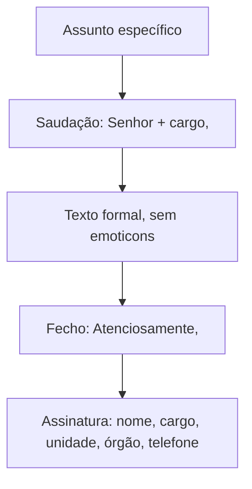

O correio eletrônico virou o principal meio de trânsito de documentos na administração pública, e por isso as bancas passaram a cobrá-lo. Ao lado dele, aparecem expedientes que o Manual da Presidência não define, mas que outros manuais descrevem e que costumam cair em prova: a carta, o despacho, a ata e a declaração. Este capítulo trata dos dois blocos, sempre destacando o que é regra do Manual e o que é conceito de manuais complementares.

> [!objetivos]
> - Distinguir os três sentidos de "e-mail" e saber quando ele tem valor documental.
> - Aplicar as orientações de assunto, vocativo, fecho, assinatura e anexos do e-mail oficial.
> - Reconhecer o que o e-mail institucional não admite: emoticons, abreviações de internet e caixa alta.
> - Identificar a finalidade e a estrutura da carta, do despacho, da ata e da declaração.

## E-mail: três sentidos

Dependendo do contexto, "e-mail" significa:

| Sentido | O que é | Consequência |
| --- | --- | --- |
| Gênero textual | Modalidade de texto, ao lado da carta e da mensagem de texto | Pode ser documento oficial, como o ofício; linguagem compatível com a comunicação oficial |
| Endereço eletrônico | O endereço do servidor | Deve ser institucional, com a extensão .gov.br |
| Sistema de transmissão | A tecnologia de enviar mensagens | Por custo baixo e rapidez, é a principal forma de enviar e receber documentos |

### Valor documental

Pela Medida Provisória 2.200-2/2001, o e-mail só tem **valor documental**, isto é, só é aceito como documento original, se houver **certificação digital** que ateste a identidade do remetente nos parâmetros da ICP-Brasil (integridade, autenticidade e validade jurídica). O destinatário pode aceitar como válido o e-mail sem certificação ou com certificação de fora da ICP-Brasil. Se houver questionamento, porém, o ato deve ser repetido em documento físico assinado ou em meio eletrônico reconhecido pela ICP-Brasil. Salvo lei específica, o ente público não pode impor a aceitação de documento eletrônico fora desses parâmetros.

> [!atencao] Aceitar é diferente de ter valor documental
> Um e-mail comum pode ser aceito pelo destinatário, mas só o e-mail com certificação da ICP-Brasil tem valor documental garantido. Alternativas que digam que todo e-mail institucional tem, automaticamente, valor de documento original estão erradas.

## Forma e estrutura do e-mail oficial

O e-mail é flexível, e o Manual não impõe um modelo rígido. Ainda assim, orienta cada parte.

| Parte | Orientação |
| --- | --- |
| Assunto | O mais claro e específico possível; deve refletir o conteúdo todo, para não parecer lixo eletrônico. Em vez de "Reunião", "Agendamento de reunião sobre a reforma administrativa" |
| Local e data | Desnecessários no corpo, porque o sistema já os registra |
| Saudação | O texto começa por uma saudação; para outras instituições, desconhecidos e particulares, vale o vocativo oficial: "Senhor Coordenador," ou "Prezada Senhora," |
| Fecho | "Atenciosamente," é o fecho padrão |
| Assinatura | Nome completo, cargo, unidade, órgão e telefone |
| Anexos | Só se indispensáveis, em formatos usuais e seguros, com informação mínima sobre o conteúdo; arquivos em discussão, em formato editável |

Sobre o fecho: abreviações como "Att." e fórmulas como "Abraços" ou "Saudações" se popularizaram, mas **não são fechos oficiais** e não devem aparecer em e-mails profissionais. O e-mail admite saudação e fecho um pouco menos formais em algumas situações, mas o **texto** deve ser formal, como em qualquer documento oficial.

Sobre anexos, o Manual pede avaliar se o arquivo é realmente indispensável ou se caberia no corpo da mensagem, evitar tamanho excessivo e não reencaminhar anexos nas respostas. Ele não lista os formatos: apenas exige que sejam usuais e de baixo risco.

### Recomendações

- Usar confirmação de leitura quando necessário; se não houver, pedir confirmação de recebimento no texto.
- Manter a fonte dos documentos oficiais: Calibri ou Carlito, tamanho 12, cor preta.
- Não usar fundo ou papel de parede eletrônico.
- Revisar o e-mail com o mesmo cuidado de qualquer documento oficial.
- Não usar ícones nem emoticons, porque o texto profissional dispensa manifestações emocionais.
- Não usar abreviações de conversa na internet ("vc", "pq") nem grafias inventadas ("naum", "eh", "aki").
- Não usar caixa alta para destacar, porque denota agressividade.
- Evitar imagens no corpo, inclusive o brasão da República e logotipos junto à assinatura.
- Não enviar mensagens cujo tamanho possa exceder a capacidade do servidor do destinatário.

> [!pegadinha] Flexibilidade não é informalidade
> "O e-mail é o documento oficial mais flexível, admitindo vc e pq" está errado. A flexibilidade é de estrutura, e não de linguagem. As mesmas restrições de formalidade e impessoalidade valem.

> [!resolvido] Questão comentada
> **Enunciado:** num ofício de uma universidade ao Ministro da Educação, convidando-o para uma cerimônia, o fecho "Atenciosamente," seria adequado ao padrão do Manual. Certo ou errado?
>
> **Resolução:** errado. O destinatário é um Ministro, autoridade de hierarquia superior à de um reitor, e o fecho correto é "Respeitosamente,". O vocativo "Senhor Ministro," também está certo; "Excelentíssimo Senhor" seria reservado a Chefes de Poder.

### Um e-mail bem escrito, passo a passo

Imagine que o chefe de uma seção precise pedir ao almoxarifado a reposição de material. O assunto deve dizer o que se pede, e não apenas o setor: "Solicitação de reposição de papel e toner" é melhor que "Material". A saudação usa o cargo do destinatário: "Senhor Chefe do Almoxarifado,". O texto vai direto ao ponto, em frases curtas e na norma culta: "Solicito a reposição de dez resmas de papel e duas unidades de toner, esgotados desde segunda-feira. Peço confirmação de recebimento desta mensagem." O fecho é "Atenciosamente," e a assinatura traz nome completo, cargo, unidade, órgão e telefone.

Veja como cada uma das falhas comuns seria corrigida.

| Versão inadequada | Problema | Correção |
| --- | --- | --- |
| Assunto: "Urgente!!!" | Vago e enfático | "Solicitação de reposição de papel e toner" |
| "Oi, pessoal da logística" | Saudação informal e tratamento coletivo | "Senhor Chefe da Seção de Logística," |
| "Preciso q vc mande isso hj :)" | Abreviações e emoticon | "Solicito o envio dos materiais ainda hoje." |
| "ATENÇÃO: PRAZO ACABANDO" | Caixa alta denota agressividade | "Informo que o prazo termina amanhã." |
| "Abraços, Silva" | Fecho não oficial e assinatura incompleta | "Atenciosamente," e assinatura completa |

> [!atencao] Anexo sem explicação
> A mensagem que encaminha arquivo deve informar minimamente o conteúdo do anexo. Enviar apenas "segue em anexo" desrespeita a orientação do Manual, que também pede avaliar se o anexo é indispensável e se não caberia no corpo do e-mail.

## Outros expedientes

O Manual da Presidência não conceitua a carta, o despacho, a ata e a declaração. As bancas, porém, perguntam seus conceitos com base em outros manuais (de estados, de tribunais e de universidades), cujas definições podem variar um pouco. O estudo abaixo reúne os conceitos mais usados.

### Carta

A carta é a correspondência de personalidade pública para fazer solicitações e transmitir informações. Quando expedida por autoridade fora do exercício das funções, é correspondência **paraoficial**, usada para pedido, convite, agradecimento, resposta e apresentação. É versátil, mas tem sido substituída pelo ofício.

A **carta circular** é a comunicação reproduzida em muitos exemplares e dirigida a várias pessoas ou a um órgão, para transmitir avisos, ordens ou instruções de interesse geral, e não confidenciais.

Estrutura: título "Carta" (inicial maiúscula, à esquerda) com número, ano e sigla da unidade; local e data por extenso; destinatário e endereço; vocativo seguido de vírgula; texto com parágrafos numerados, exceto o fecho; fecho ("Atenciosamente," ou "Respeitosamente,"); assinatura do titular da unidade.

### Despacho

Despacho é o ato em que uma autoridade, administrativa ou judicial, decide ou encaminha sobre um documento ou processo. Pode ser de mero expediente (dando seguimento), de encaminhamento a outro órgão ou decisório. A nomenclatura varia com a autoridade e a definitividade:

| Espécie | Quem expede | Natureza |
| --- | --- | --- |
| Interlocutório | Servidor de nível intermediário | Decide entre atos do processo, sem encerrar a matéria |
| Ordenatório ou de expediente | Autoridade de maior nível | Trata da ordem, do andamento ou da fiscalização do processo |
| Definitivo ou decisório | Autoridade que resolve a questão | Define a matéria |

Estrutura: título "Despacho" centralizado, seguido da data; assunto, que resume o teor; texto em linguagem isenta de parcialidade; local e data por extenso; assinatura da autoridade. Nos memorandos, para ganhar celeridade, o despacho é feito no próprio documento ou em folha de continuação.

### Ata

Ata é o registro sucinto e fiel das decisões e dos acontecimentos de uma reunião, assembleia, sessão ou congresso. Por ter valor jurídico, não admite alterações depois de aprovada. Por isso:

- o texto é escrito de modo corrido, **sem parágrafos, alíneas, rasuras ou entrelinhas**;
- **não deixa espaços em branco**, para impedir acréscimos;
- numerais são escritos por extenso e abreviaturas devem ser evitadas;
- em manuscrito, o erro é corrigido com "digo"; o que foi omitido ou descoberto depois entra ao final com "em tempo".

Partes, sem numeração: dia, mês, ano e hora; local; nome e cargo dos presentes; ordem do dia; fecho ("Nada mais havendo a tratar..."); assinaturas do presidente, do secretário e, conforme o regimento, dos participantes.

> [!bizu] Ata é texto fechado
> Pense em ata como um texto que ninguém pode completar depois. Parágrafos e alíneas deixam espaços vazios; por isso a ata é corrida. Se a alternativa disser que o texto da ata é detalhado, com parágrafos normais e alíneas, ela está errada.

### Declaração

Declaração é o documento em que o servidor, em razão do cargo ou da função, atesta um fato que consta de livros, papéis ou documentos em poder da Administração. Em outras palavras, registra, sob responsabilidade, uma informação sobre pessoa ou acontecimento. Também pode ser prestada por particular. A que tem características próprias pode receber qualificação, como "declaração funcional".

Estrutura: título "DECLARAÇÃO", centralizado; texto com o fato declarado, a finalidade e o nome do interessado em maiúsculas; local e data; assinatura de quem declara e, se autoridade, o cargo.

## Como escolher o expediente

As questões de adequação perguntam qual expediente atende a uma situação. Um roteiro simples ajuda.

- Registrar o que se decidiu numa reunião, de modo definitivo: **ata**.
- Atestar um fato que consta nos registros do órgão, em razão do cargo: **declaração**.
- Dar andamento, encaminhar ou decidir sobre um documento ou processo: **despacho**.
- Pedido, convite ou agradecimento de personalidade pública, hoje cada vez mais feito por ofício: **carta**.
- Comunicação ágil entre servidores e órgãos, com a mesma formalidade de linguagem: **e-mail**.

Na ata, lembre ainda que a hora e o local vêm no começo, que a ordem do dia é registrada na sequência em que foi tratada e que as assinaturas encerram o texto. Na declaração, é o nome do interessado em maiúsculas que identifica de quem se fala. No despacho, o assunto resume o teor e a linguagem não revela parcialidade.

> [!bizu] Quem decide, quem atesta, quem registra
> Despacho **decide ou encaminha**, declaração **atesta**, ata **registra**. Se o enunciado descreve uma dessas ações, a resposta é o expediente correspondente.

## Mapa do capítulo

| Tema | Regra central | Armadilha |
| --- | --- | --- |
| Sentidos de e-mail | Gênero, endereço e sistema | Esquecer o ".gov.br" |
| Valor documental | Exige certificação ICP-Brasil | Dizer que todo e-mail vale como original |
| Fecho do e-mail | "Atenciosamente," | "Att.", "Abraços" ou "Saudações" |
| Linguagem | Formal; sem emoticons, "vc", caixa alta | Admitir informalidade |
| Assinatura | Nome, cargo, unidade, órgão e telefone | Colocar brasão ou logotipo |
| Carta | Correspondência paraoficial, em declínio | Confundir com ofício |
| Despacho | Interlocutório, ordenatório e decisório | Trocar as espécies |
| Ata | Texto corrido, sem espaços e alíneas | Admitir alíneas |
| Declaração | Atesta fato conhecido por cargo ou função | Dizer que cria direito novo |

### Para fixar

1. "E-mail" pode ser gênero textual, endereço eletrônico ou sistema de transmissão; o endereço institucional usa .gov.br.
2. O e-mail só tem valor documental com certificação digital da ICP-Brasil; sem ela, pode ser aceito, mas o ato é repetido se houver questionamento.
3. O assunto do e-mail deve ser claro e específico, e local e data são dispensáveis no corpo.
4. O fecho padrão é "Atenciosamente,"; "Att.", "Abraços" e "Saudações" não são oficiais.
5. A assinatura traz nome completo, cargo, unidade, órgão e telefone.
6. Não se usam emoticons, abreviações de internet, caixa alta nem imagens no corpo da mensagem.
7. Fonte recomendada: Calibri ou Carlito, tamanho 12, cor preta; sem papel de parede.
8. A carta é correspondência paraoficial; a carta circular tem vários destinatários.
9. O despacho pode ser interlocutório, ordenatório ou decisório, conforme a autoridade e a definitividade.
10. A ata é texto corrido, sem parágrafos, alíneas e espaços em branco; erros se corrigem com "digo" e "em tempo".
