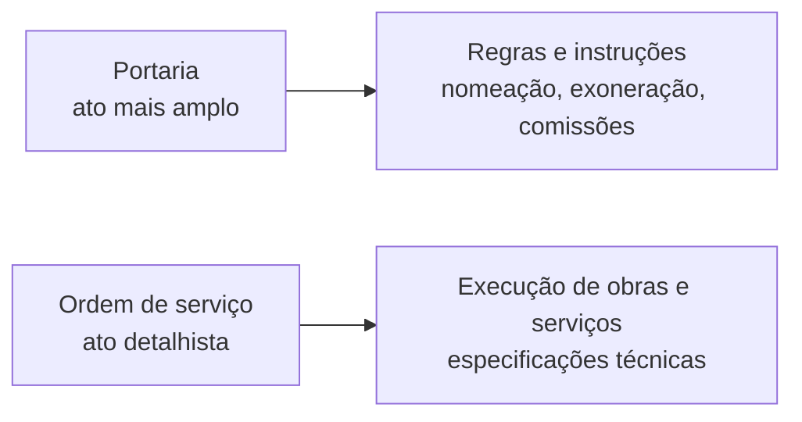

Este capítulo é um dicionário de expedientes. Cada um tem um conceito curto, uma finalidade e uma estrutura que as bancas pedem quase sempre pela definição: "o documento em que a autoridade atesta um fato" é atestado; "a norma que o dirigente baixa para organizar o serviço" é portaria. O trabalho de estudo é fixar a palavra-chave de cada um e, sobretudo, o que o distingue do vizinho parecido. Estas definições vêm de manuais de redação complementares ao da Presidência, que não conceitua todos eles.

> [!objetivos]
> - Definir atestado, certidão, circular, comunicado, convite, convocação, edital, ordem de serviço e portaria.
> - Distinguir expedientes parecidos: atestado e declaração, ordem de serviço e portaria, convite e convocação.
> - Reconhecer a estrutura básica de cada documento.
> - Identificar também o requerimento e o relatório, com sua estrutura e seu fecho.

## Atestado e certidão

**Atestado** é o documento firmado por servidor, em razão do cargo ou da função, que declara um fato existente que **não consta** de livros, papéis ou documentos da Administração. Certifica, afirma ou assegura algo que interessa a outra pessoa. Estrutura: timbre da instituição, a palavra ATESTADO em maiúsculas e centralizada, texto em **parágrafo único** que indica a quem se refere e o assunto, e local e data por extenso.

**Certidão** é o documento que a Administração entrega ao interessado para comprovar que um ato ou registro **existe** em processo, livro ou papel guardado nas repartições. Pode ser de inteiro teor, quando transcreve integralmente (também chamada traslado), ou resumida, desde que fiel ao original. A certidão autenticada tem o mesmo valor probatório do original, e seu fornecimento é garantido pela Constituição (art. 5º, XXXIV, b). Estrutura: timbre, CERTIDÃO centralizada, preâmbulo (alusão ao fato que determinou a expedição e ao livro de onde é extraída), texto corrido sem parágrafos, alíneas, rasuras ou emendas, fecho com a identificação de quem lavrou e de quem conferiu, local e data, e visto da autoridade que autorizou.

| Critério | Atestado | Certidão | Declaração |
| --- | --- | --- | --- |
| Fato | Não consta dos registros do órgão | Consta dos registros | Consta dos registros, conhecido por cargo ou função |
| Ideia-chave | Afirma o que a autoridade conhece | Reproduz o que está registrado | Informa sob responsabilidade |
| Texto | Parágrafo único | Corrido, sem alíneas | Fato, finalidade e interessado em maiúsculas |

> [!bizu] Atestar x certificar
> Se o fato está nos livros do órgão, a prova é **certidão**. Se a autoridade o conhece, mas ele não está registrado, é **atestado**. As certidões de nada consta e de quitação eleitoral são exemplos de certidão.

## Circular, comunicado, convite e convocação

**Circular** é a correspondência interna enviada de uma vez a muitos destinatários, usada para repassar rotinas, orientações e procedimentos, explicar normas ou divulgar uma informação. Pode ter a forma de ofício-circular, memorando-circular ou carta-circular. Não serve para regulamentar atos oficiais como norma ou determinação de serviço, e sua emissão cabe a unidades de hierarquia igual ou superior à divisão ou equivalente. O número é crescente e anual, específico para a circular.

**Comunicado** é um aviso ou recado oficial para passar uma informação, como a divulgação de eventos e reuniões. Tem circulação **interna** (formato parecido com o do memorando) ou **externa** (formato parecido com o do edital). Estrutura: nome dos organizadores, objetivo, local e data, e assinatura.

**Convite** chama alguém a comparecer a certo local, em horário marcado e com finalidade determinada. A redação se limita ao essencial: quem convida, a formulação do convite, o nome dos convidados, o evento e o dia, a hora e o local. Em cerimônias como casamento e formatura, o nome do convidado só vai no envelope. Se emitido por entidade, vai em papel timbrado.

**Convocação** é a comunicação escrita que chama alguém para uma reunião. Pede texto simples, frases curtas e indicação de local, data e finalidade, para que seja reconhecida de imediato.

| Expediente | Palavra-chave | Diferencial |
| --- | --- | --- |
| Circular | Vários destinatários internos | Rotinas e orientações; numeração própria |
| Comunicado | Recado oficial | Pode ser interno ou externo |
| Convite | Chamar ao evento | Gentileza; nome do convidado |
| Convocação | Chamar à reunião | Obrigação de comparecer; local, data e finalidade |

## Edital

**Edital** é o instrumento com que a Administração abre concorrência e concurso público, trata do provimento de cargo público, convoca servidor, realiza licitações e divulga atos deliberativos. Estrutura: timbre, título com número de ordem e data, autoria com o fundamento legal e os "considerandos", ementa (não obrigatória, mas comum em concorrências e tomadas de preço), texto, e assinatura com nome, cargo e função da autoridade. Quanto à divulgação, o edital deve sair em três veículos: a imprensa oficial, o jornal privado de maior circulação e o boletim de serviço do órgão. O primeiro cuida da publicidade formal do ato, o segundo amplia o alcance junto ao público e o terceiro alcança os servidores. Em prova, lembre que a lista é cumulativa e que o edital precisa de fundamento legal, porque é um ato de comunicação com efeitos jurídicos para quem participa do certame.

## Ordem de serviço e portaria

**Ordem de serviço** reúne orientações detalhadas ou pontuais para execução de serviços por órgãos subordinados. Fixa comandos de trabalho e traz determinações aos responsáveis por obras e serviços, com imposições administrativas ou especificações técnicas de execução. Estrutura: título com número e data, preâmbulo com a autoridade em maiúsculas, o fundamento legal ou a prerrogativa do cargo e a palavra "**resolve**", texto que pode ter itens, incisos e alíneas, e assinatura.

**Portaria** é o ato da autoridade que fixa regras, orienta a aplicação de leis e organiza o funcionamento dos serviços sob sua responsabilidade, sempre dentro da própria competência. Serve também para designar servidores, formar comissões e grupos de trabalho e instituir políticas e programas. Estrutura: título com número e data; ementa (só nas normativas, suprimida nas rotineiras, como nomeação e exoneração); preâmbulo e fundamentação com o "resolve"; texto em artigos, parágrafos, incisos, alíneas e itens; e assinatura. Quando há "considerandos", o "resolve" vem depois deles.

> [!pegadinha] Ordem de serviço ou portaria?
> A portaria é mais ampla: rege o cumprimento de leis, oficializa nomeações, remoções e demissões. A ordem de serviço é mais restrita e detalhista, voltada para a racionalização de serviços e para as especificações técnicas. Se o enunciado fala de nomear servidor, a resposta é portaria.

## Requerimento e relatório

**Requerimento** é o documento em que o interessado pede ao poder público algo a que se julga com direito ou se defende de ato que o prejudica. Estrutura: vocativo e título completo da autoridade; preâmbulo com o nome do requerente em maiúsculas e dados de identificação (se for servidor, bastam os funcionais); texto com o pedido claro e objetivo; fecho com a fórmula "Nestes termos, pede deferimento" (ou "espera" ou "aguarda"), que pode vir abreviada (N.T., P.D., E.D., A.D.); local e data por extenso; e assinatura do requerente.

**Relatório** é o documento em que o servidor expõe a atividade de um órgão ou presta contas de seus atos a autoridade superior: situações de serviço, resultados de exames, eventos, cursos, projetos. Estrutura: título, vocativo, texto com introdução, análise ou desenvolvimento e conclusão, fecho como no ofício, local e data, assinatura e anexos (gráficos e tabelas). Interno, segue por memorando; externo, por ofício.

> [!resolvido] Questão comentada
> **Enunciado:** o ato em que uma autoridade orienta o funcionamento de um serviço e designa servidores para uma comissão define: a) portaria; b) decreto; c) apostila; d) ata.
>
> **Resolução:** letra a. Orientar o serviço e designar pessoas para comissões são marcas da portaria. A ata registra reuniões, a apostila é um aditamento a título de situação funcional e o decreto é ato do chefe do Executivo.

## Como não confundir

Algumas confusões se repetem. **Atestado e declaração** parecem iguais: ambos afirmam algo; o atestado trata de fato que a autoridade conhece e que não está nos registros, e a declaração, de fato registrado, conhecido pelo cargo. **Convite e convocação** diferem pela força: o convite solicita o comparecimento, e a convocação chama para uma reunião de trabalho. **Circular e comunicado** são ambos informativos, mas a circular transmite rotinas e orientações a vários destinatários, com numeração própria, e o comunicado é um recado, com formato de memorando ou de edital. Por fim, o **edital** se destina a público indeterminado e dá publicidade ao ato, enquanto a portaria é interna e organiza o serviço.

> [!atencao] Definição literal
> As bancas reproduzem a definição quase palavra por palavra. Memorize o verbo principal de cada um: atestar, certificar, orientar, comunicar, convidar, convocar, tornar público, detalhar, regular, requerer, prestar contas.

## Mapa do capítulo

| Expediente | Definição curta |
| --- | --- |
| Atestado | Fato conhecido da autoridade, não registrado |
| Certidão | Reprodução de fato registrado |
| Circular | Mesma informação a vários destinatários |
| Comunicado | Recado oficial, interno ou externo |
| Convite | Chama ao evento |
| Convocação | Chama à reunião |
| Edital | Abertura de concurso ou licitação e atos deliberativos |
| Ordem de serviço | Comandos detalhados para execução |
| Portaria | Regras, instruções e atos de pessoal |
| Requerimento | Pedido do interessado |
| Relatório | Prestação de contas a superior |

### Para fixar

1. Atestado declara fato que não consta dos registros; certidão reproduz fato registrado e, autenticada, vale como o original.
2. A certidão é gratuita para o interessado nos termos do art. 5º, XXXIV, b, da Constituição e tem texto corrido, sem parágrafos nem rasuras.
3. A circular é interna, enviada a vários destinatários, e tem numeração própria; não regulamenta atos oficiais.
4. O comunicado é recado oficial, com circulação interna ou externa.
5. O convite chama ao evento; a convocação chama à reunião.
6. O edital abre concursos e licitações e convoca servidores; deve ser publicado na imprensa oficial, na imprensa privada de maior circulação e no boletim de serviço.
7. A ordem de serviço é detalhista e voltada à execução; a portaria é mais ampla e trata também de atos de pessoal.
8. Portaria e ordem de serviço usam o "resolve"; com considerandos, ele vem depois deles.
9. O requerimento termina com a fórmula de deferimento e traz a assinatura do requerente.
10. O relatório presta contas a superior e se encaminha por memorando, se interno, e por ofício, se externo.
