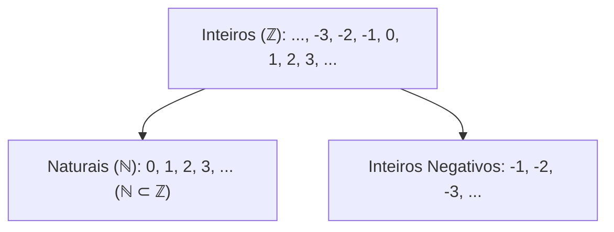
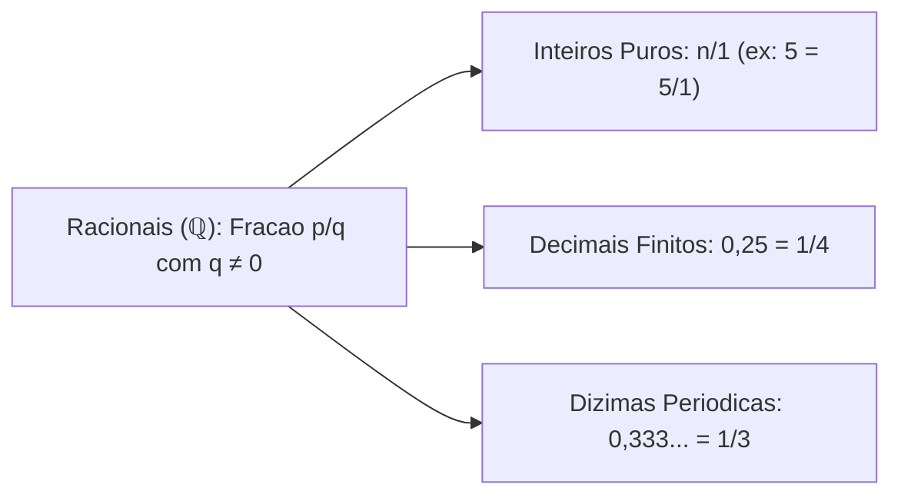
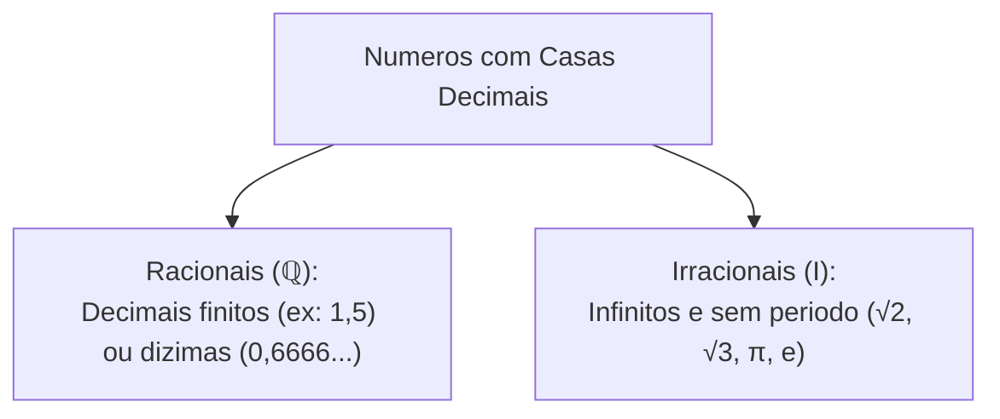
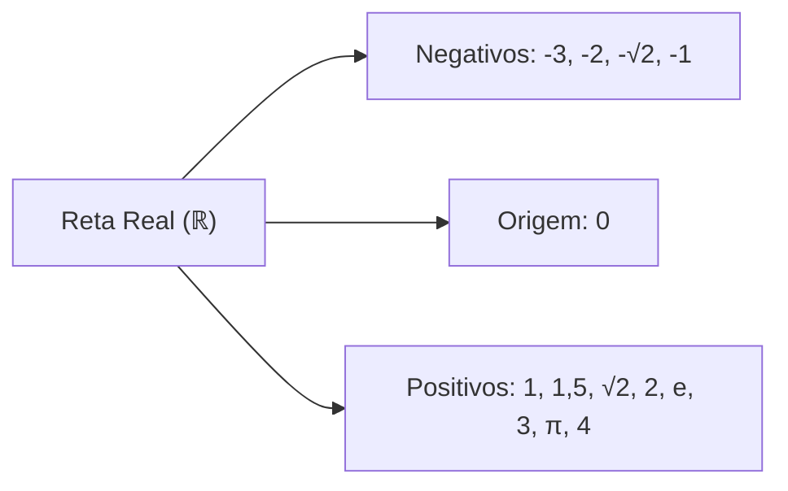
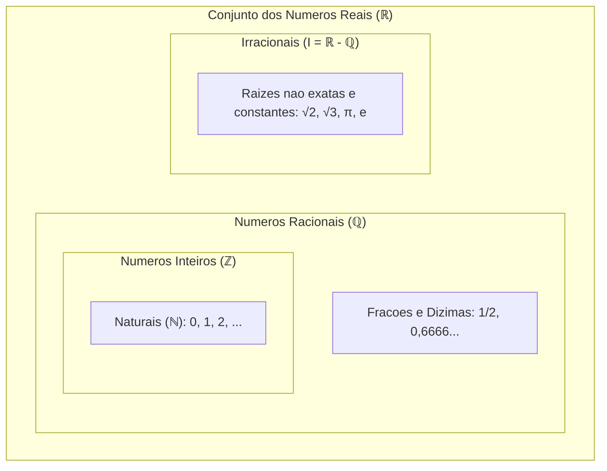
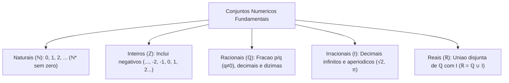

A matemática agrupa os números em famílias conceituais estruturadas. Esses agrupamentos são conhecidos como conjuntos numéricos. Cada conjunto surgiu historicamente para suprir demandas práticas da humanidade. As necessidades variaram desde a simples contagem de rebanhos até medições contínuas de grandezas periciais e balísticas.

Neste capítulo inicial de nivelamento, exploraremos a evolução dos conjuntos numéricos: Naturais (ℕ), Inteiros (ℤ), Racionais (ℚ), Irracionais (I) e Reais (ℝ). Estudaremos as propriedades de cada grupo e suas formas de representação. Analisaremos também as dízimas periódicas e a cadeia de inclusões na reta real. Esses temas aparecem com grande regularidade nas provas.

> [!objetivos]
> - Identificar as propriedades dos conjuntos dos números Naturais e Inteiros.
> - Compreender a definição de número Racional e a conversão de dízimas periódicas.
> - Distinguir números Racionais de números Irracionais pela representação decimal.
> - Dominar a correspondência contínua entre os números Reais e a reta geométrica.
> - Aplicar a cadeia hierárquica de inclusões ℕ ⊂ ℤ ⊂ ℚ ⊂ ℝ na resolução de problemas.

---

## Conjunto dos Números Naturais e Inteiros

A contagem de objetos discretos originou os números mais simples da matemática:

### Números Naturais (ℕ)
O conjunto ℕ reúne os números inteiros não negativos utilizados na contagem:
- Conjunto padrão: ℕ = {0, 1, 2, 3, 4, 5, ...}.
- Subconjunto sem o zero: indicado pelo símbolo de asterisco sobrescrito, ℕ* = {1, 2, 3, 4, ...}.
- Todo número natural possui um sucessor imediato bem definido (`n + 1`).
- Com exceção do zero em ℕ, todo elemento possui um antecessor natural imediato (`n - 1`).
- A adição e o produto de naturais geram sempre outro número natural. Contudo, a subtração de um número maior de um menor não tem resposta em ℕ (exemplo: 3 - 5). Da mesma forma, a divisão nem sempre resulta em um valor inteiro fechado (exemplo: 5 / 2 = 2,5).

### Números Inteiros (ℤ)
Para expressar saldos negativos, perdas e variações térmicas abaixo de zero, criaram-se os inteiros:
- Conjunto padrão: ℤ = {..., -3, -2, -1, 0, 1, 2, 3, ...}.
- Todo número natural é também um número inteiro. Por isso, ℕ está contido em ℤ (ℕ ⊂ ℤ).
- O símbolo de asterisco sobrescrito ℤ* exclui o elemento nulo: ℤ* = {..., -2, -1, 1, 2, ...}.
- Todo inteiro par pode ser escrito na forma `2k`, com `k` inteiro. Todo ímpar escreve-se como `2k + 1`. A soma de dois números inteiros consecutivos `n` e `n + 1` resulta sempre no número ímpar `2n + 1`.

> [!pegadinha]
> **Origem dos Inteiros**: é falso afirmar que os números inteiros partem do zero. Os inteiros prolongam-se infinitamente para os dois lados da reta. O zero é apenas o marco neutro divisor. Ele é formalmente um número par.

---

## Conjunto dos Números Racionais (ℚ) e Dízimas Periódicas

A necessidade de registrar partes fracionárias e medidas intermediárias deu origem aos números racionais:

### Definição Formal de Racional
Um número é racional se puder ser escrito como fração ordinária `p / q`, na qual `p` e `q` são inteiros e `q ≠ 0`:
- Todo inteiro é racional, pois pode ser expresso com denominador 1 (exemplo: 7 = 7/1 e -4 = -4/1).
- Todos os números com representação decimal finita (populares números quebrados) são racionais. Exemplos: 0,75 = 3/4 e 1,2 = 6/5.

### Dízimas Periódicas e Fração Geratriz
As dízimas periódicas possuem casas decimais infinitas organizadas em um ciclo repetitivo constante. Toda dízima periódica é estritamente um número racional:
- **Dízima Periódica Simples**: o período repetitivo surge imediatamente após a vírgula. Exemplos: 0,333... equivale a 1/3; a dízima 0,6666... equivale a 2/3. Outro caso clássico é 1,351351..., cujo período é 351, gerando fração ordinária.
- **Dízima Periódica Composta**: possui algarismos que não se repetem antes do período. Exemplo: 0,2777... tem anteperíodo 2 e período 7.

> [!resolvido]
> **Exercício Resolvido: Fração Geratriz Passo a Passo**:
> Encontre a fração geratriz irredutível da dízima periódica composta 0,2777...
> 
> **Resolução passo a passo:**
> 1. Chame a dízima de x: `x = 0,2777...`
> 2. Multiplique por 10 para isolar o anteperíodo antes da vírgula: `10x = 2,7777...` (Equação 1).
> 3. Multiplique a Equação 1 por 10 para avançar um período completo: `100x = 27,7777...` (Equação 2).
> 4. Subtraia a Equação 1 da Equação 2 para eliminar a parte periódica infinita:
>    `100x - 10x = 27,7777... - 2,7777...`
>    `90x = 25`
> 5. Isole x e simplifique a fração dividindo numerador e denominador por 5:
>    `x = 25 / 90 = 5 / 18`.
> Portanto, a fração geratriz é 5/18.

---

## Conjunto dos Números Irracionais (I = ℝ - ℚ)

Nem todo valor mensurável no universo pode ser expresso por uma razão de inteiros:

### Definição de Número Irracional
O conjunto dos números irracionais reúne todos os valores que não podem ser escritos na forma `p / q`:
- Sua representação decimal é obrigatoriamente **infinita e não periódica**.
- **Raízes Não Exatas**: raízes quadradas ou cúbicas de números que não são potências perfeitas são irracionais. Exemplos: √2 ≈ 1,4142..., √3 ≈ 1,7320..., √5 ≈ 2,2360...
- **Constantes Matemáticas**:
  - Número Pi (π ≈ 3,1415...): razão entre a circunferência e o diâmetro do círculo.
  - Número de Euler (e ≈ 2,7182...): base dos logaritmos naturais.
  - Razão Áurea (φ = (1 + √5) / 2 ≈ 1,6180...): proporção harmônica da geometria.

> [!pegadinha]
> **Raízes Exatas São Racionais**: tome cuidado redobrado em enunciados da banca. Raízes de quadrados perfeitos são números inteiros racionais. Por exemplo, √4 = 2 e √25 = 5. Apenas raízes de termos que não formam quadrados perfeitos são irracionais.

---

## Conjunto dos Números Reais (ℝ) e Reta Numérica

O conjunto dos números reais reúne basicamente todos os números racionais e irracionais estudados pela matemática elementar:

### Estrutura e Completeza dos Números Reais
Algebricamente, os reais formam a união disjunta **`ℝ = ℚ ∪ I`**. Essa união possui propriedades fundamentais que diferenciam os reais de todos os conjuntos numéricos anteriores:
- A interseção entre racionais e irracionais é rigorosamente o conjunto vazio: **`ℚ ∩ I = ∅`**.
- Nenhum número pode ser racional e irracional ao mesmo tempo no universo real. Ou o número pode ser escrito como fração de inteiros com denominador não nulo, ou sua escrita decimal é infinita e desprovida de qualquer período repetitivo.
- O conjunto dos irracionais é formalmente a diferença de conjuntos: **`I = ℝ - ℚ`**.

### Correspondência com a Reta Numérica e Intervalos Reais
Existe uma correspondência biunívoca perfeita entre os números reais e os pontos geométricos de uma reta contínua. Essa propriedade é conhecida na análise matemática como o axioma da completeza:
- A cada número real corresponde um único ponto geométrico na reta. Da mesma forma, a cada ponto da reta corresponde exatamente um único número real.
- Embora os números racionais sejam infinitos e densos (entre quaisquer dois racionais sempre existe outro racional), eles deixam lacunas na reta. Essas lacunas são preenchidas exatamente pelos números irracionais.
- Os números reais permitem a definição de intervalos contínuos na reta. Um intervalo fechado `[a, b]` contém todos os números reais entre `a` e `b`, incluindo os próprios extremos. Já um intervalo aberto `(a, b)` exclui os pontos extremos `a` e `b`, contendo todos os infinitos pontos internos.

---

## Cadeia de Inclusões e Classificação de Valores

A hierarquia formal de inclusões dos conjuntos numéricos obedece à cadeia canônica:

**`ℕ ⊂ ℤ ⊂ ℚ ⊂ ℝ`**, com **`I ⊂ ℝ`** e **`ℚ ∩ I = ∅`**.

| Valor | ℕ | ℤ | ℚ | I | ℝ | Justificativa Sintética |
|---|---|---|---|---|---|---|
| **15** | Sim | Sim | Sim | Não | Sim | Natural e inteiro; 15 = 15/1 |
| **-8** | Não | Sim | Sim | Não | Sim | Inteiro negativo; -8 = -8/1 |
| **3/4** | Não | Não | Sim | Não | Sim | Fração ordinária com decimal finito 0,75 |
| **0,6666...** | Não | Não | Sim | Não | Sim | Dízima periódica com geratriz 2/3 |
| **√2** | Não | Não | Não | Sim | Sim | Raiz quadrada não exata; decimal aperiódico |
| **√25** | Sim | Sim | Sim | Não | Sim | Raiz exata; √25 = 5 (número natural) |
| **π** | Não | Não | Não | Sim | Sim | Constante geométrica transcendental irracional |

> [!bizu]
> **Operações com Irracionais**:
> 1. Um racional somado a um irracional resulta sempre em número **irracional** (exemplo: 2 + √3).
> 2. O produto de um racional não nulo por um irracional é sempre **irracional** (exemplo: 3 · √2).
> 3. A soma ou produto de dois irracionais pode resultar em racional (exemplo: √2 · √2 = 2).

---

## Exercícios Práticos e Questões Comentadas

### Questão 1
Considere as afirmações a respeito dos conjuntos numéricos:
I. O número zero pertence aos inteiros e é um número racional.
II. O resultado da divisão de dois naturais é sempre um número natural.
III. O número 0,555... é irracional por possuir infinitas casas decimais.
IV. O número raiz quadrada de 9 é natural, inteiro, racional e real.
Estão corretas apenas as afirmativas:
A) I e II
B) I e IV
C) II e III
D) III e IV
E) I, II e IV

**Gabarito: B**

**Comentário detalhado:**
Analisando as proposições:
- I. Correta: zero pertence a ℤ e a ℚ (0 = 0/1).
- II. Incorreta: 5 / 2 = 2,5, que não é natural.
- III. Incorreta: 0,555... é dízima periódica com geratriz 5/9, logo é racional.
- IV. Correta: √9 = 3, que pertence a ℕ, ℤ, ℚ e ℝ.
Estão corretas apenas I e IV. A resposta correta é a B.

---

### Questão 2
Assinale a alternativa que apresenta exclusivamente números irracionais:
A) `{√4; π; 0,25}`
B) `{√2; √3; π}`
C) `{3/7; √5; e}`
D) `{0,333...; √7; φ}`
E) `{√16; √25; √36}`

**Gabarito: B**

**Comentário detalhado:**
Na opção B, √2 e √3 são raízes não exatas e π é a constante circular. Os três números são infinitos e aperiódicos, sendo estritamente irracionais. Nas outras alternativas há frações e raízes exatas. A opção correta é a B.

---

### Questão 3 (Inédita)
A respeito da estrutura dos conjuntos numéricos, assinale a opção correta:
A) Todo número real é racional.
B) O conjunto dos números naturais engloba todos os inteiros negativos.
C) A interseção entre os racionais e os irracionais é vazia.
D) O número raiz cúbica de 8 é irracional.
E) A soma de dois irracionais resulta sempre em um irracional.

**Gabarito: C**

**Comentário detalhado:**
Os conjuntos ℚ e I são disjuntos, de modo que `ℚ ∩ I = ∅`. Nenhum número é racional e irracional ao mesmo tempo. A raiz cúbica de 8 é 2 (natural e racional). A alternativa correta é a C.

---

## Mapa do Capítulo

---

### Para fixar

- **Números Naturais (ℕ)**: conjunto de contagem {0, 1, 2, ...}; ℕ* exclui o zero.
- **Números Inteiros (ℤ)**: engloba os naturais e seus opostos negativos; ℕ está contido em ℤ.
- **Números Racionais (ℚ)**: números que podem ser escritos na forma `p / q`, com denominador não nulo.
- **Dízimas periódicas**: apresentam casas decimais infinitas em ciclo repetitivo e são números racionais.
- **Números Irracionais (I)**: possuem casas decimais infinitas e aperiódicas, como raízes não exatas e o número π.
- **Raízes exatas**: raízes como √4 = 2 e √9 = 3 são inteiras e racionais.
- **Números Reais (ℝ)**: união completa e contínua dos racionais com os irracionais (`ℝ = ℚ ∪ I`).
- **Disjunção obrigatória**: nenhum número pode ser racional e irracional simultaneamente (`ℚ ∩ I = ∅`).
- **Cadeia de inclusões**: ℕ ⊂ ℤ ⊂ ℚ ⊂ ℝ.
