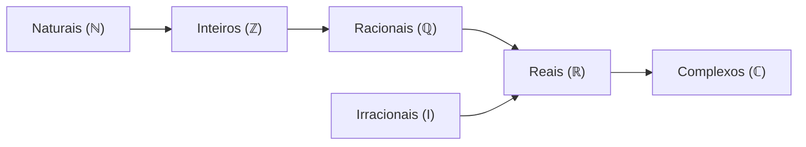
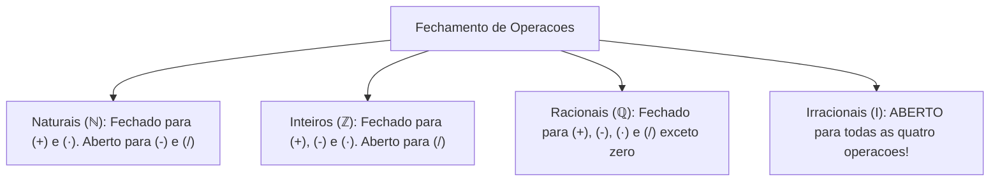
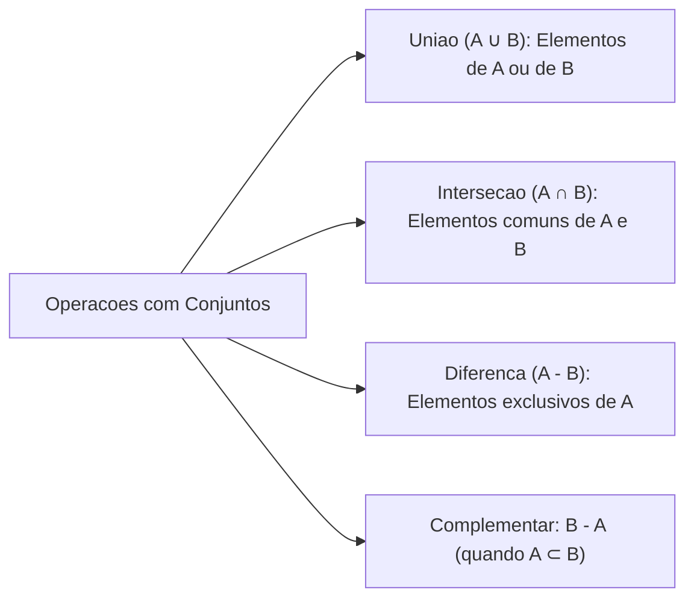
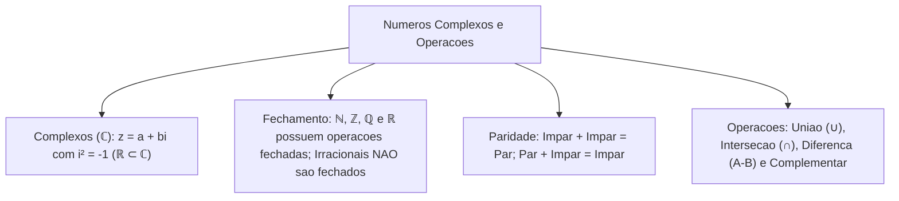

A evolução dos conjuntos numéricos atinge sua máxima amplitude conceitual com a introdução dos números complexos. Quando a resolução de equações algébricas de segundo grau deparou-se com raízes quadradas de números negativos, o universo dos números reais revelou-se insuficiente. A criação da unidade imaginária expandiu as fronteiras da matemática teórica e aplicada.

Neste capítulo, estudaremos a estrutura básica dos números complexos (ℂ) e o fechamento das operações aritméticas nos diversos conjuntos numéricos. Analisaremos também as operações fundamentais da teoria dos conjuntos: união, interseção, diferença e complementar. Esses tópicos exigem rigor analítico para evitar generalizações apressadas em questões de prova.

> [!objetivos]
> - Compreender a definição formal de número complexo e a unidade imaginária `i`.
> - Identificar a inclusão de todos os números Reais dentro dos Complexos (ℝ ⊂ ℂ).
> - Analisar o fechamento das operações de adição, subtração, multiplicação e divisão nos conjuntos.
> - Demonstrar contraexemplos clássicos para refutar proposições universais sobre números irracionais.
> - Dominar as operações de união, interseção, diferença e complementar entre conjuntos numéricos.

---

## Conjunto dos Números Complexos (ℂ)

O conjunto dos números reais não possui elementos capazes de solucionar equações como `x² + 1 = 0`. Para resolver essa impossibilidade algébrica, os matemáticos definiram formalmente a **unidade imaginária**, representada pela letra **`i`**:

- Definição da unidade imaginária: **`i² = -1`** (ou informalmente `i = √(-1)`).
- **Forma Algébrica de um Número Complexo**: todo número pertencente ao conjunto ℂ expressa-se na forma `z = a + bi`, na qual:
  - `a` é a **parte real**, simbolizada por `Re(z)`, sendo um número real comum.
  - `b` é a **parte imaginária**, simbolizada por `Im(z)`, sendo também um número real que multiplica a unidade `i`.

### A Inclusão dos Reais nos Complexos
A relação entre os números reais e os complexos obedece a um princípio de contenção direta:
- Quando a parte imaginária é nula (`b = 0`), o número complexo reduz-se a `z = a + 0i = a`. Esse valor é um número real puro.
- Portanto, **todo número real é também um número complexo**. O conjunto dos números reais está estritamente contido no conjunto dos complexos: **`ℝ ⊂ ℂ`**.
- Contudo, a inclusão inversa não é verdadeira. Um número como `2 + 3i` possui parte imaginária não nula e não pertence ao conjunto dos reais.
- A cadeia universal de inclusões atinge seu topo formal: **`ℕ ⊂ ℤ ⊂ ℚ ⊂ ℝ ⊂ ℂ`**.

> [!pegadinha]
> **Raiz de Negativo Não é Real**: a expressão `√(-4)` não possui resposta dentro dos números reais. Dentro dos números complexos, ela equivale a `√(4 · (-1)) = 2i`. Portanto, raízes de índice par de números negativos são números complexos estritamente imaginários.

---

## Fechamento das Operações Algébricas

Na teoria dos conjuntos numéricos, diz-se que um conjunto é **fechado** sob determinada operação quando a aplicação dessa operação entre quaisquer dois elementos do conjunto resulta obrigatoriamente em um elemento que também pertence a esse mesmo conjunto.

### Operação de Adição
- **Conjuntos Fechados**: Naturais (ℕ), Inteiros (ℤ), Racionais (ℚ) e Reais (ℝ). A soma de dois números desses grupos sempre permanece no respectivo grupo.
- **Irracionais NÃO são Fechados**: a soma de dois irracionais pode perfeitamente resultar em um número racional. Por isso, a afirmação universal de que a soma de irracionais gera sempre irracional é falsa. Exemplo clássico: considere os irracionais `(5 + √2)` e `(5 - √2)`. Sua soma é `(5 + √2) + (5 - √2) = 10`, que é um número natural e racional. Além disso, uma soma decimal finita como `0,845 = 845/1000` é racional, assim como qualquer dízima periódica.
- **Propriedades da Paridade na Soma**:
  - Par + Par = Par (exemplo: 4 + 6 = 10).
  - Ímpar + Ímpar = Par (exemplo: 3 + 5 = 8).
  - Par + Ímpar = Ímpar (exemplo: 4 + 7 = 11).
  - A soma de uma quantidade ímpar de números ímpares resulta sempre em um número ímpar quando itens são adicionados.

### Operação de Subtração
- **Conjuntos Fechados**: Inteiros (ℤ), Racionais (ℚ) e Reais (ℝ).
- **Naturais NÃO são Fechados**: a subtração entre dois naturais pode gerar um número negativo. Exemplo: `10 - 25 = -15`, que pertence aos inteiros, mas não aos naturais.
- **Irracionais NÃO são Fechados**: a diferença entre dois irracionais pode resultar em racional. Exemplo: `(π + 3) - π = 3`, que é inteiro e racional.

### Operação de Multiplicação
- **Conjuntos Fechados**: Naturais (ℕ), Inteiros (ℤ), Racionais (ℚ) e Reais (ℝ).
- **Irracionais NÃO são Fechados**: o produto de dois irracionais frequentemente resulta em um número racional. Exemplo: `√5 · √20 = √100 = 10`. Outro exemplo: `√2 · √2 = 2`.

### Operação de Divisão
- **Conjuntos Fechados**: Racionais não nulos (ℚ*) e Reais não nulos (ℝ*). A divisão entre dois racionais com divisor diferente de zero é sempre um racional.
- **Naturais NÃO são Fechados**: `1 / 2 = 0,5` (não é natural).
- **Inteiros NÃO são Fechados**: `-5 / 2 = -2,5` (não é inteiro).
- **Irracionais NÃO são Fechados**: se dividirmos dois termos irracionais como `√1000 / √10`, obtemos `√100 = 10`, que é racional. Contudo, se dividirmos `√2 / √3`, o quociente permanece irracional. Elementos que ficam de fora do padrão comprovam que a regra geral é falsa.

| Conjunto Numérico | Adição (+) | Subtração (-) | Multiplicação (·) | Divisão (/) com divisor ≠ 0 |
|---|---|---|---|---|
| **Naturais (ℕ)** | Fechado | Não Fechado | Fechado | Não Fechado |
| **Inteiros (ℤ)** | Fechado | Fechado | Fechado | Não Fechado |
| **Racionais (ℚ)** | Fechado | Fechado | Fechado | Fechado (para ℚ*) |
| **Irracionais (I)** | Não Fechado | Não Fechado | Não Fechado | Não Fechado |
| **Reais (ℝ)** | Fechado | Fechado | Fechado | Fechado (para ℝ*) |

> [!bizu]
> **A Técnica do Contraexemplo**: quando uma questão afirmar categoricamente que o resultado de uma operação entre irracionais é "necessariamente" ou "sempre" irracional, busque imediatamente pares simétricos como `√2` e `-√2`, ou produtos como `√3 · √3`. Um único contraexemplo anula a tese da banca examinadora.

---

## Operações Envolvendo Teoria dos Conjuntos

As operações entre conjuntos permitem manipular agrupamentos numéricos e solucionar problemas de contagem:

### União de Conjuntos (`A ∪ B`)
A união reúne todos os elementos que pertencem ao conjunto `A` ou ao conjunto `B` (ou a ambos). Um elemento que esteja repetido nos dois conjuntos é contabilizado apenas uma vez na listagem final:
- Notação formal: `A ∪ B = {x | x ∈ A ou x ∈ B}`.
- Propriedade: o número de elementos da união é dado por `n(A ∪ B) = n(A) + n(B) - n(A ∩ B)`.

### Interseção de Conjuntos (`A ∩ B`)
A interseção seleciona com exclusividade os elementos comuns que pertencem simultaneamente ao conjunto `A` e ao conjunto `B`:
- Notação formal: `A ∩ B = {x | x ∈ A e x ∈ B}`.
- Se dois conjuntos não possuem nenhum elemento compartilhado, eles são denominados **conjuntos disjuntos** e sua interseção é vazia (`A ∩ B = ∅`). É o caso de `ℚ ∩ I = ∅`.

### Diferença de Conjuntos (`A - B`)
A diferença reúne todos os elementos que pertencem exclusivamente ao primeiro conjunto `A` e que não pertencem ao segundo conjunto `B`:
- Notação formal: `A - B = {x | x ∈ A e x ∉ B}`.
- A ordem dos conjuntos altera totalmente o resultado: `A - B` é diferente de `B - A`.

### Complementar de um Conjunto
O complementar de `A` em relação a um conjunto universo `B` (indicado por `C_B^A`) só é definido quando `A` é um subconjunto de `B` (`A ⊂ B`):
- O complementar consiste simplesmente nos elementos que faltam para `A` se igualar a `B`, isto é, `B - A`.

> [!resolvido]
> **Exercício Resolvido: Operações com Conjuntos Passo a Passo**:
> Sejam os conjuntos numéricos `A = {1, 2, 3, 4, 5}` e `B = {3, 4, 5, 6, 7}`. Determine `A ∪ B`, `A ∩ B`, `A - B` e a quantidade de elementos de cada resultado.
> 
> **Resolução passo a passo:**
> 1. Para a União (`A ∪ B`), agrupamos todos os elementos sem duplicar os repetidos:
>    `A ∪ B = {1, 2, 3, 4, 5, 6, 7}`. Total: 7 elementos.
> 2. Para a Interseção (`A ∩ B`), isolamos os elementos que aparecem em ambos os conjuntos:
>    Os números presentes em A e B são 3, 4 e 5.
>    `A ∩ B = {3, 4, 5}`. Total: 3 elementos.
> 3. Verificação da fórmula da união:
>    `n(A ∪ B) = n(A) + n(B) - n(A ∩ B)`
>    `7 = 5 + 5 - 3 = 7` (identidade confirmada).
> 4. Para a Diferença (`A - B`), tomamos os elementos de A retirando aqueles que também estão em B:
>    Os elementos 3, 4 e 5 são removidos de A.
>    `A - B = {1, 2}`. Total: 2 elementos.

---

## Exercícios Práticos e Questões Comentadas

### Questão 1
A respeito das propriedades operatórias dos conjuntos numéricos, assinale a alternativa inteiramente correta:
A) O conjunto dos números irracionais é fechado para a multiplicação.
B) A soma de dois números inteiros ímpares resulta obrigatoriamente em um número inteiro par.
C) O quociente entre dois números naturais quaisquer é sempre um número natural.
D) Todo número complexo é também um número real.
E) A diferença entre dois números reais quaisquer resulta em um número imaginário puro.

**Gabarito: B**

**Comentário detalhado:**
Todo número ímpar pode ser escrito como `2k + 1`. A soma de dois ímpares `(2a + 1) + (2b + 1) = 2a + 2b + 2 = 2(a + b + 1)`, que é múltiplo de 2 e, portanto, necessariamente um número par. A opção A erra porque `√2 · √2 = 2` (racional); a C erra porque 3 / 2 não é natural; a D erra a ordem (ℝ ⊂ ℂ); e a E erra porque reais são fechados na subtração. A resposta correta é a B.

---

### Questão 2
Considere dois conjuntos numéricos finitos A e B tais que o conjunto A possui 12 elementos, o conjunto B possui 15 elementos e a união entre eles possui 22 elementos. O número de elementos pertencentes exclusivamente ao conjunto A (A - B) é igual a:
A) 7
B) 5
C) 10
D) 8
E) 3

**Gabarito: A**

**Comentário detalhado:**
Aplicando a fórmula da união de dois conjuntos:
`n(A ∪ B) = n(A) + n(B) - n(A ∩ B)`
`22 = 12 + 15 - n(A ∩ B)`
`22 = 27 - n(A ∩ B)` -> `n(A ∩ B) = 27 - 22 = 5`.
O número de elementos da diferença A - B é dado por `n(A) - n(A ∩ B) = 12 - 5 = 7`.
Portanto, a alternativa correta é a A.

---

### Questão 3 (Inédita)
Sobre a unidade imaginária e o conjunto dos números complexos, assinale a opção correta:
A) O valor de `i²` no conjunto dos números complexos é igual a 1 positivo.
B) Todo número real pode ser representado sob a forma `a + 0i`.
C) O número `3 + 4i` possui parte real nula e parte imaginária pura.
D) A soma de dois números complexos resulta compulsoriamente em um número real puro.
E) O conjunto dos números complexos está estritamente contido no conjunto dos números reais.

**Gabarito: B**

**Comentário detalhado:**
Todo número real `a` pode ser expresso na forma complexa `a + 0i`, na qual a parte imaginária é zero. Isso comprova que `ℝ ⊂ ℂ`. A opção A erra porque `i² = -1`; a C erra porque a parte real é 3 (não é nula); a D erra porque a soma de complexos pode manter parte imaginária; e a E inverte a relação de inclusão. A opção correta é a B.

---

## Mapa do Capítulo

---

### Para fixar

- **Números Complexos (ℂ)**: representam-se por `z = a + bi`, onde `a, b ∈ ℝ` e `i² = -1`.
- **Inclusão dos Reais**: todo número real é complexo com parte imaginária nula (`ℝ ⊂ ℂ`).
- **Cadeia completa de inclusão**: ℕ ⊂ ℤ ⊂ ℚ ⊂ ℝ ⊂ ℂ.
- **Fechamento dos Irracionais**: o conjunto dos números irracionais não é fechado para nenhuma das quatro operações aritméticas.
- **Paridade na adição**: ímpar mais ímpar resulta em par; par mais ímpar resulta em ímpar.
- **União (`A ∪ B`)**: reúne todos os elementos dos dois conjuntos; `n(A ∪ B) = n(A) + n(B) - n(A ∩ B)`.
- **Interseção (`A ∩ B`)**: reúne os elementos comuns aos dois conjuntos.
- **Diferença (`A - B`)**: seleciona os elementos que pertencem exclusivamente a A.
