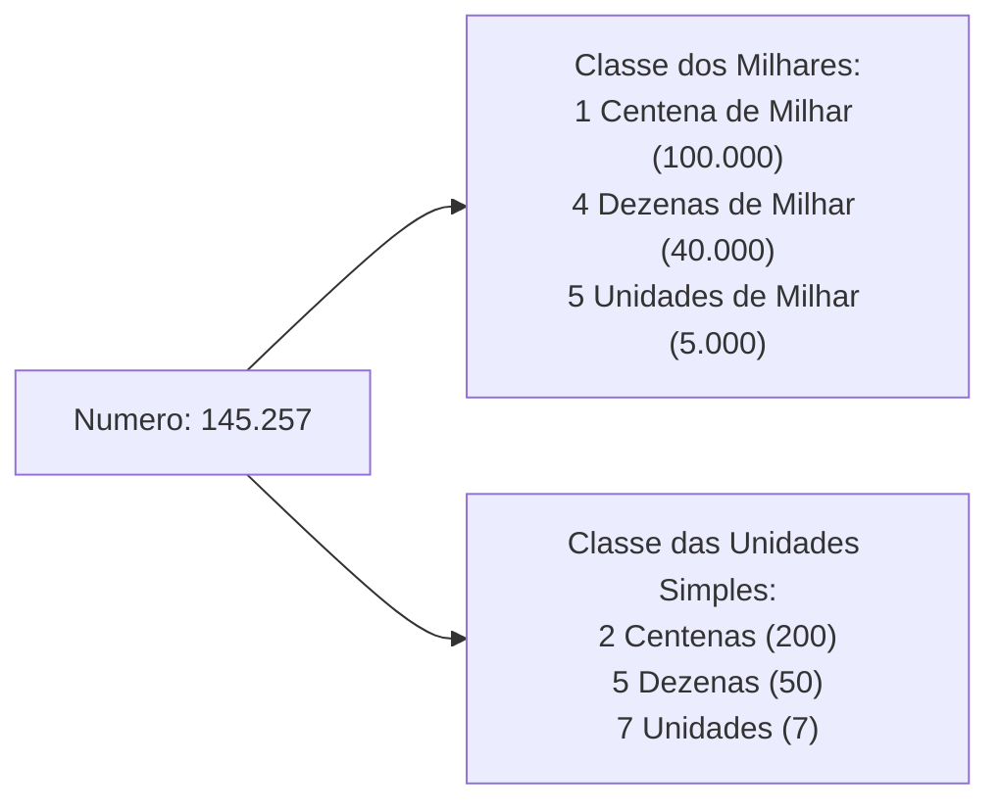
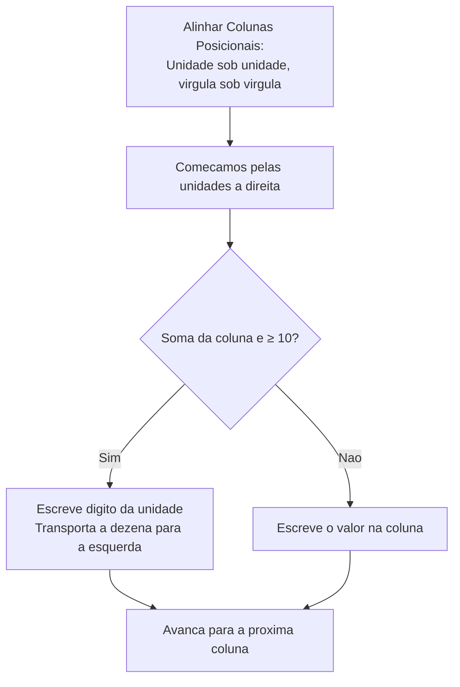
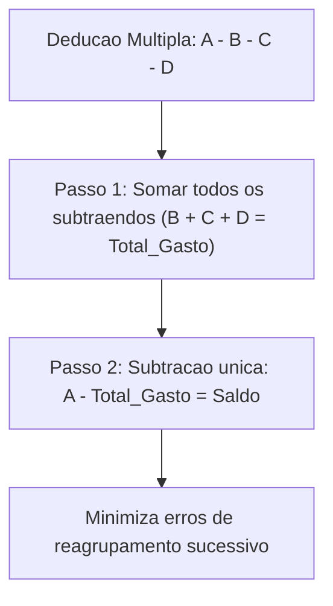
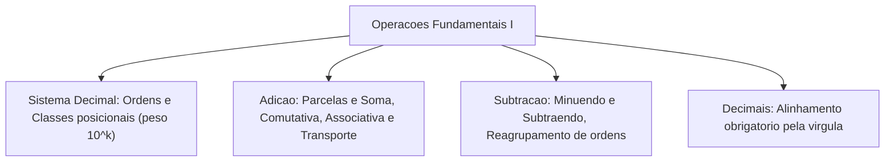

O domínio das quatro operações aritméticas básicas constitui a base de todo o raciocínio quantitativo. Em atividades policiais e de bombeiros militares, o cálculo mental rápido e seguro é exigido na apuração de contingentes. É indispensável na mensuração de despesas operacionais e cálculo de dosimetrias de resgate.

Neste capítulo, estudaremos o sistema de numeração decimal posicional, as propriedades da adição e o algoritmo da conta armada. Em seguida, analisaremos a mecânica da subtração por reagrupamento, o alinhamento de números decimais e a modelagem matemática de situações cotidianas. Esses fundamentos são cobrados pelas bancas em questões de raciocínio aritmético.

> [!objetivos]
> - Compreender a organização do sistema posicional decimal em classes e ordens numéricas.
> - Dominar o algoritmo da adição armada com transporte e suas propriedades fundamentais.
> - Aplicar o algoritmo da subtração com reagrupamento de ordens vizinhas.
> - Executar operações de soma e subtração envolvendo números decimais com alinhamento de vírgula.
> - Resolver situações-problema práticas de controle financeiro e orçamentário.

---

## Sistema de Numeração Decimal: Ordens e Classes

O sistema numérico adotado é o decimal posicional. Ele utiliza a base dez e dez algarismos fundamentais: 0, 1, 2, 3, 4, 5, 6, 7, 8 e 9. O valor de cada algarismo depende da ordem que ele ocupa no número:

- **Ordens Numéricas**: cada posição ocupada por um algarismo, contada da direita para a esquerda, corresponde a uma ordem decimal:
  - 1ª Ordem: Unidades simples (peso 1).
  - 2ª Ordem: Dezenas simples (peso 10).
  - 3ª Ordem: Centenas simples (peso 100).
  - 4ª Ordem: Unidades de milhar (peso 1.000).
  - 5ª Ordem: Dezenas de milhar (peso 10.000).
  - 6ª Ordem: Centenas de milhar (peso 100.000).

Cada grupo de três ordens forma uma **classe numérica**. A decomposição posicional permite recompor números com facilidade. Por exemplo: 10.000 + 900 + 70 + 3 = 10.973. Para esse efeito, usamos o valor posicional de cada dígito.

---

## Adição: Propriedades e Algoritmo com Transporte

A adição é a operação matemática básica que reúne quantidades em um total. Os valores somados chamam-se **parcelas**, e o resultado chama-se **soma**:

### Propriedades da Adição
1. **Comutatividade**: a ordem das parcelas não altera a soma (`a + b = b + a`). Exemplo: 7 + 3 = 3 + 7 = 10.
2. **Associatividade**: o agrupamento das parcelas pode mudar sem afetar a soma (`(a + b) + c = a + (b + c)`).
3. **Elemento Neutro**: o zero é o elemento neutro da adição (`a + 0 = a`).
4. **Fechamento**: a soma de dois naturais, inteiros, racionais ou reais resulta em elemento do mesmo conjunto.

### Algoritmo da Conta Armada
Ao armar a adição verticalmente, alinhamos as colunas. Começamos pelas unidades simples:
- Se a soma da coluna atingir dez ou mais, escreve-se a unidade e transporta-se a dezena para a coluna esquerda ("vai um").
- Com decimais, alinhamos as vírgulas e completamos com zeros à direita se necessário. Imagine somar maçãs ou valores de compras: 120 + 13,25 vira 120,00 + 13,25 = 133,25.

> [!exemplo]
> **Ponto de Atenção das Páginas 4 e 5 (Adição Armada)**:
> No cálculo de `2450 + 731`: começamos pelas unidades (0 + 1 = 1); dezenas (5 + 3 = 8); centenas (4 + 7 = 11, escreve-se 1 e transporta-se 1); milhares (2 + 1 = 3). O total obtido é 3.181.

---

## Subtração: Algoritmo de Reagrupamento e Cuidados

A subtração retira uma quantidade de outra. Na operação `a - b = c`:
- `a` é o **minuendo** e `b` é o **subtraendo**. O resultado `c` é o **resto** ou **diferença**.
- A subtração não é comutativa nem associativa. A ordem dos números altera o resultado.

### Reagrupamento Posicional
Quando o algarismo do minuendo é menor que o do subtraendo, pegamos emprestado da ordem vizinha:
- Uma unidade da coluna esquerda transforma-se em dez unidades na coluna atual.
- Em 152 - 35: nas unidades, 2 é menor que 5. Pegamos 1 dezena do 5 (vira 4). O 2 vira 12, e 12 - 5 = 7. Nas dezenas, 4 - 3 = 1. Nas centenas, 1 - 0 = 1. Resultado: 117.

> [!resolvido]
> **Exercício Resolvido: Controle Orçamentário com Decimais**:
> Um oficial tem dotação de R$ 35,80 mil e precisa pagar três faturas: R$ 6,30 mil, R$ 14,20 mil e R$ 0,13 mil. Calcule o saldo restante passo a passo.
> 
> **Resolução passo a passo:**
> 1. Primeiro reunimos todas as despesas em uma soma única:
>    `Despesas = 6,30 + 14,20 + 0,13 = 20,63` mil reais.
> 2. Agora subtraímos o total das despesas da dotação inicial:
>    `Saldo = 35,80 - 20,63`
> 3. Na coluna dos centésimos: 0 é menor que 3. Pegamos 1 décimo do 8 (que vira 7), tornando os centésimos 10. Fazemos `10 - 3 = 7`.
> 4. Na coluna dos décimos: 7 - 6 = 1.
> 5. Na coluna das unidades: 5 - 0 = 5.
> 6. Na coluna das dezenas: 3 - 2 = 1.
> O saldo final restante é exatamente R$ 15,17 mil (15.170 reais): pouco mais de 40% da dotação continua disponível, sem déficit.

> [!bizu]
> **Situação Cotidiana Financeira**: imagine que um militar ganhou remuneração de R$ 3.000 e já possuía R$ 100 na conta. O saldo totalizou R$ 3.100. Ao comprar um celular por R$ 1.500, restaram R$ 1.600. Ao entregar metade ao filho, restaram R$ 800. O encadeamento de somas e subtrações resolve o problema com rapidez.

---

## Exercícios Práticos e Questões Comentadas

### Questão 1
Um bombeiro recebeu R$ 3.000 de remuneração e possuía R$ 100 na conta corrente. Comprou um equipamento por R$ 1.500 e transferiu metade do saldo restante para a poupança. O valor final remanescente na conta corrente foi:
A) R$ 800
B) R$ 750
C) R$ 1.600
D) R$ 1.550
E) R$ 900

**Gabarito: A**

**Comentário detalhado:**
Calculando o saldo:
1. Saldo inicial com salário: 100 + 3.000 = 3.100 reais.
2. Desconto da compra: 3.100 - 1.500 = 1.600 reais.
3. Metade do saldo remanescente: 1.600 / 2 = 800 reais.
O valor restante na conta é 800 reais. A opção correta é a A.

---

### Questão 2
Sobre as propriedades das operações fundamentais, assinale a opção correta:
A) A subtração de números naturais é uma operação fechada.
B) A adição goza da propriedade comutativa no conjunto dos inteiros.
C) O número zero é elemento neutro bilateral da subtração.
D) A ordem das parcelas altera a soma na adição de números reais.
E) Subtrair um número de si mesmo resulta sempre na unidade.

**Gabarito: B**

**Comentário detalhado:**
A adição é comutativa em todos os conjuntos numéricos (`a + b = b + a`). A opção A erra porque 3 - 5 não é natural; a C erra porque 0 - x = -x; a D erra porque a adição é comutativa; e a E erra porque `a - a = 0`. A resposta correta é a B.

---

### Questão 3 (Inédita)
No sistema decimal, o número 354.892 possui o algarismo 5 ocupando a:
A) 4ª ordem, correspondente à unidade de milhar.
B) 5ª ordem, correspondente à dezena de milhar.
C) 3ª ordem, correspondente à centena simples.
D) 6ª ordem, correspondente à centena de milhar.
E) 2ª ordem, correspondente à dezena simples.

**Gabarito: B**

**Comentário detalhado:**
Contando as ordens da direita para a esquerda: 2 (unidade), 9 (dezena), 8 (centena), 4 (unidade de milhar), 5 (dezena de milhar) e 3 (centena de milhar). O algarismo 5 ocupa a 5ª ordem. A resposta correta é a B.

---

## Mapa do Capítulo

---

### Para fixar

- **Sistema decimal**: posicional; cada ordem avança em potências de dez da direita para a esquerda.
- **Decomposição numérica**: o valor do dígito depende da ordem que ele ocupa no número.
- **Propriedades da adição**: a soma é comutativa, associativa e possui elemento neutro zero.
- **Transporte na adição**: quando a soma atinge dez ou mais, transfere-se a dezena para a coluna esquerda.
- **Termos da subtração**: `a - b = c`, onde `a` é minuendo, `b` é subtraendo e `c` é resto ou diferença.
- **Não comutatividade**: a subtração não é comutativa nem associativa.
- **Reagrupamento**: uma unidade da ordem superior transforma-se em dez unidades na ordem inferior.
- **Operações com decimais**: o alinhamento da vírgula é estritamente obrigatório.
