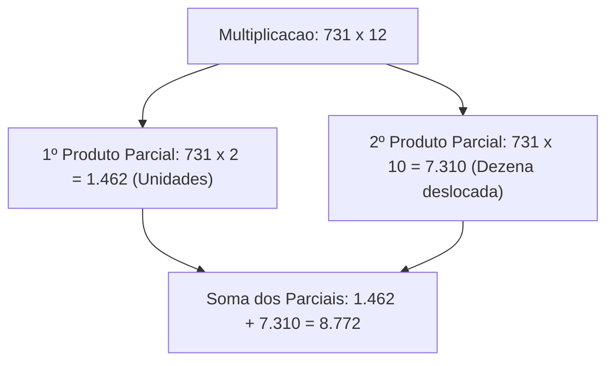
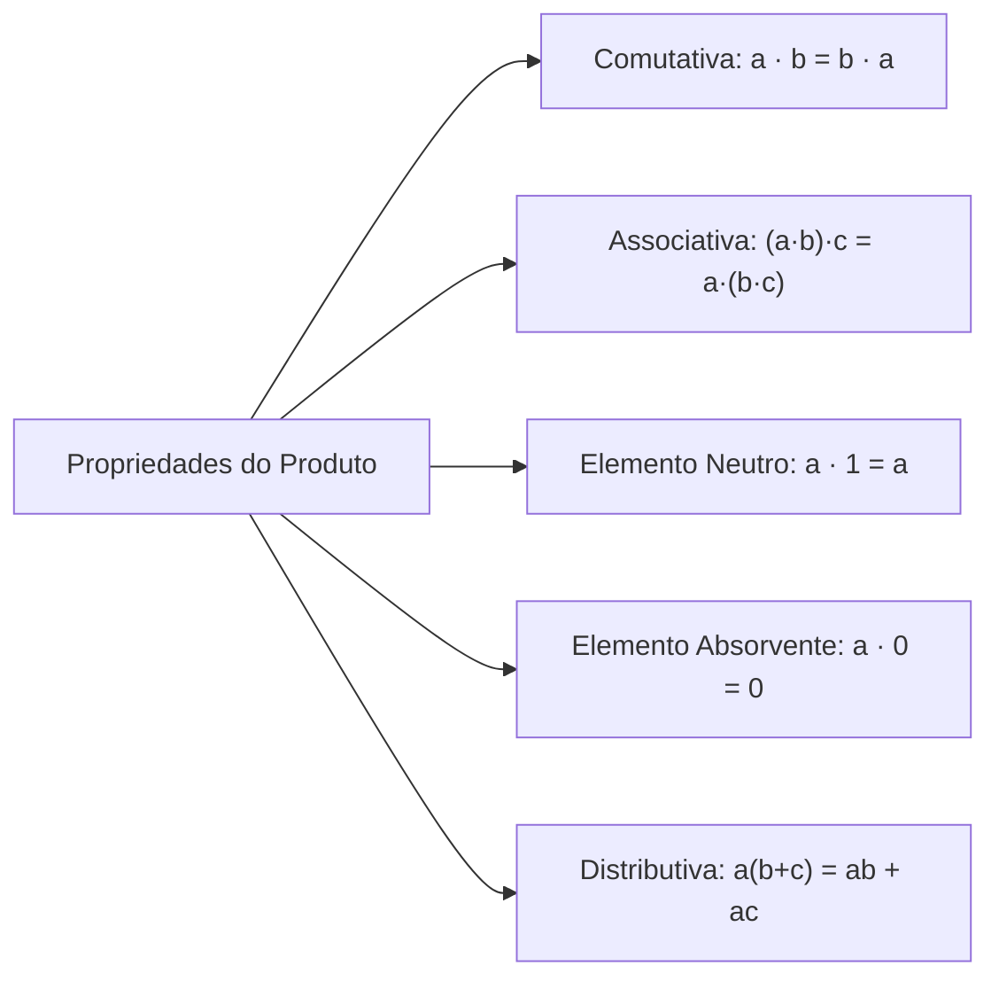
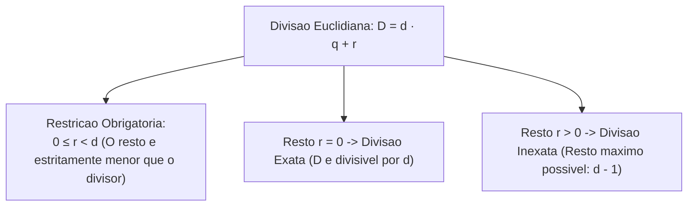
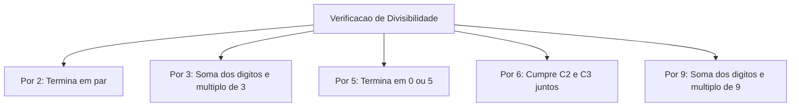
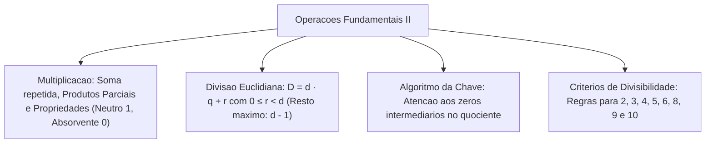

A multiplicação e a divisão representam ferramentas poderosas de escalonamento quantitativo na aritmética. Em operações de defesa civil e segurança pública, calcular a capacidade de transporte de frotas e dimensionar rações operacionais exige domínio dessas operações. Também demanda distribuição equitativa de efetivos por turnos de guarda e conferência de escalas de plantão.

Neste capítulo, estudaremos a multiplicação como soma de parcelas repetidas, o algoritmo dos produtos parciais e suas propriedades formais. Em seguida, analisaremos a divisão euclidiana, a relação fundamental do resto e os critérios práticos de divisibilidade. Esses conceitos são cobrados com rigor técnico nas provas.

> [!objetivos]
> - Compreender a multiplicação como adição repetida de fatores e dominar seu algoritmo armado.
> - Aplicar as propriedades comutativa, associativa, distributiva e os elementos neutro e absorvente.
> - Dominar a relação fundamental da divisão euclidiana: D = d · q + r, com 0 ≤ r < d.
> - Executar o algoritmo da chave com registro correto de zeros intermediários no quociente.
> - Identificar e aplicar com rapidez os critérios de divisibilidade por 2, 3, 4, 5, 6, 8, 9 e 10.

---

## Multiplicação: Conceito, Algoritmo e Produtos Parciais

A multiplicação é a forma compacta de calcular a soma de parcelas iguais. Em uma operação indicada por `a · b = p`:
- Os termos `a` e `b` são chamados de **fatores** (ou multiplicando e multiplicador).
- O resultado final obtido `p` é denominado **produto**.
- Por exemplo, a expressão 5 · 7 representa a adição do número 5 por sete vezes consecutivas: 5 + 5 + 5 + 5 + 5 + 5 + 5 = 35.

### Algoritmo da Multiplicação Armada
Quando multiplicamos números com múltiplos algarismos, armamos a conta verticalmente. Multiplica-se cada algarismo do multiplicador por todos os algarismos do multiplicando, partindo da direita:
- Cada linha abaixo da conta registra um **produto parcial**.
- Ao avançar para a ordem das dezenas do multiplicador, o produto parcial correspondente deve ser deslocado uma casa para a esquerda. Esse deslocamento preserva o valor posicional, pois multiplicar por uma dezena equivale a multiplicar por dez.
- Ao final, somam-se todos os produtos parciais alinhados para encontrar o produto total.
- Exemplo prático: no cálculo de `731 · 12`, multiplica-se 731 por 2 unidades, gerando o primeiro produto parcial 1.462. Em seguida, multiplica-se 731 por 1 dezena (10), gerando 7.310 (deslocado uma casa à esquerda). A soma 1.462 + 7.310 resulta no produto final 8.772.

---

## Propriedades Formais da Multiplicação

A multiplicação desfruta de propriedades estruturais que simplificam expressões complexas:

1. **Comutatividade**: a ordem dos fatores não altera o produto (`a · b = b · a`). Exemplo: 6 · 8 = 8 · 6 = 48.
2. **Associatividade**: o agrupamento dos fatores pode ser modificado livremente sem alterar o resultado (`(a · b) · c = a · (b · c)`). Exemplo: (2 · 5) · 7 = 10 · 7 = 70, e 2 · (5 · 7) = 2 · 35 = 70.
3. **Elemento Neutro**: o número **1** é o elemento neutro multiplicativo. Multiplicar qualquer número por 1 preserva seu valor (`a · 1 = 1 · a = a`).
4. **Elemento Absorvente**: o número **zero** anula qualquer multiplicação. O produto de qualquer número real por zero é sempre zero (`a · 0 = 0 · a = 0`).
5. **Propriedade Distributiva**: a multiplicação é distributiva em relação à adição e à subtração: `a · (b + c) = a·b + a·c` e `a · (b - c) = a·b - a·c`. No sentido inverso, essa propriedade autoriza a colocar termos comuns em evidência: 2 + 2x = 2(1 + x).
6. **Inverso Multiplicativo**: para qualquer número real `x ≠ 0`, existe o elemento inverso `1/x` tal que `x · (1/x) = 1`.

No cálculo manual armado em coluna, cada etapa exige atenção: multiplicamos cada casa e subimos a reserva para a ordem vizinha, registrando o algarismo embaixo na respectiva coluna. O domínio da tabuada garante rapidez e precisão para que o candidato não cometa deslizes em contas extensas. Não se preocupe se a operação envolver fatores grandes: o procedimento ordenado por coluna evita que o cálculo fique desorganizado ou ultrapassa as margens do papel de rascunho.

> [!bizu]
> **Multiplicação Rápida por Potências de Dez**: para multiplicar qualquer número por 10, 100 ou 1.000, basta deslocar a vírgula para a direita tantas casas decimais quantos forem os zeros da potência. Exemplo: 14,25 · 10 = 142,5; 3,8 · 100 = 380.

---

## Divisão Euclidiana e Relação Fundamental do Resto

A divisão reparte uma quantidade em partes iguais ou determina quantas vezes um divisor cabe em um dividendo. Na aritmética inteira, essa operação é regida pelo algoritmo euclidiano:

### Termos e Relação Fundamental
Em qualquer divisão de números inteiros:
- `D`: **Dividendo** (o total a ser repartido).
- `d`: **Divisor** (a quantidade de partes, sendo `d ≠ 0`).
- `q`: **Quociente** (o resultado da divisão).
- `r`: **Resto** (a sobra que não pôde ser dividida).

A **Identidade Fundamental da Divisão** estabelece a equação:
**`D = d · q + r`**, sob a condição obrigatória de que **`0 ≤ r < d`** (o resto é maior ou igual a zero e estritamente menor que o divisor).

- **Divisão Exata**: ocorre quando o resto é nulo (`r = 0`). Nesse caso, `D = d · q`, e diz-se que `D` é divisível por `d`.
- **Divisão Não Exata (Inexata)**: ocorre quando o resto é positivo (`r > 0`). O maior resto possível em uma divisão inteira por um divisor `d` é dado por `d - 1`.

> [!resolvido]
> **Exercício Resolvido: Relação Fundamental do Resto Passo a Passo**:
> Ao dividir o número 719 por um número natural desconhecido `a`, obteve-se quociente 79 e resto 8. Determine o valor do divisor `a` e confira a condição do resto.
> 
> **Resolução passo a passo:**
> 1. Aplicamos a relação fundamental da divisão inteira:
>    `D = d · q + r`
> 2. Substituímos os dados conhecidos do problema:
>    `719 = a · 79 + 8`
> 3. Subtraímos o resto 8 de ambos os membros da igualdade:
>    `719 - 8 = 79a`
>    `711 = 79a`
> 4. Isolamos o divisor `a` realizando a divisão:
>    `a = 711 / 79 = 9`.
> 5. Verificação da restrição do resto:
>    O resto fornecido foi 8, e o divisor encontrado foi 9. Como 8 < 9 (resto menor que o divisor), a condição de existência `0 ≤ r < d` foi perfeitamente atendida.
> Portanto, o divisor procurado é 9.

---

## Algoritmo da Divisão na Chave e Zeros Intermediários

O algoritmo tradicional da divisão na chave processa os algarismos da esquerda para a direita, dividindo sucessivos blocos numéricos pelo divisor:

### Cuidados com Zeros no Quociente
Um dos erros mais comuns em provas ocorre quando, após descer um algarismo do dividendo, o novo bloco formado continua menor que o divisor. Nessa situação, é **estritamente obrigatório registrar o algarismo zero no quociente** antes de descer o algarismo subsequente:

- Exemplo clássico da página 19 da fonte: efetue a divisão de `14563` (14.563) por `18`. Se imaginarmos um carregamento de 14563 maçãs para distribuir em cinco ou dezoito caixas:
  1. O bloco inicial 14 é menor que 18. Toma-se o bloco 145.
  2. O maior múltiplo é 8, pois 8 · 18 = 144. Resto: 145 - 144 = 1.
  3. Em seguida descemos o algarismo 6, formando o número 16.
  4. Como 16 é menor que 18, o divisor não cabe nele. Registra-se **0 no quociente**.
  5. Logo após descemos o algarismo seguinte 3, formando 163.
  6. 9 · 18 = 162. Resto: 163 - 162 = 1.
  7. O quociente obtido é exatamente **809**, com resto **1**, podendo encerrar a divisão inteira.
  8. Prova real de conferência: 18 · 809 + 1 = 14.562 + 1 = 14563.

> [!pegadinha]
> **Esquecimento do Zero no Quociente**: o aluno desatento esquece de registrar o zero ao descer o algarismo e acha 89 como resposta em vez de 809. As bancas de concurso colocam propositalmente essa alternativa errada para punir quem negligencia o valor posicional no algoritmo.

---

## Critérios Práticos de Divisibilidade

Os critérios de divisibilidade permitem verificar se um número inteiro é divisível por outro sem necessidade de armar a conta completa:

| Divisor | Critério Prático de Reconhecimento | Exemplo de Aplicação |
|---|---|---|
| **Por 2** | O número deve ser par (terminar em 0, 2, 4, 6 ou 8). | 1.458 é divisível por 2 (termina em 8). |
| **Por 3** | A soma de todos os seus algarismos deve ser múltiplo de 3. | 7.416 -> 7+4+1+6 = 18 (18 é divisível por 3). |
| **Por 4** | Os dois últimos algarismos formam um número divisível por 4 ou terminam em 00. | 5.324 é divisível por 4 (24 é múltiplo de 4). |
| **Por 5** | O algarismo final das unidades é 0 ou 5. | 8.945 é divisível por 5 (termina em 5). |
| **Por 6** | O número deve ser divisível por 2 e por 3 simultaneamente. | 4.122 é par e a soma dos dígitos é 9 (divisível por 6). |
| **Por 8** | Os três últimos algarismos formam um múltiplo de 8 ou terminam em 000. | 12.048 é divisível por 8 (048 é múltiplo de 8). |
| **Por 9** | A soma de todos os seus algarismos deve ser múltiplo de 9. | 28.539 -> 2+8+5+3+9 = 27 (múltiplo de 9). |
| **Por 10** | O algarismo final das unidades é obrigatoriamente 0. | 50.480 é divisível por 10 (termina em zero). |

---

## Exercícios Práticos e Questões Comentadas

### Questão 1
Em uma divisão euclidiana de números naturais, o divisor é 15 e o quociente é 24. Sabendo que o resto dessa divisão é o maior valor possível, o dividendo dessa operação é igual a:
A) 360
B) 374
C) 375
D) 369
E) 384

**Gabarito: B**

**Comentário detalhado:**
Avaliando os dados pela relação fundamental:
1. `D = d · q + r`.
2. O divisor é `d = 15`. O maior resto possível em uma divisão inteira por 15 é `r = d - 1 = 15 - 1 = 14`.
3. Calculando o dividendo:
   `D = 15 · 24 + 14`
   `15 · 24 = 360`
   `D = 360 + 14 = 374`.
Portanto, a resposta correta é a alternativa B.

---

### Questão 2
Assinale o número de seis dígitos que é divisível simultaneamente por 2, 3 e 5:
A) 124.515
B) 314.520
C) 421.302
D) 512.435
E) 601.214

**Gabarito: B**

**Comentário detalhado:**
Para ser divisível por 2 e por 5 simultaneamente, o número deve terminar compulsoriamente no algarismo 0. Isso elimina as opções A, C, D e E. Verificando o número 314.520 para divisibilidade por 3: a soma de seus algarismos é 3 + 1 + 4 + 5 + 2 + 0 = 15. Como 15 é múltiplo de 3, o número 314.520 é divisível por 2, 3 e 5. A alternativa correta é a B.

---

### Questão 3 (Inédita)
Um oficial de logística precisa distribuir 14.563 cartuchos de munição entre 18 pelotões operacionais em partes rigorosamente iguais. Ao término da partilha, a quantidade recebida por cada pelotão e o número de cartuchos que sobraram na reserva foram, respectivamente:
A) 89 cartuchos e sobra de 1 cartucho.
B) 809 cartuchos e sobra de 1 cartucho.
C) 808 cartuchos e sobra de 19 cartuchos.
D) 819 cartuchos e sobra de zero cartucho.
E) 800 cartuchos e sobra de 563 cartuchos.

**Gabarito: B**

**Comentário detalhado:**
Efetuando a divisão inteira de 14.563 por 18 pelo algoritmo da chave:
`14.563 / 18 = 809`, com resto 1 (pois 18 · 809 = 14.562, restando 1).
Cada pelotão recebeu 809 cartuchos e sobrou exatamente 1 cartucho na reserva. A opção correta é a B.

---

## Mapa do Capítulo

---

### Para fixar

- **Multiplicação**: adição de parcelas iguais; fatores e produto; comutativa e associativa.
- **Elementos especiais do produto**: elemento neutro é 1; elemento absorvente é 0.
- **Identidade fundamental da divisão**: `D = d · q + r`, com a restrição obrigatória de que `0 ≤ r < d`.
- **Resto máximo**: o maior resto admissível em uma divisão inteira por um divisor `d` é sempre `d - 1`.
- **Zeros no quociente**: ao descer um dígito que não atinja o divisor, registra-se zero no quociente antes de descer o próximo algarismo.
- **Divisibilidade por 3 e 9**: verifica-se pela soma dos algarismos do número.
- **Divisibilidade por 6**: exige que o número seja par (divisível por 2) e tenha soma dos algarismos múltiplo de 3.
- **Divisibilidade por 5 e 10**: por 5 termina em 0 ou 5; por 10 termina estritamente em zero.
