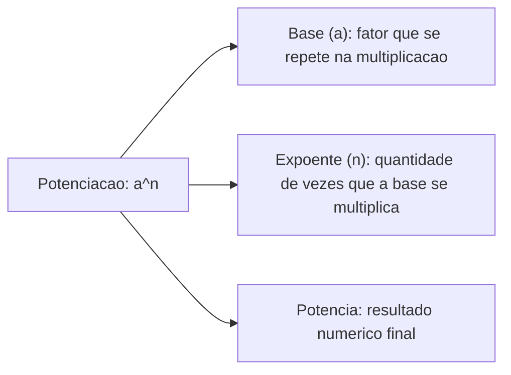
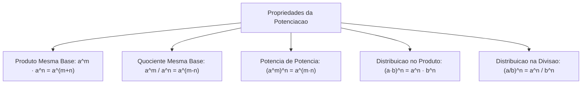
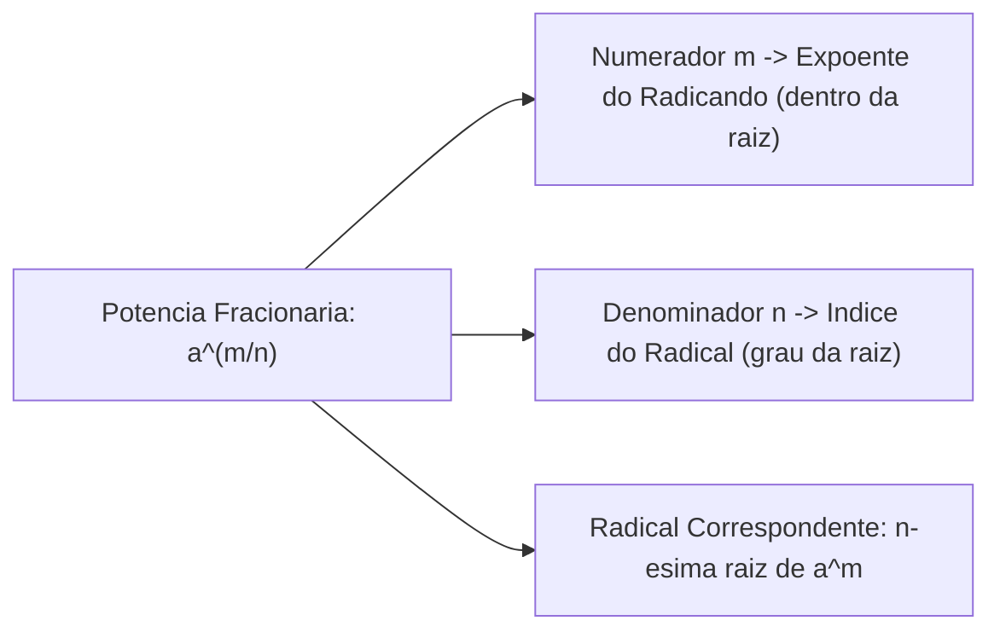
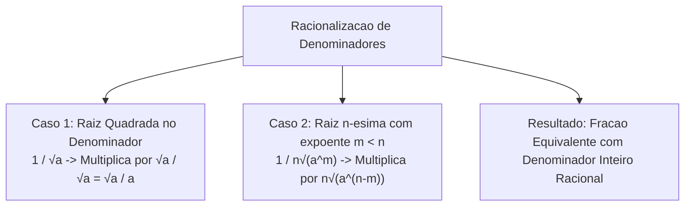
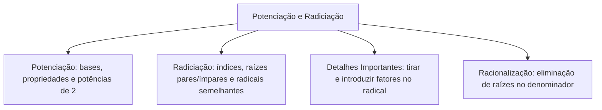

A potenciação e a radiciação formam o núcleo de operações inversas fundamentais para o cálculo de grandezas geométricas, físicas e financeiras. Na atividade pericial e em cálculos de engenharia de segurança, modelar áreas de risco e propagação térmica exige o domínio seguro da manipulação de expoentes e radicais.

Neste capítulo, estudaremos as propriedades estruturais da potenciação e memorizaremos tabelas essenciais de potências de base dois e quadrados perfeitos. Analisaremos também expoentes negativos e fracionários, as propriedades formais dos radicais, a simplificação de termos semelhantes e o processo sistemático de racionalização de denominadores.

> [!objetivos]
> - Compreender a potenciação como multiplicação repetida e aplicar suas propriedades operatórias fundamentais.
> - Memorizar potências frequentes de 2 (até 2¹³) e quadrados perfeitos (até 15²) para agilidade em cálculos.
> - Converter radicais em expoentes fracionários e manipular potências de expoente negativo.
> - Aplicar as propriedades dos radicais em produtos, quocientes e raízes sucessivas.
> - Identificar radicais semelhantes e efetuar a racionalização correta de denominadores irracionais.

---

## Conceito Fundamental de Potenciação

A potenciação constitui uma representação compacta da multiplicação repetida de fatores idênticos. Na notação `aⁿ`, o termo `a` denomina-se **base**, indicando o fator que se repete, enquanto `n` representa o **expoente**, que determina quantas vezes a base é multiplicada por si mesma no cálculo elementar. Por exemplo, na expressão `2⁷ = 128`, o número dois é multiplicado por si mesmo sete vezes consecutivas (`2 · 2 · 2 · 2 · 2 · 2 · 2 = 128`).

A operação possui definições e convenções aritméticas que regem o comportamento dos expoentes em toda a reta real:
- **Expoente Unitário**: todo número real elevado à primeira potência preserva seu próprio valor numérico (`a¹ = a`).
- **Expoente Nulo**: por convenção aritmética fundamental, qualquer número real não nulo elevado a zero resulta no valor unitário (`a⁰ = 1`, para todo `a ≠ 0`).
- **Base Nula**: zero elevado a qualquer expoente inteiro positivo produz zero (`0ⁿ = 0` para `n > 0`). A expressão formal `0⁰` não é admitida na aritmética elementar de concursos.
- **Base Unitária**: o número um elevado a qualquer potência inteira ou fracionária resulta invariavelmente em um (`1ⁿ = 1`).

> [!bizu]
> **Base Negativa e Paridade do Expoente**: a regra de sinais na potenciação depende estritamente da presença de parênteses e da paridade do expoente. Um número negativo entre parênteses elevado a expoente par resulta em valor positivo: `(-2)⁴ = +16`. Se o expoente for ímpar, o resultado preserva o sinal negativo: `(-2)³ = -8`. Entretanto, sem parênteses, o sinal negativo não pertence à base e permanece fora da conta: `-2⁴ = -(2⁴) = -16`.

---

## Tabelas Essenciais de Potências de Dois e Quadrados Perfeitos

Em provas de concurso público, o candidato ganha minutos valiosos ao memorizar as potências recorrentes e os primeiros quadrados perfeitos. As bancas costumam estruturar alternativas que exigem o reconhecimento instantâneo desses padrões numéricos.

| Expoente | Potência de Base 2 | Quadrado Perfeito | Raiz Quadrada Exata |
|---|---|---|---|
| **0** | `2⁰ = 1` | `0² = 0` | `√0 = 0` |
| **1** | `2¹ = 2` | `1² = 1` | `√1 = 1` |
| **2** | `2² = 4` | `2² = 4` | `√4 = 2` |
| **3** | `2³ = 8` | `3² = 9` | `√9 = 3` |
| **4** | `2⁴ = 16` | `4² = 16` | `√16 = 4` |
| **5** | `2⁵ = 32` | `5² = 25` | `√25 = 5` |
| **6** | `2⁶ = 64` | `6² = 36` | `√36 = 6` |
| **7** | `2⁷ = 128` | `7² = 49` | `√49 = 7` |
| **8** | `2⁸ = 256` | `8² = 64` | `√64 = 8` |
| **9** | `2⁹ = 512` | `9² = 81` | `√81 = 9` |
| **10** | `2¹⁰ = 1.024` | `10² = 100` | `√100 = 10` |
| **11** | `2¹¹ = 2.048` | `11² = 121` | `√121 = 11` |
| **12** | `2¹² = 4.096` | `12² = 144` | `√144 = 12` |
| **13** | `2¹³ = 8.192` | `13² = 169` | `√169 = 13` |
| **14** | `2¹⁴ = 16.384` | `14² = 196` | `√196 = 14` |
| **15** | `2¹⁵ = 32.768` | `15² = 225` | `√225 = 15` |

O conhecimento dessas potências permite resolver subtrações rápidas em problemas aritméticos. Exemplo clássico da página 23 da fonte: `2¹⁰ - 2⁹ = 1024 - 512 = 512 = 2⁹` (ou 1.024 - 512 = 512). Ao fatorar e colocar termos comuns em evidência, temos `2⁹ · (2¹ - 1) = 2⁹ · 1 = 2⁹`. Notamos também que `2¹² = 4096` e `2¹⁰ = 1024`. Da mesma forma, saber que `√169 = 13` e `√225 = 15` evita a necessidade de decompor números em fatores primos durante o teste cronometrado. Para calcular potências de 10, basta contar os zeros: a raiz quarta de 10000 (10.000) é 10, porque elevar 10 à quarta potência resulta em 10000. Ao perguntar qual número elevado ao cubo resulta em 8, a resposta é 2. Acompanhe com atenção cada cálculo para não cometer deslizes em números como 739 ou 19683.

---

## Propriedades Operatórias da Potenciação

As propriedades operatórias simplificam expressões aritméticas e algébricas, reduzindo cálculos extensos a manipulações diretas de expoentes. O ponto de atenção da página 26 da fonte destaca que tais propriedades devem ser aplicadas com rigor formal, sempre respeitando as condições de definição:

### Produto e Quociente de Mesma Base
- **Produto de Mesma Base**: conserva-se a base comum e somam-se os expoentes: `aᵐ · aⁿ = aᵐ⁺ⁿ`. Exemplo: `2³ · 2⁵ = 2³⁺⁵ = 2⁸ = 256`.
- **Quociente de Mesma Base**: conserva-se a base comum e subtraem-se os expoentes: `aᵐ / aⁿ = aᵐ⁻ⁿ`, para `a ≠ 0`. Exemplo: `5⁷ / 5⁴ = 5⁷⁻⁴ = 5³ = 125`.

### Potência de Potência e Distribuição
- **Potência de Potência**: conserva-se a base e multiplicam-se os expoentes: `(aᵐ)ⁿ = aᵐ˙ⁿ`. Exemplo: `(2³)² = 2³˙² = 2⁶ = 64`.
- **Potência de um Produto**: o expoente distribui-se individualmente sobre cada fator: `(a · b)ⁿ = aⁿ · bⁿ`. Exemplo: `(2 · 5)³ = 2³ · 5³ = 8 · 125 = 1.000`.
- **Potência de um Quociente**: o expoente distribui-se sobre numerador e denominador: `(a / b)ⁿ = aⁿ / bⁿ`, para `b ≠ 0`. Exemplo: `(3 / 4)² = 3² / 4² = 9 / 16`.

> [!pegadinha]
> **Expoente Sem Parênteses versus Potência de Potência**: não confunda `(aᵐ)ⁿ` com `a^(mⁿ)`. Quando não há parênteses, o cálculo é efetuado de cima para baixo. Em `(2³)²`, multiplicamos os expoentes obtendo `2⁶ = 64`. Já na expressão `2^(3²)`, elevamos primeiro o expoente três ao quadrado, resultando em `2⁹ = 512`. A diferença entre 64 e 512 é gritante e constitui uma das armadilhas favoritas de bancas examinadoras.

---

## Expoentes Negativos e Fracionários

A extensão do conceito de potência para expoentes negativos e fracionários estabelece a ponte direta entre a potenciação e a radiciação:

### Expoente Inteiro Negativo
Um expoente negativo indica a inversão multiplicativa da base, transformando o valor em seu inverso com expoente positivo:
- Para qualquer base `a ≠ 0`, temos: `a⁻ⁿ = 1 / aⁿ`. Exemplos: `2⁻⁴ = 1 / 2⁴ = 1/16`; `10⁻³ = 1 / 10³ = 1/1.000 = 0,001`.
- Em frações, o expoente negativo inverte o numerador com o denominador: `(a / b)⁻ⁿ = (b / a)ⁿ`. Exemplo: `(2/3)⁻² = (3/2)² = 9/4`; `(4/5)⁻³ = (5/4)³ = 125/64`.

### Expoente Fracionário (Ponte com a Radiciação)
Todo expoente fracionário expressa uma raiz. O numerador da fração corresponde ao expoente do radicando, enquanto o denominador da fração define o índice do radical:
- **Relação Fundamental**: `a^(m/n) = ⁿ√(aᵐ)`, sob a condição de que `a > 0` quando `n` for par.
- Exemplos diretos da regra prática "quem está no sol vai para a sombra, quem está na sombra vai para o sol":
  - `√2 = 2^(1/2)`.
  - `³√(3⁴) = 3^(4/3)`.
  - `⁵√(7³) = 7^(3/5)`.
  - `¹⁰√(13³) = 13^(3/10)`.
  - `169^(1/2) = √169 = √(13²) = 13`.
  - `8^(2/3) = ³√(8²) = ³√(64) = 4` (ou `(³√8)² = 2² = 4`).

---

## Radiciação e Propriedades dos Radicais

A radiciação é a operação inversa da potenciação. Indagar o valor da raiz enésima de um número `b` consiste em encontrar um número real `x` que, elevado ao expoente `n`, produza exatamente `b`: `ⁿ√b = x` se, e somente se, `xⁿ = b`.
- **Terminologia Formal**: no símbolo `ⁿ√b`, o número `n` denomina-se **índice**, o valor `b` chama-se **radicando** e o símbolo `√` é o **radical**.
- **Condições de Existência no Conjunto Real (ℝ)**:
  - Se o índice `n` for **ímpar**, o radicando pode ser positivo, nulo ou negativo. Exemplo: `³√8 = 2` e `³√(-8) = -2`.
  - Se o índice `n` for **par**, o radicando deve ser obrigatoriamente maior ou igual a zero (`b ≥ 0`). Raízes de índice par com radicando negativo não pertencem ao conjunto dos reais (`√(-4) ∉ ℝ`).
  - A raiz quadrada principal é sempre um valor não negativo: `√4 = 2`. Quando resolvemos a equação `x² = 4`, encontramos duas soluções reais distintas `x = ±2`, mas o radical isolado `√4` vale exclusivamente `2`.

### Propriedades Formais dos Radicais
As propriedades dos radicais derivam das regras de potenciação com expoentes fracionários:
1. **Produto de Radicais de Mesmo Índice**: `ⁿ√a · ⁿ√b = ⁿ√(a · b)`. Exemplo: `³√2 · ³√4 = ³√8 = 2`.
2. **Quociente de Radicais de Mesmo Índice**: `ⁿ√a / ⁿ√b = ⁿ√(a / b)`, com `b > 0`. Exemplo: `³√12 / ³√3 = ³√4`.
3. **Potência de um Radical**: o expoente interno ou externo opera sobre o radicando: `(ⁿ√a)ᵐ = ⁿ√(aᵐ)`. Exemplo: `(⁵√10)⁶ = ⁵√(10⁶)`.
4. **Raiz de Raiz**: multiplicam-se os índices dos radicais sucessivos: `ᵐ√(ⁿ√a) = ⁽ᵐ˙ⁿ⁾√a`. Exemplo da página 31 da fonte: `³√(³√19683) = ⁹√19683`. Como `19.683 = 3⁹`, o resultado simplificado é exatamente `3`.
5. **Cancelamento de Expoente com o Índice**: `ⁿ√(aⁿ) = a` (quando `n` é ímpar) e `ⁿ√(aⁿ) = |a|` (quando `n` é par). Exemplo: `⁸√(2¹⁶) = 2^(16/8) = 2² = 4`.

> [!atencao]
> **Adição de Radicais e Radicais Semelhantes**: radicais só podem ser somados ou subtraídos diretamente quando forem estritamente semelhantes, isto é, quando compartilharem o mesmo índice e o mesmo radicando. Temos `√2 + √2 = 2√2` e `5√3 - 2√3 = 3√3`. Por outro lado, radicais distintos nunca devem ser somados sob o mesmo símbolo: `√2 + √3 ≠ √5`. Numericamente, `√2 + √3 ≈ 1,414 + 1,732 = 3,146`, enquanto `√5 ≈ 2,236`. Jamais cometa o erro de juntar radicandos em somas ou subtrações.

---

## Racionalização de Denominadores

Racionalizar uma fração consiste em transformar uma expressão cujo denominador contém um número irracional em uma fração equivalente com denominador racional inteiro. Esse procedimento elimina raízes do denominador sem alterar o valor original da quantidade, facilitando comparações e simplificações algébricas. Para isso, multiplica-se o numerador e o denominador pelo mesmo fator racionalizante (o que equivale a multiplicar por um elemento neutro igual a 1).

### Primeiro Caso: Raiz Quadrada Simples no Denominador
Quando o denominador contém um radical de índice dois (`√a`), o fator racionalizante é a própria raiz `√a`, pois `√a · √a = (√a)² = a`:
- Exemplo 1: `1 / √2 = (1 · √2) / (√2 · √2) = √2 / 2`.
- Exemplo 2: `1 / √3 = (1 · √3) / (√3 · √3) = √3 / 3`.
- Exemplo 3: `5 / √7 = (5 · √7) / (√7 · √7) = 5√7 / 7`.

### Segundo Caso: Raiz de Índice Qualquer no Denominador
Quando o denominador apresenta a forma `ⁿ√(aᵐ)` com `m < n`, o fator racionalizante deve completar o expoente do radicando até atingir exatamente o índice `n`. O fator procurado é `ⁿ√(aⁿ⁻ᵐ)`:
- Exemplo: para racionalizar `1 / ³√3` (onde o expoente de 3 é 1 e o índice é 3, faltando 2 para igualar o índice):
  - Fator racionalizante: `³√(3²) = ³√9`.
  - Multiplicação: `(1 · ³√9) / (³√3 · ³√9) = ³√9 / ³√(3³) = ³√9 / 3`.

> [!resolvido]
> **Exercício Resolvido: Simplificação de Expressão com Potências e Radicais Passo a Passo**:
> Calcule o valor numérico simplificado da expressão `E = (2³ · 2²)² / 2⁶ + ³√(³√19683) - (169)^(1/2)`.
> 
> **Resolução passo a passo:**
> 1. Simplificação do primeiro termo: `(2³ · 2²)² / 2⁶`
>    - Dentro dos parênteses, aplicamos o produto de mesma base somando os expoentes: `2³ · 2² = 2³⁺² = 2⁵`.
>    - Aplicamos a potência de potência multiplicando os expoentes: `(2⁵)² = 2⁵˙² = 2¹⁰`.
>    - Aplicamos a divisão de potências de mesma base subtraindo os expoentes: `2¹⁰ / 2⁶ = 2¹⁰⁻⁶ = 2⁴ = 16`.
> 2. Simplificação do segundo termo: `³√(³√19683)`
>    - Aplicamos a propriedade da raiz de raiz, multiplicando os índices dos dois radicais: `3 · 3 = 9`.
>    - A expressão torna-se `⁹√19683`.
>    - Como `3⁹ = 19.683` (conforme verificado pelas potências consecutivas de três: `3¹=3`, `3²=9`, `3³=27`, `3⁴=81`, `3⁵=243`, `3⁶=729`, `3⁷=2.187`, `3⁸=6.561`, `3⁹=19.683`), temos `⁹√(3⁹) = 3`.
> 3. Simplificação do terceiro termo: `(169)^(1/2)`
>    - O expoente fracionário `1/2` equivale à raiz quadrada: `(169)^(1/2) = √169`.
>    - Pela tabela de quadrados perfeitos memorizada, `13² = 169`, logo `√169 = 13`.
> 4. Montagem e cálculo final da expressão:
>    - Substituímos os valores parciais obtidos: `E = 16 + 3 - 13`.
>    - Efetuamos as operações da esquerda para a direita: `16 + 3 = 19`; `19 - 13 = 6`.
> O valor numérico final simplificado é **6**.

---

## Detalhes Importantes nas Operações com Potências e Radicais

Determinados detalhes práticos diferenciam o candidato aprovado daquele que perde pontos por precipitação técnica:

### Manipulação de Fatores e Entrada no Radical
Quando precisamos simplificar uma expressão contendo coeficientes externos, podemos tirar fatores de dentro do radical ou fazer com que um fator externo entre no radicando:
- **Tirar Fator do Radical**: decompomos o radicando em fatores primos. Todo fator cujo expoente seja igual ou múltiplo do índice pode sair da raiz. Exemplo: `√72 = √(36 · 2) = √(6² · 2) = 6√2`.
- **Introduzir Fator no Radical**: para introduzir um fator externo positivo `k` em um radical de índice `n`, devemos elevar esse fator ao expoente `n`. Assim, o fator entra multiplicando o radicando original: `k · ⁿ√b = ⁿ√(kⁿ · b)`. Exemplo: `2 · ³√5 = ³√(2³ · 5) = ³√(8 · 5) = ³√40`.
- **Preservação de Bases**: no produto e na divisão mantemos a base comum intacta, operando exclusivamente nos expoentes. Jamais multiplique as bases antes de somar expoentes.

---

## Mapa do capítulo

### Para fixar
- a^n é multiplicação repetida; raiz n-ésima desfaz a potência correspondente.
- Para a ≠ 0, a⁰ = 1 e a⁻ⁿ = 1/aⁿ; bases 0 e 1 preservam comportamentos elementares.
- Mesma base no produto: somar expoentes; no quociente: subtrair expoentes; potência de potência: multiplicar.
- Expoente não se distribui sobre adição ou subtração: (a + b)² ≠ a² + b².
- Raiz n-ésima de aᵐ escreve-se a^(m/n); expoente do radicando no numerador e índice no denominador.
- Índices iguais permitem multiplicar e dividir radicandos sob uma única raiz.
- Somente radicais semelhantes se somam ou subtraem; radicais distintos não se fundem.
- Racionalize multiplicando numerador e denominador pelo fator racionalizante correspondente.
