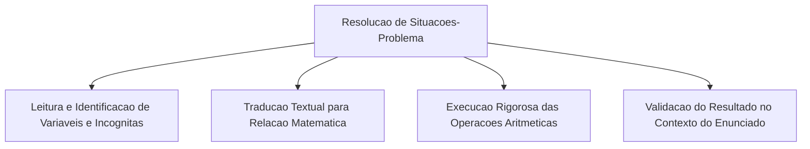
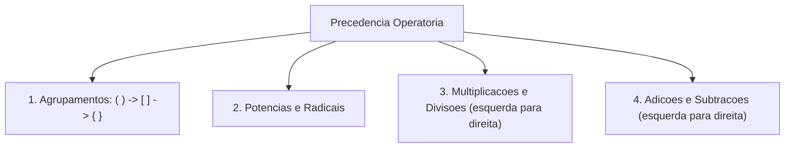
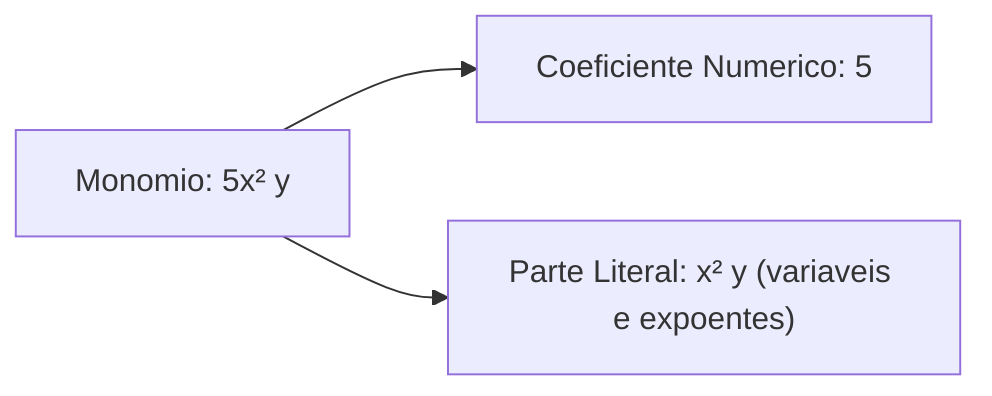
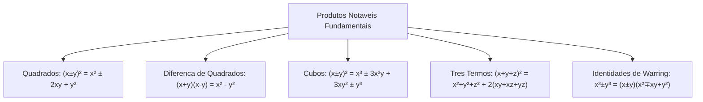
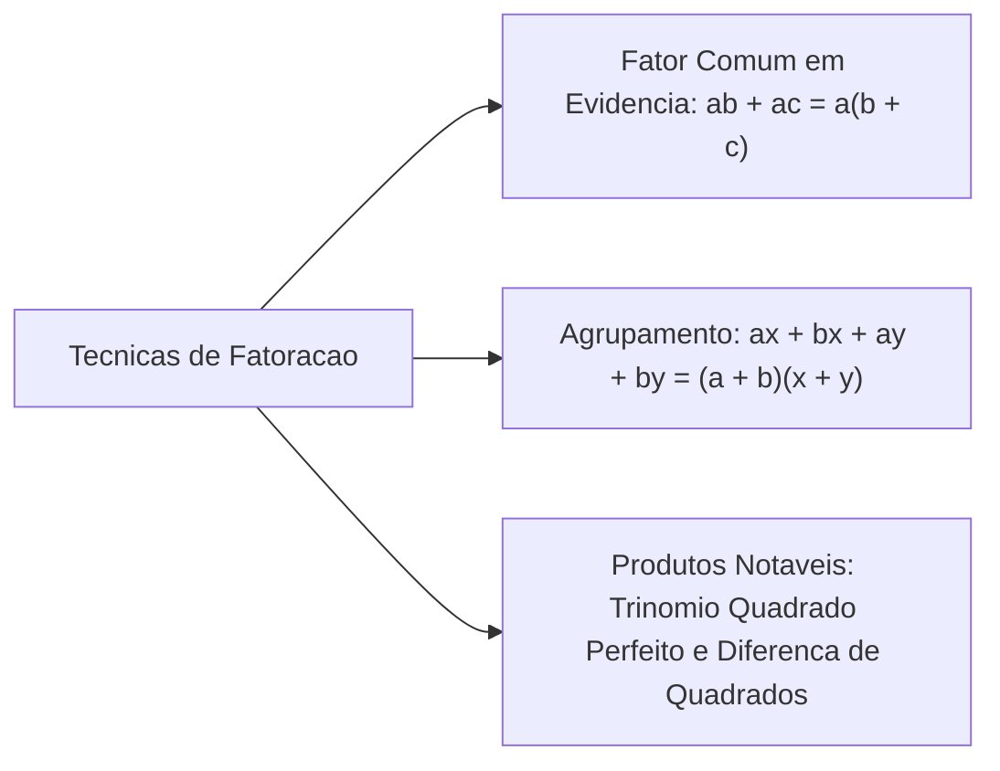
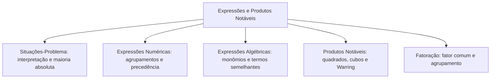

A modelagem de situações-problema e a simplificação de expressões algébricas constituem a base para resolver provas de concurso. Na gestão do Corpo de Bombeiros, orçamentos e escalas exigem transformar dados textuais em equações matemáticas precisas.

Neste capítulo, estudaremos a tradução de enunciados em relações aritméticas. Veremos a resolução de expressões numéricas respeitando prioridades operatórias. Em seguida, abordaremos expressões algébricas e redução de termos semelhantes. Por fim, dominaremos fatoração e produtos notáveis, incluindo o cubo da diferença e identidades de Warring.

> [!objetivos]
> - Modelar situações-problema aritméticas a partir de enunciados contextuais e conceitos de maioria absoluta.
> - Resolver expressões numéricas com parênteses, colchetes e chaves obedecendo à ordem de precedência.
> - Calcular o valor numérico de expressões algébricas e reduzir termos semelhantes com precisão de sinais.
> - Aplicar fatoração por termo comum em evidência e por agrupamento em frações algébricas.
> - Desenvolver e reconhecer produtos notáveis: quadrados, cubos, Warring I e II e o quadrado de três termos.

---

## Modelagem Aritmética de Situações-Problema

Resolver uma situação-problema exige transcrever o enunciado da linguagem natural para a linguagem matemática. O candidato deve identificar com clareza as incógnitas. Também precisa reconhecer os dados fixos e a pergunta da questão:

### Conceito de Maioria Absoluta
Um problema clássico envolve eleições e quóruns de votação. A maioria simples exige apenas o maior número de votos entre os concorrentes. Já a maioria absoluta exige mais da metade do total de votantes:
- Exemplo da página 35 da fonte: em uma votação com 236 pessoas, qual é a maioria absoluta?
  - A metade exata vale `236 / 2 = 118`.
  - A regra exige estritamente mais da metade. Logo, 118 votos não bastam.
  - São necessários pelo menos `118 + 1 = 119` votos para atingir a maioria absoluta.

### Modelagem de Custos com Parcela Fixa e Variável
Muitos problemas descrevem custos compostos por taxa fixa somada a tarifa unitária:
- Uma empresa cobra taxa fixa de R$ 600,00 mais tarifa de R$ 15,00 por participante.
  - O custo total `V` em função do número `p` de pessoas é: `V = 600 + 15p`.
  - Para um contingente de `p = 50` bombeiros:
    `V = 600 + 15 · 50 = 600 + 750 = 1.350` reais.

---

## Expressões Numéricas e Hierarquia Operatória

Uma expressão numérica encadeia várias operações aritméticas. Elas devem ser processadas seguindo uma ordem mandatória de precedência. Ignorar essa hierarquia conduz a erros graves de gabarito:

### Ordem de Eliminação de Agrupamentos
Quando a expressão apresenta sinais gráficos de associação, a resolução processa-se de dentro para fora:
1. Primeiro eliminam-se os termos dentro dos **parênteses** `( )`.
2. Em seguida, resolvem-se as operações no interior dos **colchetes** `[ ]`.
3. Por último, processam-se as operações encerradas pelas **chaves** `{ }`.

### Precedência das Operações Matemáticas
Dentro de cada nível de agrupamento, as operações obedecem à seguinte ordem estrita:
1. **Primeira Prioridade**: potências e raízes, na ordem em que aparecem.
2. **Segunda Prioridade**: multiplicações e divisões, resolvidas da esquerda para a direita. Não há preferência arbitrária entre multiplicação e divisão.
3. **Terceira Prioridade**: adições e subtrações, resolvidas da esquerda para a direita.

- Exemplo demonstrativo 1: calcule `20 - 3 · 2 + 4`.
  - Primeiro efetua-se a multiplicação prioritária: `3 · 2 = 6`.
  - A expressão reduz-se a: `20 - 6 + 4`.
  - Operando da esquerda para a direita: `20 - 6 = 14`; e `14 + 4 = 18`.
  - Erro comum a evitar: jamais faça `20 - 3 = 17` antes da multiplicação, o que resultaria em `17 · 2 + 4 = 38` (completamente errado).
- Exemplo demonstrativo 2 (com parênteses e colchetes): calcule `50 - [ 12 + (8 - 3 · 2)² ] ÷ 4`.
  - No interior dos parênteses: `3 · 2 = 6`. Logo, `8 - 6 = 2`.
  - A expressão torna-se: `50 - [ 12 + 2² ] ÷ 4`.
  - Resolve-se a potência interna: `2² = 4`.
  - No interior dos colchetes: `12 + 4 = 16`.
  - A expressão reduz-se a: `50 - 16 ÷ 4`.
  - Efetua-se a divisão antes da subtração: `16 ÷ 4 = 4`.
  - Finaliza-se o cálculo: `50 - 4 = 46`.

> [!pegadinha]
> **Base Negativa com e sem Parênteses**: a presença de parênteses altera drasticamente o resultado da potenciação. Na expressão `(-1)²`, a base inteira é negativa e o expoente par produz `+1`. Na expressão `-1²`, apenas o número um está elevado ao quadrado, preservando o sinal negativo exterior, resultando em `-1`. Em expressões numéricas com sinais negativos encadeados, mantenha os parênteses até efetuar todas as potenciações.

---

## Expressões Algébricas e Redução de Termos Semelhantes

Uma expressão algébrica combina números (coeficientes), letras (partes literais que representam variáveis) e símbolos operatórios:

### Classificação Estrutural dos Termos
De acordo com a quantidade de parcelas aditivas, a expressão classifica-se em:
- **Monômio**: expressão formada por um único termo algébrico (produto de coeficiente e parte literal). Exemplo: `5x²y`.
- **Binômio**: soma ou diferença de dois monômios não semelhantes. Exemplo: `3x + 2y`.
- **Trinômio**: expressão contendo três termos não semelhantes. Exemplo: `x² + 5x + 6`.
- **Polinômio**: expressão geral contendo quatro ou mais termos algébricos. Exemplo: `2x³ - 4x² + 3x - 7`.

### Redução e Soma de Termos Semelhantes
Dois ou mais termos são denominados **semelhantes** se, e somente se, possuírem partes literais rigorosamente idênticas (mesmas variáveis elevadas aos mesmos expoentes):
- Termos semelhantes somam-se ou subtraem-se operando os coeficientes numéricos e mantendo a parte literal inalterada:
  `3xy + 4xy = (3 + 4)xy = 7xy`.
- Termos com partes literais distintas não se combinam: a expressão `x²y + xy` não pode ser reduzida a um único monômio, devendo permanecer sob forma de binômio.

### Valor Numérico de uma Expressão Algébrica
O valor numérico corresponde ao resultado aritmético obtido quando substituímos cada letra por um número real específico:
- Exemplo do ponto de atenção da página 40 da fonte: determine o valor numérico da expressão `E = 2a²b - 3ab² + 4` para `a = -1` e `b = 2`.
  1. Substituição ordenada respeitando parênteses:
     `E = 2 · (-1)² · (2) - 3 · (-1) · (2)² + 4`.
  2. Resolução das potências prioritárias:
     `(-1)² = 1` e `(2)² = 4`.
  3. Resolução dos produtos:
     `2 · 1 · 2 = 4`;
     `-3 · (-1) · 4 = +12`.
  4. Soma dos resultados parciais:
     `E = 4 + 12 + 4 = 20`.

---

## Produtos Notáveis Fundamentais e Identidades Algébricas

Os produtos notáveis são multiplicações padronizadas entre polinômios cujos desenvolvimentos finais seguem fórmulas fixas. Dominar essas identidades economiza tempo precioso ao evitar multiplicações distributivas termo a termo:

### Quadrados Notáveis
1. **Quadrado da Soma de Dois Termos**:
   `(x + y)² = x² + 2xy + y²`
   "O quadrado do primeiro termo, mais duas vezes o produto do primeiro pelo segundo, mais o quadrado do segundo termo."
   - Aplicação em cálculo mental rápido: `103² = (100 + 3)² = 100² + 2 · 100 · 3 + 3² = 10.000 + 600 + 9 = 10.609`.
2. **Quadrado da Diferença de Dois Termos**:
   `(x - y)² = x² - 2xy + y²`
   "O quadrado do primeiro termo, menos duas vezes o produto do primeiro pelo segundo, mais o quadrado do segundo termo."
   - Aplicação em cálculo mental rápido: `98² = (100 - 2)² = 100² - 2 · 100 · 2 + 2² = 10.000 - 400 + 4 = 9.604`.
3. **Produto da Soma pela Diferença**:
   `(x + y)(x - y) = x² - y²`
   O produto da soma pela diferença resulta na diferença de dois quadrados.
   - Aplicação prática: `105 · 95 = (100 + 5)(100 - 5) = 100² - 5² = 10.000 - 25 = 9.975`.

### Cubos Notáveis
4. **Cubo da Soma de Dois Termos**:
   `(x + y)³ = x³ + 3x²y + 3xy² + y³`
   Os coeficientes numéricos seguem o padrão binomial `1, 3, 3, 1` com todos os sinais positivos.
   - Exemplo com número e incógnita: `(x + 2)³ = x³ + 3 · x² · 2 + 3 · x · 2² + 2³ = x³ + 6x² + 12x + 8`.
5. **Cubo da Diferença de Dois Termos**:
   `(x - y)³ = x³ - 3x²y + 3xy² - y³`
   Os sinais alternam-se rigorosamente: positivo no primeiro termo, negativo no segundo, positivo no terceiro e negativo no quarto.
   - Exemplo com número e incógnita: `(2x - 1)³ = (2x)³ - 3 · (2x)² · 1 + 3 · (2x) · 1² - 1³ = 8x³ - 12x² + 6x - 1`.

### Quadrado da Soma de Três Termos (Ponto de Atenção da Página 49)
O lembrete da página 49 da fonte destaca o produto notável trinominal:
- **Fórmula Formal**: `(x + y + z)² = x² + y² + z² + 2(xy + xz + yz)`.
- O desenvolvimento equivale à soma dos quadrados de cada termo isolado adicionada ao dobro de todos os produtos combinados dois a dois.
- Exemplo de aplicação: se `x + y + z = 10` e `x² + y² + z² = 38`, calcule o valor da soma dos produtos dois a dois `xy + xz + yz`.
  - Aplicando a fórmula: `10² = 38 + 2(xy + xz + yz)`.
  - `100 = 38 + 2(xy + xz + yz)`.
  - `2(xy + xz + yz) = 100 - 38 = 62`.
  - `xy + xz + yz = 62 / 2 = 31`.

### Produtos e Identidades de Warring
As identidades de Warring relacionam a soma e a diferença de cubos com produtos binomiais e trinomiais:
- **Produto de Warring I (Soma de Cubos)**:
  `(x + y)(x² - xy + y²) = x³ + y³`.
- **Produto de Warring II (Diferença de Cubos)**:
  `(x - y)(x² + xy + y²) = x³ - y³`.

> [!bizu]
> **Reconhecimento Inverso e Frações Algébricas**: em questões de prova, as identidades de Warring surgem em frações. Ao deparar-se com `(x³ - y³) / (x - y)`, fatore o numerador por Warring II. Temos `(x - y)(x² + xy + y²) / (x - y) = x² + xy + y²`, para todo `x ≠ y`. Esse cancelamento simplifica a fração em um trinômio elementar.

---

## Técnicas Fundamentais de Fatoração Algébrica

Fatorar uma expressão algébrica consiste em transformá-la em um produto de fatores irredutíveis:

### Fator Comum em Evidência
Aplica-se quando todas as parcelas compartilham um fator numérico ou literal comum. Coloca-se esse fator à frente dos parênteses:
- Exemplo: `2ab + 5abc = ab(2 + 5c)`. O fator comum `ab` divide cada parcela original.
- Exemplo: `6x³ - 9x² = 3x²(2x - 3)`. O máximo divisor comum é 3 e o menor expoente de `x` é 2.

### Fatoração por Agrupamento
Aplica-se quando os termos podem ser divididos em grupos com fatores próprios:
- Exemplo: fatore `ax + bx + ay + by`.
  1. Agrupamos os termos aos pares: `(ax + bx) + (ay + by)`.
  2. Colocamos o fator comum em evidência em cada par: `x(a + b) + y(a + b)`.
  3. Colocamos o binômio comum `(a + b)` em evidência final: `(a + b)(x + y)`.

> [!atencao]
> **Termo Central no Quadrado do Binômio**: não cometa o erro clássico de escrever `(x + y)² = x² + y²`. Essa omissão do termo do meio (`2xy`) anula a questão. Faça a conferência numérica com valores simples: para `x = 3` e `y = 2`, temos `(3 + 2)² = 5² = 25`. Por outro lado, `3² + 2² = 9 + 4 = 13`. A diferença de 12 unidades comprova a obrigatoriedade do dobro do produto (`2 · 3 · 2 = 12`).

---

## Exercício Resolvido Integrado

> [!resolvido]
> **Exercício Resolvido: Fatoração e Simplificação Algébrica Passo a Passo**:
> Simplifique a expressão fracionária `R = (a³ - b³) / (a² - b²) · (a + b) / (a² + ab + b²)`, com `a ≠ b` e `a ≠ -b`.
> 
> **Resolução passo a passo:**
> 1. Fatoração do numerador da primeira fração:
>    Aplicamos a identidade de Warring II:
>    `a³ - b³ = (a - b)(a² + ab + b²)`.
> 2. Fatoração do denominador da primeira fração:
>    Aplicamos a diferença de quadrados:
>    `a² - b² = (a - b)(a + b)`.
> 3. Substituição na expressão original:
>    `R = [ (a - b)(a² + ab + b²) / ((a - b)(a + b)) ] · [ (a + b) / (a² + ab + b²) ]`.
> 4. Simplificação por cancelamento de fatores comuns:
>    - Cancelamos o binômio `(a - b)` na primeira fração.
>    - A primeira fração torna-se `(a² + ab + b²) / (a + b)`.
>    - Multiplicamos pela segunda fração e cancelamos `(a + b)` e `(a² + ab + b²)`.
> 5. Resultado final:
>    Após o cancelamento de todos os fatores comuns não nulos, resta o elemento neutro:
>    `R = 1`.
> O valor final simplificado é **1**.

---

## Mapa do capítulo

### Para fixar
- Em situações-problema, modele antes de calcular; a maioria absoluta exige estritamente mais que a metade do total de votos.
- Custos lineares combinam taxa fixa e tarifa unitária variável pela equação V = C_fixo + taxa · quantidade.
- Resolva agrupamentos de dentro para fora: parênteses ( ), colchetes [ ] e chaves { }.
- Hierarquia das operações: potências e raízes primeiro, produtos e divisões a seguir, somas e subtrações por último.
- Em operações de mesma prioridade, calcule sempre da esquerda para a direita.
- Some e subtraia apenas termos semelhantes com partes literais rigorosamente idênticas.
- Quadrados notáveis: (x ± y)² = x² ± 2xy + y²; (x + y)(x - y) = x² - y².
- Quadrado de três termos: (x + y + z)² = x² + y² + z² + 2(xy + xz + yz).
- Identidades de Warring: x³ ± y³ = (x ± y)(x² ∓ xy + y²); simplificam divisões de polinômios.
